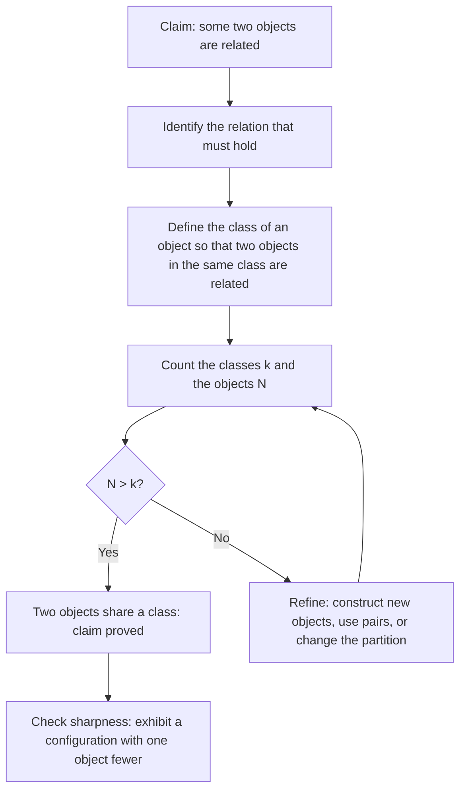
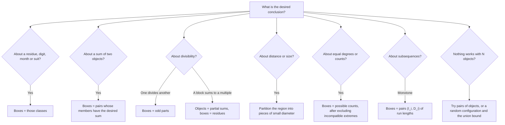
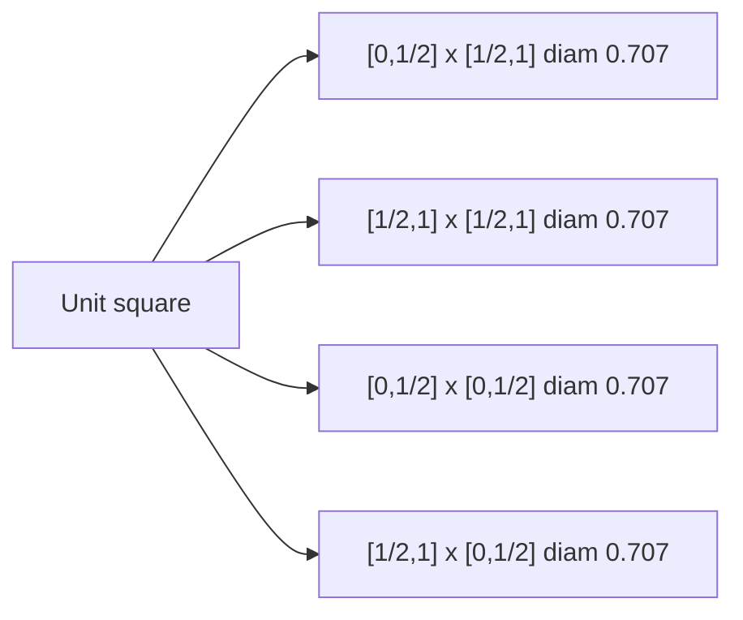

# The Pigeonhole Principle

> [Mathematics](../../README.md) › [Combinatorics](../README.md) › The Pigeonhole Principle · Level: Intermediate · Prerequisites: [Set Theory](../../00-foundations/03-set-theory/README.md), [Relations and Functions](../../00-foundations/05-relations-and-functions/README.md), [Proof Techniques](../../00-foundations/04-proof-techniques/README.md), [Counting Principles](../01-counting-principles/README.md) · Estimated time: 150 min

## 1. Introduction

If you put $n+1$ pigeons into $n$ pigeonholes, some hole contains at least two pigeons. That is the whole statement, and it is obvious. It is also one of the most useful theorems in mathematics.

The interest is never in the principle but in its *application*: choosing what to call a pigeon and what to call a hole. Consider four claims, each of which follows from the same one-line argument.

* Among any $367$ people, two share a birthday.
* Among any $n+1$ integers chosen from $\{1,2,\dots,2n\}$, one divides another.
* Among any five points in a square of side $1$, two are at distance at most $\sqrt2/2$.
* Given any $n$ integers, some non-empty block of consecutive ones has a sum divisible by $n$.

In each case the pigeonholes are not physical containers but *classes* into which some constructed object is placed: $366$ dates, $n$ odd parts, four quarter-squares, $n$ residue classes. The mathematics is in the construction; the counting is trivial. This is why the pigeonhole principle is the standard first taste of *extremal* combinatorics — the branch of the subject that asks "how large must a structure be before a given pattern is forced to appear?"

That question has a characteristic shape. One exhibits a set of objects large enough that some property cannot be avoided, and one exhibits a set one smaller that avoids it. The second half — the *sharpness* or *extremal example* — is as important as the first, and is the part beginners usually omit. "Among any 13 people two share a birth month" is a theorem; "12 people can all have different birth months" is what makes it a good theorem.

The principle itself is due to Dirichlet, who used it in 1834 in work on Diophantine approximation; it is still called the *Dirichlet drawer principle* in some traditions, and the approximation theorem of Section 7.8 is his original application. The Erdős–Szekeres theorem of Section 7.10 turned the idea into a tool of extremal combinatorics, the probabilistic method of Section 7.9 turned it into a limiting case of averaging, and the infinite form of Section 7.11 connects it to analysis and to Ramsey theory.

A warning that shapes everything below. The pigeonhole principle is *non-constructive*: it asserts that some hole contains two pigeons without identifying the hole or the pigeons. Many of its applications, and all of its elegance, come from that. But it also means that a pigeonhole argument never tells you *which* pair of people share a birthday, and cannot be used to find one — only to prove one exists.

## 2. Prerequisites

* **Sets, functions, cardinality.** You need $\lvert A\rvert$, the notion of an injection, and the elementary fact that a union of $k$ sets each of size at most $1$ has at most $k$ elements. Taught in [Set Theory](../../00-foundations/03-set-theory/README.md) and [Relations and Functions](../../00-foundations/05-relations-and-functions/README.md).
* **Proof by contradiction and by contrapositive.** Both proofs of the principle below are of this kind, and so are most of its sharpness arguments. Taught in [Proof Techniques](../../00-foundations/04-proof-techniques/README.md), Section 7.
* **Counting: the sum, product and division principles, binomial coefficients, stars and bars.** The pigeonhole principle is a counting statement, and many applications combine it with a count of the boxes. Taught in [Counting Principles](../01-counting-principles/README.md), Sections 5 and 7.
* **Divisibility and congruence.** $a \equiv b \pmod n$ means $n \mid (a-b)$; the residue classes modulo $n$ partition $\mathbb{Z}$ into $n$ classes. Taught in [Natural Numbers](../../01-arithmetic/01-natural-numbers/README.md) and used throughout [Number Theory](../../12-number-theory/README.md).
* **Basic graph vocabulary.** A graph has vertices and edges; the degree of a vertex is the number of edges at it; a triangle is a set of three mutually adjacent vertices. Needed only for Sections 7.5 and 7.10 and the Ramsey examples; the [Graph Theory](../../21-graph-theory/README.md) discipline index is the place to go for the systematic treatment.
* **Floor and ceiling.** $\lfloor x\rfloor$ is the greatest integer $\le x$ and $\lceil x\rceil$ is the least integer $\ge x$. The generalised form of the principle is stated with ceilings, and the algebra $\lceil x\rceil - 1 < x$ is used in its proof.

Conventions: $\mathbb{N} = \{1,2,\dots\}$, $\mathbb{N}_0 = \{0,1,2,\dots\}$, and $[n] = \{1,\dots,n\}$. "Boxes" and "holes" are synonyms throughout, as are "objects" and "pigeons"; the biological vocabulary is traditional, not mathematical.

## 3. Learning Objectives

By the end of this tutorial you will be able to:

1. State the pigeonhole principle precisely, with its hypothesis $N > k$ made explicit, and prove it two ways.
2. State and prove the generalised form: $N$ objects in $k$ boxes force some box to hold at least $\lceil N/k\rceil$ objects.
3. Decide, in a given problem, what the objects and the boxes should be — including the case where the objects must be *constructed* (partial sums, odd parts, differences, pairs).
4. Prove the standard applications: shared birthdays, equal handshake counts, equal graph degrees, close points in a square or cube, divisible blocks of a sequence, and divisibility chains in $\{1,\dots,2n\}$.
5. Explain the sense in which the generalised principle is an averaging statement, and use it in that form.
6. Use the probabilistic method — expectation and the union bound — to prove existence statements that the pigeonhole principle alone cannot reach.
7. State and prove the Erdős–Szekeres theorem, and construct examples showing its bound is sharp.
8. State and use the infinite pigeonhole principle, including the deduction that every infinite sequence of reals has an infinite monotone subsequence.
9. Recognise an argument that only gives *consecutive* blocks rather than arbitrary subsets, and adjust the claim accordingly.
10. Identify the four standard errors: wrong box count, overlapping boxes, misapplied ceiling, and no sharpness check.
11. Distinguish "there exist two" from "for every pair", and explain why the principle never locates the pair.
12. Verify the extremal case: exhibit a configuration one object smaller that avoids the conclusion.

## 4. Intuition

### 4.1 Too many pigeons

Think of a chest of drawers with $n$ drawers and $n+1$ shirts. Whatever you do, one drawer must hold at least two shirts: if every drawer held at most one, you would have found room for at most $n$ shirts. There is no cleverness here, and there is nothing to check case by case.

The reason this triviality is useful is that most mathematical objects can be *sorted into finitely many classes*, and the classes are often far fewer than the objects. Numbers have residues; people have birthdays; points lie in regions; functions take values. Whenever the number of objects exceeds the number of classes, two objects must share a class — and sharing a class is engineered to be exactly the property you want.

### 4.2 The worst case is the best case

Here is the mental model that makes the generalised form obvious. Suppose you are trying to *avoid* the conclusion "some box has $m$ objects". The best strategy is to spread the objects as evenly as possible: fill every box to $m-1$, using $k(m-1)$ objects. If you have more than that, the strategy fails and the conclusion is forced. So

$$N > k(m-1) \quad\Longrightarrow\quad \text{some box has at least } m \text{ objects.}$$

Every extremal argument in this tutorial is a version of that sentence: describe the configuration that best avoids the property, count it, and show that anything larger must contain the property.

### 4.3 Why such a simple principle is powerful

The principle converts a *counting* fact into an *existential* fact. You do not need to know anything about the individual objects — not their values, not their distribution — only how many there are and how many classes there are. That is unusually robust. It is also unusually blunt, which is why the sharp answers to extremal questions usually need extra ideas (the odd-part trick, the partial-sum trick, the pairs trick, the probabilistic method).

### 4.4 What the principle does not say

It does not say *which* hole, and it does not say *which* pair. It does not say the pair is easy to find. It says nothing at all when the number of objects is at most the number of boxes: $12$ people can have twelve different birth months, and $n$ integers from $\{1,\dots,2n\}$ can be chosen with no divisibility pair (take the top half). A pigeonhole argument with no sharpness example is half an argument.

## 5. Formal Definition

### 5.1 The basic principle

**Theorem 5.1.1 (Pigeonhole principle).** Let $S$ be a finite set with $\lvert S\rvert = N$ and let $B_1,\dots,B_k$ be sets with $S = B_1 \cup \cdots \cup B_k$. If $N > k$ then some $B_i$ contains at least two elements of $S$.

Note that the boxes need not be disjoint: if a point lies in two boxes, that only helps, because then the conclusion "some box contains two" is no harder. In almost every application the boxes *are* disjoint, and then the argument is cleanest.

*Proof 1 (contrapositive).* Suppose every $B_i$ contains at most one element of $S$. Then the union contains at most $k$ elements, since it is the union of $k$ sets of size at most $1$ — this is the sum rule applied to the (not necessarily disjoint) sets after replacing each by its part outside the earlier ones. Hence $N \le k$, contradicting $N > k$. $\square$

*Proof 2 (contradiction via counting).* Suppose every box has at most one element. Define $f : S \to \{1,\dots,k\}$ by choosing for each $s \in S$ an index $i$ with $s \in B_i$. Since no box has two elements, $f$ is injective. But an injection from an $N$-element set into a $k$-element set forces $N \le k$ (Theorem 7.3.2 of [Counting Principles](../01-counting-principles/README.md)), contradicting $N > k$. $\square$

The second proof identifies the principle with a familiar fact about functions: **there is no injection from a larger finite set into a smaller one.** That is the form in which the principle is used in algebra and combinatorics.

### 5.2 The generalised (strong) form

**Theorem 5.2.1 (Generalised pigeonhole principle).** Let $S$ be a finite set with $\lvert S\rvert = N$, and let $B_1,\dots,B_k$ be pairwise disjoint sets with $S = B_1\sqcup\cdots\sqcup B_k$, where $k \ge 1$. Then some $B_i$ satisfies

$$\lvert B_i \rvert \ge \left\lceil \frac{N}{k} \right\rceil .$$

*Proof.* Suppose for contradiction that $\lvert B_i\rvert \le \lceil N/k\rceil - 1$ for every $i$. Since $\lceil x\rceil - 1 < x$ for every real $x$ — the ceiling is strictly less than $x+1$ — we have $\lceil N/k\rceil - 1 < N/k$. Multiplying by $k > 0$,

$$\lvert S\rvert = \sum_{i=1}^{k}\lvert B_i\rvert \le k\left(\left\lceil \frac Nk\right\rceil - 1\right) < k\cdot \frac Nk = N,$$

which contradicts $\lvert S\rvert = N$. The sum rule gives the first equality because the boxes are disjoint. $\square$

**Two equivalent shapes.** Each is used constantly, so all three should be automatic.

* *Ceiling form*: some box has at least $\lceil N/k\rceil$ objects.
* *Threshold form*: if $N > k(m-1)$ then some box has at least $m$ objects. (Indeed $N > k(m-1) \iff N/k > m-1 \iff \lceil N/k\rceil \ge m$.)
* *Average form*: some box has at least the average $N/k$ objects; since the count is an integer, at least $\lceil N/k\rceil$.

*Check.* $N = 100$, $k = 9$: $\lceil 100/9\rceil = 12$, and indeed $9\cdot 11 = 99 < 100$. ✓ $N = 200$, $k = 7$: $\lceil 200/7\rceil = 29$, and $7\cdot 28 = 196 < 200$. ✓

### 5.3 Equivalent formulations

The following are all the same statement.

| Formulation | Statement |
|---|---|
| Pigeonhole | $N > k$ objects in $k$ boxes $\Rightarrow$ some box holds at least $2$ |
| Function form | no injection exists from an $N$-element set to a $k$-element set when $N > k$ |
| Finite-set form | if $\lvert A\rvert > \lvert B\rvert$ then no function $A \to B$ is injective |
| Surjection form | if $\lvert A\rvert > \lvert B\rvert \ge 1$, no function $A\to B$ is injective; equivalently, every injection between finite sets of *equal* size is a bijection |
| Extremal form | the largest family with all classes of size $\le m-1$ has $k(m-1)$ members |

The "equal size" corollary is worth isolating, because it powers the Chinese remainder argument of Section 7.8: *if $f : A \to B$ is injective and $\lvert A\rvert = \lvert B\rvert$ is finite, then $f$ is bijective.*

### 5.4 The infinite form

**Theorem 5.4.1 (Infinite pigeonhole principle).** If infinitely many objects are placed in finitely many boxes, some box contains infinitely many objects.

*Proof.* Suppose every box contains only finitely many objects. A finite union of finite sets is finite (induction on the number of boxes, using the sum rule), so there would be only finitely many objects, contradicting the hypothesis. $\square$

The infinite form is not a limiting case of the finite one; it is a genuinely different statement, though it follows from the finite one applied to "at least $n$ objects in each of finitely many boxes" for every $n$. Section 7.11 gives its main uses.

## 6. Mathematical Notation

| Symbol | Read as | Meaning |
|---|---|---|
| $N$, $k$ | number of objects, number of boxes | positive integers, with $k \ge 1$ |
| $\lvert S\rvert$ | cardinality | number of elements |
| $\lceil x\rceil$ | ceiling of $x$ | least integer $\ge x$ |
| $\lfloor x\rfloor$ | floor of $x$ | greatest integer $\le x$ |
| $B_1 \sqcup \cdots \sqcup B_k$ | disjoint union | union of pairwise disjoint sets |
| $a \equiv b \pmod n$ | congruent mod $n$ | $n \mid (a-b)$ |
| $\{j\alpha\}$ | fractional part | $j\alpha - \lfloor j\alpha\rfloor$, used in Section 7.8 |
| $\deg v$ | degree of a vertex | number of edges at $v$ |
| $\binom nk$ | binomial coefficient | see [Counting Principles](../01-counting-principles/README.md) |
| $\mathbb{E}[X]$ | expectation | average value of a random variable |
| $\Pr(A)$ | probability of $A$ | number in $[0,1]$ |
| $R(s,t)$ | Ramsey number | least $n$ such that every red/blue colouring of $K_n$ has a red $K_s$ or a blue $K_t$ |
| $\operatorname{diam}$ | diameter | largest distance between two points of a set |

A reading note: "$\lceil N/k\rceil$" is read "ceiling of N over k". When $k$ divides $N$ it equals $N/k$; otherwise it is the next integer up. The threshold form $N > k(m-1)$ avoids ceilings entirely and is often easier to apply.

## 7. Core Concepts

### 7.1 The basic principle in use

The first skill is recognising when a problem has the shape "more objects than classes". Three habits help.

**Habit 1: name the classes before counting.** In "among $13$ people, two share a birth month", the classes are the twelve months; there are $13$ people. In "among $11$ integers, two end in the same digit", the classes are the ten final digits. Naming the classes first tells you whether the count works.

**Habit 2: check the direction.** The principle says objects $>$ classes. If your classes outnumber your objects, the argument gives nothing — and no amount of cleverness will fix it; you need different classes.

**Habit 3: engineer the classes to match the conclusion.** If the conclusion is "two numbers have the same last digit", the class of a number should be its last digit. If the conclusion is "two numbers differ by a multiple of $n$", the class should be its residue modulo $n$. If the conclusion is "two numbers are coprime", the class should be a *pair* $\{2j-1, 2j\}$ — the pair is the class, and the conclusion holds for any two members of the same class. This last move, where the classes are chosen so that *being in the same class* is the desired relation, is the heart of the technique.

### 7.2 The generalised form in use

The generalised form answers "how many objects force $m$ in one box?" The answer is $k(m-1)+1$. So:

* $12$ months force $3$ people to share a month as soon as there are $2\cdot12+1 = 25$ people;
* $7$ days force $4$ to share a weekday as soon as there are $3\cdot7+1 = 22$ people;
* $9$ residue classes mod $9$ force $4$ to share a residue as soon as there are $28$ integers.

The generalised form is also the pigeonhole principle behind every "at least one box is heavily loaded" statement in computer science: with $N$ keys hashed into $m$ slots, some slot holds at least $\lceil N/m\rceil$ keys.

### 7.3 Finding the boxes: the central skill

Almost every pigeonhole problem is solved or lost at the moment the boxes are chosen. The following catalogue is the working toolkit; Section 10.2 turns it into a decision tree.

**Classes given by the conclusion.** If the conclusion concerns a residue, a digit, a month, a colour, a suit, a rank — the boxes are those classes, and the objects are the items themselves.

**Classes given by a pairing.** To prove "among $n+1$ of these, two are coprime", pair the numbers as $\{1,2\}, \{3,4\},\dots$: any two members of a pair are consecutive, hence coprime. The boxes are *pairs of objects*, not classes of a pre-existing attribute. Similarly, to prove "among $5$ numbers from $\{1,\dots,8\}$, two sum to $9$", the boxes are the pairs $\{1,8\},\{2,7\},\{3,6\},\{4,5\}$.

**Objects that must be constructed.** To prove "some consecutive block of $n$ integers has a sum divisible by $n$", the objects are not the integers but the $n$ partial sums; the boxes are the residues mod $n$. To prove "among $n+1$ integers from $\{1,\dots,2n\}$ one divides another", the objects are still the integers but the box of an integer is its *odd part* $a/2^{v_2(a)}$; there are only $n$ odd numbers in $\{1,\dots,2n\}$.

**Pairs as objects.** To prove something about two objects at once, count *ordered pairs* and put the pairs into boxes. The Ramsey argument of Section 7.10 does this: the objects are the other people, the classes are "friend" and "stranger".

**A useful diagnostic.** Work backwards: *what would have to be true of two objects for the conclusion to hold?* The answer is usually an equivalence relation, and its classes are the boxes. If it is not an equivalence relation, try to make it one after discarding or transforming the objects — that is exactly what the odd-part trick does.

**Check tightness before believing the answer.** If you can build a configuration with one fewer object that avoids the conclusion, your box count is optimal. If you cannot, your boxes are probably too coarse.

### 7.4 Shared birthdays

**Theorem 7.4.1.** Among any $367$ people, two share a birthday.

*Proof.* There are $366$ possible birthdays (including 29 February). With $367$ people and $366$ classes, the pigeonhole principle applies. $\square$

**Theorem 7.4.2.** Among any $25$ people, three share a birth month; $24$ people do not suffice.

*Proof.* Twelve months, and $25 = 2\cdot 12+1$, so the threshold form with $k = 12$, $m = 3$ applies. For sharpness, take two people born in each month: $24$ people, no month with three. $\square$

**The birthday paradox.** Pigeonhole statements are about *certainty*. Probability statements are about *likelihood*, and the numbers are startlingly different: with only $23$ people the chance that some two share a birthday already exceeds $1/2$. The exact complement is

$$\prod_{i=0}^{22}\frac{365-i}{365} \approx 0.4927, \qquad\text{so the probability of a match is} \qquad 1 - 0.4927 \approx 0.5073 .$$

There is no contradiction: $23$ people form $\binom{23}{2} = 253$ *pairs*, each with a $1/365$ chance of a match, and $253/365 \approx 0.69$; the pairs overlap, which is why the true value is $0.507$ rather than $0.69$. The lesson for pigeonhole problems is that "some two" statements are about pairs, and the number of pairs grows quadratically — which is why $23$ people behave like far more than $23$ objects.

### 7.5 Handshakes and graph degree sequences

**Theorem 7.5.1.** In any group of $n \ge 2$ people, two people shook hands with the same number of people in the group.

*Proof.* The number of hands shaken by a person is an integer in $\{0,1,\dots,n-1\}$, which looks like $n$ possible values for $n$ people — no pigeonhole. But $0$ and $n-1$ cannot both occur: if someone shook no hands, nobody shook all $n-1$ hands, and if someone shook $n-1$ hands, nobody shook none. So the actual counts lie in a set of at most $n-1$ values, and $n$ people occupy at most $n-1$ classes. $\square$

**Graph form.** Every simple graph with at least two vertices has two vertices of the same degree: the degrees lie in $\{0,\dots,n-1\}$, and $0$ and $n-1$ are incompatible.

*Sharpness.* The argument is optimal in the sense that the obstruction is real: the path $P_1$–$P_2$–$P_3$ has degrees $1,2,1$, repeating; but a graph with all degrees distinct is impossible for any $n\ge2$, so there is no "one smaller" example to build within a fixed $n$.

**Related, but not pigeonhole.** The *handshake lemma* $\sum_v \deg v = 2\lvert E\rvert$ (proved by double counting in [Counting Principles](../01-counting-principles/README.md), Section 7.13) implies that the number of odd-degree vertices is even. That is a parity statement, not a pigeonhole statement; the two are often confused because both are proved by counting.

### 7.6 Points in a square, cube and other regions

**Theorem 7.6.1.** Among any $5$ points in a square of side $1$, two are at distance at most $\sqrt2/2$.

*Proof.* Cut the square into four squares of side $1/2$. With $5$ points in $4$ regions, two lie in the same small square, whose diameter is $\sqrt{(1/2)^2+(1/2)^2} = \sqrt2/2$. $\square$

**Theorem 7.6.2.** Among any $9$ points in a cube of side $1$, two are at distance at most $\sqrt3/2$.

*Proof.* Cut the cube into $8$ cubes of side $1/2$, of diameter $\sqrt{3(1/2)^2} = \sqrt3/2$. $\square$

**Theorem 7.6.3.** Among any $10$ points in an equilateral triangle of side $1$, two are at distance at most $1/3$.

*Proof.* Subdivide each side into three equal parts and join the division points by lines parallel to the sides, obtaining $9$ equilateral triangles of side $1/3$ that tile the original triangle. With $10$ points in $9$ triangles, two lie in the same one, and the diameter of an equilateral triangle of side $1/3$ is $1/3$. $\square$

**Theorem 7.6.4.** Among any $5$ points with integer coordinates, two have a midpoint with integer coordinates.

*Proof.* The midpoint of $(x_1,y_1)$ and $(x_2,y_2)$ is integral exactly when $x_1 \equiv x_2$ and $y_1 \equiv y_2 \pmod 2$. There are $4$ parity classes $(\text{even},\text{even})$, $(\text{even},\text{odd})$, $(\text{odd},\text{even})$, $(\text{odd},\text{odd})$, so $5$ points give two in the same class. $\square$

**The general recipe.** Partition the region into $k$ pieces each of diameter at most $d$; then $k+1$ points force two within distance $d$. The art is choosing a partition whose pieces have small diameter — square pieces for squares, triangles for triangles, parity classes for lattices.

### 7.7 Divisible subsequences

**Theorem 7.7.1 (Consecutive block).** Given any $n$ integers $a_1,\dots,a_n$, some non-empty block $a_{i+1}, a_{i+2}, \dots, a_j$ of consecutive terms has sum divisible by $n$.

*Proof.* Let $s_0 = 0$ and $s_j = a_1+\cdots+a_j$ for $1 \le j \le n$. These are $n+1$ integers; put each into the box of its residue mod $n$, of which there are $n$. By the basic principle two of them, say $s_i$ and $s_j$ with $i<j$, have the same residue. Then $s_j - s_i = a_{i+1}+\cdots+a_j$ is divisible by $n$. $\square$

Note what the proof gives: a **consecutive** block. Since a consecutive block is a subset, the theorem implies that some non-empty subset has a sum divisible by $n$ — but it says nothing about subsets of a prescribed size, nor about which block. Questions such as "is there a subset of exactly two elements with sum divisible by $n$?" need quite different methods, and can fail.

**Theorem 7.7.2 (Divisibility chain).** Among any $n+1$ integers chosen from $\{1,2,\dots,2n\}$, one divides another.

*Proof.* Write each chosen integer as $a = 2^{v}\, m$ with $m$ odd — its *odd part*. The odd part of an integer in $\{1,\dots,2n\}$ is one of the $n$ odd numbers $1,3,\dots,2n-1$. With $n+1$ integers and $n$ odd parts, two have the same odd part, say $a = 2^r m$ and $b = 2^s m$ with $r<s$; then $a \mid b$. $\square$

*Sharpness.* The $n$ integers $n+1, n+2, \dots, 2n$ contain no pair where one divides another, since twice the smallest exceeds the largest. So the bound $2n$ cannot be lowered.

**Theorem 7.7.3 (Coprime pair).** Among any $n+1$ integers chosen from $\{1,\dots,2n\}$, two are coprime.

*Proof.* Pair the numbers as $\{1,2\}, \{3,4\}, \dots, \{2n-1, 2n\}$ — $n$ pairs. Two of the $n+1$ chosen numbers lie in the same pair, hence are consecutive, hence coprime. $\square$

*Sharpness.* The $n$ even numbers $2,4,\dots,2n$ share the common factor $2$, so no two are coprime. Hence $n+1$ is exact.

The two proofs of Theorems 7.7.2 and 7.7.3 use *different* partitions of the same ground set. That is the standard situation: the box choice depends on the property you want, not on the set.

### 7.8 Chinese remainder style arguments

**Theorem 7.8.1 (Dirichlet approximation).** For every real $\alpha$ and every integer $N \ge 1$ there exist integers $p, q$ with $1 \le q \le N$ and

$$\lvert q\alpha - p\rvert < \frac1N .$$

*Proof.* Consider the $N+1$ fractional parts $\{0\}, \{\alpha\}, \{2\alpha\}, \dots, \{N\alpha\}$, all in $[0,1)$. Split $[0,1)$ into the $N$ half-open intervals $\left[\frac{i}{N}, \frac{i+1}{N}\right)$. Two of the $N+1$ numbers lie in the same interval, say $\{j\alpha\}$ and $\{k\alpha\}$ with $j < k$. Their difference is less than $1/N$ in absolute value, and

$$\{k\alpha\} - \{j\alpha\} = (k-j)\alpha - p$$

for the integer $p = \lfloor k\alpha\rfloor - \lfloor j\alpha\rfloor$. Setting $q = k-j \in [1,N]$ gives $\lvert q\alpha - p\rvert < 1/N$. $\square$

This is Dirichlet's original application, and the source of the name "Dirichlet drawer principle". Applying the theorem for $N = 1, 2, 3, \dots$ produces infinitely many distinct rational approximations: for irrational $\alpha$ any fixed pair $(p,q)$ has $\lvert q\alpha - p\rvert = c > 0$, so once $N > 1/c$ that pair can no longer be the one the theorem exhibits. This observation is the starting point of the theory of Diophantine approximation.

**Theorem 7.8.2 (Repunits).** If $n$ is coprime to $10$, some multiple of $n$ has only the digit $1$.

*Proof.* Consider the $n$ numbers $1, 11, 111, \dots, \underbrace{11\ldots1}_{n}$, and put each into the box of its residue mod $n$. If one is $\equiv 0$ we are done. Otherwise two of the $n$ numbers share a residue, say $R_i < R_j$; their difference is $R_{j-i}\cdot 10^{i}$, divisible by $n$. Since $\gcd(n,10) = 1$, we get $n \mid R_{j-i}$. $\square$

*Check.* $n = 3$: $111 = 3\cdot 37$; $n = 7$: $111111 = 7\cdot 15873$; $n = 9$: $111111111 = 9\cdot 12345679$. ✓

**Theorem 7.8.3 (Chinese remainder theorem via counting).** Let $m_1,\dots,m_k$ be pairwise coprime positive integers and $M = m_1m_2\cdots m_k$. Then for any residues $r_1,\dots,r_k$ there is exactly one residue class $x$ modulo $M$ with $x \equiv r_i \pmod{m_i}$ for every $i$.

*Proof.* Define $\Phi : \mathbb{Z}/M\mathbb{Z} \to \prod_{i=1}^{k}\mathbb{Z}/m_i\mathbb{Z}$ by $\Phi(x) = (x \bmod m_1, \dots, x \bmod m_k)$. This is well defined: adding a multiple of $M$ changes nothing modulo any $m_i$.

*Injectivity.* If $\Phi(x) = \Phi(y)$ then $m_i \mid (x-y)$ for every $i$. Pairwise coprime integers with this property have product dividing $x-y$ — each prime power in $M$ divides some $m_i$, hence divides $x-y$ — so $M \mid (x-y)$ and $x \equiv y \pmod M$.

Now count: $\lvert \mathbb{Z}/M\mathbb{Z}\rvert = M$ and, by the product rule, $\lvert\prod_i \mathbb{Z}/m_i\mathbb{Z}\rvert = \prod_i m_i = M$. An injection between finite sets of equal size is a bijection (Section 5.3), so every tuple of residues is attained exactly once. $\square$

The point of presenting the CRT this way is that the existence half — usually proved by an explicit construction with Bézout coefficients — follows from a *count*. Both proofs are correct; the counting proof shows how much the pigeonhole principle can do when the two sets are counted correctly.

### 7.9 The probabilistic method as a cousin

The generalised principle says the maximum of a finite list of box-counts is at least their average. Written as a slogan:

> **Averaging.** If the average number of objects per box is $\mu$, some box holds at least $\mu$ objects.

Everything in Section 7.2 is a special case. Now turn the slogan around: instead of averaging over *objects in boxes*, average over *random choices of a configuration*. If the average number of "bad features" is less than $1$, some configuration has no bad feature at all. This is the **probabilistic method**, and it is the natural generalisation of the pigeonhole idea: both prove existence without construction.

**Theorem 7.9.1 (Union bound).** If finitely many events $E_1,\dots,E_t$ in a probability space satisfy $\sum_i \Pr(E_i) < 1$, then with positive probability none of them occurs; in particular some outcome avoids all of them.

*Proof.* $\Pr(\bigcup_i E_i) \le \sum_i \Pr(E_i) < 1$, so the complement has positive probability. A non-empty event contains an outcome. $\square$

**Theorem 7.9.2 (Erdős, 1947).** For every $k \ge 3$ there is a red/blue colouring of the edges of $K_n$ with $n = \lfloor 2^{k/2}\rfloor$ having no monochromatic $K_k$; hence $R(k,k) > 2^{k/2}$.

*Proof.* Colour each edge independently red or blue with probability $1/2$. For a fixed set $T$ of $k$ vertices, the $\binom k2$ edges inside $T$ are all red or all blue with probability $2\cdot 2^{-\binom k2} = 2^{1-\binom k2}$. By the union bound over the $\binom nk$ choices of $T$,

$$\Pr(\text{some monochromatic } K_k) \le \binom nk 2^{1-\binom k2} \le \frac{n^k}{k!}\,2^{1-\binom k2} \le \frac{2^{k^2/2}}{k!}\,2^{1-k(k-1)/2} = \frac{2^{k/2+1}}{k!}.$$

For $k\ge3$ this is less than $1$ (at $k=3$ it is $2^{2.5}/6 \approx 0.943$, and the ratio decreases thereafter), so some colouring has no monochromatic $K_k$. $\square$

*Check.* $k = 4$: the bound gives $R(4,4) > 2^2 = 4$, which is true but weak (the exact value is $18$). The strength of the method is asymptotic: $2^{k/2}$ grows exponentially, while the exact Ramsey numbers are unknown beyond small $k$. ✓

**How the two ideas differ.** Pigeonhole: a *deterministic* counting fact about a fixed configuration forces a coincidence. Probabilistic method: a *random* configuration has the desired property with positive probability, so a good configuration exists. Neither is constructive. The probabilistic method is strictly stronger in the problems where it applies, but it needs probabilities that can be computed, which pigeonhole arguments do not.

### 7.10 Erdős–Szekeres

**Theorem 7.10.1 (Erdős–Szekeres, 1935).** Let $r, s \ge 1$. Every sequence of $rs+1$ distinct real numbers contains an increasing subsequence of length $r+1$ or a decreasing subsequence of length $s+1$.

*Proof.* Let the sequence be $a_1,\dots,a_{rs+1}$. For each index $i$, define

$$I_i = \text{length of the longest increasing subsequence ending at } a_i, \qquad D_i = \text{length of the longest decreasing subsequence ending at } a_i .$$

Suppose, for contradiction, that there is no increasing subsequence of length $r+1$ and no decreasing subsequence of length $s+1$. Then $1 \le I_i \le r$ and $1 \le D_i \le s$ for every $i$, so the pair $(I_i, D_i)$ lies in a set of $rs$ pairs.

**Claim: the pairs $(I_i,D_i)$ are pairwise distinct.** Let $i < j$. If $a_i < a_j$, then appending $a_j$ to a longest increasing subsequence ending at $a_i$ gives an increasing subsequence ending at $a_j$ of length $I_i+1$, so $I_j \ge I_i+1 > I_i$ and the pairs differ. If $a_i > a_j$ (they cannot be equal, the terms being distinct), then appending $a_j$ to a longest decreasing subsequence ending at $a_i$ gives $D_j \ge D_i+1 > D_i$, and again the pairs differ.

So the map $i \mapsto (I_i,D_i)$ is an injection from a $(rs+1)$-element set to an $rs$-element set, contradicting the pigeonhole principle. $\square$

**Corollary 7.10.2.** Every sequence of $n^2+1$ distinct reals has a monotone subsequence of length $n+1$ (take $r = s = n$).

**Sharpness.** The bound cannot be improved: the sequence

$$\underbrace{n, n-1, \dots, 1}_{\text{block }1},\ \underbrace{2n, 2n-1, \dots, n+1}_{\text{block }2},\ \dots,\ \underbrace{n^2, n^2-1, \dots, n^2-n+1}_{\text{block }n}$$

has length $n^2$; within a block it decreases, and between blocks every term of a later block exceeds every term of an earlier one. An increasing subsequence uses at most one term per block, so has length at most $n$; a decreasing subsequence stays inside one block, so has length at most $n$. Thus no monotone subsequence of length $n+1$ exists.

*Check.* $n = 2$: the sequence $2,1,4,3$ has longest increasing subsequence $2$ (for instance $2,4$) and longest decreasing subsequence $2$ (for instance $2,1$). ✓ $n=3$: $3,2,1,6,5,4,9,8,7$ has both longest lengths $3$. ✓

**Why the pairs work.** Each term is assigned a *label* describing two independent statistics. The pigeonhole principle then says two terms have the same label, and the argument shows that cannot happen. This "label with pairs" trick is the standard way to apply pigeonhole to statements about subsequences, and it recurs throughout extremal combinatorics.

### 7.11 The infinite pigeonhole principle

**Theorem 7.11.1.** Every infinite sequence taking values in a finite set has a constant subsequence.

*Proof.* The finitely many values are the boxes; infinitely many terms are the objects; some box contains infinitely many terms, which form a constant subsequence. $\square$

**Theorem 7.11.2.** Every infinite sequence of real numbers has an infinite monotone subsequence.

*Proof.* Call an index $i$ a **peak** if $a_i \ge a_j$ for every $j > i$.

* If there are infinitely many peaks, list them as $i_1 < i_2 < \cdots$. Since $i_1$ is a peak, $a_{i_1} \ge a_{i_2}$; since $i_2$ is a peak, $a_{i_2} \ge a_{i_3}$; and so on. So $(a_{i_k})$ is an infinite non-increasing subsequence.
* If there are only finitely many peaks, let $N$ be an index beyond all of them. Every $i > N$ is not a peak, so there exists $j > i$ with $a_j > a_i$. Define $i_1 = N+1$ and, recursively, $i_{k+1}$ to be some $j > i_k$ with $a_j > a_{i_k}$. Then $a_{i_1} < a_{i_2} < \cdots$ is an infinite increasing subsequence. $\square$

This is the infinite analogue of the Erdős–Szekeres corollary: finiteness of the bound is what the finite theorem adds.

**Other uses.** The infinite pigeonhole principle is the engine behind compactness arguments (a finitely branching infinite tree has an infinite branch) and behind the Bolzano–Weierstrass theorem's combinatorial core (a bounded sequence in $\mathbb{R}$ has a convergent subsequence: bisect intervals and use the infinite pigeonhole to choose a nested chain).

### 7.12 Sharpness and extremal thinking

For each standard result, the table records the exact threshold and the extremal example that shows it cannot be lowered.

| Statement | Threshold | Extremal example with one fewer |
|---|---|---|
| two share a birth month | $13$ people | $12$ people, one per month |
| three share a birth month | $25$ people | $24$ people, two per month |
| two share a birthday | $367$ people | $366$ people, one per date |
| one divides another in $\{1,\dots,2n\}$ | $n+1$ numbers | $n+1, n+2, \dots, 2n$ |
| two coprime in $\{1,\dots,2n\}$ | $n+1$ numbers | $2, 4, \dots, 2n$ |
| two with equal degree | $n$ vertices of a graph | impossible — the conclusion always holds |
| two within $\sqrt2/2$ in the unit square | $5$ points | $4$ points at the corners: all distances $\ge 1 > \sqrt2/2$ |
| two within $1/3$ in a unit triangle | $10$ points | the $10$ lattice points of the triangular grid of side $1/3$ (rows $1,2,3,4$) are pairwise at distance at least $1/3$, so the bound $1/3$ cannot be made strict |
| a block divisible by $n$ | $n$ terms | $n-1$ terms can avoid it |
| monotone subsequence of length $n+1$ | $n^2+1$ terms | the block construction of Section 7.10 |

The last column is where marks are lost in examinations and where theorems are separated from conjectures. A pigeonhole theorem is only as good as its extremal example.

## 8. Formulas and Properties

### 8.1 The principles

| Name | Statement | Notes |
|---|---|---|
| Basic | $N > k$ objects in $k$ boxes $\Rightarrow$ some box has $\ge 2$ | boxes need not be disjoint |
| Generalised | $N$ objects in $k$ boxes $\Rightarrow$ some box has $\ge \lceil N/k\rceil$ | disjoint boxes, $k \ge 1$ |
| Threshold | $N > k(m-1) \Rightarrow$ some box has $\ge m$ | equivalent to the ceiling form |
| Averaging | some box holds at least the mean | the integer rounding gives the ceiling |
| Infinite | infinitely many objects, finitely many boxes $\Rightarrow$ some box infinite | not a limit of the finite form |
| Equal sizes | injection between finite sets of equal size is a bijection | used for the CRT |

### 8.2 Standard thresholds

With $k$ boxes and a target of $m$ objects in one box, the number of objects that forces it is

$$k(m-1) + 1 .$$

Equivalently, with $N$ objects and $k$ boxes, the guaranteed maximum is $\lceil N/k\rceil$. Both are used below; converting between them is the most common place for an off-by-one error.

### 8.3 The classical applications in one table

| Setting | Objects | Boxes | Conclusion |
|---|---|---|---|
| birthdays | people | $366$ dates (or $12$ months) | two share a date (or a month) |
| handshakes | people | possible counts $\{0,\dots,n-2\}$ | two have equal count |
| points in a square | points | $4$ quarter-squares | two within $\sqrt2/2$ |
| points in a cube | points | $8$ half-cubes | two within $\sqrt3/2$ |
| lattice midpoints | lattice points | $4$ parity classes | two have an integral midpoint |
| divisibility chain | integers from $\{1,\dots,2n\}$ | odd parts (there are $n$) | one divides another |
| coprime pair | integers from $\{1,\dots,2n\}$ | pairs $\{2j-1,2j\}$ | two are coprime |
| divisible block | partial sums | residues mod $n$ | a consecutive block has sum $\equiv 0$ |
| equal degrees | vertices | $\{0,\dots,n-2\}$ | two have the same degree |
| monotone subsequence | terms | pairs $(I_i,D_i)$ | an increasing or decreasing run |
| sum or difference divisible by $10$ | $7$ integers | $6$ classes $\{r,10-r\}$ | a pair with $10 \mid a\pm b$ |
| Dirichlet approximation | fractional parts $\{j\alpha\}$ | $N$ intervals of length $1/N$ | $\lvert q\alpha - p\rvert < 1/N$ |

## 9. Step-by-Step Examples

### Example 9.1 (Easy): months and thresholds

*Show that among $13$ people two were born in the same month, and that among $25$ people three were.*

**Objects**: people. **Boxes**: the twelve months.

For the first claim, $13 > 12$, so two people fall in the same box. For the second, $25 = 2\cdot 12 + 1$, so by the threshold form some month contains at least three people.

*Sharpness.* Twelve people can be born one per month, and twenty-four can be two per month; so neither threshold can be lowered.

*Check.* $13$ is exactly $k(m-1)+1$ with $k=12$, $m=2$: $12\cdot 1+1 = 13$. ✓ And $25 = 12\cdot 2+1$. ✓

### Example 9.2 (Easy): socks

*A drawer holds socks in $5$ colours. How many socks must be taken, in the dark, to be certain of having three of one colour?*

Boxes: $5$ colours. For three of one colour we need $N > 5\cdot 2 = 10$, so $N = 11$.

*Why.* With $11$ socks in $5$ colours, $\lceil 11/5\rceil = 3$. With $10$ socks one can take exactly two of each colour and fail.

*Check.* For a pair instead of three, the threshold is $5\cdot1+1 = 6$; with $5$ socks one of each colour avoids a pair. ✓

### Example 9.3 (Medium): residues

*Prove that among any $5$ integers, two have a difference divisible by $4$.*

Boxes: the four residues $0,1,2,3$ modulo $4$. The differences $a - b$ with $a \equiv b$ are precisely the multiples of $4$. With $5$ integers in $4$ boxes, two share a residue.

*Sharpness.* $0,1,2,3$ give pairwise differences $1,2,3,1,2,1$, none divisible by $4$.

*Check.* The statement with "divisible by $4$" replaced by "divisible by $3$" needs $4$ integers, and $1,2,3$ avoid it. ✓

### Example 9.4 (Medium): points in a cube

*Prove that among any $9$ points in a unit cube, two are at distance at most $\sqrt3/2$.*

Cut the cube into $8$ cubes of side $1/2$, by bisecting each edge. The diameter of a small cube is the length of its space diagonal:

$$\sqrt{\left(\tfrac12\right)^2+\left(\tfrac12\right)^2+\left(\tfrac12\right)^2} = \frac{\sqrt3}{2}.$$

With $9$ points in $8$ small cubes, two are in the same one, hence their distance is at most that diagonal.

*Why $8$ and not $9$.* The partition must be into strictly fewer pieces than points; $8$ pieces is the natural subdivision of a cube. Finer subdivisions would give a smaller bound but would need more points.

*Check.* The analogous planar statement is Example 7.6.1: $4$ quarter-squares, $5$ points, bound $\sqrt2/2$. ✓

### Example 9.5 (Medium): pairs summing to 9

*Prove that among any $5$ numbers chosen from $\{1,2,\dots,8\}$, two sum to $9$.*

The boxes are the four pairs

$$\{1,8\}, \quad \{2,7\}, \quad \{3,6\}, \quad \{4,5\},$$

whose members sum to $9$. Any $5$ numbers occupy $4$ pairs, so two lie in the same pair and sum to $9$.

*Sharpness.* $\{1,2,3,4\}$ has pairwise sums $3,4,5,5,6,7$; none is $9$.

*Why this is a "box" argument.* Being in the same class does not mean sharing an attribute of a single object; it means the *pair* of them has the desired property. The classes are pairs of objects, and the conclusion holds for any two members of one class.

*Check.* The same construction for $\{1,\dots,10\}$ with target $11$ uses the five pairs $\{1,10\},\dots,\{5,6\}$ and gives the threshold $6$. ✓

### Example 9.6 (Medium–hard): a divisibility chain

*Prove that among any $n+1$ integers chosen from $\{1,\dots,2n\}$ one divides another.*

Write each chosen integer $a$ as $a = 2^v m$ with $m$ odd. Since $a \le 2n$, its odd part $m$ is one of the $n$ odd numbers $1, 3, \dots, 2n-1$.

With $n+1$ integers and $n$ possible odd parts, two share the same odd part: $a = 2^r m$, $b = 2^s m$. If $r < s$ then $a \mid b$; if $s < r$ then $b \mid a$.

*Sharpness.* The $n$ integers $n+1, \dots, 2n$ have no dividing pair, because the smallest doubled is $2n+2 > 2n$.

*Check.* $n = 3$: $\{1,\dots,6\}$, choose $4$ numbers. Odd parts: $1\mapsto1$, $2\mapsto1$, $3\mapsto3$, $4\mapsto1$, $5\mapsto5$, $6\mapsto3$; three odd parts for four numbers, so a repeat is forced: $\{4, 5, 6, 1\}$ has $1\mid4$; $\{2,3,4,6\}$ has $2\mid4$ and $3\mid6$. ✓

### Example 9.7 (Hard): Erdős–Szekeres on ten terms

*Verify that the sequence $5, 3, 8, 1, 9, 2, 7, 4, 10, 6$ has an increasing subsequence of length $4$ or a decreasing subsequence of length $4$.*

Here $10 = 3\cdot 3 + 1$, so the theorem applies with $r = s = 3$: length $4$ is forced.

Computation of the labels $(I_i,D_i)$:

| $i$ | $a_i$ | $I_i$ | $D_i$ |
|---|---|---|---|
| 1 | 5 | 1 | 1 |
| 2 | 3 | 1 | 2 |
| 3 | 8 | 2 | 1 |
| 4 | 1 | 1 | 3 |
| 5 | 9 | 3 | 1 |
| 6 | 2 | 2 | 3 |
| 7 | 7 | 3 | 2 |
| 8 | 4 | 3 | 3 |
| 9 | 10 | 4 | 1 |
| 10 | 6 | 4 | 3 |

Index $9$ has $I_9 = 4$, so an increasing subsequence of length $4$ ends there; tracing back the recurrence gives $3, 8, 9, 10$. ✓ The labels are all distinct, as the proof of Theorem 7.10.1 requires.

*Why the table is the proof.* The labels are distinct elements of $[3]\times[3]$, a set of size $9$; ten distinct labels cannot fit, so some label must have first coordinate $4$ (an increasing run) or second coordinate $4$ (a decreasing run). In this example the first coordinate reaches $4$ at index $9$.

### Example 9.8 (Hard): equal handshake counts

*Prove that in any group of $n\ge2$ people, two shook hands with the same number of people.*

Let $d_1,\dots,d_n$ be the handshake counts, each an integer with $0 \le d_i \le n-1$: nominally $n$ possible values for $n$ people, so the basic principle does not apply.

The fix is to notice that the extreme values exclude each other. If some $d_i = 0$, that person shook no hands, so no one can have $d_j = n-1$. If some $d_i = n-1$, that person shook every hand, so no one can have $d_j = 0$. In either case the counts lie in a set of at most $n-1$ values, and $n$ people force a repetition.

*Why the naive attempt fails.* Counting the ranges as $n$ values ignores the *interaction* between the people, which is exactly what makes the true box count $n-1$. The interaction is not visible from any single person's number; it appears only when two extreme values are considered together.

*Check.* $n=2$: two people either shook hands or not, and in both cases the counts are equal ($1,1$ or $0,0$). ✓ $n=3$: counts $(0,1,1)$ or $(1,1,2)$ or $(2,2,2)$, always with a repeat. ✓

*Graph formulation.* No simple graph has all $n$ degrees distinct, for $n\ge2$; equivalently, a degree sequence is never a permutation of $\{0,1,\dots,n-1\}$.

## 10. Visual Explanations

### 10.1 The shape of the argument

### 10.2 Decision tree for choosing the boxes

### 10.3 Points in a square

The unit square cut into four quarter-squares. Any five points put two in the same quarter-square, whose diameter is $\sqrt2/2 \approx 0.707$.

Four points at the corners show that the number $5$ is right: their pairwise distances are $1,1,1,1,\sqrt2$, all exceeding $\sqrt2/2$.

### 10.4 The four levels of the principle

| Level | Statement | Typical use |
|---|---|---|
| Basic | $N > k$ gives a repeat | birthdays, residues, sock colours |
| Threshold | $N > k(m-1)$ gives $m$ in a box | three sharing a month |
| Averaging | some box holds at least the mean | load balancing, hashing |
| Probabilistic | a random configuration can have a good outcome | Ramsey lower bounds |

## 11. Common Mistakes

**11.1 Counting the boxes wrongly.** "Among $12$ people, two share a birth month" is false — twelve months, twelve people, no repetition forced. The box count must be *strictly* smaller than the object count; count the boxes explicitly and write the inequality.

**11.2 Overlapping boxes.** If the classes overlap, an object may be counted in two, and the sum rule fails. Either make the classes disjoint or use the union form (which is still valid, since overlap only helps the conclusion) but never add sizes of overlapping classes.

**11.3 Using the floor instead of the ceiling.** With $100$ objects in $9$ boxes the guaranteed maximum is $\lceil 100/9\rceil = 12$, not $\lfloor 100/9\rfloor = 11$. The floor is a lower bound on the average, not a guarantee about any box; the ceiling is the guarantee.

**11.4 Off by one in the threshold.** $k$ boxes force $m$ in one box when there are $k(m-1)+1$ objects, not $km$ objects. The extremal example — $m-1$ objects in every box, $k(m-1)$ in total — is the check.

**11.5 Concluding about the wrong objects.** The theorem gives *some* pair, never a specified one. "Among $23$ people, some pair shares a birthday" does not identify the pair, and the probability that a *fixed* person shares a birthday with someone else is much smaller than the probability that *some* pair does.

**11.6 Using the principle when the counts are equal.** Twelve people and twelve months give nothing. When the natural boxes are too many, the fix is to find a coarser invariant (the odd part), not to repeat the argument.

**11.7 Strengthening a block result to a subset result.** Theorem 7.7.1 produces *consecutive* blocks. Claims about arbitrary subsets need different arguments, and are often false.

**11.8 Forgetting that the objects may need to be constructed.** In the partial-sum proof the objects are not the given integers; in the odd-part proof the box is not an attribute anyone would name first. A problem that seems to have the wrong counts usually needs different objects, not a cleverer count.

**11.9 No sharpness example.** A proof that $n+1$ objects force a coincidence is incomplete without a configuration of $n$ objects that avoids it; otherwise the threshold may be far from optimal even though the proof is correct.

**11.10 Confusing "at least" with "exactly".** The generalised principle gives *at least* $\lceil N/k\rceil$ in some box; it says nothing about the other boxes, and nothing prevents several boxes from being large.

**11.11 Applying the infinite principle to a countable union of finite sets.** Finitely many boxes is essential in Theorem 5.4.1: infinitely many finite boxes can hold only finitely many objects each and still cover infinitely many.

## 12. Applications

**Hashing and load balancing.** With $N$ keys distributed over $m$ slots, some slot receives at least $\lceil N/m\rceil$ keys. This bound is what makes hashing with chaining analysable, and it is why a hash table with more keys than slots must have collisions. The same argument shows that any assignment of $N$ jobs to $m$ machines leaves some machine with at least $N/m$ jobs — the starting point of scheduling theory.

**Lossless compression.** A file of $n$ bits has $2^n$ possible contents, and there are fewer than $2^n$ files of fewer than $n$ bits. Hence no injective compression maps all $n$-bit strings to shorter ones: some file must grow. This is the pigeonhole principle applied to the set of all strings, and it is the reason "compress everything" is impossible.

**Number theory.** Dirichlet's approximation theorem (Theorem 7.8.1) is proved by pigeonhole and is the entry point to the theory of Diophantine approximation and to the continued-fraction expansion. The repunit theorem (Theorem 7.8.2) is a pigeonhole proof that certain numbers have multiples of a prescribed decimal shape.

**Ramsey theory.** $R(3,3) = 6$ — among six people there are three mutual acquaintances or three mutual strangers — is proved by two applications of the pigeonhole principle, and the general Ramsey theorem is the statement that the same phenomenon persists for every pattern size. The Erdős–Szekeres theorem is the ordered version of the same idea.

**Computational geometry.** The closest-pair problem, $\varepsilon$-nets, and the pigeonhole subdivisions of Section 7.6 are the geometric face of the principle. The parity argument for lattice midpoints is the simplest instance of a *parity* (or $\mathbb{Z}_2$) argument, which recurs in topological combinatorics.

**Genetics and strings.** Any sufficiently long string over a finite alphabet contains a repeated substring: there are $q^L$ strings of length $L$, so any text longer than that repeats a block of length $L$. This bounds the number of distinct short sequences in a genome and is used in the analysis of sequence assembly.

**Tournaments and round-robin schedules.** In a round-robin tournament, if there are more matches than the number of possible win-counts, two players have the same number of wins. In general, score sequences of tournaments are constrained in exactly this way.

**Combinatorial number theory.** The statement "among $n+1$ integers from $\{1,\dots,2n\}$ one divides another" is the simplest case of a family of results about *primitive* sets, and the odd-part argument generalises to prove that the largest primitive subset of $\{1,\dots,2n\}$ has exactly $n$ elements.

## 13. Exercises

The problem set is in [exercises.md](exercises.md): 36 problems graded from direct application to competition level, grouped as Beginner (1–12), Intermediate (13–24), Advanced (25–31) and Challenge (32–36). Each exercise names the section of this tutorial that supplies the technique, and many ask for the sharpness example as well as the proof.

## 14. Solutions

Complete worked solutions, with the box choice explained, every step displayed and the sharpness argument given where relevant, are in [solutions.md](solutions.md), numbered to match [exercises.md](exercises.md).

## 15. Summary

* **The principle.** More objects than boxes forces two in one box; with $k$ boxes, $k(m-1)+1$ objects force $m$ in one box.
* **The proof is a count.** If every box had at most $m-1$ objects, the total would be at most $k(m-1)$.
* **The work is in the boxes.** Classes from the conclusion; pairs of objects when the conclusion is about a pair; odd parts for divisibility; partial sums and residues for block sums; run-length pairs for subsequences.
* **Averaging.** Some box holds at least the average; the integer rounding gives $\lceil N/k\rceil$.
* **Probabilistic method.** If a random configuration fails with probability $<1$ — for instance by a union bound — a good configuration exists. This reaches existence statements that pigeonhole alone cannot.
* **Erdős–Szekeres.** $rs+1$ distinct reals force an increasing run of $r+1$ or a decreasing run of $s+1$; the label $(I_i,D_i)$ is a pigeonhole box, and $n^2+1$ forces a monotone run of length $n+1$.
* **Infinite form.** Infinitely many objects in finitely many boxes put infinitely many in one; hence every infinite real sequence has an infinite monotone subsequence.
* **Chinese remainder.** An injection between finite sets of equal size is a bijection — the counting form of the principle — and it proves the CRT's existence half.
* **Sharpness.** Always exhibit the configuration with one object fewer that avoids the conclusion.
* **What it cannot do.** It never identifies the pair, never gives a construction, and says nothing when the counts are equal.

## 16. Further Learning

**Next in this discipline.**

* *Generating Functions* and *Extremal Combinatorics* — later topics of this discipline, listed in the [discipline index](../README.md). Extremal combinatorics is the systematic study of thresholds of the kind computed here; Turán's theorem and the Erdős–Stone theorem are its central results.
* *Inclusion–Exclusion* — the second topic of the discipline, also listed in the [discipline index](../README.md); it supplies the counting tools that many extremal arguments use, and it is the natural companion to [Counting Principles](../01-counting-principles/README.md).

**Earlier material worth revisiting.**

* [Counting Principles](../01-counting-principles/README.md) — Sections 5 and 7 for the sum and product rules, the division principle and the bijection between injections and ordered tuples; Section 7.3 for the fact that an injection between equal finite sets is a bijection, which powers the CRT argument.
* [Set Theory](../../00-foundations/03-set-theory/README.md) — cardinality and finite sets.
* [Proof Techniques](../../00-foundations/04-proof-techniques/README.md) — contrapositive and contradiction, the two styles used in Section 5.
* [Natural Numbers](../../01-arithmetic/01-natural-numbers/README.md) — divisibility and residue classes, used throughout Section 7.7.

**Companion topics elsewhere in the repository.**

* [Probability Foundations](../../10-probability/01-probability-foundations/README.md) — the probability calculus behind the birthday paradox of Section 7.4 and the probabilistic method of Section 7.9.
* [Graph Theory](../../21-graph-theory/README.md) — the discipline index; degrees, the handshake lemma and Ramsey theory live there.
* [Number Theory](../../12-number-theory/README.md) — the discipline index; the Chinese remainder theorem and Diophantine approximation are treated systematically.

**Standard references.**

* Richard P. Brualdi, *Introductory Combinatorics* — the pigeonhole principle and Erdős–Szekeres in their standard undergraduate setting.
* Martin Aigner and Günter M. Ziegler, *Proofs from THE BOOK* — the chapters on the pigeonhole principle and on Ramsey theory are models of exposition.
* Paul Erdős and George Szekeres, "A combinatorial problem in geometry", *Compositio Mathematica* 2 (1935), 463–470 — the original paper containing Theorem 7.10.1.
* Noga Alon and Joel H. Spencer, *The Probabilistic Method* — the definitive treatment of the ideas sketched in Section 7.9.
* László Lovász, *Combinatorial Problems and Exercises* — a large collection of pigeonhole and extremal problems with hints.
* Arthur Engel, *Problem-Solving Strategies* — the chapter on the pigeonhole principle is the classic collection of competition problems.
