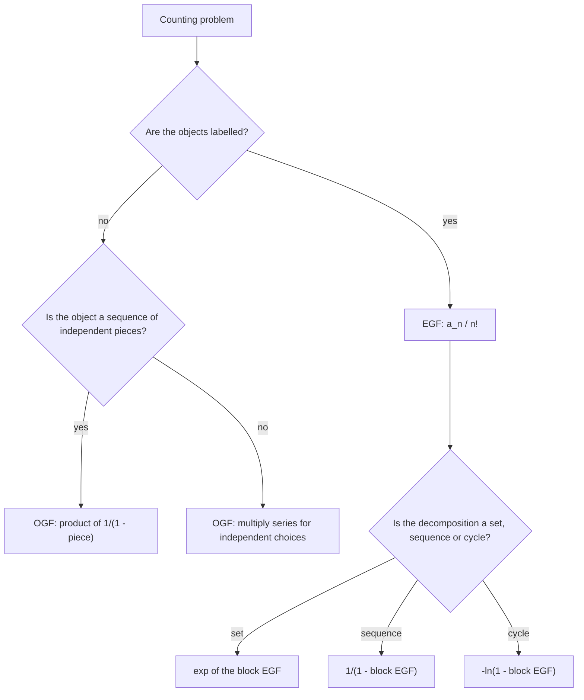
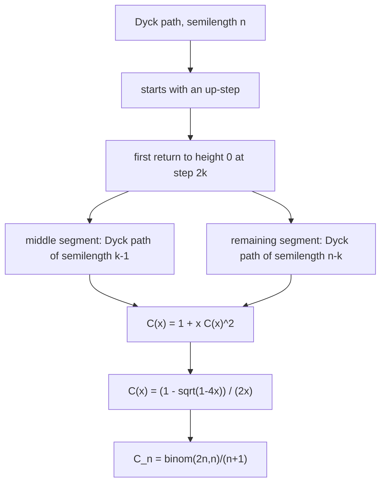

# Generating Functions

> [Mathematics](../../README.md) › [Combinatorics](../README.md) › Generating Functions · Level: Advanced · Prerequisites: [Counting Principles](../01-counting-principles/README.md), [Inclusion–Exclusion](../02-inclusion-exclusion/README.md), [Recurrence Relations](../../09-discrete-mathematics/02-recurrence-relations/README.md), [Sequences and Series in Calculus](../../07-calculus/11-sequences-and-series-in-calculus/README.md), [Quadratic Equations](../../03-algebra/08-quadratic-equations/README.md) · Estimated time: 600 min

## 1. Introduction

A sequence of numbers is an infinite tuple $(a_0,a_1,a_2,\dots)$. A **generating function** is that tuple written as the coefficients of a power series:

$$A(x) = a_0 + a_1x + a_2x^2 + a_3x^3 + \cdots .$$

Nothing is lost — the sequence and the series determine each other — but something is gained: the operations that are awkward on sequences become *elementary* on series. Adding two sequences is adding two series. Forming the sequence $c_n = \sum_{k=0}^{n}a_kb_{n-k}$ is multiplying two series. Solving a linear recurrence becomes solving an algebraic equation. Counting objects built recursively becomes solving a functional equation. Herbert Wilf's description is exact: a generating function is "a clothesline on which we hang up a sequence of numbers for display".

The idea has a long history. Euler used it in the 1740s to study partitions; Laplace used it in *Théorie analytique des probabilités* (1812) and gave the method its name (*fonction génératrice*); the systematic use in combinatorics is twentieth-century, culminating in the analytic combinatorics of Flajolet and Sedgewick. What is modern is not the technique but the *dictionary*: which combinatorial construction corresponds to which algebraic operation on series.

Three examples show the range.

* **Fibonacci numbers.** The recurrence $F_n = F_{n-1}+F_{n-2}$ becomes the equation $F(x)(1-x-x^2) = x$, so $F(x) = x/(1-x-x^2)$; factoring the denominator gives Binet's formula $F_n = (\varphi^n - \psi^n)/\sqrt5$.
* **Catalan numbers.** The recurrence $C_n = \sum_{k=0}^{n-1}C_kC_{n-1-k}$ becomes $C(x) = 1 + xC(x)^2$, a quadratic equation whose solution is $C(x) = (1-\sqrt{1-4x})/(2x)$, and expanding the square root gives $C_n = \frac{1}{n+1}\binom{2n}{n}$.
* **Partitions.** The number of partitions of $n$ has no recurrence in the usual sense, but $\sum_n p(n)x^n = \prod_{k\ge1}1/(1-x^k)$, and Euler's pentagonal number theorem turns that product into a *fast* recurrence, computing $p(50) = 204\,226$ in a few lines.

There are two kinds of generating function, and confusing them is the most common error in the subject.

* An **ordinary generating function** (OGF) $A(x) = \sum a_nx^n$ is used when the objects being counted are *unlabelled*: compositions, partitions, subsets, lattice paths. Multiplication of OGFs corresponds to concatenation or to a pair of independent choices.
* An **exponential generating function** (EGF) $\hat A(x) = \sum a_nx^n/n!$ is used when the objects are *labelled*: permutations, set partitions, graphs on a fixed vertex set. Multiplication of EGFs corresponds to splitting a labelled set into two parts.

A final word about rigour. Everything in this tutorial is done in the ring of **formal power series**, where $x$ is a symbol and no convergence is ever assumed. This is not pedantry: series such as $\sum n!x^n$ have zero radius of convergence yet are perfectly good generating functions, and the algebraic manipulations remain valid. When analytic information is needed — asymptotics, evaluation at a point — we switch to the analytic interpretation, and Section 7.13 explains exactly when each point of view is legitimate.

## 2. Prerequisites

* **Counting principles: permutations, combinations, binomial coefficients, the binomial theorem, and bijective proofs.** The number of $k$-element subsets of an $n$-set is $\binom nk$; the number of functions from an $m$-set to an $n$-set is $n^m$; the binomial theorem is $(1+x)^n = \sum_k\binom nkx^k$. Taught in [Counting Principles](../01-counting-principles/README.md), Sections 7.4–7.9.
* **Inclusion–exclusion, derangements and surjections.** The derangement numbers $D_n$ and the surjection counts reappear here as the first examples of EGFs. Taught in [Inclusion–Exclusion](../02-inclusion-exclusion/README.md), Sections 7.7–7.9.
* **Recurrence relations: iteration, characteristic equations, and the method of undetermined coefficients.** Generating functions are an alternative and stronger method; the characteristic-equation technique is the special case for constant coefficients. Taught in [Recurrence Relations](../../09-discrete-mathematics/02-recurrence-relations/README.md).
* **Sequences and series: geometric series, radius of convergence, Taylor series, and the exponential series.** Needed for the analytic interpretation and for the error estimates. Taught in [Sequences and Series in Calculus](../../07-calculus/11-sequences-and-series-in-calculus/README.md).
* **The quadratic formula and partial fractions.** The Catalan generating function comes from a quadratic equation; the Fibonacci generating function is decomposed by partial fractions. Taught in [Quadratic Equations](../../03-algebra/08-quadratic-equations/README.md) and [Advanced Algebra](../../03-algebra/14-advanced-algebra/README.md).
* **Elementary complex numbers (optional).** Only for the remark that partial fractions with complex roots produce real sequences. Taught in [Complex Numbers](../../03-algebra/13-complex-numbers/README.md).
* **The exponential and logarithmic functions and their series.** Used for the EGF of set partitions and for the formal logarithm. Taught in [Exponential and Logarithmic Functions](../../03-algebra/12-exponential-and-logarithmic-functions/README.md).

Conventions, matching [MATHEMATICAL_NOTATION.md](../../MATHEMATICAL_NOTATION.md): $\mathbb{N} = \{1,2,\dots\}$, $\mathbb{N}_0 = \{0,1,2,\dots\}$, $[n] = \{1,\dots,n\}$, $0! = 1$, and $\binom{n}{k} = 0$ when $k < 0$ or $k > n$. A series is written with a dummy $x$; its coefficient of $x^n$ is written $[x^n]A(x)$.

## 3. Learning Objectives

After working through this tutorial you will be able to:

1. Define the ring of formal power series and explain why no convergence hypothesis is needed.
2. Add, multiply, invert, differentiate and compose formal power series, and state the hypotheses under which each operation is defined.
3. Expand the geometric series and its variants, and extract coefficients from rational functions.
4. Solve linear recurrences with constant coefficients using generating functions, including the Fibonacci recurrence in full.
5. Derive the Catalan generating function from its convolution recurrence, solve the quadratic equation, and obtain $C_n = \frac{1}{n+1}\binom{2n}{n}$.
6. Explain the combinatorial meaning of the Catalan recurrence via a bijection with triangulations or Dyck paths.
7. Write down the partition generating function and use Euler's pentagonal number theorem to compute $p(n)$ recursively.
8. Decide whether a problem needs an ordinary or an exponential generating function.
9. Derive the EGFs of permutations, derangements, set partitions and surjections.
10. Use the snake-oil method to evaluate binomial sums in closed form.
11. Distinguish formal from analytic manipulations, and say precisely when each is valid.

## 4. Intuition

### 4.1 The clothesline

Imagine an infinite row of hooks, numbered $0,1,2,\dots$, and hang the number $a_n$ on hook $n$. That is the sequence. Now suppose you want to *add* two sequences: you walk along the row adding the numbers on corresponding hooks, one pair at a time, forever. With a generating function you simply write $A(x)+B(x)$ and the work is done by the notation.

The real gain comes from multiplication. If you multiply two series and collect the coefficient of $x^n$, you get $a_0b_n + a_1b_{n-1} + \cdots + a_nb_0$: *every way of splitting $n$ into a part from the first sequence and a part from the second*. That is exactly the count of objects formed by choosing an object of size $k$ of one kind and an object of size $n-k$ of another kind. **Multiplication of generating functions is independent choice.**

### 4.2 A power series is a machine for making choices

Consider $1 + x + x^2 + x^3 + \cdots$. Multiplying by itself gives $1 + 2x + 3x^2 + 4x^3 + \cdots$, whose coefficient of $x^n$ is the number of ways to write $n$ as an ordered sum of two non-negative integers — that is, the number of pairs $(i,j)$ with $i+j = n$. If the coefficient of $x^k$ in a factor records "the number of objects of size $k$", then the coefficient in the product records "the number of ways to build a composite object of size $n$", and the multiplication formula *is* the counting.

Every identity about generating functions therefore has a combinatorial reading. The identity $\frac{1}{(1-x)^2} = \frac{1}{1-x}\cdot\frac{1}{1-x}$ says that a pair of "any number of objects" choices — one from each of two independent kinds — is counted by the coefficients $n+1$, which is the number of ways to split $n$ into an ordered pair $(i,j)$ with $i+j=n$. The identity $\frac{1}{1-2x} = \frac{1}{1-x}\cdot\frac{1}{1 - x/(1-x)}$ says that a sequence of $n$ binary choices can be encoded as a "run structure": a sequence of objects, each of which is itself a non-empty sequence of a single symbol.

### 4.3 Why solve for the function?

A recurrence such as $C_n = \sum_{k<n}C_kC_{n-1-k}$ is *self-referential*: to know $C_n$ you need all earlier values, and the dependence is a convolution. Convolution is multiplication of series, so the whole infinite system of equations collapses into one algebraic equation for the unknown *function* $C(x)$:

$$C(x) = 1 + x\,C(x)^2 .$$

That single equation can be solved by the quadratic formula. This is the central trick of the subject: **replace an infinite system of equations on numbers by one equation on a series**.

### 4.4 Ordinary versus exponential

Suppose you want to count permutations. A permutation of $\{1,2,3\}$ is not "a permutation of $\{1,2\}$ glued to a permutation of $\{3\}$" in a way that the product rule on sizes captures: the labels matter, and gluing requires choosing *which* labels go to which part. If instead of $a_n$ you record $a_n/n!$, the gluing formula acquires the binomial coefficient $\binom nk$ that accounts for the choice of labels:

$$\frac{c_n}{n!} = \sum_k\frac{a_k}{k!}\cdot\frac{b_{n-k}}{(n-k)!} \quad\Longleftrightarrow\quad C(x) = A(x)B(x) \text{ for EGFs}.$$

That is why labelled structures use $a_n/n!$: it makes the labelled product into an ordinary product. Section 7.10 makes this precise.

## 5. Formal Definition

**Definition 5.1** (Formal power series). Let $\mathbb{K}$ be a field (in this tutorial $\mathbb{Q}$ or $\mathbb{C}$). A **formal power series** in the indeterminate $x$ is a sequence $(a_0,a_1,a_2,\dots)$ with $a_n \in \mathbb{K}$, written

$$A(x) = \sum_{n\ge0}a_nx^n .$$

The set of all such series is denoted $\mathbb{K}[[x]]$.

**Definition 5.2** (Equality, addition, multiplication). Two series are equal exactly when all their coefficients agree. Addition and multiplication are defined by

$$\left(\sum_n a_nx^n\right) + \left(\sum_n b_nx^n\right) := \sum_n(a_n+b_n)x^n, \qquad \left(\sum_n a_nx^n\right)\left(\sum_n b_nx^n\right) := \sum_n\left(\sum_{k=0}^{n}a_kb_{n-k}\right)x^n .$$

Both sums are finite in each coefficient — the coefficient of $x^n$ in the product involves only $n+1$ terms — so no convergence question arises. With these operations $\mathbb{K}[[x]]$ is a commutative ring with identity $1 = 1 + 0x + 0x^2+\cdots$.

**Definition 5.3** (Coefficient functional). For $n \ge 0$ the map $[x^n] : \mathbb{K}[[x]]\to\mathbb{K}$ is defined by $[x^n]\sum_k a_kx^k := a_n$; by convention $[x^n]A = 0$ for $n < 0$.

**Definition 5.4** (Order and units). The **order** of a non-zero series $A$ is the least $n$ with $a_n \ne 0$. A series is a **unit** (has a multiplicative inverse) if and only if $a_0 \ne 0$. In that case the inverse $B = 1/A$ is determined recursively by $b_0 = 1/a_0$ and

$$b_n = -\frac{1}{a_0}\sum_{k=1}^{n}a_kb_{n-k} \qquad (n \ge 1),$$

which follows from $\sum_{k=0}^{n}a_kb_{n-k} = 0$ for $n \ge 1$.

**Definition 5.5** (Ordinary generating function). Given a sequence $(a_n)_{n\ge0}$ of numbers, its **ordinary generating function** is $A(x) = \sum_{n\ge0}a_nx^n \in \mathbb{K}[[x]]$. The sequence and the series carry the same information, and we write $a_n = [x^n]A(x)$.

**Definition 5.6** (Exponential generating function). The **exponential generating function** of $(a_n)$ is

$$\hat A(x) = \sum_{n\ge0}a_n\frac{x^n}{n!}.$$

The two are related by $\hat A(x) = \sum_n (a_n/n!)x^n$: the EGF is the OGF of the sequence $a_n/n!$. In this tutorial, OGFs are written $A(x)$ and EGFs $\hat A(x)$ when the distinction matters.

**Definition 5.7** (Derivative and integral). Formally,

$$A'(x) := \sum_{n\ge0}(n+1)a_{n+1}x^n, \qquad \int_0^x A(t)\,dt := \sum_{n\ge0}\frac{a_n}{n+1}x^{n+1}.$$

These are defined coefficient-wise and satisfy the usual product rule and fundamental theorem, by direct verification on coefficients.

**Definition 5.8** (Composition). If $B(x) = \sum_{n\ge1}b_nx^n$ has zero constant term, then $A(B(x)) := \sum_n a_nB(x)^n$ is well defined, because the coefficient of $x^m$ in $B(x)^n$ vanishes for $n > m$, so each coefficient is a finite sum. If $b_0 \ne 0$, the composition is *not* defined in general.

## 6. Mathematical Notation

| Symbol | Read as | Meaning |
|---|---|---|
| $\mathbb{K}[[x]]$ | the formal power series over $\mathbb{K}$ | all series $\sum a_nx^n$ with coefficients in $\mathbb{K}$ |
| $[x^n]A(x)$ | coefficient of $x^n$ in $A$ | the number $a_n$ |
| $A(x) = \sum a_nx^n$ | $A$ of $x$ | the OGF of $(a_n)$ |
| $\hat A(x)$ | $A$ hat | the EGF $\sum a_nx^n/n!$ |
| $A \cdot B$ | $A$ times $B$ | the series with coefficients $\sum_k a_kb_{n-k}$ |
| $1/(1-x)$ | one over one minus $x$ | the geometric series $\sum x^n$ |
| $A^{-1}$ | $A$ inverse | the series $B$ with $AB = 1$; exists iff $a_0 \ne 0$ |
| $A(B(x))$ | $A$ composed with $B$ | substitution; requires $B(0) = 0$ |
| $A'$ | $A$ prime | coefficient-wise derivative |
| $[x^n]\frac{1}{1-cx}$ | — | $c^n$ |
| $\binom{r}{n}$ | $r$ choose $n$ | $\dfrac{r(r-1)\cdots(r-n+1)}{n!}$, defined for any $r \in \mathbb{Q}$ |
| $n!$ | $n$ factorial | $n(n-1)\cdots1$, with $0!=1$ |
| $D_n$ | derangement number | permutations of $[n]$ with no fixed point |
| $C_n$ | Catalan number | $\frac{1}{n+1}\binom{2n}{n}$ |
| $F_n$ | Fibonacci number | $F_0=0$, $F_1=1$, $F_n = F_{n-1}+F_{n-2}$ |
| $p(n)$ | partition number | number of integer partitions of $n$ |
| $B_n$ | Bell number | number of set partitions of $[n]$ |
| $S(n,k)$ | Stirling number (second kind) | partitions of $[n]$ into $k$ nonempty blocks |
| $\varphi,\ \psi$ | phi, psi | $\frac{1\pm\sqrt5}{2}$, the roots of $t^2 = t+1$ |
| $\lvert x\rvert$ | absolute value, modulus | distance from $x$ to $0$ |
| $O(\cdot)$, $\sim$ | big-O, asymptotically equal | growth comparison |

Read $[x^n]A(x)$ aloud as "the coefficient of $x^n$ in $A$ of $x$". Read $\hat A(x)$ as "A hat", the exponential generating function.

## 7. Core Concepts

### 7.1 Formal Power Series and the Coefficient Functional

The decisive point of the formal theory is that **no $x$ is ever substituted**. A series is a sequence; the symbol $x$ records the position. Every operation is defined coefficient by coefficient, and every identity is checked one coefficient at a time.

This has three practical consequences.

1. *No convergence hypotheses.* The series $\sum_n n!\,x^n$ is a legitimate element of $\mathbb{Q}[[x]]$, even though it converges only at $x = 0$ analytically. Its reciprocal exists, its square exists, and identities involving it are true.
2. *Finitely many contributions per coefficient.* Every coefficient of a sum, product, derivative or (zero-constant-term) composition is a finite expression, so no limits are involved.
3. *Substitution is restricted.* Composing $A$ with a series $B$ requires $B(0) = 0$; otherwise the coefficient of $x^0$ in $A(B(x))$ would be an infinite sum $\sum_n a_nb_0^n$.

Two elementary consequences are used constantly:

$$[x^n]\,(A+B) = [x^n]A + [x^n]B, \qquad [x^n]\,(A\cdot B) = \sum_{k=0}^{n}[x^k]A\cdot[x^{n-k}]B .$$

The second is the **convolution rule** and is the engine of the whole subject.

### 7.2 Sum and Product: the Convolution Rule

**Proposition 7.1** (Convolution). If $A(x) = \sum a_nx^n$, $B(x) = \sum b_nx^n$ and $C = AB$, then

$$c_n = \sum_{k=0}^{n}a_kb_{n-k} .$$

*Proof.* Expand the product:

$$\left(\sum_k a_kx^k\right)\left(\sum_j b_jx^j\right) = \sum_{k,j}a_kb_jx^{k+j}.$$

The coefficient of $x^n$ receives exactly the terms with $k+j = n$, i.e. $j = n-k$, giving $\sum_{k=0}^{n}a_kb_{n-k}$. $\blacksquare$

The combinatorial reading: if $a_k$ counts objects of size $k$ of type $A$, $b_j$ counts objects of size $j$ of type $B$, and pairs (one of each) are formed freely, then $c_n$ counts pairs of total size $n$. Multiplication is "independent choice".

Powers behave accordingly: $A(x)^2$ has coefficients $\sum_k a_ka_{n-k}$ (two ordered parts), and $A(x)^m$ has coefficients counting ordered $m$-tuples. In particular

$$\frac{1}{1-A(x)} = 1 + A(x) + A(x)^2 + \cdots$$

counts *sequences* of $A$-objects, provided $A(0) = 0$ so that the sum is well defined; this single identity generates most combinatorial decompositions.

### 7.3 Inverses, Division and Composition

**Proposition 7.2** (Reciprocal). $A = \sum a_nx^n$ has an inverse in $\mathbb{K}[[x]]$ if and only if $a_0 \ne 0$.

*Proof.* If $AB = 1$ then $a_0b_0 = 1$, so $a_0 \ne 0$. Conversely, if $a_0 \ne 0$, define $b_0 = 1/a_0$ and then, recursively,

$$b_n = -\frac{1}{a_0}\sum_{k=1}^{n}a_kb_{n-k},$$

which makes $\sum_{k=0}^na_kb_{n-k} = a_0b_n + \sum_{k=1}^na_kb_{n-k} = 0$ for every $n \ge 1$. The recursion determines each $b_n$ uniquely from earlier ones, so $B$ exists and is unique. $\blacksquare$

The first few coefficients of $1/(1-x-x^2)$ illustrate the recursion: $b_0 = 1$, $b_1 = 1$, $b_2 = 2$, $b_3 = 3$, $b_4 = 5$ — the Fibonacci numbers. This is not a coincidence; Section 7.6 explains it.

**Composition** $A(B(x))$ is defined coefficient-wise when $B(0) = 0$; then $B(x)^n$ has order at least $n$, so the coefficient of $x^m$ involves only $n \le m$. If $B(0) \ne 0$, composition can still be meaningful analytically but is *not* defined in $\mathbb{K}[[x]]$: for $B = 1 + x$ and $A = \sum x^n$, the constant term would be $1 + 1 + 1 + \cdots$.

**Derivative and integral** are coefficient-wise operations and satisfy

$$(AB)' = A'B + AB', \qquad \left[x^n\right]xA'(x) = n\,a_n, \qquad \left[x^n\right]\int_0^xA = \frac{a_{n-1}}{n}\ (n\ge1).$$

The identity $xA'(x) = \sum_n na_nx^n$ is the standard device for inserting a factor $n$ into a coefficient; it is used repeatedly in Section 7.12.

### 7.4 The Geometric Series and Its Variants

The single most useful series is the geometric one:

$$\frac{1}{1-x} = 1 + x + x^2 + x^3 + \cdots = \sum_{n\ge0}x^n .$$

*Proof in $\mathbb{K}[[x]]$.* Multiply $\sum_{n\ge0}x^n$ by $1-x$: the coefficient of $x^0$ is $1$, and for $n \ge 1$ it is $1 - 1 = 0$. Hence $(1-x)\sum x^n = 1$, so $\sum x^n = 1/(1-x)$ by Proposition 7.2. $\blacksquare$

**Variants. Every one of the following is used later.**

$$\frac{1}{1-cx} = \sum_{n\ge0}c^nx^n \qquad (c \in \mathbb{K}),$$

because substituting $cx$ for $x$ in the geometric series is composition with a zero-constant-term series (or by direct verification).

$$\frac{1}{1-x^m} = \sum_{j\ge0}x^{mj} \qquad (m \ge 1),$$

which has coefficient $1$ exactly at multiples of $m$ and $0$ elsewhere; this is the factor that says "parts of size $m$ may be used any number of times".

$$\frac{x^k}{1-x} = \sum_{n\ge k}x^n,$$

the series of "at least $k$".

**Derivatives of the geometric series.** Differentiating $1/(1-x) = \sum_{n\ge0}x^n$ formally,

$$\frac{1}{(1-x)^2} = \sum_{n\ge1}n\,x^{n-1} = \sum_{m\ge0}(m+1)x^m,$$

because the derivative of $(1-x)^{-1}$ is $(1-x)^{-2}$ by the chain rule. Iterating the differentiation,

$$\frac{1}{(1-x)^k} = \sum_{n\ge0}\binom{n+k-1}{k-1}x^n \qquad (k \ge 1),$$

which can be proved by induction on $k$ using $\frac{1}{(1-x)^{k+1}} = \frac1k\frac{d}{dx}\frac{1}{(1-x)^k}$ and Pascal's identity.

*Verification for $k = 3$.* $\frac{1}{(1-x)^3} = \frac12\frac{d^2}{dx^2}\frac{1}{1-x} = \frac12\sum_n (n+2)(n+1)x^n = \sum_n\binom{n+2}{2}x^n$. ✓ At $n=2$ this gives $\binom42 = 6$; direct multiplication of three geometric series gives the number of triples $(i,j,l)$ of non-negative integers with $i+j+l = 2$, which is $\binom{4}{2} = 6$. ✓

**Multiplication by $x^k$ shifts.** $x^kA(x) = \sum_n a_nx^{n+k} = \sum_m a_{m-k}x^m$, so $[x^m]x^kA(x) = a_{m-k}$ (zero when $m < k$).

### 7.5 Extracting Coefficients: the Binomial Series

**Theorem 7.3** (Binomial series). For every $r \in \mathbb{Q}$ (indeed for every $r$ in a field of characteristic $0$),

$$(1+x)^r = \sum_{k\ge0}\binom{r}{k}x^k, \qquad \binom{r}{k} := \frac{r(r-1)\cdots(r-k+1)}{k!}, \quad \binom{r}{0} := 1 .$$

*Proof.* Let $A(x) = \sum_k c_kx^k$ with $c_k = \binom rk$. The coefficients satisfy $c_0 = 1$ and $(k+1)c_{k+1} = (r-k)c_k$ for $k \ge 0$, by direct computation:

$$(k+1)\binom{r}{k+1} = (k+1)\frac{r(r-1)\cdots(r-k)}{(k+1)!} = \frac{r(r-1)\cdots(r-k+1)(r-k)}{k!} = (r-k)\binom rk .$$

Hence $(1+x)A'(x) = rA(x)$ coefficient-wise: the coefficient of $x^k$ on the left is $(k+1)c_{k+1} + kc_k$, and on the right $rc_k$; the recursion above is exactly this equality. A series satisfying $A(0) = 1$ and $(1+x)A' = rA$ is unique (each $c_{k+1}$ is determined by $c_0,\dots,c_k$), and $A(x) = (1+x)^r$ satisfies both conditions by the ordinary calculus identities $\frac{d}{dx}(1+x)^r = r(1+x)^{r-1}$ and $(1+x)\cdot r(1+x)^{r-1} = r(1+x)^r$. Hence the coefficients agree. $\blacksquare$

The cases that matter here:

| $r$ | series | coefficients |
|---|---|---|
| $-1$ | $\dfrac{1}{1+x}$ | $(-1)^k$ |
| $-m$ ($m \ge 1$) | $\dfrac{1}{(1+x)^m}$ | $(-1)^k\binom{m+k-1}{k}$ |
| $1/2$ | $\sqrt{1+x}$ | $\binom{1/2}{k}$ |
| $-1/2$ | $\dfrac{1}{\sqrt{1+x}}$ | $\binom{-1/2}{k}$ |
| $-1$ with $x \mapsto -x$ | $\dfrac{1}{1-x}$ | $1$ |

**Proposition 7.4** (Central binomial series). For every $n \ge 0$,

$$\left[x^n\right]\frac{1}{\sqrt{1-4x}} = \binom{2n}{n}, \qquad\text{that is,}\qquad \frac{1}{\sqrt{1-4x}} = \sum_{n\ge0}\binom{2n}{n}x^n .$$

*Proof.* By Theorem 7.3 with $r = -1/2$ and $x$ replaced by $-4x$,

$$\left[x^n\right]\,(1-4x)^{-1/2} = \binom{-1/2}{n}(-4)^n .$$

Now

$$\binom{-1/2}{n} = \frac{(-1/2)(-3/2)(-5/2)\cdots(-(2n-1)/2)}{n!} = \frac{(-1)^n}{2^n\,n!}\bigl(1\cdot3\cdot5\cdots(2n-1)\bigr) = \frac{(-1)^n(2n)!}{2^n\,n!\cdot 2^n\,n!},$$

using $1\cdot3\cdots(2n-1) = \frac{(2n)!}{2^n n!}$. Multiplying by $(-4)^n = (-1)^n2^{2n}$ gives

$$\frac{(-1)^n(2n)!}{2^{2n}(n!)^2}\cdot(-1)^n2^{2n} = \frac{(2n)!}{(n!)^2} = \binom{2n}{n}. \qquad \blacksquare$$

*Check.* The series begins $1 + 2x + 6x^2 + 20x^3 + 70x^4 + \cdots$, and squaring it must give $1/(1-4x) = 1+4x+16x^2+64x^3+\cdots$. Indeed the coefficient of $x^2$ in the square is $2\cdot6 + 2\cdot2 = 16$ ✓, and the coefficient of $x^3$ is $2\cdot20 + 2\cdot2\cdot6 = 40+24 = 64$ ✓.

**Proposition 7.5** (Square-root series). For $n \ge 1$,

$$\left[x^n\right]\sqrt{1-4x} = -\frac{2}{n}\binom{2n-2}{n-1} = -\frac{1}{2n-1}\binom{2n}{n},$$

so that $\sqrt{1-4x} = 1 - 2x - 2x^2 - 4x^3 - 10x^4 - 28x^5 - \cdots$.

*Proof.* With $r = 1/2$, the same computation as above but with the sign pattern starting at $+\frac12$ gives

$$\binom{1/2}{n}(-4)^n = -\frac{2}{n}\binom{2n-2}{n-1},$$

as one checks by expanding $\binom{1/2}{n} = (-1)^{n-1}\frac{(2n-3)!!}{2^nn!}$ and using $(2n-3)!! = \frac{(2n-2)!}{2^{n-1}(n-1)!}$. The alternative form $\frac{2}{n}\binom{2n-2}{n-1} = \frac{1}{2n-1}\binom{2n}{n}$ is a rearrangement of factorials. For $n = 1$ this gives $-2$, for $n = 2$ it gives $-2$, for $n = 3$ it gives $-4$: matching the displayed series. $\blacksquare$

### 7.6 Solving Recurrences I: First Order, then Fibonacci

The method has four steps.

1. Write $A(x) = \sum_{n\ge0}a_nx^n$.
2. Multiply the recurrence by $x^n$ and sum over all valid $n$, expressing each sum in terms of $A(x)$ and the initial values.
3. Solve the resulting algebraic equation for $A(x)$.
4. Extract coefficients, by partial fractions or by recognising standard series.

**Example 7.6** (First order). Solve $a_n = 3a_{n-1} + 2$ for $n \ge 1$, with $a_0 = 1$.

*Step 1–2.* Sum the recurrence multiplied by $x^n$ over $n \ge 1$:

$$\sum_{n\ge1}a_nx^n = 3\sum_{n\ge1}a_{n-1}x^n + 2\sum_{n\ge1}x^n .$$

The left side is $A(x) - a_0 = A(x) - 1$. The first sum on the right is $x\sum_{n\ge1}a_{n-1}x^{n-1} = xA(x)$. The second is $2x/(1-x)$.

*Step 3.* So $A(x) - 1 = 3xA(x) + \frac{2x}{1-x}$, hence

$$A(x)(1-3x) = 1 + \frac{2x}{1-x} = \frac{1-x+2x}{1-x} = \frac{1+x}{1-x}, \qquad A(x) = \frac{1+x}{(1-x)(1-3x)} .$$

*Step 4.* Partial fractions: seek $\frac{1+x}{(1-x)(1-3x)} = \frac{P}{1-x} + \frac{Q}{1-3x}$. Multiplying up, $1 + x = P(1-3x) + Q(1-x)$. At $x = 1$: $2 = -2P$, so $P = -1$. At $x = 1/3$: $4/3 = (2/3)Q$, so $Q = 2$. Therefore

$$A(x) = \frac{-1}{1-x} + \frac{2}{1-3x} = \sum_{n\ge0}\left(-1 + 2\cdot3^n\right)x^n, \qquad a_n = 2\cdot3^n - 1 .$$

*Check.* $a_0 = 2-1 = 1$ ✓; $a_1 = 3\cdot1+2 = 5$ and $2\cdot3-1 = 5$ ✓; $a_2 = 3\cdot5+2 = 17$ and $2\cdot9-1 = 17$ ✓.

**Theorem 7.7** (Fibonacci generating function and Binet's formula). Let $F_0 = 0$, $F_1 = 1$ and $F_n = F_{n-1}+F_{n-2}$ for $n \ge 2$. Then

$$F(x) = \sum_{n\ge0}F_nx^n = \frac{x}{1-x-x^2}, \qquad F_n = \frac{\varphi^n-\psi^n}{\sqrt5},$$

where $\varphi = \frac{1+\sqrt5}{2}$ and $\psi = \frac{1-\sqrt5}{2}$.

*Proof, step 1: the functional equation.* Sum $F_n = F_{n-1}+F_{n-2}$ times $x^n$ over $n \ge 2$:

$$\sum_{n\ge2}F_nx^n = \sum_{n\ge2}F_{n-1}x^n + \sum_{n\ge2}F_{n-2}x^n .$$

The left side is $F(x) - F_0 - F_1x = F(x) - x$. The first sum on the right is $x\sum_{n\ge2}F_{n-1}x^{n-1} = x\sum_{m\ge1}F_mx^m = x\bigl(F(x) - F_0\bigr) = xF(x)$. The second is $x^2\sum_{n\ge2}F_{n-2}x^{n-2} = x^2F(x)$. Hence

$$F(x) - x = xF(x) + x^2F(x) \quad\Longrightarrow\quad F(x)\left(1 - x - x^2\right) = x \quad\Longrightarrow\quad F(x) = \frac{x}{1-x-x^2}.$$

*Step 2: factor the denominator.* The roots of $t^2 - t - 1 = 0$ are $\varphi = \frac{1+\sqrt5}{2}$ and $\psi = \frac{1-\sqrt5}{2}$, with

$$\varphi + \psi = 1, \qquad \varphi\psi = -1 .$$

Hence $1 - x - x^2 = (1-\varphi x)(1-\psi x)$: expanding the right side gives $1 - (\varphi+\psi)x + \varphi\psi x^2 = 1 - x - x^2$. ✓

*Step 3: partial fractions.* Seek constants $P,Q$ with

$$\frac{x}{(1-\varphi x)(1-\psi x)} = \frac{P}{1-\varphi x} + \frac{Q}{1-\psi x} .$$

Multiplying up: $x = P(1-\psi x) + Q(1-\varphi x)$, so comparing constant and linear terms,

$$P + Q = 0, \qquad -P\psi - Q\varphi = 1 .$$

Substituting $Q = -P$ into the second: $P(\varphi - \psi) = 1$, so $P = \frac{1}{\varphi-\psi} = \frac{1}{\sqrt5}$ and $Q = -\frac{1}{\sqrt5}$.

*Step 4: extract coefficients.* Since $\frac{1}{1-\varphi x} = \sum_n\varphi^nx^n$ and similarly for $\psi$,

$$F(x) = \frac{1}{\sqrt5}\left(\frac{1}{1-\varphi x} - \frac{1}{1-\psi x}\right) = \sum_{n\ge0}\frac{\varphi^n - \psi^n}{\sqrt5}\,x^n . \qquad \blacksquare$$

*Check.* The series begins $0 + x + x^2 + 2x^3 + 3x^4 + 5x^5 + 8x^6 + \cdots$, matching $0,1,1,2,3,5,8$. ✓ Binet at $n = 10$: $\varphi^{10} = 122.9918\ldots$, $\psi^{10} = 0.00813\ldots$, difference $122.9837\ldots$, divided by $\sqrt5 = 2.23606\ldots$ gives $55.0000\ldots$ ✓.

**Corollary 7.8** (Fibonacci growth). $F_n$ is the nearest integer to $\varphi^n/\sqrt5$ for every $n \ge 0$.

*Proof.* Since $\lvert\psi\rvert = \frac{\sqrt5-1}{2} = 0.618\ldots < 1$, we have $\lvert\psi^n/\sqrt5\rvert \le 1/\sqrt5 < 1/2$. Hence $F_n$ differs from $\varphi^n/\sqrt5$ by less than $1/2$. $\blacksquare$

This is the first appearance of a general principle: **the growth of the coefficients is governed by the singularity of the generating function closest to the origin**. Here the singularities are at $x = 1/\varphi = 0.618\ldots$ and $x = 1/\psi = -1.618\ldots$; the nearer one dominates, and $F_n$ grows like $\varphi^n$.

### 7.7 The Catalan Numbers from the Quadratic Equation

The Catalan numbers are defined by $C_0 = 1$ and

$$C_n = \sum_{k=0}^{n-1}C_kC_{n-1-k} \qquad (n \ge 1).$$

The first values: $C_1 = C_0C_0 = 1$; $C_2 = C_0C_1 + C_1C_0 = 2$; $C_3 = C_0C_2 + C_1C_1 + C_2C_0 = 2+1+2 = 5$; $C_4 = C_0C_3+C_1C_2+C_2C_1+C_3C_0 = 5+2+2+5 = 14$.

**Theorem 7.9** (Catalan generating function and closed form). Let $C(x) = \sum_{n\ge0}C_nx^n$. Then

$$C(x) = \frac{1-\sqrt{1-4x}}{2x}, \qquad C_n = \frac{1}{n+1}\binom{2n}{n} .$$

*Proof, step 1: the functional equation.* The recurrence is a convolution, but with the index shifted by one: $C_n = \sum_{j+k=n-1}C_jC_k = [x^{n-1}]C(x)^2$. Therefore, for $n \ge 1$, $[x^n]C(x) = [x^{n-1}]C(x)^2$, that is, the series $C(x) - C_0$ and $xC(x)^2$ have the same coefficients. Since $C_0 = 1$,

$$C(x) - 1 = x\,C(x)^2 \quad\Longrightarrow\quad C(x) = 1 + xC(x)^2 .$$

*Step 2: solve the quadratic.* Rearranged, $xC^2 - C + 1 = 0$ with $C = C(x)$. The quadratic formula gives

$$C(x) = \frac{1 \pm \sqrt{1-4x}}{2x} .$$

*Step 3: choose the sign.* A generating function of a sequence with $C_0 = 1$ must have a finite limit as $x\to0$, namely $1$. For the plus sign, $\frac{1+\sqrt{1-4x}}{2x}\sim\frac{2}{2x} = \frac1x$ blows up; for the minus sign, both numerator and denominator vanish at $x = 0$, and by L'Hôpital (or by the series expansion below) the limit is $1$. Hence

$$C(x) = \frac{1-\sqrt{1-4x}}{2x}.$$

Equivalently, this is the unique solution of $C = 1+xC^2$ with $C(0) = 1$ in $\mathbb{Q}[[x]]$, because the other root is not a power series at all (it has a pole of order $1$).

*Step 4: extract coefficients.* By Proposition 7.5, for $m \ge 1$,

$$\left[x^m\right]\sqrt{1-4x} = -\frac{1}{2m-1}\binom{2m}{m} .$$

For $n \ge 0$, the coefficient of $x^n$ in $C(x)$ is $-\frac12$ times the coefficient of $x^{n+1}$ in $\sqrt{1-4x}$ (dividing by $x$ shifts the index down by one), so

$$C_n = -\frac12\left(-\frac{1}{2(n+1)-1}\binom{2(n+1)}{n+1}\right) = \frac{1}{2(2n+1)}\binom{2n+2}{n+1} .$$

Now simplify. Since $\binom{2n+2}{n+1} = \frac{(2n+2)!}{((n+1)!)^2}$ and $(2n+2)! = (2n+2)(2n+1)(2n)!$,

$$C_n = \frac{(2n+2)(2n+1)(2n)!}{2(2n+1)((n+1)!)^2} = \frac{(2n+2)(2n)!}{2((n+1)!)^2} = \frac{(n+1)(2n)!}{((n+1)!)^2} .$$

Finally $(n+1)! = (n+1)\,n!$, so $((n+1)!)^2 = (n+1)^2(n!)^2$ and

$$C_n = \frac{(n+1)(2n)!}{(n+1)^2(n!)^2} = \frac{(2n)!}{(n+1)(n!)^2} = \frac{1}{n+1}\binom{2n}{n}. \qquad \blacksquare$$

*Check of the first terms.* From $C(x) = (1 - \sqrt{1-4x})/(2x)$ and $\sqrt{1-4x} = 1 - 2x - 2x^2 - 4x^3 - 10x^4 - 28x^5 - \cdots$:

$$C(x) = \frac{2x + 2x^2 + 4x^3 + 10x^4 + 28x^5 + \cdots}{2x} = 1 + x + 2x^2 + 5x^3 + 14x^4 + \cdots,$$

which matches the recurrence values computed above. ✓ The closed form gives the same numbers at each index: $C_1 = \frac12\binom21 = 1$, $C_2 = \frac13\binom42 = 2$, $C_3 = \frac14\binom63 = 5$, $C_4 = \frac15\binom84 = 14$. ✓

### 7.8 A Bijective Check of the Catalan Formula

The quadratic equation came from the recurrence; the recurrence itself must come from a bijection. Two are given here, one for triangulations and one for lattice paths; both produce exactly the convolution $C_n = \sum_{k=0}^{n-1}C_kC_{n-1-k}$.

**Triangulations.** Let $C_n$ count the triangulations of a convex $(n+2)$-gon (a subdivision of the polygon into triangles by non-crossing diagonals). The counts are $C_1 = 1$ (triangle), $C_2 = 2$ (quadrilateral, cut along either diagonal), $C_3 = 5$ (pentagon), and $C_4 = 14$ (hexagon); these agree with the numbers above.

*The recursion.* Fix the edge $e$ joining vertices $1$ and $n+2$ of the $(n+2)$-gon. In every triangulation, $e$ belongs to exactly one triangle, whose third vertex $j$ satisfies $2 \le j \le n+1$. That triangle cuts the polygon into a $j$-gon (vertices $1,\dots,j$) and an $(n+3-j)$-gon (vertices $j,\dots,n+2$). Writing $j = k+2$ gives a $(k+2)$-gon and an $(n+1-k)$-gon, with $k$ ranging from $0$ to $n-1$. A triangulation is determined by the triangulations of the two pieces, and conversely, so

$$C_n = \sum_{k=0}^{n-1}C_k\,C_{n-1-k} .$$

That is exactly the recurrence solved in Theorem 7.9, so the triangulations are counted by $\frac{1}{n+1}\binom{2n}{n}$.

**Dyck paths.** Let $D_n$ count the lattice paths from $(0,0)$ to $(2n,0)$ with steps $(1,1)$ and $(1,-1)$ that never go below the $x$-axis. Such a path has $n$ up-steps and $n$ down-steps, and is called a *Dyck path of semilength $n$*.

*The recursion.* For $n \ge 1$, a Dyck path starts with an up-step and returns to height $0$ for the first time at some step $2k$ ($1 \le k \le n$). The segment between steps $1$ and $2k$ is, after deleting the first up-step and the last down-step and shifting, a Dyck path of semilength $k-1$; the remaining segment (steps $2k+1$ to $2n$) is a Dyck path of semilength $n-k$. The decomposition is a bijection, so

$$D_n = \sum_{k=1}^{n}D_{k-1}D_{n-k} = \sum_{j=0}^{n-1}D_jD_{n-1-j},$$

the same recurrence, with $D_0 = 1$. Hence $D_n = C_n$. Explicitly: $D_1 = 1$ (the path $UD$), $D_2 = 2$ ($UUDD$, $UDUD$), $D_3 = 5$, $D_4 = 14$.

Two further Catalan families, quoted for completeness because they are used in [Graph Theory](../../21-graph-theory/02-trees/README.md): **binary trees** with $n$ nodes ($n=0$ the empty tree), and **balanced strings** of $n$ pairs of parentheses. Each satisfies the same recurrence by the same "first return" decomposition, so each is counted by $C_n$.

### 7.9 Partitions and Euler's Pentagonal Number Theorem

A **partition** of $n$ is a way of writing $n = \lambda_1+\lambda_2+\cdots+\lambda_k$ with $\lambda_1\ge\lambda_2\ge\cdots\ge\lambda_k\ge1$; the order of the parts is irrelevant and $k$ is the number of parts. Let $p(n)$ be the number of partitions, with $p(0) = 1$ (the empty partition).

**Theorem 7.10** (Partition generating function).

$$\sum_{n\ge0}p(n)x^n = \prod_{k\ge1}\frac{1}{1-x^k} = \frac{1}{(1-x)(1-x^2)(1-x^3)\cdots}.$$

*Proof.* A partition is determined by how many parts of each size it has: for each $k \ge 1$, a non-negative integer $m_k$ (the multiplicity of $k$), with $\sum_k km_k = n$. A single factor $\frac{1}{1-x^k} = 1 + x^k + x^{2k} + \cdots$ records the choice of $m_k$: the term $x^{km_k}$ contributes the total size. Multiplying the factors, the coefficient of $x^n$ is the number of tuples $(m_1,m_2,\dots)$ with $\sum_k km_k = n$, that is, the number of partitions of $n$. The product is well defined in $\mathbb{K}[[x]]$ because the coefficient of $x^n$ involves only the factors with $k \le n$. $\blacksquare$

The first values are

| $n$ | 0 | 1 | 2 | 3 | 4 | 5 | 6 | 7 | 8 | 9 | 10 | 20 | 50 |
|---|---|---|---|---|---|---|---|---|---|---|---|---|---|
| $p(n)$ | 1 | 1 | 2 | 3 | 5 | 7 | 11 | 15 | 22 | 30 | 42 | 627 | 204226 |

**Theorem 7.11** (Euler's pentagonal number theorem). In $\mathbb{K}[[x]]$,

$$\prod_{k\ge1}(1-x^k) = \sum_{j\in\mathbb{Z}}(-1)^j x^{j(3j-1)/2} = 1 - x - x^2 + x^5 + x^7 - x^{12} - x^{15} + \cdots .$$

The exponents $\frac{j(3j-1)}{2}$ for $j = 1,-1,2,-2,3,-3,\dots$ are $1,2,5,7,12,15,\dots$, the **generalised pentagonal numbers**.

The theorem is not proved here: the standard proof is Franklin's involution on the Ferrers diagrams of partitions into distinct parts, which pairs off all partitions except those whose diagram is a rectangle-plus-one-row, and the exceptional shapes are exactly the pentagonal ones. What matters for computation is the *consequence*.

**Corollary 7.12** (Pentagonal recurrence). Since $P(x)\prod_{k\ge1}(1-x^k) = 1$, the coefficients satisfy

$$p(n) = p(n-1) + p(n-2) - p(n-5) - p(n-7) + p(n-12) + p(n-15) - \cdots,$$

with $p(m) = 0$ for $m < 0$ and signs repeating in pairs $+,+,-,-,+,+,-,-,\dots$.

*Proof.* Multiply $\sum_n p(n)x^n$ by $\sum_j(-1)^jx^{j(3j-1)/2}$ and set the coefficient of $x^n$ (for $n \ge 1$) equal to $0$. The term with $j = 0$ gives $p(n)$; the terms with $j = \pm1,\pm2,\dots$ give $-p(n-1)-p(n-2)+p(n-5)+p(n-7)-\cdots$. Moving them to the other side gives the recurrence. $\blacksquare$

*Worked value.* $p(10)$ using the earlier values:

$$p(10) = p(9)+p(8)-p(5)-p(3)+p(0) = 30 + 22 - 7 - 3 + 1 = 42 . ✓$$

The recurrence computes $p(n)$ in about $\sqrt n$ terms rather than in $p(n)$ steps, which is why $p(50) = 204\,226$ and even $p(100) = 190\,569\,292$ are within reach of hand calculation with a table.

**Remark 7.13.** The Hardy–Ramanujan asymptotic formula

$$p(n) \sim \frac{1}{4n\sqrt3}\,e^{\pi\sqrt{2n/3}}$$

is the analytic counterpart: the coefficients of $P(x)$ grow sub-exponentially because the singularities of $P$ accumulate at $x = 1$. This is a preview of the analytic theory of Section 7.13.

### 7.10 Exponential Generating Functions and Labelled Structures

An **ordinary** generating function counts by *size*, and multiplication means "put an object of one kind next to an object of another kind". That is right for words, compositions and partitions, where the pieces are distinguishable only by their sizes. It fails for **labelled** structures: a permutation of $\{1,2,3,4\}$ cannot be split into "a permutation of size $k$" and "a permutation of size $4-k$" without choosing which labels go where, and that choice contributes a factor $\binom4k$.

Recording $a_n/n!$ instead of $a_n$ absorbs exactly that factor.

**Theorem 7.14** (Labelled product). Let $a_n$ count $A$-structures on an $n$-element label set and $b_n$ count $B$-structures, and let $c_n$ count structures on an $n$-set that consist of a partition of the set into a block $S$ carrying an $A$-structure and its complement carrying a $B$-structure. Then

$$c_n = \sum_{k=0}^{n}\binom nk a_kb_{n-k}, \qquad\text{equivalently}\qquad \hat C(x) = \hat A(x)\,\hat B(x).$$

*Proof.* Choosing $S$ costs $\binom nk$; the structures on $S$ and on its complement are independent, so the count is $\binom nka_kb_{n-k}$, and summing over $k$ gives $c_n$. Dividing by $n!$,

$$\frac{c_n}{n!} = \sum_{k=0}^{n}\frac{a_k}{k!}\cdot\frac{b_{n-k}}{(n-k)!},$$

which is exactly the convolution formula for the product of the EGFs. $\blacksquare$

The dictionary for labelled constructions is:

| Construction | EGF |
|---|---|
| one object of size $0$ | $1$ |
| a single atom (one label) | $x$ |
| disjoint union (choice of one structure) | $\hat A + \hat B$ |
| labelled pair (structure on a subset, another on the rest) | $\hat A\cdot\hat B$ |
| sequence of structures | $\dfrac{1}{1-\hat A}$ |
| set of structures (unordered) | $e^{\hat A}$ |
| cycle of structures | $-\ln(1-\hat A)$ |

**Permutations.** The number of permutations of an $n$-set is $n!$, so

$$\sum_{n\ge0}n!\frac{x^n}{n!} = \sum_{n\ge0}x^n = \frac{1}{1-x}.$$

That is, the EGF of permutations is $1/(1-x)$. Combinatorially, a permutation is a *sequence of cycles*, and the EGF of a cycle is $-\ln(1-x)$; the identity $\exp(-\ln(1-x)) = 1/(1-x)$ recovers the same series.

**Cycles.** The number of cyclic arrangements of $n$ labels (for $n \ge 1$) is $(n-1)!$, so the EGF is

$$\sum_{n\ge1}(n-1)!\frac{x^n}{n!} = \sum_{n\ge1}\frac{x^n}{n} = -\ln(1-x).$$

**Sets.** A set of $k$ atoms has EGF $x^k/k!$ (choose $k$ labels and forget the order), so a set of atoms has EGF $e^x$, and a **non-empty** set of atoms has EGF $e^x - 1$.

### 7.11 Derangements, Set Partitions and Surjections

**Derangements.** Two derivations, one algebraic and one combinatorial, both giving

$$\hat D(x) = \sum_{n\ge0}D_n\frac{x^n}{n!} = \frac{e^{-x}}{1-x}.$$

*Algebraic.* From $D_n = \sum_{k=0}^{n}(-1)^k\binom nk(n-k)!$, divide by $n!$ term by term. Since

$$\frac{1}{n!}\binom nk(n-k)! = \frac{1}{n!}\cdot\frac{n!}{k!(n-k)!}\cdot(n-k)! = \frac{1}{k!},$$

we obtain

$$\frac{D_n}{n!} = \sum_{k=0}^{n}\frac{(-1)^k}{k!}.$$

This is the convolution of the sequences $u_k = (-1)^k/k!$ and $v_m = 1$, whose OGFs are $e^{-x}$ and $1/(1-x)$. Hence the EGF equals their product:

$$\hat D(x) = e^{-x}\cdot\frac{1}{1-x}.$$

*Combinatorial.* A permutation is a set of fixed points together with a derangement on the remaining labels. In the dictionary of Section 7.10, "set of fixed points" has EGF $e^x$ and "derangement" has EGF $\hat D(x)$, while the whole has EGF $1/(1-x)$. The labelled product gives

$$\frac{1}{1-x} = e^x\,\hat D(x) \quad\Longrightarrow\quad \hat D(x) = \frac{e^{-x}}{1-x}. ✓$$

*Coefficient check.* $[x^n]\hat D(x) = \sum_{k=0}^{n}\frac{(-1)^k}{k!}$, so $D_n = n!\sum_{k\le n}(-1)^k/k!$ — Theorem 7.5 of the [Inclusion–Exclusion](../02-inclusion-exclusion/README.md) tutorial. ✓

**Set partitions (Bell numbers).** A set partition of $[n]$ is an unordered collection of non-empty blocks. A single non-empty block is a non-empty set of labels, with EGF $e^x - 1$; a set of blocks multiplies EGFs with a factor $1/k!$ for the unordered collection, so

$$\sum_{n\ge0}B_n\frac{x^n}{n!} = \exp\left(e^x - 1\right) = 1 + x + x^2 + \frac{5}{6}x^3 + \frac{5}{8}x^4 + \cdots$$

and multiplying by $n!$ gives $B_0,\dots,B_4 = 1,1,2,5,15$. The general coefficient formula is

$$B_n = \sum_{k=0}^{n}S(n,k), \qquad \sum_{n\ge0}S(n,k)\frac{x^n}{n!} = \frac{(e^x-1)^k}{k!},$$

because a partition into exactly $k$ labelled blocks has EGF $(e^x-1)^k$, and dividing by $k!$ forgets the order of the blocks. Check: $B_5 = 52$, and $S(5,1)+\cdots+S(5,5) = 1+15+25+10+1 = 52$ ✓.

**Surjections.** An ordered partition of $[m]$ into $n$ non-empty blocks is exactly a surjection $[m]\to[n]$ (the $i$-th block is the preimage of $i$). Hence

$$\sum_{m\ge0}\operatorname{Surj}(m,n)\frac{x^m}{m!} = (e^x-1)^n, \qquad\text{and summing over } n, \qquad \sum_{m\ge0}\left(\sum_n\operatorname{Surj}(m,n)\right)\frac{x^m}{m!} = \frac{1}{1-(e^x-1)} = \frac{1}{2-e^x}.$$

The numbers $1,1,3,13,75,541,4683,\dots$ are the *ordered Bell numbers*, and the coefficient formula recovers $\operatorname{Surj}(m,n) = n!S(m,n) = \sum_k(-1)^k\binom nk(n-k)^m$.

### 7.12 The Snake-Oil Method

The **snake-oil method** evaluates a sum $\sum_k a_{n,k}$ in closed form by computing the generating function of the sums. The justification is a formal interchange of summations, valid because each coefficient receives only finitely many contributions.

**Lemma 7.15** (Interchange). Let $a_{n,k}$ be numbers such that for each fixed $n$ only finitely many $k$ have $a_{n,k}\ne0$. Then

$$\sum_{n\ge0}\left(\sum_{k}a_{n,k}\right)x^n = \sum_{k}\left(\sum_{n\ge0}a_{n,k}x^n\right)$$

in $\mathbb{K}[[x]]$.

*Proof.* The coefficient of $x^n$ on the left is $\sum_ka_{n,k}$; on the right it is the coefficient of $x^n$ in each inner series, summed over $k$, which is again $\sum_ka_{n,k}$, and the inner sum is finite. $\blacksquare$

**Example 7.16** (The simplest case). Evaluate $\sum_k\binom nk$.

$$\sum_{n\ge0}\left(\sum_k\binom nk\right)x^n = \sum_{k\ge0}\sum_{n\ge k}\binom nkx^n = \sum_{k\ge0}\frac{x^k}{(1-x)^{k+1}} = \frac{1}{1-x}\cdot\frac{1}{1-\frac{x}{1-x}} = \frac{1}{1-2x},$$

where the identity $\sum_{n\ge k}\binom nkx^n = x^k/(1-x)^{k+1}$ was used. Hence $\sum_k\binom nk = [x^n]\,1/(1-2x) = 2^n$. ✓

*Why $x^k/(1-x)^{k+1}$?* It follows from $\frac{1}{(1-x)^{k+1}} = \sum_m\binom{m+k}{k}x^m$ (Section 7.4) by substituting $m = n-k$: $\sum_{n\ge k}\binom nkx^n = x^k\sum_{m\ge0}\binom{m+k}{k}x^m = x^k/(1-x)^{k+1}$.

**Example 7.17** (Inserting a factor $k$). Evaluate $\sum_k k\binom nk$. With $y = x/(1-x)$,

$$\sum_{n\ge0}\left(\sum_k k\binom nk\right)x^n = \sum_k k\frac{x^k}{(1-x)^{k+1}} = \frac{1}{1-x}\sum_{k\ge0}k\,y^k = \frac{1}{1-x}\cdot\frac{y}{(1-y)^2}.$$

Since $1-y = \frac{1-2x}{1-x}$, this equals

$$\frac{1}{1-x}\cdot\frac{x}{1-x}\cdot\frac{(1-x)^2}{(1-2x)^2} = \frac{x}{(1-2x)^2},$$

and $[x^n]\frac{x}{(1-2x)^2} = [x^{n-1}]\,(1-2x)^{-2} = \binom{n}{1}2^{n-1} = n2^{n-1}$. ✓ (using $(1-2x)^{-2} = \sum_m(m+1)2^mx^m$).

**Example 7.18** (A factor $1/(k+1)$). Evaluate $S_n = \sum_k\binom nk/(k+1)$.

$$\sum_{n\ge0}S_nx^n = \sum_{k\ge0}\frac{1}{k+1}\cdot\frac{x^k}{(1-x)^{k+1}} = \frac{1}{1-x}\sum_{k\ge0}\frac{y^k}{k+1}, \qquad y = \frac{x}{1-x}.$$

Now $\sum_{k\ge0}y^k/(k+1) = \frac{1}{y}\sum_{k\ge0}\frac{y^{k+1}}{k+1} = -\frac{\ln(1-y)}{y}$, where $\ln(1-y) := -\sum_{m\ge1}y^m/m$ is the formal logarithm (a legitimate element of $\mathbb{Q}[[x]]$ after substituting $y$). Since $1-y = \frac{1-2x}{1-x}$,

$$\sum_{n\ge0}S_nx^n = \frac{1}{1-x}\cdot\frac{1-x}{x}\left[\ln(1-x)-\ln(1-2x)\right] = \frac{\ln(1-x)-\ln(1-2x)}{x}.$$

Extracting the coefficient of $x^n$ means taking the coefficient of $x^{n+1}$ in $\ln(1-x)-\ln(1-2x)$, which is

$$-\frac{1}{n+1} + \frac{2^{n+1}}{n+1} = \frac{2^{n+1}-1}{n+1}.$$

*Check.* At $n = 3$: $1 + \frac{3}{2} + \frac{3}{3} + \frac{1}{4} = \frac{15}{4}$, and $\frac{2^4-1}{4} = \frac{15}{4}$ ✓.

**Example 7.19** (Two binomial coefficients). Evaluate $\sum_k\binom nk\binom kj$ for fixed $j$.

$$\sum_{n\ge0}\left(\sum_k\binom nk\binom kj\right)x^n = \sum_k\binom kj\frac{x^k}{(1-x)^{k+1}} = \frac{1}{1-x}\cdot\frac{y^j}{(1-y)^{j+1}} = \frac{x^j}{(1-2x)^{j+1}},$$

using $\sum_k\binom kjy^k = y^j/(1-y)^{j+1}$. Hence

$$\left[x^n\right]\frac{x^j}{(1-2x)^{j+1}} = \binom{n}{j}2^{n-j},\qquad\text{i.e.}\qquad \sum_k\binom nk\binom kj = \binom nj2^{n-j}. ✓$$

*Check at $j = 2$, $n = 5$:* $\sum_k\binom5k\binom k2 = 0 + 0 + 10 + 30 + 30 + 10 = 80$, and $\binom52 2^3 = 10\cdot8 = 80$ ✓.

### 7.13 Formal Versus Analytic: a Caution

Everything so far has been formal. That is a strength — no convergence is needed — but it has limits, and three of them matter.

**(1) A formal identity is not a numerical identity.** In $\mathbb{Q}[[x]]$, $\frac{1}{1-x} = \sum_nx^n$ is true. Substituting $x = 2$ gives $-1 = 1+2+4+8+\cdots$, which is false *as a statement about convergent series*: the geometric series diverges at $x = 2$. The formal identity is valid, the substitution is not. Formally, substitution of a constant $c$ into a series is defined only by evaluating the polynomial truncations and taking a limit, i.e. it presupposes convergence.

**(2) Composition requires a vanishing constant term.** Writing $A(1+x)$ for $A(x) = \sum_nx^n$ would produce the constant term $1+1+1+\cdots$, which is not defined. Formally, $A(B)$ exists only when $B(0) = 0$. Analytically, $A(1+x) = 1/(1-(1+x)) = -1/x$ makes sense as a meromorphic function near $x = 0$ but is not a power series there — both points of view agree that something has gone wrong.

**(3) Radius of convergence can be zero.** The series $\sum_n n!x^n$ is a perfectly good formal power series; it has a reciprocal, a square, and a composition with $x^2$. Analytically it converges only at $x = 0$, and there is no analytic function attached to it on any disc. Any argument that evaluates a generating function at a point must first establish that the point lies inside the disc of convergence.

When the analytic point of view *is* available, it is powerful. If $A(x) = \sum a_nx^n$ has radius of convergence $R > 0$, then $A$ is analytic on $\lvert x\rvert < R$, its coefficients are given by Cauchy's integral formula, and the singularities of $A$ determine the asymptotic growth of $a_n$. Two examples already met:

* $F(x) = x/(1-x-x^2)$ has radius $1/\varphi \approx 0.618$, and $F_n \sim \varphi^n/\sqrt5$;
* $C(x) = (1-\sqrt{1-4x})/(2x)$ has radius $1/4$ (the square root is singular at $x = 1/4$), and $C_n \sim 4^n/(n^{3/2}\sqrt\pi)$ — see Exercise 35.

The general principle, due to Flajolet and Odlyzko, is: *the coefficient sequence grows like (dominant singularity)$^{-n}$ times a sub-exponential factor determined by the nature of that singularity*. A simple pole gives pure exponential growth; a square-root singularity gives an extra $n^{-3/2}$.

A final warning about divergent series. Statements such as "$\sum_{n\ge0}(-1)^n = \frac12$" belong to *summability theory* (Abel summation, Cesàro summation), not to ordinary convergence and not to formal power series. In this repository, an equality between a divergent numerical series and a number is never asserted; only identities between *series* are, and those are formal.

## 8. Formulas and Properties

### 8.1 The Standard Series

Every formula below is an identity in $\mathbb{K}[[x]]$; convergence plays no role.

| Series | Coefficients | Use |
|---|---|---|
| $\dfrac{1}{1-x}$ | $1$ | sequences of anything: $1+x+x^2+\cdots$ |
| $\dfrac{1}{1-cx}$ | $c^n$ | geometric growth |
| $\dfrac{1}{(1-x)^2}$ | $n+1$ | two independent sequences |
| $\dfrac{1}{(1-x)^k}$ | $\dbinom{n+k-1}{k-1}$ | $k$ independent sequences |
| $\dfrac{1}{1-x^m}$ | $1$ if $m \mid n$, else $0$ | parts of size $m$ |
| $\dfrac{x^k}{1-x}$ | $1$ for $n \ge k$ | "at least $k$" |
| $(1+x)^n$ | $\dbinom nk$ | subsets |
| $(1+x)^r$ | $\dbinom rk$ | binomial series, any $r$ |
| $\dfrac{1}{1+x}$ | $(-1)^n$ | alternating |
| $\dfrac{1}{\sqrt{1-4x}}$ | $\dbinom{2n}{n}$ | central binomial |
| $\sqrt{1-4x}$ | $-\dfrac{1}{2n-1}\dbinom{2n}{n}$ for $n\ge1$ | Catalan derivation |
| $\dfrac{1-\sqrt{1-4x}}{2x}$ | $C_n = \dfrac{1}{n+1}\dbinom{2n}{n}$ | Catalan numbers |
| $\dfrac{x}{1-x-x^2}$ | $F_n$ | Fibonacci |
| $\displaystyle\prod_{k\ge1}\frac{1}{1-x^k}$ | $p(n)$ | partitions |
| $-\ln(1-x)$ | $1/n$ for $n \ge 1$ | cycles (EGF) |
| $e^x$ | $1/n!$ | sets (EGF) |
| $\dfrac{1}{1-x}$ (as EGF) | $n!$ | permutations |
| $\dfrac{e^{-x}}{1-x}$ (as EGF) | $D_n$ | derangements |
| $\exp(e^x-1)$ (as EGF) | $B_n$ | set partitions |
| $\dfrac{1}{2-e^x}$ (as EGF) | ordered Bell numbers | surjections |

### 8.2 The Algebra of Generating Functions

Let $A = \sum a_nx^n$ and $B = \sum b_nx^n$.

| Operation | Effect on coefficients | Hypothesis |
|---|---|---|
| $A + B$ | $a_n + b_n$ | none |
| $cA$ | $ca_n$ | none |
| $A\cdot B$ | $\sum_{k=0}^{n}a_kb_{n-k}$ | none |
| $x^kA$ | $a_{n-k}$ (zero for $n<k$) | none |
| $A'$ | $(n+1)a_{n+1}$ | none |
| $xA'$ | $n a_n$ | none |
| $\int_0^xA$ | $a_{n-1}/n$ | none |
| $A^{-1}$ | recursion of Proposition 7.2 | $a_0 \ne 0$ |
| $A(B(x))$ | — | $B(0) = 0$ |
| $A(B(x))$ with $B(0)\ne0$ | not defined formally | — |

The identity $\frac{1}{1-A(x)} = 1 + A + A^2 + \cdots$ is the workhorse: it converts "a sequence of $A$-objects" into a generating function, and it is valid whenever $A(0) = 0$ (or more generally whenever $A(0) \ne 1$, since then $1 - A$ is a unit).

### 8.3 Recurrences and Rational Generating Functions

**Theorem 8.1** (Rational GFs $\leftrightarrow$ linear recurrences). Let $(a_n)$ be a sequence and $d \ge 1$. The following are equivalent:

1. $a_n = c_1a_{n-1} + c_2a_{n-2} + \cdots + c_da_{n-d}$ for all $n \ge d$;
2. $A(x) = \sum_n a_nx^n = \dfrac{P(x)}{1 - c_1x - c_2x^2 - \cdots - c_dx^d}$ for some polynomial $P$ with $\deg P < d$.

*Proof.* (1) $\Rightarrow$ (2). Multiply $A$ by $Q(x) := 1 - c_1x - \cdots - c_dx^d$. The coefficient of $x^n$ in $QA$ is

$$a_n - c_1a_{n-1} - \cdots - c_da_{n-d},$$

which vanishes for every $n \ge d$ by the recurrence. Hence $QA = P$ where $P = \sum_{n<d}(\text{that coefficient})x^n$ has degree $< d$, and $A = P/Q$ because $Q(0) = 1$ makes $Q$ a unit.

(2) $\Rightarrow$ (1). If $QA = P$ with $\deg P < d$, then for $n \ge d$ the coefficient of $x^n$ in $QA$ is $0$, which is precisely the recurrence. $\blacksquare$

**Consequence (partial fractions).** If $Q(x) = \prod_i(1-\lambda_ix)^{m_i}$ over $\mathbb{C}$, then $A$ decomposes as a sum of terms $\frac{\gamma}{(1-\lambda x)^j}$, and the coefficient of $x^n$ in $(1-\lambda x)^{-j}$ is $\binom{n+j-1}{j-1}\lambda^n$. Hence

$$a_n = \sum_{\lambda}\left(\text{a polynomial in } n \text{ of degree } m_\lambda - 1\right)\lambda^n .$$

This is exactly the classical "characteristic root" solution of linear recurrences, with the polynomial factors corresponding to repeated roots. Simple roots give pure geometric terms; that is the Fibonacci case, with roots $\varphi$ and $\psi$.

### 8.4 Hypotheses and Edge Cases

* **$[x^n]$ for $n<0$.** By convention this is $0$. It makes formulas such as $\sum_{k=0}^{n}$ valid for all integer $n$.
* **Zero constant term.** A series with $a_0 = 0$ is not invertible; $x/(1-x)$ has an inverse in the *field of fractions*, but that inverse, $(1-x)/x = x^{-1} - 1$, is a Laurent series, not a power series. When a formula divides by $x$, always check that the numerator has order at least $1$ (as in the Catalan formula, where $1-\sqrt{1-4x}$ has order exactly $1$).
* **$0^0$.** In the expressions $[x^0]\exp(A(x))$ and $\sum_m\binom{m}{k}$ with $m=0$, the convention is $0^0 = 1$; equivalently, the empty product is $1$. The convention is fixed by the series identities, not chosen arbitrarily.
* **Infinite products and sums.** The product $\prod_k(1-x^k)^{-1}$ is defined because the coefficient of $x^n$ depends only on factors with $k \le n$. Similarly, the infinite sum $\sum_n a_nx^n$ always has a well-defined coefficient. Infinite *composition* needs the zero-constant-term condition.
* **EGF versus OGF.** A sequence has both, and they are different series. Writing $1/(1-x)$ "as an OGF" gives all $a_n = 1$; "as an EGF" gives $a_n = n!$. Always state which is meant.
* **Substitution of numbers.** Formal identities may be evaluated at a point only if the resulting series converges. See Section 7.13.

## 9. Step-by-Step Examples

### Example 9.1 (Easy): reading off coefficients

(a) $[x^7]\dfrac{1}{1-4x}$. (b) $[x^5](1+x)^{12}$. (c) $[x^3]\dfrac{1}{(1-x)^4}$.

(a) By the geometric variant $\frac{1}{1-cx} = \sum c^nx^n$ with $c = 4$: $[x^7] = 4^7 = 16\,384$.

(b) By the binomial theorem, $[x^5](1+x)^{12} = \binom{12}{5} = 792$.

(c) By the table, $[x^n]\,(1-x)^{-4} = \binom{n+3}{3}$; at $n=3$ this is $\binom63 = 20$.

*Checks.* (a) The series is $1 + 4x + 16x^2 + 64x^3 + \cdots$; the seventh term is $4^7$. ✓ (b) $\binom{12}{5} = \frac{12\cdot11\cdot10\cdot9\cdot8}{120} = 792$ ✓. (c) $[x^3](1-x)^{-4}$ counts the solutions of $e_1+e_2+e_3+e_4 = 3$ in non-negative integers, which is $\binom{3+3}{3} = 20$ ✓.

### Example 9.2 (Easy): a product of two geometric series

Find $[x^6]\dfrac{1}{(1-x)(1-x^2)}$ and interpret the answer.

The series is $\left(\sum_jx^j\right)\left(\sum_kx^{2k}\right)$, so the coefficient of $x^6$ counts pairs $(j,k)$ of non-negative integers with $j + 2k = 6$. For $k = 0,1,2,3$ the values are $j = 6,4,2,0$: four pairs. Hence $[x^6] = 4$.

The interpretation: $j$ counts the number of $1$s and $k$ the number of $2$s, so the coefficient of $x^n$ is the number of partitions of $n$ into parts $1$ and $2$; for $n=6$ they are $2+2+2$, $2+2+1+1$, $2+1+1+1+1$, $1^6$. ✓

### Example 9.3 (Medium): a second-order recurrence

Solve $a_n = 5a_{n-1} - 6a_{n-2}$ with $a_0 = 1$, $a_1 = 2$.

*Step 1.* Sum the recurrence times $x^n$ over $n \ge 2$:

$$\sum_{n\ge2}a_nx^n = 5\sum_{n\ge2}a_{n-1}x^n - 6\sum_{n\ge2}a_{n-2}x^n .$$

The left side is $A - a_0 - a_1x = A - 1 - 2x$; the first sum on the right is $5x(A - a_0) = 5x(A-1)$; the second is $6x^2A$.

*Step 2.* So $A - 1 - 2x = 5x(A-1) - 6x^2A$, hence

$$A(1 - 5x + 6x^2) = 1 + 2x - 5x = 1 - 3x, \qquad A(x) = \frac{1-3x}{(1-2x)(1-3x)} .$$

*Step 3.* The factor $1-3x$ cancels (it is legitimate to cancel because it is a unit and the identity holds in the field of fractions; equivalently, the numerator vanishes at $x=1/3$):

$$A(x) = \frac{1}{1-2x} = \sum_{n\ge0}2^nx^n, \qquad a_n = 2^n .$$

*Check.* $a_0 = 1$, $a_1 = 2$, $a_2 = 10 - 6 = 4 = 2^2$ ✓, $a_3 = 20 - 12 = 8 = 2^3$ ✓.

*Remark.* The characteristic equation $t^2 = 5t - 6$ has roots $2$ and $3$, so a general solution would be $a_n = \alpha2^n + \beta3^n$; the initial conditions force $\beta = 0$. The generating-function computation discovers this automatically, because the numerator cancels the factor corresponding to the unused root.

### Example 9.4 (Medium): a recurrence with a non-homogeneous term

Solve $a_n = 2a_{n-1} + n$ with $a_0 = 0$.

*Step 1.* For $n \ge 1$,

$$\sum_{n\ge1}a_nx^n = 2\sum_{n\ge1}a_{n-1}x^n + \sum_{n\ge1}nx^n .$$

The left side is $A(x)$ (as $a_0 = 0$); the middle is $2xA(x)$; and $\sum_{n\ge1}nx^n = x\sum_{n\ge1}nx^{n-1} = x\cdot\frac{1}{(1-x)^2} = \frac{x}{(1-x)^2}$.

*Step 2.* Hence $A(1-2x) = \frac{x}{(1-x)^2}$, so

$$A(x) = \frac{x}{(1-x)^2(1-2x)} .$$

*Step 3: partial fractions.* Write

$$\frac{x}{(1-x)^2(1-2x)} = \frac{P}{1-x} + \frac{Q}{(1-x)^2} + \frac{R}{1-2x},$$

so that $x = P(1-x)(1-2x) + Q(1-2x) + R(1-x)^2$. Evaluate at convenient points:

* $x = 1$: $1 = Q\cdot(-1)$, so $Q = -1$.
* $x = 1/2$: $\tfrac12 = R\cdot(\tfrac12)^2 = R/4$, so $R = 2$.
* $x = 0$: $0 = P + Q + R = P - 1 + 2$, so $P = -1$.

Therefore

$$A(x) = -\frac{1}{1-x} - \frac{1}{(1-x)^2} + \frac{2}{1-2x}.$$

*Step 4.* Reading coefficients: $-1 - (n+1) + 2\cdot2^n$, i.e.

$$a_n = 2^{n+1} - n - 2 .$$

*Check.* $a_0 = 2-0-2 = 0$ ✓; $a_1 = 2\cdot0+1 = 1$ and $4-1-2 = 1$ ✓; $a_2 = 2\cdot1+2 = 4$ and $8-2-2 = 4$ ✓; $a_3 = 2\cdot4+3 = 11$ and $16-3-2 = 11$ ✓.

### Example 9.5 (Medium): from structure to recurrence to formula

How many binary strings of length $n$ contain no two consecutive $1$s?

Let $a_n$ be the number. Split according to the last symbol: a valid string either ends in $0$, in which case deleting it leaves any valid string of length $n-1$; or ends in $1$, in which case the previous symbol must be $0$ (or the string is just $1$), and deleting the final $01$ leaves a valid string of length $n-2$. Hence

$$a_n = a_{n-1} + a_{n-2} \qquad (n \ge 2), \qquad a_0 = 1,\ a_1 = 2 .$$

Solving exactly as in Theorem 7.7 (with a different numerator):

$$A(x) = \frac{a_0 + (a_1-a_0)x}{1-x-x^2} = \frac{1+x}{1-x-x^2} .$$

Now split the numerator: $\frac{1+x}{1-x-x^2} = \frac{1}{1-x-x^2} + \frac{x}{1-x-x^2}$. From Theorem 7.7, $\frac{x}{1-x-x^2} = \sum_nF_nx^n$, and dividing the Fibonacci identity $F(x) = x/(1-x-x^2)$ by $x$ gives

$$\frac{1}{1-x-x^2} = \sum_{n\ge0}F_{n+1}x^n .$$

Hence

$$A(x) = \sum_{n\ge0}(F_{n+1}+F_n)x^n = \sum_{n\ge0}F_{n+2}x^n, \qquad a_n = F_{n+2} .$$

*Check.* $a_0 = 1 = F_2$ ✓; $a_1 = 2 = F_3$ ✓; $a_2 = 3 = F_4$ ✓ ($00,01,10$); $a_3 = 5 = F_5$ ✓ ($000,001,010,100,101$).

The moral: a *structural* decomposition produces the recurrence; generating functions then convert it to a closed form. This order — structure first, algebra second — is always the safer one.

### Example 9.6 (Medium–hard): the Bell number $B_5$ from its EGF

Compute $B_5$ by expanding $\exp(e^x-1)$ to order $5$.

*Step 1: a differential equation for the series.* Let $P(x) := \exp(e^x-1) = \sum_{n\ge0}p_nx^n$, so that $B_n = n!\,p_n$. Since $P(0) = 1$ and

$$P'(x) = e^x\,P(x),$$

the coefficients satisfy a recursion obtained by comparing coefficients. On the left, $[x^n]P' = (n+1)p_{n+1}$. On the right,

$$\left[x^n\right]\left(e^xP(x)\right) = \sum_{k=0}^{n}\frac{1}{k!}\,p_{n-k} .$$

Hence

$$p_{n+1} = \frac{1}{n+1}\sum_{k=0}^{n}\frac{p_{n-k}}{k!} \qquad (n \ge 0).$$

*Step 2: iterate.* With $p_0 = 1$:

$$\begin{aligned}
p_1 &= \frac{1}{1}\cdot p_0 = 1,\\
p_2 &= \frac{1}{2}\left(p_1 + \frac{p_0}{1}\right) = \frac{1+1}{2} = 1,\\
p_3 &= \frac{1}{3}\left(p_2 + p_1 + \frac{p_0}{2}\right) = \frac{1 + 1 + \tfrac12}{3} = \frac56,\\
p_4 &= \frac{1}{4}\left(p_3 + p_2 + \frac{p_1}{2} + \frac{p_0}{6}\right) = \frac{\tfrac56 + 1 + \tfrac12 + \tfrac16}{4} = \frac{5}{8},\\
p_5 &= \frac{1}{5}\left(p_4 + p_3 + \frac{p_2}{2} + \frac{p_1}{6} + \frac{p_0}{24}\right) = \frac{\tfrac58 + \tfrac56 + \tfrac12 + \tfrac16 + \tfrac1{24}}{5} = \frac{13}{30}.
\end{aligned}$$

*Step 3: multiply by the factorials.* $B_n = n!\,p_n$, so

$$B_0 = 1,\quad B_1 = 1,\quad B_2 = 2,\quad B_3 = 6\cdot\tfrac56 = 5,\quad B_4 = 24\cdot\tfrac58 = 15,\quad B_5 = 120\cdot\tfrac{13}{30} = 52 .$$

*Check.* By block counts, $B_5 = S(5,1)+S(5,2)+S(5,3)+S(5,4)+S(5,5) = 1+15+25+10+1 = 52$ ✓. The series begins $P(x) = 1 + x + x^2 + \frac56x^3 + \frac58x^4 + \frac{13}{30}x^5+\cdots$, matching $B_5/5! = 52/120 = 13/30$. ✓ Multiplying the recursion by $(n+1)!$ and reindexing gives the classical Bell recurrence $B_{n+1} = \sum_k\binom nkB_k$, the coefficient form of $P' = e^xP$.

### Example 9.7 (Hard): a snake-oil sum with $k^2$

Evaluate $S_n = \sum_k k^2\binom nk$.

With $y = x/(1-x)$ and the identity $\sum_{n\ge k}\binom nkx^n = x^k/(1-x)^{k+1}$,

$$\sum_{n\ge0}S_nx^n = \sum_{k\ge0}k^2\frac{x^k}{(1-x)^{k+1}} = \frac{1}{1-x}\sum_{k\ge0}k^2y^k .$$

Now $\sum_k k^2y^k = y\frac{d}{dy}\left(y\frac{d}{dy}\frac{1}{1-y}\right) = y\frac{d}{dy}\frac{y}{(1-y)^2} = \frac{y(1+y)}{(1-y)^3}$. Hence

$$\sum_{n\ge0}S_nx^n = \frac{1}{1-x}\cdot\frac{y(1+y)}{(1-y)^3} .$$

Substitute $y = \frac{x}{1-x}$: then $1+y = \frac{1}{1-x}$ and $1-y = \frac{1-2x}{1-x}$, so

$$\frac{1}{1-x}\cdot\frac{\frac{x}{1-x}\cdot\frac{1}{1-x}}{\frac{(1-2x)^3}{(1-x)^3}} = \frac{1}{1-x}\cdot\frac{x}{(1-x)^2}\cdot\frac{(1-x)^3}{(1-2x)^3} = \frac{x}{(1-2x)^3} .$$

Finally, $[x^n]\frac{x}{(1-2x)^3} = [x^{n-1}]\,(1-2x)^{-3} = \binom{n+1}{2}2^{n-1} = \frac{n(n+1)}{2}\cdot2^{n-1} = n(n+1)2^{n-2}$.

*Check.* At $n=4$: $\sum_k k^2\binom4k = 0 + 1\cdot4 + 4\cdot6 + 9\cdot4 + 16\cdot1 = 4+24+36+16 = 80$, and $4\cdot5\cdot2^2 = 80$ ✓.

### Example 9.8 (Hard): the partition numbers up to $p(20)$

Use the pentagonal recurrence to compute $p(11)$ through $p(20)$ from the values $p(0),\dots,p(10) = 1,1,2,3,5,7,11,15,22,30,42$.

The generalised pentagonal numbers are $1,2,5,7,12,15,22,26,\dots$ and the signs attached to them are $+,-,-,+,+,-,-,+,\dots$ in that order. Thus

$$p(n) = p(n-1) + p(n-2) - p(n-5) - p(n-7) + p(n-12) + p(n-15) - p(n-22) - p(n-26) + \cdots,$$

omitting the terms with negative argument.

| $n$ | terms | $p(n)$ |
|---|---|---|
| 11 | $p(10)+p(9)-p(6)-p(4) = 42+30-11-5$ | $56$ |
| 12 | $p(11)+p(10)-p(7)-p(5)+p(0) = 56+42-15-7+1$ | $77$ |
| 13 | $p(12)+p(11)-p(8)-p(6)+p(1) = 77+56-22-11+1$ | $101$ |
| 14 | $p(13)+p(12)-p(9)-p(7)+p(2) = 101+77-30-15+2$ | $135$ |
| 15 | $p(14)+p(13)-p(10)-p(8)+p(3)+p(0) = 135+101-42-22+3+1$ | $176$ |
| 16 | $p(15)+p(14)-p(11)-p(9)+p(4)+p(1) = 176+135-56-30+5+1$ | $231$ |
| 17 | $p(16)+p(15)-p(12)-p(10)+p(5)+p(2) = 231+176-77-42+7+2$ | $297$ |
| 18 | $p(17)+p(16)-p(13)-p(11)+p(6)+p(3) = 297+231-101-56+11+3$ | $385$ |
| 19 | $p(18)+p(17)-p(14)-p(12)+p(7)+p(4) = 385+297-135-77+15+5$ | $490$ |
| 20 | $p(19)+p(18)-p(15)-p(13)+p(8)+p(5) = 490+385-176-101+22+7$ | $627$ |

Each row agrees with the table of Section 7.9, in particular $p(20) = 627$. ✓ Note that at $n = 12$ and $n = 15$ the term $p(n-12)$ and $p(n-15)$ carry a *plus* sign, while $p(n-5)$ and $p(n-7)$ carry a minus: mis-signing one term corrupts every later value, which is why the table lists the terms explicitly.

## 10. Visual Explanations

### 10.1 Which kind of generating function?

### 10.2 The Catalan decomposition

### 10.3 The two flavours side by side

| | Ordinary GF | Exponential GF |
|---|---|---|
| Definition | $\sum a_nx^n$ | $\sum a_nx^n/n!$ |
| Product | independent choice of sizes | split a labelled set into two parts |
| Typical objects | compositions, partitions, words, paths | permutations, set partitions, graphs |
| Sequence of objects | $\dfrac{1}{1-A}$ | $\dfrac{1}{1-A}$ |
| Set of objects | rare (needs distinct sizes) | $e^{A}$ |
| Cycle of objects | — | $-\ln(1-A)$ |

## 11. Common Mistakes

1. **Treating $x$ as a number.** Substituting $x = 1$ into $1/(1-x)$, or $x = 2$ into the geometric series, is meaningless for the formal identity. Evaluate only inside the disc of convergence, and only when a numerical value is genuinely wanted.
2. **Mixing OGF and EGF.** Counting labelled objects with an OGF (or unlabelled ones with an EGF) produces a formula that fails from $n = 3$ onwards. Decide before computing.
3. **Forgetting the initial terms in step 2.** For Fibonacci the correct identity is $F - F_0 - F_1x = x(F - F_0) + x^2F$; dropping the $x$ on the left gives $F = xF + x^2F$, i.e. $F = 0$, which is nonsense.
4. **Wrong convolution range.** $[x^n]\,(AB) = \sum_{k=0}^{n}a_kb_{n-k}$, not $\sum_{k\ge0}$. The latter is not a coefficient of anything.
5. **Choosing the wrong root.** In the Catalan equation, the $+$ sign gives a series with a pole at $0$, not a power series. The requirement $C(0) = 1$ selects the sign.
6. **Dividing by $x$ without checking the order.** $C(x) = (1-\sqrt{1-4x})/(2x)$ is legitimate because the numerator has order $1$; $(1-\sqrt{1-4x})/x^2$ would not be a power series.
7. **Mis-signing the pentagonal recurrence.** The signs follow the pentagonal numbers in pairs: $+,-,-,+,+,-,-,+,\dots$. A single error propagates to every later value.
8. **Composing with a non-zero constant term.** $A(1+x)$ is not a formal power series. If a substitution is needed, factor out the constant first.
9. **Using partial fractions over $\mathbb{R}$ when roots are complex.** It is fine — the complex terms pair up into real sequences — but the algebra must be done with complex numbers and the imaginary parts must cancel. Check the final answer numerically.
10. **Believing that a generating-function derivation replaces a check.** Always compute the first three or four terms of the series and compare with a direct count. A sign error in a partial fraction is invisible until it is tested.

## 12. Applications

* **Combinatorics.** Counting trees, paths, permutations with restrictions, set partitions and integer partitions. The method is the standard bridge between a recursive description and a formula.
* **Algorithm analysis.** The Catalan generating function counts binary search tree shapes and therefore the *average* cost of tree algorithms; the singularity analysis of $C(x)$ gives the $4^n/n^{3/2}$ leading term that makes the average tree depth $\Theta(\sqrt n)$.
* **Probability and statistics.** A **probability generating function** $G(z) = \sum_n\Pr(X=n)z^n$ encodes a random variable, with $\mathbb{E}[X] = G'(1)$ and $\operatorname{Var}(X) = G''(1) + G'(1) - G'(1)^2$; moment generating functions and characteristic functions are EGFs of the moments, and the product rule for independent variables is the convolution rule. Branching processes and queueing theory rest on these devices.
* **Number theory.** The partition generating function and Euler's pentagonal theorem are the entry point to the theory of modular forms; the Hardy–Ramanujan formula and its refinement by Rademacher are classical analytic results about a generating function.
* **Statistical mechanics.** The partition function of a lattice model is a generating function in a variable tracking energy; phase transitions appear as singularities of the generating function in the thermodynamic limit.
* **Computer algebra.** Formal power series are a data type: multiplication by convolution, inversion by Newton iteration, and composition by Brent–Kung. Every computer algebra system implements the algorithms of this tutorial.

## 13. Exercises

The problem set is in [exercises.md](exercises.md): **36 problems**, grouped as $12$ beginner, $12$ intermediate, $8$ advanced and $4$ challenge problems. Each problem names the section of this tutorial that supplies the technique.

The beginner problems practise coefficient extraction, the geometric variants, and the standard sequences. The intermediate problems solve recurrences, derive generating functions from combinatorial descriptions, and use the labelled-product rule. The advanced problems are derivations: the central binomial series from its differential equation, the Lucas numbers, domino tilings, the derangement and Bell EGFs, and full snake-oil computations. The challenge problems concern Euler's distinct-parts theorem, Lagrange inversion, asymptotics via Stirling's formula, and permutations all of whose cycles are odd.

Attempt every problem in writing before reading [solutions.md](solutions.md). Check every closed form against the first four terms computed directly.

## 14. Solutions

Full worked solutions to all 36 problems are in [solutions.md](solutions.md). Each solution states the strategy, performs every algebraic step, verifies the first terms numerically, and remarks on the common error that the problem is designed to expose.

## 15. Summary

* A **generating function** encodes a sequence as the coefficients of a formal power series; no convergence is needed, because every operation is defined coefficient by coefficient.
* **Multiplication is convolution**: $[x^n]\,(AB) = \sum_{k=0}^{n}a_kb_{n-k}$, which is the algebraic form of "independent choice".
* The **geometric series** and its derivatives generate the whole toolkit: $\frac{1}{1-x}$, $\frac{1}{(1-x)^k}$, $\frac{1}{1-cx}$, $\frac{x^k}{1-x}$, and the binomial series $(1+x)^r$.
* **Recurrences become algebraic equations**: sum the recurrence times $x^n$, solve for $A(x)$, extract coefficients. Fibonacci gives $F(x) = x/(1-x-x^2)$ and $F_n = (\varphi^n-\psi^n)/\sqrt5$.
* **Catalan numbers** satisfy $C = 1+xC^2$, so $C(x) = (1-\sqrt{1-4x})/(2x)$ and $C_n = \frac{1}{n+1}\binom{2n}{n}$; the recurrence is validated by the triangulation and Dyck-path bijections.
* **Partitions** have $P(x) = \prod_k(1-x^k)^{-1}$, and Euler's pentagonal number theorem turns this into the recurrence $p(n) = p(n-1)+p(n-2)-p(n-5)-p(n-7)+\cdots$.
* **Exponential generating functions** handle labelled structures: permutations $1/(1-x)$, derangements $e^{-x}/(1-x)$, set partitions $\exp(e^x-1)$, surjections $1/(2-e^x)$.
* The **snake-oil method** evaluates binomial sums by summing over the other index and extracting the coefficient.
* **Formal is not analytic**: identities hold in $\mathbb{K}[[x]]$, evaluation at a point requires convergence, and asymptotics come from the dominant singularity. A **rational generating function is equivalent to a linear recurrence with constant coefficients**, with partial fractions producing the classical closed form.

## 16. Further Learning

**Next and sideways in this discipline.**

* [Counting Principles](../01-counting-principles/README.md) — the binomial coefficients and bijections used throughout.
* [Inclusion–Exclusion](../02-inclusion-exclusion/README.md) — derangements and surjections, whose EGFs are derived here; its Section 8.2 shows that the sieve is "evaluate a generating polynomial at $t=-1$".
* [The Pigeonhole Principle](../03-pigeonhole-principle/README.md) — a complementary existence technique.
* [Graph Theory](../../21-graph-theory/01-graph-basics/README.md) and [Trees](../../21-graph-theory/02-trees/README.md) — Catalan and Cayley-type counts are generating-function computations.

**Prerequisites revisited.**

* [Recurrence Relations](../../09-discrete-mathematics/02-recurrence-relations/README.md) — the characteristic-equation method, which Theorem 8.1 explains — and [Sequences and Series in Calculus](../../07-calculus/11-sequences-and-series-in-calculus/README.md) with [Sequences and Series](../../14-real-analysis/02-sequences-and-series/README.md) for convergence and the analytic interpretation.
* [Quadratic Equations](../../03-algebra/08-quadratic-equations/README.md) and [Advanced Algebra](../../03-algebra/14-advanced-algebra/README.md) — the algebra used in Sections 7.7 and 8.3.

**Standard references.**

* Herbert S. Wilf, *generatingfunctionology*, 2nd edition — freely available; the friendliest complete treatment, and the source of the "clothesline" metaphor.
* Richard P. Stanley, *Enumerative Combinatorics*, Volume 1, Chapters 1–2 — the systematic theory, including the labelled-product rule and species.
* Philippe Flajolet and Robert Sedgewick, *Analytic Combinatorics* — the analytic theory of Section 7.13, with a complete dictionary of constructions and asymptotics.
* Ronald L. Graham, Donald E. Knuth and Oren Patashnik, *Concrete Mathematics*, Chapters 5–7 — generating functions, binomial identities and the snake-oil method in action.
* George E. Andrews, *The Theory of Partitions* — Euler's pentagonal number theorem with Franklin's proof, and the Hardy–Ramanujan asymptotics.

