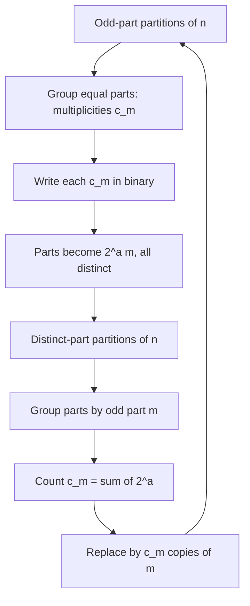
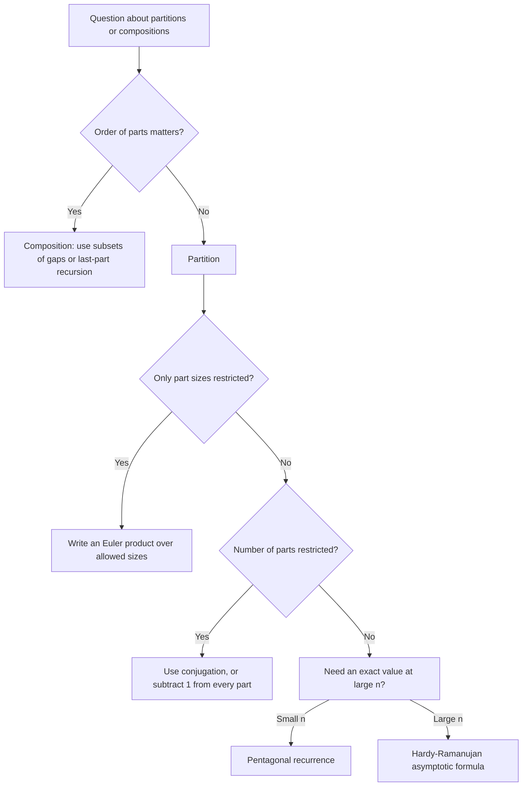

# Partitions and Compositions

> [Mathematics](../../README.md) › [Combinatorics](../README.md) › Partitions and Compositions · Level: Advanced · Prerequisites: [Counting Principles](../01-counting-principles/README.md), [Inclusion–Exclusion](../02-inclusion-exclusion/README.md), [Generating Functions](../04-generating-functions/README.md), [Mathematical Induction](../../09-discrete-mathematics/01-mathematical-induction/README.md), [Recurrence Relations](../../09-discrete-mathematics/02-recurrence-relations/README.md) · Estimated time: 480 min

## 1. Introduction

Write $4$ as a sum of positive integers. There are eight ways, and the list depends on a decision made before any counting starts.

If the order of the summands matters, the eight sums are

$$4,\quad 3+1,\quad 1+3,\quad 2+2,\quad 2+1+1,\quad 1+2+1,\quad 1+1+2,\quad 1+1+1+1 .$$

If the order does not matter, several of these are the same sum written differently, and only five objects remain: $4$, $3+1$, $2+2$, $2+1+1$, $1+1+1+1$. The first count is a *composition* problem, the second a *partition* problem, and the whole of this tutorial grows out of that single distinction.

Compositions are easy, and this is the surprising part of the story: their count is exactly $2^{n-1}$, one line of bijection. Partitions are hard — not hard to define, but hard to count. There is no closed formula for $p(n)$, the number of partitions of $n$. The values begin

$$1,\ 1,\ 2,\ 3,\ 5,\ 7,\ 11,\ 15,\ 22,\ 30,\ 42,\ 56,\ 77,\ 101,\ 135,\ 176,\ \dots$$

and grow in a manner that defeated everyone for a century and a half. Euler computed far enough to notice regularities; Sylvester and Ferrers turned partitions into pictures; Hardy and Ramanujan in 1918 proved that

$$p(n) \sim \frac{1}{4n\sqrt3}\,e^{\pi\sqrt{2n/3}},$$

an asymptotic law whose doubly exponential growth no elementary argument predicts. For $n = 200$ this gives $4.1 \times 10^{12}$ against the true value $3\,972\,999\,029\,388$, an error under $3.2\%$; the famous anecdote has Hardy asking Ramanujan, in hospital, about the number of partitions of $200$.

Three strands make partitions worth a full topic:

* **Structure.** Partitions carry a geometry. A partition is a shape made of unit squares — a *Ferrers diagram* — and the plain act of reflecting that shape in its diagonal produces a second partition. Reflection is a bijection from partitions of $n$ with at most $k$ parts to partitions of $n$ with largest part at most $k$, and it is the prototype of every bijective proof in the subject.
* **Generating functions.** The identity

$$\sum_{n \ge 0} p(n)x^n = \prod_{k \ge 1} \frac{1}{1 - x^k}$$

turns an additive problem into a multiplicative one. Euler's pentagonal number theorem evaluates the reciprocal product $\prod_{k\ge1}(1-x^k)$ in closed form, and thereby yields a recurrence that computes $p(n)$ in about $\sqrt n$ additions rather than exponentially many. The general machinery of generating functions is taught in [Generating Functions](../04-generating-functions/README.md); here we use it and push it further.
* **Universality.** Partitions index the irreducible representations of the symmetric group, describe occupation numbers of quantum states, count the ways of writing an integer as a product of prime powers with a fixed multiset of exponents, and appear in the theory of $q$-series, which is now a central language of number theory and mathematical physics.

Compositions occupy the cheap end of the same spectrum and are worth studying for exactly that reason: they give a clean model of the *method* — find a bijection between the objects you cannot count and objects you can — that partitions then refuse to follow. Learning when the method works and when it does not is the real lesson of the topic.

## 2. Prerequisites

* **Counting: sum and product rules, binomial coefficients, stars and bars.** Compositions *are* stars and bars; the proof of the count $2^{n-1}$ is a bijection with subsets. Taught in [Counting Principles](../01-counting-principles/README.md), Sections 5 and 7.
* **Generating functions: formal power series, the product rule for convolution, coefficient extraction.** Everything from Section 7.3 onwards is a coefficient computation. Taught in [Generating Functions](../04-generating-functions/README.md), Sections 5 and 7, with the partition product introduced there in Section 7.9; we re-derive it here because the derivation is part of the topic.
* **Bijections and cardinality.** Every proof in this topic that does not use generating functions is a bijection, and a bijection must be shown to be both injective and surjective. Taught in [Relations and Functions](../../00-foundations/05-relations-and-functions/README.md).
* **Proof by induction and strong induction.** The pentagonal recurrence computes $p(n)$ from all earlier values, so its verification is a strong induction. Taught in [Mathematical Induction](../../09-discrete-mathematics/01-mathematical-induction/README.md).
* **The inclusion–exclusion principle** — used in exercises on partitions with forbidden part sizes, and in one of the two proofs that the number of partitions into ordinary parts equals a signed sum over distinct parts. Taught in [Inclusion–Exclusion](../02-inclusion-exclusion/README.md).
* **Complex numbers and the residue theorem** for the saddle-point heuristic of Section 7.7 only. That subsection is explicitly labelled heuristic; nothing later depends on it.

Conventions. $\mathbb{N} = \{1,2,\dots\}$ and $\mathbb{N}_0 = \{0,1,2,\dots\}$. A *part* is a positive integer; a partition is a non-increasing finite sequence of parts. We set $p(0) = 1$ (the empty partition) and $p(n) = 0$ for $n < 0$; these conventions make every recurrence below valid without exceptional cases.

## 3. Learning Objectives

By the end of this tutorial you will be able to:

1. Define compositions and partitions of an integer, and give $2^{n-1}$ for all compositions of $n$ and $\binom{n-1}{k-1}$ for those with exactly $k$ parts.
2. Prove the count $2^{n-1}$ by exhibiting an explicit bijection with subsets of $\{1,\dots,n-1\}$, and confirm it by a second, independent method.
3. Compute $p(n)$ for small $n$ by listing, and check the values against both the generating function and the pentagonal recurrence.
4. Derive Euler's generating function $\sum p(n)x^n = \prod_{k\ge1}(1-x^k)^{-1}$ by multiplying geometric series, and justify why the coefficient of $x^n$ is unaffected by the infinitely many factors.
5. Draw the Ferrers diagram of a partition, compute its conjugate, and prove that conjugation is an involution, hence a bijection of the set of partitions of $n$ to itself.
6. Use conjugation to prove that the number of partitions of $n$ with at most $k$ parts equals the number with all parts at most $k$.
7. Prove that the number of partitions of $n$ into odd parts equals the number into distinct parts, both by generating functions and by Glaisher's explicit bijection, checking both directions.
8. State the pentagonal number theorem, derive the recurrence for $p(n)$ from it, and use the recurrence to compute $p(n)$ for moderate $n$.
9. State the Hardy–Ramanujan asymptotic formula, explain the meaning of $\sim$, and compare it numerically with exact values.
10. Write down the generating function for partitions restricted by a set of allowed part sizes, by a bound on the number of parts, or by a bound on the largest part, and extract coefficients in worked cases.
11. Distinguish an ordinary partition generating function from a $q$-series identity such as the $q$-binomial theorem, and explain where the Gaussian binomial coefficient comes from.
12. Explain two applications outside combinatorics: partitions as labels of irreducible representations of the symmetric group, and partitions as occupation numbers in statistical mechanics.
13. Avoid the standard errors: counting ordered sums when unordered sums are meant, omitting $p(0)$, applying stars and bars to partitions, and making sign errors in the pentagonal recurrence.

## 4. Intuition

### 4.1 Two ways to break a bar

Imagine a chocolate bar scored into $n$ squares in a row. A composition of $n$ records where you break the bar: each break produces a piece, and the piece lengths, read left to right, form a composition. There are $n-1$ scored lines between consecutive squares, and at each line you either break or you do not — two independent choices. Hence $2^{n-1}$. The break points remain visible in the finished object, so compositions are exactly "subsets of the scored lines", which is why they are easy.

Now forget the order of the pieces: put them in a bag, or, equivalently, sort them by size. You have lost the information about where the breaks were, and with it the easy count. A partition is a *bag of pieces*, and $p(n)$ asks in how many essentially different ways a bar of length $n$ can be broken up and the pieces sorted. Throwing information away never makes counting easier, and here it makes the problem hard enough to need complex analysis.

### 4.2 Staircases, not lists

A partition is better visualised than written. Turn each part into a row of dots, longest row on top:

```text
● ● ● ●
● ●
●
```

This is $4+2+1 = 7$. The resulting shape is a *Ferrers diagram*, and the eye immediately supplies operations the algebra does not suggest: reflect in the main diagonal, cut off a square, count cells above a diagonal, read columns instead of rows. Reflecting the shape above gives the diagram with rows $3,2,1,1$, i.e. the partition $3+2+1+1$ of $7$. Reflection is reversible, so it pairs partitions of $7$ with each other — and it happens to map "number of parts" to "largest part".

### 4.3 Why generating functions are the right home

The most useful mental move in the subject is this: a part of size $k$ is a *choice of how many copies of $k$ to use*, and the possibilities $0, 1, 2, 3, \dots$ copies contribute $1 + x^k + x^{2k} + \cdots = \frac{1}{1-x^k}$. Since part sizes are independent of one another, the total generating function is the product. The problem is additive in the exponents and multiplicative in the factors, and that mismatch is exactly what a generating function repairs: it converts adding parts into multiplying series.

Once the product is written down, every restricted partition problem becomes a product over the allowed parts, and every constraint on the number of parts becomes one further variable to track. This is the practical reason the theory is powerful: a single product generates the whole sequence $p(n)$, and small modifications of it answer hundreds of related questions.

### 4.4 The paradox of easy and hard

Compositions: closed formula, elementary bijection, nothing left to say. Partitions: no closed formula, an asymptotic law requiring modular forms, and a recurrence (Euler's pentagon) that is still the best way to compute $p(n)$ by hand. The gap is instructive. Compositions count *sequences*, and sequences are what product rules count. Partitions count *multisets*, and multisets are counted by products of geometric series, which are not closed under coefficient extraction. Every method in the topic — bijection, generating function, recurrence, asymptotics — is a different answer to the same obstruction.

## 5. Formal Definition

### 5.1 Compositions

A **composition** of $n \in \mathbb{N}_0$ is a finite sequence $(a_1, \dots, a_k)$ of positive integers with $\sum_{i=1}^{k} a_i = n$. The $a_i$ are its **parts** and $k$ is its **length**, written $\ell(a_1,\dots,a_k) = k$. For $n = 0$ there is exactly one composition, the empty one, of length $0$.

Two compositions are equal when they have the same length and the same parts in the same positions: $(3,1) \ne (1,3)$, while as partitions both are $3+1$.

### 5.2 Partitions

A **partition** of $n \in \mathbb{N}_0$ is a finite non-increasing sequence

$$\lambda = (\lambda_1, \lambda_2, \dots, \lambda_k), \qquad \lambda_1 \ge \lambda_2 \ge \cdots \ge \lambda_k \ge 1, \qquad \lambda_1 + \cdots + \lambda_k = n .$$

The $\lambda_i$ are its **parts**, $k = \ell(\lambda)$ is its **length** (the number of parts), and we write $\lvert \lambda \rvert = n$ and $\lambda \vdash n$. The unique partition of $0$ is the empty sequence, written $\varnothing$, with $\ell(\varnothing) = 0$.

Because parts are listed in non-increasing order, a partition is exactly an equivalence class of compositions under permutation of the parts. A convenient alternative notation records **multiplicities**: if the distinct part sizes are $s_1 > s_2 > \cdots > s_j$, occurring $m_1,\dots,m_j$ times, write

$$\lambda = s_1^{m_1} s_2^{m_2} \cdots s_j^{m_j},$$

so that $5^2 3^1 1^3$ denotes $5+5+3+1+1+1$, a partition of $15$.

### 5.3 The counting functions

| Function | Counts partitions of $n$ with … |
|---|---|
| $p(n)$ | no restriction, with $p(0) = 1$ |
| $p(n,k)$ | exactly $k$ parts |
| $p_{\le k}(n)$ | at most $k$ parts |
| $q(n)$ | all parts distinct (each multiplicity $\le 1$) |
| $p_S(n)$ | every part lying in a prescribed set $S \subseteq \mathbb{N}$ |
| $p_{\text{odd}}(n)$ | every part odd |
| $c(n)$ | — compositions of $n$: $c(n) = 2^{n-1}$ for $n \ge 1$, $c(0) = 1$ |
| $c(n,k)$ | — compositions of $n$ with exactly $k$ parts: $\binom{n-1}{k-1}$ |

We adopt $p(n) = 0$ for $n < 0$ and $p(0) = 1$; with these conventions every formula in Section 8 holds at $n = 0$ without a separate case.

### 5.4 Ferrers diagrams and conjugation

The **Ferrers diagram** of $\lambda = (\lambda_1,\dots,\lambda_k)$ is the set of cells

$$D(\lambda) = \{(i,j) \in \mathbb{Z}^2 : 1 \le i \le k,\ 1 \le j \le \lambda_i\},$$

drawn with row $i$ left-aligned below row $i-1$; $(i,j)$ is the cell in row $i$, column $j$. The **conjugate** partition $\lambda'$ is defined by

$$\lambda'_j = \#\{i : \lambda_i \ge j\},$$

the number of cells in column $j$ of $D(\lambda)$. Equivalently, $D(\lambda') = \{(j,i) : (i,j) \in D(\lambda)\}$: the diagram of $\lambda'$ is the reflection of $D(\lambda)$ in the diagonal $i=j$. A partition is **self-conjugate** when $\lambda = \lambda'$.

### 5.5 The two statistics that conjugation exchanges

For a partition $\lambda$ define

$$\ell(\lambda) = \text{number of parts}, \qquad \lambda_1 = \text{largest part}.$$

Then $\ell(\lambda') = \lambda_1$ and $(\lambda')_1 = \ell(\lambda)$: conjugation swaps length and largest part. This is a one-line computation from the definition (the number of columns of $D(\lambda)$ is $\lambda_1$, and the number of cells in column $1$ is $\ell(\lambda)$), and it is the engine of Section 7.4.

### 5.6 The extremal question for partitions

Two kinds of question recur and should be kept apart:

* *How many* partitions of $n$ satisfy a given restriction? — a counting question, answered by a generating function or a bijection.
* *Which* partitions of $n$ maximise or minimise a statistic (largest part, number of parts, number of distinct parts)? — an extremal question, usually answered by exhibiting the extremal partition. Over all partitions of $n$, the largest part ranges from $1$ (for $1^n$) to $n$ (for $(n)$), and the length likewise ranges from $1$ to $n$, so both statistics attain every value in between.

## 6. Mathematical Notation

| Symbol | Read as | Meaning |
|---|---|---|
| $\lambda \vdash n$ | $\lambda$ is a partition of $n$ | $\lvert\lambda\rvert = n$ |
| $\lvert \lambda \rvert$ | size of $\lambda$ | sum of its parts |
| $\ell(\lambda)$ | length of $\lambda$ | number of parts |
| $\lambda_i$ | the $i$-th part | parts are non-increasing |
| $\lambda'$ | conjugate of $\lambda$ | column lengths of the Ferrers diagram |
| $s^{m}$ in a partition | "$m$ copies of $s$" | multiplicity notation |
| $p(n)$ | "$p$ of $n$" | number of partitions of $n$ |
| $p(n,k)$, $p_{\le k}(n)$ | — | exactly $k$ parts; at most $k$ parts |
| $q(n)$ | "$q$ of $n$" | partitions of $n$ into distinct parts |
| $p_S(n)$ | — | partitions of $n$ with parts in $S$ |
| $c(n)$, $c(n,k)$ | — | compositions of $n$; compositions with exactly $k$ parts |
| $[x^n]F(x)$ | coefficient of $x^n$ in $F$ | the coefficient-extraction operator |
| $\prod_{k\ge1}(1-x^k)^{-1}$ | Euler product | generating function of $p(n)$ |
| $(q;q)_\infty$ | $q$-Pochhammer symbol | $\prod_{j\ge1}(1-q^j)$ |
| $(a;q)_n$ | — | $\prod_{j=0}^{n-1}(1-aq^j)$, with $(a;q)_0 = 1$ |
| $\binom{n}{k}_q$ | Gaussian binomial coefficient | $\dfrac{(q;q)_n}{(q;q)_k\,(q;q)_{n-k}}$ |
| $g_k$ | generalised pentagonal number | $g_k = k(3k-1)/2$ for $k \in \mathbb{Z}$ |
| $F_n$ | Fibonacci number | $F_1 = F_2 = 1$, $F_n = F_{n-1} + F_{n-2}$ |
| $f \sim g$ | asymptotically equal | $f(n)/g(n) \to 1$ as $n \to \infty$ |

Two notational warnings. First, $\lambda'$ is the conjugate partition, not a derivative and not a set complement; $\lambda$ and $\lambda'$ always have the same size but in general different lengths. Second, the symbol $q$ in Section 7.10 is a formal variable of a $q$-series, while $q(n)$ is the count of partitions into distinct parts; the parentheses disambiguate, and both usages are standard.

## 7. Core Concepts

### 7.1 Compositions: the count $2^{n-1}$

**Theorem 7.1 (Compositions).** For $n \ge 1$ the number of compositions of $n$ is $c(n) = 2^{n-1}$; the number with exactly $k$ parts is $c(n,k) = \binom{n-1}{k-1}$ for $1 \le k \le n$, and $c(0) = 1$.

**Proof (first method: bijection with subsets).** Define

$$\Phi : \{\text{compositions of } n\} \longrightarrow \mathcal{P}(\{1,2,\dots,n-1\}), \qquad \Phi(a_1,\dots,a_k) = \{a_1,\ a_1+a_2,\ \dots,\ a_1+a_2+\cdots+a_{k-1}\}.$$

*Well defined.* Each partial sum $a_1 + \cdots + a_i$ for $1 \le i \le k-1$ lies between $1$ and $n-1$, because the $a_i$ are positive and the total is $n$; and the partial sums are strictly increasing, so $\Phi$ produces a set of size $k-1$. (For $k = 1$ the set is empty.)

*Injective.* The composition can be recovered from the image set: if $\Phi(a) = S = \{s_1 < s_2 < \cdots < s_{k-1}\}$, then

$$a_1 = s_1,\quad a_2 = s_2 - s_1,\quad \dots,\quad a_{k-1} = s_{k-1} - s_{k-2},\quad a_k = n - s_{k-1},$$

so two compositions with the same image have the same parts. Explicitly, $\Psi(S) = (s_1, s_2-s_1, \dots, s_{k-1}-s_{k-2}, n-s_{k-1})$ recovers the composition.

*Surjective.* Given any $S = \{s_1 < \cdots < s_{k-1}\} \subseteq \{1,\dots,n-1\}$, the tuple $\Psi(S)$ consists of positive integers, because consecutive elements of $S$ strictly increase and $s_{k-1} < n$; and its parts sum to $n$ by telescoping. Thus $\Psi(S)$ is a composition of $n$ and $\Phi(\Psi(S)) = S$. Hence $\Phi$ is a bijection, and the number of compositions equals the number of subsets of an $(n-1)$-element set, namely $2^{n-1}$.

*Counting by length.* A composition with exactly $k$ parts has an image of size $k-1$, and every $(k-1)$-element subset of $\{1,\dots,n-1\}$ occurs as an image (the argument above produces a composition with $k$ parts from any such subset). Hence $c(n,k) = \binom{n-1}{k-1}$. As a check, $\sum_{k=1}^{n}\binom{n-1}{k-1} = 2^{n-1}$ by the binomial theorem. $\blacksquare$

**Proof (second method: last part recursion).** Every composition of $n$ with $n \ge 1$ has a last part $j \in \{1,\dots,n\}$, and deleting it leaves a composition of $n-j$; conversely, appending the part $j$ to any composition of $n-j$ produces a composition of $n$. This is a bijection, so

$$c(n) = \sum_{j=1}^{n} c(n-j) = \sum_{m=0}^{n-1} c(m).$$

Subtracting the same identity at $n-1$ gives $c(n) - c(n-1) = c(n-1)$, i.e. $c(n) = 2c(n-1)$ for $n \ge 2$, and $c(1) = 1$. Induction yields $c(n) = 2^{n-1}$. $\blacksquare$

The second proof is worth remembering because the same "look at the last part" device computes compositions with a restricted set of allowed part sizes. Two examples, both proved exactly that way.

* *Compositions of $n$ into parts $\ge 2$.* Deleting the last part $j \ge 2$ gives $d(n) = \sum_{j \ge 2} d(n-j) = d(n-2) + d(n-3) + \cdots$, whence $d(n) - d(n-1) = d(n-2)$, i.e. $d(n) = d(n-1) + d(n-2)$ with $d(1) = 0$, $d(2) = 1$. So $d(n) = F_{n-1}$ where $F_1 = F_2 = 1$.
* *Compositions of $n$ into odd parts.* Deleting the last part $j$ odd gives $e(n) = e(n-1) + e(n-3) + e(n-5) + \cdots$, and subtracting the same relation at $n-2$ gives $e(n) = e(n-1) + e(n-2)$ with $e(1) = e(2) = 1$. So $e(n) = F_n$.

**Example 7.2.** The compositions of $6$ are $32$ in number; grouped by length they are $\binom51 = 5$ of length $2$, $\binom52 = 10$ of length $3$, $\binom53 = 10$ of length $4$, $\binom54 = 5$ of length $5$, and one each of length $1$ and $6$. Indeed $1 + 5 + 10 + 10 + 5 + 1 = 32 = 2^5$.

| Length $k$ | 1 | 2 | 3 | 4 | 5 | 6 |
|---|---|---|---|---|---|---|
| $c(6,k)$ | 1 | 5 | 10 | 10 | 5 | 1 |

### 7.2 Partitions: the values and the shape of the problem

Partitions have no such luck. The first values, obtained by listing, are

| $n$ | 0 | 1 | 2 | 3 | 4 | 5 | 6 | 7 | 8 | 9 | 10 | 11 | 12 |
|---|---|---|---|---|---|---|---|---|---|---|---|---|---|
| $p(n)$ | 1 | 1 | 2 | 3 | 5 | 7 | 11 | 15 | 22 | 30 | 42 | 56 | 77 |

and continuing

| $n$ | 13 | 14 | 15 | 16 | 17 | 18 | 19 | 20 | 21 | 22 | 23 | 24 | 25 |
|---|---|---|---|---|---|---|---|---|---|---|---|---|---|
| $p(n)$ | 101 | 135 | 176 | 231 | 297 | 385 | 490 | 627 | 792 | 1002 | 1255 | 1575 | 1958 |

For instance the eleven partitions of $6$ are

$$6,\quad 5+1,\quad 4+2,\quad 4+1+1,\quad 3+3,\quad 3+2+1,\quad 3+1+1+1,\quad 2+2+2,\quad 2+2+1+1,\quad 2+1^4,\quad 1^6 .$$

Listing is reliable only for very small $n$: the number of partitions grows so fast that $p(100) = 190\,569\,292$ and $p(200) = 3\,972\,999\,029\,388$. Two elementary facts should be recorded before any machinery is introduced.

**Proposition 7.3.** (a) $p(n) \ge 1$ for all $n \ge 0$, the extreme cases being the single-part partition $(n)$ and the all-ones partition $1^n$. (b) $p(n)$ is strictly increasing for $n \ge 1$.

**Proof.** (a) The partition $(n)$ exists for $n \ge 1$, and $\varnothing$ covers $n = 0$. (b) The map $(\lambda_1,\lambda_2,\dots,\lambda_k) \mapsto (\lambda_1+1, \lambda_2, \dots, \lambda_k)$ sends a partition of $n$ to a partition of $n+1$: it is still non-increasing because $\lambda_1 + 1 > \lambda_1 \ge \lambda_2$, and its parts are positive. It is injective, since subtracting $1$ from the first part inverts it, and its image consists of partitions of $n+1$ with at least one part exceeding $1$, so it is not surjective. Hence $p(n+1) > p(n)$. $\blacksquare$

What makes partitions hard is visible already in the definition: a partition is a *multiset*, and multisets are counted by $\prod_k (1-x^k)^{-1}$ rather than by a product of binomial coefficients. There is no polynomial formula, no fixed-length product formula and no simple recurrence of order $1$; the exact formulas require the circle method, and the first genuinely useful tool is a product.

### 7.3 Euler's product: the generating function of $p(n)$

**Theorem 7.4 (Euler).** As formal power series,

$$\sum_{n\ge 0} p(n)\,x^n \;=\; \prod_{k \ge 1} \frac{1}{1-x^k} \;=\; \prod_{k\ge1}\left(1 + x^k + x^{2k} + x^{3k} + \cdots\right).$$

**Proof.** Fix $N \ge 1$ and consider the finite product

$$P_N(x) = \prod_{k=1}^{N} \frac{1}{1-x^k} = \prod_{k=1}^{N}\left(\sum_{m_k \ge 0} x^{k m_k}\right).$$

Expanding, a monomial $\prod_{k=1}^N x^{k m_k} = x^{\sum_k k m_k}$ appears once for each choice of multiplicities $(m_1,\dots,m_N) \in \mathbb{N}_0^N$. Hence

$$P_N(x) = \sum_{n \ge 0} a_N(n)\, x^n, \qquad a_N(n) = \#\Big\{(m_1,\dots,m_N) \in \mathbb{N}_0^N : \sum_{k=1}^{N} k\,m_k = n\Big\}.$$

Now the key observation: a tuple in this set corresponds to a partition of $n$ whose parts are all at most $N$, by reading $m_k$ as the multiplicity of the part $k$. Therefore $a_N(n) = p_{\le N}(n)$, the number of partitions of $n$ with all parts at most $N$. If $N \ge n$, every partition of $n$ has all parts at most $n \le N$, so $a_N(n) = p(n)$. In particular, for each fixed $n$ the coefficient of $x^n$ in $P_N(x)$ equals $p(n)$ as soon as $N \ge n$. A coefficient of a power series depends on only finitely many factors, so the infinite product is a well-defined formal power series whose $n$-th coefficient is $p(n)$. $\blacksquare$

The same argument applied to a subset $S \subseteq \mathbb{N}$ of allowed part sizes gives Euler's general recipe, which we use repeatedly:

$$\sum_{n\ge0} p_S(n)\,x^n = \prod_{k \in S} \frac{1}{1-x^k}.$$

Because the coefficient of $x^n$ involves only the factors with $k \le n$, such infinite products are always legitimate as formal series.

**Example 7.5.** Extract the coefficient of $x^6$ in $\prod_{k\ge1}(1-x^k)^{-1}$, i.e. recompute $p(6) = 11$ from the product. Only the factors with $k \le 6$ matter, and the coefficient of $x^6$ is the number of tuples $(m_1,\dots,m_6) \in \mathbb{N}_0^6$ with $\sum_{k=1}^{6} k\,m_k = 6$. Listing them by the multiplicity of the largest part used:

| Solution $(m_1,\dots,m_6)$ | Partition | Solution $(m_1,\dots,m_6)$ | Partition |
|---|---|---|---|
| $(6,0,0,0,0,0)$ | $1^6$ | $(1,1,1,0,0,0)$ | $3+2+1$ |
| $(4,1,0,0,0,0)$ | $2+1^4$ | $(3,0,1,0,0,0)$ | $3+1^3$ |
| $(2,2,0,0,0,0)$ | $2^2+1^2$ | $(0,0,2,0,0,0)$ | $3^2$ |
| $(0,3,0,0,0,0)$ | $2^3$ | $(2,0,0,1,0,0)$ | $4+1^2$ |
| $(0,1,0,1,0,0)$ | $4+2$ | $(1,0,0,0,1,0)$ | $5+1$ |
| $(0,0,0,0,0,1)$ | $6$ | | |

The table has exactly eleven rows, matching $p(6) = 11$; each row is a distinct solution because the vector $(m_1,\dots,m_6)$ records the multiplicities, and the eleven partitions of $6$ were listed in Section 7.2. Note that the enumeration is only feasible because $6$ is tiny: the number of tuples to inspect grows like $p(n)$, so this is a check, not a method.

### 7.4 Ferrers diagrams and conjugation

Draw the partition as a left-aligned array of dots. The partition $\lambda = (5,3,2,1)$ of $11$ has diagram

```text
● ● ● ● ●
● ● ●
● ●
●
```

and reading *columns* left to right gives the sequence of column heights $4, 3, 2, 1, 1$, i.e. the partition $\lambda' = (4,3,2,1,1)$ of $11$. Formally $\lambda'_j = \#\{i : \lambda_i \ge j\}$.

**Theorem 7.6 (Conjugation is an involution).** For every partition $\lambda$ one has $\lambda'' = \lambda$. Consequently conjugation is a bijection of the set of partitions of $n$ onto itself, and it is its own inverse.

**Proof.** Let $\lambda$ have Ferrers diagram $D = D(\lambda) \subseteq \mathbb{Z}^2$. By definition $D(\lambda') = \{(j,i) : (i,j) \in D\}$, i.e. the reflection $\rho(i,j) = (j,i)$ of the plane. Applying the same recipe again,

$$D(\lambda'') = \{(j,i) : (i,j) \in D(\lambda')\} = \{(j,i) : (i,j) = (b,a) \text{ with } (a,b) \in D\} = \{(a,b) : (a,b) \in D\} = D(\lambda).$$

Since a partition is determined by its diagram (its parts are the row lengths), $D(\lambda'') = D(\lambda)$ gives $\lambda'' = \lambda$. Hence conjugation is injective (it has an inverse, namely itself) and surjective (every $\mu$ is the conjugate of $\mu'$, since $(\mu')' = \mu$). $\blacksquare$

**Corollary 7.7 (Length versus largest part).** For all $n, k \ge 0$,

$$p_{\le k}(n) = \#\{\lambda \vdash n : \lambda_1 \le k\}.$$

That is: the number of partitions of $n$ with at most $k$ parts equals the number with largest part at most $k$.

**Proof.** Conjugation exchanges the two statistics: the number of parts of $\lambda'$ is the number of columns of $D(\lambda)$, which is $\lambda_1$, and the largest part of $\lambda'$ is the number of rows of $D(\lambda)$, which is $\ell(\lambda)$. So $\lambda \mapsto \lambda'$ maps $\{\lambda \vdash n : \ell(\lambda) \le k\}$ onto $\{\mu \vdash n : \mu_1 \le k\}$, and by Theorem 7.6 it is a bijection. $\blacksquare$

Conjugation also produces a bijection between the set of self-conjugate partitions of $n$ (fixed points of the involution) and something quite different — partitions into distinct odd parts — which is the subject of Exercise 32.

**Example 7.8.** Take $\lambda = (4,4,2)$. Its diagram has rows of length $4,4,2$, so the column heights are $3,3,2,2$ and $\lambda' = (3,3,2,2)$. Check: $\ell(\lambda) = 3 = \lambda'_1$ and $\lambda_1 = 4 = \ell(\lambda')$, as Corollary 7.7 predicts; both partitions have size $10$.

### 7.5 Odd parts versus distinct parts

Euler observed, and it is still the most quoted partition identity, that the two following families are equinumerous for every $n$:

* partitions of $n$ into **odd** parts: $3+3+1+1+1+1$ for $n = 10$;
* partitions of $n$ into **distinct** parts: $6+4$ for $n = 10$.

For $n = 10$ both families have $10$ members; for $n = 8$ both have $6$. The identity is not obvious: the two restrictions look unrelated, and no member of one family is a member of the other in general.

**Theorem 7.9 (Euler).** For every $n \ge 0$, $p_{\text{odd}}(n) = q(n)$.

**Proof 1 (generating functions).** Since the allowed parts are the odd integers,

$$\sum_{n\ge0} p_{\text{odd}}(n)x^n = \prod_{k \text{ odd}} \frac{1}{1-x^k}, \qquad \sum_{n\ge0} q(n)x^n = \prod_{k\ge1}(1+x^k),$$

the second because using the part $k$ zero or one time contributes $1 + x^k$. The two products are equal, by the telescoping identity

$$\prod_{k\ge1}(1+x^k) = \prod_{k\ge1}\frac{1-x^{2k}}{1-x^k} = \frac{\prod_{j \text{ even}}(1-x^{j})}{\prod_{j \ge 1}(1-x^{j})} = \frac{1}{\prod_{j \text{ odd}}(1-x^{j})},$$

where the middle step renames $2k$ as $j$ in the numerator and $k$ as $j$ in the denominator. Formally one takes the identity for finite products $k \le N$, in which both sides are polynomials, and then passes to the coefficient of $x^n$, which is stable once $N \ge n$. Equal generating functions force equal coefficients, so $p_{\text{odd}}(n) = q(n)$ for all $n$. $\blacksquare$

**Proof 2 (Glaisher's bijection).** The identity also has a direct combinatorial proof, which is more informative because it maps each partition to a partner. Let $\lambda$ be a partition of $n$ into odd parts. Group equal parts: for each odd $m$, let $c_m$ be the number of parts equal to $m$. Write each multiplicity in binary,

$$c_m = 2^{a_1} + 2^{a_2} + \cdots + 2^{a_r}, \qquad a_1 < a_2 < \cdots < a_r,$$

noting that the binary expansion is unique. Replace the $c_m$ copies of $m$ by the $r$ parts

$$2^{a_1}m,\ 2^{a_2}m,\ \dots,\ 2^{a_r}m .$$

The total is unchanged, because $\sum_i 2^{a_i}m = c_m m$. The resulting parts are all **distinct**: two parts arising from the same $m$ differ because the exponents $a_i$ are distinct, and parts arising from different odd $m \ne m'$ differ because an integer has a unique odd part (the number $2^a m$ is even or odd according to $a$, and stripping all factors $2$ from $2^a m$ returns $m$). Hence the image is a partition of $n$ into distinct parts.

Conversely, let $\mu$ be a partition of $n$ into distinct parts. Every part has a unique representation $2^{a}m$ with $m$ odd and $a \ge 0$, namely $m$ = odd part of the part. Group the parts by their odd part $m$: the exponents $a$ that occur are distinct, so for a fixed $m$ the number of parts with odd part $m$ is $c_m = \sum 2^{a}$ over the exponents present. Replace these parts by $c_m$ copies of $m$; the total is again unchanged, and all parts are odd.

The two constructions are inverse to each other: starting from $\lambda$, the multiplicities $c_m$ recover the multiset of exponents $\{a\}$ grouped by odd part, and regrouping them produces $c_m$ copies of $m$ for each $m$ — precisely $\lambda$ again; starting from $\mu$ and returning, the binary expansion of each $c_m$ reproduces the original exponents. Both directions are well defined and inverse, so the map is a bijection and $p_{\text{odd}}(n) = q(n)$. $\blacksquare$

**Example 7.10 (the bijection at $n = 10$).** The ten partitions of $10$ into odd parts and their Glaisher images:

| Odd-part partition | Multiplicities | Image |
|---|---|---|
| $9+1$ | $c_9 = 1$, $c_1 = 1$ | $9 + 1$ |
| $7+3$ | $c_7 = 1$, $c_3 = 1$ | $7 + 3$ |
| $7+1+1+1$ | $c_7 = 1$, $c_1 = 3 = 2+1$ | $7 + 2 + 1$ |
| $5+5$ | $c_5 = 2$ | $10$ |
| $5+3+1+1$ | $c_5 = 1$, $c_3 = 1$, $c_1 = 2$ | $5 + 3 + 2$ |
| $5+1^5$ | $c_5 = 1$, $c_1 = 5 = 4+1$ | $5 + 4 + 1$ |
| $3+3+3+1$ | $c_3 = 3 = 2+1$, $c_1 = 1$ | $6 + 3 + 1$ |
| $3+3+1^4$ | $c_3 = 2$, $c_1 = 4$ | $6 + 4$ |
| $3+1^7$ | $c_3 = 1$, $c_1 = 7 = 4+2+1$ | $4 + 3 + 2 + 1$ |
| $1^{10}$ | $c_1 = 10 = 8+2$ | $8 + 2$ |

The right-hand column lists exactly the ten partitions of $10$ into distinct parts, each once. Nothing is missing and nothing repeats, which is what a bijection means.

### 7.6 The pentagonal number theorem and the recurrence for $p(n)$

Euler's product $\prod_{k\ge1}(1-x^k)$ is the reciprocal of the partition generating function, so its coefficients are the numbers that let us compute $p(n)$ recursively. Euler discovered that this product has an astonishingly sparse expansion. The **generalised pentagonal numbers** are

$$g_k = \frac{k(3k-1)}{2}, \qquad k \in \mathbb{Z},$$

namely $0, 1, 2, 5, 7, 12, 15, 22, 26, 35, 40, \dots$ for $k = 0, 1, -1, 2, -2, 3, -3, \dots$

**Theorem 7.11 (Pentagonal number theorem, Euler).** As formal power series,

$$\prod_{k\ge1}(1-x^k) \;=\; \sum_{k=-\infty}^{\infty} (-1)^k x^{k(3k-1)/2} \;=\; 1 \;-\; x \;-\; x^2 \;+\; x^5 \;+\; x^7 \;-\; x^{12} \;-\; x^{15} \;+\; x^{22} \;+\; x^{26} \;-\; \cdots$$

The proof is a sign-reversing involution due to Franklin (1881) on partitions into distinct parts, in which all diagrams cancel in pairs except the "staircase" diagrams of sizes $g_k$; we quote the statement and use it, and refer to the Further Learning section for the proof.

**Corollary 7.12 (Euler's recurrence).** For $n \ge 1$,

$$p(n) \;=\; \sum_{k \ge 1} (-1)^{k-1}\Big[\, p\big(n - g_k\big) + p\big(n - g_{-k}\big) \Big], \qquad g_k = \frac{k(3k-1)}{2},\quad g_{-k} = \frac{k(3k+1)}{2},$$

with the convention $p(m) = 0$ for $m < 0$. In words: subtract the values at distances $1, 2, 5, 7, 12, 15, 22, 26, \dots$ with the sign pattern $+,+,-,-,+,+,-,-,\dots$, that is, the two members of each pair $\{g_k, g_{-k}\}$ share the sign $(-1)^{k-1}$.

**Proof.** Multiply the identity of Theorem 7.11 by $\sum_{m\ge0} p(m)x^m = \prod_{k\ge1}(1-x^k)^{-1}$. The product is $1$, so the coefficient of $x^n$ on the left is

$$\sum_{j \ge 0} \big[x^j\big]\prod_{k\ge1}(1-x^k) \cdot p(n-j) \;=\; 0 \qquad (n \ge 1).$$

By Theorem 7.11 the coefficient of $x^j$ in the product is $(-1)^k$ when $j = g_k$ for a unique $k \in \mathbb{Z}$, and $0$ otherwise. The term $j = 0$ (i.e. $k=0$) gives $p(n)$, and the remaining terms give $\sum_{k \ne 0}(-1)^k p(n - g_k)$. Hence

$$p(n) + \sum_{k\ne 0}(-1)^k p(n-g_k) = 0,$$

which is the stated recurrence after multiplying by $-1$ and using $(-1)^{k+1} = -(-1)^k$; terms with $n - g_k < 0$ vanish by the convention. $\blacksquare$

**Example 7.13 (computing $p(20)$ by the recurrence).** The needed earlier values $p(0),\dots,p(19)$ are in the table of Section 7.2. The generalised pentagonal numbers not exceeding $20$ are, in the order $g_1, g_{-1}, g_2, g_{-2}, g_3, g_{-3}$,

$$1,\ 2,\ 5,\ 7,\ 12,\ 15,$$

with signs $+, +, -, -, +, +$ coming from $(-1)^{k-1}$ for $k = 1,1,2,2,3,3$. Hence

$$\begin{aligned}
p(20) &= p(19) + p(18) - p(15) - p(13) + p(8) + p(5) \\
&= 490 + 385 - 176 - 101 + 22 + 7 \\
&= 875 - 277 + 29 \\
&= 627,
\end{aligned}$$

which agrees with the table. Note the arithmetic order used: pair the positive terms ($490 + 385 = 875$ and $22 + 7 = 29$) and the negative terms ($176 + 101 = 277$), then combine.

**Example 7.14 (the same recurrence at $n = 10$).** The pentagonal numbers not exceeding $10$ are $1, 2, 5, 7$ with signs $+, +, -, -$, so

$$p(10) = p(9) + p(8) - p(5) - p(3) = 30 + 22 - 7 - 3 = 42,$$

in agreement with $p(10) = 42$. The sign pattern is thus

$$+, +, -, -, +, +, -, -, \dots \quad \text{attached to} \quad 1, 2, 5, 7, 12, 15, 22, 26, \dots$$

and it is the single most error-prone part of the computation: the two members of each pair share a sign, and the sign changes only when the index $k$ increases.

### 7.8 Restricted partitions and their generating functions

Every restriction on part sizes or on the number of parts translates into a modification of Euler's product. The dictionary below is the working tool of the subject; each line is proved exactly as Theorem 7.4 was, by multiplying geometric series indexed by the allowed multiplicities.

| Restriction on the partition | Generating function |
|---|---|
| all parts in a set $S \subseteq \mathbb{N}$ | $\displaystyle\prod_{k \in S}\frac{1}{1-x^k}$ |
| all parts odd | $\displaystyle\prod_{k \text{ odd}}\frac{1}{1-x^k} = \prod_{k\ge1}(1+x^k)$ |
| all parts distinct | $\displaystyle\prod_{k\ge1}(1+x^k)$ |
| parts distinct and odd | $\displaystyle\prod_{k \text{ odd}}(1+x^k)$ |
| largest part at most $k$ | $\displaystyle\prod_{i=1}^{k}\frac{1}{1-x^i}$ |
| at most $k$ parts | $\displaystyle\prod_{i=1}^{k}\frac{1}{1-x^i}$ (by conjugation) |
| exactly $k$ parts | $\displaystyle\frac{x^k}{(1-x)(1-x^2)\cdots(1-x^k)}$ |
| all parts $\equiv a \pmod m$ | $\displaystyle\prod_{j\ge0}\frac{1}{1-x^{a+jm}}$ |
| no part equal to $1$ | $\displaystyle(1-x)\prod_{k\ge1}\frac{1}{1-x^k}$ |
| all parts even | $\displaystyle\prod_{j\ge1}\frac{1}{1-x^{2j}}$ |
| all parts $\ge 2$ | $\displaystyle(1-x)\prod_{k\ge1}\frac{1}{1-x^k}$ |

The last two lines of the table illustrate a useful habit: a restriction either restricts the index set of the product (parts odd, parts in $S$) or multiplies the product by a polynomial factor (no part equal to $1$, parts even). The polynomial factor is what makes such problems accessible to inclusion–exclusion.

**Theorem 7.16 (Two-part partitions).** The number of partitions of $n$ into at most two parts is $\lfloor n/2 \rfloor + 1$.

**Proof.** By Corollary 7.7, partitions of $n$ with at most two parts correspond to partitions of $n$ with all parts at most $2$, i.e. to solutions of $a + 2b = n$ in non-negative integers $a,b$. For each $b$ with $0 \le b \le \lfloor n/2\rfloor$ there is exactly one such $a$, namely $a = n - 2b$. Hence the count is $\lfloor n/2\rfloor + 1$. $\blacksquare$

Equivalently, the generating function is

$$\frac{1}{(1-x)(1-x^2)} = \sum_{n\ge0}\left(\left\lfloor \frac{n}{2}\right\rfloor + 1\right)x^n,$$

whose coefficients are $1,1,2,2,3,3,4,4,\dots$

**Theorem 7.17 (Partitions avoiding the part $1$).** The number of partitions of $n$ with no part equal to $1$ is $p(n) - p(n-1)$ for $n \ge 1$.

**Proof.** A partition of $n$ either contains a part $1$ or it does not. Appending a part $1$ to a partition of $n-1$ gives a bijection between partitions of $n-1$ and partitions of $n$ that contain at least one $1$: the map is injective (delete a $1$ to invert it) and its image is exactly the set of partitions containing a $1$. Hence the number of partitions of $n$ with no part $1$ is $p(n) - p(n-1)$. $\blacksquare$

For instance $p(10) - p(9) = 42 - 30 = 12$, and indeed the partitions of $10$ without a part $1$ are $10$, $8+2$, $7+3$, $6+4$, $6+2+2$, $5+5$, $5+3+2$, $4+4+2$, $4+3+3$, $3+3+2+2$, $4+2+2+2$, $2^5$: twelve of them.

**Theorem 7.18 (Exactly $k$ parts).** For $k \ge 1$,

$$\sum_{n\ge0} p(n,k)\,x^n = \frac{x^k}{(1-x)(1-x^2)\cdots(1-x^k)} .$$

**Proof.** Removing one from each part of a partition with exactly $k$ parts gives a partition of $n-k$ with at most $k$ parts (parts that become $0$ are dropped), and adding one to each of the $k$ parts of a partition of $n-k$ with at most $k$ parts — padding with zeros to get $k$ entries — inverts this. Both constructions preserve the ordering of parts, so they are mutually inverse bijections between partitions of $n$ with exactly $k$ parts and partitions of $n-k$ with at most $k$ parts. Hence $p(n,k) = p_{\le k}(n-k)$, and multiplying the generating function of $p_{\le k}$ (which is $\prod_{i=1}^{k}(1-x^i)^{-1}$ by the table above) by $x^k$ gives the claim. $\blacksquare$

### 7.9 Partitions into at most $k$ parts

The table of Section 7.8 gives the generating function for partitions into at most $k$ parts by *conjugation*, but there is also a direct derivation which exposes the quasipolynomial structure.

**Theorem 7.19.** For fixed $k \ge 1$ and $n \to \infty$, the function $n \mapsto p_{\le k}(n)$ is a quasipolynomial of degree $k-1$ with period $\operatorname{lcm}(1,2,\dots,k)$; that is, on each residue class of $n$ modulo that period it agrees with a polynomial of degree $k-1$.

**Proof.** By partial fractions, $1/\prod_{i=1}^{k}(1-x^i)$ is a sum of terms $c/(1-\zeta x)^j$ where $\zeta$ runs over roots of unity of order dividing some $i \le k$ and $j$ is a positive integer. The coefficient of $x^n$ in $c/(1-\zeta x)^j$ is $c\binom{n+j-1}{j-1}\zeta^n$, a polynomial in $n$ of degree $j-1$ times a periodic factor $\zeta^n$. Collecting terms gives the claim, with degree $\max(j)-1 = k-1$ and period dividing $\operatorname{lcm}(1,\dots,k)$. $\blacksquare$

**Example 7.20 (the case $k = 3$).** The partial fraction decomposition is

$$\frac{1}{(1-x)(1-x^2)(1-x^3)} = \frac{1}{6(1-x)^3} + \frac{1}{4(1-x)^2} + \frac{1}{4(1-x^2)} + \frac{1}{3(1-x^3)},$$

which the reader may verify by clearing denominators (both sides are rational functions, so it suffices to check the identity after multiplying by $(1-x)(1-x^2)(1-x^3)$ and comparing polynomials). Extracting coefficients term by term,

$$p_{\le 3}(n) = \frac{1}{6}\binom{n+2}{2} + \frac{1}{4}(n+1) + \frac{1}{4}\cdot\frac{1+(-1)^n}{2} + \frac{1}{3}\cdot[3 \mid n],$$

using $[x^n](1-x^2)^{-1} = 1$ for even $n$ and $0$ for odd $n$, and $[x^n](1-x^3)^{-1} = 1$ when $3 \mid n$ and $0$ otherwise. Evaluating this expression gives the classical formula: $p_{\le 3}(n)$ is the nearest integer to $(n+3)^2/12$. Checking a few values: $n = 6$ gives $81/12 = 6.75$, nearest integer $7$, and indeed $p_{\le3}(6) = 7$; $n = 10$ gives $169/12 = 14.08$, nearest integer $14$, and $p_{\le3}(10) = 14$.

A second, more elementary route to the same numbers uses the identity $p_{\le3}(n) = p_{\text{parts} \le 3}(n) = \#\{(a,b,c) \in \mathbb{N}_0^3 : a + 2b + 3c = n\}$, whence

$$p_{\le 3}(n) = \sum_{c=0}^{\lfloor n/3\rfloor}\left(\left\lfloor \frac{n-3c}{2}\right\rfloor + 1\right),$$

a formula that is convenient for computation and which evaluates to the same closed expression.

**Example 7.21.** Compute $p_{\le 3}(8)$ both ways. From the sum: $c = 0,1,2$ give $\lfloor 8/2\rfloor + 1 = 5$, $\lfloor 5/2 \rfloor + 1 = 3$, $\lfloor 2/2\rfloor + 1 = 2$, total $10$. From the closed form: $(8+3)^2/12 = 121/12 = 10.08$, nearest integer $10$. From the list of partitions of $8$ with at most three parts: $8$, $7+1$, $6+2$, $6+1+1$, $5+3$, $5+2+1$, $4+4$, $4+3+1$, $4+2+2$, $3+3+2$ — ten partitions. All three agree.

### 7.10 A first look at $q$-series

Everything above is a statement about the ordinary generating function $\sum p(n)x^n$. If we keep track of *two* statistics at once — size and number of parts, say — the generating function acquires a second variable and the theory becomes that of **$q$-series**. The letter $q$ is traditional in place of $x$.

**Definition 7.22 (Gaussian binomial coefficient).** For $0 \le k \le n$,

$$\binom{n}{k}_q = \frac{(q;q)_n}{(q;q)_k\,(q;q)_{n-k}} = \frac{(1-q^n)(1-q^{n-1})\cdots(1-q^{n-k+1})}{(1-q)(1-q^2)\cdots(1-q^k)},$$

a polynomial in $q$ of degree $k(n-k)$.

**Theorem 7.23 (Partitions in a box).** Let $B(k,n-k)$ be the set of partitions $\lambda$ whose diagram fits in a $k \times (n-k)$ rectangle, i.e. $\ell(\lambda) \le k$ and $\lambda_1 \le n-k$. Then

$$\binom{n}{k}_q = \sum_{\lambda \in B(k,n-k)} q^{\lvert \lambda \rvert}.$$

**Proof.** Write $G(n,k) = \sum_{\lambda \in B(k,n-k)}q^{\lvert\lambda\rvert}$. A partition in $B(k,n-k)$ either has at most $k-1$ parts, in which case it lies in $B(k-1,n-k)$ and contributes $G(n-1,k-1)$, or it has exactly $k$ parts, in which case subtracting $1$ from each of its $k$ rows leaves a partition in $B(k,n-k-1)$ and multiplies the weight by $q^k$, contributing $q^kG(n-1,k)$. These two classes are exhaustive and disjoint, so

$$G(n,k) = G(n-1,k-1) + q^k\,G(n-1,k).$$

The Gaussian binomial coefficients satisfy the same recurrence,

$$\binom{n}{k}_q = \binom{n-1}{k-1}_q + q^k\binom{n-1}{k}_q,$$

which follows from the product formula by writing $\binom{n}{k}_q = \frac{1-q^n}{1-q^k}\binom{n-1}{k-1}_q$ and $\binom{n-1}{k}_q = \frac{1-q^{n-k}}{1-q^k}\binom{n-1}{k-1}_q$ and adding: the right side becomes $\left(1 + q^k\frac{1-q^{n-k}}{1-q^k}\right)\binom{n-1}{k-1}_q = \frac{1-q^k+q^k-q^n}{1-q^k}\binom{n-1}{k-1}_q$, which is $\binom{n}{k}_q$. The boundary conditions agree: $G(n,0) = G(n,n) = 1 = \binom{n}{0}_q = \binom{n}{n}_q$, and $G(n,k) = 0$ for $k<0$ or $k>n$. Two sequences satisfying the same recurrence and the same boundary values coincide, by induction on $n$. $\blacksquare$

**Example 7.24.** Take $n = 5$, $k = 2$: the box is $2 \times 3$ and

$$\binom{5}{2}_q = \frac{(1-q^5)(1-q^4)}{(1-q)(1-q^2)} = 1 + q + 2q^2 + 2q^3 + 2q^4 + q^5 + q^6 .$$

The coefficient of $q^6$ is $1$: the only partition of $6$ fitting in a $2\times3$ box is $3+3$. The coefficient of $q^3$ is $2$: the partitions are $3$ and $2+1$. Total: $\binom{5}{2}_q$ at $q=1$ gives $\binom52 = 10$, and the coefficients above sum to $1+1+2+2+2+1+1 = 10$.

Two deeper identities show the direction the theory takes. The **$q$-binomial theorem** states

$$\prod_{i=0}^{n-1}(1+xq^i) = \sum_{k=0}^{n} q^{k(k-1)/2}\binom{n}{k}_q x^k,$$

and the **Jacobi triple product** states

$$\prod_{m\ge1}(1-x^{2m})(1+x^{2m-1}z)(1+x^{2m-1}z^{-1}) = \sum_{k\in\mathbb{Z}} z^k x^{k^2},$$

which specialises to Euler's pentagonal number theorem. The **Rogers–Ramanujan identities**,

$$\sum_{n\ge0}\frac{q^{n^2}}{(q;q)_n} = \prod_{n\ge0}\frac{1}{(1-q^{5n+1})(1-q^{5n+4})}, \qquad \sum_{n\ge0}\frac{q^{n^2+n}}{(q;q)_n} = \prod_{n\ge0}\frac{1}{(1-q^{5n+2})(1-q^{5n+3})},$$

say combinatorially that partitions of $n$ into parts differing by at least $2$ are equinumerous with partitions into parts congruent to $\pm1 \pmod 5$, and that the same holds with "parts at least $2$" and $\pm 2 \pmod 5$. Both are theorems of the same family as Euler's identity, and both are proved by $q$-series manipulation rather than by a simple bijection. Finally, the product $\prod_{k\ge1}(1-q^k)$ is, up to the factor $q^{1/24}$, the Dedekind eta function $\eta(\tau) = q^{1/24}\prod_{k\ge1}(1-q^k)$ with $q = e^{2\pi i\tau}$; the modular transformation properties of $\eta$ are what make the Hardy–Ramanujan asymptotic analysis possible.

### 7.11 Applications: representation theory and statistical mechanics

**Representation theory of the symmetric group.** The irreducible complex representations of the symmetric group $S_n$ are indexed by the partitions of $n$: to each $\lambda \vdash n$ there is an irreducible representation $V_\lambda$ (the Specht module), and every irreducible representation is isomorphic to exactly one of these. For $n = 4$ the index set is

$$(4),\ (3,1),\ (2,2),\ (2,1,1),\ (1,1,1,1),$$

five partitions, matching the five conjugacy classes of $S_4$ (which are also indexed by partitions, by cycle type). The dimension of $V_\lambda$ is given by the **hook length formula**

$$f^\lambda = \frac{n!}{\prod_{c \in D(\lambda)} h(c)},$$

where $h(c)$ is the hook length of the cell $c$: the number of cells in its row to the right, plus the number in its column below, plus one. For $\lambda = (2,1)$ the hook lengths are $3, 1, 1$, so $f^{(2,1)} = 3!/(3\cdot1\cdot1) = 2$, and indeed $S_3$ has a two-dimensional irreducible representation. The identity $\sum_{\lambda \vdash n}(f^\lambda)^2 = n!$ (the sum of squares of the degrees equals the order of the group) is a partition-theoretic statement, and the hook length formula makes it checkable: for $n = 4$ the dimensions are $1,3,2,3,1$ and $1+9+4+9+1 = 24 = 4!$.

The same diagrams index the irreducible polynomial representations of $GL_m(\mathbb{C})$ and the Schur functions $s_\lambda$, and the RSK correspondence is a bijection between permutations and pairs of standard Young tableaux of the same shape, which gives another proof of $\sum_\lambda (f^\lambda)^2 = n!$. Partitions are thus the common skeleton of symmetric-group representation theory, symmetric functions and algebraic combinatorics.

**Statistical mechanics.** Consider a single quantum harmonic oscillator of frequency $\omega$. Its energy levels are $E_m = m\hbar\omega$ for $m \in \mathbb{N}_0$, and the occupation number $m$ may be any non-negative integer. The canonical partition function of one oscillator at inverse temperature $\beta$ is

$$Z_1 = \sum_{m\ge0} e^{-\beta m\hbar\omega} = \frac{1}{1 - x}, \qquad x = e^{-\beta\hbar\omega}.$$

For a collection of independent modes with frequencies $\omega_1, \omega_2, \dots$ (a free bosonic field), the total partition function is the product $\prod_j (1-x_j)^{-1}$, and the coefficient of $x^n$ in $\prod_{k\ge1}(1-x^k)^{-1}$ counts the ways of distributing total energy $n\hbar\omega$ among modes of energies $\hbar\omega, 2\hbar\omega, 3\hbar\omega, \dots$: a **partition of $n$**. Restricting each occupation number to $0$ or $1$ — the Pauli exclusion principle for fermions — replaces $1/(1-x^k)$ by $1+x^k$, so the fermionic partition function is $\prod_k(1+x^k)$, and Euler's identity of Section 7.5 becomes the statement that a bosonic gas with odd energy levels is equinumerous with a fermionic gas. Identities among $q$-series are, in this dictionary, identities among partition functions, and the Rogers–Ramanujan identities appear in the exact solution of the XXZ spin chain and in Baxter's hard hexagon model of statistical mechanics. This is the reason $q$-series are studied by physicists as well as number theorists.

**Number theory and beyond.** The product $\prod(1-x^k)^{-1}$ is the generating function of partitions and, up to the eta factor, a modular form; its coefficients satisfy congruences discovered by Ramanujan, such as $p(5n+4) \equiv 0 \pmod 5$ and $p(7n+5) \equiv 0 \pmod 7$, which follow from $q$-series identities. Partitions also count factorisations of integers in the sense of writing $n$ as a product of integers greater than $1$ with a fixed multiset of "shapes" (through the prime-exponent vectors), and they appear in the combinatorics of the symmetric group, of symmetric functions, and of the representation theory of Lie algebras.

## 8. Formulas and Properties

### 8.1 Compositions

| Statement | Hypothesis | Why it is true |
|---|---|---|
| $c(n) = 2^{n-1}$ | $n \ge 1$ | bijection with subsets of $\{1,\dots,n-1\}$ (Theorem 7.1) |
| $c(n,k) = \binom{n-1}{k-1}$ | $1 \le k \le n$ | choose the $k-1$ cut positions among $n-1$ gaps |
| $\sum_k c(n,k) = 2^{n-1}$ | $n \ge 1$ | binomial theorem |
| compositions into parts $\ge 2$: $F_{n-1}$ | $n \ge 1$ | last-part recursion $d(n)=d(n-1)+d(n-2)$ |
| compositions into odd parts: $F_n$ | $n \ge 1$ | last-part recursion $e(n)=e(n-1)+e(n-2)$ |

### 8.2 Partitions

| Statement | Hypothesis | Why it is true |
|---|---|---|
| $\sum_{n\ge0}p(n)x^n = \prod_{k\ge1}(1-x^k)^{-1}$ | formal series | Theorem 7.4 |
| $\sum_n p_{\le k}(n)x^n = \prod_{i=1}^{k}(1-x^i)^{-1}$ | $k \ge 0$ | Theorem 7.4 with parts bounded by $k$, or Corollary 7.7 |
| $p(n,k) = p_{\le k}(n-k)$ | $k \ge 1$ | subtract/add $1$ from each part (Theorem 7.18) |
| $p_{\le k}(n) = \#\{\lambda \vdash n : \lambda_1 \le k\}$ | $k \ge 0$ | conjugation (Corollary 7.7) |
| $(\lambda')' = \lambda$ | every $\lambda$ | reflection is an involution (Theorem 7.6) |
| $p_{\text{odd}}(n) = q(n)$ | $n \ge 0$ | Theorem 7.9, two proofs |
| $p_{\le 2}(n) = \lfloor n/2\rfloor + 1$ | $n \ge 0$ | count solutions of $a+2b=n$ |
| $p_{\le 3}(n) = $ nearest integer to $(n+3)^2/12$ | $n \ge 0$ | partial fractions, Example 7.20 |
| $p(n) - p(n-1) = \#\{\lambda \vdash n : 1 \notin \lambda\}$ | $n \ge 1$ | append or delete a part $1$ |
| $p(n) = \sum_{k\ge1}(-1)^{k-1}\big[p(n-g_k)+p(n-g_{-k})\big]$ | $n \ge 1$ | pentagonal number theorem |
| $p(n) \sim \dfrac{1}{4n\sqrt3}e^{\pi\sqrt{2n/3}}$ | $n \to \infty$ | Hardy–Ramanujan |

### 8.3 The sequences

| $n$ | 0 | 1 | 2 | 3 | 4 | 5 | 6 | 7 | 8 | 9 | 10 | 11 | 12 |
|---|---|---|---|---|---|---|---|---|---|---|---|---|---|
| $p(n)$ | 1 | 1 | 2 | 3 | 5 | 7 | 11 | 15 | 22 | 30 | 42 | 56 | 77 |
| $q(n)$ | 1 | 1 | 1 | 2 | 2 | 3 | 4 | 5 | 6 | 8 | 10 | 12 | 15 |
| $p_{\le3}(n)$ | 1 | 1 | 2 | 3 | 4 | 5 | 7 | 8 | 10 | 12 | 14 | 16 | 19 |
| $c(n)$ | 1 | 1 | 2 | 4 | 8 | 16 | 32 | 64 | 128 | 256 | 512 | 1024 | 2048 |

The row $q(n)$ equals the row $p_{\text{odd}}(n)$ — that is Theorem 7.9 — and the row $c(n)$ is $2^{n-1}$ for $n \ge 1$ with $c(0) = 1$ by convention.

### 8.4 Hypotheses and edge cases

* $p(0) = 1$ and $c(0) = 1$; both count the empty partition or empty composition, and both are needed for the recurrences to work at small $n$.
* $2^{n-1}$ requires $n \ge 1$; at $n = 0$ the formula would give $1/2$.
* $c(n,k) = \binom{n-1}{k-1}$ requires $1 \le k \le n$; for $k > n$ the count is $0$ and the binomial coefficient $\binom{n-1}{k-1}$ is $0$ by the standard convention, so the formula extends.
* $p(n,k) = p_{\le k}(n-k)$ requires $k \ge 1$ and gives $0$ for $k > n$, correctly.
* The pentagonal recurrence needs $p(m) = 0$ for $m < 0$ and terminates because $g_k \to \infty$; the number of terms for a given $n$ is $O(\sqrt n)$.
* The asymptotic formula is an asymptotic equivalence, not an identity: it is not intended for small $n$ and it has no error term attached unless one writes one.

## 9. Step-by-Step Examples

### Example 9.1 (Easy): counting compositions of $8$

By Theorem 7.1 there are $2^{7} = 128$ compositions of $8$. Those with exactly $3$ parts number $\binom{7}{2} = 21$. To see the mechanism: a composition with three parts is determined by its first two partial sums $s_1 < s_2$ chosen from $\{1,\dots,7\}$; choosing $s_1 = 2$, $s_2 = 5$ gives parts $a_1 = 2$, $a_2 = 5-2 = 3$, $a_3 = 8-5 = 3$, i.e. $2+3+3$. Checking the total over all lengths,

$$\sum_{k=1}^{8}\binom{7}{k-1} = 1 + 7 + 21 + 35 + 35 + 21 + 7 + 1 = 128 .$$

### Example 9.2 (Easy): the partitions of $7$

The partitions of $7$ are

$$7,\ 6+1,\ 5+2,\ 5+1^2,\ 4+3,\ 4+2+1,\ 4+1^3,\ 3+3+1,\ 3+2+2,\ 3+2+1^2,\ 3+1^4,\ 2^3+1,\ 2^2+1^3,\ 2+1^5,\ 1^7,$$

fifteen of them, so $p(7) = 15$. Among them exactly four have three parts, $5+1+1$, $4+2+1$, $3+3+1$, $3+2+2$, so $p(7,3) = 4$. Exactly four have at most two parts, $7$, $6+1$, $5+2$, $4+3$, in agreement with $p_{\le2}(7) = \lfloor 7/2\rfloor+1 = 4$. Note that $p(7,3) = p_{\le3}(4) = 4$: the partitions of $4$ with at most three parts are $4$, $3+1$, $2+2$, $2+1+1$, which is exactly the claim of Theorem 7.18 at $n=7$, $k=3$.

### Example 9.3 (Easy–medium): conjugation of $(5,4,2,2)$

The diagram of $\lambda = (5,4,2,2)$ is

```text
● ● ● ● ●
● ● ● ●
● ●
● ●
```

Reading column heights left to right gives $4, 4, 2, 2, 1$, so $\lambda' = (4,4,2,2,1)$. Both partitions have size $13$, and

$$\ell(\lambda) = 4 = \lambda'_1, \qquad \lambda_1 = 5 = \ell(\lambda'),$$

as Corollary 7.7 requires. Conjugating again returns $\lambda$: the diagram of $(4,4,2,2,1)$ has column heights $5,4,2,2$, i.e. $\lambda'' = (5,4,2,2)$.

A partition can be its own conjugate: $(4,3,2,1)$ has column heights $4,3,2,1$ and is therefore self-conjugate.

### Example 9.4 (Medium): parts restricted to $\{2,3\}$

Partitions of $n$ into parts $2$ and $3$ have generating function

$$\frac{1}{(1-x^2)(1-x^3)} = \sum_{a,b\ge0} x^{2a+3b},$$

so the number of such partitions of $n$ is the number of pairs $(a,b) \in \mathbb{N}_0^2$ with $2a + 3b = n$. For $n = 12$: $2a = 12 - 3b$ requires $12 - 3b$ even, i.e. $b$ even, so $b \in \{0, 2, 4\}$ giving $(a,b) = (6,0), (3,2), (0,4)$. The three partitions are

$$2^6, \qquad 3^2 + 2^3, \qquad 3^4 .$$

No other value of $b$ works: $b = 1$ gives $2a = 9$ (not an integer), $b = 3$ gives $2a = 3$ (not an integer).

### Example 9.5 (Medium): the two families at $n = 9$

The odd-part partitions of $9$ are eight in number:

$$9,\quad 7+1^2,\quad 5+3+1,\quad 5+1^4,\quad 3^3,\quad 3^2+1^3,\quad 3+1^6,\quad 1^9 .$$

Glaisher's map of Section 7.5 sends them to

| Odd partition | Binary multiplicities | Image |
|---|---|---|
| $9$ | $c_9 = 1$ | $9$ |
| $7+1^2$ | $c_7=1$, $c_1 = 2$ | $7 + 2$ |
| $5+3+1$ | $c_5=c_3=c_1=1$ | $5+3+1$ |
| $5+1^4$ | $c_5=1$, $c_1 = 4$ | $5+4$ |
| $3^3$ | $c_3 = 3 = 2+1$ | $6+3$ |
| $3^2+1^3$ | $c_3=2$, $c_1 = 3 = 2+1$ | $6+2+1$ |
| $3+1^6$ | $c_3=1$, $c_1 = 6 = 4+2$ | $4+3+2$ |
| $1^9$ | $c_1 = 9 = 8+1$ | $8+1$ |

and the images are exactly the eight partitions of $9$ into distinct parts: $9$, $8+1$, $7+2$, $6+3$, $6+2+1$, $5+4$, $5+3+1$, $4+3+2$. This confirms $p_{\text{odd}}(9) = q(9) = 8$.

### Example 9.6 (Medium–hard): $p(15)$ by the pentagonal recurrence

The generalised pentagonal numbers not exceeding $15$ are $1, 2, 5, 7, 12, 15$, with signs $+,+,-,-,+,+$. Hence

$$\begin{aligned}
p(15) &= p(14) + p(13) - p(10) - p(8) + p(3) + p(0) \\
&= 135 + 101 - 42 - 22 + 3 + 1 \\
&= 236 - 64 + 4 \\
&= 176,
\end{aligned}$$

which matches the table. Note how few terms are needed: six, against the fifteen partitions that would have to be listed.

### Example 9.7 (Hard): exactly three parts

By Theorem 7.18, $p(n,3) = p_{\le3}(n-3)$, so by Example 7.20,

$$p(n,3) = \text{nearest integer to } \frac{((n-3)+3)^2}{12} = \text{nearest integer to } \frac{n^2}{12}.$$

Take $n = 25$: $625/12 = 52.083\ldots$, so the formula predicts $p(25,3) = 52$. A direct count checks it. Write a partition into three parts as $a \le b \le c$ with $a + b + c = 25$. For a fixed $a$ the condition $a \le b \le c$ is equivalent to $a \le b \le \lfloor (25-a)/2 \rfloor$, so the number of choices is $\lfloor (25-a)/2\rfloor - a + 1$, which is positive exactly for $a \le 8$ (because $3a \le 25$). The contributions are

| $a$ | 1 | 2 | 3 | 4 | 5 | 6 | 7 | 8 |
|---|---|---|---|---|---|---|---|---|
| $\lfloor (25-a)/2\rfloor$ | 12 | 11 | 11 | 10 | 10 | 9 | 9 | 8 |
| count | 12 | 10 | 9 | 7 | 6 | 4 | 3 | 1 |

Summing the last row: $12 + 10 + 9 + 7 + 6 + 4 + 3 + 1 = 52$, in agreement with the formula. The same computation reproduces $p(9,3) = 7$ (here $n = 9$: $81/12 = 6.75$, nearest integer $7$) and matches the seven partitions listed in Section 7.2.

### Example 9.8 (Hard): the Hardy–Ramanujan estimate at $n = 100$

Take $n = 100$. Then $\pi\sqrt{2n/3} = \pi\sqrt{200/3} = \pi\sqrt{66.666\ldots} \approx \pi\cdot 8.1650 = 25.651$. Hence

$$e^{25.651} \approx 1.380\times 10^{11}, \qquad \frac{1}{4n\sqrt3} = \frac{1}{400\cdot 1.73205} = \frac{1}{692.82} \approx 1.4434\times10^{-3},$$

and the product is $1.4434\times10^{-3}\cdot 1.380\times10^{11} \approx 1.992\times 10^{8}$. The true value is $p(100) = 190\,569\,292$, so the relative error is about $4.5\%$. The estimate is an asymptotic equivalence: the ratio tends to $1$, but at $n = 100$ it is still $0.956$, and one should not use the formula as though it were exact.

### Example 9.9 (Hard): a Gaussian binomial coefficient

Take $n = 4$, $k = 2$. Since $1 - q^4 = (1-q^2)(1+q^2)$, the defining quotient simplifies by cancelling the factor $(1-q^2)$:

$$\binom{4}{2}_q = \frac{(1-q^4)(1-q^3)}{(1-q)(1-q^2)} = \frac{(1-q^2)(1+q^2)(1-q^3)}{(1-q)(1-q^2)} = \frac{(1+q^2)(1-q^3)}{1-q} = (1+q^2)(1+q+q^2).$$

Expanding,

$$\binom{4}{2}_q = 1 + q + q^2 + q^2 + q^3 + q^4 = 1 + q + 2q^2 + q^3 + q^4 .$$

The coefficients $1,1,2,1,1$ count the partitions of $0,1,2,3,4$ that fit in a $2\times2$ box: respectively $\varnothing$; $1$; $2$ and $1+1$; $2+1$; $2+2$. At $q = 1$ the polynomial equals $6 = \binom42$, as Theorem 7.23 requires.

## 10. Visual Explanations

### 10.1 Conjugation as a reflection

The two diagrams below are reflections of each other in the diagonal, which is the whole content of Theorem 7.6.

```text
λ = (5,4,2,2)                λ' = (4,4,2,2,1)

● ● ● ● ●                    ● ● ● ●
● ● ● ●                      ● ● ● ●
● ●                          ● ●
● ●                          ● ●
                             ●
```

Row lengths of the left diagram are $5,4,2,2$; column heights are $4,4,2,2,1$, which are the row lengths of the right diagram. Reflecting again returns the original, so the operation is an involution, not merely an injection.

### 10.2 The shape of the argument for Euler's identity



The two horizontal arrows are Glaisher's map and its inverse; the vertical returns show that the round trip is the identity.

### 10.3 Which tool for which question



### 10.4 The size of the two sequences

| $n$ | 10 | 20 | 30 | 40 | 50 | 100 |
|---|---|---|---|---|---|---|
| $p(n)$ | 42 | 627 | 5604 | 37338 | 204226 | 190569292 |
| $c(n) = 2^{n-1}$ | 512 | 524288 | $5.37\times10^{8}$ | $5.50\times10^{11}$ | $5.63\times10^{14}$ | $6.34\times10^{29}$ |

Compositions outnumber partitions from $n = 3$ onwards (at $n = 0,1,2$ both counts equal $1,1,2$), and the gap widens without bound: $p(n)$ is subexponential, so $c(n)/p(n) = 2^{n-1}/p(n) \to \infty$. The table makes the comparison concrete — at $n = 100$ there are about $3\times 10^{21}$ compositions for every partition. The two sequences nonetheless look superficially similar at small $n$, which is a reminder that asymptotic growth is not visible in a handful of values (the exercises return to this comparison).

## 11. Common Mistakes

1. **Counting ordered sums when unordered sums are meant.** "$4 = 3+1 = 1+3$" is one partition but two compositions. Before computing, decide which object is being counted; the two answers differ by a factor that is not constant.

2. **Applying stars and bars to partitions.** Stars and bars counts solutions of $a_1 + \cdots + a_k = n$ in non-negative integers, which are compositions (ordered). The number of partitions of $n$ into at most $k$ parts is *not* $\binom{n+k-1}{k-1}$; that binomial counts compositions with at most $k$ parts.

3. **Forgetting $p(0) = 1$.** Without it, the recurrences fail at $n = 1$ and the generating function has constant term $0$ instead of $1$. The empty partition is a partition.

4. **Assuming a simple closed form exists.** $p(n)$ has an exact formula (Rademacher's series) and an asymptotic law, but no elementary closed form. Answers such as "$p(n) = \binom{n}{2}$" or polynomial guesses should be tested at $n = 6,7$ and will fail immediately.

5. **Mixing up at most $k$ parts with exactly $k$ parts.** They differ by the substitution $n \mapsto n-k$: $p(n,k) = p_{\le k}(n-k)$. Using the at-most formula in an exactly-$k$ problem overcounts.

6. **Believing conjugation preserves the number of parts.** It exchanges the number of parts with the largest part: $\ell(\lambda') = \lambda_1$. It preserves the size and nothing else in general.

7. **Believing conjugation preserves the set of parts.** It does not: $(5,4,2,2)' = (4,4,2,2,1)$ has a part $1$ that the original does not. Only the size is guaranteed.

8. **Sign errors in the pentagonal recurrence.** The sign $(-1)^{k-1}$ applies to the *pair* $g_k, g_{-k}$, so the pattern is $+,+,-,-,+,+,\dots$ over $1,2,5,7,12,15,\dots$ A single misplaced sign produces a wrong value that still looks plausible, which is why every computation should be checked against a known small value.

9. **Treating an infinite product as a sum of its factors.** $\prod(1-x^k)$ is not $\sum (1-x^k)$; multiplying out is required, and the sparsity of the result (the pentagonal theorem) is a theorem, not an obvious fact.

10. **Assuming $p(n)$ is a polynomial or satisfies a linear recurrence with constant coefficients.** It does not; a sequence with asymptotic growth $e^{C\sqrt n}$ cannot be produced by a fixed-order linear recurrence with constant coefficients, whose growth is exponential or polynomial.

11. **Confusing "distinct parts" with "distinct part sizes in the multiset".** These are the same condition, but "distinct" does not mean "no two parts differ by 1" or "parts of different parity"; the precise reading is that every multiplicity is $0$ or $1$.

12. **Forgetting the convergence caveat in asymptotic statements.** $p(n) \sim \frac{1}{4n\sqrt3}e^{\pi\sqrt{2n/3}}$ is a statement about the ratio as $n\to\infty$; using it at $n = 10$ gives $48$ instead of $42$, an error of $14\%$.

## 12. Applications

| Area | Where partitions or compositions appear |
|---|---|
| Number theory | Ramanujan congruences $p(5n+4)\equiv0 \pmod 5$, $p(7n+5)\equiv0\pmod 7$; modular forms via the eta product; $q$-series identities |
| Representation theory | irreducible representations of $S_n$ indexed by partitions; hook length formula; Schur functions and RSK |
| Statistical mechanics | occupation numbers of bosons (distinct parts = fermions); partition functions of free fields; Rogers–Ramanujan in the XXZ chain and hard hexagon model |
| Computer science | algorithms for generating and counting partitions; integer partition in dynamic programming; analysis of hashing and of database "group by" aggregations; integer partition problems are a standard dynamic-programming exercise |
| Probability | Ewens sampling formula and the Chinese restaurant process describe random partitions of $n$, used in population genetics and Bayesian nonparametrics |
| Algebraic combinatorics | symmetric functions, Hall–Littlewood polynomials, Macdonald polynomials, all indexed by partitions |

The two worth expanding are representation theory and statistical mechanics, which Section 7.11 treats; for probability, the key fact is that the number of permutations of $n$ with cycle type $\lambda$ is $n!/\big(\prod_i m_i! \prod_i i^{m_i}\big)$ where $m_i$ is the multiplicity of $i$ in $\lambda$, so partitions of $n$ index the conjugacy classes of $S_n$ — the same index set as the irreducible representations, which is the content of the representation theory of $S_n$.

## 13. Exercises

The problem set is in [exercises.md](exercises.md): 36 problems graded from Beginner to Challenge, with competition-style items in the last two sections. Every problem names the section of this tutorial that supplies the technique, and each one is solvable from the material above.

## 14. Solutions

Complete worked solutions to all 36 problems, with every algebraic step, are in [solutions.md](solutions.md). Attempt the problems in writing first.

## 15. Summary

* A **composition** is an ordered sum; a **partition** is an unordered sum. Order is the whole difference, and it changes the difficulty completely.
* There are $2^{n-1}$ compositions of $n$ (bijection with subsets of the $n-1$ gaps) and $\binom{n-1}{k-1}$ with exactly $k$ parts.
* $p(n)$ counts partitions; $p(0)=1$; the sequence begins $1,1,2,3,5,7,11,15,22,30,42,\dots$ and has no elementary closed form.
* Euler's product $\sum p(n)x^n = \prod_{k\ge1}(1-x^k)^{-1}$ converts the additive problem into a multiplicative one; restrictions on part sizes become restrictions on the index set.
* The **Ferrers diagram** gives partitions a geometry, and **conjugation** is an involution that exchanges the number of parts with the largest part, hence $p_{\le k}(n) = \#\{\lambda \vdash n : \lambda_1 \le k\}$.
* **Euler's identity** $p_{\text{odd}}(n) = q(n)$ has two proofs: the telescoping product identity and **Glaisher's explicit bijection** via binary expansion of multiplicities.
* The **pentagonal number theorem** gives the sparse expansion of $\prod(1-x^k)$, and hence the recurrence $p(n) = \sum_{k\ge1}(-1)^{k-1}\big[p(n-g_k)+p(n-g_{-k})\big]$, with signs $+,+,-,-,+,+,\dots$
* **Hardy–Ramanujan**: $p(n) \sim \frac{1}{4n\sqrt3}e^{\pi\sqrt{2n/3}}$; the growth is subexponential of order $e^{C\sqrt n}$, and Rademacher's refinement is an exact convergent series.
* **Restricted partitions** are handled by modifying the product, by conjugation, or by subtracting 1 from every part; $p_{\le 2}(n) = \lfloor n/2\rfloor + 1$ and $p_{\le 3}(n)$ is the nearest integer to $(n+3)^2/12$.
* **$q$-series** keep track of a second statistic; the Gaussian binomial $\binom{n}{k}_q$ encodes partitions in a box, and the $q$-binomial theorem, Jacobi triple product and Rogers–Ramanujan identities are the classical landmarks.
* Partitions index irreducible representations of $S_n$ (hook length formula) and describe bosonic occupation numbers; distinct parts correspond to fermions.

## 16. Further Learning

**Inside this repository.**

* [Generating Functions](../04-generating-functions/README.md) — the general theory behind Euler's product, including coefficient extraction, the snake-oil method and the derivation of the partition numbers as an application.
* [Counting Principles](../01-counting-principles/README.md) — stars and bars, bijections and the counting toolkit used in Section 7.1.
* [Inclusion–Exclusion](../02-inclusion-exclusion/README.md) — the technique behind partitions with forbidden part sizes.
* [Recurrence Relations](../../09-discrete-mathematics/02-recurrence-relations/README.md) — the general theory of recurrences, of which Euler's pentagonal recurrence is a celebrated example.
* [Number Theory](../../12-number-theory/README.md) — divisibility, congruences and arithmetic functions, the setting for Ramanujan's congruences.
* [Abstract Algebra](../../13-abstract-algebra/README.md) and [Groups](../../13-abstract-algebra/01-groups/README.md) — group theory, including the symmetric group whose representations partitions index.
* [Probability Foundations](../../10-probability/01-probability-foundations/README.md) — the language needed for random partitions and the Ewens formula.

**Standard references.**

* G. E. Andrews, *The Theory of Partitions* (Encyclopedia of Mathematics and its Applications 2), Addison–Wesley, 1976; reprinted Cambridge University Press, 1998. The comprehensive classical account, including Franklin's proof of the pentagonal theorem and the theory of $q$-series.
* G. H. Hardy and S. Ramanujan, "Asymptotic formulae in combinatory analysis", *Proceedings of the London Mathematical Society* (2) 17 (1918), 75–115. The original circle-method paper.
* G. H. Hardy and E. M. Wright, *An Introduction to the Theory of Numbers*, Oxford University Press, sixth edition 2008, Chapter XIX (partitions) and Chapter XXI (the Hardy–Ramanujan formula).
* R. P. Stanley, *Enumerative Combinatorics*, Volume 1, second edition, Cambridge University Press, 2012, Chapter 1 (Ferrers diagrams, generating functions) and Chapter 7 (symmetric functions).
* I. G. Macdonald, *Symmetric Functions and Hall Polynomials*, second edition, Oxford University Press, 1995, Chapter I.
* H. S. Wilf, *generatingfunctionology*, third edition, A K Peters, 2006; freely available from the author's website. A gentle introduction to coefficient extraction.
* R. J. Baxter, *Exactly Solved Models in Statistical Mechanics*, Academic Press, 1982, for the appearance of Rogers–Ramanujan-type identities in lattice models.

### 7.7 Asymptotics: the Hardy–Ramanujan theorem

**Theorem 7.15 (Hardy–Ramanujan, 1918).** As $n \to \infty$,

$$p(n) \;\sim\; \frac{1}{4n\sqrt3}\, e^{\pi\sqrt{2n/3}},$$

that is, the ratio of the two sides tends to $1$.

**Numerical comparison.** The table shows how slowly the ratio approaches $1$.

| $n$ | $p(n)$ | $\dfrac{e^{\pi\sqrt{2n/3}}}{4n\sqrt3}$ | ratio |
|---|---|---|---|
| 10 | 42 | 48.1 | 0.873 |
| 20 | 627 | 692.4 | 0.906 |
| 50 | 204226 | $2.176\times10^{5}$ | 0.939 |
| 100 | 190569292 | $1.993\times10^{8}$ | 0.956 |
| 200 | 3972999029388 | $4.100\times10^{12}$ | 0.969 |

The agreement is good but not excellent at these sizes; the convergence is only like $1 - c/\sqrt n$. Rademacher (1937) refined the Hardy–Ramanujan expansion into an exact convergent series, whose first term is the expression above; the Hardy–Ramanujan method itself is the *circle method*, one of the great techniques of analytic number theory, and its invention for this problem is why the asymptotic formula is treated as a landmark.

**Saddle-point heuristic (not a proof).** Cauchy's coefficient formula gives

$$p(n) = \frac{1}{2\pi i}\oint \frac{1}{x^{n+1}}\prod_{k\ge1}\frac{1}{1-x^k}\,dx .$$

The integrand is largest when $x$ approaches $1$ from below. Write $x = e^{-t}$ with $t>0$ small. Then

$$\log \prod_{k\ge1}\frac{1}{1-e^{-kt}} = \sum_{k\ge1} -\log(1-e^{-kt}) \approx \int_0^\infty -\log(1-e^{-tu})\,du = \frac{1}{t}\int_0^\infty -\log(1-e^{-v})\,dv = \frac{\pi^2}{6t},$$

using $\int_0^\infty -\log(1-e^{-v})dv = \pi^2/6$ (the standard evaluation of $\sum_{k\ge1}1/k^2$). The exponent to be balanced is

$$\log(\text{integrand}) \approx \frac{\pi^2}{6t} - n t,$$

whose minimum over $t > 0$ occurs at $t = \pi/\sqrt{6n}$ and equals $-2\pi\sqrt{n/6} = -\pi\sqrt{2n/3}$. Hence $p(n)$ grows like $e^{\pi\sqrt{2n/3}}$ up to a polynomial factor; the saddle-point (Gaussian) integral supplies the factor $1/(4n\sqrt3)$. This derivation is heuristic: the integral over the whole circle, the analyticity of the product, and the uniformity of the approximation are exactly what Hardy and Ramanujan had to control. The value of the heuristic is that it predicts the exponent, which is otherwise invisible.

Two consequences worth recording. First, $p(n)$ grows faster than any polynomial but slower than any exponential $c^n$ with $c > 1$ fixed; the growth is *subexponential*, of order $e^{C\sqrt n}$. Second, the exact value $p(200)$ is within $3.2\%$ of the first approximation, which is why the formula is used in practice for estimates.
