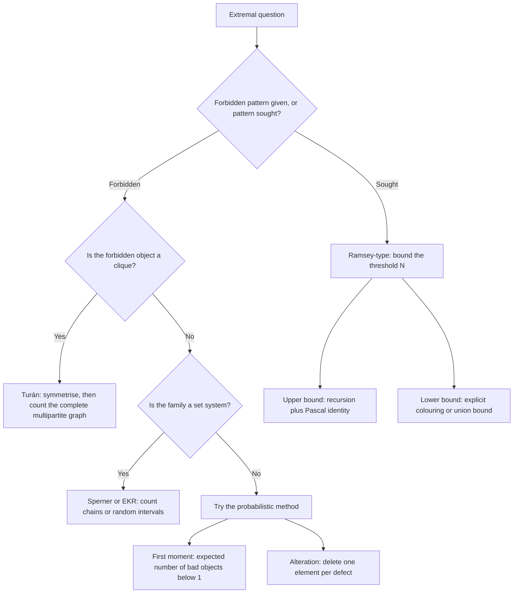

# Extremal Combinatorics

> [Mathematics](../../README.md) › [Combinatorics](../README.md) › Extremal Combinatorics · Level: Advanced · Prerequisites: [Counting Principles](../01-counting-principles/README.md), [The Pigeonhole Principle](../03-pigeonhole-principle/README.md), [Graph Basics](../../21-graph-theory/01-graph-basics/README.md), [Probability Foundations](../../10-probability/01-probability-foundations/README.md), [Expectation and Variance](../../10-probability/05-expectation-and-variance/README.md) · Estimated time: 540 min

## 1. Introduction

Most of combinatorics counts structures. Extremal combinatorics asks a different question: *how large can a structure be before it is forced to contain a pattern that is forbidden?* The answer is always a pair of statements — an upper bound saying the pattern cannot be avoided beyond some size, and an explicit construction showing that one object fewer can still avoid it. Neither half is worth much without the other.

Four theorems form the classical core, and each is the template for a whole industry.

* **Turán's theorem (1941).** A graph on $n$ vertices with no $K_{r+1}$ has at most $\left(1-\frac1r\right)\frac{n^2}{2}$ edges, approximately, and the exact maximum is attained by the complete $r$-partite graph with parts as equal as possible. The forbidden pattern is a clique; the extremal object is balanced.
* **Ramsey's theorem (1930).** However you two-colour the edges of a large complete graph, some colour contains a large complete subgraph. The smallest $N$ forcing a red $K_3$ or a blue $K_4$, for instance, is $9$; forcing a red or blue $K_3$ is $6$.
* **Sperner's theorem (1928).** A family of subsets of $[n]$ in which no member contains another has at most $\binom{n}{\lfloor n/2\rfloor}$ members, attained by all subsets of the middle size.
* **The Erdős–Ko–Rado theorem (1961).** If every two members of a family of $k$-subsets of $[n]$ intersect, and $n \ge 2k$, the family has at most $\binom{n-1}{k-1}$ members, attained by all $k$-subsets containing a fixed element.

Running through them is a small set of techniques, and learning the techniques is more valuable than memorising the statements:

1. **Symmetrisation.** If an extremal object is not symmetric, replace part of it by a copy of a more regular part. Turán's theorem is proved this way: a vertex of maximum degree can be cloned onto its non-neighbours without creating the forbidden clique.
2. **Double counting and averaging.** Count pairs or chains in two ways to derive an inequality; this gives Mantel's theorem, Sperner's theorem and the LYM inequality.
3. **Probability.** Choose a random object and show that the probability of containing the forbidden pattern is less than $1$. Erdős's 1947 proof that $R(k,k) > 2^{k/2}$ launched the *probabilistic method*, now one of the most used tools in combinatorics and theoretical computer science.
4. **Augmenting structures.** Build a maximum matching or a maximum chain and show that a violating configuration could be enlarged. Hall's theorem is proved this way.

The subject is also where combinatorics meets the rest of mathematics: the same extremal question appears as a sphere-packing bound in coding theory, as a guarantee of unavoidable subnetworks in network design, as the existence of a schedule in operations research, and as the statement that every large enough structure contains a prescribed sub-structure — the theme of Ramsey theory.

## 2. Prerequisites

* **Counting: binomial coefficients, double counting, the sum and product rules.** Every proof below counts something twice or counts a family of objects. Taught in [Counting Principles](../01-counting-principles/README.md), Sections 5 and 7.
* **The pigeonhole principle, including its generalised form.** The upper bound for $R(3,3)$ is a pigeonhole argument at a vertex, and the sharpness arguments are extremal examples of the same kind. Taught in [The Pigeonhole Principle](../03-pigeonhole-principle/README.md), Sections 5 and 7.
* **Graph vocabulary: vertices, edges, degree, complete graph $K_n$, complete bipartite graph, complement, clique, independent set, matching.** Taught in [Graph Basics](../../21-graph-theory/01-graph-basics/README.md). The systematic treatment of matchings is in [Paths and Connectivity](../../21-graph-theory/03-paths-and-connectivity/README.md); we prove Hall's theorem here and link there for its consequences.
* **Basic probability: finite sample spaces, uniform distribution, events, independence; expectation, linearity of expectation, Markov's inequality.** The probabilistic method is Section 7.4. Taught in [Probability Foundations](../../10-probability/01-probability-foundations/README.md) and [Expectation and Variance](../../10-probability/05-expectation-and-variance/README.md).
* **Proof by induction, including strong induction, and proof by contradiction.** Turán's theorem is proved by induction on the number of parts; Ramsey's theorem by induction on $r+s$; Hall's theorem by induction on $\lvert A\rvert$. Taught in [Proof Techniques](../../00-foundations/04-proof-techniques/README.md) and [Mathematical Induction](../../09-discrete-mathematics/01-mathematical-induction/README.md).
* **Asymptotic notation $O$, $\Omega$, $\Theta$, $o$.** Used to state extremal results up to constant factors. Taught in [Algorithms and Complexity](../../09-discrete-mathematics/03-algorithms-and-complexity/README.md).

Conventions. A graph is finite, simple and undirected unless stated otherwise; $v(G)$ and $e(G)$ are its numbers of vertices and edges. $K_n$ is the complete graph on $n$ vertices and $K_{r,s}$ the complete bipartite graph with parts of sizes $r$ and $s$. $[n] = \{1,\dots,n\}$ and $2^{[n]}$ is the power set. A **family** of subsets is a set of sets, and $\binom{[n]}{k}$ denotes the set of all $k$-element subsets of $[n]$.

## 3. Learning Objectives

By the end of this tutorial you will be able to:

1. Define the extremal number $\operatorname{ex}(n,H)$ and explain why an extremal statement needs both an upper bound and a construction.
2. State Turán's theorem with its hypotheses, describe the Turán graph $T_r(n)$, and compute $t_r(n)$ from the part sizes and from the closed formula.
3. Prove Turán's theorem by symmetrisation and induction on the number of parts, and recover Mantel's theorem as the case $r = 2$.
4. Prove that $\operatorname{ex}(n,K_3) = \lfloor n^2/4\rfloor$ by a second, essentially different argument (degree sums).
5. State Ramsey's theorem, prove $R(3,3) = 6$ (both bounds), and prove $R(3,4) = 9$ (upper bound by degrees and handshake parity, lower bound by an explicit colouring of $K_8$).
6. Prove the Erdős–Szekeres bound $R(r,s) \le \binom{r+s-2}{r-1}$ and explain why it is far from sharp.
7. Prove the probabilistic lower bound $R(k,k) > 2^{k/2}$, stating exactly where the union bound and the estimate $\binom{n}{k} \le n^k/k!$ enter.
8. Use the first-moment method and the alteration method, and explain the difference between "probability less than $1$" and "expected value argument".
9. State and prove Sperner's theorem, state and prove the LYM inequality, and explain why LYM implies Sperner.
10. State the Erdős–Ko–Rado theorem, give the star as the extremal example, and prove the theorem in the case of intervals on a circle (Katona's argument).
11. State Hall's theorem, prove it by induction, and derive the defect form and the corollary that every regular bipartite graph has a perfect matching.
12. Explain applications to coding theory (sphere-packing bound), network design (Turán-type limits), and scheduling (Hall-type feasibility).

## 4. Intuition

### 4.1 The extremal question

Picture a complete graph and a devil who colours some of its edges red and the rest blue. You want a red triangle; the devil wants to prevent it. How large must the graph be before the devil loses? That is Ramsey's question. Now suppose instead that you may *choose* the graph, that you want as many edges as possible, and that a certain subgraph is forbidden — you are the devil. How many edges can you keep? That is Turán's question.

Both questions have the same shape: a parameter (number of edges, number of vertices, size of a family) is pushed to its extreme subject to a constraint. The answer is always an *extremal number* plus a description of the structures attaining it. The description matters: "at most $6$ edges" is a bound, but "$6$ edges, and exactly the graph $K_{2,3}$" is a theorem.

### 4.2 Balance is optimal

Every classical extremal example is *balanced* or *symmetric*. Why? Suppose you are building a graph with many edges but no large clique. A complete bipartite graph has no triangle at all and roughly $n^2/4$ edges; splitting the vertices into two unequal parts wastes edges, since the smaller part limits the count. Forbidding $K_{r+1}$ instead of $K_3$ leaves no reason to use two parts, and $r$ parts are better: each part is an independent set, and all edges between different parts are present. Balanced parts maximise the count because the number of missing edges, $\sum_i \binom{n_i}{2}$, is a convex function of the part sizes.

The same instinct explains the other theorems. Sperner's extremal family is the middle layer, the most "balanced" layer of the Boolean lattice. Erdős–Ko–Rado's extremal family is a star, the most concentrated possible intersecting family. In each case the extremal object is the one that concentrates the constraint where it does least damage.

### 4.3 The extremal example is half the theorem

Beginners prove the upper bound and stop. That is a mistake. "Among any $6$ people there are three mutual acquaintances or three mutual strangers" is a theorem about $6$; the fact that $5$ people can be arranged with no such triple is what makes $6$ the right number. Without the construction, an upper bound of $6$ might be an upper bound of $100$ in disguise.

The constructions in this topic are worth memorising because they recur: the $5$-cycle for $R(3,3)$, the Möbius ladder for $R(3,4)$, the Turán graph for Turán's theorem, the middle layer for Sperner, the star for EKR.

### 4.4 Randomness proves existence

Here is a thought that took mathematics by surprise in 1947: to prove that an object exists, it is enough to exhibit a probability distribution under which a random object has the desired property with positive probability. You never see the object; you only prove it must be somewhere.

Erdős applied this to Ramsey numbers. Colour the edges of $K_n$ independently at random. The expected number of monochromatic $K_k$'s is small when $n$ is somewhat below $2^{k/2}$; if the expectation is less than $1$, some colouring has *no* monochromatic $K_k$ at all, so $R(k,k) > n$. The argument is non-constructive, short, and gives results that no explicit construction matched for decades — which is exactly why the method became central.

### 4.5 Why the tools repeat

Four techniques suffice for this whole topic, and each is an instance of a general strategy:

| Technique | General strategy | Theorems |
|---|---|---|
| Symmetrisation | replace an extremal object by a more symmetric one without losing the property | Turán |
| Double counting | count one set of objects in two ways to get an inequality | Mantel, Sperner, LYM |
| Probability | show a random object fails with probability $<1$ | Ramsey lower bound, alteration |
| Augmentation | a maximal object that is not maximum can be enlarged | Hall, matching |

Recognising which technique applies is the real skill; the statements can always be looked up.

## 5. Formal Definition

### 5.1 The extremal number

Let $H$ be a graph. A graph $G$ is **$H$-free** if it contains no subgraph isomorphic to $H$. Define

$$\operatorname{ex}(n,H) = \max\{e(G) : v(G) = n,\ G \text{ is } H\text{-free}\},$$

the **extremal number** (or Turán number) of $H$. More generally, for a family $\mathcal{H}$ of graphs, $\operatorname{ex}(n,\mathcal{H})$ is the maximum number of edges in an $n$-vertex graph containing no member of $\mathcal{H}$ as a subgraph. A graph attaining the maximum is an **extremal graph**.

Two elementary facts follow from the definition:

* $\operatorname{ex}(n,H)$ is non-decreasing in $n$ (add an isolated vertex);
* if $H' \subseteq H$ then $\operatorname{ex}(n,H') \le \operatorname{ex}(n,H)$ (fewer forbidden graphs means a larger maximum).

### 5.2 Colourings and Ramsey numbers

A **two-colouring** of the edges of $K_N$ is a function $\chi : \binom{[N]}{2} \to \{\text{red},\text{blue}\}$. A set $S \subseteq [N]$ is **red** if every edge inside $S$ is red; similarly blue. For integers $r, s \ge 1$ the **Ramsey number** $R(r,s)$ is the least $N$ such that every two-colouring of $K_N$ contains a red $K_r$ or a blue $K_s$. Equivalently, it is least $N$ such that every graph on $N$ vertices contains $K_r$ or its complement contains $K_s$.

The definition presupposes that such an $N$ exists; that is Ramsey's theorem, proved in Section 7.3.

### 5.3 Antichains and intersecting families

Let $2^{[n]}$ be the Boolean lattice ordered by inclusion. A **chain** is a family $A_1 \subsetneq A_2 \subsetneq \cdots \subsetneq A_m$; an **antichain** is a family in which no member contains another. A family $\mathcal{F} \subseteq \binom{[n]}{k}$ is **intersecting** if $A \cap B \ne \varnothing$ for all $A, B \in \mathcal{F}$. A **star** is a family of the form $\{A \in \binom{[n]}{k} : x \in A\}$ for a fixed $x$.

### 5.4 Matchings and Hall's condition

Let $G$ be a bipartite graph with parts $A$ and $B$. A **matching** is a set of pairwise disjoint edges; it **saturates** $A$ (or is an $A$-saturating matching) if every vertex of $A$ is incident with a matching edge. For $S \subseteq A$, $N(S)$ denotes the set of neighbours of vertices of $S$ in $B$. **Hall's condition** is

$$\lvert N(S)\rvert \ge \lvert S \rvert \qquad \text{for every } S \subseteq A .$$

### 5.5 Asymptotic language

For functions $f, g$ of $n$: $f = O(g)$ means $\lvert f\rvert \le C\lvert g\rvert$ for a constant $C$ and all large $n$; $f = \Omega(g)$ means $g = O(f)$; $f = \Theta(g)$ means both; $f = o(g)$ means $f/g \to 0$. Statements such as $\operatorname{ex}(n,K_3) = \Theta(n^2)$ describe the order of growth and are sharper than $O(n^2)$ alone when a matching lower bound is given.

### 5.6 Extremal versus Ramsey: two directions

The two questions in Section 4.1 should be kept apart.

* In an **extremal** problem the pattern is forbidden and the *graph* is chosen to maximise a parameter. The answer is a number and an extremal construction.
* In a **Ramsey** problem the pattern is sought and the *colouring* is chosen by an adversary. The answer is a threshold $N$ above which the pattern cannot be avoided.

The techniques overlap — Turán's theorem is used inside proofs of Ramsey bounds — but the quantifiers are opposite, and confusing them produces wrong proofs.

## 6. Mathematical Notation

| Symbol | Read as | Meaning |
|---|---|---|
| $\operatorname{ex}(n,H)$ | extremal number | max edges in an $n$-vertex $H$-free graph |
| $K_n$ | complete graph | every pair adjacent |
| $K_{r,s}$ | complete bipartite graph | parts of sizes $r$ and $s$, all cross edges |
| $\overline{G}$ | complement of $G$ | edges exactly where $G$ has none |
| $T_r(n)$ | Turán graph | complete $r$-partite graph on $n$ vertices with balanced parts |
| $t_r(n)$ | — | $e(T_r(n))$ |
| $\omega(G)$, $\alpha(G)$ | clique number, independence number | largest clique, largest independent set |
| $d(v)$ | degree of $v$ | number of edges at $v$ |
| $N(S)$ | neighbourhood of $S$ | all vertices adjacent to some vertex of $S$ |
| $R(r,s)$ | Ramsey number | least $N$ forcing red $K_r$ or blue $K_s$ |
| $\binom{[n]}{k}$ | — | all $k$-element subsets of $[n]$ |
| $\lvert \mathcal{F} \rvert$ | size of a family | number of sets in $\mathcal{F}$ |
| $\sum_{A \in \mathcal{F}}$ | — | sum over the members of $\mathcal{F}$ |
| $\operatorname{Pr}$, $\mathbb{E}$ | probability, expectation | see the probability prerequisites |
| $\mathbf{1}_{A}$ | indicator of event $A$ | $1$ if $A$ occurs, else $0$ |
| $G(n,p)$ | Erdős–Rényi random graph | each edge present independently with probability $p$ |
| $\Theta$, $O$, $\Omega$, $o$ | — | asymptotic comparison (Section 5.5) |

Two notational points. First, $T_r(n)$ is a *graph*, $t_r(n)$ its *edge count*; the lower-case symbol is used constantly in inequalities. Second, $\overline{G}$ is the complement, so "a graph with no $K_r$ but with many edges" and "a graph whose complement has no independent set of size $r$" are the same statement.

## 7. Core Concepts

### 7.1 The extremal question

The first examples calibrate the definition.

| Forbidden $H$ | $\operatorname{ex}(n,H)$ | Reason |
|---|---|---|
| $K_2$ | $0$ | a $K_2$-free graph has no edges |
| $K_3$ | $\lfloor n^2/4\rfloor$ | Mantel's theorem, Section 7.2 |
| $K_{r+1}$ | $t_r(n) = \left(1-\frac1r\right)\frac{n^2}{2} + O(n)$ | Turán's theorem, Section 7.2 |
| $C_4$ | $\Theta(n^{3/2})$ | Kővári–Sós–Turán upper bound, projective-plane lower bound; Exercise 36 |
| $K_{s,t}$ | $O(n^{2-1/s})$ | Kővári–Sós–Turán theorem, quoted |

Two general phenomena are visible. When the forbidden graph is non-bipartite, the extremal number is $\Theta(n^2)$: the extremal graph is a complete multipartite graph with a bounded number of parts, and the exact value is given by Turán's theorem (or by the Erdős–Stone–Simonovits theorem, which states $\operatorname{ex}(n,H) = \left(1 - \frac{1}{\chi(H)}\right)\frac{n^2}{2} + o(n^2)$ for every graph $H$ with chromatic number $\chi(H) \ge 3$). When the forbidden graph is bipartite, no complete multipartite graph helps, and the extremal number is genuinely smaller — $O(n^{2-1/s})$ for $K_{s,t}$, and unknown even for $K_{4,4}$ beyond constant factors.

The definition immediately yields the two monotonicity facts of Section 5.1, and one more useful principle: if $G$ is $H$-free with $n$ vertices, then every induced subgraph on $m$ vertices is also $H$-free, so $\operatorname{ex}(m,H) \ge e(G[\text{any } m\text{-set}])$. Averaging this inequality over all $m$-sets gives a lower bound on $\operatorname{ex}(m,H)$ from any constraint on the average degree of an $n$-vertex $H$-free graph; this is the standard route from a global edge bound to a local one.

### 7.2 Turán's theorem

**Definition 7.1 (Turán graph).** Let $n \ge r \ge 1$. The **Turán graph** $T_r(n)$ is the complete $r$-partite graph on $n$ vertices whose parts have sizes as equal as possible, namely $\lfloor n/r\rfloor$ or $\lceil n/r\rceil$. Write $t_r(n) = e(T_r(n))$.

Writing $n = qr + s$ with $0 \le s < r$, the parts are $s$ copies of $q+1$ and $r-s$ copies of $q$, so

$$t_r(n) = \binom{n}{2} - s\binom{q+1}{2} - (r-s)\binom{q}{2} = \left(1 - \frac1r\right)\frac{n^2}{2} - \frac{s(r-s)}{2r}.$$

For instance $t_2(5) = 6$ (parts $3,2$), $t_3(7) = 16$ (parts $3,2,2$), $t_3(10) = 33$ (parts $4,3,3$) and $t_4(10) = 37$ (parts $3,3,2,2$).

**Lemma 7.2 (convexity).** Let $n_1 + \cdots + n_r = n$ with $n_i \ge 0$. Then

$$\sum_{i=1}^{r}\binom{n_i}{2} \;\ge\; s\binom{q+1}{2} + (r-s)\binom{q}{2},$$

with equality exactly when all parts are $\lfloor n/r\rfloor$ or $\lceil n/r\rceil$. Consequently every complete $r$-partite graph on $n$ vertices has at most $t_r(n)$ edges.

**Proof.** If two parts satisfy $n_i \ge n_j + 2$, move one vertex from part $i$ to part $j$. The sum $\sum_k \binom{n_k}{2}$ changes by

$$-\binom{n_i}{2} + \binom{n_i-1}{2} + \binom{n_j+1}{2} - \binom{n_j}{2} = -(n_i-1) + n_j = n_j - n_i + 1 \le -1,$$

so it strictly decreases. Repeating, the sum decreases until no two parts differ by $2$ or more, i.e. until all parts are $\lfloor n/r\rfloor$ or $\lceil n/r\rceil$; the minimum is therefore the balanced value, and since $e = \binom{n}{2} - \sum_i\binom{n_i}{2}$ the edge count is maximised there. $\blacksquare$

**Theorem 7.3 (Turán, 1941).** Let $r \ge 1$ and $n \ge r$. Every graph on $n$ vertices with no $K_{r+1}$ has at most $t_r(n)$ edges, and $T_r(n)$ attains this bound.

**Proof (by induction on $r$).** The case $r = 1$ says that a $K_2$-free graph has no edges, and $t_1(n) = 0$ ✓.

Assume the theorem known for $r-1$ and all numbers of vertices. Let $G$ be $K_{r+1}$-free on $n$ vertices with the maximum possible number of edges, and let $v$ be a vertex of maximum degree $\Delta$.

*Step 1: clone $v$ onto its non-neighbours.* For each vertex $u$ that is not adjacent to $v$, define $G_u$ by deleting all edges at $u$ and joining $u$ to every vertex of $N(v)$ (so $u$ remains non-adjacent to $v$). Then $d_{G_u}(u) = \lvert N(v)\rvert = \Delta \ge d_G(u)$, so $e(G_u) \ge e(G)$, and $G_u$ is $K_{r+1}$-free: any $(r+1)$-clique of $G_u$ containing $u$ would consist of $u$ together with $r$ pairwise adjacent vertices of $N(v)$, and those $r$ vertices together with $v$ would form a $K_{r+1}$ in $G_u$ — hence in $G$, since $G_u$ and $G$ agree on all vertices except $u$. Contradiction.

Performing this operation for every non-neighbour of $v$ in turn gives a $K_{r+1}$-free graph $G'$ with $e(G') \ge e(G)$ in which every non-neighbour of $v$ is adjacent to exactly the vertices of $N(v)$. (Each operation leaves $N(v)$ unchanged, because the vertex being cloned is not adjacent to $v$.)

*Step 2: count the edges of $G'$.* Write $A = N(v)$ and $B$ for the set of non-neighbours of $v$; then $\lvert A\rvert = \Delta$ and $\lvert B\rvert = n - 1 - \Delta$. By construction $B$ is independent and every vertex of $B$ is joined to every vertex of $A$. Hence

$$e(G') = \Delta + e(G'[A]) + \Delta\,\lvert B\rvert = e(G'[A]) + \Delta\,(n - \Delta).$$

*Step 3: apply the induction.* The graph $G'[A]$ has $\Delta$ vertices and is $K_r$-free (a $K_r$ in $A$, together with $v$, would be a $K_{r+1}$). By the induction hypothesis, $e(G'[A]) \le t_{r-1}(\Delta)$.

*Step 4: compare with $t_r(n)$.* The number $t_{r-1}(\Delta)$ is the edge count of a complete $(r-1)$-partite graph on $\Delta$ vertices with balanced parts. Adding one further part of size $n - \Delta$ and joining it completely to the others produces a complete $r$-partite graph on $n$ vertices with

$$t_{r-1}(\Delta) + \Delta\,(n-\Delta)$$

edges. By Lemma 7.2 every complete $r$-partite graph on $n$ vertices has at most $t_r(n)$ edges. Therefore

$$e(G) \le e(G') \le t_{r-1}(\Delta) + \Delta(n-\Delta) \le t_r(n).$$

Finally $T_r(n)$ is $K_{r+1}$-free (each part is an independent set, so a clique meets each part at most once and has at most $r$ vertices) and has $t_r(n)$ edges, so the bound is attained. $\blacksquare$

**Remark 7.4 (equality).** Tracking the inequalities shows that equality forces every step to be an equality: every non-neighbour $u$ of $v$ must have $d(u) = \Delta$, the graph $G'[A]$ must itself be an extremal $(r-1)$-partite graph, and the part sizes must be balanced. This yields the classical fact that $T_r(n)$ is the unique extremal graph. We state it without proof, since it requires a careful analysis of the cloning step for equal degrees.

**Example 7.5 (Mantel's theorem).** Taking $r = 2$ in Theorem 7.3: every triangle-free graph on $n$ vertices has at most

$$t_2(n) = \left\lfloor \frac{n^2}{4}\right\rfloor$$

edges, with equality for the complete bipartite graph $K_{\lfloor n/2\rfloor, \lceil n/2\rceil}$. This is Mantel's theorem (1907), the earliest extremal result.

**Proof 2 of Mantel's theorem (degree sums).** Let $G$ be triangle-free with $m$ edges and degrees $d_v$. For an edge $uv$, the neighbourhoods $N(u)$ and $N(v)$ have no common vertex: a common neighbour $w$ would give the triangle $u,v,w$. Hence $d(u) + d(v) \le n$.

Summing this inequality over all edges, each vertex $v$ contributes $d(v)$ once for each of its $d(v)$ incident edges, so

$$\sum_{v}d(v)^2 = \sum_{uv \in E}\big(d(u)+d(v)\big) \le mn .$$

By the Cauchy–Schwarz inequality, $(\sum_v d(v))^2 \le n\sum_v d(v)^2$, i.e. $(2m)^2 \le n\cdot mn = mn^2$, so $4m^2 \le mn^2$ and, for $m > 0$, $m \le n^2/4$; since $m$ is an integer, $m \le \lfloor n^2/4\rfloor$. $\blacksquare$

The two proofs are genuinely different: the first is structural (find the extremal graph), the second is analytic (an inequality between degree moments).

**Corollary 7.6 (degree form).** If $G$ is $K_{r+1}$-free on $n$ vertices, then $G$ has a vertex of degree at most $\left(1 - \frac1r\right)n$. More precisely, the average degree is at most $\frac{2t_r(n)}{n} \le \left(1-\frac1r\right)n$.

**Proof.** $2e(G) \le 2t_r(n) = \left(1-\frac1r\right)n^2 - \frac{s(r-s)}{r} \le \left(1-\frac1r\right)n^2$, so the average degree $2e/n$ is at most $\left(1-\frac1r\right)n$, and some vertex has degree at most the average. $\blacksquare$

### 7.3 Ramsey's theorem

**Definition 7.7.** For integers $r,s \ge 1$, $R(r,s)$ is the least $N$ such that every two-colouring of the edges of $K_N$ contains a red $K_r$ or a blue $K_s$.

The complement formulation is often convenient: $R(r,s)$ is the least $N$ such that every graph on $N$ vertices contains $K_r$ or has an independent set of size $s$ (colour edges of the graph red and non-edges blue).

**Proposition 7.8 (elementary values).** (a) $R(1,s) = 1$ for all $s \ge 1$. (b) $R(2,s) = s$ for all $s \ge 2$. (c) $R(r,s) = R(s,r)$.

**Proof.** (a) A single vertex is a red $K_1$, so $N = 1$ works, and no smaller positive $N$ exists. (b) In any colouring of $K_s$, either there is a red edge (a red $K_2$) or all edges are blue, giving a blue $K_s$; so $R(2,s) \le s$. And colouring all edges of $K_{s-1}$ blue gives no red edge and no blue $K_s$, so $R(2,s) > s-1$. (c) Swapping the names of the colours turns a red $K_r$/blue $K_s$ problem into a red $K_s$/blue $K_r$ problem. $\blacksquare$

**Theorem 7.9.** $R(3,3) = 6$.

**Proof.** *Upper bound $R(3,3) \le 6$.* Take any two-colouring of $K_6$ and any vertex $v$. The five edges at $v$ are coloured red or blue, so at least three of them have the same colour (pigeonhole: $\lceil 5/2\rceil = 3$). Suppose three are red, joining $v$ to $a,b,c$. If any of the edges $ab, bc, ca$ is red, that edge together with $v$ forms a red triangle. If none is red, all three are blue and $a,b,c$ form a blue triangle. The argument with blue in place of red is identical. Hence every colouring of $K_6$ has a monochromatic triangle.

*Lower bound $R(3,3) > 5$.* Colour the edges of $K_5$ whose vertices are the cyclic group $\mathbb{Z}_5$: red if the difference is $\pm 1 \pmod 5$, blue if it is $\pm 2 \pmod 5$. The red graph is a $5$-cycle, which has no triangle; the blue graph is the complement of a $5$-cycle, which is again a $5$-cycle, hence also has no triangle. So $K_5$ admits a colouring with no monochromatic triangle. Therefore $R(3,3) = 6$. $\blacksquare$

**Theorem 7.10.** $R(3,4) = 9$.

**Proof.** *Upper bound $R(3,4) \le 9$.* Suppose, for contradiction, that $K_9$ is two-coloured with no red triangle and no blue $K_4$.

For any vertex $v$, the set $N_R(v)$ of red neighbours of $v$ contains no red edge — such an edge with $v$ would be a red triangle — so $N_R(v)$ is a blue clique, and it has at most $3$ vertices because there is no blue $K_4$. Hence

$$d_R(v) \le 3 \qquad \text{for every vertex } v.$$

*Claim.* Some vertex has $d_R(v) \le 2$. If not, then $d_R(v) = 3$ for all nine vertices, so $\sum_v d_R(v) = 27$; but the handshake lemma says the sum of all degrees of a graph equals $2e_R$, an even number. Contradiction.

So take $v$ with $d_R(v) \le 2$; then $d_B(v) = 8 - d_R(v) \ge 6$. Choose six blue neighbours of $v$; by Theorem 7.9 applied to the colouring restricted to these six vertices, they contain a monochromatic triangle. A red triangle is impossible (there is none in the whole colouring), so they contain a blue triangle, and together with $v$ — which is joined to all of them in blue — that is a blue $K_4$. Contradiction. Hence $R(3,4) \le 9$.

*Lower bound $R(3,4) > 8$.* Colour $K_8$ with vertex set $\mathbb{Z}_8$ as follows: edges of the $8$-cycle ($i$ adjacent to $i\pm1$) and the four "diameters" ($i$ adjacent to $i+4$) are red; all remaining edges are blue. The red graph is the **Möbius ladder** $V_8$.

*Red has no triangle.* A triangle in $V_8$ either lies inside the cycle $C_8$ (impossible: a cycle has no triangle) or uses a diameter $\{i, i+4\}$. A vertex adjacent to both $i$ and $i+4$ would have to be one of $i\pm1$ (neighbours of $i$) and one of $i+3, i+5$ (neighbours of $i+4$), and no vertex is in both sets.

*Blue has no $K_4$.* A blue $K_4$ is an independent set of size $4$ in the red graph. The independent $4$-sets of the cycle $C_8$ are exactly the two alternating sets $\{0,2,4,6\}$ and $\{1,3,5,7\}$: a $4$-set in an $8$-cycle with no two cyclically adjacent must alternate around the cycle. But $\{0,2,4,6\}$ contains the diameters $0\!-\!4$ and $2\!-\!6$, and $\{1,3,5,7\}$ contains $1\!-\!5$ and $3\!-\!7$, so neither is independent in $V_8$. Hence the red independence number is at most $3$, i.e. blue has no $K_4$.

So $K_8$ admits a colouring with no red triangle and no blue $K_4$, and $R(3,4) = 9$. $\blacksquare$

**Theorem 7.11 (Erdős–Szekeres bound).** For $r,s \ge 2$,

$$R(r,s) \;\le\; \binom{r+s-2}{r-1}.$$

In particular $R(k,k) \le \binom{2k-2}{k-1} < 4^{k-1}$, so Ramsey numbers are finite.

**Proof.** First, the recursion

$$R(r,s) \le R(r-1,s) + R(r,s-1).$$

Let $N = R(r-1,s) + R(r,s-1)$ and take any two-colouring of $K_N$. Fix a vertex $v$. Its $N-1$ incident edges split into $d_R$ red and $d_B$ blue with $d_R + d_B = N-1$, so either $d_R \ge R(r-1,s)$ or $d_B \ge R(r,s-1)$.

In the first case, choose a set $S$ of $R(r-1,s)$ red neighbours of $v$. By definition of $R(r-1,s)$, the colouring restricted to $S$ contains a red $K_{r-1}$ (which with $v$ forms a red $K_r$) or a blue $K_s$; either way we are done. In the second case, choose $R(r,s-1)$ blue neighbours and apply the definition of $R(r,s-1)$: they contain a blue $K_{s-1}$ (which with $v$ forms a blue $K_s$) or a red $K_r$. Hence every colouring of $K_N$ has the required monochromatic clique.

Now the bound follows by induction on $r+s$ using Pascal's identity: for $r, s \ge 2$,

$$\binom{r+s-3}{r-2} + \binom{r+s-3}{r-1} = \binom{r+s-2}{r-1},$$

with the base cases $R(1,s) = 1 = \binom{s-1}{0}$ and $R(2,s) = s \le \binom{s}{1} = s$. $\blacksquare$

**Theorem 7.12 (Ramsey, 1930).** For all $r,s \ge 1$ the number $R(r,s)$ exists; equivalently, every two-colouring of the edges of a sufficiently large complete graph contains a monochromatic $K_r$.

**Proof.** Immediate from Theorem 7.11 and Proposition 7.8. $\blacksquare$

The infinitary form is often the most useful statement: for every $r$ and every two-colouring of the edges of the infinite complete graph on $\mathbb{N}$, there is an infinite set all of whose edges have the same colour. That is proved by iterating the pigeonhole principle (choose a vertex, take an infinite set of edges of one colour at it, and recurse), and it implies the finite version by a compactness argument.

**Table of known Ramsey numbers.** Very few values are known exactly.

| $r \backslash s$ | 2 | 3 | 4 | 5 | 6 | 7 | 8 | 9 |
|---|---|---|---|---|---|---|---|---|
| 2 | 2 | 3 | 4 | 5 | 6 | 7 | 8 | 9 |
| 3 | 3 | **6** | **9** | **14** | **18** | **23** | **28** | **36** |
| 4 | 4 | 9 | **18** | **25** | — | — | — | — |
| 5 | 5 | 14 | 25 | — | — | — | — | — |

The exact value of $R(5,5)$ is unknown, and so is that of every entry marked with a dash. Bounds such as $2^{k/2} < R(k,k) < 4^{k}$ (Section 7.4 and Theorem 7.11) are all that is known in general, a gap that has resisted improvement in the exponent for more than seventy years.

### 7.4 The probabilistic method

**Lemma 7.13 (union bound).** For events $A_1,\dots,A_m$ in a finite probability space,

$$\Pr\Big(\bigcup_{i=1}^{m}A_i\Big) \le \sum_{i=1}^{m}\Pr(A_i).$$

**Proof.** By induction on $m$. For $m = 1$ it is an equality. For $m \ge 2$, writing $B = A_1 \cup \cdots \cup A_{m-1}$,

$$\Pr(B \cup A_m) \le \Pr(B) + \Pr(A_m) \le \sum_{i=1}^{m-1}\Pr(A_i) + \Pr(A_m),$$

where the first inequality uses $\Pr(B \cup A_m) = \Pr(B) + \Pr(A_m) - \Pr(B \cap A_m) \le \Pr(B) + \Pr(A_m)$. $\blacksquare$

The union bound needs no independence, which is why it is so widely applicable.

**Theorem 7.14 (Erdős, 1947).** For every $k \ge 3$,

$$R(k,k) > 2^{k/2}.$$

**Proof.** Let $n = \lfloor 2^{k/2}\rfloor$ and colour each edge of $K_n$ red or blue independently, uniformly at random, so that each of the $2^{\binom n2}$ colourings is equally likely. For a $k$-element set $S$ let $A_S$ be the event that all $\binom k2$ edges inside $S$ receive the same colour. Since the edges are independent and each monochromatic pattern has probability $2^{-\binom k2}$,

$$\Pr(A_S) = 2\cdot 2^{-\binom k2} = 2^{1-\binom k2}.$$

By the union bound,

$$\Pr\Big(\bigcup_{S}\Big) \le \binom nk\,2^{1-\binom k2} \le \frac{n^k}{k!}\,2^{1-\binom k2} \le \frac{2^{k^2/2}}{k!}\,2^{1-k(k-1)/2} = \frac{2^{1+k/2}}{k!},$$

using $\binom nk \le n^k/k!$ and $n \le 2^{k/2}$. Now $2^{1+k/2} < k!$ for $k \ge 3$: at $k = 3$ it reads $2^{2.5} = 5.66 < 6$, and the ratio $k!/2^{1+k/2}$ is multiplied by more than $1$ when $k$ increases, since $(k+1)/\sqrt2 > 1$.

Hence $\Pr(\text{some monochromatic } K_k) < 1$, so with positive probability a colouring has no monochromatic $K_k$. Such a colouring exists, whence $R(k,k) > n = \lfloor 2^{k/2}\rfloor$, i.e. $R(k,k) \ge \lfloor 2^{k/2}\rfloor + 1 > 2^{k/2}$. $\blacksquare$

**Numerical table.** The largest $n$ for which this argument certifies a colouring, as a function of $k$:

| $k$ | 3 | 4 | 5 | 6 | 7 | 8 | 9 |
|---|---|---|---|---|---|---|---|
| largest $n$ with $\binom nk 2^{1-\binom k2} < 1$ | 3 | 6 | 11 | 17 | 27 | 42 | 65 |
| $2^{k/2}$ | 2.83 | 4.00 | 5.66 | 8.00 | 11.31 | 16.00 | 22.63 |

The certified values exceed $2^{k/2}$ by a factor that grows slowly with $k$, because the estimate $\binom nk \le n^k/k!$ and the union bound leave some room; the clean statement $R(k,k) > 2^{k/2}$ records only the leading exponential order.

**The first-moment method.** Markov's inequality states that for a non-negative random variable $X$ and $t > 0$,

$$\Pr(X \ge t) \le \frac{\mathbb{E}[X]}{t},$$

because $\mathbb{E}[X] \ge t\Pr(X \ge t)$. Taking $t = 1$ for an integer-valued $X$: if $\mathbb{E}[X] < 1$ then $\Pr(X \ge 1) < 1$, so $\Pr(X = 0) > 0$. That is the general principle behind Theorem 7.14, with $X$ the number of monochromatic $K_k$'s.

**The alteration method.** Sometimes a random object almost has the desired property: it has a few forbidden configurations. Then delete one element from each and control the damage. The recipe is:

1. choose a random object;
2. let $X$ be a parameter to be kept large and $Y$ the number of "defects";
3. show $\mathbb{E}[X - Y] > 0$, so some object satisfies $X - Y > 0$;
4. delete one element per defect: at least $X - Y$ units of the parameter survive and all defects are destroyed.

**Theorem 7.15.** For every $n \ge 3$ there is a triangle-free graph on $n$ vertices with at least $\tfrac13 n^{3/2} - \tfrac12\sqrt n$ edges.

**Proof.** Let $p = n^{-1/2}$ and let $G \sim G(n,p)$. Let $X = e(G)$ and let $Y$ be the number of triangles of $G$. Then

$$\mathbb{E}[X] = \binom n2p = \frac{n(n-1)}{2\sqrt n} \ge \frac{n^{3/2}}{2} - \frac{\sqrt n}{2}, \qquad \mathbb{E}[Y] = \binom n3p^3 \le \frac{n^3}{6}\cdot\frac{1}{n^{3/2}} = \frac{n^{3/2}}{6}.$$

Hence $\mathbb{E}[X - Y] \ge \frac{n^{3/2}}{3} - \frac{\sqrt n}{2}$, which is positive for $n \ge 2$. So some graph $G_0$ satisfies $X(G_0) - Y(G_0) \ge \frac{n^{3/2}}{3} - \frac{\sqrt n}{2}$. Delete one edge from each triangle of $G_0$: at most $Y(G_0)$ edges are deleted, the graph remains triangle-free, and at least

$$X(G_0) - Y(G_0) \ge \frac{n^{3/2}}{3} - \frac{\sqrt n}{2},$$

edges remain. $\blacksquare$

The bound is far weaker than Mantel's exact $\lfloor n^2/4\rfloor$, and that is the point: the alteration method is a blunt instrument that works for properties where nothing exact is known. Applying the same construction to $K_4$ (with $p = cn^{-1/2}$) gives $K_4$-free graphs with $\Omega(n^{3/2})$ edges, and applying it in the setting of $K_{2,2}$ gives nothing useful, because the expected number of $4$-cycles exceeds the expected number of edges. For $K_{2,2}$ the extremal order $\Theta(n^{3/2})$ is known — the upper bound is the Kővári–Sós–Turán theorem and the lower bound comes from incidence graphs of projective planes — but it is not the alteration method that supplies the construction.

**Limits.** The probabilistic method proves existence without exhibiting the object; the gap between $2^{k/2}$ and $4^k$ for $R(k,k)$ remains the central open problem of Ramsey theory, and no method — probabilistic or explicit — has improved the exponent.

### 7.5 Sperner's theorem and the LYM inequality

**Theorem 7.16 (Sperner, 1928).** If $\mathcal{F} \subseteq 2^{[n]}$ is an antichain, then

$$\lvert \mathcal{F}\rvert \le \binom{n}{\lfloor n/2\rfloor}.$$

The bound is attained by the family of all subsets of size $\lfloor n/2\rfloor$ (or of size $\lceil n/2\rceil$), which is an antichain because two distinct sets of the same size cannot contain one another.

**Proof (random maximal chains).** A **maximal chain** of $2^{[n]}$ is a chain $\varnothing \subsetneq \{x_1\} \subsetneq \{x_1,x_2\} \subsetneq \cdots \subsetneq [n]$; it is determined by the order in which the elements are added, i.e. by a permutation of $[n]$. There are $n!$ maximal chains, and we choose one uniformly at random.

Fix a set $A \subseteq [n]$ with $\lvert A\rvert = a$. The chain passes through $A$ exactly when the first $a$ elements of the permutation are the elements of $A$ in some order, which happens with probability

$$\Pr(A \in \text{chain}) = \frac{a!\,(n-a)!}{n!} = \frac{1}{\binom na}.$$

Now let $\mathcal{F}$ be an antichain. A chain contains at most one member of $\mathcal{F}$: if it contained $A \subsetneq B$ with both in $\mathcal{F}$, the antichain property would be violated. Hence the events $\{A \in \text{chain}\}$, $A \in \mathcal{F}$, are pairwise disjoint, and

$$1 \ge \Pr\Big(\bigcup_{A \in \mathcal{F}}\{A \in \text{chain}\}\Big) = \sum_{A\in\mathcal{F}}\Pr(A \in \text{chain}) = \sum_{A \in \mathcal{F}}\frac{1}{\binom{n}{\lvert A\rvert}}.$$

Since $\binom{n}{\lvert A\rvert} \le \binom{n}{\lfloor n/2\rfloor}$ for every $A$ (the binomial coefficients increase up to the middle), each term is at least $1/\binom{n}{\lfloor n/2\rfloor}$, so

$$1 \ge \frac{\lvert\mathcal{F}\rvert}{\binom{n}{\lfloor n/2\rfloor}}, \qquad\text{i.e.}\qquad \lvert\mathcal{F}\rvert \le \binom{n}{\lfloor n/2\rfloor}. \qquad \blacksquare$$

The argument proves more, and the extra strength is worth naming.

**Theorem 7.17 (LYM inequality; Lubell, Yamamoto, Mesalkin).** If $\mathcal{F} \subseteq 2^{[n]}$ is an antichain, then

$$\sum_{A \in \mathcal{F}}\frac{1}{\binom{n}{\lvert A\rvert}} \le 1 .$$

Theorem 7.16 follows because $\binom{n}{\lvert A\rvert} \le \binom{n}{\lfloor n/2\rfloor}$ turns the LYM inequality into $\lvert\mathcal{F}\rvert/\binom{n}{\lfloor n/2\rfloor} \le 1$. The LYM inequality is stronger: it says an antichain cannot even be spread out over many levels with the "quota" $1/\binom{n}{\lvert A\rvert}$ per set. For instance, in $2^{[4]}$ one may take all $4$ sets of size $3$ and $2$ of size $1$: the sum is $4/4 + 2/4 = 1.5 > 1$, so this family is not an antichain (indeed a $1$-set is contained in some of the $3$-sets).

**Theorem 7.18 (Erdős's $k$-Sperner theorem).** If $\mathcal{F} \subseteq 2^{[n]}$ contains no chain of $k+1$ sets, then $\lvert\mathcal{F}\rvert$ is at most the sum of the $k$ largest binomial coefficients $\binom ni$ with $0 \le i \le n$.

For $k = 1$ this is Sperner's theorem. We quote the general case; the proof is again by a chain-counting (or symmetric-chain) argument.

### 7.6 The Erdős–Ko–Rado theorem

**Theorem 7.19 (Erdős–Ko–Rado, 1961).** Let $n \ge 2k$ and let $\mathcal{F} \subseteq \binom{[n]}{k}$ be an intersecting family. Then

$$\lvert \mathcal{F}\rvert \le \binom{n-1}{k-1}.$$

The bound is attained by every **star**, the family of all $k$-sets containing a fixed element $x$: any two of them share $x$, and there are $\binom{n-1}{k-1}$ of them.

**Intuition.** Without the intersection requirement there are $\binom nk$ sets. Requiring every pair to intersect is a strong condition, and the cheapest way to satisfy it is to fix one common point — the star. The theorem says that no cleverer scheme beats the star, and the hypothesis $n \ge 2k$ is essential: if $n = 2k-1$ then *any* two $k$-sets intersect (two disjoint $k$-sets would need $2k$ elements), so the whole family $\binom{[n]}{k}$ is intersecting and has $\binom{2k-1}{k} > \binom{2k-2}{k-1}$ members.

**Proof (Katona's circle method).** Fix a cyclic order of $[n]$, i.e. an arrangement of the $n$ elements on a circle. An **interval** of the circle is a set of $k$ consecutive elements; there are exactly $n$ intervals, one for each starting point.

*Lemma.* If $n \ge 2k$, a family of pairwise intersecting intervals in a fixed cyclic order has at most $k$ members.

*Proof of the lemma.* Write $I_i = \{i, i+1, \dots, i+k-1\}$ (indices mod $n$) and let $S$ be the set of starting points of the intervals in the family, so $\lvert S\rvert$ is the number of intervals. Order the elements of $S$ as $i_1 < i_2 < \cdots < i_m$ in $\{0,1,\dots,n-1\}$.

If $i_m - i_1 \le k-1$, all starting points lie in an arc of $k$ consecutive positions, so $m \le k$ ✓. Otherwise $i_m - i_1 \ge k$; since $I_{i_1}$ and $I_{i_m}$ must intersect, the only possibility is that they meet across the point $0$, i.e. $i_1 + n - i_m \le k-1$ (the interval starting at $i_m$ runs past $n-1$ and reaches $i_1$). Then all starting points lie in the arc $\{i_m, i_m+1, \dots, n-1, 0, \dots, i_1\}$, which has $n - i_m + i_1 + 1 \le k$ elements; again $m \le k$ ✓. $\square$

Now choose a cyclic order uniformly at random. There are $(n-1)!$ cyclic orders, and in each of them the $n$ intervals are $n$ **distinct** $k$-sets. By symmetry over the $\binom nk$ possible $k$-sets, the probability that a fixed $k$-set $A$ is one of the intervals is

$$\Pr(A \text{ is an interval}) = \frac{n}{\binom nk}.$$

Let $Z$ be the number of members of $\mathcal{F}$ that are intervals in the random cyclic order. Then

$$\mathbb{E}[Z] = \sum_{A \in \mathcal{F}}\Pr(A \text{ is an interval}) = \lvert\mathcal{F}\rvert\cdot\frac{n}{\binom nk}.$$

On the other hand, in every cyclic order the intervals belonging to $\mathcal{F}$ form a family of pairwise intersecting intervals — because $\mathcal{F}$ is intersecting — so by the lemma there are at most $k$ of them: $Z \le k$ always. Therefore $\mathbb{E}[Z] \le k$, and

$$\lvert \mathcal{F}\rvert\cdot\frac{n}{\binom nk} \le k \quad\Longrightarrow\quad \lvert\mathcal{F}\rvert \le \frac{k\binom nk}{n} = \binom{n-1}{k-1},$$

using the identity $k\binom nk = n\binom{n-1}{k-1}$. $\blacksquare$

**Remark 7.20 (equality).** For $n > 2k$ the only intersecting families attaining the bound are the stars. For $n = 2k$ there are others: if a family contains exactly one set from each complementary pair $\{A, [n]\setminus A\}$, then it is intersecting — two disjoint $k$-sets in $[2k]$ must be complements — and it has $\frac12\binom{2k}{k} = \binom{2k-1}{k-1}$ members, the same count as a star.

The hypothesis $n \ge 2k$ in Theorem 7.19 cannot be relaxed, as the example $n = 2k-1$ shows; and the extremal problem for $n < 2k$ is different in kind, because then *every* family of $k$-sets is intersecting and the bound is simply $\binom nk$. This is a useful reminder: an extremal theorem is a statement about a range of parameters, and the range is part of the theorem.

### 7.7 Matching and Hall's theorem

Matchings are treated systematically in [Paths and Connectivity](../../21-graph-theory/03-paths-and-connectivity/README.md); here we prove the one theorem that makes the theory work, because its proof is a model extremal argument.

**Theorem 7.21 (Hall, 1935).** Let $G$ be a bipartite graph with parts $A$ and $B$. There is a matching saturating $A$ if and only if

$$\lvert N(S)\rvert \ge \lvert S\rvert \qquad \text{for every } S \subseteq A.$$

**Proof.** *Necessity.* If $M$ is a matching saturating $A$, then for $S \subseteq A$ the matching edges at the vertices of $S$ have distinct endpoints in $N(S)$, so $\lvert N(S)\rvert \ge \lvert S\rvert$.

*Sufficiency.* Assume Hall's condition. Let $M$ be a matching of maximum size, and suppose for contradiction that some $a_0 \in A$ is unmatched by $M$. We construct sets $X \subseteq A$ and $Y \subseteq B$ and derive a violation of Hall's condition.

Set $X = \{a_0\}$ and $Y = \varnothing$. Repeat the following step as long as possible: if there are $a \in X$ and $b \in N(a)\setminus Y$, add $b$ to $Y$, and if $b$ is matched by $M$ to some $a' \in A$, also add $a'$ to $X$. The process terminates because $X$ and $Y$ only grow and are finite.

1. *Every $b \in Y$ is matched by $M$.* By construction $b$ is the end of an alternating path $a_0\,b_1\,a_1\,b_2\,\cdots\,b$ from $a_0$ to $b$, starting with a non-matching edge and alternating between edges outside $M$ and edges of $M$. If $b$ were unmatched, this path would be $M$-augmenting, and exchanging edges along it (removing the $M$-edges, adding the others) would produce a matching with one more edge, contradicting maximality of $M$.
2. *Consequently $\lvert X\rvert = \lvert Y\rvert + 1$.* Sending $b \in Y$ to its $M$-partner gives an injection $Y \to X\setminus\{a_0\}$, because distinct $b$ have distinct partners and each partner lies in $X$; it is surjective because every vertex of $X\setminus\{a_0\}$ was added as the partner of some $b \in Y$. So $\lvert X\setminus\{a_0\}\rvert = \lvert Y\rvert$.
3. *$N(X) = Y$.* By construction each $b \in Y$ has a neighbour in $X$, so $Y \subseteq N(X)$; and when the process stops no vertex of $X$ has a neighbour outside $Y$, so $N(X) \subseteq Y$.

Therefore $\lvert N(X)\rvert = \lvert Y\rvert = \lvert X\rvert - 1 < \lvert X\rvert$, contradicting Hall's condition. Hence no vertex of $A$ is unmatched, i.e. $M$ saturates $A$. $\blacksquare$

The lemma used above (a matching is maximum if and only if it admits no augmenting path), together with the algorithmic consequence (the Hungarian algorithm, running in $O(\lvert E\rvert\sqrt{\lvert V\rvert})$ with the Hopcroft–Karp refinement), belongs to [Paths and Connectivity](../../21-graph-theory/03-paths-and-connectivity/README.md).

**Corollary 7.22 (defect form).** In a bipartite graph with parts $A,B$, the maximum size of a matching is

$$\lvert A\rvert - \max_{S \subseteq A}\big(\lvert S\rvert - \lvert N(S)\rvert\big).$$

**Proof.** Let $d = \max_S(\lvert S\rvert - \lvert N(S)\rvert)$. Add $d$ new vertices to $B$, each joined to every vertex of $A$; call the result $G^{+}$. For $S \subseteq A$, if $S = \varnothing$ then $\lvert N_{G^+}(S)\rvert = 0 = \lvert S\rvert$, and if $S \ne \varnothing$ then $\lvert N_{G^+}(S)\rvert \ge \lvert N_G(S)\rvert + d \ge \lvert S\rvert$. So Hall's condition holds in $G^+$, and there is a matching saturating $A$, of which at most $d$ edges use new vertices. Discarding those leaves a matching of $G$ with at least $\lvert A\rvert - d$ edges. Conversely, for any $S \subseteq A$, a matching has at most $\lvert N(S)\rvert$ edges with endpoints in $S$ and at most $\lvert A\rvert - \lvert S\rvert$ edges with endpoints in $A\setminus S$, so its size is at most $\lvert A\rvert - (\lvert S\rvert - \lvert N(S)\rvert) \le \lvert A\rvert - d$. $\blacksquare$

**Corollary 7.23 (regular bipartite graphs).** Every $k$-regular bipartite graph with $k \ge 1$ has a perfect matching.

**Proof.** Let $G$ have parts $A,B$; counting edges from $A$ and from $B$ gives $k\lvert A\rvert = k\lvert B\rvert$, so $\lvert A\rvert = \lvert B\rvert$. For $S \subseteq A$, the number of edges with an endpoint in $S$ is $k\lvert S\rvert$, and all of them end in $N(S)$, where each vertex receives at most $k$ of them; hence $k\lvert N(S)\rvert \ge k\lvert S\rvert$, i.e. $\lvert N(S)\rvert \ge \lvert S\rvert$. Hall's theorem gives a matching saturating $A$, which has $\lvert A\rvert = \lvert B\rvert$ edges and is therefore perfect. $\blacksquare$

Repeating the corollary after deleting a perfect matching shows that a $k$-regular bipartite graph decomposes into $k$ perfect matchings (König's line-colouring theorem), the key ingredient in the proof that every regular bipartite graph is edge-colourable with $k$ colours.

**Corollary 7.24 (Latin rectangles).** Every $r \times n$ Latin rectangle with $r < n$ can be extended to an $n \times n$ Latin square.

**Proof.** Let $G$ be the bipartite graph whose parts are the $n$ columns and the $n$ symbols, with column $j$ joined to symbol $\sigma$ exactly when $\sigma$ does not occur in column $j$. A new row is precisely a matching of $G$ that saturates the columns: choose for each column a symbol that is missing there, all choices distinct, and place them in the row; the extended array is Latin because each column receives a new symbol and the row contains each symbol once.

Now $G$ is regular of degree $n-r$: each column contains exactly $r$ distinct symbols, so it misses exactly $n-r$ of them; and each symbol occurs exactly once in each of the $r$ rows, hence in exactly $r$ distinct columns, so it is missing from exactly $n-r$ columns. Since $r < n$, the degree $n-r$ is at least $1$, and Corollary 7.23 gives a perfect matching, in particular one saturating the columns. $\blacksquare$

### 7.8 Applications

**Coding theory.** A binary code of length $n$ is a set $C \subseteq \{0,1\}^n$; its minimum distance is the least Hamming distance between distinct codewords. If the minimum distance is at least $2t+1$, the code corrects $t$ errors, and the balls of radius $t$ around codewords are pairwise disjoint. Each ball has $\sum_{i=0}^{t}\binom ni$ words, so

$$\lvert C\rvert\sum_{i=0}^{t}\binom ni \le 2^n \qquad \text{(Hamming or sphere-packing bound).}$$

This is an extremal argument of exactly the kind used for Sperner's theorem: a packing bound obtained by counting disjoint regions. The Gilbert–Varshamov bound goes the other way: a greedy choice of codewords at distance at least $d$ from all previously chosen ones produces a code with

$$\lvert C\rvert \ge \frac{2^n}{\sum_{i=0}^{d-1}\binom ni},$$

so the two bounds sandwich the optimum up to the usual gap. Extremal set theory enters coding theory directly through anticodes: a family of subsets with no containment is a set of binary vectors whose supports form an antichain, and Sperner's theorem bounds its size.

**Network design.** A network in which no $r+1$ nodes are all mutually linked is a $K_{r+1}$-free graph, and Turán's theorem gives the maximum number of links: $t_r(n)$, attained by $r$ balanced groups with all cross-links present and no internal links. If instead we require that every set of $s$ nodes have a common neighbour, or that no large set of nodes be independent (Ramsey-type conditions), the corresponding extremal numbers govern the capacity of the design. The practical content is always the same: a forbidden local pattern caps a global parameter, and the cap is attained by a highly symmetric design.

**Scheduling and assignment.** Hall's theorem is the mathematical form of the statement "a feasible assignment exists if and only if no group of jobs is collectively too restricted". Given $n$ jobs and $m$ machines, with $N(j)$ the set of machines able to run job $j$, a complete assignment exists exactly when every set $S$ of jobs satisfies $\lvert N(S)\rvert \ge \lvert S\rvert$. The defect form of Corollary 7.22 quantifies how many jobs must be left unassigned when the condition fails, and the augmenting-path algorithm finds an optimal assignment in polynomial time.

**Ramsey-type guarantees.** In any large enough system some pattern is unavoidable: any sequence of more than $(r-1)(s-1)$ distinct numbers contains an increasing subsequence of length $r$ or a decreasing one of length $s$ (the Erdős–Szekeres theorem, proved by a pigeonhole argument in [The Pigeonhole Principle](../03-pigeonhole-principle/README.md)); any two-colouring of a large complete graph has a large monochromatic clique; any sufficiently large family of sets contains a chain or an antichain of prescribed size. These statements are used in the analysis of algorithms — for instance to prove that certain search trees must be unbalanced, or that certain greedy heuristics cannot be optimal — precisely because they are unconditional.


## 8. Formulas and Properties

### 8.1 Extremal numbers for graphs

| Forbidden $H$ | $\operatorname{ex}(n,H)$ | Extremal graph | Where proved |
|---|---|---|---|
| $K_2$ | $0$ | empty graph | Section 7.2 ($r=1$) |
| $K_3$ | $\left\lfloor n^2/4\right\rfloor$ | $K_{\lfloor n/2\rfloor,\lceil n/2\rceil}$ | Mantel, Example 7.5 |
| $K_{r+1}$ | $t_r(n) = \left(1-\frac1r\right)\frac{n^2}{2} - \frac{s(r-s)}{2r}$, $n = qr+s$ | $T_r(n)$ | Turán, Theorem 7.3 |
| $K_{s,t}$ | $O(n^{2-1/s})$ | — | Kővári–Sós–Turán (quoted) |
| $C_{2k}$ | $O(n^{1+1/k})$ | — | Kővári–Sós–Turán (quoted) |
| any $H$ with $\chi(H) = k \ge 3$ | $\left(1-\frac1k\right)\frac{n^2}{2} + o(n^2)$ | $T_k(n)$ | Erdős–Stone–Simonovits (quoted) |

The first three rows are exact; the last three are asymptotic and are the frontier of the subject. In particular $\operatorname{ex}(n,H) = \Theta(n^2)$ exactly when $H$ is non-bipartite (that is the content of Erdős–Stone–Simonovits), while for bipartite $H$ the extremal number is $o(n^2)$.

### 8.2 Ramsey numbers

| Statement | Value or bound | Hypothesis |
|---|---|---|
| $R(1,s)$ | $1$ | $s \ge 1$ |
| $R(2,s)$ | $s$ | $s \ge 2$ |
| $R(r,s)$ | $= R(s,r)$ | all $r,s$ |
| $R(3,3)$ | $6$ | exact |
| $R(3,4)$ | $9$ | exact |
| $R(3,k)$, $k = 5,\dots,9$ | $14, 18, 23, 28, 36$ | exact, quoted |
| $R(4,4)$ | $18$ | exact, quoted |
| $R(4,5)$ | $25$ | exact, quoted |
| recursion | $R(r,s) \le R(r-1,s) + R(r,s-1)$ | $r,s \ge 2$ |
| Erdős–Szekeres | $R(r,s) \le \binom{r+s-2}{r-1} < 4^{r+s-2}$ | $r,s \ge 2$ |
| probabilistic lower bound | $R(k,k) > 2^{k/2}$ | $k \ge 3$ |

### 8.3 Sperner, LYM and Erdős–Ko–Rado

| Statement | Bound | Hypothesis |
|---|---|---|
| Sperner | $\lvert\mathcal{F}\rvert \le \binom{n}{\lfloor n/2\rfloor}$ | $\mathcal{F}$ an antichain in $2^{[n]}$ |
| LYM | $\sum_{A\in\mathcal{F}}1/\binom{n}{\lvert A\rvert} \le 1$ | $\mathcal{F}$ an antichain in $2^{[n]}$ |
| Erdős $k$-Sperner | $\lvert\mathcal{F}\rvert \le$ sum of the $k$ largest $\binom ni$ | no chain of $k+1$ sets |
| EKR | $\lvert\mathcal{F}\rvert \le \binom{n-1}{k-1}$ | $\mathcal{F}$ intersecting, $n \ge 2k$ |
| EKR, outside the range | $\lvert\mathcal{F}\rvert \le \binom nk$ | $n < 2k$ (the bound is trivial) |

### 8.4 Matching

| Statement | Content | Hypothesis |
|---|---|---|
| Hall | $A$-saturating matching $\iff \lvert N(S)\rvert\ge\lvert S\rvert$ for all $S\subseteq A$ | bipartite $G$, parts $A,B$ |
| defect form | max matching $= \lvert A\rvert - \max_S(\lvert S\rvert - \lvert N(S)\rvert)$ | bipartite |
| regular case | every $k$-regular bipartite graph has a perfect matching | $k \ge 1$ |
| decomposition | a $k$-regular bipartite graph is the union of $k$ perfect matchings | $k \ge 1$ |
| Latin rectangles | every $r\times n$ Latin rectangle with $r<n$ extends to a Latin square | $r < n$ |

### 8.5 Edge cases and hypotheses

* Turán's theorem needs $n \ge r$; for $n < r$ the Turán graph has $n$ parts of size $1$ and $t_r(n) = \binom n2$, correctly allowing the complete graph.
* $T_r(n)$ has part sizes $q$ and $q+1$ only; if $r \nmid n$ there are exactly $s = n - qr$ parts of size $q+1$.
* $R(1,s) = 1$ rather than $0$: a single vertex already contains a red $K_1$.
* The probabilistic bound $R(k,k) > 2^{k/2}$ requires $k \ge 3$; for $k = 2$ both sides equal $2$.
* EKR requires $n \ge 2k$; without it the star is not extremal.
* Sperner's bound is attained by two layers when $n$ is odd ($\lfloor n/2\rfloor$ and $\lceil n/2\rceil$), by one layer when $n$ is even.
* Hall's condition must be checked for **all** subsets $S \subseteq A$, including $S = \varnothing$ (where it is trivial) and $S = A$ (where it is not).

## 9. Step-by-Step Examples

### Example 9.1 (Easy): $\operatorname{ex}(5,K_3) = 6$

Mantel's theorem gives $\lfloor 25/4\rfloor = 6$. The extremal graph is $K_{2,3}$, with parts $\{1,2\}$ and $\{3,4,5\}$: it has $2\cdot3 = 6$ edges and no triangle, since a triangle would need three mutually adjacent vertices and two of them would lie in the same part.

That $7$ edges are impossible is Mantel's inequality: for a triangle-free graph with $m$ edges on $5$ vertices, $m \le 5^2/4 = 6.25$, so $m \le 6$.

A direct check by degrees: for a triangle-free graph on $5$ vertices with $m$ edges, each edge $uv$ satisfies $d(u)+d(v) \le 5$, so $\sum_v d(v)^2 \le 5m$; Cauchy–Schwarz gives $(2m)^2 \le 5\cdot 5m = 25m$, hence $4m^2 \le 25m$ and $m \le 6.25$, i.e. $m \le 6$ ✓.

### Example 9.2 (Easy): two Turán numbers from the formula

$t_3(7)$: $7 = 2\cdot 3 + 1$, so $q = 2$, $s = 1$; the parts are $3,2,2$ and

$$t_3(7) = \binom72 - \binom32 - \binom22 - \binom22 = 21 - 3 - 1 - 1 = 16 .$$

From the closed formula: $\frac{2}{3}\cdot\frac{49}{2} - \frac{1\cdot2}{2\cdot3} = 16.333\ldots - 0.333\ldots = 16$ ✓.

$t_3(10)$: $10 = 3\cdot3 + 1$, so $q = 3$, $s = 1$; the parts are $4,3,3$ and

$$t_3(10) = \binom{10}{2} - \binom42 - \binom32 - \binom32 = 45 - 6 - 3 - 3 = 33 .$$

From the closed formula: $\frac23\cdot 50 - \frac{1\cdot 2}{6} = 33.333 - 0.333 = 33$ ✓.

### Example 9.3 (Easy–medium): $R(3,3) = 6$ in full

*Upper bound.* Colour $K_6$. At vertex $1$ there are five edges, so at least three share a colour; say edges $12, 13, 14$ are red. If any of $23, 24, 34$ is red, that edge with vertex $1$ is a red triangle. If none is red, then $234$ is a blue triangle. A colouring with no monochromatic triangle is therefore impossible.

*Lower bound.* On $\{0,1,2,3,4\}$ colour $\{i,j\}$ red when $j - i \equiv \pm1 \pmod 5$ and blue otherwise. The red edges are $01, 12, 23, 34, 40$ — a $5$-cycle, which has no triangle. The blue edges are $02, 13, 24, 30, 41$ — again a $5$-cycle, also triangle-free. So $K_5$ can avoid monochromatic triangles, and $R(3,3) = 6$.

### Example 9.4 (Medium): the colouring proving $R(3,4) > 8$

Label the vertices $0,1,\dots,7$ and take as red edges the $8$ cycle edges

$$01,\ 12,\ 23,\ 34,\ 45,\ 56,\ 67,\ 70$$

and the $4$ diameters $04,\ 15,\ 26,\ 37$; the remaining $16$ edges are blue.

*No red triangle.* A triangle either lies inside the cycle (impossible) or uses a diameter $i, i+4$. A common neighbour of $i$ and $i+4$ would lie in $\{i-1, i+1\}$ and in $\{i+3, i+5\}$, and these sets are disjoint.

*No blue $K_4$.* A blue $K_4$ is a set of $4$ vertices with no red edge between them, i.e. an independent $4$-set of the red graph. An independent $4$-set of the cycle $C_8$ must alternate, so it is $\{0,2,4,6\}$ or $\{1,3,5,7\}$; the first contains the red diameters $04$ and $26$, the second contains $15$ and $37$. So no independent $4$-set exists: the blue graph has no $K_4$.

Hence $R(3,4) \ge 9$, and with the upper bound of Theorem 7.10, $R(3,4) = 9$.

### Example 9.5 (Medium): Sperner at $n = 4$

The Boolean lattice $2^{[4]}$ has $16$ sets, distributed over levels as $1, 4, 6, 4, 1$. The middle layer consists of the six $2$-sets, and it is an antichain, so $\lvert\mathcal{F}\rvert \ge 6$ is achievable; Sperner's theorem says $6$ is the maximum.

LYM for this family: $\sum_{A}1/\binom{4}{2} = 6\cdot\frac16 = 1$ ✓, exactly $1$, as it must be for a full middle layer.

A mixed family tests the strength of LYM: take all four $3$-sets and the two $1$-sets $\{1\}$, $\{2\}$. The LYM sum is $4\cdot\frac14 + 2\cdot\frac14 = 1.5 > 1$, so by LYM the family cannot be an antichain — and indeed $\{1\}$ is contained in the three $3$-sets that include $1$, so it is comparable with members of the family.

### Example 9.6 (Medium): Erdős–Ko–Rado at $n = 6$, $k = 3$

Here $n = 2k$, so the theorem applies with equality. A star, say all $3$-subsets of $[6]$ containing $1$, has $\binom52 = 10$ members. There are $\binom63 = 20$ three-subsets in total, forming $10$ complementary pairs $\{A, [6]\setminus A\}$; choosing one from each pair also gives $10$ members, and such a family is intersecting because two disjoint $3$-sets in a $6$-set must be complementary.

Ten is the maximum: the EKR bound is $\binom51 = 10$, and both constructions attain it. Note that the first construction is a star and the second need not be.

### Example 9.7 (Medium–hard): the probabilistic bound at $k = 6$

Theorem 7.14 claims $R(6,6) > 2^3 = 8$, which is very weak; the union bound certifies much more. We need the largest $n$ with

$$\binom n6\,2^{1-\binom62} = \binom n6\,2^{-14} < 1, \qquad\text{i.e.}\qquad \binom n6 < 16384 .$$

Now $\binom{17}{6} = 12376 < 16384$ but $\binom{18}{6} = 18564 > 16384$. So the argument certifies a colouring of $K_{17}$ with no monochromatic $K_6$, i.e. $R(6,6) > 17$. (The true value of $R(6,6)$ is unknown, but it is far larger.)

The bookkeeping is worth checking: $\binom{17}{6} = \frac{17\cdot16\cdot15\cdot14\cdot13\cdot12}{720} = 12376$ ✓, and $12376/16384 = 0.755 < 1$ ✓.

### Example 9.8 (Hard): the alteration method at $n = 100$

Theorem 7.15 gives a triangle-free graph on $100$ vertices with at least

$$\frac13\cdot 100^{3/2} - \frac12\sqrt{100} = \frac{1000}{3} - 5 = 328.33\ldots$$

edges, so at least $328$ edges. Mantel's theorem gives the true maximum $\lfloor 100^2/4\rfloor = 2500$, so the alteration bound is about $13\%$ of the truth. The comparison is the honest measure of the method: it is a general-purpose existence result, not an optimal one.

### Example 9.9 (Hard): Hall's condition failing, and the defect formula

Let $A = \{a_1,a_2,a_3\}$, $B = \{b_1,b_2\}$, and join each $a_i$ to both $b_j$. Then $N(A) = B$ and $\lvert N(A)\rvert = 2 < 3 = \lvert A\rvert$, so Hall's condition fails and no matching saturates $A$; indeed only two $a_i$ can be matched.

The defect formula gives

$$\max_{S\subseteq A}\big(\lvert S\rvert - \lvert N(S)\rvert\big) = 3 - 2 = 1,$$

so the maximum matching has size $3 - 1 = 2$ ✓.

Adding a new vertex $b_3$ adjacent to all $a_i$ restores Hall's condition; the matching saturating $A$ then has one edge at $b_3$, and deleting it leaves the maximum matching of the original graph.

### Example 9.10 (Hard): the degree form of Turán's theorem is tight

By Corollary 7.6, every $K_4$-free graph on $10$ vertices has a vertex of degree at most $\left(1 - \frac13\right)\cdot 10 = 6.67$, i.e. at most $6$. The Turán graph $T_3(10)$ has parts $4,3,3$; a vertex in the part of size $4$ is adjacent to the other $6$ vertices, and a vertex in a part of size $3$ is adjacent to $7$. So the minimum degree of $T_3(10)$ is exactly $6$: the bound is attained and there is no better universal bound.

Averaging confirms the numbers: $e(T_3(10)) = 33$ and $\sum_v d(v) = 66 = 10\cdot 6.6$, so the average degree is $6.6$, and the minimum is $6$.


## 10. Visual Explanations

### 10.1 Choosing a technique



### 10.2 Mantel values and the balanced graph

| $n$ | 2 | 3 | 4 | 5 | 6 | 7 | 8 | 9 | 10 |
|---|---|---|---|---|---|---|---|---|---|
| $\operatorname{ex}(n,K_3)$ | 1 | 2 | 4 | 6 | 9 | 12 | 16 | 20 | 25 |
| parts of $T_2(n)$ | 1,1 | 2,1 | 2,2 | 3,2 | 3,3 | 4,3 | 4,4 | 5,4 | 5,5 |

The values are $\lfloor n^2/4\rfloor$: $1, 2, 4, 6, 9, 12, 16, 20, 25$ ✓. The pattern of part sizes shows the balance: as $n$ increases by one, the larger part grows, and the two parts never differ by more than $1$.

### 10.3 Turán graphs and their parts

| $r$ | $n$ | parts of $T_r(n)$ | $t_r(n)$ |
|---|---|---|---|
| 2 | 7 | $4,3$ | $12$ |
| 3 | 7 | $3,2,2$ | $16$ |
| 3 | 10 | $4,3,3$ | $33$ |
| 4 | 10 | $3,3,2,2$ | $37$ |

Each row can be checked from $\binom n2 - \sum_i\binom{n_i}{2}$: for $T_4(10)$ this is $45 - 3 - 3 - 1 - 1 = 37$ ✓.

### 10.4 The two-colouring that beats $R(3,4) = 9$

```text
vertices 0..7 on a cycle

red:   the 8 cycle edges   01 12 23 34 45 56 67 70
       the 4 diameters     04 15 26 37
blue:  the remaining 16 edges

red graph  = Möbius ladder V8 : triangle-free
blue graph = complement of V8 : no K4 (independence number of V8 is 3)
```

The colouring is a certificate: it exhibits a $K_8$ colouring with no red triangle and no blue $K_4$, so no proof can establish $R(3,4) \le 8$.

## 11. Common Mistakes

1. **Confusing the extremal number with the number of $H$-free graphs.** $\operatorname{ex}(n,H)$ is the *maximum number of edges* in one $H$-free graph, not the number of $H$-free graphs. Counting labelled graphs is a different (and usually much harder) problem.

2. **Proving only one half.** An extremal theorem has two halves: the upper bound and the construction. A proof of "$e(G) \le 10$" without a $10$-edge example leaves open that the true bound is $7$; a construction without a bound leaves open that $10^{6}$ edges are possible.

3. **Mis-indexing Turán's theorem.** The theorem bounds $K_{r+1}$-free graphs by $t_r(n)$, and the index is part of the statement: using $t_{r+1}(n)$ for $K_{r+1}$-free graphs gives a bound that is true but far too weak, while claiming that $t_r(n)$ is the *exact* maximum for $K_r$-free graphs is false — the exact maximum there is $t_{r-1}(n)$.

4. **Forgetting the integrality.** Mantel's bound is $\lfloor n^2/4\rfloor$, not $n^2/4$; for odd $n$ the two differ, and the integer version is the theorem.

5. **Arithmetic slips in $n = qr + s$.** The formula $t_r(n) = \binom n2 - s\binom{q+1}{2} - (r-s)\binom q2$ requires $0 \le s < r$; taking $s = r$ or a negative $s$ silently changes the graph.

6. **Believing the probabilistic method constructs the object.** The union bound proves that *some* colouring exists; it does not exhibit one, and the proof gives no efficient way to find one. Existence is not construction.

7. **Dropping the factor $2$ in the Ramsey union bound.** A $k$-set can be monochromatic in two colours, so $\Pr(A_S) = 2^{1-\binom k2}$, not $2^{-\binom k2}$. Omitting the factor $2$ produces an invalid bound.

8. **Applying EKR outside its range.** For $n < 2k$ the bound $\binom{n-1}{k-1}$ is not the answer: every family is intersecting and the maximum is $\binom nk$.

9. **Checking Hall's condition only on $A$.** The condition must hold for every subset $S \subseteq A$; the case $S = A$ alone is far from sufficient.

10. **Reversing the containment in the definition of an antichain.** An antichain forbids $A \subsetneq B$ *and* $B \subsetneq A$; a family of pairwise disjoint sets is a different notion (and pairwise disjoint sets of the same size are automatically an antichain, which is a source of confusion).

11. **Assuming the extremal object is unique.** Sperner's bound is attained by both middle layers when $n$ is odd; Turán's by relabellings of $T_r(n)$; EKR's by many families when $n = 2k$.

12. **Forgetting that the clone in Turán's proof must stay $K_{r+1}$-free.** The verification of that fact is the whole content of the proof: the clones are made adjacent to $N(v)$ only, which is exactly the structure that cannot close a clique with $v$.

13. **Double counting with ordered pairs.** When counting $\sum_v \binom{d(v)}{2}$ or chains through a set, fix whether pairs are ordered; an extra factor of $2$ is the most common error in the subject.

14. **Treating $O(n^{3/2})$ as if it were exact.** For bipartite forbidden graphs the extremal number is known only up to constants in most cases; quoting an $O(\cdot)$ bound as an equation is a factual error.

## 12. Applications

| Area | Extremal statement used | What it buys |
|---|---|---|
| Coding theory | sphere-packing (Hamming) bound, Gilbert–Varshamov bound | upper and lower bounds on the size of error-correcting codes |
| Coding theory | Sperner's theorem (antichains of supports) | bounds on anticodes and on constant-weight codes |
| Network design | Turán's theorem | maximum number of links in a network avoiding a forbidden all-to-all cluster |
| Distributed systems | Ramsey-type guarantees | unavoidable patterns in large communication graphs; bounds on consensus rounds |
| Scheduling | Hall's theorem and its defect form | feasibility of assignments; the maximum number of jobs that can be served |
| Timetabling | Latin rectangle extension | completion of partial timetables and of Sudoku-type puzzles |
| Algorithm analysis | Erdős–Szekeres, Ramsey bounds | lower bounds on comparison sorting of partial orders; unbalanced search trees |
| Database and data mining | Sperner / LYM | limits on the number of frequent itemsets with no containment relation |
| Additive combinatorics | extremal set systems | sum-free sets, progression-free sets, and their counting |

Two of these deserve a sentence more. In **coding theory**, the Hamming bound is proved by the same disjointness argument as Sperner's theorem, and the Gilbert–Varshamov bound is the greedy counterpart — extremal upper bound and constructive lower bound, exactly the pair of statements that this topic trains you to expect. In **scheduling**, Hall's theorem is not merely an existence statement: the augmenting-path proof is an algorithm, and the defect formula of Corollary 7.22 tells a planner how far from feasible an instance is.

## 13. Exercises

The problem set is in [exercises.md](exercises.md): 36 problems graded from Beginner to Challenge, including competition-style problems on Turán numbers, Ramsey colourings and Hall-type matching. Every problem names the section of this tutorial that supplies the technique.

## 14. Solutions

Complete worked solutions to all 36 problems are in [solutions.md](solutions.md), with the reasoning for each step and with numerical answers checked.

## 15. Summary

* Extremal combinatorics asks how large a structure can be while avoiding a forbidden pattern; the answer always has two halves, an upper bound and an extremal construction.
* **Turán's theorem**: a $K_{r+1}$-free graph on $n$ vertices has at most $t_r(n)$ edges, attained by the balanced complete $r$-partite graph $T_r(n)$; the case $r = 2$ is Mantel's theorem, $\operatorname{ex}(n,K_3) = \lfloor n^2/4\rfloor$.
* The proof of Turán's theorem clones a maximum-degree vertex onto its non-neighbours (symmetrisation), then induces on the neighbourhood and applies convexity to part sizes.
* For non-bipartite $H$, $\operatorname{ex}(n,H) = \left(1-\frac{1}{\chi(H)}\right)\frac{n^2}{2} + o(n^2)$ (Erdős–Stone–Simonovits); for bipartite $H$ the growth is genuinely smaller, e.g. $O(n^{2-1/s})$ for $K_{s,t}$.
* **Ramsey**: $R(3,3) = 6$ and $R(3,4) = 9$; in general $R(r,s) \le \binom{r+s-2}{r-1}$ and $R(k,k) > 2^{k/2}$, a gap of a factor $2$ in the exponent that nobody has been able to close. Only finitely many exact values are known.
* The **probabilistic method** proves existence by showing that a random object has the desired property with positive probability; the union bound gives $R(k,k) > 2^{k/2}$, and the alteration method deletes defects at a controlled cost.
* **Sperner's theorem**: an antichain in $2^{[n]}$ has at most $\binom{n}{\lfloor n/2\rfloor}$ members; the stronger **LYM inequality** $\sum_{A\in\mathcal{F}}1/\binom{n}{\lvert A\rvert}\le 1$ implies it.
* **Erdős–Ko–Rado**: for $n \ge 2k$ an intersecting family of $k$-subsets has at most $\binom{n-1}{k-1}$ members, attained by stars; Katona's circle argument proves it by counting intervals.
* **Hall's theorem**: an $A$-saturating matching exists if and only if $\lvert N(S)\rvert \ge \lvert S\rvert$ for all $S \subseteq A$; the defect form and the regular-graph corollary follow, and the augmenting-path proof gives an algorithm.
* Extremal results are used in coding theory (sphere-packing bounds), network design (Turán limits), scheduling (Hall feasibility), and the analysis of algorithms (unavoidable patterns).

## 16. Further Learning

**Inside this repository.**

* [Counting Principles](../01-counting-principles/README.md) — the double-counting toolkit used throughout.
* [The Pigeonhole Principle](../03-pigeonhole-principle/README.md) — the Erdős–Szekeres theorem and the averaging arguments that underlie the probabilistic method.
* [Generating Functions](../04-generating-functions/README.md) — the algebraic side of enumeration, complementary to the extremal side.
* [Partitions and Compositions](../05-partitions-and-compositions/README.md) — the other advanced topic of this discipline, where bijections rather than inequalities do the work.
* [Graph Basics](../../21-graph-theory/01-graph-basics/README.md) and [Paths and Connectivity](../../21-graph-theory/03-paths-and-connectivity/README.md) — the systematic treatment of graphs, matchings and connectivity.
* [Probability Foundations](../../10-probability/01-probability-foundations/README.md) and [Expectation and Variance](../../10-probability/05-expectation-and-variance/README.md) — the probability needed for the probabilistic method, including Markov's inequality.
* [Algorithms and Complexity](../../09-discrete-mathematics/03-algorithms-and-complexity/README.md) — where extremal bounds become running-time lower bounds.
* [Abstract Algebra](../../13-abstract-algebra/README.md) — the algebraic constructions used in the best explicit Ramsey and extremal examples.

**Standard references.**

* P. Turán, "On an extremal problem in graph theory", *Matematikai és Fizikai Lapok* 48 (1941), 436–452.
* P. Erdős, "Some remarks on the theory of graphs", *Bulletin of the American Mathematical Society* 53 (1947), 292–294 — the first application of the probabilistic method.
* B. Bollobás, *Extremal Graph Theory*, Academic Press, 1978; Dover reprint 2004. The classical reference for Turán-type problems.
* M. Aigner and G. M. Ziegler, *Proofs from THE BOOK*, Springer, sixth edition 2018 — short, beautiful proofs of Sperner's theorem and of the Erdős–Ko–Rado theorem.
* N. Alon and J. H. Spencer, *The Probabilistic Method*, fourth edition, Wiley, 2016 — the standard text for Sections 7.4 and beyond.
* S. Jukna, *Extremal Combinatorics: With Applications in Computer Science*, second edition, Springer, 2011.
* R. Diestel, *Graph Theory*, fifth edition, Springer, 2017 — Chapter 4 for matchings and Chapter 6 for Ramsey theory.
* R. L. Graham, B. L. Rothschild and J. H. Spencer, *Ramsey Theory*, second edition, Wiley, 1990.
