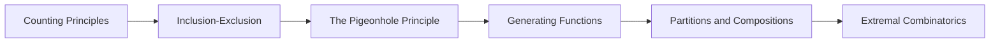

<!-- Generated by tools/build_indexes.py from tools/curriculum.json. Do not edit by hand. -->

# Combinatorics

*Counting, arranging and extremal structure*

[Mathematics](../README.md) › Combinatorics

The art of counting without listing: bijections, inclusion-exclusion, generating functions and extremal arguments.

## At a glance

| | |
|---|---|
| Topics | 6 (0 complete, 1 draft, 5 planned) |
| Estimated study time | ~49 hours |
| Prerequisites | [00-foundations](../00-foundations/README.md), [09-discrete-mathematics](../09-discrete-mathematics/README.md) |

## Study order

The numbers are the recommended order. Study a topic only after the ones before it —
the dependency chain below is the shortest safe route through the discipline.

## Topic inventory

| # | Topic | Level | Est. time | Status | Materials |
|---|---|---|---|---|---|
| 1 | [Counting Principles](01-counting-principles/README.md) | Intermediate | 9 h | Draft | [Tutorial](01-counting-principles/README.md) · [Exercises](01-counting-principles/exercises.md) |
| 2 | Inclusion-Exclusion | Intermediate | 7 h | Planned | — |
| 3 | The Pigeonhole Principle | Intermediate | 6 h | Planned | — |
| 4 | Generating Functions | Advanced | 10 h | Planned | — |
| 5 | Partitions and Compositions | Advanced | 8 h | Planned | — |
| 6 | Extremal Combinatorics | Advanced | 9 h | Planned | — |

### What each topic covers

- **Counting Principles** — Product and sum rules, permutations, combinations, bijective proofs.
- **Inclusion-Exclusion** — The principle, its proof, derangements and applications to counting.
- **The Pigeonhole Principle** — Basic and generalised forms, with classic and surprising applications.
- **Generating Functions** — Ordinary and exponential generating functions as algebraic counters.
- **Partitions and Compositions** — Integer partitions, Ferrers diagrams, Euler's pentagonal theorem preview.
- **Extremal Combinatorics** — Turán's theorem, Ramsey theory, matching and the probabilistic method.

## Related disciplines

- [21-graph-theory](../21-graph-theory/README.md)
- [10-probability](../10-probability/README.md)

## Status key

- **Complete** — tutorial, exercises and full solutions exist and the tutorial meets the
  [authoring standard](../CONTRIBUTING.md).
- **Draft** — some material exists but the topic is not finished.
- **Planned** — identified in the curriculum, not written yet.

Overall progress and the full topic inventory live in [ROADMAP.md](../ROADMAP.md).
