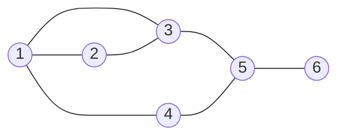
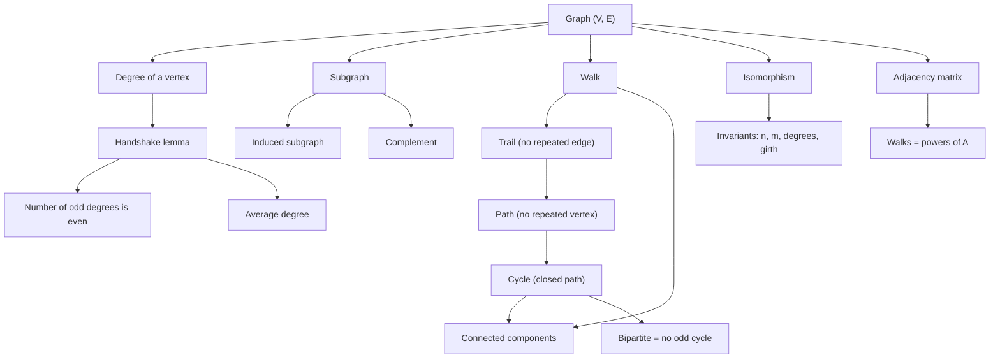
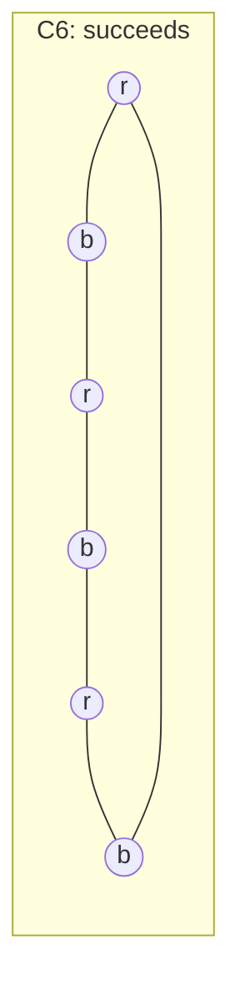

# Graph Basics

> [Mathematics](../../README.md) › [Graph Theory](../README.md) › Graph Basics · Level: Intermediate · Prerequisites: [Set Theory](../../00-foundations/03-set-theory/README.md), [Logic](../../00-foundations/02-logic/README.md), [Proof Techniques](../../00-foundations/04-proof-techniques/README.md), [Mathematical Induction](../../09-discrete-mathematics/01-mathematical-induction/README.md), [Combinatorics](../../20-combinatorics/README.md) · Estimated time: 480 min

## 1. Introduction

A **graph** is the simplest mathematical object that records *relationships*. Take any collection of things — cities, people, computers, squares of a chessboard, atoms in a molecule — and any relation between pairs of them, and you are looking at a graph. The things become *vertices*; the related pairs become *edges*.

That is almost embarrassingly little structure, and the surprise of graph theory is how much follows from it. A road network, a friendship circle, the hyperlinks of the web, a scheduling conflict table and the carbon skeleton of a molecule are all graphs, and the same three or four theorems answer questions in all of them: is the network connected, how many links are there, can the objects be split into two camps with no relation inside a camp, could this graph be the same as that one drawn differently?

This topic builds the vocabulary and the small number of counting arguments on which every later topic in [Graph Theory](../README.md) rests. The two central results are both double-counting arguments:

* the **handshake lemma** — the degrees of a graph add up to twice the number of edges — and its corollary that the number of odd-degree vertices is always even;
* the **characterisation of bipartite graphs** — a graph can be split into two camps with all edges crossing if and only if it has no cycle of odd length.

Both are proved completely here, because both are used everywhere afterwards. Around them sit the definitions that later topics silently assume: subgraph, induced subgraph, complement, walk, trail, path, cycle, component, isomorphism, degree sequence, adjacency matrix.

Two warnings about the word "graph". In this repository, *graph* (of a function) already means the set $\{(x, f(x))\}$ in the coordinate plane, and it appears in [Functions](../../03-algebra/11-functions/README.md). A graph in the sense of this topic is unrelated; the [GLOSSARY](../../GLOSSARY.md) keeps the two senses apart. A graph is *not* a picture either: a drawing is one of many possible renderings of the same abstract object, and the whole notion of isomorphism exists to make that precise.

Graph theory also has a distinctive style. Results are often trivial to state and awkward to prove, and the standard proofs are *counting* proofs: count the same finite set in two ways and equate the answers. Section 4 trains that instinct on a puzzle before any symbol appears.

## 2. Prerequisites

Everything below is taught earlier in the repository; the list is short on purpose.

* **Sets, subsets, cardinality.** $A \subseteq B$, $A \cup B$, $A \cap B$, $\lvert A\rvert$, the power set, and the notation $\binom{V}{2}$ for the set of two-element subsets of $V$. Taught in [Set Theory](../../00-foundations/03-set-theory/README.md).
* **Ordered pairs and relations.** A relation on a set is a set of ordered pairs; an equivalence relation partitions its set into classes. Both are used for directed graphs and for connected components. Taught in [Relations and Functions](../../00-foundations/05-relations-and-functions/README.md).
* **Logic and quantifiers.** Reading "for all $v \in V$ there exists $e \in E$ such that …", and negating such a statement. Taught in [Logic](../../00-foundations/02-logic/README.md) and [Mathematical Thinking](../../00-foundations/01-mathematical-thinking/README.md).
* **Proof techniques: direct, contrapositive, contradiction, cases.** The two long proofs of this topic (the handshake lemma and the odd-cycle theorem) use double counting and contradiction respectively. Taught in [Proof Techniques](../../00-foundations/04-proof-techniques/README.md).
* **Mathematical induction.** Used for the walk-counting theorem and for the claim that every graph has at least $n - c$ edges. Taught in [Mathematical Induction](../../09-discrete-mathematics/01-mathematical-induction/README.md).
* **Binomial coefficients.** $\binom{n}{k} = \frac{n!}{k!(n-k)!}$ counts the $k$-element subsets of an $n$-element set; $\binom{n}{2} = \frac{n(n-1)}{2}$ counts the pairs. Taught in [Combinatorics](../../20-combinatorics/README.md) and in [Polynomials](../../03-algebra/06-polynomials/README.md), where the binomial coefficient and the binomial theorem are introduced.
* **Matrices (helpful, not essential).** Rows, columns, matrix multiplication, transpose. The two sections on adjacency and incidence matrices can be read as a first course in matrices. Taught in [Linear Algebra](../../08-linear-algebra/README.md).

Conventions, matching [MATHEMATICAL_NOTATION.md](../../MATHEMATICAL_NOTATION.md): all graphs in this topic are **finite**; $\mathbb{N} = \{1,2,3,\dots\}$ and $\mathbb{N}_0 = \{0,1,2,3,\dots\}$; a graph always has at least one vertex unless we say otherwise.

## 3. Learning Objectives

By the end of this tutorial you will be able to:

1. Say precisely what a graph models, and translate a description of a real network into a vertex set and an edge set.
2. Distinguish simple graphs, multigraphs, directed graphs and weighted graphs, and choose the right model for a problem.
3. Compute the degree of every vertex of a graph given by an edge list, a drawing or a matrix.
4. Prove the handshake lemma by double counting, and use it to compute the number of edges from a degree list.
5. Prove that the number of vertices of odd degree is even, and explain why a graph cannot have exactly one vertex of odd degree.
6. Form subgraphs, induced subgraphs, complements, and graphs with a vertex or an edge deleted, and compute degrees in each.
7. Distinguish walks, trails, paths and cycles, and prove that every walk contains a path.
8. Define connectivity, prove that "joined by a path" is an equivalence relation, and find the components of a graph.
9. Prove that two graphs are not isomorphic by comparing invariants, and give two non-isomorphic graphs with the same degree sequence.
10. Prove that a graph is bipartite if and only if it has no cycle of odd length, including the lemma that every odd closed walk contains an odd cycle.
11. Write down the adjacency and incidence matrices of a graph, and use powers of the adjacency matrix to count walks.
12. Decide whether a degree sequence is graphical using the Havel–Hakimi algorithm, and state the Erdős–Gallai criterion.

## 4. Intuition

### 4.1 A party, and a question about hands

Thirty people meet at a party. Some pairs shake hands; nobody shakes their own hand and no pair shakes twice. Is there anything that can be said about the *total number of handshakes* without knowing who shook hands with whom?

Yes. Every handshake involves exactly two hands. So if we count, person by person, how many hands each person shook, and add those numbers, each handshake has been counted exactly twice — once at each participant. The total is therefore even. In particular, the number of people who shook an odd number of hands must be even: pair up the odd numbers, and their sum is even only if there are evenly many of them.

That is graph theory's first theorem, and the entire proof is this paragraph. The people are vertices, the handshakes are edges, the number of hands a person shook is the *degree* of that vertex.

### 4.2 Maps, not pictures

A graph is what is left of a drawing after you forget the positions of the dots, the lengths of the lines and whether the lines are straight or curved. Two drawings that can be deformed into each other show the same graph. That is why the same graph can be drawn as a triangle with three dangling edges or as a hexagon, and why "isomorphic" is the correct notion of *same*: a relabelling of the vertices that preserves exactly which pairs are joined.

Everything that a graph *is* must survive the forgetting. The number of vertices survives. The number of edges survives. The multiset of degrees survives. The number of pieces ("components") survives. Nothing about angles or distances does. Section 7.7 turns this into a method: to prove two graphs differ, exhibit a quantity that survives relabelling and takes different values.

### 4.3 Two camps

Many real networks are *two-sided*: authors and the papers they wrote, students and the courses they take, jobs and the machines that can run them. In such a network every link joins a member of one side to a member of the other; no link stays inside a side. That is a **bipartite** graph.

The pleasant surprise is that bipartiteness is a property of the *shape alone*, not of a chosen division: a graph can be split into two camps exactly when it has no cycle of odd length. A triangle forces a conflict — three objects each pair of which must be on opposite sides — and any odd cycle does the same. Conversely, if no odd cycle exists, colouring by distance parity from a fixed vertex always succeeds. Section 7.8 proves both directions.

### 4.4 One object, many descriptions

The same graph can be given as a picture, as a list of edges, as a table (the adjacency matrix), or as a set of degrees. Each description loses something. The degree list loses the most: it is a remarkably weak invariant, and two quite different graphs can share it, as Examples 7.7.3 and 7.7.4 show. The adjacency matrix loses nothing at all — it is the graph, written as numbers — which is why linear algebra can be brought to bear.

### 4.5 Why "simple" is a technical word

In everyday language a graph without repeated edges and without self-loops is the normal case, and one would not bother to name it. In graph theory the word **simple** marks exactly that case, because once you allow a pair of vertices to be joined twice (two roads between the same towns) or a vertex to be joined to itself (a self-loop), several theorems change. The handshake lemma survives, with loops counting twice. The statement "$m \le \binom{n}{2}$" does not. Each definition below therefore says which kind of graph it is about, and the theorems say which hypotheses they need.

## 5. Formal Definition

### 5.1 Graphs

**Definition 5.1.1 (simple graph).** A **simple graph** is a pair $G = (V, E)$ where

* $V$ is a finite non-empty set, whose elements are the **vertices** of $G$;
* $E$ is a set of two-element subsets of $V$, whose elements are the **edges** of $G$.

So an edge is a set $\{u, v\}$ with $u \ne v$; we write it $uv$ or $vu$. "Simple" means: no edge joins a vertex to itself, and no two distinct edges join the same pair.

**Definition 5.1.2 (order, size).** For a graph $G$, $\lvert V(G)\rvert$ is the **order** and $\lvert E(G)\rvert$ is the **size**. We write $n = \lvert V\rvert$ and $m = \lvert E\rvert$ throughout; a graph of order $n$ is "a graph on $n$ vertices".

**Definition 5.1.3 (multigraph).** A **multigraph** is a triple $G = (V, E, \varphi)$ where $V$ is a finite non-empty set, $E$ is a finite set whose elements are called **edges**, and $\varphi : E \to \binom{V}{2} \cup V$ assigns to every edge its set of endpoints. If $\varphi(e) = \{u,v\}$ with $u \ne v$, the edge $e$ **joins** $u$ and $v$. If $\varphi(e) = \{v\}$, then $e$ is a **loop** at $v$. Two distinct edges $e \ne f$ with $\varphi(e) = \varphi(f) \in \binom{V}{2}$ are **parallel**.

A simple graph is the special case of a multigraph in which $\varphi$ is injective and never takes a singleton value; the extra generality of Definition 5.1.3 is exactly what real networks need. A telephone network may have two cables between the same pair of exchanges, and a road may loop back to where it started.

**Definition 5.1.4 (directed graph).** A **directed graph** or **digraph** is a pair $D = (V, A)$ where $V$ is a finite non-empty set and $A \subseteq V \times V$ is a set of **ordered** pairs, called **arcs**. An arc $(u,v)$ is drawn as an arrow from $u$ (its **tail**) to $v$ (its **head**). The digraph is **loopless** if $(v,v) \notin A$ for every $v$. Its **underlying graph** is the simple graph on $V$ whose edges are the two-element sets $\{u,v\}$ for which $(u,v) \in A$ or $(v,u) \in A$.

Digraphs model one-way relations: who follows whom, which tasks must precede which, where traffic may flow. Note that $(u,v)$ and $(v,u)$ are different arcs, and that the underlying graph of a digraph deliberately forgets the directions.

**Definition 5.1.5 (weighted graph).** A **weighted graph** is a pair $(G, w)$ where $G$ is a graph and $w : E(G) \to \mathbb{R}$ is a function assigning a **weight** to each edge. Weights model lengths, costs, capacities, travel times or probabilities; they may be negative, zero or non-integral unless a theorem says otherwise.

The four definitions are not rivals; they are four degrees of detail. A road map is a weighted multigraph (roads can be duplicated, lengths matter). A friendship network is a simple graph (a friendship is symmetric, and one does not befriend oneself). A follower network is a loopless digraph.

### 5.2 Degree

**Definition 5.2.1 (degree).** Let $G$ be a graph and $v$ a vertex. The **degree** of $v$, written $\deg_G(v)$ or $d(v)$, is the number of **edge-ends** incident with $v$: every edge joining $v$ to a different vertex contributes $1$, and every loop at $v$ contributes $2$.

The formulation in terms of edge-ends is the one that makes the handshake lemma true without exceptions. For a simple graph it reduces to the familiar statement "the number of edges containing $v$".

**Definition 5.2.2 (neighbourhood).** In a simple graph, the **open neighbourhood** of $v$ is $N(v) = \{u \in V : uv \in E\}$, and the **closed neighbourhood** is $N[v] = N(v) \cup \{v\}$. Clearly $\deg(v) = \lvert N(v)\rvert$. For a set $S \subseteq V$, $N(S) = \bigcup_{v \in S} N(v) \setminus S$ is the set of vertices outside $S$ adjacent to something in $S$.

**Definition 5.2.3 (minimum, maximum and average degree).** $\delta(G) = \min_{v \in V} \deg(v)$ is the **minimum degree**, $\Delta(G) = \max_{v \in V} \deg(v)$ the **maximum degree**, and $\bar d(G) = \frac{1}{n}\sum_{v \in V} \deg(v)$ the **average degree**.

**Definition 5.2.4 (regular graph).** A graph is **$k$-regular** if $\deg(v) = k$ for every vertex $v$. A $3$-regular graph is called **cubic**. The **empty graph** $\overline{K_n}$ has no edges and is $0$-regular; the **complete graph** $K_n$ (Definition 5.3.3) is $(n-1)$-regular.

### 5.3 Named graphs

**Definition 5.3.1 (path, cycle).** For $n \ge 1$, the **path** $P_n$ is the graph with vertex set $\{1,\dots,n\}$ and edges $i(i+1)$ for $1 \le i \le n-1$. For $n \ge 3$, the **cycle** $C_n$ is the graph with vertex set $\{1,\dots,n\}$ and edges $i(i+1)$ for $1 \le i \le n-1$ together with $n1$. (The word "cycle" is also used for a closed walk; Definition 5.5.4 fixes the second meaning. Context always disambiguates, but this tutorial writes "$C_n$" when the graph is meant.)

**Definition 5.3.2 (empty graph).** The **empty graph** on $n$ vertices, written $\overline{K_n}$, has $V = \{1,\dots,n\}$ and $E = \varnothing$.

**Definition 5.3.3 (complete graph).** The **complete graph** $K_n$ has $V = \{1,\dots,n\}$ and $E = \binom{V}{2}$: every pair of distinct vertices is joined by exactly one edge.

**Definition 5.3.4 (complete bipartite graph).** For $a, b \ge 1$, the **complete bipartite graph** $K_{a,b}$ has vertex set $A \sqcup B$ with $\lvert A\rvert = a$ and $\lvert B\rvert = b$, and edge set $E = \{uv : u \in A,\ v \in B\}$. Every pair with one endpoint in each part is joined, and no pair inside a part is.

**Definition 5.3.5 (hypercube).** For $d \ge 0$ the **$d$-dimensional hypercube** $Q_d$ has vertex set $\{0,1\}^d$ (all binary strings of length $d$), with two strings adjacent when they differ in exactly one position. $Q_0$ is a single vertex, $Q_1$ is $P_2$, $Q_2$ is $C_4$, and $Q_3$ is the cube.

### 5.4 Subgraphs and the complement

**Definition 5.4.1 (subgraph).** Let $G$ be a simple graph. A graph $H$ is a **subgraph** of $G$, written $H \subseteq G$, if $V(H) \subseteq V(G)$ and $E(H) \subseteq E(G)$. It is a **proper** subgraph if $H \ne G$, and a **spanning** subgraph if $V(H) = V(G)$.

**Definition 5.4.2 (induced subgraph).** For $S \subseteq V(G)$, the **subgraph induced by $S$**, written $G[S]$, has $V(G[S]) = S$ and $E(G[S]) = \{uv \in E(G) : u, v \in S\}$. An induced subgraph keeps *every* edge of $G$ whose endpoints survive. Deleting a vertex means passing to $G[V \setminus \{v\}]$, written $G - v$; deleting an edge means removing it from $E$ while keeping all vertices, written $G - e$.

**Definition 5.4.3 (complement).** The **complement** of a simple graph $G$ on vertex set $V$ is the simple graph $\overline{G}$ with $V(\overline{G}) = V$ and, for distinct $u, v \in V$,
$$uv \in E(\overline{G}) \quad \Longleftrightarrow \quad uv \notin E(G).$$
The complement has exactly the edges that $G$ lacks; a graph is **self-complementary** if $\overline{G} \cong G$ (Definition 5.7.1).

### 5.5 Walks, trails, paths and cycles

Throughout this section $G$ is a graph, possibly a multigraph.

**Definition 5.5.1 (walk).** A **walk** of length $k \ge 0$ in $G$ is a sequence
$$W = (v_0, e_1, v_1, e_2, v_2, \dots, e_k, v_k)$$
in which each $e_i$ is an edge with endpoints $v_{i-1}$ and $v_i$. Its **length** is $k$, the number of edges counted with repetition. Its **endpoints** are $v_0$ and $v_k$, and $v_1,\dots,v_{k-1}$ are its **internal vertices**. The walk is **closed** if $v_0 = v_k$. In a simple graph the edges are determined by the vertices, so we abbreviate $W$ to $v_0 v_1 \cdots v_k$.

**Definition 5.5.2 (trail, path).** A walk is a **trail** if its edges $e_1,\dots,e_k$ are pairwise distinct. A walk is a **path** if its vertices $v_0, \dots, v_k$ are pairwise distinct. Every path is a trail, because its edges $v_{i-1}v_i$ have distinct pairs of endpoints; a trail, however, may revisit vertices.

**Definition 5.5.3 (circuit).** A **circuit** is a closed trail of positive length.

**Definition 5.5.4 (cycle).** A **cycle** of length $k \ge 3$ in a simple graph is a closed walk $v_0 v_1 \cdots v_{k-1} v_0$ whose vertices $v_0, \dots, v_{k-1}$ are pairwise distinct. Its length is $k$. A cycle of length $3$ is a **triangle**, one of length $4$ a **square**. In a multigraph, parallel edges give cycles of length $2$ and loops give cycles of length $1$; since most of this topic concerns simple graphs, the phrase "cycle" below means a cycle of length at least $3$ unless stated.

**Definition 5.5.5 (girth, circumference, distance).** The **girth** of a graph containing a cycle is the length of its shortest cycle; the **circumference** is the length of its longest cycle. In a connected graph, the **distance** $d(u,v)$ is the length of a shortest $u$–$v$ path; the **diameter** is $\max_{u,v} d(u,v)$.

### 5.6 Connectivity

**Definition 5.6.1 (connected).** Two vertices $u, v$ of $G$ are **connected** if some $u$–$v$ path exists (a single vertex is connected to itself by the path of length $0$). The graph is **connected** if every two of its vertices are connected; otherwise it is **disconnected**.

**Definition 5.6.2 (component).** A **component** of $G$ is a maximal connected subgraph, or equivalently a set of vertices all connected to each other and to nothing else. The number of components is written $c(G)$. An **isolated vertex** is a vertex of degree $0$; it forms a component by itself.

**Definition 5.6.3 (bridge).** An edge $e$ of a connected graph is a **bridge** if $G - e$ is disconnected.

**Definition 5.6.4 (cut).** For a non-empty proper subset $S \subsetneq V$, the **cut** $\delta(S)$ is the set of edges with exactly one endpoint in $S$. (A cut "separates" $S$ from the rest.)

### 5.7 Isomorphism

**Definition 5.7.1 (isomorphism).** Let $G$ and $H$ be simple graphs. A **graph isomorphism** is a bijection $\varphi : V(G) \to V(H)$ such that, for all distinct $u, v \in V(G)$,
$$uv \in E(G) \quad \Longleftrightarrow \quad \varphi(u)\varphi(v) \in E(H).$$
If such a $\varphi$ exists, $G$ and $H$ are **isomorphic**, written $G \cong H$. An isomorphism from $G$ to itself is an **automorphism**; the automorphisms form a group under composition.

**Definition 5.7.2 (invariant).** A function $\iota$ on graphs is an **isomorphism invariant** if $G \cong H$ implies $\iota(G) = \iota(H)$. Order, size, degree sequence, number of components and girth are invariants; a labelling of the vertices is not.

### 5.8 Bipartite graphs

**Definition 5.8.1 (bipartite).** A graph $G$ is **bipartite** if $V(G)$ can be written as a disjoint union $V = A \sqcup B$ such that every edge has one endpoint in $A$ and one in $B$. Such a pair $(A,B)$ is a **bipartition** of $G$; $A$ and $B$ are the **parts**. A bipartite graph is **complete bipartite** if every vertex of $A$ is adjacent to every vertex of $B$.

**Definition 5.8.2 (proper colouring with two colours).** A **proper $k$-colouring** of $G$ is a function $c : V \to \{1,\dots,k\}$ with $c(u) \ne c(v)$ whenever $uv \in E$. A graph is bipartite exactly when it has a proper $2$-colouring; the two colour classes are the parts.

### 5.9 Matrices and degree sequences

**Definition 5.9.1 (adjacency matrix).** Let $G$ have vertices $v_1,\dots,v_n$. The **adjacency matrix** $A(G)$ is the $n \times n$ matrix with $a_{ij}$ equal to the number of edges joining $v_i$ and $v_j$ (a loop at $v_i$ contributing $2$ to $a_{ii}$). For a simple graph, $a_{ij} \in \{0,1\}$, $a_{ii} = 0$ and $A$ is symmetric.

**Definition 5.9.2 (incidence matrix).** Let $G$ have vertices $v_1,\dots,v_n$ and edges $e_1,\dots,e_m$. The **incidence matrix** $B(G)$ is the $n \times m$ matrix with $b_{ij} = 1$ if $v_i$ is an endpoint of $e_j$ and $b_{ij} = 0$ otherwise, where a loop contributes $2$ in its row. For a digraph, the **oriented incidence matrix** has $b_{ij} = 1$ if $v_i$ is the tail of $a_j$, $b_{ij} = -1$ if it is the head, and $0$ otherwise.

**Definition 5.9.3 (degree sequence, graphical).** The **degree sequence** of a graph on $n$ vertices is the list of its degrees, usually written in non-increasing order $d_1 \ge d_2 \ge \dots \ge d_n$. A finite sequence of non-negative integers is **graphical** if it is the degree sequence of some simple graph.

## 6. Mathematical Notation

| Symbol | Read as | Meaning |
|---|---|---|
| $G = (V,E)$ | graph $G$ with vertex set $V$ and edge set $E$ | the object of study |
| $V(G)$, $E(G)$ | vertex set, edge set of $G$ | the two ingredients |
| $n$, $m$ | order, size | $n = \lvert V\rvert$, $m = \lvert E\rvert$ |
| $uv$ | edge $u v$ | the edge $\{u,v\}$ |
| $u \sim v$ | $u$ is adjacent to $v$ | $uv \in E$ |
| $d(v)$, $\deg(v)$ | degree of $v$ | number of edge-ends at $v$ |
| $\delta(G)$, $\Delta(G)$ | minimum, maximum degree | $\min_v d(v)$, $\max_v d(v)$ |
| $N(v)$, $N[v]$ | open, closed neighbourhood | $N(v) \cup \{v\}$ for the closed one |
| $G[S]$ | $G$ induced on $S$ | all edges with both ends in $S$ |
| $G - v$, $G - e$ | $G$ with $v$, or $e$, deleted | vertex or edge deletion |
| $\overline{G}$ | complement of $G$ | the missing edges |
| $c(G)$ | number of components | connected pieces |
| $\delta(S)$ | the cut defined by $S$ | edges with exactly one end in $S$ |
| $P_n$, $C_n$, $K_n$ | path, cycle, complete graph | named graphs on $n$ vertices |
| $K_{a,b}$ | complete bipartite graph | parts of size $a$ and $b$ |
| $Q_d$ | $d$-dimensional cube | binary strings, Hamming distance $1$ |
| $G \cong H$ | $G$ is isomorphic to $H$ | same graph up to relabelling |
| $A(G)$, $B(G)$ | adjacency, incidence matrix | the graph written numerically |
| $d_1 \ge \dots \ge d_n$ | degree sequence | degrees in decreasing order |
| $\binom{V}{2}$ | set of pairs from $V$ | all two-element subsets |
| $d(u,v)$ | distance from $u$ to $v$ | shortest path length |
| $\operatorname{girth}(G)$ | girth | shortest cycle length |
| $\blacksquare$ | end of proof | a completed argument |

Reading a formula aloud: "$m = \frac{1}{2}\sum_{v \in V} \deg(v)$" is "the number of edges is one half of the sum over all vertices of the degree". "$\Delta(G) \le 2$" is "the maximum degree is at most two", i.e. every vertex has at most two neighbours, so every component is a path or a cycle.

## 7. Core Concepts

### 7.1 What a graph models

A graph records *which pairs of things are related*. Nothing else. That austerity is the source of its power: a theorem proved about graphs applies to every situation that can be described as a graph, however different the things are.

| Situation | Vertex | Edge | Question graph theory answers |
|---|---|---|---|
| Road network | town | road between two towns | shortest route; is every town reachable? |
| Social network | person | friendship | who is central? how many degrees of separation? |
| Web | page | hyperlink | how do search engines rank pages? |
| Airline schedule | airport | direct flight | minimum fleet size; hub structure |
| Molecule | atom | chemical bond | is the molecule a tree (acyclic)? |
| Course timetabling | course | shared student | fewest exam slots (colouring) |
| Task planning | task | "must precede" | feasible order (topological sort) |
| Chess positions | position | legal move | can white force a win? (a game tree) |

The translation is always the same two steps: decide what the objects are (they become $V$), decide which pairs are related (they become $E$). Everything else — direction, multiplicity, weights — is extra structure you add only if the problem needs it.

### 7.2 Four kinds of graph, and when to use each

The definitions are in Section 5.1; what matters is choosing correctly.

* **Simple graph.** Use when the relation is symmetric and cannot occur twice or reflexively: friendship, "is a sibling of", "shares a border with". Most theorems in this topic are stated for simple graphs.
* **Multigraph.** Use when a pair can be related more than once, or when a thing can be related to itself. Two flights a day between the same airports, a telephone cable loop, multiple pipes between the same junctions. Loops change the arithmetic: they count twice towards the degree and they are cycles of length $1$.
* **Digraph.** Use when the relation has a direction: "follows", "is taller than" is not a digraph (it is a transitive relation, but the *arc* is directed), "must be completed before", one-way streets, tournaments. A digraph and its underlying graph can behave very differently: the underlying graph may be connected while no directed path reaches a given vertex.
* **Weighted graph.** Use when edges carry a number: distance, cost, capacity, probability. Weights are extra data attached to $E$, not to $V$; vertex weights exist too but are a separate notion.

A single model can combine all four: a flight network is a weighted loopless digraph with parallel arcs allowed. The theorems below generalise, but each generalisation must be checked, because the simple-graph hypotheses are used in the proofs.

### 7.3 Degree and the handshake lemma

**Theorem 7.3.1 (handshake lemma).** Let $G = (V,E)$ be a finite graph, simple or not. Then
$$\sum_{v \in V} \deg(v) = 2\lvert E\rvert .$$

**Proof.** An **edge-end** is one of the two ends of an edge: every edge has exactly two, and for a loop both ends sit at the same vertex. Let $I$ be the set of all edge-ends of $G$.

*Count by edges.* Each edge contributes its two ends, so $\lvert I\rvert = 2m$. This includes loops: a loop has two ends even though both are at one vertex.

*Count by vertices.* The edge-ends at $v$ are exactly what Definition 5.2.1 counts, so the number of edge-ends at $v$ is $\deg(v)$; summing over $v$ gives $\lvert I\rvert = \sum_{v \in V} \deg(v)$.

The same set has been counted in two ways, so the two answers agree: $\sum_v \deg(v) = 2m$. $\blacksquare$

For a simple graph the proof can be written without the word "edge-end": each edge $\{u,v\}$ contributes exactly $1$ to $\deg(u)$ and exactly $1$ to $\deg(v)$, so summing all degrees counts every edge twice.

The name comes from the party in Section 4.1: the number of hands shaken, summed over all people, is twice the number of handshakes, because each handshake involves two hands.

**Corollary 7.3.2 (the number of odd-degree vertices is even).** In every finite graph, $\bigl\lvert\{v \in V : \deg(v) \text{ is odd}\}\bigr\rvert$ is even.

**Proof.** By Theorem 7.3.1 the total $S = \sum_{v} \deg(v)$ equals $2m$, which is even. Split $S$ into the sum over even-degree vertices and the sum over odd-degree vertices. The first is even. Reduce the second modulo $2$: each odd degree is $1 \pmod 2$, so
$$0 \equiv S \equiv \sum_{v \text{ odd}} \deg(v) \equiv \sum_{v \text{ odd}} 1 = \bigl\lvert\{v : \deg(v) \text{ odd}\}\bigr\rvert \pmod 2 .$$
A number congruent to $0$ modulo $2$ is even. $\blacksquare$

**Corollary 7.3.3 (average degree).** The average degree of a graph on $n$ vertices is $\bar d = 2m/n$, and therefore
$$\delta(G) \le \frac{2m}{n} \le \Delta(G).$$
In particular, every graph has a vertex of degree at least $2m/n$ and a vertex of degree at most $2m/n$.

**Proof.** The average of $n$ numbers lies between the smallest and the largest, and Corollary 7.3.2's theorem gives $\bar d = (1/n)\sum \deg(v) = 2m/n$. $\blacksquare$

**Corollary 7.3.4 (regular graphs).** If $G$ is $k$-regular on $n$ vertices, then $m = kn/2$. In particular $kn$ is even: a $k$-regular graph with $k$ odd has an even number of vertices.

**Proof.** Every degree equals $k$, so Theorem 7.3.1 gives $kn = 2m$. $\blacksquare$

**Proposition 7.3.5 (bounds from simplicity).** If $G$ is a simple graph on $n \ge 1$ vertices, then $\Delta(G) \le n-1$ and
$$m \le \binom{n}{2} = \frac{n(n-1)}{2},$$
with equality exactly when $G = K_n$.

**Proof.** A vertex can be adjacent only to the other $n-1$ vertices, so $\deg(v) \le n-1$. An edge is a two-element subset of $V$, and distinct edges give distinct subsets, so $m \le \lvert\binom{V}{2}\rvert = \binom{n}{2}$, with equality exactly when every two-element subset is an edge. $\blacksquare$

### 7.4 Subgraphs, induced subgraphs and the complement

A subgraph is obtained by deleting vertices and edges; an induced subgraph is obtained by deleting *only vertices*, keeping every edge that survives. The difference matters constantly.

**Proposition 7.4.1 (induced subgraphs).** Let $G$ be a simple graph and $S \subseteq V(G)$. Then $V(G[S]) = S$ and
$$E(G[S]) = \{e \in E(G) : \text{both endpoints of } e \text{ lie in } S\}.$$
Moreover $G[S] = G - (V \setminus S)$, where $G - X$ means "delete every vertex of $X$ and every edge incident with $X$".

**Proof.** Both statements are immediate from Definitions 5.4.1 and 5.4.2: the induced subgraph keeps exactly the edges with both ends in $S$, and deleting $V \setminus S$ leaves exactly the vertices in $S$ and exactly those edges. $\blacksquare$

**Proposition 7.4.2 (monotonicity of degree under subgraphs).** If $H \subseteq G$ and $v \in V(H)$, then $\deg_H(v) \le \deg_G(v)$.

**Proof.** Every edge of $H$ containing $v$ is an edge of $G$ containing $v$, and distinct edges stay distinct. $\blacksquare$

A subgraph of a graph need not be induced. For example $P_3$ on vertices $\{1,2,3\}$ with edges $12, 23$ is a subgraph of $K_3$, but it is not an induced subgraph of $K_3$, because $K_3[\{1,2,3\}] = K_3$ contains the edge $13$ as well.

**Definition 7.4.3 (spanning subgraph).** A **spanning subgraph** of $G$ has $V(H) = V(G)$ and $E(H) \subseteq E(G)$. A spanning subgraph may delete edges but never vertices.

**Proposition 7.4.4 (complement).** Let $G$ be a simple graph on $n$ vertices. Then for every $v \in V$,
$$\deg_{\overline{G}}(v) = (n-1) - \deg_G(v), \qquad\text{and}\qquad m(G) + m(\overline{G}) = \binom{n}{2}.$$

**Proof.** Fix $v$. The $n-1$ pairs $\{v,u\}$ with $u \ne v$ split into the $\deg_G(v)$ pairs that are edges of $G$ and the rest, which are exactly the edges of $\overline{G}$ at $v$. This proves the degree formula. Summing it over all $v$ and using Theorem 7.3.1 gives $2m(\overline{G}) = 2(n-1)n/2 - 2m(G) = n(n-1) - 2m(G)$, which is the second identity. $\blacksquare$

**Proposition 7.4.5 (double complement).** $\overline{\overline{G}} = G$ for every simple graph $G$.

**Proof.** Both graphs have the same vertex set, and $uv$ is an edge of $\overline{\overline{G}}$ iff it is not an edge of $\overline{G}$ iff it is an edge of $G$. $\blacksquare$

### 7.5 Walks, trails, paths and cycles

The three notions form a hierarchy of increasing strictness: a walk may repeat everything; a trail may repeat vertices but not edges; a path repeats nothing. A cycle is a closed path of length at least three.

**Lemma 7.5.1 (every walk contains a path).** If there is a $u$–$v$ walk in $G$, then there is a $u$–$v$ path in $G$.

**Proof.** Among all $u$–$v$ walks choose one of minimum length, say $W = v_0 e_1 v_1 \cdots e_k v_k$ with $v_0 = u$ and $v_k = v$. If some vertex occurred twice — $v_i = v_j$ with $0 \le i < j \le k$ — then deleting the segment $e_{i+1} v_{i+1} \cdots e_j$ would leave the shorter walk
$$v_0 e_1 \cdots v_i e_{j+1} v_{j+1} \cdots e_k v_k,$$
which is still a walk from $u$ to $v$ (because $v_i = v_j$), contradicting minimality. Hence all $v_0,\dots,v_k$ are distinct and $W$ is a path. $\blacksquare$

**Proposition 7.5.2 (concatenation).** If $W_1$ is a $u$–$v$ walk and $W_2$ is a $v$–$w$ walk, then writing $W_1$ followed by $W_2$ gives a $u$–$w$ walk whose length is the sum of the lengths.

**Proof.** The last vertex of $W_1$ equals the first vertex of $W_2$, which is exactly the condition for concatenation in Definition 5.5.1. $\blacksquare$

The converse of Lemma 7.5.1 fails: a path is a walk but a walk need not be a path. The walk $1,2,3,1,2$ in $K_3$ is not a path because $1$ and $2$ repeat.

**Proposition 7.5.3 (short closed walks).** (a) Every closed walk of length $2$ in a loopless graph is a back-and-forth along a single edge, $v_0 e v_1 e v_0$; it is never a cycle. (b) A graph has a cycle of length $1$ exactly when it has a loop, and a cycle of length $2$ exactly when it has two parallel edges. (c) A simple graph has neither, so every cycle in a simple graph has length at least $3$.

**Proof.** (a) A closed walk of length $2$ is $v_0 e_1 v_1 e_2 v_0$ with $v_1 \ne v_0$ (otherwise $e_1$ would be a loop). If $e_1 \ne e_2$ then both join $v_0$ to $v_1$, so they are parallel; if $e_1 = e_2$ the walk traverses one edge twice. In neither case are the vertices distinct in the sense required by Definition 5.5.4, and in the second case an edge repeats, so the walk is not a cycle. (b) A length-$1$ closed walk is $v_0 e v_0$ with both ends of $e$ at $v_0$, that is, a loop; a length-$2$ closed walk with $e_1 \ne e_2$ is exactly a pair of parallel edges. (c) A simple graph has no loops and no parallel edges. $\blacksquare$

**Proposition 7.5.4 (parity and bipartiteness of a cycle).** A cycle of length $k$ has $k$ vertices, $k$ edges, and every vertex of it has degree $2$ in the cycle. In a bipartite graph every cycle has even length.

**Proof.** The first statement is immediate from Definition 5.5.4: the vertices $v_0,\dots,v_{k-1}$ are distinct and each is incident with exactly the two edges $v_{i-1}v_i$ and $v_iv_{i+1}$ (indices mod $k$). For the second, a cycle visits the parts alternately, since consecutive vertices are adjacent and hence lie in opposite parts; returning to the starting part after $k$ steps forces $k$ to be even. $\blacksquare$

### 7.6 Connectivity and components

**Theorem 7.6.1 ("joined by a path" is an equivalence relation).** On $V(G)$, define $u \sim v$ if and only if a $u$–$v$ path exists. Then $\sim$ is an equivalence relation.

**Proof.** *Reflexive:* the sequence $(v)$ is a walk of length $0$ from $v$ to $v$, and by Lemma 7.5.1 there is a path of length $0$. *Symmetric:* reversing a $u$–$v$ walk gives a $v$–$u$ walk, because an edge has no direction. *Transitive:* if $P_1$ is a $u$–$v$ walk and $P_2$ a $v$–$w$ walk, Proposition 7.5.2 gives a $u$–$w$ walk, and Lemma 7.5.1 turns it into a path. $\blacksquare$

**Corollary 7.6.2.** The components of $G$ are the equivalence classes of $\sim$; they partition $V(G)$; and $G$ is connected if and only if $c(G) = 1$.

**Proof.** Equivalence classes partition a set, and two vertices are in the same class exactly when they are connected, which is the definition of sharing a component. $\blacksquare$

**Lemma 7.6.3 (deleting an edge).** Let $e$ be an edge of a graph $G$. Then $c(G - e)$ is either $c(G)$ or $c(G) + 1$. It equals $c(G) + 1$ exactly when $e$ is a bridge.

**Proof.** Write $e = uv$ and let $C$ be the component of $G$ containing $u$ and $v$; all other components are untouched. In $C - e$, let $A$ be the set of vertices reachable from $u$ and $B = V(C) \setminus A$. If $B = \varnothing$ then $C - e$ is connected, so $c$ does not change. If $B \ne \varnothing$, take $w \in B$. In $C$ there is a simple path from $w$ to $u$; it must use $e$, and the only way to use $e$ in a simple path ending at $u$ is as the final step $v \to u$. So the path without that step is a $w$–$v$ path in $C - e$, and every vertex of $B$ is connected to $v$. Hence $C - e$ has exactly the two components $A$ and $B$, and $c$ increases by exactly one. Finally $B \ne \varnothing$ means $u$ and $v$ are separated in $G - e$, which is precisely the statement that $e$ is a bridge. $\blacksquare$

**Theorem 7.6.4 (a lower bound for the number of edges).** For every graph on $n$ vertices with $c$ components,
$$m \ge n - c .$$

**Proof.** Induct on $m$. If $m = 0$ then every vertex is isolated, so $c = n$ and $m = 0 = n - c$. For the step, delete any edge $e$. By induction applied to $G - e$,
$$m - 1 \ge n - c(G-e).$$
If $e$ is a bridge, Lemma 7.6.3 gives $c(G-e) = c+1$, so $m - 1 \ge n - c - 1$, that is $m \ge n - c$. If $e$ is not a bridge, $c(G-e) = c$, so $m - 1 \ge n - c$, that is $m \ge n - c + 1 > n-c$. Either way the claim holds. $\blacksquare$

Equality $m = n - c$ characterises forests, which is the subject of the next topic [Trees](../02-trees/README.md). For a connected graph, Theorem 7.6.4 says $m \ge n-1$: a connected graph on $n$ vertices needs at least $n-1$ edges.

**Proposition 7.6.5 (adding an edge).** Adding an edge to a graph either decreases $c$ by one or leaves $c$ unchanged.

**Proof.** Adding $e = uv$ can only merge the components containing $u$ and $v$; every other component is untouched. $\blacksquare$

### 7.7 Isomorphism and invariants

**Proposition 7.7.1.** Isomorphism is an equivalence relation on the class of simple graphs.

**Proof.** The identity map is an isomorphism $G \to G$; if $\varphi$ is an isomorphism then so is $\varphi^{-1}$ (the biconditional in Definition 5.7.1 is symmetric); and if $\varphi : G \to H$ and $\psi : H \to J$ are isomorphisms then $\psi \circ \varphi$ is a bijection and $uv \in E(G) \Leftrightarrow \varphi(u)\varphi(v) \in E(H) \Leftrightarrow \psi(\varphi(u))\psi(\varphi(v)) \in E(J)$. $\blacksquare$

**Theorem 7.7.2 (isomorphism invariants).** If $G \cong H$, then $G$ and $H$ have

1. the same order and the same size;
2. the same degree sequence (hence the same $\delta$, $\Delta$ and average degree);
3. the same number of components;
4. the same number of cycles of each length $k \ge 3$ (hence the same girth and circumference, when defined);
5. the same diameter, and the same number of pairs of vertices at each distance;
6. the same bipartiteness (both bipartite or both not);
7. the same number of triangles, of spanning subgraphs isomorphic to any fixed graph $F$, and so on.

**Proof.** Let $\varphi : V(G) \to V(H)$ be an isomorphism. (1) $\varphi$ is a bijection of vertex sets, and $e \mapsto \{\varphi(u),\varphi(v)\}$ for $e = \{u,v\}$ is a bijection $E(G) \to E(H)$ with inverse induced by $\varphi^{-1}$. (2) For $v \in V(G)$ the map $u \mapsto \varphi(u)$ is a bijection $N_G(v) \to N_H(\varphi(v))$, so degrees are preserved. (3) $\varphi$ maps paths to paths and non-paths to non-paths, so it maps components onto components. (4) Similarly $\varphi$ maps cycles of length $k$ bijectively onto cycles of length $k$. (5) A path of length $k$ from $u$ to $v$ maps to a path of length $k$ from $\varphi(u)$ to $\varphi(v)$ and conversely, so all distances are preserved. (6) If $(A,B)$ is a bipartition of $G$ then $(\varphi(A),\varphi(B))$ is one of $H$. (7) Apply $\varphi$ to every vertex of the subgraph in question. $\blacksquare$

The power of invariants is *negative*: to prove $G \not\cong H$ it suffices to find one invariant that differs. The weakness is that agreement of all the invariants in Theorem 7.7.2 does **not** imply isomorphism. The standard illustrations:

**Example 7.7.3 (same degrees, different components).** $C_6$ and the disjoint union $C_3 \sqcup C_3$ both have $6$ vertices, $6$ edges and degree sequence $(2,2,2,2,2,2)$. But $C_6$ is connected and $C_3 \sqcup C_3$ has two components, so they are not isomorphic (invariant 3).

**Example 7.7.4 (same degrees, same number of components, different cycles).** Let $G_1$ be a triangle $a b c$ with a path $b d e f$ attached at $b$. Let $G_2$ be a $5$-cycle $v_1v_2v_3v_4v_5v_1$ with one pendant vertex $v_6$ attached to $v_1$. Both are connected with $6$ vertices and $6$ edges, and both have degree sequence $(3,2,2,2,2,1)$:

* in $G_1$: $\deg(a)=2$, $\deg(b)=3$, $\deg(c)=2$, $\deg(d)=2$, $\deg(e)=2$, $\deg(f)=1$;
* in $G_2$: $\deg(v_1)=3$, $\deg(v_2)=\dots=\deg(v_5)=2$, $\deg(v_6)=1$.

Yet $G_1$ contains a triangle and $G_2$ does not (its shortest cycle has length $5$). Triangles are counted by invariant 4, so $G_1 \not\cong G_2$.

Example 7.7.4 is worth remembering: it defeats every invariant based only on degrees, order, size and connectivity. Distinguishing graphs in general is a hard computational problem (graph isomorphism is not known to be solvable in polynomial time by elementary methods, though it is now known to be solvable in quasi-polynomial time), which is exactly why invariants are used as a *necessary* test rather than a sufficient one.

### 7.8 Bipartite graphs and odd cycles

**Theorem 7.8.1 (equivalent forms of bipartiteness).** For a graph $G$ the following are equivalent:

(a) $G$ is bipartite;
(b) $V(G)$ admits a proper $2$-colouring;
(c) there is a partition $V = A \sqcup B$ with $E(G) \subseteq \{uv : u \in A,\ v \in B\}$;
(d) after ordering the vertices so that the vertices of $A$ come first, the adjacency matrix has block form
$$A(G) = \begin{pmatrix} 0 & C \\ C^{\mathsf T} & 0 \end{pmatrix}.$$

**Proof.** (a) $\Leftrightarrow$ (c) is Definition 5.8.1. (a) $\Leftrightarrow$ (b): colour $A$ with colour $1$ and $B$ with colour $2$; conversely the colour classes of a proper $2$-colouring form a bipartition. (c) $\Leftrightarrow$ (d): a vertex in $A$ has no neighbour in $A$, so the top-left block is zero, and similarly for $B$; the off-diagonal block $C$ records the edges between the parts, and symmetry of $A(G)$ forces the bottom-left block to be $C^{\mathsf T}$. $\blacksquare$

**Lemma 7.8.2 (odd closed walk implies odd cycle).** Every closed walk of odd length in a graph contains a cycle of odd length.

**Proof.** Let $W = v_0 e_1 v_1 \cdots e_k v_k$ with $v_0 = v_k$ and $k$ odd, chosen with $k$ as small as possible among all odd closed walks. Suppose two vertices of $W$ coincide: $v_i = v_j$ with $0 \le i < j \le k-1$. Then $W$ splits into two closed walks
$$W_1 = v_i e_{i+1} \cdots e_j v_j, \qquad W_2 = v_j e_{j+1} \cdots v_k e_1 \cdots e_i v_i,$$
of lengths $j - i$ and $k - j + i$. Both lengths are at least $1$, and their sum is $k$, which is odd; hence exactly one of them has odd length, and that one is shorter than $k$. This contradicts the choice of $W$. Therefore $v_0, \dots, v_{k-1}$ are pairwise distinct. Since $k$ is odd, $k \ne 2$; and $k \ne 1$, because a closed walk of length $1$ would be a loop, which a simple graph does not have. Hence $k \ge 3$ and $W$ is a cycle of length $k$, which is odd. $\blacksquare$

**Theorem 7.8.3 (König's characterisation of bipartite graphs).** A graph is bipartite if and only if it contains no cycle of odd length.

**Proof.**

*($\Rightarrow$)* Suppose $G$ is bipartite with parts $A, B$. Any cycle alternates between the parts; if it has length $k$ then it makes $k$ steps and returns to its starting part, so $k$ is even (Proposition 7.5.4). Hence there is no odd cycle.

*($\Leftarrow$)* Suppose $G$ has no odd cycle. It is enough to treat each component separately, because a graph is bipartite if and only if every component is (the parts of the components can be combined independently). So assume $G$ is connected, and fix a vertex $r$. Since $G$ is connected, every vertex has a finite distance $d(r,v)$ from $r$ (Definition 5.5.5), so
$$A = \{v : d(r,v) \text{ is even}\}, \qquad B = \{v : d(r,v) \text{ is odd}\}$$
is a partition of $V$ with $r \in A$. We claim every edge joins $A$ to $B$. Suppose not: let $uv \in E$ with $u, v$ both in $A$ or both in $B$. Take shortest paths $P_u$ from $r$ to $u$ and $P_v$ from $r$ to $v$, of lengths $d(r,u)$ and $d(r,v)$; these two lengths have the same parity. Then
$$P_u \ \text{followed by} \ uv \ \text{followed by the reverse of } P_v$$
is a closed walk of length $d(r,u) + 1 + d(r,v)$, which is odd (same parity plus one). By Lemma 7.8.2 it contains an odd cycle, contradicting the hypothesis. So every edge joins $A$ to $B$ and $(A,B)$ is a bipartition. $\blacksquare$

The proof of the hard direction is *constructive*: it tells you how to find the bipartition, or an odd cycle, in one breadth-first search. Colour $r$ red; colour its neighbours blue; colour their neighbours red; and so on. Either the colouring succeeds — and then the graph is bipartite — or it produces an edge with both ends the same colour, which closes an odd walk and therefore contains an odd cycle.

**Corollary 7.8.4 (subgraphs and components).** Every subgraph of a bipartite graph is bipartite, and a graph is bipartite if and only if each of its components is.

**Proof.** A cycle in a subgraph is a cycle in the whole graph, so a subgraph of a graph without odd cycles has no odd cycles; apply Theorem 7.8.3. The component statement follows because a cycle lies entirely inside one component. $\blacksquare$

**Proposition 7.8.5 (edge bound for bipartite graphs).** If $G$ is bipartite with parts of sizes $a$ and $b$, then
$$m \le ab \le \left\lfloor \frac{(a+b)^2}{4} \right\rfloor .$$
In particular a bipartite graph on $n$ vertices has at most $\lfloor n^2/4\rfloor$ edges, with equality for $K_{\lfloor n/2\rfloor, \lceil n/2\rceil}$.

**Proof.** Every edge is a pair with one end in $A$ and one in $B$, and there are at most $a b$ such pairs. For the second inequality, put $n = a+b$; then $4ab \le (a+b)^2$ by $(a-b)^2 \ge 0$, so $ab \le n^2/4$, and $ab$ is an integer, so $ab \le \lfloor n^2/4\rfloor$. Taking $a = \lfloor n/2\rfloor$ and $b = \lceil n/2\rceil$ achieves $ab = \lfloor n^2/4 \rfloor$ and every cross pair is an edge of $K_{a,b}$. $\blacksquare$

### 7.9 Complete, regular and planar graphs: a preview

**Complete graphs.** $K_n$ has $m = \binom{n}{2}$ and is $(n-1)$-regular. It contains every graph on $n$ vertices as a subgraph (in particular $\binom{n}{k}$ copies of $K_k$, one for each $k$-element vertex subset).

**Complete bipartite graphs.** $K_{a,b}$ has $n = a+b$ vertices, $m = ab$ edges, degrees $b$ on the $A$-side and $a$ on the $B$-side; it is bipartite and, when $a = b$, regular of degree $a$.

**Hypercubes.** $Q_d$ has $2^d$ vertices, is $d$-regular, hence has $m = d\,2^{d-1}$ edges by Corollary 7.3.4. It is bipartite: colour a binary string by the parity of its number of ones. Two strings differing in one position have opposite parity.

**The Petersen graph.** The graph with vertices the two-element subsets of $\{1,2,3,4,5\}$ and an edge between two subsets when they are disjoint. It has $10$ vertices, is $3$-regular, so has $15$ edges; its girth is $5$; it is not bipartite, because it contains $5$-cycles and $5$ is odd.

**Planar graphs.** A graph is **planar** if it can be drawn in the plane so that edges meet only at a shared endpoint. Planarity is an isomorphism invariant (it depends only on the abstract graph, not on one drawing). $K_4$ is planar; $K_5$ and $K_{3,3}$ are not, and these two graphs are the obstructions in Kuratowski's theorem, which is proved in a later topic of this discipline (listed in the [discipline index](../README.md)). As a preview of the counting argument used there: in a connected simple plane graph with $n \ge 3$ vertices, $m$ edges and $f$ faces, Euler's formula $n - m + f = 2$ holds, every face is bounded by at least $3$ edges, and double counting face-edge incidences gives $2m \ge 3f$; eliminating $f$ yields $m \le 3n - 6$. For $K_5$, $m = 10 > 9 = 3\cdot 5 - 6$, so $K_5$ is not planar. For a bipartite plane graph every face has length at least $4$, giving $m \le 2n-4$; for $K_{3,3}$, $m = 9 > 8 = 2\cdot 6 - 4$, so $K_{3,3}$ is not planar either.

### 7.10 Adjacency and incidence matrices

Matrices turn graph questions into linear algebra. This section proves only the two facts needed later; the spectral theory of graphs is a topic of its own.

**Theorem 7.10.1 (walks are counted by powers of $A$).** Let $G$ be a loopless graph (simple, or with parallel edges) with vertices $v_1,\dots,v_n$ and adjacency matrix $A$, where $a_{ij}$ is the number of edges joining $v_i$ and $v_j$. Then for every $k \ge 0$, the entry $(A^k)_{ij}$ equals the number of walks of length $k$ from $v_i$ to $v_j$.

The restriction to loopless graphs matters: a loop can be traversed twice in a row, and the convention "$a_{ii} = 2$" of Definition 5.9.1 (chosen so that row sums are degrees) would then double-count. For walk counting with loops one uses the matrix with $a_{ii}$ equal to the number of loops.

**Proof.** Induct on $k$. For $k=0$, $A^0 = I$, and there is exactly one walk of length $0$ from $v_i$ to $v_j$ if $i = j$ and none otherwise. For the step, a walk of length $k+1$ from $v_i$ to $v_j$ consists of a walk of length $k$ from $v_i$ to some vertex $v_\ell$ followed by one edge from $v_\ell$ to $v_j$. Summing over $\ell$,
$$(A^{k+1})_{ij} = \sum_{\ell=1}^{n} (A^{k})_{i\ell}\, a_{\ell j},$$
and the right-hand side counts, by the inductive hypothesis and the definition of $a_{\ell j}$, exactly the walks of length $k+1$ from $i$ to $j$. The displayed identity is the definition of matrix multiplication. $\blacksquare$

**Corollary 7.10.2 (diagonal entries and triangles).** For a simple graph $G$,

* $(A^2)_{ii} = \deg(v_i)$, and $\operatorname{tr}(A^2) = \sum_i \deg(v_i) = 2m$;
* $(A^3)_{ii}$ is twice the number of triangles containing $v_i$, and $\operatorname{tr}(A^3) = 6\,t(G)$, where $t(G)$ is the number of triangles.

**Proof.** A walk of length $2$ from $v_i$ back to $v_i$ is $v_i v_\ell v_i$ for some neighbour $v_\ell$, so there are $\deg(v_i)$ of them; summing gives the first claim. A closed walk of length $3$ from $v_i$ is $v_i v_j v_k v_i$; in a simple graph the three vertices are distinct (there are no loops and no parallel edges), so it is a triangle through $v_i$, traversed in one of two directions. Hence $(A^3)_{ii} = 2 t_i$ where $t_i$ is the number of triangles containing $v_i$, and summing over $i$ counts every triangle three times, once per vertex: $\operatorname{tr}(A^3) = 2 \cdot 3 t(G) = 6t(G)$. $\blacksquare$

**Proposition 7.10.3 (incidence matrix identities).** Let $G$ be a loopless graph with incidence matrix $B$. Then, with $\mathbf{1}$ the all-ones vector of the appropriate size,
$$B\mathbf{1} = \bigl(\deg(v_1), \dots, \deg(v_n)\bigr)^{\mathsf T}, \qquad \mathbf{1}^{\mathsf T} B = 2\,\mathbf{1}^{\mathsf T}.$$
The second identity is the handshake lemma in matrix form. For a digraph with oriented incidence matrix $B$, every column of $B$ sums to $0$, and if the digraph's underlying graph has $c$ components then $\operatorname{rank} B = n - c$ over $\mathbb{R}$.

**Proof.** The row sum $b_{i1} + \dots + b_{im}$ counts the edges incident with $v_i$, which is $\deg(v_i)$; the column sum of an unoriented incidence matrix counts the two ends of one edge. For the oriented matrix, a column has one $+1$ and one $-1$ (or is zero for a loop, which we excluded), so it sums to $0$. For the rank: $Bx = 0$ with $x \in \mathbb{R}^n$ means that for every edge $uv$ with orientation $u \to v$ we have $x_u - x_v = 0$, i.e. $x$ is constant on each connected component; the null space therefore has dimension $c$, and rank-nullity gives $\operatorname{rank} B = n - c$. $\blacksquare$

**Proposition 7.10.4 (isomorphism as matrix equivalence).** Simple graphs $G$ and $H$ on $n$ vertices are isomorphic if and only if there is an $n \times n$ permutation matrix $P$ with
$$A(H) = P\,A(G)\,P^{\mathsf T}.$$

**Proof.** A permutation matrix $P$ corresponds to a bijection $\sigma$ of $\{1,\dots,n\}$ by $P_{\sigma(i),i} = 1$. The identity $A(H) = P A(G) P^{\mathsf T}$ says exactly that the entry of $A(H)$ at $(\sigma(i),\sigma(j))$ equals the entry of $A(G)$ at $(i,j)$, which is Definition 5.7.1 read through the relabelling $\sigma$. $\blacksquare$

### 7.11 Degree sequences and graphical sequences

Not every list of numbers is a degree sequence. Three necessary conditions follow immediately from Section 7.3:

* the sum $\sum_i d_i$ is even (Theorem 7.3.1);
* $0 \le d_i \le n-1$ (Proposition 7.3.5);
* at least two indices have equal values unless $n = 1$: the $n$ degrees lie in the $n$-element set $\{0,1,\dots,n-1\}$, and the values $0$ and $n-1$ cannot both occur, so at most $n-1$ different values are available for $n$ vertices.

These are not sufficient. The classical decision procedures are the following.

**Theorem 7.11.1 (Havel–Hakimi).** Let $d = (d_1, \dots, d_n)$ be a sequence of non-negative integers with $n \ge 2$ and $d_1 \ge d_2 \ge \dots \ge d_n$. Put $k = d_1$; if $k > n-1$ then $d$ is not graphical. Otherwise define
$$d' = (d_2 - 1,\ d_3 - 1,\ \dots,\ d_{k+1} - 1,\ d_{k+2},\ \dots,\ d_n),$$
the first block having $k$ terms (so $d'$ has $n-1$ terms). Then $d$ is graphical if and only if $d'$ is graphical; if $d'$ has a negative entry it is not graphical.

**Proof.**

*($\Leftarrow$)* Suppose $d'$ is realised by a simple graph $H$ on vertices $v_2,\dots,v_n$. Add a new vertex $v_1$ and join it to $v_2,\dots,v_{k+1}$. Then $\deg(v_1) = k = d_1$, the degrees of $v_2,\dots,v_{k+1}$ increase by one, and all other degrees are unchanged; the result realises $d$.

*($\Rightarrow$)* Suppose $d$ is realised by some simple graph $G$ with $V = \{v_1,\dots,v_n\}$ and $\deg(v_i) = d_i$. Among all such realisations choose one for which the number $\lvert N(v_1) \cap \{v_2,\dots,v_{k+1}\}\rvert$ is as large as possible. We claim $v_1$ is adjacent to all of $v_2,\dots,v_{k+1}$. Suppose $v_1 v_i \notin E$ for some $i \le k+1$. Since $\deg(v_1) = k$ and $v_i$ is one of the $k$ vertices $v_2,\dots,v_{k+1}$, at most $k-1$ of the neighbours of $v_1$ lie in that set, so some neighbour $v_j$ of $v_1$ has $j > k+1$. Because the degrees are non-increasing, $d_i \ge d_{k+1} \ge d_j$.

*Case 1: $d_i > d_j$.* Since $v_1 \in N(v_j) \setminus N(v_i)$, we have $N(v_i) \cap N(v_j) \subseteq N(v_j) \setminus \{v_1\}$, so
$$\lvert N(v_i) \setminus N(v_j) \rvert = d_i - \lvert N(v_i) \cap N(v_j)\rvert \ge d_i - (d_j - 1) \ge 2 .$$
At most one of these vertices is $v_j$, so choose $v_\ell \in N(v_i) \setminus N(v_j)$ with $v_\ell \neq v_j$. Then $v_\ell \ne v_1$ because $v_1 \notin N(v_i)$. Exchange the two edges $v_1v_j$ and $v_iv_\ell$ for the two non-edges $v_1v_i$ and $v_jv_\ell$. Every degree is unchanged: $v_1$ loses $v_j$ and gains $v_i$; $v_i$ loses $v_\ell$ and gains $v_1$; $v_j$ loses $v_1$ and gains $v_\ell$; $v_\ell$ loses $v_i$ and gains $v_j$. The four involved vertices are distinct and the result is still simple, so it is a realisation of $d$ — but now $v_1$ is adjacent to $v_i$, so the count has increased. Contradiction.

*Case 2: $d_i = d_j$.* Interchange the labels $v_i$ and $v_j$. Since the two degrees are equal, the indexed degree sequence is unchanged, and in the relabelled graph the vertex now named $v_i$ is the old $v_j$, which is adjacent to $v_1$. So the count has again increased. Contradiction.

Hence $v_1$ is adjacent to $v_2,\dots,v_{k+1}$, and deleting $v_1$ from $G$ leaves a realisation of $d'$. $\blacksquare$

**Theorem 7.11.2 (Erdős–Gallai, stated).** Let $d_1 \ge d_2 \ge \dots \ge d_n$ be non-negative integers with even sum. Then $d$ is graphical if and only if for every $k$ with $1 \le k \le n$,
$$\sum_{i=1}^{k} d_i \ \le \ k(k-1) + \sum_{i=k+1}^{n} \min(d_i, k).$$

This is a genuine characterisation, unlike the three necessary conditions above. Its necessity is a double-counting argument on the $k$ vertices of largest degree; its sufficiency needs a careful repair argument. Neither is proved in this tutorial. For computation the Havel–Hakimi algorithm is simpler and produces a realisation as a by-product.

**Example 7.11.3 (Havel–Hakimi in action).** Test $d = (3,3,2,2,2,2)$:
$$(3,3,2,2,2,2) \to (2,1,1,2,2) \to (2,2,2,1,1) \to (1,1,1,1) \to (1,1,0) \to (0,0),$$
where at each step the leading entry $k$ is removed, the next $k$ entries are reduced by one, and the result is re-sorted. The final sequence is all zeros, so $d$ is graphical. A realisation is the path $1$–$2$–$3$–$4$–$5$–$6$ together with the chords $13$ and $46$: the degrees are $2,2,3,3,2,2$, that is $(3,3,2,2,2,2)$ after sorting.

## 8. Formulas and Properties

The table collects the results of Section 7 in one place, with the hypothesis each one needs and the idea of its proof. No formula here is true without its hypothesis.

| Result | Statement | Hypothesis | Why it is true |
|---|---|---|---|
| Handshake lemma | $\sum_{v}\deg(v) = 2m$ | any finite graph | count the edge-ends two ways (Theorem 7.3.1) |
| Parity of odd degrees | $\#\{v : \deg(v) \text{ odd}\}$ is even | any finite graph | reduce the handshake lemma mod $2$ (Corollary 7.3.2) |
| Average degree | $\bar d = 2m/n$ and $\delta \le \bar d \le \Delta$ | any graph on $n \ge 1$ vertices | average of $n$ numbers (Corollary 7.3.3) |
| Regular graph | $m = kn/2$, so $kn$ even | $k$-regular | every degree equals $k$ (Corollary 7.3.4) |
| Maximum size | $m \le \binom{n}{2}$, equality iff $K_n$ | simple graph | edges are $2$-element subsets (Proposition 7.3.5) |
| Complement degrees | $\deg_{\overline G}(v) = n-1-\deg_G(v)$ | simple graph | the $n-1$ pairs at $v$ split between $G$ and $\overline G$ |
| Complement size | $m(G) + m(\overline G) = \binom{n}{2}$ | simple graph | sum the complement degree formula |
| Path | $m(P_n) = n-1$ | $n \ge 1$ | count the consecutive pairs |
| Cycle | $m(C_n) = n$ | $n \ge 3$ | $n$ consecutive pairs plus the closing edge |
| Complete graph | $m(K_n) = \binom{n}{2}$, $(n-1)$-regular | $n \ge 1$ | every pair is joined |
| Complete bipartite | $m(K_{a,b}) = ab$ | $a, b \ge 1$ | every cross pair is joined |
| Hypercube | $n = 2^d$, $m = d\,2^{d-1}$, $d$-regular | $d \ge 0$ | each string has $d$ neighbours |
| Bipartite bound | $m \le ab \le \lfloor n^2/4 \rfloor$ | bipartite with parts $a,b$ | each edge is one cross pair (Proposition 7.8.5) |
| Edge lower bound | $m \ge n-c$ | any graph with $c$ components | induction on $m$ (Theorem 7.6.4) |
| Connected lower bound | $m \ge n-1$ | connected | special case $c=1$ |
| Walk counting | $(A^k)_{ij}$ = number of $v_i$–$v_j$ walks of length $k$ | loopless graph | induction on $k$ (Theorem 7.10.1) |
| Closed walks of length $2$ | $\operatorname{tr}(A^2) = \sum_v \deg(v) = 2m$ | loopless graph | diagonal entries are degrees |
| Triangles | $\operatorname{tr}(A^3) = 6\,t(G)$ | simple graph | each triangle is traversed $6$ ways |
| Graphical sequences | $\sum_i d_i$ even and $0 \le d_i \le n-1$ necessary | simple graph | handshake lemma and simplicity |

Three of these deserve a warning label. The bound $m \le \binom{n}{2}$ is false for multigraphs, where parallel edges are allowed. The formula $\deg_{\overline G} = n-1-\deg_G$ is false for multigraphs, because the complement is only defined for simple graphs. The identity $\operatorname{tr}(A^3) = 6t(G)$ is false if loops or parallel edges are present, since then a closed walk of length $3$ need not be a triangle on three distinct vertices.

## 9. Step-by-Step Examples

### Example 9.1 (Easy): degrees from an edge list

Let $G$ have $V = \{1,2,3,4,5,6\}$ and $E = \{12, 13, 14, 23, 35, 45, 56\}$. Compute every degree, verify the handshake lemma, and determine $\delta(G)$, $\Delta(G)$ and the degree sequence.

Read the edge list and, for each vertex, collect the edges containing it:

| Vertex | Incident edges | Degree |
|---|---|---|
| $1$ | $12, 13, 14$ | $3$ |
| $2$ | $12, 23$ | $2$ |
| $3$ | $13, 23, 35$ | $3$ |
| $4$ | $14, 45$ | $2$ |
| $5$ | $35, 45, 56$ | $3$ |
| $6$ | $56$ | $1$ |

The degree sum is $3+2+3+2+3+1 = 14$. There are $7$ edges, and $2 \cdot 7 = 14$, so Theorem 7.3.1 checks out. The minimum degree is $\delta(G) = 1$ (at vertex $6$) and the maximum is $\Delta(G) = 3$ (at vertices $1, 3, 5$). The degree sequence in non-increasing order is $(3,3,3,2,2,1)$.

The odd-degree vertices are $1, 3, 5, 6$: there are four of them, an even number, as Corollary 7.3.2 requires. The average degree is $14/6 = 7/3 \approx 2.33$, which lies between $\delta = 1$ and $\Delta = 3$ as Corollary 7.3.3 says.

### Example 9.2 (Easy–medium): the complement, computed exactly

For the graph $G$ of Example 9.1, write down $E(\overline{G})$, the degrees in $\overline G$, and check Proposition 7.4.4.

The complete graph $K_6$ has $\binom{6}{2} = 15$ edges. Listing all pairs not in $E(G)$ gives
$$E(\overline{G}) = \{15,\ 16,\ 24,\ 25,\ 26,\ 34,\ 36,\ 46\}.$$
Counting: $8$ edges, and indeed $7 + 8 = 15$. The degrees in $\overline G$, read from this list, are $2, 3, 2, 3, 2, 4$ for vertices $1,\dots,6$ in order. Proposition 7.4.4 predicts $5 - \deg_G(v)$, which gives $5-3 = 2$, $5-2 = 3$, $5-3 = 2$, $5-2 = 3$, $5-3=2$, $5-1 = 4$; the two lists agree.

The sum of the degrees in $\overline G$ is $2+3+2+3+2+4 = 16 = 2 \cdot 8$, another handshake check. $\overline{G}$ is connected: for instance $1$–$5$–$2$–$4$–$6$–$3$ is a path through all six vertices, so every vertex is reachable from every other. Notice that $G$ is also connected, which shows that a graph and its complement can both be connected.

### Example 9.3 (Medium): deciding bipartiteness three ways

Decide whether each of the following graphs is bipartite, and justify the answer.

**(a) The cube $Q_3$.** Vertices are the binary strings of length $3$. Colour a string red if it has an even number of ones and blue otherwise: $000$ red; $001, 010, 100$ blue; $011, 101, 110$ red; $111$ blue. Two strings joined by an edge differ in exactly one position, so their numbers of ones differ by $1$ and have opposite parity. Every edge therefore joins red to blue, and $Q_3$ is bipartite.

**(b) The Petersen graph.** Label the vertices by the two-element subsets of $\{1,2,3,4,5\}$, two subsets being adjacent when they are disjoint. The sequence
$$12,\ 34,\ 15,\ 23,\ 45,\ 12$$
is a cycle: consecutive pairs are disjoint, and the last vertex is the first. It has length $5$. Five is odd, so by Theorem 7.8.3 the Petersen graph is not bipartite.

**(c) The graph $G$ of Example 9.1.** It contains the triangle $1$–$2$–$3$–$1$, since $12$, $23$ and $13$ are all edges. A triangle is an odd cycle, so $G$ is not bipartite. One can also watch the colouring algorithm fail: colour $1$ red, then $2$ and $3$ must be blue, but $23$ is an edge joining two blue vertices.

The three cases illustrate the three practical methods: an explicit bipartition, an explicit odd cycle, and an odd cycle of length $3$.

### Example 9.4 (Medium): classifying walks

In the graph $G$ of Example 9.1, classify each of the following sequences.

1. $6, 5, 4, 1, 2, 3$.
2. $6, 5, 3, 1, 2, 3, 5$.
3. $4, 1, 2, 3, 5, 4$.
4. $1, 2, 3, 1$.
5. $4, 1, 4$.

**1.** Each consecutive pair is an edge: $65$, $54$, $41$, $12$, $23$. All six vertices are distinct, so the sequence is a path of length $5$; it visits every vertex, so it is a Hamiltonian path.

**2.** The pairs $65, 53, 31, 12, 23, 35$ are all edges. The edge $35$ occurs twice (as $53$ at the start and as $35$ at the end), so this is a walk but not a trail; the vertex $3$ also repeats. It is not closed because $6 \ne 5$.

**3.** The pairs are $41, 12, 23, 35, 54$, all edges, all distinct, and the vertices $4,1,2,3,5$ are distinct with the last equal to the first. This is a cycle, $C_5$: $4$–$1$–$2$–$3$–$5$–$4$.

**4.** A closed walk of length $3$ with distinct vertices: a triangle, hence a cycle.

**5.** The walk $4 \to 1 \to 4$ uses the single edge $14$ twice. It is closed but not a trail (an edge repeats) and not a cycle (its vertices are not distinct apart from the endpoints).

### Example 9.5 (Medium): walks counted by a matrix power

Write the adjacency matrix of the graph $G$ from Example 9.1 and compute $A^2$. Use it to count the walks of length $2$ from $1$ to $5$, and check every row sum.

With vertices ordered $1,\dots,6$,
$$A = \begin{pmatrix}
0&1&1&1&0&0\\
1&0&1&0&0&0\\
1&1&0&0&1&0\\
1&0&0&0&1&0\\
0&0&1&1&0&1\\
0&0&0&0&1&0
\end{pmatrix}.$$
Multiplying $A$ by itself entry by entry, $(A^2)_{ij} = \sum_\ell a_{i\ell}a_{\ell j}$, which counts the vertices $\ell$ adjacent to both $v_i$ and $v_j$. The result is
$$A^2 = \begin{pmatrix}
3&1&1&0&2&0\\
1&2&1&1&1&0\\
1&1&3&2&0&1\\
0&1&2&2&0&1\\
2&1&0&0&3&0\\
0&0&1&1&0&1
\end{pmatrix}.$$
The entry $(A^2)_{15} = 2$ says there are two walks of length $2$ from $1$ to $5$. They are $1$–$3$–$5$ and $1$–$4$–$5$, which are exactly the two common neighbours $3$ and $4$ of vertices $1$ and $5$. The diagonal entries are $3,2,3,2,3,1$, which are precisely the degrees, as Corollary 7.10.2 asserts; their sum $14$ is $\operatorname{tr}(A^2) = 2m$.

The row sums of $A^2$ are $7, 6, 8, 6, 6, 3$. Each equals the sum of the degrees of the neighbours of the corresponding vertex: for instance at vertex $3$ the neighbours are $1, 2, 5$ with degrees $3, 2, 3$, total $8$. That is a general fact: a walk of length $2$ starting at $v$ ends at a neighbour of $v$, and there are $\deg(u)$ choices at a neighbour $u$.

### Example 9.6 (Medium–hard): two degree sequences tested

Decide whether $(5,5,3,3,2,2)$ and $(4,4,4,4,2)$ are graphical, using Havel–Hakimi (Theorem 7.11.1).

**First sequence.** The sum is $5+5+3+3+2+2 = 20$, which is even, and the largest entry is $5 = n-1$, so no immediate obstruction appears. Apply one step with $k = 5$: delete the leading $5$ and subtract $1$ from the next five entries,
$$(5,5,3,3,2,2) \longmapsto (5-1,\,3-1,\,3-1,\,2-1,\,2-1) = (4,2,2,1,1).$$
Now $k = 4$:
$$(4,2,2,1,1) \longmapsto (2-1,\,2-1,\,1-1,\,1-1) = (1,1,0,0).$$
Then $k=1$: $(1,1,0,0) \mapsto (0,0,0)$, which is graphical; hence the original sequence is graphical.

To see the realisation that the proof of Theorem 7.11.1 constructs, run the algorithm backwards. Start from the empty graph on $\{3,4,5,6\}$ and add vertices in reverse order: from $(1,1,0,0)$ add a vertex joined to the two vertices of positive degree; from $(4,2,2,1,1)$ add a vertex joined to all four of the remaining ones; and finally add the last vertex of degree $5$ joined to everything. Concretely: take vertices $1,\dots,6$, join both $1$ and $2$ to every other vertex, and add the edge $34$. The degrees are $5, 5$ (for $1,2$), then $3,3$ (for $3,4$, which gain one from the edge $34$) and $2,2$ (for $5,6$); the edge count is $10$, consistent with $20/2 = 10$.

**Second sequence.** The sum is $4+4+4+4+2 = 18$, even, and the largest entry is $4 = n-1$. One step with $k=4$:
$$(4,4,4,4,2) \longmapsto (3,3,3,1).$$
Then $k=3$: $(3,3,3,1) \mapsto (2,2,0)$, then $k=2$: $(2,2,0) \mapsto (1,-1)$, which has a negative entry. So the sequence is not graphical.

The failure is easy to see directly: in a graph on five vertices, a vertex of degree $4$ is adjacent to every other vertex. If four vertices have degree $4$, each of them is adjacent to the fifth vertex, so the fifth vertex has degree $4$ rather than $2$.

### Example 9.7 (Hard): a longest path forces a cycle

Prove that every finite simple graph in which every vertex has degree at least $2$ contains a cycle, and deduce that a simple graph with no cycle on $n \ge 1$ vertices has at most $n-1$ edges.

**The cycle claim.** Let $P = v_0 v_1 \cdots v_k$ be a path of maximum length in $G$; such a path exists because the graph is finite. Every neighbour of $v_0$ must lie on $P$: if $v_0$ were adjacent to a vertex $w$ outside $P$, then $w v_0 v_1 \cdots v_k$ would be a longer path, contradicting maximality. Now $\deg(v_0) \ge 2$, so $v_0$ has at least two neighbours on $P$; one of them is $v_1$, so let $v_i$ with $i \ge 2$ be another. Then
$$v_0 v_1 v_2 \cdots v_i v_0$$
is a closed walk with distinct vertices $v_0, \dots, v_i$, that is, a cycle. $\square$

**The edge count.** Induct on $n$. For $n = 1$ a graph with no cycle has no edges, and $0 \le 0$. For $n \ge 2$, if $G$ had minimum degree at least $2$ then by the claim it would contain a cycle, contrary to hypothesis; so $G$ has a vertex $v$ with $\deg(v) \le 1$. The graph $G - v$ is simple, has $n-1$ vertices, no cycle, and $m - \deg(v)$ edges. By induction $m - \deg(v) \le (n-1) - 1 = n-2$, so
$$m \le n - 2 + \deg(v) \le n - 2 + 1 = n-1. \quad \square$$

This is the inequality half of the tree characterisation. The next topic [Trees](../02-trees/README.md) proves that equality holds exactly for connected acyclic graphs.

### Example 9.8 (Hard): triangles from a matrix power

Let $H$ have $V = \{1,2,3,4,5\}$ and $E = \{12, 13, 23, 24, 34, 45\}$. Count the triangles of $H$ by hand, and verify that $\operatorname{tr}(A^3) = 6t(H)$. Then count the walks of length $3$ from $1$ to $5$.

**By hand.** The edges are those of the triangle $1$–$2$–$3$ and the triangle $2$–$3$–$4$, sharing the edge $23$, plus the pendant edge $45$. So $t(H) = 2$. The number of triangles through each vertex is: $1$ through one triangle, $2$ and $3$ through two each, $4$ through one, $5$ through none. Corollary 7.10.2 predicts $(A^3)_{ii} = 2t_i$, that is, diagonal entries $2, 4, 4, 2, 0$, whose sum is $12 = 6 \cdot 2$.

**By matrix.** With vertices in the order $1,\dots,5$,
$$A = \begin{pmatrix}
0&1&1&0&0\\
1&0&1&1&0\\
1&1&0&1&0\\
0&1&1&0&1\\
0&0&0&1&0
\end{pmatrix}, \qquad
A^2 = \begin{pmatrix}
2&1&1&2&0\\
1&3&2&1&1\\
1&2&3&1&1\\
2&1&1&3&0\\
0&1&1&0&1
\end{pmatrix}.$$
For example $(A^2)_{11} = 2 = \deg(1)$, and $(A^2)_{14} = 2$ because vertices $1$ and $4$ have the two common neighbours $2$ and $3$. To get the diagonal of $A^3$ we need only the rows of $A^2$ at the neighbours of each vertex: for vertex $1$, the neighbours are $2$ and $3$, and
$$(A^3)_{11} = (A^2)_{12}A_{21} + (A^2)_{13}A_{31} = 1 \cdot 1 + 1 \cdot 1 = 2 .$$
Similarly $(A^3)_{22} = (A^2)_{21} + (A^2)_{23} + (A^2)_{24} = 1 + 2 + 1 = 4$, $(A^3)_{33} = 1 + 2 + 1 = 4$, $(A^3)_{44} = (A^2)_{42} + (A^2)_{43} + (A^2)_{45} = 1 + 1 + 0 = 2$, and $(A^3)_{55} = (A^2)_{54} = 0$. The trace is $2+4+4+2+0 = 12 = 6t(H)$.

**Walks from $1$ to $5$.** A walk of length $3$ from $1$ to $5$ must enter $5$ by its only edge $45$, so it is a walk of length $2$ from $1$ to $4$ followed by $45$. Since $(A^2)_{14} = 2$, there are exactly two such walks:
$$1 \to 2 \to 4 \to 5, \qquad 1 \to 3 \to 4 \to 5 .$$
This agrees with $(A^3)_{15} = \sum_\ell (A^2)_{1\ell} A_{\ell 5} = (A^2)_{14} \cdot 1 = 2$.

## 10. Visual Explanations

### 10.1 A small graph and its matrix

The graph of Example 9.1, drawn with the vertices in their natural positions:

Reading the picture gives the same numbers as the edge list: vertex $1$ has three neighbours, vertex $6$ has one, and the seven edges are visible as seven segments. The triangle $1$–$2$–$3$ is visible as a closed triangle; the cycle $4$–$1$–$2$–$3$–$5$–$4$ runs around the outside.

### 10.2 The adjacency matrix as a picture

The adjacency matrix of a simple graph is a $0/1$ table which is symmetric about its diagonal and has zeros on the diagonal. Sorting the vertices into the two parts of a bipartition turns the table into two diagonal blocks of zeros with the edges confined to the off-diagonal blocks:

| | $A$ (part 1) | $B$ (part 2) |
|---|---|---|
| $A$ (part 1) | all $0$ | the edges |
| $B$ (part 2) | the edges ($C^{\mathsf T}$) | all $0$ |

If such a block form is impossible for any ordering of the vertices, the graph is not bipartite. This is the matrix form of Theorem 7.8.1, and it is exactly what a computer checks when it tests bipartiteness by connected components of the "same colour" relation.

### 10.3 How the definitions depend on each other

Every arrow is a dependency used in this tutorial: you cannot prove the handshake lemma before defining degree, and you cannot state the odd-cycle theorem before defining cycle.

### 10.4 The two-colouring algorithm

The constructive proof of Theorem 7.8.3 is a breadth-first search. The diagram shows the state of the search on a $6$-cycle, which succeeds, and on a $5$-cycle, which fails at the last edge.

For $C_5$ the same procedure gives colours red, blue, red, blue, red along the path, and then the closing edge joins two red vertices: the algorithm has found an odd closed walk, and Lemma 7.8.2 turns it into an odd cycle. The lesson is that one algorithm decides bipartiteness and *certifies* its answer, either with a colouring or with an odd cycle.

### 10.5 Invariants at a glance

| Invariant | $C_6$ | $C_3 \sqcup C_3$ | $G_1$ of Example 7.7.4 | $G_2$ of Example 7.7.4 |
|---|---|---|---|---|
| order | $6$ | $6$ | $6$ | $6$ |
| size | $6$ | $6$ | $6$ | $6$ |
| degree sequence | $(2,2,2,2,2,2)$ | $(2,2,2,2,2,2)$ | $(3,2,2,2,2,1)$ | $(3,2,2,2,2,1)$ |
| components | $1$ | $2$ | $1$ | $1$ |
| triangles | $0$ | $2$ | $1$ | $0$ |
| girth | $6$ | $3$ | $3$ | $5$ |
| bipartite | yes | no | no | no |

The table is the practical form of Section 7.7: compute invariants until they differ. Only the last two rows separate $G_1$ from $G_2$, and only the components row separates $C_6$ from $C_3 \sqcup C_3$.

## 11. Common Mistakes

**1. Confusing the two meanings of "graph".** The graph of $f(x) = x^2$ is a curve in the plane; the graph $K_2$ is a pair of vertices joined by an edge. The [GLOSSARY](../../GLOSSARY.md) records both senses. When a sentence is ambiguous, write "the graph of the function" or "the graph $G = (V,E)$".

**2. Thinking a drawing is the graph.** A graph has many drawings, and the same four vertices can be drawn as a square or as a bow tie with crossing edges. If you answer a question from one drawing, you may miss an edge or invent one. Convert the drawing to an edge list before computing anything.

**3. Forgetting that a loop counts twice.** In a multigraph, a loop at $v$ contributes $2$ to $\deg(v)$, because it has two edge-ends at $v$. Without this convention the handshake lemma fails. A loop also forms a cycle of length $1$, and two parallel edges form a cycle of length $2$, which is why the phrase "no cycle of length $1$ or $2$" appears in the simple-graph statements.

**4. Believing $m \le \binom{n}{2}$ for all graphs.** It holds for simple graphs only. A multigraph on $3$ vertices can have a thousand edges between the same pair.

**5. Assuming the degree sequence determines the graph.** It does not; Section 7.7 gives two connected graphs with the same order, size and degree sequence that are not isomorphic. Degrees are an invariant, not a complete invariant.

**6. Assuming the complement of a connected graph is disconnected.** The complement of $K_n$ is empty, so a connected graph can have a disconnected complement (Example 9.2 gives a connected graph whose complement is also connected). What *is* true is the converse: the complement of a **disconnected** graph is connected (Exercise 22).

**7. Calling a closed walk a cycle.** A cycle must have distinct vertices apart from its endpoints. The closed walk $1,2,3,1,2,1$ in $K_3$ is not a cycle, although it contains one.

**8. Calling a trail a path.** A trail may revisit vertices. A path may not. Every path is a trail and every cycle is a circuit, but neither converse holds.

**9. Testing bipartiteness by looking for a $2$-colouring of a drawing.** The colouring depends on the drawing only through the adjacency, so that part is fine; the mistake is to stop after colouring *some* of the graph. One fails only when a whole component has been coloured and an edge joins equal colours. A single component is enough to make the whole graph non-bipartite, and all components must be checked for the answer to be "yes".

**10. Thinking every acyclic graph is a tree.** A tree must be connected as well as acyclic. Three isolated vertices and no edges form an acyclic graph that is not a tree; it is a forest with three components.

**11. Adding degrees across a digraph as if it were undirected.** A digraph has an out-degree and an in-degree at every vertex; the correct identities are $\sum_v \deg^+(v) = \sum_v \deg^-(v) = \lvert A\rvert$. The undirected handshake lemma applies only after passing to the underlying graph.

**12. Applying the Havel–Hakimi step without re-sorting.** The theorem requires the sequence in non-increasing order at every step, and the leading entry must be the *largest* degree. Subtracting from an arbitrarily chosen block of entries can destroy a graphical sequence and produce a false negative.

**13. Mistaking a necessary condition for a sufficient one.** An even degree sum, entries at most $n-1$ and two equal entries are necessary for a simple graph, but $(3,3,1,1)$ passes all three tests and is not graphical: the two vertices of degree $3$ would have to be adjacent to both others, giving those degree $2$, not $1$. Only a full criterion (Havel–Hakimi or Erdős–Gallai) decides.

**14. Believing an odd closed walk must *be* an odd cycle.** It contains one (Lemma 7.8.2), but the walk itself may be longer. The distinction matters when you extract the cycle rather than merely assert that it exists.

## 12. Applications

**Transport and logistics.** Road, rail and flight networks are weighted graphs; the weights are distances or travel times. Route planning asks for shortest paths (a later topic), timetable design asks for edge colourings, and network robustness asks how many edges must fail before a component breaks off.

**Communication and the internet.** Physical and logical networks are graphs: routers and cables, autonomous systems and peering links, web pages and hyperlinks. Connectivity, degree distributions and the *small-world* phenomenon are graph-theoretic properties; the adjacency matrix of the web graph is far too large to store, so randomised and streaming methods are used.

**Social networks.** People are vertices, friendships or followers are edges. Questions about influence, communities and centrality are graph questions. A famous empirical observation is that in many social networks the degree distribution has a heavy tail: a few vertices have enormous degree, most have small degree. That is a statement about $\Delta(G)$ and the degree sequence, not about any particular drawing.

**Chemistry and biology.** A molecule is a multigraph whose vertices are atoms and whose edges are bonds; valence is degree (with hydrogen suppressed). Structural formulas must satisfy valence constraints, which is exactly a degree-sequence question. Protein interaction networks, food webs, metabolic pathways and phylogenetic trees (the subject of [Trees](../02-trees/README.md)) are all graphs; the latter are acyclic because descent branches but never merges.

**Computer science.** Compilers build control-flow graphs and dependency graphs; a topological order exists exactly when the digraph has no directed cycle. Databases optimise joins by looking at query graphs. Version control stores a directed acyclic graph of commits. Scheduling and register allocation use graph colouring, and deadlock detection looks for cycles in a "waits-for" digraph.

**Operations research.** Assignment problems (workers to jobs) are bipartite graphs; matching theory answers "can everyone be assigned?"; the max-flow min-cut theorem answers "what is the throughput?". These are the subjects of the later topic *Matching and Flows* in the [discipline index](../README.md).

**Probability and statistics.** A random graph is a probability distribution on graphs, and questions such as "is there a giant component?" are graph-theoretic questions with probabilistic answers. Markov chains on graphs model random walks and PageRank; the spectral theory of the adjacency matrix is the tool. The probability background is in [Probability](../../10-probability/README.md).

**Logistics of everyday life.** Course timetabling, exam scheduling, seating plans, Sudoku (a constraint graph), and the "six degrees of separation" puzzle are all graph problems. Once the translation is made, the same handful of theorems apply.

## 13. Exercises

The problem set is in [exercises.md](exercises.md). It contains 36 problems in four groups:

* **Beginner (1–12)** — reading graphs, computing degrees, complements, small matrices, classifying walks and recognising bipartite graphs.
* **Intermediate (13–22)** — short proofs with the handshake lemma, degree sequences, bipartite bounds, walk counting, connectedness thresholds.
* **Advanced (23–30)** — proofs of the lemmas used in the text, parity arguments, even-degree decompositions, isomorphism and matrices, a Cauchy–Schwarz bound.
* **Challenge (31–36)** — Mantel's theorem, counting graphs on four vertices, cuts and bipartite subgraphs, degeneracy, long cycles, and self-complementary graphs.

Attempt every problem in writing before reading the solutions. Section references are given with each problem so that a stuck reader knows where to reread.

## 14. Solutions

Full worked solutions are in [solutions.md](solutions.md). Each solution states the idea, carries out the argument with every significant step displayed, and checks small cases numerically where a formula is involved. Proof problems receive complete proofs; no solution merely quotes a theorem that the exercise asks you to prove.

## 15. Summary

* A **graph** $G = (V,E)$ is a set of vertices and a set of edges, each edge joining two vertices. **Multigraphs** allow loops and parallel edges, **digraphs** orient the edges, **weighted graphs** attach numbers to them.
* The **degree** $\deg(v)$ is the number of edge-ends at $v$, with loops counting twice.
* **Handshake lemma:** $\sum_v \deg(v) = 2m$, proved by counting edge-ends by edge and by vertex.
* **Corollary:** the number of odd-degree vertices is even; the average degree is $2m/n$; a $k$-regular graph has $kn/2$ edges.
* In a **simple** graph, $m \le \binom{n}{2}$, $\Delta \le n-1$, and $\deg_{\overline G}(v) = n-1-\deg_G(v)$.
* **Subgraphs** delete edges and vertices; **induced subgraphs** delete only vertices; the **complement** keeps exactly the missing edges.
* A **walk** may repeat everything, a **trail** repeats no edge, a **path** repeats no vertex; a **cycle** is a closed path of length at least $3$. Every walk contains a path (Lemma 7.5.1).
* **Connectivity** is an equivalence relation on $V$; its classes are the **components**. Every graph satisfies $m \ge n - c$ (Theorem 7.6.4).
* **Isomorphism** is a bijection of vertex sets preserving adjacency. Invariants — order, size, degree sequence, components, cycle counts, girth, bipartiteness — prove non-isomorphism but never isomorphism.
* A graph is **bipartite** if and only if it has no odd cycle (Theorem 7.8.3). The proof turns a failed $2$-colouring into an odd closed walk, and Lemma 7.8.2 turns that into an odd cycle.
* A bipartite graph with parts of sizes $a$ and $b$ has at most $ab$ edges; on $n$ vertices the bound is $\lfloor n^2/4\rfloor$.
* The **adjacency matrix** satisfies $(A^k)_{ij} = $ number of walks of length $k$ from $v_i$ to $v_j$; in particular $\operatorname{tr}(A^2) = 2m$ and $\operatorname{tr}(A^3) = 6t(G)$.
* **Degree sequences** are decided by Havel–Hakimi; the Erdős–Gallai inequalities give an equivalent criterion.

## 16. Further Learning

**Within this repository.**

* [Trees](../02-trees/README.md) — the next topic: connected acyclic graphs, spanning trees, Kruskal and Prim, Cayley's formula. The edge bound $m \ge n-c$ of Section 7.6 becomes exact there.
* [Mathematical Induction](../../09-discrete-mathematics/01-mathematical-induction/README.md) — the technique used for the walk-counting theorem and for monotone bounds in Section 7.
* [Combinatorics](../../20-combinatorics/README.md) — binomial coefficients, double counting and the counting style used throughout this topic.
* [Linear Algebra](../../08-linear-algebra/README.md) — matrices, matrix multiplication and rank, for the spectral topics that follow graph theory.
* [Number Theory](../../12-number-theory/README.md) and [Probability](../../10-probability/README.md) — the two disciplines that interact most with graph enumeration and random graphs.
* The [discipline index](../README.md) lists the remaining Graph Theory topics: planarity and colouring, matching and flows, and spectral graph theory.

**Standard texts.** For a first course, R. Diestel, *Graph Theory* (Springer, Graduate Texts in Mathematics) and J. A. Bondy and U. S. R. Murty, *Graph Theory with Applications* are the classical references; both prove everything stated here and much more. For the computational side, S. Even, *Graph Algorithms*, and the graph chapters of T. H. Cormen, C. E. Leiserson, R. L. Rivest and C. Stein, *Introduction to Algorithms*, cover the algorithms of the next topics. For the history and the culture of the subject, *Introduction to Graph Theory* by R. J. Wilson is a gentle and very readable account.

**What to study next.** The natural continuation is [Trees](../02-trees/README.md), then paths and connectivity (Euler and Hamilton tours, shortest paths, Menger's theorem), then planarity and colouring. Each of those topics uses the vocabulary of this one without further comment, which is the practical test of whether this topic has been learned.

