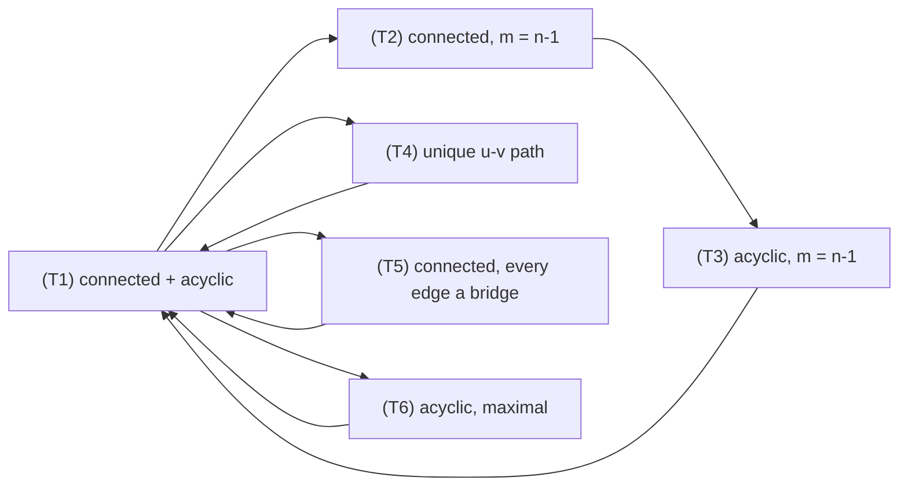
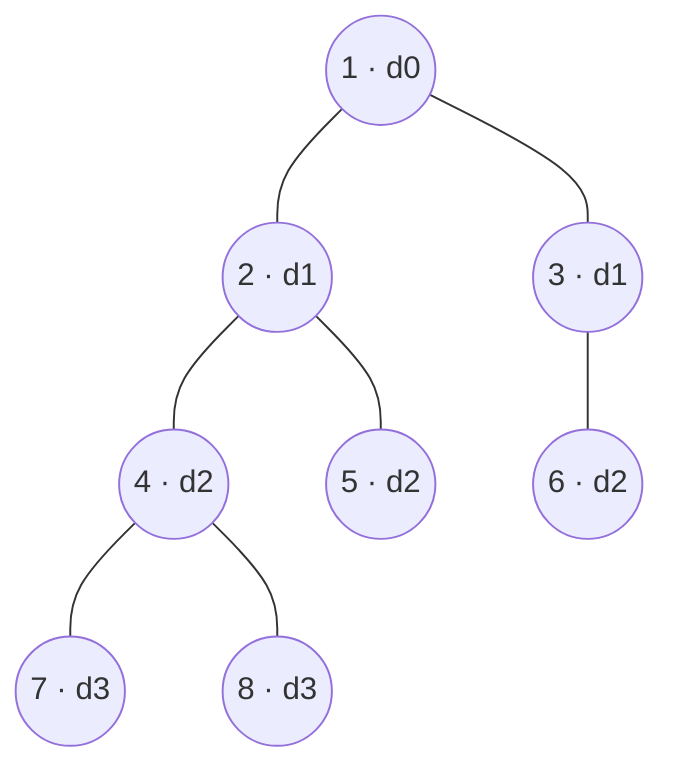
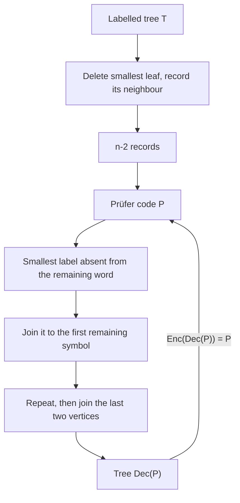

# Trees

> [Mathematics](../../README.md) › [Graph Theory](../README.md) › Trees · Level: Intermediate · Prerequisites: [Graph Basics](../01-graph-basics/README.md), [Mathematical Induction](../../09-discrete-mathematics/01-mathematical-induction/README.md), [Proof Techniques](../../00-foundations/04-proof-techniques/README.md), [Combinatorics](../../20-combinatorics/README.md) · Estimated time: 420 min

## 1. Introduction

A **tree** is a connected graph with no cycle. That is the whole definition, and it is astonishing how much follows from it: a tree on $n$ vertices always has exactly $n-1$ edges, always has at least two vertices of degree $1$, always has exactly one path between any two vertices, and every one of its edges is a bridge. None of these facts is an extra assumption; each is a consequence, and Section 7.2 proves that all six standard characterisations are logically equivalent.

Trees are the skeleton of every connected graph. Delete edges from a connected graph until no cycle remains and you have a **spanning tree**: same vertices, a minimal set of edges that keeps everything reachable. If the edges carry costs — cable lengths, pipe diameters, road distances — the natural question is which spanning tree is cheapest, and that question has two famous answers, **Kruskal's algorithm** and **Prim's algorithm**, both proved correct in Section 7.7 and 7.8. Remarkably, a greedy rule that never looks ahead finds the global optimum, and the reason is a single exchange argument.

Trees are also the objects that counting questions attach to. Cayley's formula says there are exactly $n^{n-2}$ labelled trees on $n$ vertices: for $n = 4$ that is $16$, for $n = 5$ it is $125$, for $n = 10$ it is $10^8$. The proof via **Prüfer sequences** (Section 7.9) is a bijection rather than an induction, and it gives much more than the count: it tells you how many trees have a prescribed degree sequence, how many leaves an average tree has, and why the number of paths is $n!/2$.

Finally, trees are the data structure of choice whenever a hierarchy is needed. A file system is a tree, an arithmetic expression is a tree, the syntax of a program is a tree, a family of species related by descent is a tree, and a decision procedure is a tree. The vocabulary of rooted trees — parent, child, depth, height, leaf — is used in every one of those settings, and Section 7.4 makes it precise.

The prerequisite is [Graph Basics](../01-graph-basics/README.md): vertices, edges, degree, paths, cycles, connectivity, components and isomorphism are all used here without redefinition. In return, this topic completes the loose end left there: in any graph $m \ge n-c$, and the graphs with equality are exactly the forests.

## 2. Prerequisites

* **Graphs, degree, paths, cycles, connectivity.** Definitions 5.1–5.8 and Theorems 7.3.1 (handshake), 7.5.1 (a walk contains a path), 7.6.1 (connectivity is an equivalence relation) and 7.6.4 ($m \ge n-c$) of [Graph Basics](../01-graph-basics/README.md) are used constantly.
* **Mathematical induction.** Used for the edge count of a tree, for the leaf-count identity and for the correctness of the greedy algorithms. Taught in [Mathematical Induction](../../09-discrete-mathematics/01-mathematical-induction/README.md).
* **Proof techniques: contradiction, contrapositive, the exchange argument.** The exchange argument of Section 7.6 is the most important proof technique in combinatorial optimisation. Taught in [Proof Techniques](../../00-foundations/04-proof-techniques/README.md).
* **Bijections and counting.** "$G \cong H$", "there is a bijection between $A$ and $B$", the product rule and the multinomial coefficient. Taught in [Combinatorics](../../20-combinatorics/README.md).
* **Binomial coefficients and the binomial theorem.** Used for the Catalan numbers and for the multinomial count of Prüfer sequences. Taught in [Polynomials](../../03-algebra/06-polynomials/README.md); the general counting framework is in [Combinatorics](../../20-combinatorics/README.md).
* **Elementary logarithms.** $\log_2$ appears in the height bounds for binary trees. Taught in [Exponential and Logarithmic Functions](../../03-algebra/12-exponential-and-logarithmic-functions/README.md).
* **Basic algorithm analysis.** What $O(f(n))$ means, and why sorting $m$ items costs $O(m\log m)$. A first encounter with complexity is enough; the analysis in Sections 7.7 and 7.8 is self-contained.

Conventions: all graphs are finite and simple unless stated; a weighted graph has real edge weights; $\log$ without a subscript means $\log_2$ in this topic when discussing heights, and $\ln$ is always the natural logarithm.

## 3. Learning Objectives

By the end of this tutorial you will be able to:

1. State the definition of a tree and of a forest, and give examples and non-examples from everyday structures.
2. Prove the equivalence of the six standard characterisations of a tree: connected and acyclic; connected with $n-1$ edges; acyclic with $n-1$ edges; unique paths; connected with every edge a bridge; acyclic and maximal with respect to adding edges.
3. Prove that every tree with $n \ge 2$ vertices has at least two leaves, and that the number of leaves is $2 + \sum_{k\ge3}(k-2)n_k$.
4. Use the vocabulary of rooted trees — parent, child, ancestor, descendant, depth, height, subtree — correctly, and compute those quantities for a given rooted tree.
5. Prove the counting identities for binary trees, including "a full binary tree with $i$ internal vertices has $i+1$ leaves".
6. Prove that every connected graph has a spanning tree, and state the cut and cycle properties of spanning trees.
7. State and prove the cut property and the cycle property for minimum spanning trees, and deduce that distinct weights give a unique MST.
8. Carry out Kruskal's algorithm and Prim's algorithm on a weighted graph, and prove both correct.
9. Analyse the complexity of both algorithms, including the role of the union–find data structure and of the priority queue.
10. State and prove Cayley's formula $n^{n-2}$ using the Prüfer bijection, in both directions.
11. Derive the number of labelled trees with a given degree sequence, the expected number of leaves, and the number of labelled paths.
12. Relate ordered binary trees to Catalan numbers, and compute the first values of both sequences.
13. Recognise trees in applications: decision trees, phylogenetic trees, network design, parsing, file systems and Huffman coding.

## 4. Intuition

### 4.1 The least connected structure

Think of a set of towns that must all be able to reach each other by road, with the smallest possible number of roads. Start with one town. Each new road can join at most one new town to the network, so connecting $n$ towns needs at least $n-1$ roads. Build them one at a time, always attaching a new town to the existing network: after $n-1$ roads everything is connected and there is no redundancy — no road can be closed without cutting the network into two pieces.

That structure is a tree. "Connected" is the requirement; "no cycle" is the price of minimality. Every cycle is a redundancy: if a network contains a cycle, one of its edges can be deleted and everything remains reachable. Trees are exactly the connected graphs with no redundancy at all.

### 4.2 One path or none

In a tree there is exactly one route between any two towns. That is the practical meaning of acyclicity: two different routes would form a cycle (go along one route, come back along the other). This "unique path" property is what makes trees so useful as data structures. Given a node in a file system or in a parse tree, there is exactly one way to write down its address from the root, which is exactly why a path name like `/home/user/notes.txt` is unambiguous.

### 4.3 Cheap networks

Suppose the roads have prices. Among all the networks that connect $n$ towns with $n-1$ roads, which is cheapest? Greedy thinking suggests taking the cheapest road first, then the next cheapest that does not create a cycle, and so on. The surprising theorem is that this greed works: Kruskal's algorithm is optimal. The same is true of the other natural greedy strategy, which grows one connected blob outward from a chosen town, always adding the cheapest road leaving the blob.

Both are instances of one idea. A **cut** is a division of the towns into two groups; any connected network must cross it. If the cheapest road across a cut is added, there is an optimal network containing it — because any optimal network that crosses the cut some other way can swap that other road for the cheap one without getting worse. That single exchange argument, made precise in Section 7.6, proves both algorithms at once.

### 4.4 Why $n^{n-2}$

The number $n^{n-2}$ looks like a misprint. For $n = 3$ there are $3$ labelled trees, and $3^1 = 3$. For $n = 4$ there are $16$, and $4^2 = 16$. For $n = 5$ there are $125$, and $5^3 = 125$.

Where could a power of $n$ come from? A tree has $n-2$ "internal decisions": the Prüfer code records, for each of the first $n-2$ leaves removed in a standard order, the label of the vertex it was attached to. Each record is a free choice among $n$ labels, so there are $n^{n-2}$ possible records. The content of Section 7.9 is that this recording is a perfect code: every string of length $n-2$ over an $n$-letter alphabet is the code of exactly one tree.

### 4.5 Trees as hierarchies

A rooted tree records *descent*. Every vertex except the root has exactly one parent, so following parents from any vertex leads back to the root in a finite number of steps — a tree cannot contain a cycle, so the process cannot loop. Depth measures how far a vertex is from the root; the height is the largest depth. A binary tree restricts each vertex to at most two children, and the restrictions translate into counting identities: a full binary tree with $i$ internal vertices has $i+1$ leaves, because every internal vertex "spends" one extra edge above what the leaves can absorb.

These identities are not curiosities. They bound the performance of data structures (a balanced binary tree with $n$ nodes has height about $\log_2 n$), of comparison sorting (a decision tree with $n!$ leaves needs depth at least $\log_2(n!)$), and of compression (a Huffman code is a full binary tree whose leaf depths are the code lengths).

## 5. Formal Definition

### 5.1 Trees and forests

**Definition 5.1.1 (forest, tree).** A **forest** is a simple graph with no cycle. A **tree** is a connected forest. A **trivial tree** is the tree with one vertex and no edges.

Note what is *not* required: a tree need not be drawn without crossings, need not be planar in a particular embedding, and need not have a distinguished vertex. Planarity is a separate property; every tree happens to be planar, as Section 12 notes.

**Definition 5.1.2 (leaf, internal vertex).** A **leaf** of a tree is a vertex of degree $1$. A vertex of degree at least $2$ is **internal**. (In the trivial tree the single vertex has degree $0$ and is neither; this convention keeps the identity "leaves $= 2 + \sum_{k\ge3}(k-2)n_k$" valid for $n \ge 2$ without an exception.)

**Definition 5.1.3 (subtree).** A **subtree** of a tree $T$ is a connected subgraph of $T$. Every connected subgraph of a tree is itself a tree, and every subgraph of a tree is a forest.

### 5.2 Rooted trees and binary trees

**Definition 5.2.1 (rooted tree).** A **rooted tree** is a pair $(T, r)$ where $T$ is a tree and $r \in V(T)$ is a chosen **root**. For a vertex $v \ne r$, the **parent** of $v$ is the neighbour of $v$ on the unique $r$–$v$ path; the **children** of $v$ are the neighbours whose parent is $v$. The **siblings** of $v$ are the other children of its parent. An **ancestor** of $v$ is any vertex on the $r$–$v$ path other than $v$ itself, and a **descendant** of $v$ is any vertex $w \ne v$ whose $r$–$w$ path passes through $v$.

**Definition 5.2.2 (depth, level, height).** The **depth** of $v$ in $(T,r)$ is its distance $d(r,v)$ from the root. The vertices of depth $i$ form the **level** $i$. The **height** $h(T)$ is the maximum depth, $\max_v d(r,v)$. The **subtree rooted at $v$**, written $T_v$, is the subgraph induced by $v$ and its descendants.

**Definition 5.2.3 (binary tree).** A **binary tree** is a rooted tree in which every vertex has at most two children. It is **ordered** (or *plane*) if the two child positions are distinguished as left and right. It is **full** (or *proper*) if every vertex has either zero or two children. It is **perfect** of height $h$ if all leaves have depth $h$ and every internal vertex has two children.

A binary tree with $n$ vertices may be **degenerate** (a path, height $n-1$) or balanced. The distinction matters: a search in a tree costs time proportional to its height.

**Definition 5.2.4 ($m$-ary tree, plane tree).** An **$m$-ary tree** is a rooted tree in which every vertex has at most $m$ children. A **plane tree** is a rooted tree in which the children of every vertex are linearly ordered left to right.

### 5.3 Spanning trees and weighted trees

**Definition 5.3.1 (spanning tree).** A **spanning tree** of a graph $G$ is a spanning subgraph of $G$ that is a tree. Equivalently: a set of $n-1$ edges of $G$ containing no cycle, on the full vertex set.

**Definition 5.3.2 (weight).** For a weighted graph $(G,w)$ and a subgraph $H \subseteq G$, the **weight** of $H$ is $w(H) = \sum_{e \in E(H)} w(e)$.

**Definition 5.3.3 (minimum spanning tree).** A **minimum spanning tree** (MST) of a connected weighted graph $(G,w)$ is a spanning tree $T$ with $w(T) \le w(T')$ for every spanning tree $T'$ of $G$.

**Definition 5.3.4 (cut).** For $\varnothing \ne S \subsetneq V$, the **cut** $\delta(S)$ is the set of edges with exactly one endpoint in $S$. An edge of $\delta(S)$ is said to **cross** the cut.

### 5.4 Prüfer codes and Catalan numbers

**Definition 5.4.1 (Prüfer code).** Let $T$ be a labelled tree on $\{1,\dots,n\}$ with $n \ge 2$. The **Prüfer code** $P(T)$ is the sequence of length $n-2$ obtained as follows: while more than two vertices remain, let $\ell$ be the smallest leaf of the current tree, append the label of its unique neighbour to the sequence, and delete $\ell$. The two surviving vertices are not recorded.

**Definition 5.4.2 (Dyck path, Catalan number).** A **Dyck path** of semilength $n$ is a lattice path from $(0,0)$ to $(n,n)$ using steps $(1,0)$ and $(0,1)$ that never rises above the diagonal $y = x$. The **Catalan number** is
$$C_n = \frac{1}{n+1}\binom{2n}{n}, \qquad n \ge 0 .$$

## 6. Mathematical Notation

| Symbol | Read as | Meaning |
|---|---|---|
| $T = (V,E)$ | tree $T$ | a connected acyclic graph |
| $n$, $m$ | order, size | $n = \lvert V\rvert$, $m = \lvert E\rvert$ |
| $n_k$ | number of vertices of degree $k$ | used in the leaf identity |
| $\ell(T)$, $L(T)$ | number of leaves of $T$ | vertices of degree $1$ |
| $(T,r)$ | rooted tree with root $r$ | a tree plus a distinguished vertex |
| $\operatorname{parent}(v)$ | parent of $v$ | neighbour toward the root |
| $\operatorname{depth}(v)$ | depth of $v$ | $d(r,v)$ |
| $h(T)$ | height | maximum depth |
| $T_v$ | subtree rooted at $v$ | $v$ and its descendants |
| $\mathcal{T}_n$ | the set of labelled trees on $\{1,\dots,n\}$ | $\lvert\mathcal{T}_n\rvert = n^{n-2}$ |
| $P(T)$ | Prüfer code of $T$ | a word of length $n-2$ over $\{1,\dots,n\}$ |
| $\operatorname{occ}(v)$ | number of occurrences of $v$ in a Prüfer code | equals $\deg(v) - 1$ |
| $w(e)$, $w(H)$ | weight of an edge, of a subgraph | sum over edges |
| $T_{\mathrm{min}}$ | a minimum spanning tree | minimum total weight |
| $\delta(S)$ | cut defined by $S$ | edges leaving $S$ |
| $C_n$ | $n$-th Catalan number | $\frac{1}{n+1}\binom{2n}{n}$ |
| $B_n$ | number of ordered binary trees with $n$ vertices | equals $C_n$ |
| $(2n-3)!!$ | double factorial | $1\cdot3\cdot5\cdots(2n-3)$ |
| $\alpha(n)$ | inverse Ackermann function | effectively a constant, $\le 4$ in practice |
| $O(f(n))$ | big-O | asymptotic upper bound |
| $\log_2$ | logarithm base $2$ | used for heights and depths |
| $\blacksquare$ | end of proof | a completed argument |

Reading notation aloud: "$P(T) = (p_1,\dots,p_{n-2})$" is "the Prüfer code of $T$ is the word $p_1$ through $p_{n-2}$". "$\deg(v) = 1 + \operatorname{occ}(v)$" is "the degree of $v$ is one plus the number of times $v$ occurs in the Prüfer code" — the central identity of Section 7.9.

## 7. Core Concepts

### 7.1 What a tree is: first examples

* A path $P_n$ is a tree; a cycle $C_n$ is not (for $n \ge 3$), because it has a cycle.
* The complete graph $K_1$ is a tree; $K_2$ is a tree; $K_3$ is not.
* A star $K_{1,k}$ is a tree: one centre joined to $k$ leaves.
* A forest is a disjoint union of trees. The empty graph on $n$ vertices is a forest with $n$ trivial trees.
* Every connected subgraph of a tree is a tree; every subgraph of a tree is a forest. In particular, deleting edges from a tree always produces a forest, and it stays a tree exactly when no edge is deleted.

The two conditions — connected and acyclic — are independent. A triangle is connected but not acyclic. Two disjoint edges form a graph that is acyclic but not connected. A cycle plus an isolated vertex is neither.

### 7.2 Six equivalent characterisations

The following theorem is the reason trees are easy to work with: six very different-looking properties are all the same property, so a proof may use whichever is most convenient.

**Theorem 7.2.1 (characterisations of a tree).** Let $T$ be a simple graph with $n \ge 1$ vertices and $m$ edges. The following are equivalent:

(T1) $T$ is connected and acyclic;
(T2) $T$ is connected and $m = n-1$;
(T3) $T$ is acyclic and $m = n-1$;
(T4) for every pair of distinct vertices $u, v$ there is exactly one simple $u$–$v$ path;
(T5) $T$ is connected and every edge of $T$ is a bridge;
(T6) $T$ is acyclic, and adding any edge between two non-adjacent vertices creates exactly one cycle.

The proof needs three lemmas and the edge bound from [Graph Basics](../01-graph-basics/README.md).

**Lemma 7.2.2 (a tree has two leaves).** Every tree with $n \ge 2$ vertices has at least two leaves.

**Proof.** Let $P = v_0 v_1 \cdots v_k$ be a longest path in $T$; since $T$ is connected and $n \ge 2$, we have $k \ge 1$. Every neighbour of $v_0$ lies on $P$: a neighbour $w$ outside $P$ would extend $P$ to the longer path $w v_0 v_1 \cdots v_k$. Moreover $v_0$ is adjacent to no $v_i$ with $i \ge 2$, because $v_0 v_1 \cdots v_i v_0$ would then be a cycle. So $v_1$ is the only neighbour of $v_0$ and $\deg(v_0) = 1$. The same argument at the other end shows $\deg(v_k) = 1$, and $v_0 \ne v_k$. $\blacksquare$

**Lemma 7.2.3 (edge count of a tree).** If $T$ is a tree on $n$ vertices then $m = n-1$.

**Proof.** Induct on $n$. For $n = 1$ there are no edges and $0 = 1-1$. For $n \ge 2$, Lemma 7.2.2 provides a leaf $\ell$. The graph $T - \ell$ is connected (a path between two vertices other than $\ell$ cannot pass through $\ell$, which has degree $1$) and acyclic (it is a subgraph of an acyclic graph), so it is a tree on $n-1$ vertices. By induction it has $n-2$ edges, and $T$ has exactly one more, namely the edge at $\ell$. Hence $m = n-1$. $\blacksquare$

**Lemma 7.2.4 (edge count of a forest).** A forest with $n$ vertices and $c$ components has exactly $m = n-c$ edges.

**Proof.** Each component of a forest is a tree (it is connected and acyclic). If the components have $n_1,\dots,n_c$ vertices, Lemma 7.2.3 gives $n_i - 1$ edges in the $i$-th component, so
$$m = \sum_{i=1}^{c}(n_i - 1) = n - c. \qquad\blacksquare$$

**Proof of Theorem 7.2.1.** We prove the implications
$$(T1) \Rightarrow (T2) \Rightarrow (T3) \Rightarrow (T1), \qquad (T1) \Rightarrow (T4) \Rightarrow (T1),$$
$$(T1) \Rightarrow (T5) \Rightarrow (T1), \qquad (T1) \Rightarrow (T6) \Rightarrow (T1).$$
Any two of the six are then connected by a chain of implications through (T1).

*$(T1) \Rightarrow (T2)$* is Lemma 7.2.3.

*$(T2) \Rightarrow (T3)$.* Suppose $T$ is connected with $m = n-1$ and contains a cycle. Let $e$ be an edge of that cycle. Deleting $e$ does not disconnect $T$: the endpoints of $e$ are still joined along the rest of the cycle. So $T - e$ is connected with $n-2$ edges. But every connected graph on $n$ vertices has at least $n-1$ edges, by Theorem 7.6.4 of [Graph Basics](../01-graph-basics/README.md) with $c = 1$. Contradiction. Hence $T$ is acyclic.

*$(T3) \Rightarrow (T1)$.* Let $c$ be the number of components of $T$. By Lemma 7.2.4, $n-1 = m = n-c$, so $c = 1$ and $T$ is connected.

*$(T1) \Rightarrow (T4)$.* Connectivity gives at least one path. Suppose two distinct simple $u$–$v$ paths $P$ and $Q$ exist. List the vertices common to $P$ and $Q$ in the order in which they occur on $P$:
$$u = x_0,\ x_1,\ \dots,\ x_r = v .$$
Since $P \ne Q$, for some $i$ the segment of $P$ from $x_i$ to $x_{i+1}$ differs from the segment of $Q$ from $x_i$ to $x_{i+1}$; otherwise every segment would coincide and the paths would be equal. Those two segments share no internal vertex (by the choice of consecutive common vertices) and each is a simple path, so their union is a cycle: start at $x_i$, traverse the $P$-segment to $x_{i+1}$, then traverse the $Q$-segment backwards to $x_i$. This contradicts acyclicity. Hence the path is unique.

*$(T4) \Rightarrow (T1)$.* Existence of a path for every pair is connectivity. If $T$ had a cycle and $x, y$ were two distinct vertices of it, the two arcs of the cycle would give two distinct simple $x$–$y$ paths, contradicting (T4). So $T$ is acyclic.

*$(T1) \Rightarrow (T5)$.* Connectivity is hypothesis. Let $e = uv$ be an edge. If $e$ were not a bridge, $T - e$ would be connected and would contain a $u$–$v$ path; together with $e$ that path would be a cycle in $T$. So $e$ is a bridge.

*$(T5) \Rightarrow (T1)$.* Connectivity is hypothesis. If $T$ had a cycle, any edge $e$ of that cycle would fail to be a bridge: its endpoints remain joined along the rest of the cycle, so $T - e$ is connected. Contradiction.

*$(T1) \Rightarrow (T6)$.* Acyclicity is hypothesis. Let $u, v$ be non-adjacent. By (T4), which is already proved equivalent to (T1), there is a unique simple $u$–$v$ path $P$, and $P$ together with the new edge $uv$ is a cycle of $T + uv$. Every cycle of $T + uv$ must use the new edge (the rest of the graph is $T$, which has no cycle), and deleting $uv$ from such a cycle leaves a $u$–$v$ path in $T$; by uniqueness this path is $P$. So there is exactly one cycle.

*$(T6) \Rightarrow (T1)$.* Acyclicity is hypothesis. If $T$ were disconnected, take $u, v$ in different components; they are non-adjacent, and adding $uv$ creates no cycle, since no $u$–$v$ path exists. That contradicts (T6). Hence $T$ is connected. $\blacksquare$

The two slogans to remember are: a tree is a **minimal connected** graph (T5: every edge is needed) and a **maximal acyclic** graph (T6: no edge can be added without creating a cycle).

### 7.3 Counting consequences

**Corollary 7.3.1 (at least two leaves).** Every tree with $n \ge 2$ vertices has at least two leaves.

**Proof.** This is Lemma 7.2.2; it is restated because it is used more often than any other fact about trees. $\blacksquare$

**Corollary 7.3.2 (the leaf identity).** Let $T$ be a tree with $n \ge 2$ vertices, and let $n_k$ be the number of vertices of degree $k$. Then
$$n_1 = 2 + \sum_{k \ge 3}(k-2)\,n_k .$$

**Proof.** By Theorem 7.2.1, $m = n-1$, and by the handshake lemma,
$$2(n-1) = \sum_{v}\deg(v) = n_1 + 2n_2 + \sum_{k\ge3} k\,n_k .$$
Also $n = n_1 + n_2 + \sum_{k\ge3} n_k$, so $2n - 2 = 2n_1 + 2n_2 + 2\sum_{k\ge3} n_k - 2$. Equating the two expressions for $2(n-1)$ and cancelling $2n_2$,
$$n_1 + \sum_{k\ge3} k\,n_k = 2n_1 + 2\sum_{k\ge3} n_k - 2,$$
which rearranges to the claimed identity. $\blacksquare$

**Corollary 7.3.3 (leaves versus branching).** In a tree with $n \ge 2$, $\sum_{k\ge3} n_k \le n_1 - 2$; in particular, if $\Delta(T) \ge 3$ then $T$ has at least $\Delta(T)$ leaves.

**Proof.** Since $(k-2) \ge 1$ for $k \ge 3$, Corollary 7.3.2 gives $n_1 - 2 = \sum_{k\ge3}(k-2)n_k \ge \sum_{k\ge3} n_k$. If $\Delta = d \ge 3$, the vertex of degree $d$ contributes $d-2$ to the sum, so $n_1 \ge 2 + (d-2) = d$. $\blacksquare$

*Check.* A star $K_{1,k}$ has $\Delta = k$, one vertex of degree $k$, and $k$ leaves: $n_1 = k = 2 + (k-2)$ exactly. A path has $\Delta = 2$ and exactly two leaves.

**Corollary 7.3.4 (forests).** A graph is a forest if and only if every component is a tree, and then $m = n - c$. Conversely, a forest with $n$ vertices and $n-1$ edges is a tree.

**Proof.** The first sentence is the definition; the edge count is Lemma 7.2.4. For the converse, $m = n-c$ and $m = n-1$ force $c = 1$. $\blacksquare$

### 7.4 Rooted trees, binary trees and depth

**Proposition 7.4.1 (parents).** Let $(T,r)$ be a rooted tree and $v \ne r$. Then $v$ has exactly one parent; its parent has depth $\operatorname{depth}(v) - 1$; and following parents from $v$ reaches $r$ after exactly $\operatorname{depth}(v)$ steps.

**Proof.** The $r$–$v$ path is unique by Theorem 7.2.1, so the neighbour of $v$ on it is unique: that is the parent. Deleting $v$ from the path gives the $r$–parent path, so the parent's depth is one less. Iterating decreases depth by one each time, so after $\operatorname{depth}(v)$ steps the depth is $0$, and the only vertex of depth $0$ is $r$. $\blacksquare$

The parent chain cannot loop: a loop would be a cycle.

**Proposition 7.4.2 (subtrees).** Let $(T,r)$ be a rooted tree and $v \in V$. The set of descendants of $v$ together with $v$ induces a tree $T_v$ with root $v$. Moreover $T_v$ is the component of $T - \operatorname{parent}(v)$ that contains $v$.

**Proof.** $T_v$ is connected: each descendant is joined to $v$ by the segment of its root path below $v$. It is acyclic as a subgraph of a tree. Hence it is a tree. Removing the parent edge of $v$ separates $v$ and all its descendants from everything above, and no other edge of $T$ leaves $T_v$, so $T_v$ is exactly that component. $\blacksquare$

**Proposition 7.4.3 (height bounds for binary trees).** A binary tree of height $h \ge 0$ has at most $2^{h+1} - 1$ vertices and at most $2^h$ leaves. Consequently a binary tree with $n \ge 1$ vertices has height at least $\lceil \log_2(n+1)\rceil - 1$.

**Proof.** Level $i$ contains at most $2^i$ vertices: level $0$ has the root only, and each vertex of level $i$ has at most two children, so level $i+1$ has at most twice as many vertices as level $i$. Summing over $i = 0,\dots,h$,
$$n = \sum_{i=0}^{h}\lvert\text{level } i\rvert \le \sum_{i=0}^{h} 2^i = 2^{h+1} - 1 .$$

For the leaf bound, induct on $h$. For $h = 0$ the tree has one vertex, which is a leaf. For $h \ge 1$, remove the root; what remains is at most two binary trees, each of height at most $h-1$, which by induction have at most $2^{h-1}$ leaves each. The leaves of the original tree are exactly the leaves of those subtrees (or the root itself, if it has no children, in which case there is one leaf), so there are at most $2\cdot 2^{h-1} = 2^h$ leaves.

Finally $n \le 2^{h+1}-1$ gives $2^{h+1} \ge n+1$, so $h+1 \ge \log_2(n+1)$ and, since $h$ is an integer, $h \ge \lceil \log_2(n+1)\rceil - 1$. $\blacksquare$

**Proposition 7.4.4 (full binary trees).** In a full binary tree with $i$ internal vertices and $L$ leaves, $L = i+1$ and the total number of vertices is $2i+1$.

**Proof.** Let $n = i + L$ be the number of vertices. Counting edges from below: the tree has $n-1$ edges. Counting edges from above: every internal vertex has exactly two children, so every edge is counted once as "the edge to a child of an internal vertex", giving $2i$ edges. Hence $i + L - 1 = 2i$, that is $L = i+1$, and $n = i + (i+1) = 2i+1$. $\blacksquare$

**Proposition 7.4.5 (general binary trees).** In a binary tree let $n_0$, $n_1$, $n_2$ be the numbers of vertices with $0$, $1$, $2$ children. Then $n_0 = n_2 + 1$.

**Proof.** $n = n_0+n_1+n_2$ vertices, so $n-1$ edges; counting edges from above gives $n_1 + 2n_2$ edges. Hence
$$n_0 + n_1 + n_2 - 1 = n_1 + 2n_2 \quad\Longrightarrow\quad n_0 = n_2 + 1. \qquad\blacksquare$$

**Proposition 7.4.6 ($m$-ary trees).** An $m$-ary tree of height $h \ge 0$ has at most $m^h$ leaves and at most
$$\frac{m^{h+1}-1}{m-1}$$
vertices. In particular a ternary tree of height $4$ has at most $81$ leaves and at most $(3^5-1)/2 = 121$ vertices.

**Proof.** Level $i$ has at most $m^i$ vertices, since each vertex has at most $m$ children; summing the geometric series gives the vertex bound. For the leaf bound, induct on $h$: a tree of height $0$ has one leaf; for $h \ge 1$, removing the root leaves at most $m$ subtrees of height at most $h-1$, each with at most $m^{h-1}$ leaves by induction, so the total is at most $m\cdot m^{h-1} = m^h$. $\blacksquare$

The case $m = 2$ recovers Proposition 7.4.3; the case $m = 1$ degenerates to a path, where height $h$ means $h+1$ vertices and one leaf.

### 7.5 Spanning trees

**Theorem 7.5.1 (every connected graph has a spanning tree).** A graph $G$ is connected if and only if it has a spanning tree.

**Proof.** If $G$ has a spanning tree, that tree connects all vertices, so $G$ is connected. Conversely, suppose $G$ is connected. If $G$ has a cycle, delete an edge of the cycle; the graph stays connected (the cycle's endpoints remain joined around the rest of the cycle) and keeps all vertices. Repeat. Each step reduces $m$ by one, so the process stops; at that point the graph is a connected spanning subgraph with no cycle, that is, a spanning tree. $\blacksquare$

**Corollary 7.5.2 (edge bound again).** A connected graph on $n$ vertices has at least $n-1$ edges.

**Proof.** It contains a spanning tree with $n-1$ edges. $\blacksquare$

**Proposition 7.5.3 (a spanning tree meets every cut).** Let $T$ be a spanning tree of $G$ and let $\varnothing \ne S \subsetneq V$. Then $T$ has at least one edge crossing the cut $\delta(S)$.

**Proof.** Choose $u \in S$ and $v \notin S$. The unique $u$–$v$ path in $T$ starts inside $S$ and ends outside, so at some step it uses an edge with one endpoint in $S$ and one outside. $\blacksquare$

**Proposition 7.5.4 (fundamental cycle).** Let $T$ be a spanning tree of $G$ and let $e \in E(G) \setminus E(T)$. Then $T + e$ contains exactly one cycle.

**Proof.** This is property (T6) of Theorem 7.2.1 applied to $T$. $\blacksquare$

**Proposition 7.5.5 (fundamental cut).** Let $T$ be a spanning tree of $G$ and $f \in E(T)$. Then $T - f$ has exactly two components, with vertex sets $S$ and $V \setminus S$; the edges of $G$ crossing $\delta(S)$ are $f$ together with exactly those non-tree edges $e$ whose fundamental cycle in $T + e$ contains $f$.

**Proof.** $T-f$ has two components by (T5), because $f$ is a bridge of $T$. Every T-edge other than $f$ lies inside $S$ or inside $V\setminus S$. A non-tree edge $e = xy$ crosses $\delta(S)$ exactly when $x$ and $y$ lie on opposite sides, which happens exactly when the unique $x$–$y$ path in $T$ uses $f$ — that is, exactly when the fundamental cycle of $e$ contains $f$. $\blacksquare$

Propositions 7.5.4 and 7.5.5 are the combinatorial content behind the greedy algorithms: every non-tree edge defines a cycle, every tree edge defines a cut, and the two are dual to each other.

### 7.6 Minimum spanning trees: the two exchange properties

Throughout this section $(G,w)$ is a connected weighted graph with real edge weights.

**Theorem 7.6.1 (cut property).** Let $\varnothing \ne S \subsetneq V(G)$ and let $e$ be an edge of minimum weight among the edges crossing $\delta(S)$. Then some minimum spanning tree of $G$ contains $e$.

**Proof.** Let $T$ be an MST. If $e \in E(T)$ there is nothing to prove. Otherwise $T + e$ contains a unique cycle $C$ (Proposition 7.5.4). The cycle crosses the cut: $e$ crosses it, and a cycle that leaves $S$ must come back. So $C$ contains another edge $f \in \delta(S)$, with $f \ne e$. Since $e$ is lightest across the cut, $w(f) \ge w(e)$.

Then $T' = T - f + e$ is a spanning tree (removing an edge of the unique cycle and adding a non-tree edge restores a tree with $n-1$ edges), and
$$w(T') = w(T) - w(f) + w(e) \le w(T).$$
Because $T$ is minimum, $w(T') = w(T)$ and $T'$ is also an MST, this one containing $e$. $\blacksquare$

**Lemma 7.6.2 (safe edge).** Let $F$ be a set of edges contained in some MST $T$, let $\varnothing \ne S \subsetneq V$ be such that no edge of $F$ crosses $\delta(S)$, and let $e$ be a lightest edge of $\delta(S)$. Then $F \cup \{e\}$ is contained in some MST.

**Proof.** Run the exchange argument of Theorem 7.6.1 with this $F$ and $T$. If $e \in T$, done. Otherwise let $C$ be the cycle in $T + e$ and $f$ the other edge of $C$ crossing $\delta(S)$; then $w(f) \ge w(e)$, and $T' = T - f + e$ is an MST with $w(T') \le w(T)$, hence equal. Since $f$ crosses $\delta(S)$ and no edge of $F$ does, $f \notin F$; therefore $F \subseteq T'$ and $e \in T'$, so $F \cup \{e\} \subseteq T'$. $\blacksquare$

This is the lemma that the correctness proofs of Kruskal and Prim both invoke.

**Theorem 7.6.3 (cycle property).** Let $C$ be a cycle of $G$ and let $e \in E(C)$ have weight strictly larger than every other edge of $C$. Then no minimum spanning tree contains $e$.

**Proof.** Suppose an MST $T$ contains $e$. Delete $e$ from $T$; the result has two components, with vertex sets $S$ and $V \setminus S$, and $e$ crosses this cut. The cycle $C$ minus $e$ is a path joining the two endpoints of $e$, hence it crosses the cut in some edge $f \ne e$. Since $f \in E(C)$ and $e$ is strictly heavier than every other edge of $C$, $w(f) < w(e)$. Then $T - e + f$ is a spanning tree with
$$w(T - e + f) = w(T) - w(e) + w(f) < w(T),$$
contradicting the minimality of $T$. $\blacksquare$

**Corollary 7.6.4 (uniqueness).** If all edge weights of a connected graph are pairwise distinct, the minimum spanning tree is unique.

**Proof.** Suppose $T_1 \ne T_2$ are both MSTs. The symmetric difference $T_1 \triangle T_2$ is non-empty, and all weights are distinct, so it has a unique edge $e$ of minimum weight. Interchange the names so that $e \in E(T_1) \setminus E(T_2)$.

Add $e$ to $T_2$: by Proposition 7.5.4 there is a unique cycle $C$, and $C$ contains an edge $f \in E(T_2) \setminus E(T_1)$ (the cycle cannot consist entirely of $T_1$-edges, since $T_1$ is acyclic). Since $f \in T_1 \triangle T_2$ and $f \ne e$, minimality of $e$ in the symmetric difference gives $w(f) > w(e)$. Now $T_2 - f + e$ is a spanning tree with
$$w(T_2 - f + e) = w(T_2) - w(f) + w(e) < w(T_2),$$
contradicting the minimality of $T_2$. $\blacksquare$

### 7.7 Kruskal's algorithm

**Algorithm 7.7.1 (Kruskal).** Given a connected weighted graph $(G,w)$:

1. Sort the edges so that $w(e_1) \le w(e_2) \le \dots \le w(e_m)$.
2. Set $F \leftarrow \varnothing$.
3. For $i = 1,\dots,m$: if $F \cup \{e_i\}$ contains no cycle, set $F \leftarrow F \cup \{e_i\}$.
4. Return $F$.

In practice step 3 is implemented with a **union–find** structure: $F$ is a forest, and $F \cup \{e\}$ contains a cycle exactly when the endpoints of $e$ already lie in the same component of $F$.

**Theorem 7.7.2 (Kruskal is correct).** If $G$ is connected, Kruskal's algorithm returns a minimum spanning tree.

**Proof.** *The output is a spanning tree.* Throughout, $F$ is acyclic, since an edge is added only when it creates no cycle. At the end $F$ is maximal with this property: if some edge $e = uv$ were still addable, its endpoints would lie in different components of $F$, and adding $e$ would create no cycle, so the algorithm would have added it. Hence every edge of $G$ has both endpoints in the same component of $F$, which means $F$'s components coincide with $G$'s; since $G$ is connected, $F$ has one component. A spanning, acyclic, connected subgraph is a spanning tree, and it has $n-1$ edges.

*The output is minimum.* We prove by induction on the number of edges chosen that after each step, the current set $F$ is contained in some MST. This is true initially ($\varnothing$ is contained in every MST; an MST exists because $G$ is connected and finitely many spanning trees exist).

For the step, let $e = e_i$ be the edge about to be added. Let $S$ be the vertex set of one of the two components of $F$ whose endpoints $e$ joins. Then $e$ crosses $\delta(S)$, and no edge of $F$ crosses $\delta(S)$ (edges of $F$ lie inside components of $F$). We claim $e$ is a lightest edge of $\delta(S)$. Suppose $f \in \delta(S)$ had $w(f) < w(e)$. Then $f$ was considered before $e$. At the moment $f$ was considered, its endpoints lay in different components of the then-current forest $F_0 \subseteq F$ (components only merge as the algorithm proceeds, and the endpoints lie in different components of $F$), so $F_0 \cup \{f\}$ had no cycle and $f$ was added. But then $f \in F$ crosses $\delta(S)$, contradicting the choice of $S$. Hence $e$ is lightest across the cut, and Lemma 7.6.2 (with the cut $\delta(S)$ and the set $F$) shows that $F \cup \{e\}$ lies in some MST. The induction continues.

At the end $F$ is a spanning tree contained in an MST $T$; two spanning trees with $F \subseteq T$ and $\lvert F\rvert = \lvert T\rvert = n-1$ satisfy $F = T$. So the output is an MST. $\blacksquare$

**Proposition 7.7.3 (complexity of Kruskal).** Kruskal's algorithm runs in $O(m \log m)$ time with a comparison sort, or $O(m \log n)$ since $m \le \binom{n}{2}$ implies $\log m \le 2 \log n$. The union–find operations cost $O(m\,\alpha(n))$, where $\alpha$ is the inverse Ackermann function; this is dominated by the sorting. Memory is $O(n+m)$.

**Proof.** Sorting dominates: $O(m\log m)$. There are at most $2m$ union–find operations (two finds and possibly one union per edge), each $O(\alpha(n))$ with union by rank and path compression. Since $\alpha(n) \le 4$ for all practical $n$, this term is linear. $\blacksquare$

### 7.8 Prim's algorithm

**Algorithm 7.8.1 (Prim).** Given a connected weighted graph $(G,w)$ and a starting vertex $r$:

1. Set $S \leftarrow \{r\}$ and $F \leftarrow \varnothing$.
2. While $S \ne V$: choose an edge $e = uv$ of minimum weight with $u \in S$ and $v \notin S$; set $F \leftarrow F \cup \{e\}$ and $S \leftarrow S \cup \{v\}$.
3. Return $F$.

**Theorem 7.8.2 (Prim is correct).** Prim's algorithm returns a minimum spanning tree.

**Proof.** *The output is a spanning tree.* After $k$ iterations, $\lvert S\rvert = k+1$ and $\lvert F\rvert = k$, and $F$ is a tree on $S$: each added edge joins a new vertex to the existing tree. When the loop ends, $S = V$ and $F$ is a tree on all vertices.

*The output is minimum.* We show by induction that at every stage $F$ is contained in some MST. Initially true. At a step with current set $S$ and current forest $F$, every edge of $F$ has both endpoints in $S$, so no edge of $F$ crosses $\delta(S)$. Algorithm 7.8.1 chooses a lightest edge $e$ of $\delta(S)$. By Lemma 7.6.2, $F \cup \{e\}$ is contained in some MST. At the end, $F$ is a spanning tree contained in an MST, hence equal to it by the edge-count argument in the proof of Theorem 7.7.2. $\blacksquare$

**Proposition 7.8.3 (complexity of Prim).** With adjacency lists and a binary heap, Prim's algorithm runs in $O(m \log n)$ time; with a Fibonacci heap, in $O(m + n\log n)$; with an array of current best edges and a linear scan for the minimum, in $O(n^2)$ time, which is preferable for dense graphs since then $m = \Theta(n^2)$.

**Proof.** With a binary heap, each edge causes at most one decrease-key operation and each vertex one extract-min, giving $O(m\log n)$ plus $O(n \log n)$. The array version performs $n$ scans of length $n$, hence $O(n^2)$, and relaxes each of the $2m$ edge-ends once, which is $O(m) \subseteq O(n^2)$. $\blacksquare$

**Choosing between them.** Kruskal is simpler to implement and natural when the edges arrive as a list or must be processed in sorted order; it also works on disconnected graphs, producing a minimum spanning forest. Prim is usually faster on dense graphs and easier to run if the graph is given by an adjacency matrix. Both are greedy, and both are correct for the same reason: the cut property.

### 7.9 Cayley's formula and Prüfer sequences

**Theorem 7.9.1 (Cayley).** For $n \ge 2$, the number of labelled trees on the vertex set $\{1,2,\dots,n\}$ is
$$n^{\,n-2}.$$

For $n = 1$ there is exactly one tree (the trivial one), which we record separately.

The proof is a bijection with words. Recall Definition 5.4.1: the **Prüfer code** $P(T)$ is obtained by repeatedly deleting the smallest leaf and recording its neighbour.

**Lemma 7.9.2 (occurrences equal degree minus one).** Let $T$ be a labelled tree on $\{1,\dots,n\}$ with $n \ge 2$ and Prüfer code $P = P(T)$. Then for every vertex $v$,
$$\deg(v) = 1 + \operatorname{occ}_P(v),$$
where $\operatorname{occ}_P(v)$ is the number of times $v$ appears in $P$.

**Proof.** Run the encoding algorithm and watch $v$. Every edge incident with $v$ is eventually removed: either $v$ is itself deleted as a leaf, in which case its last incident edge is removed at that moment, or $v$ is one of the two final vertices, in which case exactly one incident edge survives. Consider each of the other $\deg(v) - 1$ incident edges: it is removed at the moment when the vertex at its other end is deleted as the smallest leaf, and at that moment $v$ is recorded. Hence $v$ is recorded exactly $\deg(v)-1$ times. $\blacksquare$

**Corollary 7.9.3.** $\sum_{v=1}^{n}\operatorname{occ}_P(v) = n-2$.

**Proof.** Summing Lemma 7.9.2 and using the handshake lemma,
$$\sum_v \operatorname{occ}_P(v) = \sum_v \bigl(\deg(v)-1\bigr) = 2(n-1) - n = n-2,$$
which also explains why the code has exactly $n-2$ entries. $\blacksquare$

Now the inverse construction.

**Algorithm 7.9.4 (decoding a Prüfer code).** Given a word $P = (p_1,\dots,p_{n-2})$ over $\{1,\dots,n\}$:

1. Set $U \leftarrow \{1,\dots,n\}$.
2. For $i = 1,\dots,n-2$: let $\ell_i$ be the smallest element of $U$ that does not occur among $p_i, p_{i+1}, \dots, p_{n-2}$. Output the edge $\ell_i p_i$ and set $U \leftarrow U \setminus \{\ell_i\}$.
3. When two elements $a, b$ remain in $U$, output the edge $ab$.

**Lemma 7.9.5 (the decoder inverts the encoder).** For every word $P$ of length $n-2$ over $\{1,\dots,n\}$:

(a) the graph $T = \mathrm{Dec}(P)$ is a tree on $\{1,\dots,n\}$;
(b) $P(T) = P$.

**Proof.**

(a) First observe that at step $i$ the label $p_i$ is still in $U$: if $p_i$ had been removed at an earlier step $j < i$, then $\ell_j = p_i$ would have been chosen *not* to occur in the suffix $(p_j,\dots,p_{n-2})$, yet $p_i$ occurs in that suffix at position $i$ — a contradiction. So the edge added at step $i$ joins the vertex $\ell_i$ that is being removed to a vertex $p_i$ that remains. Reading the steps backwards, each removed vertex is joined by its own edge to a vertex that survives longer, so by induction every vertex is connected to the final pair, and the final pair is joined by the last edge. Hence $\mathrm{Dec}(P)$ is connected, has $n$ vertices and $n-1$ edges, and is a tree by Theorem 7.2.1, $(T2)\Rightarrow(T1)$.

(b) Let $T = \mathrm{Dec}(P)$. By the same edge-tracking argument as in Lemma 7.9.2, applied to the construction, one finds
$$\deg_T(v) = 1 + \operatorname{occ}_P(v).$$
Moreover, for each $i$, the edges added at steps $i, i+1, \dots, n-2$ together with the final edge form the tree $T_i$ on the vertex set $U_i$ that the decoder would build from the suffix $(p_i,\dots,p_{n-2})$; hence
$$\deg_{T_i}(v) = 1 + \operatorname{occ}_{(p_i,\dots,p_{n-2})}(v),$$
and the leaves of $T_i$ are precisely the vertices of $U_i$ that do not occur in that suffix. By construction $\ell_i$ is the *smallest* such vertex. Therefore, when the encoder is run on $T$, the first leaf it deletes is $\ell_1$, and it records its unique neighbour, which is $p_1$. The remaining tree is exactly $T_2$, so the same argument applies inductively: the encoder records $p_1, p_2, \dots, p_{n-2}$, that is, $P(T) = P$. $\blacksquare$

**Proof of Theorem 7.9.1.** Let $\mathcal{T}_n$ be the set of labelled trees on $\{1,\dots,n\}$ and $\mathcal{W}_n = \{1,\dots,n\}^{n-2}$ the set of words of length $n-2$; then $\lvert\mathcal{W}_n\rvert = n^{n-2}$.

The encoder defines a map $\mathrm{Enc} : \mathcal{T}_n \to \mathcal{W}_n$ and the decoder a map $\mathrm{Dec} : \mathcal{W}_n \to \mathcal{T}_n$. Lemma 7.9.5 says that $\mathrm{Enc}(\mathrm{Dec}(P)) = P$ for every word $P$. Therefore $\mathrm{Enc}$ is surjective (every word is hit by the tree $\mathrm{Dec}(P)$), which gives $\lvert\mathcal{T}_n\rvert \ge \lvert\mathcal{W}_n\rvert$, and $\mathrm{Dec}$ is injective, which gives $\lvert\mathcal{W}_n\rvert \le \lvert\mathcal{T}_n\rvert$. Hence both sets have the same size, and both maps are bijections:
$$\lvert\mathcal{T}_n\rvert = n^{n-2}. \qquad\blacksquare$$

*Check.* For $n = 2$ the only word is the empty word, and the tree is the single edge $\{1,2\}$: $2^0 = 1$. For $n = 3$ the words are $(1), (2), (3)$, giving the three trees that are paths with a different centre. For $n = 4$ there are $4^2 = 16$ trees; by the classification of Exercise 4 these are $4$ stars and $12$ paths, and $4 + 12 = 16$ ✓.

**Corollary 7.9.6 (trees with a prescribed degree sequence).** Let $d_1,\dots,d_n$ be positive integers with $\sum_i d_i = 2n-2$. The number of labelled trees on $\{1,\dots,n\}$ with $\deg(i) = d_i$ for all $i$ is
$$\frac{(n-2)!}{\prod_{i=1}^{n}(d_i-1)!}.$$

**Proof.** By Lemma 7.9.2, a tree has these degrees exactly when its Prüfer code contains the symbol $i$ exactly $d_i-1$ times. The number of words of length $n-2$ with prescribed multiplicities $e_i = d_i - 1$ is the multinomial coefficient $\binom{n-2}{e_1,\dots,e_n} = \frac{(n-2)!}{\prod_i e_i!}$, and the bijection of Theorem 7.9.1 transports this count to trees. $\blacksquare$

*Check.* For $n = 5$, the star centred at vertex $1$ has labelled degree sequence $(4,1,1,1,1)$, and the formula gives $3!/(3!\,0!\,0!\,0!\,0!) = 1$: exactly one tree. The labelled sequence $(3,2,1,1,1)$ with $\deg(1)=3$ and $\deg(2)=2$ gives $3!/(2!\,1!\,0!\,0!\,0!) = 3$ trees, matching the enumeration in Example 9.5.

**Corollary 7.9.7 (summing over degree sequences).** Summing Corollary 7.9.6 over all compositions of $n-2$ into $n$ non-negative parts reproduces Cayley's formula:
$$\sum_{e_1+\cdots+e_n = n-2} \frac{(n-2)!}{e_1!\,e_2!\cdots e_n!} = n^{\,n-2},$$
which is the multinomial theorem applied to $(1+1+\cdots+1)^{n-2}$ with $n$ terms. So the two counts are consistent.

**Corollary 7.9.8 (expected number of leaves).** Choose a labelled tree on $\{1,\dots,n\}$ uniformly at random. Then the expected number of leaves is
$$\mathbb{E}[L] = n\left(\frac{n-1}{n}\right)^{n-2}.$$

**Proof.** A vertex $v$ is a leaf exactly when it does not occur in the Prüfer code (Lemma 7.9.2). Under the uniform distribution on trees, the Prüfer code is a uniformly random word of length $n-2$ over $n$ letters, so each of the $n-2$ positions avoids $v$ with probability $(n-1)/n$, independently. Hence
$$\Pr(v \text{ is a leaf}) = \left(\frac{n-1}{n}\right)^{n-2},$$
and by linearity of expectation
$$\mathbb{E}[L] = \sum_{v=1}^{n}\Pr(v\text{ is a leaf}) = n\left(\frac{n-1}{n}\right)^{n-2}. \qquad\blacksquare$$

*Check.* For $n = 4$: $4\cdot(3/4)^2 = 9/4 = 2.25$. Indeed the $16$ labelled trees on four vertices are $4$ stars (each with $3$ leaves) and $12$ paths (each with $2$ leaves), totalling $12 + 24 = 36$ leaves over $16$ trees, an average of $2.25$. For $n = 5$: $5\cdot(4/5)^3 = 320/125 = 2.56$, matching $20 + 180 + 120 = 320$ leaves over the $125$ trees of Example 9.5.

**Corollary 7.9.9 (paths).** For $n \ge 2$, the number of labelled trees on $\{1,\dots,n\}$ with maximum degree at most $2$ is $n!/2$.

**Proof.** $\Delta \le 2$ means every $\deg(v) - 1 \le 1$, so the Prüfer code has $n-2$ pairwise distinct entries. The number of words of length $n-2$ with distinct entries from an $n$-letter alphabet is
$$n(n-1)(n-2)\cdots\bigl(n-(n-2)+1\bigr) = \frac{n!}{2!} = \frac{n!}{2}. \qquad\blacksquare$$

*Check.* For $n = 4$: $24/2 = 12$ paths, matching the enumeration $16 = 4$ stars $+\ 12$ paths.

### 7.10 Counting binary trees: Catalan numbers

**Lemma 7.10.1 (recurrence).** Let $B_n$ be the number of ordered binary trees with $n$ vertices, with $B_0 = 1$ for the empty tree. Then for $n \ge 1$,
$$B_n = \sum_{i=0}^{n-1} B_i\,B_{n-1-i}.$$

**Proof.** An ordered binary tree with $n \ge 1$ vertices consists of a root together with a left subtree and a right subtree, each ordered and binary, whose vertex counts $i$ and $n-1-i$ sum to $n-1$. Conversely any such pair determines the tree uniquely. Summing over the possible size $i$ of the left subtree gives the recurrence. $\blacksquare$

**Theorem 7.10.2 (binary trees are counted by Catalan numbers).** For every $n \ge 0$,
$$B_n = C_n = \frac{1}{n+1}\binom{2n}{n}.$$

**Proof.**

*Step 1: a bijection with Dyck paths.* Given an ordered binary tree with $n$ vertices, fill every empty child slot with an **external leaf**. A binary tree with $n$ vertices has $2n$ child slots, of which $n-1$ are occupied (every vertex except the root is somebody's child), so exactly $n+1$ are empty; the result is a full binary tree with $n$ internal and $n+1$ external vertices.

Now traverse the full tree in **preorder** (visit a vertex, then its left subtree, then its right subtree), writing "(" for each internal vertex and ")" for each external vertex, and delete the final ")".

Let us verify that the resulting word of length $2n$ is a Dyck word. By induction on $n$: for $n = 0$ the word is empty. For $n \ge 1$, the preorder word is "(" $w_L w_R$ where $w_L, w_R$ are the preorder words of the left and right subtrees, each with one more ")" than "(". Every proper prefix of $w_L$ has at least as many "(" as ")"; so after the initial "(" the running balance is at least $1$ inside $w_L$ and returns to $0$ at its end; inside $w_R$ the balance is at least $0$; and at the end the balance is $1 + (-1) + (-1) = -1$, so deleting the last ")" leaves a word with $n$ "(" and $n$ ")" and non-negative partial sums. That is a Dyck path read as east/north steps.

The construction is reversible: given a Dyck word of semilength $n$, append ")" and rebuild the full binary tree with the standard stack procedure — read the symbols left to right, creating a new internal vertex for "(" and an external leaf for ")", filling the left slot of the topmost unfinished vertex first and its right slot second, and closing a vertex once both slots are filled. The preorder traversal of the rebuilt tree reproduces the word, and the filling of empty slots is exactly the inverse of deleting external leaves. Hence ordered binary trees with $n$ vertices are in bijection with Dyck paths of semilength $n$.

*Step 2: counting Dyck paths.* A path from $(0,0)$ to $(n,n)$ with unit steps has $2n$ steps, $n$ of them vertical, so there are $\binom{2n}{n}$ such paths in total. Call a path **bad** if it touches the line $y = x+1$, i.e. if some prefix has more vertical than horizontal steps. Reflect the portion of a bad path up to and including its first contact with $y = x+1$ in that line. The reflection turns the start $(0,0)$ into $(-1,1)$ and leaves the end $(n,n)$ fixed, and it is a bijection between bad paths and *all* paths from $(-1,1)$ to $(n,n)$. Such a path has $(n+1)$ horizontal and $(n-1)$ vertical steps, so there are $\binom{2n}{n-1}$ of them. Therefore
$$D_n = \binom{2n}{n} - \binom{2n}{n-1} = \binom{2n}{n}\left(1 - \frac{n}{n+1}\right) = \frac{1}{n+1}\binom{2n}{n},$$
where $\binom{2n}{n-1} = \binom{2n}{n}\cdot\frac{n}{n+1}$ was used. Combining with Step 1, $B_n = C_n$. $\blacksquare$

**Corollary 7.10.3 (full binary trees).** The number of full binary trees with $L$ leaves (equivalently, with $L-1$ internal vertices) is $C_{L-1}$.

**Proof.** A full binary tree with $L$ leaves has $L-1$ internal vertices by Proposition 7.4.4, and deleting the external leaves gives an ordered binary tree with $L-1$ vertices; the correspondence is a bijection. Hence the count is $B_{L-1} = C_{L-1}$. $\blacksquare$

The first values are

| $n$ | $0$ | $1$ | $2$ | $3$ | $4$ | $5$ | $6$ | $7$ |
|---|---|---|---|---|---|---|---|---|
| $B_n = C_n$ | $1$ | $1$ | $2$ | $5$ | $14$ | $42$ | $132$ | $429$ |

The ratio $C_{n+1}/C_n = \frac{2(2n+1)}{n+2}$ tends to $4$, so the number of binary trees grows like $4^n$, faster than any polynomial but slower than $n!$. That is one reason balanced trees matter: among the $C_n$ shapes on $n$ vertices, most are tall, and only a small fraction have height $O(\log n)$.

### 7.11 The union–find structure behind Kruskal

Kruskal's algorithm needs one operation constantly: *given two vertices, are they in the same component of the current forest?* A **disjoint-set** or **union–find** structure answers it in almost constant time.

**Definition 7.11.1 (disjoint-set structure).** A disjoint-set structure maintains a partition of a fixed set $V$ under three operations:

* $\mathrm{MakeSet}(v)$: create the singleton part $\{v\}$;
* $\mathrm{Find}(v)$: return a canonical representative of the part containing $v$;
* $\mathrm{Union}(u,v)$: replace the two parts containing $u$ and $v$ by their union.

Two vertices are in the same part exactly when $\mathrm{Find}(u) = \mathrm{Find}(v)$, so Kruskal's cycle test is a comparison of two Find values, and an accepted edge triggers one Union.

**Implementation 7.11.2 (forest of parents).** Represent each part by a rooted tree of parent pointers, with the representative at the root. $\mathrm{Find}$ walks up the parent pointers. $\mathrm{Union}$ makes the root of the shallower tree point to the root of the deeper one (**union by rank**), which keeps all trees shallow. **Path compression** makes every vertex visited by a Find point directly at the root.

**Proposition 7.11.3 (complexity).** With union by rank and path compression, a sequence of $m'$ operations on $n$ elements costs $O(m'\,\alpha(n))$, where $\alpha$ is the inverse Ackermann function: $\alpha(n) \le 4$ for every $n$ that could be stored in the physical universe. In particular the union–find work in Kruskal's algorithm is negligible compared with sorting, so the running time is $O(m\log m)$.

**Proof sketch.** Union by rank alone guarantees depth $O(\log n)$, since a tree of rank $r$ has at least $2^r$ vertices. Path compression then makes each Find cheap on average: the accounting argument charges each pointer traversal either to a Union or to a rank increase, and a vertex's rank can increase only $O(\log n)$ times. The full amortised analysis, due to Tarjan, gives the bound $O(m'\,\alpha(n))$. $\blacksquare$

The structure is worth knowing on its own: it is the standard way to maintain connected components in an incremental graph (edges only added), and it is the reason Kruskal is often the fastest MST algorithm in practice on sparse graphs.

## 8. Formulas and Properties

| Result | Statement | Hypothesis | Why it is true |
|---|---|---|---|
| Edge count | $m = n-1$ | $T$ is a tree | induction on $n$ after deleting a leaf (Lemma 7.2.3) |
| Forest count | $m = n-c$ | forest with $c$ components | sum $n_i-1$ over components |
| Two leaves | $n_1 \ge 2$ | tree with $n \ge 2$ | both ends of a longest path are leaves |
| Leaf identity | $n_1 = 2 + \sum_{k\ge3}(k-2)n_k$ | tree with $n \ge 2$ | handshake lemma plus $\sum n_k = n$ |
| Branching bound | $\sum_{k\ge3}n_k \le n_1-2$ | tree with $n \ge 2$ | each branching vertex consumes at least one leaf |
| Leaves vs maximum degree | $n_1 \ge \Delta$ | tree, $\Delta \ge 3$ | the vertex of maximum degree contributes $\Delta-2$ |
| Unique paths | exactly one simple $u$–$v$ path | tree | two paths would form a cycle |
| Every edge a bridge | $T-e$ has $2$ components | tree, $e \in E(T)$ | (T5) of Theorem 7.2.1 |
| Fundamental cycle | $T+e$ has exactly one cycle | $T$ spanning tree, $e \notin E(T)$ | (T6) of Theorem 7.2.1 |
| Fundamental cut | $T-e$ has exactly $2$ components | $T$ spanning tree, $e \in E(T)$ | (T5) of Theorem 7.2.1 |
| Spanning tree exists | $G$ connected $\Leftrightarrow$ $G$ has a spanning tree | finite graph | delete cycle edges until none remain |
| Connected edge bound | $m \ge n-1$ | connected | a spanning tree has $n-1$ edges |
| Height bound | $n \le 2^{h+1}-1$, and $h \ge \lceil\log_2(n+1)\rceil-1$ | binary tree | level $i$ has at most $2^i$ vertices |
| Leaf bound | $L \le 2^h$ | binary tree of height $h$ | induction on $h$ |
| Full binary tree | $L = i+1$, $n = 2i+1$ | full binary tree with $i$ internal vertices | count edges from above and below |
| Binary tree leaves | $n_0 = n_2+1$ | any binary tree | count edges from above and below |
| Cut property | a lightest edge across $\delta(S)$ lies in some MST | connected weighted graph | exchange argument (Theorem 7.6.1) |
| Cycle property | a strictly heaviest edge of a cycle lies in no MST | connected weighted graph | exchange argument (Theorem 7.6.3) |
| Uniqueness | the MST is unique | all weights distinct | exchange plus minimality (Corollary 7.6.4) |
| Kruskal | returns an MST | connected weighted graph | each chosen edge is safe (Theorem 7.7.2) |
| Kruskal cost | $O(m\log m)$ | comparison sort, union–find | sorting dominates |
| Prim | returns an MST | connected weighted graph | repeated cut property (Theorem 7.8.2) |
| Prim cost | $O(m\log n)$ heap, $O(n^2)$ array | adjacency lists or matrix | one decrease-key per edge |
| Cayley | $\lvert\mathcal{T}_n\rvert = n^{n-2}$ | $n \ge 2$ labelled vertices | Prüfer bijection (Theorem 7.9.1) |
| Degree sequence | $\dfrac{(n-2)!}{\prod_i(d_i-1)!}$ trees | $\sum d_i = 2n-2$, all $d_i \ge 1$ | multinomial count of codes |
| Expected leaves | $n\left(\frac{n-1}{n}\right)^{n-2}$ | uniform random labelled tree | $v$ is a leaf iff absent from the code |
| Labelled paths | $n!/2$ | $n \ge 2$, $\Delta \le 2$ | codes with distinct entries |
| Catalan | $B_n = \frac{1}{n+1}\binom{2n}{n}$ | ordered binary trees, $n$ vertices | Dyck paths and reflection |
| Full binary count | $C_{L-1}$ | $L$ leaves | bijection with binary trees on $L-1$ vertices |
| Rooted binary phylogenies | $(2n-3)!!$ | $n \ge 2$ labelled leaves | insert leaves one at a time |

Each row is a statement about *all* graphs satisfying the hypothesis, and the hypothesis is part of the statement. In particular, "$m = n-1$" is not by itself a test for a tree: a triangle together with an isolated vertex has $4$ vertices and $3 = n-1$ edges but is disconnected, while a square has $4$ vertices and $4 \ne n-1$ edges and is not a tree either.

## 9. Step-by-Step Examples

### Example 9.1 (Easy): which edge lists are trees?

Decide whether each of the following graphs on $V = \{1,2,3,4,5\}$ is a tree.

(a) $E = \{12, 13, 14, 15\}$;
(b) $E = \{12, 23, 34, 45\}$;
(c) $E = \{12, 23, 34, 45, 51\}$;
(d) $E = \{12, 13, 24, 35\}$;
(e) $E = \{12, 13, 14, 15, 23\}$;
(f) $E = \{12, 13, 24\}$.

Use the characterisation (T2): a tree on $5$ vertices has exactly $4$ edges and is connected, equivalently (T3): exactly $4$ edges and acyclic.

(a) $4$ edges. It is the star $K_{1,4}$ with centre $1$: connected, and no cycle (every edge uses vertex $1$, so a cycle would have to revisit $1$). **Tree.**

(b) $4$ edges. It is the path $1$–$2$–$3$–$4$–$5$: connected and acyclic. **Tree.**

(c) $5$ edges, but a tree on $5$ vertices must have $4$. It is a $5$-cycle, so it is not acyclic either. **Not a tree.**

(d) $4$ edges. Connectivity: $1$–$2$–$4$ and $1$–$3$–$5$ reaches all five vertices. A connected graph with $n-1$ edges is a tree by (T2)$\Rightarrow$(T1). **Tree.**

(e) $5$ edges $\ne 4$, so it cannot be a tree; indeed $1$–$2$–$3$–$1$ is a cycle. **Not a tree.**

(f) $3$ edges $< 4$, so it cannot be connected; indeed vertex $5$ is isolated. **Not a tree.**

The example shows the practical test: count the edges first, then check exactly one of "connected" or "acyclic". Checking both is redundant once the edge count is right, by Theorem 7.2.1.

### Example 9.2 (Easy): encoding and decoding a Prüfer code

(a) Compute the Prüfer code of the tree $T$ with $V = \{1,\dots,7\}$ and $E = \{12, 13, 24, 25, 56, 57\}$.
(b) Decode the word $P = (2,2,3,4)$ for $n = 6$.

**(a)** The degrees are $\deg(1) = 2$, $\deg(2) = 3$, $\deg(3) = 1$, $\deg(4) = 1$, $\deg(5) = 3$, $\deg(6) = 1$, $\deg(7) = 1$, so the leaves are $3,4,6,7$.

| Step | Current leaves | Smallest leaf | Its neighbour (recorded) | Remaining edges |
|---|---|---|---|---|
| 1 | $3,4,6,7$ | $3$ | $1$ | $12, 24, 25, 56, 57$ |
| 2 | $1,4,6,7$ | $1$ | $2$ | $24, 25, 56, 57$ |
| 3 | $4,6,7$ | $4$ | $2$ | $25, 56, 57$ |
| 4 | $2,6,7$ | $2$ | $5$ | $56, 57$ |
| 5 | $6,7$ | $6$ | $5$ | $57$ (two vertices left, stop) |

After step 1 the vertex $1$ becomes a leaf, and it is smaller than $4,6,7$, so it is deleted next — this is the step most easily got wrong. After step 4 the tree is the path $5$–$6$ together with the edge $57$, so $6$ is the smallest leaf. The final two vertices are $5$ and $7$. Hence
$$P(T) = (1,\ 2,\ 2,\ 5,\ 5).$$
Check with Lemma 7.9.2: $1$ occurs once and $\deg(1) = 2$; $2$ occurs twice and $\deg(2) = 3$; $5$ occurs twice and $\deg(5) = 3$; the labels $3,4,6,7$ occur zero times and have degree $1$. All consistent.

**(b)** Decode $(2,2,3,4)$ on $\{1,\dots,6\}$.

| Step | Remaining word | Smallest absent from it | Edge added |
|---|---|---|---|
| 1 | $(2,2,3,4)$ | $1$ | $12$ |
| 2 | $(2,3,4)$ | $5$ | $52$ |
| 3 | $(3,4)$ | $2$ | $23$ |
| 4 | $(4)$ | $3$ | $34$ |
| final | — | $\{4,6\}$ remain | $46$ |

The tree has edges $\{12, 25, 23, 34, 46\}$, hence degrees $1, 3, 2, 2, 1, 1$ for vertices $1,\dots,6$. Re-encoding: the leaves are $1,5,6$; the smallest is $1$, joined to $2$ (record $2$); then $5$ joined to $2$ (record $2$); then $2$ joined to $3$ (record $3$); then $3$ joined to $4$ (record $4$); two vertices $4,6$ remain. The code is $(2,2,3,4)$, as required.

### Example 9.3 (Easy–medium): a full Kruskal trace

Run Kruskal's algorithm on the weighted graph with $V = \{1,2,3,4,5\}$ and edges
$$13:1,\quad 23:2,\quad 24:3,\quad 34:4,\quad 45:5,\quad 15:6,\quad 25:7,\quad 12:8 .$$

The edges are already sorted. Process them in order, keeping the forest $F$ and its components:

| Step | Edge | Weight | Components of $F$ before | Cycle? | Action |
|---|---|---|---|---|---|
| 1 | $13$ | $1$ | $\{1\},\{2\},\{3\},\{4\},\{5\}$ | no | add |
| 2 | $23$ | $2$ | $\{1,3\},\{2\},\{4\},\{5\}$ | no | add |
| 3 | $24$ | $3$ | $\{1,2,3\},\{4\},\{5\}$ | no | add |
| 4 | $34$ | $4$ | $\{1,2,3,4\},\{5\}$ | yes ($3$–$2$–$4$) | skip |
| 5 | $45$ | $5$ | $\{1,2,3,4\},\{5\}$ | no | add |

After step 5 there are $4 = n-1$ edges and all five vertices are connected, so the algorithm stops. The output is
$$F = \{13, 23, 24, 45\}, \qquad w(F) = 1+2+3+5 = 11 .$$

*Optimality check.* Verify the cut property at each of the four chosen edges. At step 1 the forest is empty and $13$ joins the singleton $\{1\}$ to $\{3\}$; the cut $\delta(\{1\}) = \{13, 12, 15\}$ has weights $1, 8, 6$, so $13$ is lightest ✓. At step 2, $F = \{13\}$ and $23$ joins the component $\{1,3\}$ to vertex $2$; the cut $\delta(\{2\}) = \{23, 24, 25, 12\}$ has weights $2, 3, 7, 8$, so $23$ is lightest ✓. At step 3, $24$ joins $\{1,2,3\}$ to $\{4\}$, and $\delta(\{4\}) = \{24, 34, 45\}$ has weights $3, 4, 5$, so $24$ is lightest ✓. At step 5, $45$ joins $\{1,2,3,4\}$ to $\{5\}$, and $\delta(\{5\}) = \{45, 15, 25\}$ has weights $5, 6, 7$, so $45$ is lightest ✓. By Lemma 7.6.2 each chosen edge is safe, so the output is an MST.

The rejected edge $34$ closes the cycle $3$–$2$–$4$–$3$ and is the heaviest edge of that cycle ($4 > 3 > 2$), so by the cycle property (Theorem 7.6.3) no MST contains it.

### Example 9.4 (Easy–medium): Prim on the same graph

Run Prim's algorithm from vertex $1$ on the graph of Example 9.3 and compare.

| Step | $S$ after adding | Lightest edge leaving $S$ | Weight |
|---|---|---|---|
| 1 | $\{1\}$ | $13$ | $1$ |
| 2 | $\{1,3\}$ | $23$ | $2$ |
| 3 | $\{1,2,3\}$ | $24$ | $3$ |
| 4 | $\{1,2,3,4\}$ | $45$ | $5$ |

The output is $\{13, 23, 24, 45\}$, the same tree, of weight $11$. The two algorithms agree here, as they must when the weights are distinct (Corollary 7.6.4).

*Check that no cheaper edge was missed.* At step 3, the edges leaving $\{1,2,3\}$ are $24$ (weight $3$), $34$ (weight $4$, joining $3$ to $4$), $15$ (weight $6$) and $25$ (weight $7$); the lightest is $24$ ✓. At step 4, the edges leaving $\{1,2,3,4\}$ are $45$ (weight $5$), $15$ (weight $6$) and $25$ (weight $7$); the lightest is $45$ ✓.

### Example 9.5 (Medium): Cayley's formula for $n = 5$, by degree sequence

There are $5^{3} = 125$ labelled trees on $\{1,2,3,4,5\}$. Partition them by their degree multiset. Since $\sum_i d_i = 2\cdot 4 = 8$ and every $d_i \ge 1$, the possible multisets are $(4,1,1,1,1)$, $(3,2,1,1,1)$ and $(2,2,2,1,1)$.

* $(4,1,1,1,1)$: a star. Choose its centre in $5$ ways, and the tree is then determined. By Corollary 7.9.6 the count for a fixed labelled sequence is $3!/3! = 1$. Total $5 \cdot 1 = 5$.
* $(3,2,1,1,1)$: choose the vertex of degree $3$ ( $5$ ways) and the vertex of degree $2$ ( $4$ ways). For a fixed assignment the formula gives $3!/(2!\,1!) = 3$. Total $20 \cdot 3 = 60$.
* $(2,2,2,1,1)$: choose the two leaves, $\binom{5}{2} = 10$ ways. For a fixed assignment the formula gives $3!/(1!\,1!\,1!) = 6$. Total $10 \cdot 6 = 60$.

Sum: $5 + 60 + 60 = 125 = 5^3$ ✓. This is a non-trivial check of both Cayley's formula and Corollary 7.9.6, since the three totals are computed in completely different ways.

Now count leaves. The stars contribute $5 \cdot 4 = 20$ leaves; the $(3,2,1,1,1)$ trees have $3$ leaves each, contributing $180$; the $(2,2,2,1,1)$ trees have $2$ leaves each, contributing $120$. Total $320$, so the average number of leaves is $320/125 = 2.56$. Corollary 7.9.8 predicts
$$5\left(\frac{4}{5}\right)^{3} = 5\cdot\frac{64}{125} = \frac{320}{125} = 2.56,$$
in agreement.

### Example 9.6 (Medium–hard): counting spanning trees of small graphs

(a) How many spanning trees does $C_n$ have? (b) How many does $K_4$ have? (c) How many does $K_4$ with one edge deleted have?

**(a)** A spanning tree of $C_n$ has $n-1$ edges, so it is obtained from the $n$ edges of the cycle by deleting exactly one. Deleting different edges gives different trees (different edge sets), and every spanning tree arises this way, because a spanning tree cannot contain all $n$ edges (that would be the cycle) and cannot omit two (that would leave only $n-2$ edges, disconnected). Hence $C_n$ has exactly $n$ spanning trees.

**(b)** By Cayley's formula, $K_4$ has $4^{2} = 16$ spanning trees.

**(c)** Every spanning tree of $K_4$ has $3$ edges, so the number of pairs $(\text{tree}, \text{edge of the tree})$ is $16 \cdot 3 = 48$. The six possible edges of $K_4$ are equivalent under relabelling, so each lies in the same number of spanning trees, namely
$$\frac{48}{6} = 8 .$$
The spanning trees of $K_4 - e$ are exactly the spanning trees of $K_4$ that avoid $e$, so there are $16 - 8 = 8$ of them.

As a check, list them. Let $K_4 - 12$ have vertices $1,2,3,4$ and edges $13, 14, 23, 24, 34$. A spanning tree needs $3$ edges out of these $5$, so it omits exactly $2$. There are $\binom{5}{3} = 10$ three-edge subsets. A three-edge subset is disconnected exactly when some vertex is incident with none of its edges. Vertex $1$ has only the two incident edges $13, 14$, so omitting both leaves the triangle $\{23,24,34\}$ on $\{2,3,4\}$ with $1$ isolated; similarly omitting $23, 24$ leaves the triangle $\{13,14,34\}$ with $2$ isolated. Vertices $3$ and $4$ have three incident edges each, so isolating one of them would leave only two edges — impossible. Hence exactly $2$ of the $10$ subsets are disconnected and $10 - 2 = 8$ are spanning trees ✓.

### Example 9.7 (Hard): the leaf identity on a concrete tree

Let $T$ have $V = \{a,b,c,d,e,f,g,h,j\}$ and
$$E = \{ab,\ ac,\ ad,\ ae,\ bf,\ bg,\ fh,\ cj\}.$$
Verify that $T$ is a tree, compute its degrees, and check Corollary 7.3.2.

There are $9$ vertices and $8$ edges, and the graph is connected: $a$ reaches $b,c,d,e$; $b$ reaches $f$ and $g$; $f$ reaches $h$; $c$ reaches $j$. A connected graph with $n-1$ edges is a tree (Theorem 7.2.1). Degrees:
$$\deg(a) = 4,\quad \deg(b) = 3,\quad \deg(c) = 2,\quad \deg(f) = 2,\quad \deg(d)=\deg(e)=\deg(g)=\deg(h)=\deg(j)=1 .$$
So $n_4 = 1$, $n_3 = 1$, $n_2 = 2$, $n_1 = 5$, and
$$n_1 = 2 + (4-2)n_4 + (3-2)n_3 = 2 + 2\cdot 1 + 1\cdot 1 = 5,$$
as stated. The handshake check: $5\cdot1 + 2\cdot2 + 3 + 4 = 5+4+3+4 = 16 = 2\cdot 8$ ✓.

Note that the identity determines $n_1$ without knowing the shape of the tree: any tree with one vertex of degree $4$, one of degree $3$ and two of degree $2$ has exactly five leaves, regardless of how they are arranged.

### Example 9.8 (Hard): a local optimality criterion for minimum spanning trees

Prove the following.

**Claim.** Let $T$ be a spanning tree of a connected weighted graph $G$. Suppose that for every edge $f \in E(T)$, $f$ is a lightest edge across the cut $\delta(S_f)$, where $S_f$ is one of the two components of $T - f$. Then $T$ is a minimum spanning tree.

**Proof.** Suppose $T$ is not minimum, and let $T^{*}$ be an MST chosen among all MSTs to have as many edges in common with $T$ as possible. Since $T \ne T^{*}$ and both have $n-1$ edges, there is an edge $f \in E(T) \setminus E(T^{*})$.

Add $f$ to $T^{*}$. By Proposition 7.5.4, $T^{*} + f$ has a unique cycle $C$. Since $f$ crosses the cut $\delta(S_f)$ (its endpoints lie in different components of $T - f$) and $C$ leaves $S_f$, the cycle contains another edge $g \in \delta(S_f)$; note $g \ne f$.

Because $f$ is a lightest edge across $\delta(S_f)$ and $g$ crosses the same cut, $w(f) \le w(g)$. Define
$$T' = T^{*} - g + f .$$
This is a spanning tree: deleting an edge of the unique cycle and adding $f$ restores $n-1$ edges and connectivity. Its weight is
$$w(T') = w(T^{*}) - w(g) + w(f) \le w(T^{*}),$$
and since $T^{*}$ is an MST, equality holds and $T'$ is an MST. But $T'$ agrees with $T$ on one more edge than $T^{*}$ does (it gains $f$ and loses only $g \notin E(T)$), contradicting the choice of $T^{*}$.

Hence no such $f$ exists, and $T = T^{*}$ is an MST. $\square$

This criterion explains both algorithms: Kruskal builds a tree whose every edge was the lightest across the cut defined by the component it joined, and Prim builds one whose every edge was the lightest across the cut between the growing set and the rest. Exercise 21 asks you to apply the criterion to a specific tree.

## 10. Visual Explanations

### 10.1 The shape of the equivalence proof

Every arrow is an implication proved in Theorem 7.2.1. The diagram is a "hub and spoke" proof: (T1) is proved equivalent to each of the other five, and transitivity through (T1) gives all thirty ordered pairs of implications.

### 10.2 A rooted tree with depths

The root $1$ has depth $0$; $2$ and $3$ have depth $1$; $4,5,6$ have depth $2$; $7,8$ have depth $3$. The height is $3$, the leaves are $5,6,7,8$, and the internal vertices are $1,2,3,4$. The subtree rooted at $4$ consists of $4,7,8$. Every vertex except the root has exactly one parent: $\operatorname{parent}(2) = 1$, $\operatorname{parent}(4) = 2 = \operatorname{parent}(5)$, and so on.

### 10.3 Encode and decode

The two loops are inverse to each other. The crucial point, proved in Lemma 7.9.5, is that the "smallest label absent from the remaining word" is exactly the smallest leaf of the partially decoded tree, so the decoder retraces the encoder's steps.

### 10.4 Greedy at work

| Step | Kruskal (Example 9.3) | Prim (Example 9.4) |
|---|---|---|
| 1 | $13$ (weight $1$) | $13$ (weight $1$) |
| 2 | $23$ (weight $2$) | $23$ (weight $2$) |
| 3 | $24$ (weight $3$) | $24$ (weight $3$) |
| 4 | skip $34$ (cycle) | $45$ (weight $5$) |
| 5 | $45$ (weight $5$) | — |
| total | $11$ | $11$ |

Kruskal scans the sorted edge list and rejects cycle-forming edges; Prim never sees a cycle because it always adds an edge leaving its current tree. Both end at the same tree here; with tied weights they may end at different trees of the same total weight.

## 11. Common Mistakes

**1. "A tree is a graph with no cycle."** That defines a forest. A tree must also be connected. Two disjoint edges form a forest that is not a tree.

**2. "A tree on $n$ vertices has $n$ edges."** It has $n-1$. The off-by-one is the most common error in the subject: $P_n$ has $n$ vertices and $n-1$ edges, while $C_n$ has $n$ of each.

**3. "Connected and $n-1$ edges is automatic."** It is a theorem (T2), not a definition, and it fails without connectivity: a triangle plus an isolated vertex has $4$ vertices and $3 = n-1$ edges but is not a tree.

**4. Forgetting that every subgraph of a tree is a forest but need not be a tree.** Deleting one edge from a tree gives two trees, not one. The only connected subgraphs of a tree are its subtrees.

**5. Confusing depth with height.** Depth is a property of a vertex (distance to the root); height is a property of the tree (the maximum depth). In Example 10.2 the depth of $7$ is $3$ and the height is also $3$, but in a tree with one deep branch and many shallow ones the two numbers differ for most vertices.

**6. Assuming every binary tree is full.** A binary tree allows vertices with one child. A full binary tree does not. The identity $L = i+1$ needs fullness; the general identity is $n_0 = n_2 + 1$, which counts only vertices with two children.

**7. Using the height bound $2^{h+1}-1$ as an equality.** It is the maximum, attained by the perfect tree. A path is a binary tree of height $n-1$ with $n$ vertices.

**8. Claiming the MST is unique.** It is unique if all weights are distinct (Corollary 7.6.4); with ties there may be many MSTs, and both algorithms may return different ones. The *weight* is always unique.

**9. Confusing an MST with a shortest-path tree.** An MST minimises the *total* edge weight, not the distance from a source. Take the $4$-cycle $s$–$a$–$b$–$c$–$s$ with all four edges of weight $1$. Every spanning tree is obtained by deleting one edge, and every one has weight $3$, so all four are MSTs. In the MST $\{sa, ab, bc\}$ the distance from $s$ to $c$ is $3$, while the direct edge $cs$ of weight $1$ is not in that tree: the shortest path is $1$, the MST path is $3$. A shortest-path tree from $s$ would contain $sc$.

**10. Applying Kruskal without connectivity.** On a disconnected graph it produces a minimum spanning *forest*, one tree per component, not a spanning tree. If a spanning tree is required, the graph must be connected.

**11. Forgetting to check the cut in the exchange argument.** The proof of the cut property uses that the cycle crosses the cut and that the replacement edge $g$ is not already in $F$ (Lemma 7.6.2). Without that, the "exchange" can destroy the set of chosen edges.

**12. Thinking Prüfer codes are sequences of leaves.** The code records the *neighbours* of the deleted leaves. Recording the leaves themselves loses information: the smallest leaf is determined by the tree, so the sequence of leaves would contain no information at all.

**13. Using the wrong end point in the decoder.** The decoder always joins the smallest label *absent from the remaining word*, not the smallest label overall. Using the smallest unused label would produce the wrong tree and would not invert the encoder.

**14. Believing Cayley's formula counts unlabelled trees.** It counts labelled trees. The number of unlabelled trees on $n$ vertices is much smaller and has no simple closed form: $1, 1, 1, 2, 3, 6, 11, 23, \dots$ for $n = 1,2,3,\dots$.

**15. Assuming all binary trees are counted by Catalan numbers.** Only *ordered* binary trees are. If left and right children are not distinguished, several ordered trees collapse to the same shape, and the counts fall to the Wedderburn–Etherington numbers $1, 1, 1, 2, 3, 6, 11, 23, \dots$ for $n = 1,\dots,8$, far fewer than $C_n$.

**16. Mixing up "spanning tree" and "subtree".** A spanning tree contains every vertex; a subtree may contain a few. A spanning tree of a tree is the tree itself, which is why "spanning tree" is interesting only for graphs with cycles.

## 12. Applications

**Network design.** Connecting sites by cable, pipeline or rail at minimum cost is the MST problem when the cost is a sum of edge costs and there are no capacity or redundancy requirements. Kruskal's algorithm is often preferred because the edge list may be huge and sorting is straightforward; Prim's is preferred when the graph is dense. Real networks usually add redundancy (a minimum spanning tree is fragile: every edge is a bridge), which leads to $k$-edge-connected spanning subgraphs, a harder problem.

**Clustering.** Single-linkage hierarchical clustering is Kruskal's algorithm in disguise: treat the data points as vertices with pairwise distances as weights, run Kruskal, and stop when the next edge would exceed a threshold. The connected components at that moment are the clusters, and the sequence of merges is the dendrogram. A minimum spanning tree stores all the information needed for every threshold at once.

**Decision trees.** A decision tree is a rooted tree whose internal vertices are tests and whose leaves are outcomes or classifications. The depth is the number of tests needed in the worst case, so Proposition 7.4.3 gives an immediate lower bound: a tree with $L$ leaves has depth at least $\lceil\log_2 L\rceil$. Applied to comparison sorting, the $n!$ possible orders require at least $\log_2(n!) = \Theta(n\log n)$ comparisons, which is the classical lower bound for sorting by comparisons. Every sorting algorithm is a decision tree, and no such tree can be shallow.

**Phylogenetic trees.** The evolutionary history of a set of species is modelled by a rooted tree whose leaves are the present-day species and whose internal vertices are common ancestors. The number of possible rooted binary histories on $n$ labelled species is $(2n-3)!! = 1\cdot3\cdot5\cdots(2n-3)$. To see the recurrence, start with the tree on two leaves and insert the $k$-th leaf by subdividing an edge: a rooted binary tree on $k-1$ leaves has $2k-4$ edges, and there is one further attachment point above the root, so there are $2k-3$ possibilities, and every tree on $k$ leaves arises exactly once. For $n = 10$ the count is already $34\,459\,425$, which is why phylogenetic inference needs data and algorithms rather than enumeration.

**Parsing and compilation.** The syntax of an expression or a program is a rooted tree: leaves are tokens, internal vertices are grammatical constructions. Arithmetic expressions are binary trees whose leaves are numbers or variables and whose internal vertices are operators; the tree records precedence and associativity, so $(1+2)\times 3$ and $1+(2\times 3)$ are different trees with the same leaves. Ambiguous grammars are exactly those for which a string has more than one parse tree.

**File systems and the web.** Directory structures are rooted trees (ignoring symbolic links, which would create cycles). XML and HTML documents are trees, and so is the JSON format; every query language for them ("find all descendants of this node") is a tree traversal. Version control stores commits in a directed acyclic graph, a close relative of a tree.

**Compression.** A Huffman code is a full binary tree whose leaves are symbols and whose depth is the length of the codeword. Corollary 7.10.3 counts the possible shapes, and Proposition 7.4.4 says that a full tree with $i$ internal vertices has $i+1$ leaves; the algorithm builds the tree bottom-up by repeatedly merging the two least frequent symbols, which is again a greedy argument of the cut type.

**Electrical and hydraulic networks.** Kirchhoff's laws on a network are usually solved on a spanning tree plus the remaining "chord" edges, because the tree part can be solved by elimination. The fundamental cycle and fundamental cut of Propositions 7.5.4 and 7.5.5 are exactly the quantities that make this work.

**Games and search.** The possible continuations of a game form a tree (or a DAG, if positions can repeat). Minimax search, alpha–beta pruning and Monte Carlo tree search are all algorithms on game trees, and their cost is governed by the height and branching factor, exactly as in Proposition 7.4.3.

**Databases and indexes.** A B-tree is a balanced $m$-ary tree kept shallow on purpose: with a branching factor of a few hundred, a tree of height $4$ indexes billions of records, so a lookup touches only a handful of disk pages. The design is driven by Proposition 7.4.3 read backwards — to keep the height small, maximise the number of children per vertex rather than using a binary tree.

**Project scheduling.** In the critical path method, tasks are vertices of a directed acyclic graph and an arc means "must finish before". A topological order is a linear extension of the partial order, and the longest path gives the project duration. Although the graph is directed, the undirected skeleton is a forest when tasks form independent chains, and the tree vocabulary (predecessor, successor, root) carries over directly.

**Spanning trees in networks.** Ethernet's Spanning Tree Protocol elects a root bridge and builds a spanning tree of the physical network, deliberately disabling the edges that would close a cycle; loops in a layer-2 network would make broadcast frames circulate forever. The protocol is a distributed computation of a spanning tree, and the price of acyclicity is that the disabled links carry no traffic — the same trade-off as anywhere else.

## 13. Exercises

The problem set is in [exercises.md](exercises.md). It contains 36 problems in four groups:

* **Beginner (1–12)** — edge counts, recognising trees, Prüfer encoding and decoding, rooted-tree data, binary-tree counts, Kruskal and Prim traces.
* **Intermediate (13–22)** — proofs of the characterisations and the leaf identity, spanning trees, the exchange properties, and counting spanning trees of small graphs.
* **Advanced (23–30)** — correctness of Prim, the cycle property, the Prüfer degree formula, bipartiteness and bridges in trees, minimum bottleneck trees, and edge exchanges between spanning trees.
* **Challenge (31–36)** — counting paths, the expected number of leaves, degree sequences of trees, the maximum-degree/leaf bound, the decoder's correctness, and the number of trees containing a fixed edge.

Attempt every problem in writing before reading the solutions. Each problem names the section of the tutorial that supplies the technique.

## 14. Solutions

Full worked solutions are in [solutions.md](solutions.md). Each solution states the strategy, then carries out the argument with every significant step displayed. Numerical claims are checked against the small cases computed in Section 9.

## 15. Summary

* A **tree** is a connected acyclic graph; a **forest** is an acyclic graph. A tree on $n$ vertices has exactly $n-1$ edges, and a forest with $c$ components has $n-c$.
* Six properties are equivalent (Theorem 7.2.1): connected and acyclic; connected with $n-1$ edges; acyclic with $n-1$ edges; a unique path between every pair; connected with every edge a bridge; acyclic and maximal under adding edges.
* Every tree with $n \ge 2$ has at least two leaves, and $n_1 = 2 + \sum_{k\ge3}(k-2)n_k$; in particular $n_1 \ge \Delta$ when $\Delta \ge 3$.
* A **rooted tree** orients the edges toward a root; **depth** is the distance to the root, **height** the maximum depth. A binary tree of height $h$ has at most $2^{h+1}-1$ vertices and $2^h$ leaves.
* In a **full binary tree** with $i$ internal vertices there are $i+1$ leaves; in any binary tree $n_0 = n_2+1$.
* Every connected graph has a **spanning tree** (delete cycle edges until none remain), and every spanning tree crosses every cut.
* **Cut property:** a lightest edge across a cut belongs to some MST. **Cycle property:** a strictly heaviest edge of a cycle belongs to no MST. Distinct weights imply a unique MST.
* **Kruskal** sorts the edges and adds each one that does not create a cycle; **Prim** grows a tree by repeatedly adding the lightest edge leaving it. Both are correct by the cut property and both run in $O(m\log n)$ with the standard data structures.
* **Cayley:** there are $n^{n-2}$ labelled trees on $n$ vertices, proved by the **Prüfer bijection** between trees and words of length $n-2$.
* In that bijection $\deg(v) = 1 + \operatorname{occ}_P(v)$, which gives the number of trees with a prescribed degree sequence, the expected number of leaves $n\left(\frac{n-1}{n}\right)^{n-2}$, and the count $n!/2$ of labelled paths.
* The number of ordered binary trees with $n$ vertices is the **Catalan number** $C_n = \frac{1}{n+1}\binom{2n}{n}$, and the number of full binary trees with $L$ leaves is $C_{L-1}$.
* Trees model hierarchies, decision procedures, phylogenetic histories, parse structures and — through spanning trees — minimal connection networks.

## 16. Further Learning

**Within this repository.**

* [Graph Basics](../01-graph-basics/README.md) — the prerequisite: degree, paths, cycles, connectivity and the edge bound $m \ge n-c$ that becomes exact for forests here.
* [Mathematical Induction](../../09-discrete-mathematics/01-mathematical-induction/README.md) — the technique behind Lemma 7.2.3, the height bounds and the correctness induction.
* [Recurrence Relations](../../09-discrete-mathematics/02-recurrence-relations/README.md) — the Catalan recurrence of Lemma 7.10.1 is a standard example of a non-linear recurrence solved by generating functions.
* [Combinatorics](../../20-combinatorics/README.md) — bijections, the multinomial theorem and the reflection principle used in Section 7.10.
* [Polynomials](../../03-algebra/06-polynomials/README.md) — binomial coefficients and the binomial theorem, used for the Catalan and Prüfer counts.
* The [discipline index](../README.md) lists the remaining graph theory topics; *Paths and Connectivity* continues with Euler tours, shortest paths and Menger's theorem, all of which use spanning trees.

**Standard texts.** R. Diestel, *Graph Theory*, and J. A. Bondy and U. S. R. Murty, *Graph Theory* treat all of this material, with the Prüfer bijection in the chapter on trees. For algorithms, T. H. Cormen, C. E. Leiserson, R. L. Rivest and C. Stein, *Introduction to Algorithms*, Chapters 21–23 cover union–find, Kruskal and Prim in detail; R. K. Ahuja, T. L. Magnanti and J. B. Orlin, *Network Flows*, develops the optimisation viewpoint. For the counting side, R. P. Stanley, *Enumerative Combinatorics*, Volume 2, is the standard reference for Catalan numbers and their hundreds of interpretations.

**What to study next.** Within Graph Theory, the next topics are paths and connectivity (Euler and Hamilton tours, shortest paths, Menger's theorem), then planarity and colouring. Beyond that, the MST problem is the first example of a *matroid* greedy algorithm, and the exchange argument of Section 7.6 generalises verbatim to matroids; that is the natural bridge to [Abstract Algebra](../../13-abstract-algebra/README.md) and to combinatorial optimisation.

