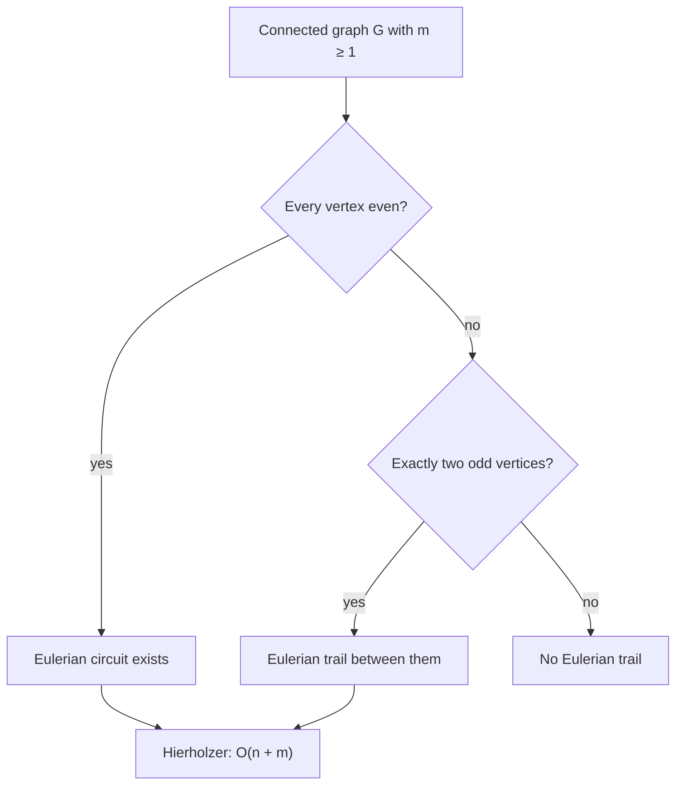
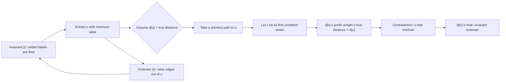

# Paths and Connectivity

> [Mathematics](../../README.md) › [Graph Theory](../README.md) › Paths and Connectivity · Level: Intermediate · Prerequisites: [Graph Basics](../01-graph-basics/README.md), [Trees](../02-trees/README.md), [Proof Techniques](../../00-foundations/04-proof-techniques/README.md), [Mathematical Induction](../../09-discrete-mathematics/01-mathematical-induction/README.md), [Algorithms and Complexity](../../09-discrete-mathematics/03-algorithms-and-complexity/README.md) · Estimated time: 480 min

## 1. Introduction

In 1736 Leonhard Euler was asked a harmless question about the city of Königsberg. The river Pregel surrounded an island, the island was joined to the two banks and to the eastern district by seven bridges, and the citizens wondered whether a Sunday walk could cross every bridge exactly once. Euler's answer — no, and here is why no such walk can exist — is usually called the first theorem of graph theory, and it is the model for everything in this topic: a question about *routes* is translated into a question about *degrees*, and the degree computation settles it completely.

That first success is misleadingly clean. Two centuries later, William Rowan Hamilton asked a superficially identical question — can a walk visit every *vertex* exactly once? — and this version has resisted every attempt at a comparable criterion. The contrast between the two problems is the intellectual centre of this topic. Euler's problem has a characterisation that a schoolchild can check: every vertex must have even degree. Hamilton's problem has no known efficient characterisation, and the reason is not ignorance of a clever trick but a theorem of computational complexity: the Hamiltonian cycle problem is NP-complete, so a polynomial-time test would prove $\mathrm{P} = \mathrm{NP}$.

Between and around these two extremes sit the tools that make graphs usable as models of networks:

* **shortest paths.** Given non-negative lengths on the edges, Dijkstra's algorithm finds the cheapest route from a source to every other vertex in $O((n+m)\log n)$ time; Bellman–Ford handles negative lengths and detects negative cycles; Floyd–Warshall computes all pairs at once. Each algorithm comes with a proof of correctness, not merely a description.
* **connectivity.** How many edges must fail before a network splits? How many vertices must be removed? These two numbers, $\lambda(G)$ and $\kappa(G)$, measure the resilience of a network, and Menger's theorem says they are the same as the largest number of edge-disjoint or internally vertex-disjoint routes between two points. The min-cut equals the max number of paths — a statement with the same shape as the max-flow min-cut theorem, and the combinatorial source of it.
* **block decomposition.** Every connected graph can be cut along its cut vertices into maximal pieces with no cut vertex of their own, and the pieces are arranged in a tree. This is the structural skeleton that answers "where are the bottlenecks?" in one glance.

The topic is deliberately algorithmic as well as mathematical. Statements such as "Dijkstra's algorithm is correct" are theorems, and they are proved here in full; statements such as "Hamiltonian cycle is NP-complete" are theorems of a different kind, proved elsewhere and quoted with their source. Keeping the two kinds apart is part of learning the subject.

A note on scope. All graphs here are finite. Unless a section says otherwise, a graph is simple (no loops, no multiple edges); the bridges of Königsberg force us to allow multiple edges in Section 7.1, and directed graphs appear in Section 7.4 and in the all-pairs material. Weighted graphs have real weights, and a *negative* weight is allowed wherever the algorithm tolerates it — several sections turn on exactly that distinction.

## 2. Prerequisites

The list is short, and every item is taught earlier in the repository.

* **Graphs, degree, walks, trails, paths, cycles, components, connectivity.** Vertices and edges, $\deg(v)$, the handshake lemma $\sum_v \deg(v) = 2m$, subgraphs, $G - v$, $G - e$, and the fact that "joined by a path" is an equivalence relation whose classes are the components. Taught in [Graph Basics](../01-graph-basics/README.md), Sections 5–7.
* **Trees, spanning trees, bridges.** A connected acyclic graph, the equivalence of the six characterisations of a tree, and the fact that every connected graph has a spanning tree. Taught in [Trees](../02-trees/README.md), Sections 7.2 and 7.5.
* **Proof techniques.** Direct proof, contrapositive, contradiction, induction, the pigeonhole principle, and the double-counting pattern "count the same finite set in two ways". Taught in [Proof Techniques](../../00-foundations/04-proof-techniques/README.md) and [Mathematical Thinking](../../00-foundations/01-mathematical-thinking/README.md).
* **Mathematical induction and strong induction.** Used for the correctness of Dijkstra's algorithm, for the round count of Bellman–Ford, and for the Floyd–Warshall invariant. Taught in [Mathematical Induction](../../09-discrete-mathematics/01-mathematical-induction/README.md).
* **Sets and functions.** $A \subseteq B$, $A \setminus B$, $\lvert A\rvert$, the power set, and the notation $f : A \to B$. Taught in [Set Theory](../../00-foundations/03-set-theory/README.md).
* **Orders of growth and the basics of complexity.** $O$, $\Omega$, $\Theta$, and what "polynomial time" means. A reader who has not met this yet can read every proof in this topic and skip the complexity remarks; Section 7.9 is the only place where the vocabulary is essential. Taught in [Algorithms and Complexity](../../09-discrete-mathematics/03-algorithms-and-complexity/README.md).
* **Binomial coefficients (occasionally).** $\binom{n}{2} = \frac{n(n-1)}{2}$ for the number of pairs in an $n$-set. Taught in [Combinatorics](../../20-combinatorics/README.md).

Conventions, matching [MATHEMATICAL_NOTATION.md](../../MATHEMATICAL_NOTATION.md): $\mathbb{N} = \{1,2,3,\dots\}$ and $\mathbb{N}_0$ includes $0$; $n = \lvert V\rvert$ and $m = \lvert E\rvert$ always; a path is written as a sequence of vertices $v_0 v_1 \cdots v_k$ with the edges understood; "$uv$" abbreviates the edge $\{u,v\}$; and an isolated vertex is a vertex of degree $0$. Infinite graphs are not considered, and "graph" never means the graph of a function; see [Functions](../../03-algebra/11-functions/README.md) for that other sense.

## 3. Learning Objectives

By the end of this tutorial you will be able to:

1. Decide in linear time whether a graph, multigraph or digraph has an Eulerian circuit or an Eulerian trail, and justify the decision from the degree sequence and the component structure.
2. Prove both directions of Euler's criterion, including the sufficiency direction via Hierholzer's splicing argument.
3. Construct an Eulerian circuit explicitly by Hierholzer's algorithm, and explain why Fleury's bridge-avoiding rule also works.
4. State the definition of a Hamiltonian path and cycle, and decide the question on small graphs by exhaustive reasoning.
5. Derive and use the necessary conditions for Hamiltonicity: 2-connectedness, the cut condition $c(G - S) \le \lvert S\rvert$, and the bipartite balance condition.
6. State and prove Ore's theorem, deduce Dirac's theorem from it, and explain why neither condition is necessary.
7. Explain precisely in what sense no simple characterisation of Hamiltonian graphs is known, quoting the NP-completeness of Hamiltonian Cycle and the impossibility of a forbidden-subgraph criterion.
8. Prove the correctness of Dijkstra's algorithm and analyse its running time with array, binary-heap and Fibonacci-heap implementations.
9. Run Bellman–Ford, prove its round-by-round invariant, and detect a negative cycle reachable from the source.
10. Run Floyd–Warshall, prove its invariant, and reconstruct shortest paths and negative cycles from the final matrix.
11. Compute the vertex connectivity $\kappa(G)$, the edge connectivity $\lambda(G)$ and the minimum degree $\delta(G)$ of a graph, and prove $\kappa(G) \le \lambda(G) \le \delta(G)$.
12. State Menger's theorem in its vertex, edge and global forms, and use it to translate between "many disjoint routes" and "no small cut".
13. Decompose a connected graph into blocks, draw its block-cut tree, and explain how the decomposition locates every cut vertex and bridge.

## 4. Intuition

### 4.1 Every bridge exactly once

Imagine a postman who must cross every bridge of a town exactly once, because the town pays per crossing and refuses to pay twice. Walking through a vertex — a street corner, a square, an island — the postman arrives along one bridge and leaves along another. Bridges are used in pairs at every corner. So if a corner has an odd number of bridges, one of them must be the first or last crossing of that corner, and there can be at most two such corners in a single walk: the start and the end.

Königsberg has four corners with an odd number of bridges. Hence no walk exists, and the argument does not depend on the shape of the town, the lengths of the bridges or the cleverness of the postman. That is the whole idea of Euler's criterion: an *evenness* condition, forced by the fact that a route pairs up the edges at every vertex it passes through.

The converse is the surprising half. If every corner has an even number of bridges and the town is connected, a walk *does* exist. The proof is constructive: walk until you return to where you started, and if edges remain, splice a second closed walk into the first at a shared corner. Repeat. Nothing can go wrong because evenness guarantees that a walk which enters a corner can always leave it.

### 4.2 Every city exactly once

Now change one word. The salesman must visit every *city* exactly once and needs a route; the roads may be reused or ignored. This is a different problem, and the parity argument evaporates: parity counts edges at a vertex, but visiting vertices has nothing to do with pairing edges. A vertex of degree $2$ is easy to visit and easy to leave, a vertex of degree $100$ is no harder, and a vertex of degree $1$ forces the route to start or end there.

The obstruction is global. A Hamiltonian cycle is a single loop that threads through every vertex, and the difficulty is that local data (degrees, neighbourhoods) does not see the global order in which the threading must happen. Cut a graph at a small set $S$ of vertices: a Hamiltonian cycle can pass through $S$ at most $\lvert S\rvert$ times, so it can leave at most $\lvert S\rvert$ pieces behind. That is a real constraint, and it rules out many graphs. But it is only necessary. There are graphs that satisfy every such counting constraint and still have no Hamiltonian cycle.

That asymmetry — a local criterion for Euler, only global constraints for Hamilton — is the reason the two problems, stated in almost the same words, live in different computational worlds. Deciding Eulerianness takes time proportional to the number of edges. Deciding Hamiltonicity is NP-complete.

### 4.3 The cheapest route

A delivery company does not care about visiting every vertex or every edge; it cares about the cost of the route from the depot to a customer. Put a number on each road — minutes, litres, euros — and ask for the path of least total weight.

The greedy instinct is right: from the depot, go to the nearest place first. Dijkstra's algorithm is that instinct made systematic — settle vertices in increasing order of the best known distance, and every time a vertex is settled, use it to improve the estimates of its neighbours. The subtle point is *why* the settled distance can never be improved later. It can be, if some road has negative length: a long detour that earns money can beat a short direct road. Non-negativity is exactly the hypothesis that makes "settled" mean "final", and Section 7.11 proves it.

Bellman–Ford gives up the greedy order and relaxes every edge repeatedly, which costs more time but tolerates negative lengths and, more importantly, *detects* the one situation in which no shortest path exists: a cycle of negative total weight, around which one could loop forever and pay ever less. Floyd–Warshall answers all origin–destination pairs at once by asking, for each intermediate vertex in turn, whether routing through it is cheaper.

### 4.4 Many routes, few cuts

A network engineer thinks in two currencies. *Redundancy*: how many independent routes exist between two cities? *Fragility*: how few links (or switching stations) must fail to disconnect them? The two numbers feel like opposites — one counts paths, the other counts a barrier — and Menger's theorem says they are equal. If the best you can do is three disjoint routes, then some three links cut them all; if every cut needs at least five links, then five disjoint routes exist. The equality is a min–max theorem, and its proof is the prototype for the max-flow min-cut theorem of network optimisation.

The same duality organises the whole graph. Cut vertices and bridges are the places where one well-aimed failure splits the network. Removing them decomposes the graph into *blocks* — maximal pieces that have no such fragility of their own — and the blocks hang off each other in a tree. Read the tree and you know every bottleneck at once.

## 5. Formal Definition

Throughout, $G = (V,E)$ is a finite graph and $n = \lvert V\rvert$, $m = \lvert E\rvert$. The definitions of walk, trail, path and cycle are repeated here because everything else is built from them, and because the difference between "trail" and "path" is the difference between the two central problems of this topic.

**Definition 5.1 (walk, trail, path, cycle).** A **walk** of length $k$ is a sequence $v_0 e_1 v_1 e_2 \cdots e_k v_k$ alternating vertices and edges with $e_i = v_{i-1}v_i$. Its **length** is $k$, the number of edges counted with multiplicity. A walk is **closed** if $v_0 = v_k$. A **trail** is a walk in which the edges $e_1,\dots,e_k$ are pairwise distinct. A **path** is a walk in which the vertices $v_0,\dots,v_k$ are pairwise distinct (and hence so are the edges). A **cycle** is a closed trail $v_0 e_1 v_1 \cdots e_k v_0$ with $k \ge 3$ whose vertices $v_0,\dots,v_{k-1}$ are pairwise distinct.

Thus every path is a trail, and every trail is a walk; neither converse holds. A **circuit** is a closed trail, so a cycle is a circuit with no repeated vertex other than the ends. When the graph is simple, a walk is determined by its vertex sequence, and we write $v_0v_1\cdots v_k$; when multiple edges are present, as in Section 7.1, the edge names must be recorded.

**Definition 5.2 (Eulerian trail and circuit).** An **Eulerian trail** of $G$ is a trail containing every edge of $G$ exactly once. An **Eulerian circuit** is a closed Eulerian trail. $G$ is **Eulerian** if it has an Eulerian circuit. A graph with an Eulerian trail is sometimes called **semi-Eulerian**.

The definition speaks about *edges*: an Eulerian trail must use all of them, once each. Whether it visits a vertex once or fifty times is irrelevant. Note also that an Eulerian circuit requires $m \ge 1$ unless we allow the degenerate circuit of length $0$ at an isolated vertex; the theorems below state their hypotheses so that this degenerate case is harmless.

**Definition 5.3 (Hamiltonian path and cycle).** A **Hamiltonian path** of $G$ is a path containing every vertex of $G$. A **Hamiltonian cycle** is a cycle containing every vertex of $G$. $G$ is **Hamiltonian** if it has a Hamiltonian cycle, and **traceable** if it has a Hamiltonian path.

The definition speaks about *vertices*: a Hamiltonian cycle has exactly $n$ edges, one entering and one leaving each vertex, and it exists only when $n \ge 3$. Compare the two definitions word by word — "trail containing every edge" against "path containing every vertex" — and note that exchanging "edge" for "vertex" changes the difficulty of the problem from linear-time to NP-complete.

**Definition 5.4 (weighted graphs, lengths and distances).** A **weighted graph** $(G,w)$ is a graph together with a function $w : E \to \mathbb{R}$. The **weight** of a path or walk $P = v_0v_1\cdots v_k$ is $w(P) = \sum_{i=1}^{k} w(v_{i-1}v_i)$. A **shortest path** from $u$ to $v$ is a $u$–$v$ path of minimum weight, and the **distance** is
$$d(u,v) = \min\{w(P) : P \text{ is a } u\text{–}v \text{ path}\},$$
with $d(u,v) = \infty$ when no $u$–$v$ path exists. A **negative cycle** is a cycle of negative total weight.

If $u$ and $v$ lie in the same component and a negative cycle is reachable from $u$ and can reach $v$, then the minimum in the definition is not attained — walking the cycle more times makes the walk cheaper — and one writes $d(u,v) = -\infty$ in that case. All shortest-path algorithms in this topic are stated with the hypothesis that excludes this situation, and two of them detect it when it occurs.

**Definition 5.5 (separators and local connectivity).** Let $u,v \in V$ be distinct. A set $S \subseteq V \setminus \{u,v\}$ **separates** $u$ from $v$ if $u$ and $v$ lie in different components of $G - S$. The **local vertex connectivity** is
$$\kappa(u,v) = \min\{\lvert S\rvert : S \text{ separates } u \text{ from } v\},$$
with $\kappa(u,v) = \infty$ when no such $S$ exists. Similarly, a set $F \subseteq E$ **separates** $u$ from $v$ if $u$ and $v$ lie in different components of $G - F$, and the **local edge connectivity** $\lambda(u,v)$ is the minimum size of such an $F$.

For adjacent $u,v$ one usually takes $\kappa(u,v) = \infty$ by convention, because no vertex set avoiding $u$ and $v$ can separate them; the convention keeps the min–max statements of Section 7.15 tidy and is flagged again there.

**Definition 5.6 (connectivity of a graph).** The **vertex connectivity** of $G$ is
$$\kappa(G) = \min\{\kappa(u,v) : u \ne v,\ uv \notin E\},$$
and the **edge connectivity** is $\lambda(G) = \min\{\lambda(u,v) : u \ne v\}$. A graph is **$k$-connected** if $\kappa(G) \ge k$, and **$k$-edge-connected** if $\lambda(G) \ge k$. Conventions: $\kappa(K_n) = \lambda(K_n) = n-1$ for $n \ge 2$, and $\kappa(K_1) = \lambda(K_1) = 0$; a disconnected graph has $\kappa(G) = \lambda(G) = 0$. Do not confuse $\kappa(G)$ with the minimum degree, written $\delta(G)$.

**Definition 5.7 (cut vertex and bridge).** A vertex $v$ is a **cut vertex** (or **articulation point**) of a connected graph $G$ if $G - v$ is disconnected. An edge $e$ is a **bridge** if $G - e$ is disconnected. A **block** of $G$ is a maximal connected subgraph $B$ of $G$ that has no cut vertex of its own; maximality is with respect to taking subgraphs, and $B$ is not required to be an induced subgraph.

A bridge $e = uv$ is itself a block: the subgraph with vertex set $\{u,v\}$ and edge set $\{e\}$ has no cut vertex. An isolated vertex is a block too. Every other block of a connected graph with at least three vertices is 2-connected. These degenerate blocks are not an annoyance but a convenience, because they make "every edge lies in exactly one block" true without exceptions (Section 7.16).

## 6. Mathematical Notation

| Symbol | Read as | Meaning |
|---|---|---|
| $G = (V,E)$ | $G$ with vertex set $V$ and edge set $E$ | a finite graph |
| $n$, $m$ | $n$ vertices, $m$ edges | $n = \lvert V\rvert$, $m = \lvert E\rvert$ |
| $uv$ | the edge $u$ $v$ | the unordered pair $\{u,v\} \in E$ |
| $v_0v_1\cdots v_k$ | the walk through those vertices | vertex sequence of a walk, edges understood |
| $\deg(v)$ | degree of $v$ | number of edges at $v$, loops counted twice |
| $\delta(G)$, $\Delta(G)$ | minimum / maximum degree | $\min_v \deg(v)$, $\max_v \deg(v)$ |
| $N(v)$ | the neighbourhood of $v$ | $\{u : uv \in E\}$ |
| $\delta(S)$ | the edge boundary of $S$ | edges with exactly one endpoint in $S$ |
| $G - v$, $G - e$ | $G$ delete $v$ / delete $e$ | vertex or edge deletion |
| $G/e$ | $G$ contract $e$ | identify the endpoints of $e$, discard loops |
| $G[S]$ | the subgraph induced by $S$ | all edges with both endpoints in $S$ |
| $c(G)$ | number of components of $G$ | $c(G) = 1$ for a connected non-empty graph |
| $d(u,v)$ | distance from $u$ to $v$ | minimum weight of a $u$–$v$ path |
| $\kappa(G)$, $\kappa(u,v)$ | vertex connectivity, local connectivity | fewest vertices whose removal disconnects |
| $\lambda(G)$, $\lambda(u,v)$ | edge connectivity, local edge connectivity | fewest edges whose removal disconnects |
| $k$-connected | $k$ connected | $\kappa(G) \ge k$ |
| $K_n$, $K_{m,n}$ | complete graph, complete bipartite graph | all possible edges, or all crossing edges |
| $P_n$, $C_n$ | path, cycle on $n$ vertices | $n$ vertices in a line, or in a ring |
| $Q_3$ | the cube graph | the $3$-dimensional cube, $8$ vertices, $12$ edges |
| $\mathrm{P}$, $\mathrm{NP}$ | pee, en-pee | complexity classes of decidable problems |

Two conventions deserve a warning. First, $\delta$ carries two meanings in graph theory: $\delta(G)$ is the minimum degree (a number) and $\delta(S)$ is the edge boundary (a set of edges). The context — a graph or a vertex set inside the parentheses — always disambiguates. Second, $\kappa(u,v)$ is defined only for non-adjacent pairs unless one adopts the convention $\kappa(u,v) = \infty$ for adjacent pairs; when a formula uses $\kappa(u,v)$, the convention in force is stated.

## 7. Core Concepts

### 7.1 The bridges of Königsberg

The city of Königsberg (now Kaliningrad) lay on both banks of the Pregel, with an island — the Kneiphof — in the middle and a district on the east. Seven bridges connected the four pieces of land, and the question of 1736 was whether a walk could cross each of the seven exactly once and return to its starting point.

Model the four land masses as vertices and the bridges as edges. Several bridges join the same pair of land masses, so this is a **multigraph**: multiple edges are allowed, loops are not. Euler's own diagram gives edges $a, b$ joining $A$ to $B$; $c, d$ joining $A$ to $C$; $e$ joining $A$ to $D$; $f$ joining $B$ to $D$; and $g$ joining $C$ to $D$. The degrees are
$$\deg(A) = 5, \qquad \deg(B) = 3, \qquad \deg(C) = 3, \qquad \deg(D) = 3,$$
and the handshake check $5 + 3 + 3 + 3 = 14 = 2\cdot 7$ confirms that all seven bridges have been counted.

Four vertices have odd degree, and that is fatal. Consider any walk that traverses a set of edges without repetition and passes through a vertex $x$ that is neither its first nor its last vertex. Every visit to $x$ consumes one edge on arrival and one on departure, so the edges of the walk incident with $x$ come in pairs; hence an even number of them. If the walk uses *all* the edges, then every vertex except possibly the two endpoints of the walk has even degree. A closed walk has no endpoints at all, so every degree must be even.

The conclusion is not "nobody has found a walk"; it is "no walk exists", and the reason is a parity count that can be performed in a minute. The same paragraph proves the necessity half of Euler's criterion in general.

There is a pleasant coda. Königsberg's bridges were bombed in 1944 and rebuilt differently; the modern city has a different bridge graph, and a walk crossing each bridge once may or may not exist depending on how the rebuilding went. The mathematics, unlike the bridges, is permanent.

### 7.2 Eulerian circuits: the parity criterion

Two lemmas are needed before the criterion can be stated. The first is the parity argument of Section 7.1 in its general form; the second is the observation that makes the construction work.

**Theorem 7.2.1 (Euler's criterion, necessity).** Let $G$ be a graph with $m \ge 1$. If $G$ has an Eulerian circuit, then $G$ is connected after deleting isolated vertices and every vertex of $G$ has even degree.

**Proof.** Let $C = v_0e_1v_1\cdots e_mv_0$ be an Eulerian circuit. Every edge of $G$ appears exactly once in $C$, so $C$ visits every vertex of positive degree, and $C$ itself is a connected subgraph containing all of them; hence all vertices of positive degree lie in one component.

For the parity, fix a vertex $x$. Read through $C$ and count the occurrences of $x$ among $v_0,\dots,v_{m-1}$, say $r \ge 1$ times. Each occurrence is flanked by an entering edge and a leaving edge (with indices read cyclically, so that $v_{m-1}$ is followed by $v_0$), and the $2r$ edges obtained this way are exactly the edges of $C$ incident with $x$. Since $C$ uses every edge, $2r = \deg(x)$, which is even. $\blacksquare$

The condition "connected after deleting isolated vertices" is usually phrased as "all edges lie in one component". A graph consisting of two disjoint cycles has every degree even and no Eulerian circuit, so connectivity cannot be dropped.

**Lemma 7.2.2 (maximal trails in even graphs are closed).** Suppose every vertex of $G$ has even degree and $m \ge 1$. Let $W = v_0e_1v_1\cdots e_kv_k$ be a trail that cannot be extended by appending an unused edge at $v_k$. Then $v_k = v_0$.

**Proof.** For a vertex $x$, let $u(x)$ be the number of edges of $W$ incident with $x$. Every time $W$ passes through $x$ as an internal vertex $v_i$ with $0 < i < k$, it uses two edges at $x$; the initial vertex $v_0$ contributes one edge if $v_0 \ne v_k$ and two if $v_0 = v_k$; the final vertex $v_k$ contributes one if $v_k \ne v_0$ and two if they coincide. Hence $u(x)$ is even for every $x \notin \{v_0,v_k\}$, and $u(v_0)$ and $u(v_k)$ are odd if $v_0 \ne v_k$, even if $v_0 = v_k$.

Suppose for contradiction that $v_k \ne v_0$. Then $u(v_k)$ is odd, while $\deg(v_k)$ is even, so $u(v_k) < \deg(v_k)$: some edge at $v_k$ is unused, contradicting maximality of $W$. $\blacksquare$

**Theorem 7.2.3 (Euler's criterion, sufficiency).** Let $G$ be a connected graph with $m \ge 1$, all of whose vertices have even degree. Then $G$ has an Eulerian circuit.

**Proof.** The proof is an algorithm together with the two claims that it is well defined and that it terminates correctly.

*Growing a closed trail.* Start at any vertex $v_0$ and extend a trail by unused edges for as long as possible. By Lemma 7.2.2 the resulting trail $C$ is closed.

*Splicing.* If $C$ uses every edge, it is an Eulerian circuit. Otherwise some edge is unused. Because $G$ is connected and $m \ge 1$, some vertex $w$ of $C$ is incident with an unused edge: take an unused edge $ab$, take a path from $v_0$ to $a$, and let $w$ be the last vertex of that path lying on $C$, with successor $w'$; the edge $ww'$ is not one of the edges of $C$ (otherwise $w'$ would be on $C$ too), so $w$ has an unused edge.

Now delete the edges of $C$ from $G$ to obtain $G'$, and note that every vertex of $G'$ still has even degree: a vertex on $C$ loses $u(x)$ edges, which is even, and other vertices lose none. Let $H$ be the component of $G'$ containing $w$; every degree in $H$ is even, so by Lemma 7.2.2 a maximal trail $C'$ in $H$ starting at $w$ returns to $w$. Replace $C$ by the closed trail obtained by walking $C$ from $v_0$ to $w$, then $C'$, then the rest of $C$ from $w$ back to $v_0$. The result is still a closed trail, because the edges of $C'$ are disjoint from those of $C$.

Each splice strictly increases the number of edges used, and there are only $m$ edges, so after at most $m$ splices the trail uses every edge. What remains is an Eulerian circuit. $\blacksquare$

**Corollary 7.2.4 (Eulerian graphs).** A connected graph with at least one edge is Eulerian if and only if every vertex has even degree.

The proof of Theorem 7.2.3 is constructive and is exactly Hierholzer's algorithm; Section 7.5 turns it into a linear-time procedure.

### 7.3 Eulerian trails with distinct endpoints

Dropping the requirement that the walk be closed changes the parity condition in the smallest possible way.

**Theorem 7.3.1 (Eulerian trail criterion).** Let $G$ be a connected graph with $m \ge 1$. Then $G$ has an Eulerian trail if and only if the number of vertices of odd degree is $0$ or $2$. In the first case the trail can be closed, in the second it must start at one odd vertex and end at the other.

**Proof.** If $G$ has an Eulerian trail $W$ from $u$ to $v$, the counting of Theorem 7.2.1 gives: every vertex other than $u$ and $v$ has even degree, and $u$, $v$ have odd degree if $u \ne v$, while all degrees are even if $u = v$. So the number of odd vertices is $0$ or $2$.

Conversely, suppose there are exactly two odd vertices $u \ne v$ (the case of none is Theorem 7.2.3). Form $G^+$ by adding one new edge $e_0$ joining $u$ to $v$; if the graph is simple and $uv$ is already an edge, add a parallel edge instead, which is why the theorem is stated for graphs with multiple edges allowed. In $G^+$ every degree is even and $G^+$ is connected, so by Theorem 7.2.3 it has an Eulerian circuit. Delete the edge $e_0$ from that circuit: the circuit becomes a trail that uses every edge of $G$ exactly once, starting at one endpoint of $e_0$ and ending at the other. $\blacksquare$

**Corollary 7.3.2 (endpoints are forced).** If a connected graph has exactly two odd vertices $u$ and $v$, every Eulerian trail starts at $u$ and ends at $v$, or the reverse.

**Proof.** Apply the necessity argument of Theorem 7.3.1 to an arbitrary Eulerian trail: its two endpoints are precisely the odd vertices. $\blacksquare$

**Proposition 7.3.3 (Eulerian graphs have no bridges).** If $G$ is connected, has $m \ge 2$ and is Eulerian, then $G$ has no bridge.

**Proof.** Suppose $e$ is a bridge. Then $G - e$ has two components, with vertex sets $S$ and $V \setminus S$. In the Eulerian circuit, delete the single occurrence of $e$; the rest of the circuit is a trail joining the two endpoints of $e$, and that trail lies entirely in $G - e$. So $G - e$ is connected, contradicting the definition of a bridge. $\blacksquare$

The condition $m \ge 2$ matters: $K_2$ has both degrees odd, so it is not a counterexample; but a single vertex with a loop would be Eulerian and the loop would be a bridge, which is why loops are excluded throughout.

### 7.4 Directed Eulerian circuits

For directed graphs the parity condition splits into an in-degree condition and an out-degree condition, and connectivity must be strengthened.

**Definition 7.4.1 (directed Eulerian circuit).** A **directed Eulerian circuit** of a digraph $D$ is a directed closed trail containing every arc exactly once. $D$ is **Eulerian** if it has one.

**Theorem 7.4.2 (directed Euler criterion).** A weakly connected digraph $D$ with at least one arc has a directed Eulerian circuit if and only if $\deg^{\mathrm{in}}(v) = \deg^{\mathrm{out}}(v)$ for every vertex $v$.

**Proof sketch.** *Necessity.* Each visit to $v$ inside the circuit uses one entering and one leaving arc, so the used arcs at $v$ pair up; since all arcs are used, $\deg^{\mathrm{in}}(v) = \deg^{\mathrm{out}}(v)$. Weak connectivity follows as in Theorem 7.2.1.

*Sufficiency.* Run the splicing algorithm of Theorem 7.2.3 with arcs instead of edges. A maximal directed trail starting at $v_0$ can stop at a vertex $x \ne v_0$ only if every arc leaving $x$ is already used; but at $x$ the used arcs satisfy $\deg^{\mathrm{in}}_{\text{used}}(x) = \deg^{\mathrm{out}}_{\text{used}}(x) + 1$, so $\deg^{\mathrm{out}}_{\text{used}}(x) < \deg^{\mathrm{out}}(x) = \deg^{\mathrm{in}}(x)$, leaving an unused outgoing arc. Hence a maximal trail is closed. The splicing step uses weak connectivity, and the balance condition survives the deletion of a closed trail. $\blacksquare$

Note the difference from the undirected case: **weak** connectivity plus balance suffices. It is worth seeing why balance upgrades weak connectivity to strong connectivity on the vertices of positive degree. Suppose a balanced weakly connected digraph were not strongly connected, and consider the condensation (the directed acyclic graph of strongly connected components); it has a source component $S$ with no arc entering it. Summing $\deg^{\mathrm{in}}(v) = \deg^{\mathrm{out}}(v)$ over $v \in S$ counts each arc with both ends in $S$ once on each side, so the arcs leaving $S$ and the arcs entering $S$ are equinumerous; but no arc enters $S$, while at least one arc leaves it (otherwise $S$ would be a separate weak component), a contradiction. Hence a balanced weakly connected digraph is strongly connected, and the splicing argument has all the reachability it needs. A digraph such as $1 \to 2$, $2 \to 1$, $3 \to 4$, $4 \to 3$ with the two pieces disjoint is balanced but not weakly connected, and indeed has no single Eulerian circuit — which is why weak connectivity is required.

### 7.5 Finding Eulerian circuits: Hierholzer and Fleury

**Hierholzer's algorithm (1873).** Given a connected graph with all degrees even:

1. Choose any vertex $v_0$ with positive degree, and grow a trail by unused edges until it closes (Lemma 7.2.2 guarantees closure).
2. While unused edges remain, find a vertex of the current circuit incident with an unused edge, grow a closed trail from it using unused edges, and splice it into the circuit.
3. Output the circuit.

Every edge is examined a constant number of times if the adjacency lists are stored as doubly linked lists from which used edges can be removed, so the running time is $O(n + m)$. In practice one stores each vertex's incident edges in a list with a pointer to the first unused edge and uses an explicit stack instead of recursion; the version below is the standard iterative one.

```
Hierholzer(G):
    stack = [any vertex with degree > 0]; circuit = []
    while stack not empty:
        v = stack.top
        if v has an unused incident edge vw:
            mark vw used; stack.push(w)
        else:
            circuit.append(stack.pop())
    return reverse(circuit)
```

The vertices are appended to `circuit` in reverse order of the tour, so the reversed list is the Eulerian circuit. The algorithm is linear because each edge is pushed and examined once and each vertex is popped once.

**Fleury's algorithm (1883).** Walk from a vertex, and at each step choose an unused edge that is *not* a bridge of the remaining graph, unless no alternative exists. Fleury's rule is easy to state and easy to remember ("never burn a bridge unless you must"), but testing for a bridge at every step costs $O(m)$ with a naive test, so the running time is $O(m^2)$; with a dynamic bridge-finding structure it can be improved, but Hierholzer remains simpler and faster. The correctness of Fleury's rule rests on the invariant that the unused edges together with the current position always form a connected subgraph, so one never gets stranded with unused edges elsewhere.

### 7.6 Hamiltonian paths and cycles: first examples

**Example 7.6.1.** (a) $K_n$ is Hamiltonian for every $n \ge 3$: any cyclic ordering of the vertices is a Hamiltonian cycle. (b) $C_n$ is Hamiltonian. (c) $P_n$ has a Hamiltonian path but, for $n \ge 3$, no Hamiltonian cycle. (d) $K_{m,n}$ is Hamiltonian if and only if $m = n \ge 2$.

**Proof of (d).** A cycle in a bipartite graph alternates between the two parts, so it contains equally many vertices of each; a Hamiltonian cycle therefore forces $m = n$. Conversely, if $m = n$, write the parts as $x_1,\dots,x_n$ and $y_1,\dots,y_n$; then $x_1y_1x_2y_2\cdots x_ny_nx_1$ is a Hamiltonian cycle. $\blacksquare$

Note that $K_{2,3}$ is 2-connected and has a Hamiltonian *path* ($x_1y_1x_2y_2$ visits four vertices only; the path $y_1 x_1 y_2 x_2 y_3$ visits all five), but no Hamiltonian cycle. This is the first counterexample to the hope that "2-connected" might be enough.

**Example 7.6.2 (grids).** The $3 \times 3$ grid (nine vertices, edges between horizontally and vertically adjacent squares) is bipartite with parts of sizes $5$ and $4$, so it has no Hamiltonian cycle, although it has a Hamiltonian path. The $4 \times 4$ grid has $16$ vertices, equal parts $8$ and $8$, and does have a Hamiltonian cycle: go round the outer ring of $12$ squares, then traverse the central $2 \times 2$ block by entering it, going round it and leaving, with the two connecting edges chosen on opposite sides. Grids model robot motion planning, and "does this grid region have a Hamiltonian cycle?" is the discrete version of "can a robot sweep every cell once?".

**Example 7.6.3 (Petersen).** The Petersen graph (ten vertices, three-regular, girth five) has a Hamiltonian path but no Hamiltonian cycle. The non-existence is proved in Exercise 31; it is the standard example showing that regularity, high connectivity and small girth do not help.

### 7.7 Necessary conditions and their limits

**Proposition 7.7.1 (Hamiltonian implies 2-connected).** If $G$ is Hamiltonian and $n \ge 3$, then $G$ has no cut vertex; in particular $\kappa(G) \ge 2$.

**Proof.** Let $C$ be a Hamiltonian cycle and $v$ any vertex. The graph $C - v$ is a path through the other $n-1$ vertices, hence connected. Since $C - v \subseteq G - v$, the graph $G - v$ is connected as well. So no vertex is a cut vertex. A connected graph on at least three vertices with no cut vertex has $\kappa(G) \ge 2$ by definition of $\kappa$, because separating two non-adjacent vertices requires deleting at least two vertices. $\blacksquare$

**Theorem 7.7.2 (the cut condition).** If $G$ is Hamiltonian and $S \subseteq V$, then
$$c(G - S) \le \lvert S\rvert .$$

**Proof.** Let $C$ be a Hamiltonian cycle. Deleting the $k = \lvert S\rvert$ vertices of $S$ from the cycle $C$ leaves at most $k$ paths (one for each gap between consecutive deleted vertices, and possibly fewer if deleted vertices are adjacent), so $c(C - S) \le k$. Every component of $C - S$ is contained in a component of $G - S$, and adding edges cannot increase the number of components, so
$$c(G - S) \le c(C - S) \le k = \lvert S\rvert. \qquad \blacksquare$$

A graph satisfying $c(G - S) \le \lvert S\rvert$ for every $S$ is called **1-tough** (the general notion of toughness replaces $\lvert S\rvert$ by $t\lvert S\rvert$). By Theorem 7.7.2 every Hamiltonian graph is 1-tough. The converse fails: the Petersen graph is 1-tough and non-Hamiltonian, and hypohamiltonian graphs — non-Hamiltonian graphs all of whose vertex-deleted subgraphs are Hamiltonian — provide infinitely many further examples. The condition is nevertheless useful, because it is cheap to test on small sets and often settles a graph at once.

**Proposition 7.7.3 (bipartite balance).** Let $G$ be bipartite with parts $X$ and $Y$. If $G$ is Hamiltonian, then $\lvert X\rvert = \lvert Y\rvert$.

**Proof.** A cycle in a bipartite graph alternates between $X$ and $Y$: consecutive vertices lie in opposite parts, so the cycle has equally many vertices from each part. A Hamiltonian cycle contains every vertex, so $\lvert X\rvert = \lvert Y\rvert$. $\blacksquare$

The **Herschel graph** — the smallest non-Hamiltonian 3-connected planar graph, with $11$ vertices and $18$ edges — is bipartite with parts of sizes $6$ and $5$, so Proposition 7.7.3 settles it. This matters for Section 7.9: planarity and 3-connectedness, which are strong structural hypotheses, still do not force a Hamiltonian cycle.

**Example 7.7.4 ($K_{2,3}$ dissected).** Let the parts be $X = \{x_1,x_2\}$ and $Y = \{y_1,y_2,y_3\}$. The graph is 2-connected, so it passes the test of Proposition 7.7.1. It fails the cut condition with $S = X$: deleting the two vertices of $X$ leaves the three isolated vertices of $Y$, so $c(K_{2,3} - X) = 3 > 2 = \lvert X\rvert$. It fails the balance condition of Proposition 7.7.3 because $\lvert X\rvert = 2 \ne 3 = \lvert Y\rvert$. And it has a Hamiltonian path $y_1x_1y_2x_2y_3$. So the three tests of this section are independent in what they detect: connectivity alone is not enough, the cut condition catches the obstruction here, and balance catches it too. That redundancy is typical; the tests are cheap and are meant to be applied together.

### 7.8 Sufficient conditions: Ore and Dirac

The two classical sufficient conditions trade hypotheses on *all* pairs of non-adjacent vertices (Ore) for a hypothesis on the *minimum degree* (Dirac). Both are proved by the same rotation idea.

**Theorem 7.8.1 (Ore, 1960).** Let $G$ be a simple graph with $n \ge 3$. Suppose that
$$\deg(u) + \deg(v) \ge n \qquad \text{for every pair of non-adjacent vertices } u, v.$$
Then $G$ is Hamiltonian.

**Proof.** Suppose the claim false, and among all non-Hamiltonian graphs on the same vertex set that contain $G$ as a subgraph, choose $G'$ maximal (add edges one at a time for as long as the graph stays non-Hamiltonian). Since $G'$ has at least the degrees of $G$ and at most the non-adjacent pairs of $G$, it satisfies the same degree condition. By maximality, for every non-adjacent pair $u,v$ of $G'$, the graph $G' + uv$ has a Hamiltonian cycle; that cycle must use the new edge $uv$, so deleting $uv$ from it gives a Hamiltonian path
$$v_1v_2\cdots v_n \quad\text{with } v_1 = u \text{ and } v_n = v .$$

**Claim.** There is no index $i$ with $1 \le i \le n-2$ such that $uv_{i+1} \in E(G')$ and $v_iv \in E(G')$.

Indeed, such an $i$ would produce the Hamiltonian cycle
$$v_1 v_{i+1} v_{i+2} \cdots v_n v_i v_{i-1} \cdots v_2 v_1 ,$$
whose edges are $v_1v_{i+1}$ (the first hypothesis), the path edges $v_{i+1}v_{i+2},\dots,v_{n-1}v_n$ (all present), the edge $v_nv_i$ (the second hypothesis), and the path edges $v_iv_{i-1},\dots,v_2v_1$ (all present). This contradicts the choice of $G'$. $\;\diamond$

Now define
$$A = \{\, i : 1 \le i \le n-2,\ uv_{i+1} \in E(G') \,\}, \qquad B = \{\, i : 1 \le i \le n-2,\ v_iv \in E(G') \,\}.$$
Both are subsets of $\{1,\dots,n-2\}$, and the claim says $A \cap B = \varnothing$. Counting, $\lvert A\rvert = \deg_{G'}(u)$, because the neighbours of $u$ are exactly $v_2,\dots,v_{n-1}$ (the vertex $v = v_n$ is not a neighbour, being non-adjacent to $u$). Similarly $\lvert B\rvert = \deg_{G'}(v) - 1$, because $v$ is adjacent to $v_{n-1}$ along the path, an index excluded from the range $1 \le i \le n-2$. Therefore
$$\deg_{G'}(u) + \deg_{G'}(v) - 1 = \lvert A\rvert + \lvert B\rvert \le n - 2,$$
that is, $\deg_{G'}(u) + \deg_{G'}(v) \le n-1$, contradicting the hypothesis. Hence $G$ is Hamiltonian. $\blacksquare$

**Corollary 7.8.2 (Dirac, 1952).** Let $G$ be a simple graph with $n \ge 3$. If $\delta(G) \ge n/2$, then $G$ is Hamiltonian.

**Proof.** For non-adjacent $u,v$ we have $\deg(u) + \deg(v) \ge 2\delta(G) \ge n$, so Ore's condition holds and Theorem 7.8.1 applies. $\blacksquare$

**Remark 7.8.3 (neither condition is necessary).** The cycle $C_n$ with $n \ge 5$ is Hamiltonian, yet $\delta(C_n) = 2 < n/2$, so Dirac's condition fails; and for non-adjacent $u,v$ on $C_n$ we have $\deg(u)+\deg(v) = 4 < n$, so Ore's condition fails too. Conversely the hypothesis of Ore is genuinely weaker than that of Dirac: take $K_6$ on $\{1,\dots,6\}$ and add two new vertices $7,8$, each joined to $1$, $2$ and to each other. Then $n = 8$, $\delta = 3 < 4$, so Dirac does not apply; the only non-adjacent pairs involve $7$ or $8$ together with a vertex of $\{3,4,5,6\}$, and each such pair has degree sum $3+5 = 8 \ge n$, so Ore applies and indeed
$$7\,1\,3\,4\,5\,6\,2\,8\,7$$
is a Hamiltonian cycle. So Ore's theorem proves more graphs Hamiltonian than Dirac's, and Dirac's theorem is best remembered as a corollary.

**Remark 7.8.4 (degree-sequence strengthenings).** Chvátal (1972) proved the following generalisation. Order the degrees $d_1 \le d_2 \le \cdots \le d_n$. If for every $k$ with $1 \le k < n/2$ the implication
$$d_k \le k \;\Longrightarrow\; d_{n-k} \ge n-k$$
holds, then $G$ is Hamiltonian. Dirac's condition implies Chvátal's (if $d_k \le k < n/2$ then $d_1 \le k$, so $n/2 \le \delta \le d_k \le k < n/2$, a contradiction, so the implication is vacuous), and Chvátal's condition implies Ore's; the proof is a refinement of the rotation argument above. All of these conditions are sufficient and none is necessary, and all are checkable in polynomial time (sorting the degree sequence).

**Remark 7.8.5 (the Bondy–Chvátal closure).** If $u,v$ are non-adjacent and $\deg(u)+\deg(v) \ge n$, then $G$ is Hamiltonian if and only if $G + uv$ is. The proof is the rotation argument in miniature: a Hamiltonian cycle of $G+uv$ that uses $uv$ can be converted into one of $G$ exactly when some index $i$ of the claim above exists, and the counting shows that such an $i$ must exist. Repeating the operation until no more edges can be added yields the **closure** $\operatorname{cl}(G)$, and $G$ is Hamiltonian if and only if $\operatorname{cl}(G)$ is; when the closure is complete, the answer is yes. Ore's theorem is the special case in which the closure is complete after one round.

### 7.9 Why no simple characterisation is known

It is worth being precise about what is and is not known, because the phrase "no simple characterisation" hides three different statements.

**(a) The decision problem is NP-complete.** Define
$$\textsc{Hamiltonian Cycle} = \{\, G : G \text{ has a Hamiltonian cycle} \,\}.$$
Membership in $\mathrm{NP}$ is immediate: a certificate is a cyclic ordering of the $n$ vertices, and checking that consecutive pairs are edges takes $O(n)$ time. Karp proved in 1972 that the problem is $\mathrm{NP}$-complete, by a reduction from $3$-$\textsc{SAT}$ (via the directed Hamiltonian cycle problem, which encodes variables as chains of vertices and clauses as detours). Garey, Johnson and Tarjan (1976) showed that it remains $\mathrm{NP}$-complete when $G$ is restricted to be planar. Consequently, unless $\mathrm{P} = \mathrm{NP}$, there is no algorithm that decides Hamiltonicity in time polynomial in $n$; see [Algorithms and Complexity](../../09-discrete-mathematics/03-algorithms-and-complexity/README.md) for the definitions and the meaning of "reduction".

**(b) A criterion is not the same as an algorithm.** A characterisation could in principle exist without yielding a fast test — for instance "Hamiltonian if and only if some NP-witness exists" is a characterisation, and a useless one. What the NP-completeness rules out is a characterisation whose truth can be checked in polynomial time. Since every known characterisation of Eulerianness (even degree plus connectivity) is checkable in linear time, the contrast is sharp: the Eulerian problem *has* an efficient criterion, and a Hamiltonian analogue would give a polynomial-time algorithm.

**(c) No forbidden-subgraph characterisation can exist.** Kuratowski's theorem characterises planar graphs by forbidding subdivisions of two fixed graphs (see the next topic). Nothing of that kind is possible for Hamiltonicity, and the reason is a one-line argument: every graph is a subgraph of some complete graph $K_N$, and $K_N$ is Hamiltonian. If a finite list of forbidden subgraphs characterised non-Hamiltonian graphs, then any graph containing one of them would be non-Hamiltonian; but every graph is contained in a Hamiltonian graph, so no such list exists.

**(d) Necessary conditions are numerous and none is sufficient.** The known necessary conditions form a hierarchy: 2-connectedness (Proposition 7.7.1), the cut condition $c(G - S) \le \lvert S\rvert$ (Theorem 7.7.2), the bipartite balance (Proposition 7.7.3), and the toughness condition with a constant $t \le 1$. Each is strictly weaker than the next in the sense that graphs satisfying it but not Hamiltonicity exist: $K_{2,3}$ satisfies 2-connectedness and fails the cut condition; the Petersen graph is 1-tough and non-Hamiltonian; hypohamiltonian graphs satisfy every reasonable connectivity condition and fail Hamiltonicity. Keeping these examples in mind prevents the common error of treating a necessary condition as a criterion.

The correct summary is this: Hamiltonicity is a genuinely global property, the local data (degrees, cuts, connectivity) does not determine it, and the question "is there a polynomial-time characterisation?" is equivalent to a famous open problem.

### 7.10 Shortest paths and the distance function

**Proposition 7.10.1 (distances are non-negative and satisfy the triangle inequality).** Let $(G,w)$ be a weighted graph with $w(e) \ge 0$ for all $e$. Then for all vertices $u,v,x$: $d(u,u) = 0$, $d(u,v) \ge 0$, $d(u,v) = d(v,u)$ if $G$ is undirected, and
$$d(u,v) \le d(u,x) + d(x,v).$$

**Proof.** The first three are immediate from the definition. For the triangle inequality, concatenate a shortest $u$–$x$ path with a shortest $x$–$v$ path; the concatenation is a $u$–$v$ walk of weight $d(u,x) + d(x,v)$, and any walk contains a path of no greater weight when all weights are non-negative (delete the cycles). Hence $d(u,v) \le d(u,x)+d(x,v)$. $\blacksquare$

The deletion-of-cycles step is where non-negativity enters: deleting a cycle from a walk removes a non-negative quantity. With negative weights a shortest *walk* need not contain a shortest *path*, and the notion of distance itself can degenerate.

There are three standard problem statements:

| Problem | Input | Output | Best known running time |
|---|---|---|---|
| Single-source, unweighted | $G$, source $s$ | all $d(s,v)$ | $O(n+m)$ (breadth-first search) |
| Single-source, non-negative weights | $(G,w)$, source $s$ | all $d(s,v)$ | $O(m + n\log n)$ (Dijkstra with a Fibonacci heap) |
| Single-source, arbitrary weights | $(G,w)$, source $s$ | all $d(s,v)$ or a negative cycle | $O(nm)$ (Bellman–Ford) |
| All pairs, arbitrary weights | $(G,w)$ | all $d(u,v)$ | $O(n^3)$ (Floyd–Warshall), $O(nm + n^2\log n)$ (Johnson) |

The entries in the last column are upper bounds, not optimality claims; the table is a map of the algorithms proved in this topic.

### 7.11 Dijkstra's algorithm

**The algorithm.** Given a graph with $w(e) \ge 0$ and a source $s$:

```
Dijkstra(G, w, s):
    for each v: d[v] = INFINITY; d[s] = 0; S = empty
    Q = priority queue containing (0, s)
    while Q not empty:
        u = extract-min(Q)                 # vertex with smallest tentative distance
        if u in S: continue                # stale entry, skip
        S = S + {u}
        for each edge uv with v not in S:
            if d[u] + w(uv) < d[v]:
                d[v] = d[u] + w(uv); insert (d[v], v) into Q
    return d
```

The set $S$ holds **settled** vertices, whose distance is final; the other vertices have tentative labels $d[v]$, which are lengths of some $s$–$v$ walk.

**Theorem 7.11.1 (correctness of Dijkstra).** Let $(G,w)$ be a weighted graph with $w(e) \ge 0$ for every edge, and let $s$ be a vertex from which every other vertex is reachable. At the end of the algorithm, $d[v] = d(s,v)$ for every vertex $v$.

**Proof.** The proof maintains two invariants through the main loop:

(i) for every settled vertex $u \in S$, $d[u] = d(s,u)$;
(ii) for every unsettled vertex $v \notin S$, $d[v]$ is the minimum weight of an $s$–$v$ path all of whose internal vertices lie in $S$.

Both hold initially: $S = \varnothing$, $d[s] = 0 = d(s,s)$, and $d[v] = \infty$ correctly describes the absence of paths with no internal vertices except when $v = s$.

*Invariant (ii) is maintained.* When $u$ is settled, the only paths newly covered are those whose last internal vertex is $u$; relaxing the edges $uv$ updates $d[v]$ with $d[u] + w(uv)$, and by the induction hypothesis $d[u]$ is the minimum over paths with internal vertices in the old $S$. Since any path with internal vertices in $S \cup \{u\}$ either avoids $u$ (old value) or ends with an edge $uv$ after a path covered by the old $S$ (new value), the minimum is correct.

*Invariant (i) is maintained.* Let $u$ be the vertex extracted with minimum tentative label, and suppose for contradiction that $d[u] > d(s,u)$. Let $P$ be a shortest $s$–$u$ path and let $x$ be the first vertex of $P$ not in $S$ (such a vertex exists because $u \notin S$ before extraction). The prefix of $P$ from $s$ to $x$ has all internal vertices in $S$, so by (ii) applied before the extraction,
$$d[x] \le w(\text{prefix}) = d(s,x).$$
All weights are non-negative, so $d(s,x) \le d(s,u) < d[u]$. Hence $d[x] < d[u]$, contradicting the choice of $u$ as the unsettled vertex with minimum label. Therefore $d[u] = d(s,u)$, and (i) holds for the enlarged set.

At termination every vertex is settled (all are reachable, and the queue empties only after the last relaxation), so $d[v] = d(s,v)$ for all $v$. $\blacksquare$

Two details deserve emphasis. First, the strict inequality $d[x] < d[u]$ is what makes the argument work; if weights could be negative, the step $d(s,x) \le d(s,u)$ would fail, and the algorithm would be wrong. Second, the argument does not need the settled vertex to be unique: any vertex of minimum label works, ties broken arbitrarily.

**Counterexample 7.11.2 (Dijkstra fails with negative weights).** Take vertices $s,a,b,t$ and edges $sa$ of weight $2$, $sb$ of weight $5$, $ba$ of weight $-4$ and $at$ of weight $3$. Dijkstra settles $a$ with label $2$ (the smallest), then $b$ with label $5$, then relaxes $ba$ to $1$, but $a$ is already settled and is never updated. The final label of $a$ is $2$, whereas $d(s,a) = 5 - 4 = 1$ via $b$. The output is wrong, and no tie-breaking rule saves the algorithm: the failure is structural.

**Complexity.** Let $n = \lvert V\rvert$ and $m = \lvert E\rvert$.

* Array implementation: each extract-min scans the unsettled vertices, giving $O(n^2)$ total; each edge is relaxed once, $O(m)$. Total $O(n^2 + m) = O(n^2)$, which is optimal for dense graphs ($m = \Theta(n^2)$).
* Binary heap: $n$ insertions and $m$ decrease-key operations, each $O(\log n)$; total $O((n+m)\log n)$.
* Fibonacci heap: $O(1)$ amortised decrease-key and insert, $O(\log n)$ amortised extract-min; total $O(m + n\log n)$.

Since a graph is usually sparse, the heap versions are preferred in practice; the $O(n^2)$ version is often faster for dense graphs because of its smaller constant.

**Remark 7.11.3 (path reconstruction).** Store a predecessor $\pi[v]$ whenever $d[v]$ is updated. At the end, following predecessors from $t$ backwards gives a shortest $s$–$t$ path in reverse; the total length of the path is $d[t]$, and the path can be read off in $O(n)$ time.

### 7.12 Bellman–Ford: negative weights and negative cycles

Dijkstra's algorithm needs non-negative weights because it commits to a vertex permanently. Bellman–Ford avoids commitment: it relaxes *every* edge, $n-1$ times.

```
BellmanFord(G, w, s):
    for each v: d[v] = INFINITY; d[s] = 0
    repeat n-1 times:
        for each edge uv in any fixed order:
            if d[u] + w(uv) < d[v]: d[v] = d[u] + w(uv)
    for each edge uv:                       # n-th pass: detection only
        if d[u] + w(uv) < d[v]: return "negative cycle reachable from s"
    return d
```

**Lemma 7.12.1 (round invariant).** After the $k$-th pass, for every vertex $v$, the label $d[v]$ is the weight of some $s$–$v$ walk, and
$$d[v] \le \min\{\, w(W) : W \text{ an } s\text{–}v \text{ walk with at most } k \text{ edges} \,\}.$$

**Proof.** Induction on $k$. For $k = 0$ the only walk with no edges is the trivial walk at $s$, and $d[s] = 0$, $d[v] = \infty$ for $v \ne s$, so the claim holds.

For the step, fix $v$ and let $W$ be a walk of minimum weight among all $s$–$v$ walks with at most $k$ edges. If $W$ has at most $k-1$ edges, the induction hypothesis gives $d[v] \le w(W)$ already after pass $k-1$, and labels never increase. Otherwise $W = W' + uv$ where $W'$ is an $s$–$u$ walk with at most $k-1$ edges. By induction, just before the edge $uv$ is relaxed during pass $k$, the label of $u$ satisfies $d[u] \le w(W')$ (it may have been lowered further). After the relaxation, $d[v] \le d[u] + w(uv) \le w(W') + w(uv) = w(W)$. The label is always the weight of a walk because it is only ever set to a walk weight plus an edge weight. $\blacksquare$

**Theorem 7.12.2 (correctness in the absence of negative cycles).** Suppose no cycle of negative weight is reachable from $s$. Then after $n-1$ passes, $d[v] = d(s,v)$ for every vertex $v$.

**Proof.** Let $v$ be reachable from $s$. Among all $s$–$v$ walks of minimum weight, choose one, $W$, with the fewest edges. If $W$ repeated a vertex, the subwalk between two occurrences would be a cycle; deleting it would give a walk of the same or smaller weight (a negative cycle is excluded, and a zero cycle can be deleted without changing the weight) and fewer edges, contradicting the choice of $W$. So $W$ is a path, with at most $n-1$ edges, and $w(W) = d(s,v)$. Lemma 7.12.1 gives $d[v] \le d(s,v)$ after $n-1$ passes. Conversely, every finite label is the weight of some $s$–$v$ walk, so $d[v] \ge d(s,v)$. Hence equality, and for unreachable $v$ both sides are $\infty$. $\blacksquare$

**Theorem 7.12.3 (negative-cycle detection).** After $n-1$ passes, some edge $uv$ satisfies $d[u] + w(uv) < d[v]$ if and only if a negative cycle is reachable from $s$.

**Proof.** If no negative cycle is reachable, Theorem 7.12.2 gives $d[u] = d(s,u)$ and $d[v] = d(s,v)$ for all edges, and $d(s,v) \le d(s,u) + w(uv)$ by the triangle inequality, so no edge can be relaxed.

Conversely, suppose the edge $uv$ can be relaxed after $n-1$ passes, and let $W_u$ be an $s$–$u$ walk of weight $d[u]$ (it exists because every finite label is a walk weight). Then $W = W_u + uv$ is an $s$–$v$ walk of weight $d[u] + w(uv) < d[v]$. By Lemma 7.12.1, $d[v]$ is at most the minimum weight of an $s$–$v$ walk with at most $n-1$ edges, so $W$ has more than $n-1$ edges, that is, at least $n$ edges. A walk on $n$ vertices with at least $n$ edges repeats a vertex, so $W$ decomposes into an $s$–$v$ path together with some cycles. The path has at most $n-1$ edges and therefore weight at least $d[v] > w(W)$, so the total weight of the cycles is negative; at least one cycle has negative weight. That cycle lies on $W$ and is therefore reachable from $s$. $\blacksquare$

**Corollary 7.12.4 (complexity and early termination).** Bellman–Ford runs in $O(nm)$ time and $O(n)$ extra space. If a pass completes without changing any label, no later pass can change one either, so the algorithm may stop early; on a graph whose shortest paths all have few edges this is a substantial saving.

Note that the order of edge relaxation within a pass is irrelevant for correctness; it only affects how quickly the labels settle. A common optimisation is to process edges out of vertices whose labels changed in the previous pass (sometimes called SPFA), which is faster in practice but has the same $O(nm)$ worst case.

### 7.13 Floyd–Warshall: all pairs at once

Let $V = \{1,\dots,n\}$ and let $W$ be the weight matrix, with $W[i][j] = w(ij)$ if $ij \in E$, $W[i][i] = 0$, and $W[i][j] = \infty$ otherwise. The algorithm computes matrices $D^{(0)}, D^{(1)}, \dots, D^{(n)}$ where $D^{(0)} = W$ and

$$\boxed{\;D^{(k)}[i][j] = \min\bigl(D^{(k-1)}[i][j],\; D^{(k-1)}[i][k] + D^{(k-1)}[k][j]\bigr)\;}$$

In code, this is a triple loop with $k$ outermost:

```
FloydWarshall(W):
    D = W
    for k = 1 to n:
        for i = 1 to n:
            for j = 1 to n:
                if D[i][k] + D[k][j] < D[i][j]:
                    D[i][j] = D[i][k] + D[k][j]
    return D
```

**Theorem 7.13.1 (invariant of Floyd–Warshall).** For every $k$ with $0 \le k \le n$, the entry $D^{(k)}[i][j]$ is the minimum weight of an $i$–$j$ path whose internal vertices all lie in $\{1,\dots,k\}$.

**Proof.** Induction on $k$. For $k = 0$ the only permitted path is a single edge (or the empty path at $i = j$), which is exactly $W$.

For the step, consider a minimum-weight $i$–$j$ path $P$ with internal vertices in $\{1,\dots,k\}$. If $k$ is not an internal vertex of $P$, then $P$ has internal vertices in $\{1,\dots,k-1\}$ and its weight is $D^{(k-1)}[i][j]$. If $k$ is an internal vertex, then, because $P$ is a path, it visits $k$ exactly once; splitting $P$ at $k$ gives an $i$–$k$ path and a $k$–$j$ path, both with internal vertices in $\{1,\dots,k-1\}$, whose weights are at least $D^{(k-1)}[i][k]$ and $D^{(k-1)}[k][j]$. So
$$w(P) \ge \min\bigl(D^{(k-1)}[i][j],\; D^{(k-1)}[i][k] + D^{(k-1)}[k][j]\bigr).$$
Conversely, each of the two candidates is the weight of a genuine path: the first by induction, the second by concatenating the two optimal paths, whose internal vertex sets are disjoint from $\{k\}$ and lie in $\{1,\dots,k-1\}$ (the concatenation is a path because the pieces meet only at $k$; if they met elsewhere, the concatenation would contain a cycle, which can be deleted without increasing the weight, and the minimum is still attained). Hence equality. $\blacksquare$

**Corollary 7.13.2 (all-pairs distances).** After $n$ rounds, $D^{(n)}[i][j] = d(i,j)$ whenever there is no negative cycle through the relevant vertices, and $D^{(n)}[i][i] < 0$ if and only if vertex $i$ lies on a cycle of negative weight.

**Proof.** Every path on $n$ vertices has all its internal vertices in $\{1,\dots,n\}$, so $D^{(n)}[i][j]$ is the minimum path weight, which equals $d(i,j)$ when the minimum is attained. For the second claim, $D^{(n)}[i][i]$ is the minimum weight of a closed walk from $i$ to $i$ other than the empty one; it is negative exactly when some cycle through $i$ is negative. $\blacksquare$

The running time is $\Theta(n^3)$ and the space $\Theta(n^2)$, both independent of $m$. One can also recover a shortest path through a **next-hop matrix**: initialise $\mathrm{next}[i][j] = j$ when $ij \in E$, and set $\mathrm{next}[i][j] = \mathrm{next}[i][k]$ whenever the relaxation through $k$ improves the entry. The loop order matters: $k$ must be the outermost loop, because $D^{(k)}$ is built from $D^{(k-1)}$ and the recurrence is not symmetric in the three indices (see Common Mistake 12).

### 7.14 Vertex and edge connectivity

**Proposition 7.14.1 ($\lambda \le \delta$).** For every graph with at least two vertices, $\lambda(G) \le \delta(G)$.

**Proof.** Let $v$ be a vertex of minimum degree. The set $\delta(\{v\})$ of edges incident with $v$ has size $\deg(v) = \delta(G)$, and deleting them isolates $v$, disconnecting the graph (unless $v$ was the only vertex). So it is an edge cut of size $\delta(G)$, and $\lambda(G)$, the minimum size of an edge cut, is at most that. $\blacksquare$

**Theorem 7.14.2 ($\kappa \le \lambda$).** For every graph with at least two vertices, $\kappa(G) \le \lambda(G)$.

**Proof.** If $G$ is complete, $\kappa(G) = \lambda(G) = n-1$. Otherwise let $F$ be a minimum edge cut, $\lvert F\rvert = \lambda(G)$, and let $X$ be the vertex set of one component of $G - F$, with $Y = V \setminus X$. Every edge between $X$ and $Y$ lies in $F$, and $F$ consists exactly of such edges because $F$ is minimal.

Choose $x_0 \in X$ and $y_0 \in Y$ arbitrarily, and for each edge $f \in F$ choose an endpoint of $f$ that is not in $\{x_0,y_0\}$; this is possible because $f$ has one endpoint in $X$ and one in $Y$, so at most one endpoint lies in the two-element set. Let $S$ be the set of chosen endpoints. Then $\lvert S\rvert \le \lvert F\rvert = \lambda(G)$, and $x_0 \notin S$, $y_0 \notin S$. In $G - S$ no edge of $F$ survives, and every $X$–$Y$ edge belongs to $F$, so there is no path from $x_0$ to $y_0$; since both survive, $G - S$ is disconnected and $S$ is a vertex cut. Therefore $\kappa(G) \le \lvert S\rvert \le \lambda(G)$. $\blacksquare$

**Corollary 7.14.3 (Whitney's inequality).** For every graph with at least two vertices,
$$\kappa(G) \le \lambda(G) \le \delta(G).$$

Both inequalities can be strict, and the two examples below show each strictness separately.

**Example 7.14.4 (a graph with $\kappa < \lambda = \delta$).** Take two copies of $K_4$ sharing exactly one vertex $v$, so $n = 7$. Removing $v$ separates the other six vertices into two triples, so $\kappa = 1$. Every vertex other than $v$ has degree $3$ and $v$ has degree $6$, so $\delta = 3$. There is no edge cut of size $1$ or $2$: deleting the two edges at a vertex $a \ne v$ still leaves $a$ joined to two other vertices of its $K_4$, and any cut must separate one of the two $K_4$'s minus $v$, which needs all three edges at some vertex. So $\lambda = 3 = \delta$, and $1 = \kappa < \lambda = \delta = 3$.

**Example 7.14.5 (a graph with $\kappa = \lambda < \delta$).** Take two copies of $K_4$ on $\{1,2,3,4\}$ and $\{5,6,7,8\}$ and join them by exactly two independent edges $15$ and $26$. Then every vertex has degree $3$ or $4$, so $\delta = 3$. Deleting $15$ and $26$ disconnects the graph, so $\lambda \le 2$; no single edge disconnects it (every edge lies on a cycle), so $\lambda = 2$. Deleting $1$ and $2$ disconnects $\{3,4\}$ from $\{5,6,7,8\}$, so $\kappa \le 2$, and no single vertex does, so $\kappa = 2$. Hence $2 = \kappa = \lambda < \delta = 3$.

**Proposition 7.14.6 (local characterisations).** Let $G$ be connected with $n \ge 3$. Then:

(a) $\kappa(G) = 1$ if and only if $G$ has a cut vertex;
(b) $\lambda(G) = 1$ if and only if $G$ has a bridge;
(c) an edge $e$ is a bridge if and only if $e$ lies on no cycle of $G$;
(d) a vertex $v$ is a cut vertex if and only if there exist vertices $u,w \ne v$ such that every $u$–$w$ path passes through $v$.

**Proof.** (a) and (b) restate the definitions. For (c): if $e = uv$ lies on a cycle $C$, then $G - e$ still joins $u$ to $v$ along the rest of $C$, so $G - e$ is connected and $e$ is not a bridge. Conversely, if $e$ is not a bridge, $G - e$ contains a $u$–$v$ path $P$, and $P + e$ is a cycle through $e$. For (d): if every $u$–$w$ path passes through $v$, then $G - v$ has no $u$–$w$ path, so it is disconnected and $v$ is a cut vertex. Conversely, if $G - v$ is disconnected, take $u,w$ in different components of $G - v$; any $u$–$w$ path in $G$ must use $v$. $\blacksquare$

**Remark 7.14.7 (computing the numbers).** $\delta(G)$ is computed in $O(n+m)$ by scanning the adjacency lists. $\lambda(G)$ and $\kappa(G)$ are computed in polynomial time by max-flow techniques: $\lambda(u,v)$ is the value of a maximum flow from $u$ to $v$ with unit capacities, and $\kappa(u,v)$ is obtained by splitting every vertex $x \notin \{u,v\}$ into $x_{\text{in}} \to x_{\text{out}}$ with capacity $1$ and giving all other arcs infinite capacity. Testing whether $\kappa(G) \ge k$ is therefore polynomial in $n$ and $m$ for every fixed $k$, and the full value of $\kappa(G)$ requires at most $n$ flow computations.

### 7.15 Menger's theorem

**Theorem 7.15.1 (Menger, edge version).** Let $u,v$ be distinct vertices of a graph $G$. The maximum number of pairwise edge-disjoint $u$–$v$ paths equals the minimum number of edges whose removal separates $u$ from $v$:
$$\max \#\{\text{edge-disjoint } u\text{–}v \text{ paths}\} = \lambda(u,v).$$

**Theorem 7.15.2 (Menger, vertex version; Whitney 1932).** Let $u,v$ be distinct non-adjacent vertices of a graph $G$. The maximum number of pairwise internally vertex-disjoint $u$–$v$ paths equals the minimum number of vertices whose removal separates $u$ from $v$:
$$\max \#\{\text{internally disjoint } u\text{–}v \text{ paths}\} = \kappa(u,v).$$

**Theorem 7.15.3 (global forms).** For a graph $G$ with at least two vertices and an integer $k \ge 1$:

(a) $\lambda(G) \ge k$ if and only if every two distinct vertices are joined by at least $k$ pairwise edge-disjoint paths;
(b) $\kappa(G) \ge k$ if and only if every two distinct vertices are joined by at least $k$ pairwise internally vertex-disjoint paths (a path of length one counts as having no internal vertices).

**Intuition.** One inequality is easy in both versions: if there are $k$ edge-disjoint $u$–$v$ paths, every $u$–$v$ cut must contain at least one edge of each, so $\lambda(u,v) \ge k$; and if there are $k$ internally disjoint paths, every separating set must contain at least one internal vertex of each, so $\kappa(u,v) \ge k$. The content of Menger's theorem is the reverse inequality: *few paths imply a small cut*. The standard proof is an induction on the number of edges, or a reduction to the integral max-flow min-cut theorem — send one unit of flow along each path, note that a cut of capacity $c$ bounds the flow by $c$, and use the fact that an integral maximum flow decomposes into edge-disjoint paths. The vertex version follows from the edge version by **vertex splitting**: replace each vertex $x \notin \{u,v\}$ by two vertices $x^{-}, x^{+}$ joined by a single arc $x^{-}x^{+}$ of capacity $1$, route every arc entering $x$ to $x^{-}$ and every arc leaving $x$ from $x^{+}$, and give all other arcs infinite capacity; then internally disjoint paths correspond to edge-disjoint paths in the split graph, and vertex separators correspond to edge cuts of the same size. A complete proof is in Diestel, *Graph Theory*, Section 3.3.

**Corollary 7.15.4 ($\kappa \le \lambda$, again).** Every family of internally vertex-disjoint $u$–$v$ paths is in particular edge-disjoint, so the maximum in Theorem 7.15.2 is at most the maximum in Theorem 7.15.1, hence $\kappa(G) \le \lambda(G)$.

**Corollary 7.15.5 (2-connected graphs).** A graph with at least three vertices is 2-connected if and only if every two vertices lie on a common cycle.

**Proof.** If every two vertices lie on a common cycle, no single vertex deletion can disconnect two others (deleting a vertex from the cycle leaves the rest of the cycle as a path), so $\kappa \ge 2$. Conversely, if $G$ is 2-connected and $u,v$ are distinct, then by Theorem 7.15.3(b) there are two internally disjoint $u$–$v$ paths, and their union is a cycle containing both $u$ and $v$. $\blacksquare$

**Example 7.15.6 (a min–max computation).** In the graph of Example 7.14.5 (two $K_4$'s joined by the edges $15$ and $26$), take $u = 3$ and $v = 7$. Two internally disjoint paths are $3$–$1$–$5$–$7$ and $3$–$2$–$6$–$7$? The second is $3$–$2$–$6$–$7$: edges $32$, $26$, $67$ ✓, but $3$–$2$–$6$ uses $2$, which is also an endpoint of the first path? The first is $3$–$1$–$5$–$7$ (internal vertices $1,5$); the second is $3$–$2$–$6$–$7$ (internal vertices $2,6$). They share only $3$ and $7$ ✓. So there are at least two. There cannot be three, because $\{1,2\}$ separates $3$ from $7$: all edges from $\{3,4\}$ to the other side go through $1$ or $2$. So $\kappa(3,7) = 2$, matching the two paths.

### 7.16 Block decomposition

**Definition 7.16.1 (block-cut structure).** Let $G$ be a connected graph. A **block** is a maximal connected subgraph without a cut vertex (Definition 5.7). The **block-cut graph** $\operatorname{BC}(G)$ is the bipartite graph whose vertices are the blocks of $G$ together with the cut vertices of $G$, with an edge between a block $B$ and a cut vertex $v$ exactly when $v \in V(B)$.

**Proposition 7.16.2 (blocks cover the edges).** In a connected graph, every edge lies in exactly one block; two distinct blocks share at most one vertex; and a vertex lies in more than one block if and only if it is a cut vertex.

**Proof.** *Existence.* The subgraph with vertex set $\{u,v\}$ and edge set $\{uv\}$ has no cut vertex, so the family of connected subgraphs without a cut vertex that contain $uv$ is non-empty; by finiteness it has a maximal element, which is a block containing $uv$.

*Uniqueness and the intersection property.* Suppose $B_1 \ne B_2$ are blocks with $u,v \in V(B_1) \cap V(B_2)$. Then $B_1 \cup B_2$ is connected, and it has no cut vertex: for $x \in V(B_1 \cup B_2)$, if $x$ is not in both blocks then one of the two subgraphs contains both $u$ and $v$ and survives intact, and the other is connected after deleting $x$ and meets the first in a surviving vertex; if $x$ is in both, then both $B_1 - x$ and $B_2 - x$ contain the other of $u,v$, so they intersect and their union is connected. Hence $B_1 \cup B_2$ is a connected subgraph without a cut vertex strictly containing $B_1$, contradicting maximality. This proves the second claim and, with it, uniqueness of the block containing an edge.

*Cut vertices.* If $v \in V(B_1) \cap V(B_2)$ for distinct blocks, then $G - v$ is disconnected: $B_1 - v$ and $B_2 - v$ are non-empty and no edge joins them, because such an edge would lie in a block meeting $B_1$ and $B_2$ in two vertices each. Conversely, if $v$ is a cut vertex, then $G - v$ has at least two components; edges in different components lie in different blocks, and both blocks contain $v$. $\blacksquare$

**Theorem 7.16.3 (the block-cut graph is a tree).** If $G$ is connected, then $\operatorname{BC}(G)$ is a tree.

**Proof.** *Connected.* Any two blocks $B_1, B_2$ are joined by a path in $G$; the edges along that path lie in blocks forming a chain $B_1 = C_0, C_1, \dots, C_r = B_2$ in which consecutive blocks share a vertex, hence a cut vertex. So the corresponding vertices of $\operatorname{BC}(G)$ are joined.

*Acyclic.* Suppose $B_1, \dots, B_r$ ($r \ge 3$) form a cycle in $\operatorname{BC}(G)$, with consecutive blocks sharing cut vertices $c_1, \dots, c_r$ (indices modulo $r$). Then $U = B_1 \cup \cdots \cup B_r$ is connected. Removing any vertex $x$ from $U$ leaves the blocks that do not contain $x$ untouched, and the blocks that do contain $x$ remain connected after the deletion (they have no cut vertex) and still meet their neighbours along the cycle in the shared cut vertices, which are different from $x$ by the intersection property. Hence $U - x$ is connected for every $x$, so $U$ has no cut vertex; but $U$ strictly contains $B_1$, contradicting maximality. Therefore $\operatorname{BC}(G)$ is a connected acyclic graph, that is, a tree. $\blacksquare$

**Example 7.16.4 (a block-cut tree).** Let $G$ have vertices $1,\dots,7$ and edges
$$12,\ 23,\ 31,\ 34,\ 45,\ 56,\ 64,\ 57 .$$
The triangles $\{1,2,3\}$ and $\{4,5,6\}$ are blocks, and so are the edges $34$ and $57$. The cut vertices are $3$ (separating $\{1,2\}$ from the rest), $4$ (separating $\{1,2,3\}$ from $\{5,6\}$) and $5$ (separating $7$). The block-cut tree is the path
$$\{1,2,3\} \;-\; 3 \;-\; \{34\} \;-\; 4 \;-\; \{4,5,6\} \;-\; 5 \;-\; \{57\},$$
a tree with $4$ block-nodes and $3$ cut-vertex nodes. Every bridge of $G$ appears as a block with two vertices, and every cut vertex appears with degree at least two in the tree.

**Remark 7.16.5 (computing the blocks).** Tarjan's algorithm finds all blocks in $O(n+m)$ time by depth-first search. It records the discovery time $\mathrm{disc}[v]$ and the **low value** $\mathrm{low}[v]$, the smallest discovery time reachable from the subtree of $v$ using at most one back edge. An edge $vw$ (with $w$ a child of $v$ in the DFS tree) is a bridge exactly when $\mathrm{low}[w] > \mathrm{disc}[v]$, and $v$ is a cut vertex exactly when it has a child $w$ with $\mathrm{low}[w] \ge \mathrm{disc}[v]$ (with the root treated separately: the root is a cut vertex iff it has at least two children). The same computation, with a stack of edges, outputs the blocks as the edges are popped when the condition triggers.

**Why it matters.** The block decomposition reduces many questions about a graph to questions about its blocks, which are 2-connected and therefore much more rigid:

* **Reliability.** A cut vertex or bridge is a single point of failure. The block-cut tree shows all of them at once, and its leaves are the parts of the network that hang by a single articulation point.
* **Algorithms.** Problems that are hard on general graphs are often easy on 2-connected graphs, and the block-cut tree glues the solutions together. Longest path is a good example: on a block that is a bridge the answer is forced, and on a 2-connected block one can often reason from Menger's theorem.
* **Structure theory.** Every connected graph is obtained from a tree by replacing each node by a 2-connected graph (or a single edge) and identifying the appropriate vertices. The tree is unique, so this is a canonical decomposition, comparable in spirit to the decomposition of a graph into 3-connected components by Tutte, or into biconnected pieces in SPQR trees.

## 8. Formulas and Properties

### 8.1 The criteria at a glance

| Statement | Hypotheses | Conclusion | Proved in |
|---|---|---|---|
| Handshake lemma | any graph | $\sum_{v}\deg(v) = 2m$; the number of odd-degree vertices is even | [Graph Basics](../01-graph-basics/README.md) |
| Euler circuit | connected on its non-isolated vertices, $m \ge 1$ | Eulerian circuit $\iff$ every degree is even | Theorem 7.2.1, Theorem 7.2.3 |
| Euler trail | connected, $m \ge 1$ | Eulerian trail $\iff$ exactly $0$ or $2$ odd vertices | Theorem 7.3.1 |
| Directed Euler circuit | weakly connected, at least one arc | directed Eulerian circuit $\iff$ $\deg^{\mathrm{in}}(v) = \deg^{\mathrm{out}}(v)$ for all $v$ | Theorem 7.4.2 |
| Eulerian graphs are bridgeless | connected Eulerian, $m \ge 2$ | no bridge | Proposition 7.3.3 |
| Hamiltonian $\Rightarrow$ 2-connected | $n \ge 3$ | $\kappa(G) \ge 2$ | Proposition 7.7.1 |
| Cut condition | Hamiltonian | $c(G - S) \le \lvert S\rvert$ for all $S$ | Theorem 7.7.2 |
| Bipartite balance | bipartite and Hamiltonian | the two parts have equal size | Proposition 7.7.3 |
| Ore | $n \ge 3$, $\deg(u)+\deg(v) \ge n$ for all non-adjacent $u,v$ | Hamiltonian | Theorem 7.8.1 |
| Dirac | $n \ge 3$, $\delta(G) \ge n/2$ | Hamiltonian | Corollary 7.8.2 |
| Chvátal | degree sequence condition | Hamiltonian | Remark 7.8.4 |
| Whitney | any graph, $n \ge 2$ | $\kappa(G) \le \lambda(G) \le \delta(G)$ | Corollary 7.14.3 |
| Menger (edge) | $u \ne v$ | max edge-disjoint $u$–$v$ paths $= \lambda(u,v)$ | Theorem 7.15.1 |
| Menger (vertex) | $u \ne v$ non-adjacent | max internally disjoint $u$–$v$ paths $= \kappa(u,v)$ | Theorem 7.15.2 |
| Blocks | connected graph | block-cut graph is a tree | Theorem 7.16.3 |

### 8.2 Why each criterion holds, in one line

* **Euler circuit.** Necessity: a circuit pairs up the edges at every vertex. Sufficiency: a maximal trail in an even graph is closed, and closed trails splice (§7.2).
* **Euler trail.** Add a dummy edge between the two odd vertices, apply the circuit criterion, delete the dummy edge (§7.3).
* **Directed Euler circuit.** The in–out balance plays the role of even degree, and balance plus weak connectivity implies strong connectivity (§7.4).
* **Hamiltonian implies 2-connected.** Deleting a vertex from a Hamiltonian cycle leaves a path through all the others (§7.7).
* **Cut condition.** A cycle can enter and leave each deleted vertex at most once, so deleting $k$ vertices cuts the cycle into at most $k$ arcs (§7.7).
* **Ore.** If the conclusion failed, a maximal counterexample would have a Hamiltonian path whose endpoint neighbourhoods are too small — the rotation argument (§7.8).
* **Dirac.** Instant from Ore, because $\delta \ge n/2$ makes every non-adjacent pair sum to at least $n$ (§7.8).
* **$\kappa \le \lambda$.** Choose one endpoint of each edge of a minimum edge cut, avoiding two chosen vertices; the chosen set is a vertex cut (§7.14).
* **$\lambda \le \delta$.** The edges at a minimum-degree vertex form a cut (§7.14).
* **Menger.** The easy inequality counts one edge or vertex per path in every cut; the hard inequality is the integral max-flow min-cut theorem, or an induction on the number of edges (§7.15).
* **Block-cut tree.** Two blocks share at most one vertex; a cycle of blocks would merge into a larger block (§7.16).

### 8.3 Complexity summary

| Task | Algorithm | Time | Space | Handles negative weights? |
|---|---|---|---|---|
| Eulerian circuit | Hierholzer | $O(n+m)$ | $O(n+m)$ | not applicable |
| Eulerian circuit | Fleury | $O(m^2)$ naive | $O(n+m)$ | not applicable |
| Single-source shortest paths, $w \ge 0$ | Dijkstra, binary heap | $O((n+m)\log n)$ | $O(n+m)$ | no |
| Single-source shortest paths, $w \ge 0$ | Dijkstra, Fibonacci heap | $O(m + n\log n)$ | $O(n+m)$ | no |
| Single-source shortest paths, $w \ge 0$, dense | Dijkstra, array | $O(n^2)$ | $O(n)$ | no |
| Single-source shortest paths, arbitrary $w$ | Bellman–Ford | $O(nm)$ | $O(n)$ | yes, and detects negative cycles |
| All-pairs shortest paths | Floyd–Warshall | $O(n^3)$ | $O(n^2)$ | yes, and detects negative cycles |
| All-pairs shortest paths, sparse | Johnson | $O(nm + n^2\log n)$ | $O(n^2)$ | yes |
| Vertex connectivity, fixed $k$ | $n$ max-flow computations | polynomial | polynomial | not applicable |
| Blocks and cut vertices | Tarjan lowlink | $O(n+m)$ | $O(n+m)$ | not applicable |

### 8.4 The distance function

For non-negative weights the distance satisfies, for all $u,v,x$,
$$d(u,u) = 0, \qquad d(u,v) \ge 0, \qquad d(u,v) \le d(u,x) + d(x,v),$$
and in an undirected graph $d(u,v) = d(v,u)$. These are the axioms of a metric except that $d(u,v) = 0$ does not force $u = v$ (only that $u$ and $v$ are joined by zero-weight edges). With negative weights the triangle inequality survives as long as no negative cycle is reachable, and fails in the presence of one.

## 9. Step-by-Step Examples

### Example 9.1 (Easy): the bridges of Königsberg and a repaired city

(a) Verify that the Königsberg multigraph of Section 7.1 has no Eulerian trail. (b) Which single bridge, if rebuilt between two of the odd vertices, would make an Eulerian circuit possible? (c) Which single bridge would make an Eulerian trail possible?

**(a)** The degree sequence is $(5,3,3,3)$ for $(A,B,C,D)$ and the sum is $14 = 2\cdot 7$, so the seven bridges are correctly counted. A graph with an Eulerian trail has $0$ or $2$ odd-degree vertices (Theorem 7.3.1). Here there are four, so no trail exists, closed or open.

**(b)** Adding one edge toggles the parity of exactly its two endpoints, so it changes the number of odd vertices by $-2$, $0$ or $+2$. With four odd vertices, one addition leaves two odd vertices, never zero. Hence **no single rebuilt bridge produces an Eulerian circuit**; two are needed, and two always suffice (for example $BC$ and $AD$ make all degrees even).

**(c)** Add a bridge between two of the odd vertices, say $B$ and $C$. The degrees become $A = 5$, $B = 4$, $C = 4$, $D = 3$, so exactly two odd vertices $A$ and $D$ remain and Theorem 7.3.1 gives an Eulerian trail from $A$ to $D$ (or from $D$ to $A$), using all eight bridges.

### Example 9.2 (Easy): four small graphs and their Eulerian status

Decide for each graph whether it has an Eulerian circuit, an Eulerian trail, or neither.

| Graph | $n$ | $m$ | Degree sequence | Odd vertices | Verdict |
|---|---|---|---|---|---|
| $K_4$ | $4$ | $6$ | $(3,3,3,3)$ | $4$ | neither |
| Bowtie (two triangles sharing a vertex) | $5$ | $6$ | $(2,2,4,2,2)$ | $0$ | Eulerian circuit |
| House (square with a roof) | $5$ | $6$ | $(2,3,3,2,2)$ | $2$ | Eulerian trail |
| $K_{3,3}$ | $6$ | $9$ | $(3,3,3,3,3,3)$ | $6$ | neither |

$K_4$ has four odd vertices, so even its trail condition fails. The bowtie is connected and all its degrees are even, so Theorem 7.2.3 gives an Eulerian circuit. The house has exactly two odd vertices ($2$ and $3$), so it has an Eulerian trail between them but no circuit. $K_{3,3}$ has six odd vertices, so it has neither. All four graphs are connected, so connectivity never enters the verdict here.

### Example 9.3 (Easy–medium): Hierholzer on the bowtie and an Euler circuit in $K_5$

**(a)** Run Hierholzer on the bowtie with vertices $1,2,3,4,5$ and edges $12, 23, 31, 34, 45, 53$.

Start at $1$ and take edges in the order they are listed: $1 \to 2$ (edge $12$), $2 \to 3$ (edge $23$), $3 \to 1$ (edge $31$). No unused edge at $1$, so the first circuit is $C_1 = 1,2,3,1$ with three edges. Unused edges: $34, 45, 53$, all incident with vertex $3$, which lies on $C_1$. Grow a second trail from $3$: $3 \to 4 \to 5 \to 3$, using $34, 45, 53$; it closes. Splice at $3$:
$$1 \to 2 \to 3 \to 4 \to 5 \to 3 \to 1 .$$
That is a closed trail; the edges are $12, 23, 34, 45, 53, 31$, all six, each once ✓.

**(b)** In $K_5$ with vertices $1,\dots,5$, the degrees are all $4$, so an Eulerian circuit exists. One is
$$1 \to 2 \to 3 \to 1 \to 4 \to 2 \to 5 \to 3 \to 4 \to 5 \to 1 .$$
Check the ten edges: $12, 23, 31, 14, 42, 25, 53, 34, 45, 51$ — the ten edges of $K_5$, each exactly once, and the walk returns to $1$ ✓. The circuit uses every vertex several times, which is allowed: only edges are constrained.

### Example 9.4 (Easy–medium): an Eulerian trail on the house

The house has $V = \{1,2,3,4,5\}$ and edges $12, 23, 34, 41, 25, 53$ (a square $1$–$2$–$3$–$4$–$1$ with a roof at $5$ above $2$ and $3$). The degrees are $\deg(1) = 2$, $\deg(2) = 3$, $\deg(3) = 3$, $\deg(4) = 2$, $\deg(5) = 2$, so the odd vertices are $2$ and $3$ and every Eulerian trail runs from $2$ to $3$ or from $3$ to $2$ (Corollary 7.3.2).

Here is one:
$$2 \to 1 \to 4 \to 3 \to 2 \to 5 \to 3 .$$
The edges used are $21, 14, 43, 32, 25, 53$ — all six, each once, starting at $2$ and ending at $3$ ✓. It is a trail and not a path, because the vertex $2$ is visited twice; that is exactly the difference between the two notions (Definition 5.1).

To see the construction from Theorem 7.3.1, add a dummy edge $23$; the resulting multigraph has all degrees even and an Eulerian circuit, for instance $2,1,4,3,2,5,3,2$; deleting the dummy edge $32$ at the end leaves the trail above.

### Example 9.5 (Medium): Dirac, Ore and a graph in between

Let $G$ be $K_6$ on $\{1,\dots,6\}$ together with two vertices $7,8$, each adjacent to $1$, $2$ and to each other.

*Degrees:* $\deg(1) = \deg(2) = 5 + 1 = 6$; $\deg(3) = \cdots = \deg(6) = 5$; $\deg(7) = \deg(8) = 3$. So $n = 8$ and $\delta(G) = 3$.

*Dirac.* $\delta = 3 < 4 = n/2$, so Dirac's condition fails and Dirac's theorem says nothing.

*Ore.* The non-adjacent pairs are $(7,x)$ and $(8,x)$ for $x \in \{3,4,5,6\}$ (the pairs among $\{1,\dots,6\}$ are adjacent, and $78$ is an edge; $7$ and $8$ are adjacent to $1$ and $2$). Each such pair has degree sum $3+5 = 8 \ge n = 8$, so Ore's condition holds. Ore's theorem gives a Hamiltonian cycle.

*Explicit cycle.*
$$7 \to 1 \to 3 \to 4 \to 5 \to 6 \to 2 \to 8 \to 7 .$$
Check the edges: $71$ ✓, $13$ ✓ (inside $K_6$), $34$ ✓, $45$ ✓, $56$ ✓, $62$ ✓, $28$ ✓, $87$ ✓. It visits all eight vertices once ✓.

*Contrast.* $C_7$ is Hamiltonian but satisfies neither condition: $\delta = 2 < 3.5$, and non-adjacent pairs have degree sum $4 < 7$. So the hypotheses are sufficient only. Neither theorem can be reversed, and no amount of tweaking the constants produces a necessary condition of this form.

### Example 9.6 (Medium): a full Dijkstra trace

Take $V = \{1,\dots,6\}$, source $1$, and edges with weights
$$12:7,\quad 13:9,\quad 16:14,\quad 23:10,\quad 24:15,\quad 34:11,\quad 36:2,\quad 45:6,\quad 56:9 .$$

| Step | Extracted | $d[1]$ | $d[2]$ | $d[3]$ | $d[4]$ | $d[5]$ | $d[6]$ | Relaxations |
|---|---|---|---|---|---|---|---|---|
| 0 | — | $0$ | $\infty$ | $\infty$ | $\infty$ | $\infty$ | $\infty$ | initialise |
| 1 | $1$ | $0$ | $7$ | $9$ | $\infty$ | $\infty$ | $14$ | $1\to2$, $1\to3$, $1\to6$ |
| 2 | $2$ | $0$ | $7$ | $9$ | $22$ | $\infty$ | $14$ | $2\to4$ ($7+15=22$); $2\to3$ gives $17>9$ |
| 3 | $3$ | $0$ | $7$ | $9$ | $20$ | $\infty$ | $11$ | $3\to4$ ($9+11=20$); $3\to6$ ($9+2=11$) |
| 4 | $6$ | $0$ | $7$ | $9$ | $20$ | $20$ | $11$ | $6\to5$ ($11+9=20$) |
| 5 | $4$ | $0$ | $7$ | $9$ | $20$ | $20$ | $11$ | $4\to5$ gives $26>20$ |
| 6 | $5$ | $0$ | $7$ | $9$ | $20$ | $20$ | $11$ | none |

Extraction order: $1$ (label $0$), $2$ ($7$), $3$ ($9$), $6$ ($11$), $4$ ($20$), $5$ ($20$); ties are broken arbitrarily and, because all weights are non-negative, either order is correct. The final distances are $d = (0,7,9,20,20,11)$.

*Verification of the two least obvious entries.* For vertex $5$ the candidates are the route through $4$ ($20 + 6 = 26$) and the route through $6$ ($11 + 9 = 20$); the minimum is $20$, realised by $1 \to 3 \to 6 \to 5$, of weight $9+2+9 = 20$ ✓. For vertex $4$ the candidates are $1 \to 2 \to 4$ ($7+15 = 22$) and $1 \to 3 \to 4$ ($9+11 = 20$); the minimum is $20$ ✓.

*The shortest-path tree.* Predecessors: $\pi[2] = 1$, $\pi[3] = 1$, $\pi[6] = 3$, $\pi[4] = 3$, $\pi[5] = 6$. These six edges form a tree rooted at $1$ — the union of the shortest paths — and adding the edge $24$ of weight $15$ would create the cycle $2$–$4$–$3$–$1$–$2$.

### Example 9.7 (Medium): Bellman–Ford, a negative edge, and a negative cycle

**(a)** Vertices $s,a,b,t$ with edges $sa:4$, $sb:5$, $ba:-3$, $at:2$, $bt:6$, processed in the order $sa, sb, at, bt, ba$.

| Pass | $d[s]$ | $d[a]$ | $d[b]$ | $d[t]$ | What changed |
|---|---|---|---|---|---|
| 0 | $0$ | $\infty$ | $\infty$ | $\infty$ | initialise |
| 1 | $0$ | $4 \to 2$ | $5$ | $6$ | $sa$ sets $4$; $at$ sets $6$; $ba$ lowers $a$ to $2$ |
| 2 | $0$ | $2$ | $5$ | $4$ | $at$ lowers $t$ to $2+2=4$ |
| 3 | $0$ | $2$ | $5$ | $4$ | nothing changes, stop |

The final distances are $d(s)=0$, $d(a)=2$, $d(b)=5$, $d(t)=4$. The path realising $d(a)=2$ is $s \to b \to a$, of weight $5-3 = 2$; the path realising $d(t)=4$ is $s \to b \to a \to t$, of weight $5-3+2 = 4$ ✓. Note that pass $1$ alone is not enough: the negative edge $ba$ arrives after $sa$ has already set $d[a]=4$, and only the second pass propagates the improvement to $t$. In general $n-1$ passes are necessary, and this graph shows why.

**(b)** Dijkstra on the same graph fails. It starts with $d[a]=4$, $d[b]=5$, $d[t]=6$ and extracts $a$ first (label $4$), marking it settled. The edge $ba$ then gives $5-3 = 2 < 4$, but $a$ is settled and cannot be updated. Dijkstra returns $d[a]=4$ and $d[t]=6$, both wrong by $2$.

**(c)** Add the edge $tb:-5$. The cycle $b \to a \to t \to b$ has weight $-3+2-5 = -6 < 0$, so no shortest path exists for vertices reachable through it. Running three passes with the order $sa, sb, ba, at, bt, tb$:

| Pass | $d[a]$ | $d[b]$ | $d[t]$ | Reason |
|---|---|---|---|---|
| 0 | $\infty$ | $\infty$ | $\infty$ | |
| 1 | $2$ | $5$ | $4$ | $ba$ lowers $a$ to $2$ after $sb$ |
| 2 | $-4$ | $-1$ | $-2$ | $tb$ lowers $b$ to $4-5=-1$, then $ba$ gives $-4$ |
| 3 | $-10$ | $-7$ | $-8$ | the cycle is used a second time |

The labels keep decreasing by $6$ per pass, which is exactly the cycle weight. The detection pass finds $ba$ relaxable ($-13-3 = -16 < -10$) and reports a negative cycle ✓.

### Example 9.8 (Medium–hard): a complete Floyd–Warshall computation

Take the digraph on $\{1,2,3,4\}$ with arcs
$$1\to2:3,\qquad 2\to3:1,\qquad 1\to3:8,\qquad 3\to4:2,\qquad 2\to4:7,\qquad 4\to1:1 .$$
Write $\infty$ for "no path yet". The matrices are, with the allowed internal vertices in braces:

$$D^{(0)} = \begin{pmatrix} 0 & 3 & 8 & \infty \\ \infty & 0 & 1 & 7 \\ \infty & \infty & 0 & 2 \\ 1 & \infty & \infty & 0 \end{pmatrix}, \qquad D^{(1)} = \begin{pmatrix} 0 & 3 & 8 & \infty \\ \infty & 0 & 1 & 7 \\ \infty & \infty & 0 & 2 \\ 1 & 4 & 9 & 0 \end{pmatrix}$$

The single change in $D^{(1)}$ is row $4$: from $4$ one reaches $1$ at cost $1$, then $2$ at $1+3 = 4$ and $3$ at $1+8 = 9$.

$$D^{(2)} = \begin{pmatrix} 0 & 3 & 4 & 10 \\ \infty & 0 & 1 & 7 \\ \infty & \infty & 0 & 2 \\ 1 & 4 & 5 & 0 \end{pmatrix}$$

Changes: $D[1][3]$ improves from $8$ to $3+1 = 4$ and $D[1][4]$ from $\infty$ to $3+7 = 10$; $D[4][3]$ improves from $9$ to $4+1 = 5$.

$$D^{(3)} = \begin{pmatrix} 0 & 3 & 4 & 6 \\ \infty & 0 & 1 & 3 \\ \infty & \infty & 0 & 2 \\ 1 & 4 & 5 & 0 \end{pmatrix}$$

Changes: $D[1][4]$ improves from $10$ to $4+2 = 6$; $D[2][4]$ improves from $7$ to $1+2 = 3$.

$$D^{(4)} = \begin{pmatrix} 0 & 3 & 4 & 6 \\ 4 & 0 & 1 & 3 \\ 3 & 6 & 0 & 2 \\ 1 & 4 & 5 & 0 \end{pmatrix}$$

Changes in the last round use the arc $4\to1$ of weight $1$: $D[2][1] = 3+1 = 4$, $D[3][1] = 2+1 = 3$, $D[3][2] = 2+1+3 = 6$. Row $4$ is unchanged because routing $4 \to 1 \to \cdots$ costs more than the existing entries except for the diagonal.

*Checks.* The entry $D[2][1] = 4$ is realised by $2 \to 3 \to 4 \to 1$ of weight $1+2+1 = 4$ ✓. The entry $D[3][2] = 6$ is realised by $3 \to 4 \to 1 \to 2$ of weight $2+1+3 = 6$ ✓. The diagonal is $0$ everywhere, so there is no negative cycle; the cycle $1 \to 2 \to 3 \to 4 \to 1$ has weight $3+1+2+1 = 7 > 0$, consistent with Corollary 7.13.2.

### Example 9.9 (Hard): connectivity of two graphs, checked against Menger

**(a)** Let $G_1$ be two copies of $K_4$ sharing the single vertex $v$ (Example 7.14.4). Then $\kappa(G_1) = 1$, $\lambda(G_1) = 3$, $\delta(G_1) = 3$.

*Verification of $\kappa = 1$*: $G_1 - v$ has two components, each a triangle, so $v$ is a cut vertex. *Verification of $\lambda = 3$*: every vertex other than $v$ has degree $3$, so $\lambda \le 3$; and no two edges disconnect, because for any component $C$ of $G_1 - F$ not containing $v$, counting degrees gives $\lvert\delta(C)\rvert = \sum_{x \in C}\deg(x) - 2e(C) \ge 3\lvert C\rvert - 2\binom{\lvert C\rvert}{2}$, which equals $3, 4, 3$ for $\lvert C\rvert = 1,2,3$; all exceed $2$. Hence $\lambda = 3$. *Verification against Menger*: between a vertex $a$ of the first triangle and a vertex $b$ of the second, every path passes through $v$, so the minimum vertex separator is $\{v\}$ and the maximum number of internally disjoint $a$–$b$ paths is $1 = \kappa(a,b)$ ✓. The minimum edge cut between $a$ and $b$ has size $3$ — the three edges at $a$ — and three edge-disjoint $a$–$b$ paths exist: writing the first triangle as $\{v,a,a',a''\}$ and the second as $\{v,b,b',b''\}$, they are $a$–$v$–$b$, $a$–$a'$–$v$–$b'$–$b$ and $a$–$a''$–$v$–$b''$–$b$, whose edge sets $\{av, vb\}$, $\{aa', a'v, vb', b'b\}$ and $\{aa'', a''v, vb'', b''b\}$ are pairwise disjoint ✓. So $\lambda(a,b) = 3$ in agreement with Menger's edge theorem.

**(b)** Let $G_2$ be the graph of Example 7.14.5: two $K_4$'s on $\{1,2,3,4\}$ and $\{5,6,7,8\}$ joined by $15$ and $26$. Then $\kappa = \lambda = 2$ and $\delta = 3$. *Verification against Menger*: between $3$ and $7$ there are the two internally disjoint paths $3$–$1$–$5$–$7$ and $3$–$2$–$6$–$7$ (Example 7.15.6), and the separator $\{1,2\}$ shows there cannot be three; so $\kappa(3,7) = 2$ ✓. Between $1$ and $5$ (adjacent), the separator question is different; the edge cut $\{15, 26\}$ of size $2$ separates the two halves, and there are two edge-disjoint $1$–$5$ paths: the direct edge $15$ and $1$–$2$–$6$–$5$ ✓, so $\lambda(1,5) = 2$ ✓.

## 10. Visual Explanations

### 10.1 The decision procedure for Eulerian graphs



The chart is the whole of Section 7.2 and 7.3 compressed into four questions; the answer depends only on the degree sequence and connectivity, never on the shape of the drawing. Compare the corresponding chart for Hamiltonicity, which would need a question mark at every node.

### 10.2 The two problems side by side

| | Euler | Hamilton |
|---|---|---|
| Object traversed | every edge once | every vertex once |
| Local obstruction | odd degree | none known |
| Criterion | all degrees even (circuit) | unknown |
| Decision complexity | $O(n+m)$ | NP-complete |
| Natural certificate | the circuit itself | the cycle itself |
| Standard sufficient condition | — | Dirac, Ore, Chvátal |
| Standard necessary condition | even degrees | 2-connected, $c(G-S) \le \lvert S\rvert$ |

### 10.3 The shape of the Dijkstra proof



The only place where non-negativity is used is the step $d(s,x) \le d(s,u)$; every other step is pure induction.

### 10.4 The block-cut tree of Example 7.16.4


Squares are blocks, circles are cut vertices; the result is a path, which is the simplest possible block-cut tree. The leaves of a block-cut tree are always blocks, and a leaf block contains exactly one cut vertex.

## 11. Common Mistakes

**1. Forgetting connectivity in Euler's criterion.** Two disjoint triangles have every degree even and no Eulerian circuit, because one closed trail cannot cover both. The criterion is "connected on its non-isolated vertices and all degrees even". Isolated vertices are harmless: they have degree $0$ and may be ignored.

**2. Thinking an Eulerian trail must be a path.** It must be a *trail*: edges distinct, vertices may repeat. A path visiting every edge exactly once exists only in very special graphs (essentially a path plus, at most, nothing).

**3. Confusing Euler with Hamilton.** "Euler" refers to edges, "Hamilton" to vertices. The mistake is common in exam answers and is fatal: the criteria are completely different, and the Hamilton problem has no parity criterion.

**4. Believing that all vertices of even degree guarantee an Eulerian trail in a disconnected graph.** Evenness is local; connectivity is global; both are needed. The theorem is an "if and only if", and dropping either hypothesis breaks one direction.

**5. Using Dirac or Ore as necessary conditions.** They are sufficient. A graph may be Hamiltonian and fail both (any $C_n$ with $n \ge 5$). If a problem says "prove that this graph is *not* Hamiltonian using Dirac", the answer is that Dirac cannot do that.

**6. Claiming Ore implies Dirac.** The implication goes the other way: $\delta \ge n/2$ gives $\deg u + \deg v \ge n$ for every pair, so Dirac's hypothesis implies Ore's. Ore's theorem is stronger.

**7. Forgetting the hypothesis $n \ge 3$.** $K_2$ satisfies $\delta = 1 \ge n/2 = 1$ and has no cycle. The bound $n \ge 3$ is part of the theorem, not a convenience.

**8. Assuming a Hamiltonian graph must contain a Hamiltonian path in every induced subgraph.** Hamiltonicity is not hereditary: $C_5$ is Hamiltonian, and deleting one vertex leaves $P_4$, which is Hamiltonian in the path sense but not the cycle sense. Deleting vertices destroys Hamiltonicity routinely. Only *adding* edges preserves it.

**9. Running Dijkstra with negative weights.** The greedy commit is invalid as soon as an edge can decrease a settled label. Example 9.7(b) is the smallest demonstration. Bellman–Ford or Johnson's algorithm must be used instead.

**10. Concluding that a vertex is final because it has the smallest label at the start.** Dijkstra finalises the *extracted* vertex, and only under non-negative weights. A vertex whose label is small but which has not been extracted can still improve later? No — extraction takes the minimum, so a vertex is extracted when no label is smaller. The real error is to finalise a vertex whose label was set but not yet extracted, or to skip the relaxation of edges into settled vertices while also allowing negative weights.

**11. Running Bellman–Ford for $n$ passes and calling the result the answer.** The $n$-th pass is a *detection* pass; its label changes are evidence of a negative cycle, not distances. Iterating $n-1$ times is enough when no negative cycle exists.

**12. Putting the Floyd–Warshall loops in the wrong order.** If $k$ is not the outermost loop, the recurrence uses entries that have already been updated in the same round, and the invariant of Theorem 7.13.1 fails. Writing `for i, for j, for k` is the classic bug: it computes something, but not shortest paths.

**13. Confusing $\kappa$ and $\lambda$.** $\kappa$ counts vertices, $\lambda$ counts edges. In $K_4$ both equal $3$; in the two-$K_4$ example they are $1$ and $3$. Whitney's inequality orders them; it does not equate them.

**14. Thinking a cut vertex is an endpoint of a bridge.** A bridge's endpoints need not be cut vertices ($K_2$ has none), and a cut vertex need not be incident with a bridge (the shared vertex of two triangles). The correct statements are Proposition 7.14.6.

**15. Believing that "2-connected" means "contains a cycle".** Every cycle is 2-connected, but so is $K_{2,3}$, which contains no triangle. 2-connectedness forbids cut vertices, not short cycles.

**16. Treating Menger's theorem as an equality for adjacent vertices without care.** For adjacent $u,v$ the vertex version needs the convention that the edge $uv$ counts as a path with no internal vertices; otherwise the two sides differ. The theorem is stated for non-adjacent pairs for exactly this reason.

**17. Forgetting that blocks include bridges and isolated vertices.** If blocks were defined only as maximal 2-connected subgraphs, then a bridge would belong to no block and the block-cut tree would fall apart. The degenerate blocks are part of the definition (Definition 5.7).

## 12. Applications

**Route inspection (the Chinese postman problem).** A snowplough or a street-cleaning vehicle must traverse every street of a district. If the street graph is Eulerian, one pass suffices and Hierholzer produces the route. If not, the vehicle must repeat some streets, and the minimum total repetition is an optimisation problem solved by pairing up the odd-degree vertices with shortest paths (a minimum-weight perfect matching on the odd vertices). The Eulerian criterion is the feasibility test; the matching problem is the optimisation layer. The same structure appears in garbage collection, meter reading and mail delivery.

**DNA sequencing.** A sequencing machine reads short fragments of a genome. In the de Bruijn graph, vertices are $(k-1)$-mers and edges are $k$-mers observed in the reads; a genome corresponds to an Eulerian trail of this graph. The Eulerian approach is the basis of assemblers such as Euler and Velvet, and it competes with the overlap-layout-consensus approach that uses Hamiltonian paths. The Eulerian formulation wins in practice because the Eulerian test is local and fast, while the Hamiltonian version is the NP-complete problem of Section 7.9.

**Internet routing.** Link-state routing protocols (OSPF, IS-IS) compute shortest paths from every router to every destination with Dijkstra's algorithm, where the weight of a link is a configurable metric. Distance-vector protocols (RIP, BGP in its path-vector form) resemble Bellman–Ford: routers exchange distance vectors with their neighbours and iterate until convergence. The count-to-infinity problem of distance-vector routing is exactly the negative-cycle pathology of Section 7.12: a stale route can circulate, and the fix (split horizon, path vectors) is a way of preventing the equivalent of a negative cycle.

**Network reliability and survivability.** $\kappa(G)$ and $\lambda(G)$ measure how many independent failures a network can survive. Optical backbone design asks for 2-edge-connected or 3-connected topologies; the block-cut tree identifies single points of failure; Menger's theorem converts a resilience requirement ("two disjoint routes between every pair of offices") into a cut condition that can be checked by max-flow. The same mathematics underwrites the design of fault-tolerant chips and of power grids.

**Currency arbitrage.** Vertices are currencies, and an exchange rate $r_{ij}$ gives an edge with weight $-\log r_{ij}$. A cycle whose product of rates exceeds $1$ is a negative cycle, and Bellman–Ford detects it. This is the standard algorithmic formulation of arbitrage detection.

**Scheduling and project management.** The critical path method builds a directed acyclic graph of tasks; the longest path (not the shortest) is the project duration, and the earliest/latest start times are computed by a traversal in topological order. When the graph has cycles (iterative engineering), the analysis needs the strongly connected components, which are also the key structure behind the condensation argument of Section 7.4.

**Robotics and motion planning.** A grid or a roadmap is a graph; a route for a robot is a path; repeated coverage of a region is an Eulerian trail of the grid graph. Configuration spaces of robot arms are often represented by graphs of free configurations, where connectivity questions ("can the arm move from this pose to that one without collision?") become reachability and block-decomposition questions.

**Map and game analysis.** Board games with one-way moves are digraphs; the strongly connected components are the sets of positions from which play can cycle, and the condensation is a DAG on which dynamic programming computes winning and losing positions. Eulerian circuits appear in the design of puzzles and in the "draw this figure without lifting the pen" genre, where the criterion of Section 7.2 is the complete answer.

## 13. Exercises

The problem set is in [exercises.md](exercises.md). It contains 36 problems in four groups:

* **Beginner (1–12)** — degree computations and Eulerian verdicts, a Hierholzer trace, Eulerian trails with prescribed endpoints, directed Eulerian tests, Dirac and Ore checks, Hamiltonicity of small graphs, a Dijkstra trace, a Bellman–Ford trace with a negative edge, cut vertices and bridges, the three connectivity numbers, and choosing the right algorithm.
* **Intermediate (13–22)** — complete proofs of the necessity and sufficiency halves of Euler's criterion, the Euler-trail theorem, the bridgelessness of Eulerian graphs, the cut condition, bipartite balance, Whitney's inequality, the bridge and cut-vertex characterisations, the Bellman–Ford invariant, and a full Floyd–Warshall computation.
* **Advanced (23–30)** — Ore's theorem, the deduction of Dirac's theorem, the Bondy–Chvátal closure lemma, the reduction from Hamiltonian path to Hamiltonian cycle, the equivalence of 2-connectedness with the common-cycle property, the case $k = 2$ of Menger's edge theorem, the block-cut tree, and the cycle decomposition of Eulerian graphs.
* **Challenge (31–36)** — the Petersen graph is not Hamiltonian, Rédei's theorem on tournaments, the line graph of an Eulerian graph and a counterexample to the converse, decomposition of an edge set into the minimum number of trails, Hall's condition for Hamiltonian bipartite graphs, and the blockwise criterion for Eulerian graphs.

Attempt every problem in writing before reading the solutions. Each problem names the section of the tutorial that supplies the technique.

## 14. Solutions

Full worked solutions are in [solutions.md](solutions.md). Each solution states the strategy, then carries out every significant step, including complete proofs for the proof problems. Numerical claims are checked against the invariant or the definition they illustrate, and where a second argument exists it is described.

## 15. Summary

* An **Eulerian circuit** is a closed trail using every edge once; an **Eulerian trail** is the same without the closure. A connected graph has an Eulerian circuit exactly when every degree is even, and an Eulerian trail exactly when it has $0$ or $2$ odd-degree vertices. In the second case the trail must start and end at the odd vertices.
* The necessity is a parity count at each vertex; the sufficiency is Hierholzer's algorithm, whose key lemma is that a maximal trail in an even graph is closed, and whose main step splices closed trails together.
* Directed Eulerian circuits exist exactly when the digraph is weakly connected and $\deg^{\mathrm{in}}(v) = \deg^{\mathrm{out}}(v)$ at every vertex; balance plus weak connectivity implies strong connectivity.
* A **Hamiltonian cycle** visits every vertex once. It has no parity criterion: the decision problem is NP-complete, no forbidden-subgraph characterisation can exist, and every known necessary condition fails to be sufficient.
* Necessary conditions: Hamiltonicity implies 2-connectedness, the cut condition $c(G - S) \le \lvert S\rvert$, and equal bipartition sizes in the bipartite case.
* Sufficient conditions: **Ore** ($\deg u + \deg v \ge n$ for non-adjacent $u,v$) and its corollary **Dirac** ($\delta \ge n/2$), both proved by the rotation argument; **Chvátal**'s degree-sequence condition and the **Bondy–Chvátal closure** generalise them.
* **Dijkstra**: settle vertices in increasing order of tentative distance; with non-negative weights the settled labels are final. Running time $O((n+m)\log n)$ with a binary heap, $O(n^2)$ with an array, $O(m + n\log n)$ with a Fibonacci heap. It fails with negative weights.
* **Bellman–Ford**: after $k$ passes every label is at most the weight of the cheapest walk with at most $k$ edges; after $n-1$ passes the labels are the distances, and an $n$-th pass detects a negative cycle. Running time $O(nm)$.
* **Floyd–Warshall**: after round $k$ the entry $D[i][j]$ is the cheapest path whose internal vertices lie in $\{1,\dots,k\}$. Running time $O(n^3)$, space $O(n^2)$, negative edges allowed, negative cycles detected by a negative diagonal.
* **Connectivity numbers**: $\kappa(G) \le \lambda(G) \le \delta(G)$; $\kappa = 1$ characterises cut vertices, $\lambda = 1$ characterises bridges, and an edge is a bridge exactly when it lies on no cycle.
* **Menger's theorem** equates the maximum number of disjoint routes with the minimum size of a cut, in the edge, vertex and global forms. It gives $\kappa \le \lambda$, characterises $k$-connected graphs by $k$ internally disjoint paths between every pair, and shows that 2-connected graphs are exactly those in which every two vertices lie on a common cycle.
* **Block decomposition**: every connected graph is a tree of blocks, glued at cut vertices; bridges and isolated vertices are blocks too; Tarjan's lowlink algorithm computes everything in $O(n+m)$.

## 16. Further Learning

**Within this repository.**

* [Graph Basics](../01-graph-basics/README.md) — the definitions of walk, trail, path, cycle, component and degree, and the handshake lemma used throughout Section 7.2.
* [Trees](../02-trees/README.md) — spanning trees, bridges, and the equivalence of the six characterisations of a tree, used in the proof that blocks are arranged in a tree.
* [Algorithms and Complexity](../../09-discrete-mathematics/03-algorithms-and-complexity/README.md) — $\mathrm{P}$, $\mathrm{NP}$, reductions and NP-completeness, the background for Section 7.9.
* [Mathematical Induction](../../09-discrete-mathematics/01-mathematical-induction/README.md) — the induction machinery behind the proofs of Dijkstra, Bellman–Ford and Floyd–Warshall.
* [Combinatorics](../../20-combinatorics/README.md) — counting arguments, including the pigeonhole principle used to find repeated vertices in long walks.
* [Planarity and Colouring](../04-planarity-and-coloring/README.md) — the next topic; planarity puts strong constraints on which graphs can be Hamiltonian or Eulerian, and colouring uses the same separator ideas.
* The [discipline index](../README.md) lists the remaining topics; *Matching and Flows* develops the max-flow min-cut theorem that gives Menger's theorem its cleanest proof.

**Standard texts.** R. Diestel, *Graph Theory*, Chapter 1 (paths, connectivity, Menger's theorem) and Chapter 3 (matching and flows) is the standard modern reference; J. A. Bondy and U. S. R. Murty, *Graph Theory*, Chapter 2 treats Euler tours, Hamilton cycles, Ore's theorem and Menger's theorem with historical notes. For the algorithmic side, T. H. Cormen, C. E. Leiserson, R. L. Rivest and C. Stein, *Introduction to Algorithms*, Chapters 22–25 cover breadth-first search, Dijkstra, Bellman–Ford and Floyd–Warshall in detail, and R. K. Ahuja, T. L. Magnanti and J. B. Orlin, *Network Flows*, develops the max-flow theory behind Menger's theorem. For NP-completeness, M. R. Garey and D. S. Johnson, *Computers and Intractability*, lists Hamiltonian Cycle as problem GT37 and the planar version as GT38.

**What to study next.** Within Graph Theory, *Matching and Flows* continues with Hall's theorem and max-flow min-cut, which specialise to the edge form of Menger's theorem and generalise the connectivity material of Sections 7.14–7.15; *Planarity and Colouring* studies the graphs that can be drawn without crossings, where Euler's formula constrains Hamiltonicity and where the four-colour theorem lives. Beyond graph theory, the shortest-path algorithms are the entry point to dynamic programming and greedy algorithms, and the min–max duality of Menger's theorem is a special case of linear-programming duality, the natural bridge to [Optimization](../../18-optimization/README.md) and [Linear Algebra](../../08-linear-algebra/README.md).
