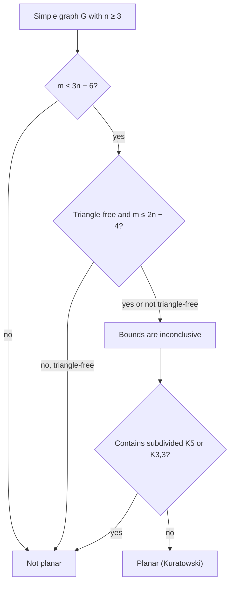
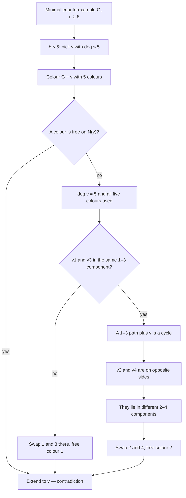
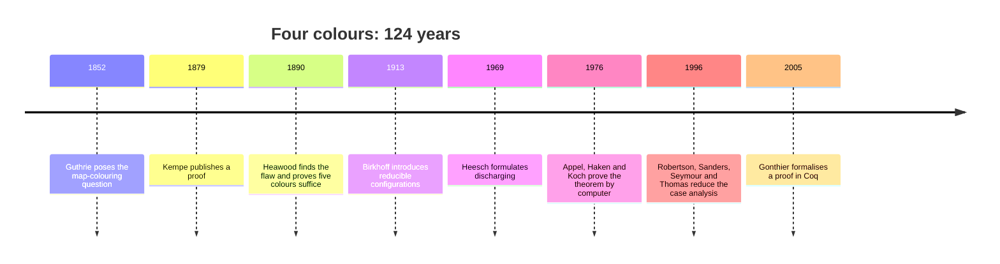

# Planarity and Colouring

> [Mathematics](../../README.md) › [Graph Theory](../README.md) › Planarity and Colouring · Level: Advanced · Prerequisites: [Graph Basics](../01-graph-basics/README.md), [Trees](../02-trees/README.md), [Paths and Connectivity](../03-paths-and-connectivity/README.md), [Proof Techniques](../../00-foundations/04-proof-techniques/README.md), [Mathematical Induction](../../09-discrete-mathematics/01-mathematical-induction/README.md), [Combinatorics](../../20-combinatorics/README.md) · Estimated time: 540 min

## 1. Introduction

Two questions organise this topic, and they turn out to be the same question seen from two sides.

The first is **drawing**. A graph is an abstract object, but engineers, cartographers and chip designers need pictures of it, and pictures have a constraint that abstract graphs do not: lines drawn on a sheet of paper can cross. A graph is **planar** if it can be drawn in the plane with no crossings at all, edges meeting only at shared endpoints. The surprise is that this geometric property has a purely combinatorial description. Euler's formula $V - E + F = 2$ relates the numbers of vertices, edges and faces of any such drawing, and it forces a graph with too many edges to be non-planar: $K_5$, the complete graph on five vertices, has ten edges where at most nine are possible, so it cannot be drawn; $K_{3,3}$, the three-utilities graph, has nine edges where at most eight are possible, so it cannot be drawn either. Kuratowski's theorem upgrades these two examples into a complete characterisation: a graph is planar exactly when it contains no subdivided copy of $K_5$ or $K_{3,3}$.

The second question is **colouring**. Colour the vertices so that adjacent vertices get different colours; what is the smallest number of colours needed? This number, the chromatic number $\chi(G)$, measures conflict in its purest form, and the same computation answers questions about timetables, radio frequencies, register allocation in a compiler, and the colouring of maps. Here the classical result is the four-colour theorem: every planar graph can be coloured with four colours. It was conjectured in 1852, "proved" incorrectly by Kempe in 1879, and proved in 1976 by Appel and Haken with the help of a computer — the first major theorem whose proof no human being has ever checked line by line without machine assistance.

The two questions meet in the middle. A map is a planar graph in disguise: give each region a vertex and join two regions when they share a border, and the map-colouring problem becomes vertex colouring of a planar graph. Conversely, a planar graph can be drawn as a map, and the dual graph of an embedding encodes the adjacency of the faces. Euler's formula controls how many edges a planar graph can have, and that bound controls how many colours the greedy algorithm needs; the four-colour theorem is the statement that the crude bound can be improved from six to four.

The topic is marked *Advanced* for three reasons. First, it uses the topological fact that a simple closed curve separates the plane, and one proof — the five-colour theorem — leans on it explicitly. Second, the four-colour theorem is genuinely deep, and understanding what its proof does and does not do is part of mathematical culture. Third, the chromatic polynomial ties colouring to algebra: it counts colourings by a polynomial whose degree is the number of vertices, and this bridge between combinatorics and algebra is where modern enumerative graph theory begins.

Planarity has applications far beyond drawing. A printed circuit board with one layer of copper must have a planar connection graph. A road network without bridges or tunnels is nearly planar. A graph drawing algorithm that produces no crossings is easier to read, and the theory explains when such a drawing exists. The dual graph turns questions about faces into questions about vertices, which is how map colouring becomes vertex colouring and how planar electrical networks are analysed.

## 2. Prerequisites

The list is short and specific.

* **Graphs, degree, paths, cycles, connectivity, blocks.** Vertices, edges, subgraphs, $G - v$, $G - e$, components, bridges, cut vertices, and the definition of $k$-connectedness. Taught in [Graph Basics](../01-graph-basics/README.md) and [Paths and Connectivity](../03-paths-and-connectivity/README.md), Sections 5 and 7.14.
* **Trees and spanning trees.** A connected graph has a spanning tree with $n-1$ edges, and an edge is a bridge exactly when it lies on no cycle. Taught in [Trees](../02-trees/README.md), Section 7.5, and [Paths and Connectivity](../03-paths-and-connectivity/README.md), Proposition 7.14.6.
* **Eulerian circuits.** A connected graph is Eulerian exactly when all degrees are even. Taught in [Paths and Connectivity](../03-paths-and-connectivity/README.md), Section 7.2.
* **Mathematical induction and strong induction.** Used for Euler's formula, for the five-colour theorem, and for the recurrence of the chromatic polynomial. Taught in [Mathematical Induction](../../09-discrete-mathematics/01-mathematical-induction/README.md).
* **Counting and binomial coefficients.** $\binom{n}{k}$ and the double-counting pattern "count the same set in two ways", used for the face-handshake identity. Taught in [Combinatorics](../../20-combinatorics/README.md).
* **Proof by contradiction and minimal counterexamples.** Used throughout, and essential for the five-colour theorem. Taught in [Proof Techniques](../../00-foundations/04-proof-techniques/README.md).
* **Polynomials (for Sections 7.12–7.13).** Degree, leading coefficient, roots, and the evaluation of a polynomial at integers. Taught in [Algebra](../../03-algebra/README.md).

Conventions, matching [MATHEMATICAL_NOTATION.md](../../MATHEMATICAL_NOTATION.md): all graphs are finite; unless stated otherwise a graph is simple; $n = \lvert V\rvert$ and $m = \lvert E\rvert$; $K_n$ is the complete graph, $K_{m,n}$ the complete bipartite graph, and $W_n$ the wheel with $n$ rim vertices (so $W_n$ has $n+1$ vertices). "Plane graph" means a graph together with a fixed embedding in the plane; "planar graph" means a graph for which at least one such embedding exists. The distinction matters: planarity is a property of the abstract graph, the faces are a property of the embedding.

## 3. Learning Objectives

By the end of this tutorial you will be able to:

1. Define a plane embedding and its faces, and explain why a bridge borders the same face on both sides.
2. Prove Euler's formula $V - E + F = 2$ for connected plane graphs, and the general form $V - E + F = 1 + c$ for disconnected ones.
3. Derive the edge bounds $E \le 3V - 6$ and, for triangle-free planar graphs, $E \le 2V - 4$; use them to prove that $K_5$ and $K_{3,3}$ are non-planar.
4. Prove that every planar graph has a vertex of degree at most $5$, and that every bipartite planar graph has a vertex of degree at most $3$.
5. Recognise maximal planar graphs and prove that they are exactly the triangulations, with $E = 3V - 6$.
6. State Kuratowski's theorem and Wagner's minor version, and use them to certify non-planarity and to explain why the counting bounds are not a characterisation.
7. Construct the dual of a plane graph, compute $n^*$, $m^*$, $f^*$, and prove that duality interchanges bridges and loops.
8. Compute the chromatic number and clique number of small graphs, and prove the basic inequalities $\chi \ge \omega$ and $\chi \ge n/\alpha$.
9. Prove the greedy bound $\chi \le \Delta + 1$ and the degeneracy bound $\chi \le k+1$.
10. State Brooks' theorem and explain what it improves over the greedy bound.
11. Define the chromatic polynomial, prove the deletion–contraction recurrence, and compute $P_G(k)$ for complete graphs, trees, cycles and small examples such as the diamond and the wheel.
12. Prove the five-colour theorem in full, including the Kempe-chain argument.
13. State the four-colour theorem, describe its history and the computer-assisted nature of its proof, and explain why it does not follow from the five-colour argument.
14. Apply planarity and colouring to map colouring, scheduling, register allocation and frequency assignment.

## 4. Intuition

### 4.1 When can a drawing avoid crossings?

Take a piece of paper and draw $K_4$, the complete graph on four vertices: a triangle with a fourth vertex inside, joined to all three corners. No crossings. Now try $K_5$: the fifth vertex has to go somewhere, and wherever it goes, at least one of its five edges must cross something. The obstruction is not a lack of skill or a bad choice of positions; it is a counting fact about regions.

Every drawing of a connected graph divides the plane into regions — the **faces**. A single cycle bounds an inside and an outside. Add an edge inside a face and you split that face in two; add an edge that does not lie on a cycle (a bridge) and you split nothing, because the two sides of a bridge are the same region. Starting from a spanning tree, which has one face and $n-1$ edges, each extra edge creates exactly one new face. That gives
$$F = 1 + (m - (n-1)) = m - n + 2,$$
which is Euler's formula rearranged. The formula is a conservation law for drawings: vertices, edges and faces cannot vary independently.

The counting has teeth. Each face is bounded by at least three edges (in a simple graph with $n \ge 3$), and each edge borders two faces, so $3F \le 2E$. Combining with $F = 2 - n + m$ gives $m \le 3n - 6$. For $n = 5$ this says $m \le 9$, and $K_5$ has $10$ edges. So $K_5$ is not planar, and no clever drawing will ever exist. For bipartite graphs every face has at least four edges (a cycle in a bipartite graph is even and at least $4$), giving $m \le 2n - 4$; for $K_{3,3}$ that reads $9 \le 8$, false.

### 4.2 Why only two obstructions?

The counting bounds show that some graphs are non-planar, but they cannot show that a graph *is* planar. The remarkable fact, conjectured in the 1920s and proved by Kuratowski in 1930, is that the obstructions are exactly two: $K_5$ and $K_{3,3}$, up to subdividing edges. Subdividing an edge replaces it by a path; this cannot create or destroy planarity, so any subdivision of a non-planar graph is non-planar, and any subdivision of a planar graph is planar. Kuratowski's theorem says that every non-planar graph contains a subdivided $K_5$ or a subdivided $K_{3,3}$.

The analogy with other classification theorems is worth noticing. A graph is a forest if it contains no cycle; a graph is bipartite if it contains no odd cycle; a graph is planar if it contains no subdivided $K_5$ or $K_{3,3}$. In each case a **forbidden-subgraph** list describes the class. Later in the topic, Hamiltonicity provides the contrast: no such list can exist there (Section 7.9 of the previous topic).

### 4.3 Colouring: conflicts as colours

Suppose a set of exams must be scheduled into time slots, and certain pairs of exams share students and therefore cannot be simultaneous. Draw a vertex for each exam and an edge between conflicting pairs; a valid timetable is a colouring of the vertices in which adjacent vertices have different colours, and the number of slots needed is the chromatic number $\chi$. The same model handles radio transmitters that must not share a frequency, jobs that need the same machine, and variables that must live in different processor registers.

The clique number $\omega$ is the size of the largest set of mutually conflicting items; those certainly need distinct colours, so $\chi \ge \omega$. Equality is not automatic. An odd cycle has clique number $2$ but chromatic number $3$: three colours are needed even though no three items are pairwise in conflict. The gap can be arbitrarily large: the Mycielski construction turns a $k$-chromatic triangle-free graph into a $(k+1)$-chromatic triangle-free graph, so there are graphs with $\omega = 2$ and $\chi$ as large as one likes.

For planar graphs the gap is tightly controlled. Four colours always suffice, and the four-colour theorem is exactly the statement that the gap between $\omega$ and $\chi$ is at most $2$ for planar graphs (since $\omega \le 4$). Proving it took 124 years.

### 4.4 The greedy algorithm and its limits

The simplest colouring algorithm processes the vertices in some order and gives each vertex the smallest colour not used by its already-coloured neighbours. If every vertex has at most $\Delta$ neighbours, the algorithm never needs more than $\Delta + 1$ colours, because at the moment a vertex is coloured at most $\Delta$ colours are forbidden. For planar graphs this gives $\chi \le 6$ once we know that every planar graph has a vertex of degree at most $5$: remove such a vertex, colour the rest by induction, and put it back — at most five colours are forbidden, so a sixth always works.

The same induction with five colours almost works, and the failure is instructive. If the removed vertex has five neighbours, all five colours may already be used on them, so there is no free colour. Kempe's idea, which succeeds for five colours and fails for four, is to *recolour* part of the graph: swap two colours in one connected component of a two-colour subgraph. If a suitable component can be chosen, one colour becomes free. The five-colour theorem is one careful application of this swap; the four-colour theorem requires an additional argument that no such simple swap can supply, and that is why its proof needs a computer.

### 4.5 Counting colourings with a polynomial

Instead of asking for the minimum number of colours, ask how many colourings exist with a fixed number $k$. For $K_3$ the answer is $k(k-1)(k-2)$; for a tree it is $k(k-1)^{n-1}$; for a cycle it is $(k-1)^n + (-1)^n(k-1)$. In each case the answer is a polynomial in $k$, and it is not an accident: the chromatic polynomial $P_G(k)$ counts proper $k$-colourings and satisfies the deletion–contraction recurrence
$$P_G(k) = P_{G-e}(k) - P_{G/e}(k),$$
which is just the statement "colourings of $G - e$ in which the endpoints differ are colourings of $G$, and those in which they agree are colourings of the contraction". Degrees, edges and the structure of the graph are all readable from the coefficients, and the smallest $k$ with $P_G(k) > 0$ is the chromatic number.

## 5. Formal Definition

**Definition 5.1 (plane graph, embedding, faces).** A **plane graph** is a graph $G$ together with a drawing in the plane $\mathbb{R}^2$ in which every vertex is a point, every edge is a simple arc between its endpoints, no arc passes through a vertex other than its endpoints, and two arcs meet only at a common endpoint. A **planar graph** is a graph for which such a drawing exists; the drawing is called a **plane embedding** (or just an embedding). The connected components of $\mathbb{R}^2 \setminus \bigl(\text{points and arcs of } G\bigr)$ are the **faces** of the embedding. Exactly one face is unbounded; it is the **outer face**. The **length** (or degree) of a face is the number of edge-sides on its boundary, counted with multiplicity; a bridge contributes twice to the same face.

Two remarks on rigour. First, the definition uses arcs and the plane, and the theorem below uses the fact that a simple closed curve has an inside and an outside — the **Jordan curve theorem**. That is a genuine topological input and is the only one used; everything else in the topic is combinatorial. Second, the faces depend on the embedding, not only on the abstract graph: the same planar graph can have embeddings with different face structures. For 3-connected planar graphs, Whitney's theorem says the embedding is unique up to reflection, so no ambiguity arises there.

**Definition 5.2 (planar embedding up to equivalence).** Two embeddings of $G$ are **equivalent** if there is a homeomorphism of the sphere that carries one drawing to the other. Working on the sphere rather than the plane removes the distinction between the outer face and the others, which is often convenient: on the sphere every face is bounded, and the formula $V - E + F = 2$ is the Euler characteristic of the sphere.

**Definition 5.3 (maximal planar, triangulation).** A simple planar graph is **maximal planar** if adding any missing edge destroys planarity. A plane graph is a **triangulation** if every face (including the outer one) has length $3$.

**Definition 5.4 (dual graph).** Let $G$ be a plane graph with face set $\Phi$. The **dual** $G^{*}$ has vertex set $\Phi$, and for every edge $e \in E(G)$ there is an edge $e^{*}$ joining the two faces that border $e$ (a loop when the same face borders $e$ on both sides, which happens exactly when $e$ is a bridge). Multiple edges are allowed, so $G^{*}$ is in general a plane multigraph. It inherits an embedding: place the vertex of $G^{*}$ inside each face and draw $e^{*}$ across $e$.

**Definition 5.5 (colouring, chromatic number, clique number).** A **proper $k$-colouring** of $G$ is a function $c : V \to \{1,\dots,k\}$ with $c(u) \ne c(v)$ for every edge $uv$. The **chromatic number** $\chi(G)$ is the least $k$ for which a proper $k$-colouring exists; $\chi(G) = \infty$ if no finite colouring exists, which cannot happen for finite graphs. The **clique number** $\omega(G)$ is the size of the largest complete subgraph, and the **independence number** $\alpha(G)$ is the size of the largest set of pairwise non-adjacent vertices.

**Definition 5.6 (critical graphs).** A graph $G$ is **$k$-critical** if $\chi(G) = k$ and $\chi(G - v) < k$ for every vertex $v$. Every graph with chromatic number $k$ contains a $k$-critical subgraph: delete vertices for as long as the chromatic number stays $k$.

**Definition 5.7 (chromatic polynomial).** For a graph $G$ and an integer $k \ge 0$, let $P_G(k)$ be the number of proper $k$-colourings of $G$. The function $k \mapsto P_G(k)$ turns out to be a polynomial with rational (indeed integer) coefficients; it is the **chromatic polynomial** of $G$.

**Definition 5.8 (degeneracy).** A graph is **$d$-degenerate** if every non-empty subgraph has a vertex of degree at most $d$. Equivalently, the vertices can be ordered so that each vertex has at most $d$ neighbours later in the order. Planar graphs are $5$-degenerate (Section 7.9).

## 6. Mathematical Notation

| Symbol | Read as | Meaning |
|---|---|---|
| $V$, $E$, $F$ | vertices, edges, faces | $V$ and $E$ of the graph, $F$ the number of faces of the embedding |
| $n$, $m$, $f$ | numbers of vertices, edges, faces | $n = \lvert V\rvert$, $m = \lvert E\rvert$, $f = F$ |
| $G^{*}$ | the dual of $G$ | vertices are the faces of a plane embedding |
| $e^{*}$ | the dual edge | the edge of $G^{*}$ crossing $e$ |
| $\chi(G)$ | chi of $G$, the chromatic number | fewest colours in a proper colouring |
| $\omega(G)$ | omega of $G$, the clique number | size of the largest complete subgraph |
| $\alpha(G)$ | alpha of $G$, the independence number | size of the largest independent set |
| $P_G(k)$ | the chromatic polynomial of $G$ at $k$ | number of proper $k$-colourings |
| $\Delta(G)$, $\delta(G)$ | maximum / minimum degree | $\max_v \deg(v)$, $\min_v \deg(v)$ |
| $K_n$ | complete graph on $n$ vertices | all $\binom{n}{2}$ edges |
| $K_{m,n}$ | complete bipartite graph | all edges between the two parts |
| $W_n$ | wheel with $n$ rim vertices | a cycle $C_n$ plus a hub joined to all of it |
| $Q_3$ | cube graph | $8$ vertices, $12$ edges, $6$ square faces |
| $G - e$, $G/e$ | delete $e$ / contract $e$ | $G/e$ identifies the endpoints of $e$ |
| $\operatorname{cl}(G)$ | the closure of $G$ | see [Paths and Connectivity](../03-paths-and-connectivity/README.md), Remark 7.8.5 |
| $k$-critical | $k$ critical | $\chi(G) = k$ but every vertex deletion lowers $\chi$ |

The symbol $\chi$ is also used for the Euler characteristic of a surface; in this topic it always denotes the chromatic number, and the Euler characteristic appears only as the number $2$ in $V - E + F = 2$. The symbol $\omega$ is the clique number, not a region of the complex plane.

## 7. Core Concepts

### 7.1 Plane graphs and faces

A drawing of a graph divides the plane into regions. Draw a triangle: there are two regions, the bounded triangle and the unbounded outside. Draw a second triangle sharing one vertex with the first: there are three regions. Draw a single edge: there is one region, because you can walk around the endpoint of a segment without crossing it.

The following facts are the working vocabulary of the subject.

* The **faces** of a plane graph are the connected components of the complement of the drawing. There is always at least one, and exactly one is unbounded.
* The **boundary** of a face is a closed walk in $G$; its **length** is the number of edge-steps, counted with multiplicity.
* An edge **borders** the face or faces on its two sides. If the edge is a bridge, both sides belong to the same face, so the bridge contributes $2$ to that face's length and the face's boundary walk traverses the bridge twice.
* Summing the lengths of all faces counts every edge exactly twice, once for each side:
$$\sum_{\varphi \in \Phi} \operatorname{len}(\varphi) = 2m .$$
This is the face version of the handshake lemma, and it is used in every counting argument below.

**Example 7.1.1.** (a) A tree with $n$ vertices has one face: the complement of a tree is connected, because a tree can be built by attaching leaves and attaching a leaf never separates the plane. (b) A cycle $C_n$ has two faces, of lengths $n$ and $n$. (c) The cube $Q_3$ drawn as a cube has $6$ faces, each of length $4$, and $4\cdot 6 = 24 = 2\cdot 12$ ✓. (d) $K_4$ drawn as a tetrahedron has $4$ triangular faces and $3\cdot 4 = 12 = 2\cdot 6$ ✓.

The third example shows why the number of faces is not a property of the abstract graph alone: the cube can also be drawn with a different arrangement of its faces, although for 3-connected graphs all embeddings have the same face structure (Whitney's theorem, Section 7.6).

### 7.2 Euler's formula

**Theorem 7.2.1 (Euler's formula, 1750).** Let $G$ be a connected plane graph with $n$ vertices, $m$ edges and $f$ faces. Then
$$n - m + f = 2 .$$

**Proof.** We prove the formula by induction on $m$, using two elementary facts about adding and removing edges from a drawing.

*Fact A.* If $e$ is a bridge of $G$, then $G - e$ has the same faces as $G$: a bridge lies inside a single face and its two sides belong to that face, so deleting it joins nothing and separates nothing.

*Fact B.* If $e$ lies on a cycle of $G$, then $G - e$ is connected and has exactly one face fewer than $G$: the cycle is a simple closed curve, and its inside and outside are distinct faces of $G - e$ which $e$ separates; deleting $e$ merges those two faces into one.

(These two facts are where the Jordan curve theorem is used; everything else is counting.)

*Base.* If $m = 0$ then $G$ is a single vertex, $n = 1$, $f = 1$ (the whole plane), and $1 - 0 + 1 = 2$ ✓.

*Inductive step.* Let $G$ be connected with $m \ge 1$.

If $G$ is a tree, then $m = n-1$ and $f = 1$: deleting any edge disconnects the tree, so every edge is a bridge, and by Fact A deleting edges one at a time never changes the number of faces; starting from a single vertex with one face, the number of faces stays $1$. Hence
$$n - m + f = n - (n-1) + 1 = 2 .$$

If $G$ is not a tree, it contains a cycle; choose an edge $e$ on a cycle. Then $G - e$ is connected, has $n$ vertices and $m-1$ edges, and by Fact B has $f - 1$ faces. By induction applied to $G - e$,
$$n - (m-1) + (f-1) = 2, \quad\text{that is,}\quad n - m + f = 2 . \qquad \blacksquare$$

**Corollary 7.2.2 (disconnected plane graphs).** If $G$ is a plane graph with $c$ components, then
$$n - m + f = 1 + c .$$

**Proof.** Embed the components far apart, so that their drawings are disjoint. Each component $G_i$ has $n_i - m_i + f_i = 2$, and the outer face of each component is a separate face of the disjoint union except that the $c$ outer faces merge into a single face when the components are placed in the same plane. Hence $f = \sum_i f_i - (c-1)$, and
$$n - m + f = \sum_i (n_i - m_i + f_i) - (c-1) = 2c - c + 1 = c + 1 . \qquad \blacksquare$$

**Example 7.2.3.** Two disjoint triangles: $n = 6$, $m = 6$, $f = 3$ (two bounded faces and one unbounded), and $6 - 6 + 3 = 3 = 1 + 2$ ✓. This is the standard check that the connected version of the formula cannot be applied blindly to disconnected graphs.

### 7.3 The edge bound and the non-planarity of $K_5$

**Proposition 7.3.1 (face lengths in simple graphs).** Let $G$ be a simple planar graph with $n \ge 3$ and let $G$ be embedded in the plane. Then every face has length at least $3$.

**Proof.** A face of length $1$ would be bounded by a loop, and a face of length $2$ would be bounded by two edges joining the same pair of vertices; a simple graph has neither. (The exception $n = 2$ is exactly $K_2$, whose single face has length $2$, which is why the hypothesis is $n \ge 3$.) $\blacksquare$

**Theorem 7.3.2 (edge bound for planar graphs).** Let $G$ be a simple planar graph with $n \ge 3$. Then
$$m \le 3n - 6 .$$

**Proof.** Embed $G$ in the plane. By Proposition 7.3.1 every face has length at least $3$, and summing lengths counts each edge twice:
$$2m = \sum_{\varphi}\operatorname{len}(\varphi) \ge 3f .$$
Euler's formula gives $f = 2 - n + m$, so
$$2m \ge 3f = 3(2 - n + m) = 6 - 3n + 3m,$$
and rearranging gives $m \le 3n - 6$. $\blacksquare$

**Corollary 7.3.3 (another face bound).** With the same hypotheses, $f \le 2n - 4$.

**Proof.** $f = 2 - n + m \le 2 - n + (3n - 6) = 2n - 4$. $\blacksquare$

**Corollary 7.3.4 (a vertex of small degree).** Every simple planar graph with $n \ge 3$ has a vertex of degree at most $5$; equivalently, planar graphs are $5$-degenerate.

**Proof.** By the handshake lemma and Theorem 7.3.2,
$$2m \le 6n - 12, \qquad \text{so the average degree } \frac{2m}{n} \le 6 - \frac{12}{n} < 6 .$$
An average strictly below $6$ means some vertex has degree at most $5$. The same argument applied to every subgraph (subgraphs of planar graphs are planar) gives degeneracy at most $5$. $\blacksquare$

**Corollary 7.3.5 ($K_5$ is not planar).** $K_5$ has $n = 5$ and $m = 10$, but $3n - 6 = 9 < 10$. So no embedding exists.

Note what the proof does *not* say. It gives a necessary condition; satisfying $m \le 3n - 6$ does not make a graph planar. The Petersen graph has $n = 10$, $m = 15 \le 24$, and is not planar — a fact that requires Kuratowski's theorem (Section 7.6). The bound is a filter, not a characterisation.

### 7.4 Bipartite planar graphs and $K_{3,3}$

**Theorem 7.4.1 (edge bound for triangle-free planar graphs).** Let $G$ be a simple planar graph with $n \ge 3$ and no cycle of length $3$. Then
$$m \le 2n - 4 .$$

**Proof.** Every face of an embedding has length at least $4$. Indeed, a face boundary is a closed walk; in a bipartite graph every closed walk has even length; and length $2$ is impossible in a simple graph. So
$$2m = \sum_\varphi \operatorname{len}(\varphi) \ge 4f .$$
With $f = 2 - n + m$,
$$2m \ge 4(2 - n + m) = 8 - 4n + 4m,$$
so $2m \le 4n - 8$, that is $m \le 2n - 4$. $\blacksquare$

**Corollary 7.4.2 ($K_{3,3}$ is not planar).** $K_{3,3}$ is bipartite, has $n = 6$ and $m = 9$, but $2n - 4 = 8 < 9$. So $K_{3,3}$ has no plane embedding.

**Corollary 7.4.3 (low-degree vertex in bipartite planar graphs).** A simple bipartite planar graph with $n \ge 3$ has a vertex of degree at most $3$.

**Proof.** $2m \le 4n - 8$ gives average degree strictly less than $4$. $\blacksquare$

**Example 7.4.4 (the bound is attained).** $K_{2,n}$ has $n+2$ vertices and $2n$ edges, and $2(n+2) - 4 = 2n$ ✓. It is planar: draw the two vertices of the small part as two horizontal lines and the $n$ vertices of the large part as vertical segments between them. So the bound $m \le 2n - 4$ is sharp for bipartite planar graphs, just as $m \le 3n - 6$ is sharp for general planar graphs (triangulations).

### 7.5 Maximal planar graphs and triangulations

**Theorem 7.5.1 (maximal planar graphs are triangulations).** Let $G$ be a simple planar graph with $n \ge 3$. The following are equivalent:

(a) $G$ is maximal planar;
(b) in every plane embedding of $G$, every face has length $3$;
(c) $m = 3n - 6$.

**Proof.** (a) $\Rightarrow$ (b): if some embedding had a face $\varphi$ of length at least $4$, then two vertices on the boundary of $\varphi$ that are not adjacent could be joined by an arc drawn inside $\varphi$, contradicting maximality. (Faces of length $1$ or $2$ are impossible by simplicity, Proposition 7.3.1.) A face of length $3$ admits no such arc.

(b) $\Rightarrow$ (c): if every face has length $3$, then $2m = 3f$, and Euler gives $m = 3n - 6$ by the computation of Theorem 7.3.2 with equality throughout.

(c) $\Rightarrow$ (a): if $m = 3n - 6$, then $f = 2n - 4$ and $2m = 6n - 12 = 3f$. Since every face has length at least $3$, $2m = \sum \operatorname{len}(\varphi) \ge 3f$ with equality, so every face has length exactly $3$. A missing edge could only be drawn inside a face, and every face is a triangle already; adding an edge between two existing vertices would have to cross an existing edge or duplicate one. So no edge can be added and $G$ is maximal. $\blacksquare$

**Corollary 7.5.2.** Every simple planar graph with $n \ge 3$ is a spanning subgraph of a maximal planar graph on the same vertex set, obtained by adding edges inside faces of length at least $4$ until none remain.

This is how planarity results are often proved: it suffices to prove them for triangulations, because a colouring (or any other vertex assignment) of a supergraph restricts to the subgraph.

**Example 7.5.3.** The octahedron is $4$-regular with $n = 6$ and $m = 12 = 3\cdot 6 - 6$, so it is maximal planar; its $f = 8$ faces are all triangles ✓. The cube has $n = 8$, $m = 12 < 18$, and its $6$ faces are squares; adding a diagonal to each square gives a triangulation with $m = 18$ ✓.

### 7.6 Kuratowski's theorem and its relatives

**Definition 7.6.1 (subdivision, minor).** A **subdivision** of a graph $H$ is obtained by replacing edges of $H$ by internally disjoint paths of length at least $1$. Equivalently, $G$ contains a subdivision of $H$ if $H$ can be obtained from a subgraph of $G$ by suppressing vertices of degree $2$. A graph $H$ is a **minor** of $G$ if $H$ can be obtained from $G$ by deleting vertices, deleting edges and contracting edges.

Subdivision preserves planarity in both directions: if $G$ is planar then every subdivision of $G$ is planar, and if a subdivision of $G$ is planar then $G$ is planar. So the class of planar graphs can be described by forbidding subdivisions.

**Theorem 7.6.2 (Kuratowski, 1930).** A graph is planar if and only if it contains no subdivision of $K_5$ and no subdivision of $K_{3,3}$ as a subgraph.

**Theorem 7.6.3 (Wagner, 1937).** A graph is planar if and only if neither $K_5$ nor $K_{3,3}$ is a minor of it.

Kuratowski's theorem is the reason $K_5$ and $K_{3,3}$ are called the **Kuratowski graphs**. The theorem is not proved here: the forward direction (a planar graph contains no subdivided $K_5$ or $K_{3,3}$) follows from Euler's formula applied to the subdivision, and the hard direction is the converse, proved by induction on the number of edges with a careful analysis of separators of size $2$. Complete proofs are in Diestel, *Graph Theory*, Chapter 4, and Bondy and Murty, *Graph Theory*, Chapter 10.

Three companion results are worth recording.

**Theorem 7.6.4 (Fáry, 1948).** Every simple planar graph has a plane embedding in which every edge is a straight line segment.

So "planar" does not depend on allowing curved edges. Fáry's theorem is why straight-line graph drawing is possible for planar graphs, and why planarity testing is a purely combinatorial matter.

**Theorem 7.6.5 (Whitney, 1933).** Every 3-connected planar graph has a unique embedding on the sphere up to reflection.

Consequently, for a 3-connected planar graph the faces are determined by the abstract graph: the dual is unique up to isomorphism, and questions about faces are questions about the graph.

**Theorem 7.6.6 (planarity testing).** Planarity can be decided in $O(n)$ time (Hopcroft and Tarjan, 1974), and an embedding can be constructed in linear time. Modern algorithms are simpler but the linear bound is classical.

**Example 7.6.7 (the counting bound is not enough).** The Petersen graph has $n = 10$ and $m = 15$, well inside $3n - 6 = 24$, yet it is not planar. By Kuratowski's theorem it must contain a subdivision of $K_5$ or of $K_{3,3}$. It cannot contain a subdivision of $K_5$, because a subdivision of $K_5$ has five branch vertices of degree $4$, and the Petersen graph is cubic. Hence it contains a subdivision of $K_{3,3}$. This is a good example of a non-planarity proof that no counting argument can supply.

### 7.7 Dual graphs

**Definition 7.7.1 (dual, restated concretely).** Given a plane graph $G$ with face set $\Phi$, place one vertex of $G^{*}$ inside each face $\varphi \in \Phi$. For each edge $e \in E(G)$, draw an arc $e^{*}$ crossing $e$ transversally and joining the vertices of $G^{*}$ in the two faces on either side of $e$; if both sides are the same face (that is, $e$ is a bridge), $e^{*}$ is a loop. The result is a plane multigraph, the **dual** of $G$ with respect to the chosen embedding.

**Proposition 7.7.2 (counting in the dual).** Let $G$ be a connected plane graph with $n$ vertices, $m$ edges and $f$ faces, and let $G^{*}$ be its dual. Then
$$n^{*} = f, \qquad m^{*} = m, \qquad f^{*} = n .$$
Moreover $G^{*}$ is connected.

**Proof.** The vertices of $G^{*}$ are the faces of $G$ by definition, so $n^{*} = f$; the edges of $G^{*}$ are in bijection with the edges of $G$, so $m^{*} = m$. Each face of $G^{*}$ contains exactly one vertex of $G$ (the arcs $e^{*}$ cross edges of $G$ and so never cross a vertex), and the correspondence face of $G^{*} \leftrightarrow$ vertex of $G$ is a bijection, so $f^{*} = n$. Applying Euler's formula to $G^{*}$ gives $f - m + n = 2$, which is Euler's formula for $G$: consistency, not a new fact. Connectivity of $G^{*}$ follows because the faces of a connected plane graph are connected to each other across edges (any two faces can be joined by a curve crossing edges, and each crossing moves to an adjacent face). $\blacksquare$

**Proposition 7.7.3 (duality is an involution).** For a connected plane graph $G$, the double dual $G^{**}$ is isomorphic to $G$ as a plane graph.

**Proof.** A face of $G^{*}$ contains exactly one vertex of $G$, so the vertices of $G^{**}$ correspond to the vertices of $G$. An edge $e^{**}$ crosses $e^{*}$, which crosses $e$, so $e^{**}$ corresponds to $e$. The incidences match, so the correspondence is a graph isomorphism that also preserves the embedding. $\blacksquare$

**Proposition 7.7.4 (bridges and loops).** Let $G$ be a connected plane graph and $e \in E(G)$. Then:

(a) $e$ is a bridge of $G$ if and only if $e^{*}$ is a loop of $G^{*}$;
(b) $e$ is a loop of $G$ if and only if $e^{*}$ is a bridge of $G^{*}$.

**Proof.** (a) Both sides of $e$ belong to the same face exactly when $e$ separates no two regions, which is exactly when deleting $e$ does not disconnect $G$; that is, $e$ is a bridge. If both sides are the same face, $e^{*}$ begins and ends at the same dual vertex, a loop.

(b) If $e$ is a loop, it encloses a region inside a face; the dual edge $e^{*}$ crosses the loop and is the only connection across it, hence a bridge of $G^{*}$. $\blacksquare$

**Proposition 7.7.5 (cycle–cut duality).** Let $G$ be a connected plane graph. A set $C \subseteq E(G)$ is the edge set of a cycle of $G$ if and only if $C^{*} = \{e^{*} : e \in C\}$ is a minimal edge cut of $G^{*}$. Consequently, $T \subseteq E(G)$ is the edge set of a spanning tree of $G$ if and only if $\{e^{*} : e \in E(G) \setminus T\}$ is the edge set of a spanning tree of $G^{*}$.

**Proof sketch.** A cycle $C$ separates the plane into an inside and an outside, so the dual edges $C^{*}$ all cross from the inside faces to the outside faces: deleting them disconnects $G^{*}$, and no proper subset does. Conversely a minimal cut of $G^{*}$ has this form. For the spanning-tree statement, count: if $T$ is a spanning tree of $G$ then $\lvert T\rvert = n-1$ and $\lvert E \setminus T\rvert = m-n+1 = f-1 = n^{*}-1$; and $E \setminus T$ contains no cycle of $G$ iff its dual contains no minimal cut of $G^{*}$, which is exactly the condition for the dual set to be connected and spanning. $\blacksquare$

**Example 7.7.6 (dual of a pentagon with a chord).** Let $G$ be $C_5$ on $1,\dots,5$ with the chord $13$. Then $n = 5$, $m = 6$, $f = 3$: the triangle $1$–$2$–$3$, the quadrilateral $1$–$3$–$4$–$5$, and the outer face of length $5$. Lengths: $3 + 4 + 5 = 12 = 2\cdot 6$ ✓. The dual has $n^{*} = 3$ vertices, $m^{*} = 6$ edges and $f^{*} = 5$ faces, and it is a triangle with $1$, $2$ and $3$ parallel edges on its three sides: the chord $13$ is shared only by the triangle and the quadrilateral, so $1$ dual edge; the edges $12$ and $23$ border the triangle and the outer face, so $2$ dual edges; the edges $34, 45, 51$ border the quadrilateral and the outer face, so $3$ dual edges. Degrees: $3, 4, 5$, summing to $12 = 2m^{*}$ ✓.

### 7.8 Colourings, cliques and independence

**Definition 7.8.1.** A proper $k$-colouring partitions $V$ into $k$ independent sets, called colour classes. Hence $\chi(G) \le k$ if and only if $V$ can be partitioned into $k$ independent sets.

**Proposition 7.8.2 (elementary values).** For a graph $G$:

(a) $\chi(G) = 1$ if and only if $E = \varnothing$;
(b) $\chi(G) = 2$ if and only if $G$ is bipartite and has at least one edge;
(c) $\chi(C_n) = 2$ for $n$ even and $3$ for $n$ odd;
(d) $\chi(K_n) = n$;
(e) $\chi(G) \ge \omega(G)$;
(f) $\chi(G) \ge \lceil n/\alpha(G)\rceil$.

**Proof.** (a) One colour is proper exactly when there are no edges. (b) A 2-colouring is precisely a bipartition (colour classes are independent sets and every edge crosses), and a non-empty bipartite graph needs two colours. (c) Even cycles are bipartite; an odd cycle is not, and colouring it alternately with two colours forces the closing edge to join equal colours, so three are needed and three suffice. (d) All pairs of vertices of $K_n$ are adjacent, so all colours differ. (e) The vertices of a clique are pairwise adjacent, so they receive distinct colours. (f) In a proper colouring each colour class is an independent set of size at most $\alpha(G)$, and $k$ classes cover $n$ vertices, so $n \le k\alpha(G)$. $\blacksquare$

The inequality $\chi \ge \omega$ is not an equality in general: $\chi(C_5) = 3$ and $\omega(C_5) = 2$. Section 7.11 shows that the gap can be arbitrarily large.

**Proposition 7.8.3 (properties of critical graphs).** Let $G$ be $k$-critical with $k \ge 2$. Then:

(a) $G$ is connected;
(b) $\delta(G) \ge k-1$;
(c) $G$ has no cut vertex when $k \ge 3$;
(d) for every vertex $v$, every $(k-1)$-colouring of $G - v$ uses all $k-1$ colours on $N(v)$.

**Proof.** (a) If $G$ were disconnected, some component would contain a subgraph of chromatic number $k$; deleting a vertex in a different component would leave the chromatic number at $k$, contradicting criticality.

(b) If $\deg(v) \le k-2$, colour $G - v$ with $k-1$ colours (possible by criticality) and extend the colouring to $v$: its neighbours forbid at most $k-2$ colours, so a colour remains. That would colour $G$ with $k-1$ colours, a contradiction. Hence $\deg(v) \ge k-1$ for every $v$.

(c) Suppose $v$ is a cut vertex of $G$, and let $G_1,\dots,G_r$ ($r \ge 2$) be the subgraphs induced by $v$ together with the vertex sets of the components of $G - v$. Each $G_i$ is a proper subgraph of $G$ (it omits the vertices of the other components), so by criticality each has a proper $(k-1)$-colouring $c_i$. Rename the colours in each $c_i$ so that $c_i(v) = 1$ for every $i$; renaming preserves properness. There are no edges between different $G_i$ except at $v$ (an edge between two components of $G - v$ would join them), so the union of the $c_i$ is a proper $(k-1)$-colouring of $G$, a contradiction. Hence $G$ has no cut vertex.

(d) Fix $v$ and a proper $(k-1)$-colouring $c$ of $G - v$. If some colour $\gamma \in \{1,\dots,k-1\}$ were unused on $N(v)$, then setting $c(v) = \gamma$ would give a proper $(k-1)$-colouring of $G$, a contradiction. So all $k-1$ colours occur on $N(v)$. $\blacksquare$

**Example 7.8.4 (odd wheels are 4-critical).** Let $W_n$ be a wheel with hub $h$ and rim cycle $v_1\dots v_n$. If $n$ is odd, $\chi(W_n) = 4$: the rim needs three colours, and after colouring the rim with three colours the hub is adjacent to all three, so it needs a fourth. If $n$ is even, $\chi(W_n) = 3$: colour the rim alternately with colours $1,2$ and give the hub colour $3$. For odd $n$, deleting the hub leaves an odd cycle (chromatic number $3$) and deleting a rim vertex leaves a path plus hub (chromatic number $3$), so every vertex deletion lowers the chromatic number: $W_n$ is 4-critical.

### 7.9 The greedy bound, degeneracy and six colours

**Theorem 7.9.1 (greedy bound).** For every graph $G$, $\chi(G) \le \Delta(G) + 1$.

**Proof.** Order the vertices arbitrarily as $v_1,\dots,v_n$ and colour them in that order, giving $v_i$ the smallest colour not used by its already-coloured neighbours. When $v_i$ is coloured, at most $\deg(v_i) \le \Delta(G)$ colours are forbidden, so one of the colours $\{1,\dots,\Delta(G)+1\}$ is available. Hence a proper $(\Delta+1)$-colouring is produced. $\blacksquare$

**Theorem 7.9.2 (degeneracy bound).** If $G$ is $d$-degenerate, then $\chi(G) \le d+1$.

**Proof.** Let $v_n$ be a vertex of degree at most $d$ in $G$; by definition of degeneracy such a vertex exists. Remove it and repeat, obtaining an ordering $v_1,\dots,v_n$ in which every $v_i$ has at most $d$ neighbours among $v_{i+1},\dots,v_n$. Colour in the reverse order: when $v_i$ is coloured, its neighbours among the already-coloured vertices $v_{i+1},\dots,v_n$ number at most $d$, so one of $d+1$ colours is available. $\blacksquare$

**Corollary 7.9.3 (six-colour theorem).** Every planar graph is $6$-colourable.

**Proof.** Planar graphs are $5$-degenerate (Corollary 7.3.4, applied to every subgraph), so Theorem 7.9.2 with $d = 5$ gives $\chi \le 6$. $\blacksquare$

**Corollary 7.9.4 (four colours for bipartite planar graphs).** Every bipartite planar graph is $4$-colourable.

**Proof.** It is $3$-degenerate (Corollary 7.4.3 applied to every subgraph), so $\chi \le 4$. (Grötzsch's theorem improves this to $3$, but that is a deeper result.) $\blacksquare$

**Example 7.9.5 (greedy can be wasteful).** Greedy colouring depends on the order. On the path $P_6$ with vertices $1$–$2$–$3$–$4$–$5$–$6$, the order $2,5,1,3,4,6$ gives: $2 \mapsto 1$, $5 \mapsto 1$, $1 \mapsto 2$ (adjacent to $2$), $3 \mapsto 2$ (adjacent to $2$), $4 \mapsto 3$ (adjacent to $3$ and $5$, whose colours are $2$ and $1$), $6 \mapsto 2$ (adjacent only to $5$). Three colours, although $\chi(P_6) = 2$. The order $1,2,3,4,5,6$ gives two colours. The algorithm is correct (it always produces a proper colouring) but not optimal, and no ordering rule is known that makes it optimal on all graphs — that would decide 3-colourability in polynomial time, which is NP-complete.

### 7.10 Brooks' theorem

The greedy bound $\chi \le \Delta + 1$ is attained by complete graphs and odd cycles: $K_{\Delta+1}$ has $\chi = \Delta + 1$, and $C_{2m+1}$ has $\chi = 3 = \Delta + 1$. Brooks' theorem says that nothing else attains it.

**Theorem 7.10.1 (Brooks, 1941).** Let $G$ be a connected graph. If $G$ is neither a complete graph nor an odd cycle, then
$$\chi(G) \le \Delta(G) .$$
Equivalently, $\chi(G) \le \Delta(G)$ for every connected graph, with equality only for complete graphs and odd cycles.

**Idea of the proof.** The proof is an ordering argument, and the two exceptional families are exactly the graphs in which the ordering cannot be found.

Suppose first that $G$ is 2-connected and not complete. Since $G$ is not complete and is connected, there are two vertices at distance $2$, say $x$–$z$–$y$ with $xy \notin E$; then $z$ has two non-adjacent neighbours. Choose such a vertex $v = z$ and its non-adjacent neighbours $v_1 = x$, $v_2 = y$.

Because $G$ is 2-connected, $G - v$ is connected. Take a spanning tree $T$ of $G - v$ rooted at $v_1$, and list the vertices of $G - v$ as
$$v_1,\ v_2,\ v_3,\ \dots,\ v_{n-1}$$
where $v_2$ is placed second and every $v_i$ with $i \ge 3$ appears after its parent in $T$. Colour in this order, giving $v_1$ and $v_2$ the same colour (legal, since they are not adjacent). For $i \ge 3$, the vertex $v_i$ has an earlier neighbour (its parent), so at most $\deg(v_i) - 1 \le \Delta - 1$ of its neighbours are already coloured; hence at most $\Delta-1$ colours are forbidden and one of $\Delta$ colours is available. Finally, colour $v$: all its neighbours are coloured, but $v_1$ and $v_2$ share a colour, so at most $\Delta - 1$ distinct colours appear on $N(v)$ and a colour is free. Hence $\Delta$ colours suffice.

If $G$ is not 2-connected, split it at a cut vertex into smaller graphs and apply induction, matching the colour of the shared cut vertex in each piece; the details are an induction on the block-cut tree. If $G$ is complete or an odd cycle, $\chi = \Delta + 1$ and no bound of $\Delta$ is possible. A complete proof is in Diestel, *Graph Theory*, §5.2. $\blacksquare$ (sketch)

**Example 7.10.2.** (a) $K_4$: $\chi = 4 = \Delta + 1$, an exception. (b) $C_5$: $\chi = 3 = \Delta + 1$, an exception. (c) $C_6$: $\chi = 2 \le 2 = \Delta$. (d) The Petersen graph: $\Delta = 3$, and $\chi = 3 \le 3$ ✓. (e) The cube $Q_3$: $\Delta = 3$, $\chi = 2$. (f) Every planar graph with $\Delta \ge 5$ satisfies $\chi \le \Delta$ by Brooks, since the only complete planar graph is $K_4$ (and $K_4$ has $\Delta = 3$).

The last example shows the relation between Brooks and the five-colour theorem: Brooks gives $\chi \le 5$ for planar graphs of maximum degree $5$, and the five-colour theorem gives $\chi \le 5$ for all planar graphs. Brooks alone does not give five colours for planar graphs of maximum degree greater than $5$.

### 7.11 How large can the gap between $\omega$ and $\chi$ be?

A clique forces distinct colours, so $\chi \ge \omega$. The reverse inequality fails for $C_5$, where $\omega = 2$ and $\chi = 3$. There is a construction that makes the failure arbitrarily severe while keeping the graph triangle-free.

**Definition 7.11.1 (Mycielski construction).** Given $G$ with $V = \{v_1,\dots,v_n\}$, form $M(G)$ as follows. Take a copy $V$ of the vertices, a set $U = \{u_1,\dots,u_n\}$ of new vertices, and one further vertex $w$. Keep all edges of $G$; join $u_i$ to every neighbour of $v_i$ in $G$; join $w$ to every $u_i$. There are no other edges.

**Theorem 7.11.2 (Mycielski, 1955).** For every graph $G$:

(a) $\chi(M(G)) = \chi(G) + 1$;
(b) if $G$ has no triangle, then $M(G)$ has no triangle.

**Proof.** (a) *Upper bound.* Let $c$ be a proper $k$-colouring of $G$. Extend it by $c(u_i) = c(v_i)$ and $c(w) = k+1$. For an edge $u_ix$ with $x \in N(v_i)$ we have $c(x) \ne c(v_i) = c(u_i)$ ✓; the edges of $G$ are properly coloured by hypothesis; and $w$, with its own colour, is fine. So $\chi(M(G)) \le k+1$.

*Lower bound.* Let $t = \chi(M(G))$ and let $c$ be a proper $t$-colouring. Relabel so that $c(w) = t$; then no $u_i$ has colour $t$ (each $u_i$ is adjacent to $w$). Define a colouring of $G$ by
$$c'(v_i) = \begin{cases} c(v_i), & c(v_i) \ne t, \\ c(u_i), & c(v_i) = t. \end{cases}$$
This is well defined because $c(u_i) \ne t$. It is proper: for an edge $v_iv_j$, at most one of $v_i,v_j$ can have colour $t$ (they are adjacent), so suppose $c(v_i) = t$. Then $c'(v_i) = c(u_i)$, and $u_i$ is adjacent to every neighbour of $v_i$, in particular to $v_j$, so $c(u_i) \ne c(v_j) = c'(v_j)$ ✓. Hence $G$ is $(t-1)$-colourable and $\chi(G) \le t-1 = \chi(M(G)) - 1$. Combined with the upper bound, $\chi(M(G)) = \chi(G)+1$.

(b) Suppose $M(G)$ has a triangle. The set $U$ is independent, and $w$'s only neighbours are in $U$, which is independent, so no triangle contains $w$ and a vertex of $V$; and no triangle has two vertices of $U$. So a triangle is of one of two forms: three vertices of $V$, which would be a triangle of $G$; or $u_i$ together with two vertices $x,y \in V$ that are both neighbours of $v_i$ and adjacent to each other, which is a triangle $v_ixy$ of $G$. So if $G$ has no triangle, neither does $M(G)$. $\blacksquare$

**Corollary 7.11.3.** For every $k \ge 2$ there is a triangle-free graph with chromatic number $k$. Start from $K_2$ ($\omega = 2$, $\chi = 2$) and apply $M$ repeatedly; each step preserves triangle-freeness and increases $\chi$ by one. The graph $M(C_5)$ is the **Grötzsch graph** (11 vertices, 20 edges), the smallest triangle-free 4-chromatic graph.

**Remark 7.11.4 (perfect graphs).** Graphs in which $\chi(H) = \omega(H)$ for every induced subgraph $H$ are called **perfect**. Bipartite graphs, complete graphs and interval graphs are perfect. The Strong Perfect Graph Theorem (Chudnovsky, Robertson, Seymour and Thomas, 2006) characterises them: a graph is perfect if and only if neither it nor its complement contains an induced odd cycle of length at least $5$. Section 7.11's construction shows that triangle-free graphs are far from perfect in general.

### 7.12 Chromatic polynomials

**Definition 7.12.1.** For a graph $G$ and an integer $k \ge 0$, the **chromatic polynomial** $P_G(k)$ is the number of functions $c : V \to \{1,\dots,k\}$ with $c(u)\ne c(v)$ for every edge $uv$. Equivalently, it is the number of ways to partition $V$ into at most $k$ independent sets, with the parts labelled by colours.

**Example 7.12.2.** $P_{K_n}(k) = k(k-1)(k-2)\cdots(k-n+1)$: colour the vertices in any order and each has one fewer available colour than the previous. In particular $P_{K_1}(k) = k$, $P_{K_2}(k) = k(k-1)$, $P_{K_3}(k) = k(k-1)(k-2)$. For the empty graph on $n$ vertices, $P(k) = k^n$.

**Theorem 7.12.3 (deletion–contraction).** Let $G$ be a graph and $e \in E(G)$. Then
$$P_G(k) = P_{G-e}(k) - P_{G/e}(k),$$
where $G/e$ is obtained by contracting $e$ (identifying its endpoints and deleting loops; parallel edges may remain and do not affect the count).

**Proof.** Every proper $k$-colouring of $G - e$ either gives the two endpoints of $e = uv$ different colours or the same colour. Those that give different colours are exactly the proper $k$-colourings of $G$. Those that give the same colour correspond bijectively to proper $k$-colourings of $G/e$: identifying $u$ and $v$ produces a valid colouring of the contraction, and every colouring of the contraction pulls back to a colouring of $G - e$ in which $u$ and $v$ agree. Hence
$$P_{G-e}(k) = P_G(k) + P_{G/e}(k),$$
which is the stated recurrence. $\blacksquare$

**Theorem 7.12.4 (basic properties).** Let $G$ have $n \ge 1$ vertices, $m$ edges and $c$ components.

(a) $P_G(k)$ is a polynomial in $k$ of degree $n$ with leading coefficient $1$;
(b) $P_G(k) = \prod_{i=1}^{c} P_{G_i}(k)$ for the components $G_i$;
(c) $P_G(k)$ is divisible by $k^{c}$, where $c$ is the number of components; in particular the constant term is $0$ when $n \ge 1$;
(d) the coefficient of $k^{n-1}$ is $-m$;
(e) for integers $k \ge 0$, $P_G(k) > 0$ if and only if $k \ge \chi(G)$.

**Proof.** (a) Induction on $m$ using deletion–contraction: for $m = 0$, $P_G = k^n$. For $m \ge 1$, $G - e$ has $n$ vertices and $m-1$ edges, while $G/e$ has $n-1$ vertices and at most $m-1$ edges; by induction $P_{G-e}$ has degree $n$ and leading coefficient $1$, and $P_{G/e}$ has degree $n-1$, so the difference has degree $n$ and leading coefficient $1$.

(b) A colouring of a disconnected graph is a choice of a colouring in each component independently.

(c) A colouring with the empty palette does not exist when $n \ge 1$, so $P_G(0) = 0$ and $k$ divides $P_G$. More generally, by (b) it suffices to note that each $P_{G_i}$ is divisible by $k$, since $P_{G_i}(0) = 0$; hence $k^{c}$ divides $P_G$.

(d) Induction on $m$: for $m = 0$ the coefficient of $k^{n-1}$ is $0 = -m$ ✓. For $m \ge 1$, the coefficient of $k^{n-1}$ in $P_{G-e}$ is $-(m-1)$ by induction, and $P_{G/e}$ has degree $n-1$ with leading coefficient $1$, so it contributes $-1$:
$$[k^{n-1}]P_G = -(m-1) - 1 = -m .$$

(e) A proper $k$-colouring exists exactly when $k \ge \chi(G)$; and $P_G(k)$ counts them. $\blacksquare$

**Remark 7.12.5 (alternation of signs).** The coefficients of $P_G$ alternate in sign: writing $P_G(k) = \sum_j a_j k^j$, one has $a_j = 0$ or $\operatorname{sign}(a_j) = (-1)^{n-j}$. This follows from Whitney's expansion $P_G(k) = \sum_{A \subseteq E}(-1)^{\lvert A\rvert}k^{c(A)}$ (Exercise 35) together with a sign-reversing involution on the edge subsets; the involution is not needed anywhere later in this topic, so it is only quoted here.

**Theorem 7.12.5 (trees and cycles).** (a) If $T$ is a tree with $n \ge 1$ vertices, then $P_T(k) = k(k-1)^{n-1}$. (b) For $n \ge 3$,
$$P_{C_n}(k) = (k-1)^n + (-1)^n (k-1) .$$

**Proof.** (a) Root the tree at any vertex and colour in order of increasing distance from the root: the root has $k$ choices and every other vertex has exactly one already-coloured neighbour (its parent), hence $k-1$ choices. The choices are independent, so the total is $k(k-1)^{n-1}$.

(b) Induction on $n$. For $n = 3$ the formula reads $(k-1)^3 - (k-1) = k(k-1)(k-2) = P_{K_3}(k)$ ✓. For $n \ge 4$, delete an edge $e$ of $C_n$: then $C_n - e = P_n$ is a tree, so $P_{C_n-e} = k(k-1)^{n-1}$; and $C_n/e = C_{n-1}$. The recurrence gives
$$P_{C_n} = P_{C_n-e} - P_{C_n/e} = k(k-1)^{n-1} - P_{C_{n-1}} .$$
Substituting the induction hypothesis for $P_{C_{n-1}}$,
$$P_{C_n} = k(k-1)^{n-1} - (k-1)^{n-1} - (-1)^{n-1}(k-1) = (k-1)^n + (-1)^n(k-1) . \qquad \blacksquare$$

**Corollary 7.12.6 (chromatic number from the polynomial).** $\chi(G) = \min\{k \in \mathbb{N}_0 : P_G(k) > 0\}$. For example $P_{C_5}(2) = 1^5 - 1 = 0$ and $P_{C_5}(3) = 2^5 - 2 = 30 > 0$, so $\chi(C_5) = 3$ ✓.

**Remark 7.12.7 (evaluation at $-1$).** Although $P_G(k)$ counts colourings only for $k \ge 0$, its values at negative integers carry information. Stanley's theorem (1973) states that
$$P_G(-1) = (-1)^{n}\, a(G),$$
where $a(G)$ is the number of **acyclic orientations** of $G$ (orientations of the edges with no directed cycle). This is the beginning of the theory of the Tutte polynomial, of which the chromatic polynomial is a specialisation.

### 7.13 Worked computations of chromatic polynomials

**Example 7.13.1 (the $4$-cycle).** Delete an edge $e$ of $C_4$: $C_4 - e = P_4$, a tree, so $P = k(k-1)^3$; and $C_4/e = C_3$, so $P = k(k-1)(k-2)$. Therefore
$$P_{C_4}(k) = k(k-1)^3 - k(k-1)(k-2) = k(k-1)\bigl[(k-1)^2 - (k-2)\bigr] = k(k-1)(k^2 - 3k + 3).$$
Expanding: $k^4 - 4k^3 + 6k^2 - 3k$. Check: $P(2) = 2\cdot1\cdot(4-6+3) = 2$ ✓ (the two alternating colourings); $P(3) = 3\cdot2\cdot(9-9+3) = 18$, matching $(3-1)^4 + (3-1) = 16 + 2 = 18$ ✓.

**Example 7.13.2 (the wheel $W_4$).** $W_4$ is a hub $h$ joined to a $4$-cycle. Colour the hub first: $k$ choices. The rim must then be coloured with the remaining $k-1$ colours, and it is a $C_4$, so the number of ways is $P_{C_4}(k-1)$. Hence
$$P_{W_4}(k) = k\,P_{C_4}(k-1) = k\bigl[(k-2)^4 + (k-2)\bigr] .$$
Check at $k = 3$: $3(1 + 1) = 6$ ✓. Directly: three choices for the hub, then the rim is a $4$-cycle in two colours, which has exactly two colourings ✓.

**Example 7.13.3 (the diamond).** Let $G$ be $K_4$ with one edge deleted; write the non-adjacent pair as $a,c$ and the other two vertices as $b,d$, so the edges are $ab, ad, bc, bd, cd$. Delete the edge $bd$: then $G - bd = C_4$ (the cycle $a$–$b$–$c$–$d$–$a$), and $G/bd$ is the path $a$–$x$–$c$ where $x$ is the merged vertex, that is $P_3$. Therefore
$$P_G = P_{C_4} - P_{P_3} = \bigl[(k-1)^4 + (k-1)\bigr] - k(k-1)^2 .$$
Factor:
$$P_G = k(k-1)(k-2)^2 .$$
Check: at $k = 3$ this gives $3\cdot2\cdot1 = 6$; directly, $b$ and $d$ must receive two different colours ($3\cdot2 = 6$ ways) and then $a$ and $c$ are forced to the third colour, so there are exactly $6$ ✓.

**Example 7.13.4 ($C_4$ with a pendant edge).** Let $G$ be $C_4$ on $1,2,3,4$ with a pendant vertex $5$ attached to $1$. Apply the recurrence to the edge $12$: $G - 12$ is a tree on five vertices (the path $2$–$3$–$4$–$1$–$5$), so $P_{G-12} = k(k-1)^4$; and $G/12$ is the paw (a triangle with a pendant edge at the merged vertex), whose polynomial is $k(k-1)^2(k-2)$ because the merged vertex has $k$ choices, the other two triangle vertices $k-1$ and $k-2$, and the pendant $k-1$. Hence
$$P_G = k(k-1)^4 - k(k-1)^2(k-2) = k(k-1)^2\bigl[(k-1)^2 - (k-2)\bigr] = k(k-1)^2(k^2 - 3k + 3).$$
Check at $k = 2$: $2\cdot1\cdot(4-6+3) = 2$ ✓ (two alternating colourings on the $C_4$ part, with the pendant forced). At $k = 3$: $3\cdot4\cdot(9-9+3) = 36$; a direct count: $5$ has $3$ colours, $1$ has $2$, $2$ has $2$, $3$ has $2$, and $4$ has $2$ or $1$ depending on whether $3$ agrees with $1$ — the count gives $3\cdot2\cdot2\cdot3 = 36$ ✓.

### 7.14 The five-colour theorem

**Theorem 7.14.1 (Heawood, 1890).** Every planar graph is $5$-colourable.

**Proof.** Induction on $n$. For $n \le 5$ colour every vertex with its own colour. For $n \ge 6$, by Corollary 7.3.4 there is a vertex $v$ of degree at most $5$. By induction, $G - v$ has a proper colouring $c$ with the five colours $\{1,2,3,4,5\}$.

If fewer than five colours appear on $N(v)$, then some colour is unused there and $c$ extends to $v$. So assume $\deg(v) = 5$ and the five neighbours $v_1,v_2,v_3,v_4,v_5$ of $v$ receive the five distinct colours $1,2,3,4,5$ respectively, in the cyclic order around $v$ given by the embedding.

Consider the subgraph $H_{13}$ of $G - v$ induced by the vertices of colours $1$ and $3$.

*Case 1: $v_1$ and $v_3$ lie in different components of $H_{13}$.* Swap colours $1$ and $3$ on the component of $H_{13}$ that contains $v_1$. This is still a proper colouring of $G - v$ (the swap affects no edge between the component and its complement, because such an edge would join a $1$–$3$ vertex to a vertex of another colour, which is unaffected). After the swap, colour $1$ is no longer used on $N(v)$: it has been removed from $v_1$ and was not present on any other neighbour. So $v$ can take colour $1$.

*Case 2: $v_1$ and $v_3$ lie in the same component of $H_{13}$.* Then there is a path $P$ in $G - v$ from $v_1$ to $v_3$ using only colours $1$ and $3$. Together with the edges $vv_1$ and $vv_3$, the path $P$ forms a cycle $C$ through $v$. Since $G$ is drawn in the plane, $C$ is a simple closed curve, and its two sides are separated (Jordan curve theorem). The neighbours $v_2$ and $v_4$ lie on opposite sides of $C$: the cyclic order of $v_1,\dots,v_5$ around $v$ is $v_1,v_2,v_3,v_4,v_5$, so $v_2$ lies in the sector between $v_1$ and $v_3$ and $v_4$ in the sector between $v_3$ and $v_5$.

Now consider the subgraph $H_{24}$ induced by the vertices of colours $2$ and $4$. If $v_2$ and $v_4$ lay in the same component of $H_{24}$, a $2$–$4$ path between them would have to cross the cycle $C$; but all vertices of $C$ have colours $1$ or $3$, so no vertex of the path can lie on $C$, and no edge can cross $C$ in a plane drawing. Hence $v_2$ and $v_4$ lie in different components of $H_{24}$. Swap colours $2$ and $4$ on the component containing $v_2$; then colour $2$ is free on $N(v)$, and $v$ takes colour $2$.

In every case $G$ receives a proper $5$-colouring. $\blacksquare$

Two features of the proof are worth isolating, because they explain why the same argument does not give four colours.

* **The swap needs a colour that is absent from the whole neighbourhood.** With five colours and five neighbours, one colour is necessarily absent after a successful swap, because a swap removes one colour from one neighbour and does not introduce it on the others. With four colours and a vertex of degree $5$, the neighbourhood is larger than the palette, and no swap can free a colour that all neighbours use.
* **The Jordan curve argument supplies exactly one separation.** It shows that $v_2$ and $v_4$ are on opposite sides, which is what makes the second swap legal. A four-colour proof would need a finer analysis of the possible Kempe chains around a degree-$5$ vertex, and there are configurations in which every candidate swap fails. Section 7.15 records what is needed to get past this.

**Remark 7.14.2.** The five-colour theorem is tight for the method, not for the truth: four colours do suffice (Theorem 7.15.1). The number five is what Kempe's argument yields, and Heawood published it in 1890 while pointing out the flaw in Kempe's four-colour "proof".

### 7.15 The four-colour theorem

**Theorem 7.15.1 (four-colour theorem; Appel and Haken, 1976).** Every planar graph is $4$-colourable. Equivalently, $P_G(4) > 0$ for every planar graph $G$.

Equivalently again, every map in the plane can be coloured with four colours so that regions sharing a border of positive length receive different colours. The equivalence passes through the dual: the regions of a map are the faces of a plane graph, adjacency of regions is adjacency of the corresponding vertices of the dual, and the dual of a planar graph is planar.

**History.** The conjecture was communicated by Francis Guthrie to his brother Frederick in 1852, and through Augustus De Morgan to the mathematical public. Kempe published a proof in 1879; Heawood found the error in 1890 and salvaged the five-colour theorem above. The gap in Kempe's argument is precisely the four-colour analogue of Case 2 in the proof of Theorem 7.14.1: Kempe assumed that a suitable chain could always be swapped, and it can fail when a degree-$5$ vertex has all four colours on its neighbourhood and the relevant chains interlock.

Over the next eighty years the conjecture was reduced to a finite problem. Birkhoff introduced **reducible configurations** in 1913, and Heesch developed the **discharging method**: assign a charge to each vertex or face, redistribute charge along edges according to local rules, and show that any planar graph must contain one of a finite list of local configurations — an **unavoidable set** — each of which cannot appear in a minimal counterexample. The theorem follows if the two lists match: an unavoidable set of reducible configurations.

Appel and Haken, with John Koch, completed this programme in 1976 using $1476$ reducible configurations and about $1200$ hours of computer time. The proof was the first major theorem established with substantial machine assistance, and it provoked a debate about what counts as a proof that has never entirely subsided. The argument has since been simplified: Robertson, Sanders, Seymour and Thomas (1996) gave a proof with $633$ configurations, and Gonthier (2005) formalised a proof in the Coq proof assistant, verifying every case mechanically.

**What the proof establishes and what it does not.** The proof is a proof by contradiction: a minimal counterexample is 5-critical (Section 7.8), the discharging argument shows that every planar graph contains one of the listed configurations, and each configuration is shown to be impossible in a 5-critical planar graph by a finite case check. The computer is used only in the reducibility checks; the discharging rules are human-verifiable. No proof is known that avoids a large case analysis, and the theorem is not known to follow from any structural principle of the kind that proves the five-colour theorem.

**Consequences and relatives.**

* **Hadwiger's conjecture for $k = 5$** states that every graph with no $K_5$ minor is $4$-colourable. Every planar graph has no $K_5$ minor (Kuratowski's theorem), so for planar graphs the statement is the four-colour theorem; conversely Wagner (1937) showed that the four-colour theorem implies the general statement, so the two are equivalent.
* **Grötzsch's theorem** (1959): every triangle-free planar graph is $3$-colourable. This is not a consequence of the four-colour theorem and has its own proof.
* **Sharpness.** $K_4$ is planar and needs four colours, so three colours do not suffice in general. The icosahedron is another planar $4$-chromatic graph.

**Remark 7.15.2 (maps and regions).** A map whose regions are not simply connected (a country with a lake containing an island) can be modelled by allowing the dual to have multiple edges, and the theorem still applies; the dual of a plane graph is always planar (it is drawn in the plane by construction). What the theorem does not claim is that four colours suffice for maps on other surfaces: the torus needs seven, and the general surface of genus $g$ needs $\lfloor (7 + \sqrt{1 + 48g})/2 \rfloor$ colours (the Heawood formula, proved for all surfaces except the Klein bottle by Ringel and Youngs in 1968).

## 8. Formulas and Properties

### 8.1 The results at a glance

| Statement | Hypotheses | Conclusion | Proved in |
|---|---|---|---|
| Euler's formula | $G$ connected plane, $n \ge 1$ | $n - m + f = 2$ | Theorem 7.2.1 |
| Euler, disconnected | $G$ plane with $c$ components | $n - m + f = 1 + c$ | Corollary 7.2.2 |
| Face handshake | plane graph | $\sum_\varphi \operatorname{len}(\varphi) = 2m$ | Section 7.1 |
| Edge bound | simple planar, $n \ge 3$ | $m \le 3n - 6$ and $f \le 2n - 4$ | Theorem 7.3.2, Corollary 7.3.3 |
| Triangle-free bound | simple planar, no $C_3$, $n \ge 3$ | $m \le 2n - 4$ | Theorem 7.4.1 |
| Degree bound | simple planar, $n \ge 3$ | $\delta \le 5$; bipartite: $\delta \le 3$ | Corollary 7.3.4, 7.4.3 |
| Triangulations | simple planar, $n \ge 3$ | maximal $\iff$ all faces triangles $\iff m = 3n-6$ | Theorem 7.5.1 |
| Kuratowski | any graph | planar $\iff$ no subdivided $K_5$ or $K_{3,3}$ | Theorem 7.6.2 |
| Wagner | any graph | planar $\iff$ no $K_5$ or $K_{3,3}$ minor | Theorem 7.6.3 |
| Dual counts | connected plane $G$ | $n^{*} = f$, $m^{*} = m$, $f^{*} = n$ | Proposition 7.7.2 |
| Double dual | connected plane $G$ | $G^{**} \cong G$ | Proposition 7.7.3 |
| Bridge–loop | connected plane $G$ | $e$ bridge $\iff e^{*}$ loop | Proposition 7.7.4 |
| Cycle–cut | connected plane $G$ | cycles of $G$ $\leftrightarrow$ minimal cuts of $G^{*}$ | Proposition 7.7.5 |
| Clique bound | any graph | $\chi \ge \omega$ and $\chi \ge \lceil n/\alpha\rceil$ | Proposition 7.8.2 |
| Greedy | any graph | $\chi \le \Delta + 1$ | Theorem 7.9.1 |
| Degeneracy | $d$-degenerate | $\chi \le d + 1$ | Theorem 7.9.2 |
| Six colours | planar | $\chi \le 6$ | Corollary 7.9.3 |
| Five colours | planar | $\chi \le 5$ | Theorem 7.14.1 |
| Four colours | planar | $\chi \le 4$ | Theorem 7.15.1 |
| Brooks | connected, not complete, not odd cycle | $\chi \le \Delta$ | Theorem 7.10.1 |
| Deletion–contraction | any $G$, $e \in E$ | $P_G = P_{G-e} - P_{G/e}$ | Theorem 7.12.3 |
| Trees | $T$ with $n$ vertices | $P_T(k) = k(k-1)^{n-1}$ | Theorem 7.12.5(a) |
| Cycles | $n \ge 3$ | $P_{C_n}(k) = (k-1)^n + (-1)^n(k-1)$ | Theorem 7.12.5(b) |
| Polynomial degree | $n \ge 1$ | degree $n$, leading coefficient $1$, $[k^{n-1}] = -m$ | Theorem 7.12.4 |

### 8.2 Why each bound is true, in one line

* **Euler.** Delete edges one at a time; a non-bridge deletion merges two faces, a bridge deletion changes nothing, and both sides of the account move together.
* **$m \le 3n - 6$.** Every face has at least three sides and every edge has two sides, so $3f \le 2m$; substitute $f = 2 - n + m$.
* **$m \le 2n - 4$.** Triangle-free graphs have faces of length at least four, so $4f \le 2m$.
* **$\delta \le 5$.** $2m/n \le 6 - 12/n < 6$, so some vertex is below the average.
* **Triangulations.** Equality in $3f \le 2m$ forces every face to be a triangle.
* **Kuratowski.** The two excluded graphs are the smallest obstructions; every non-planar graph contains a subdivision of one of them.
* **Duality.** Faces become vertices and vertices become faces; crossing an edge moves between adjacent faces, which is an incidence.
* **$\chi \ge \omega$.** A clique needs one colour per vertex.
* **$\chi \le \Delta + 1$.** A vertex has at most $\Delta$ forbidden colours at the moment it is coloured.
* **Brooks.** A clever ordering gives one vertex a repeated colour, so every vertex sees at most $\Delta - 1$ colours.
* **Deletion–contraction.** Colourings of $G - e$ split into those whose endpoints differ (they are the colourings of $G$) and those whose endpoints agree (they are the colourings of $G/e$).
* **Cycle polynomial.** $P_{C_n} = P_{P_n} - P_{C_{n-1}}$, which is a first-order recurrence solved by $(-1)^n$.

### 8.3 A table of small graphs

| Graph | $n$ | $m$ | Planar? | $\chi$ | $\omega$ | $\alpha$ |
|---|---|---|---|---|---|---|
| $K_n$ | $n$ | $\binom{n}{2}$ | $n \le 4$ | $n$ | $n$ | $1$ |
| $K_{m,n}$ | $m+n$ | $mn$ | $\min(m,n) \le 2$ | $2$ | $2$ | $\max(m,n)$ |
| $P_n$ | $n$ | $n-1$ | yes | $1$ if $n=1$, else $2$ | $2$ if $n \ge 2$ | $\lceil n/2 \rceil$ |
| $C_n$ | $n$ | $n$ | yes | $2$ if $n$ even, $3$ if odd | $2$ | $\lfloor n/2\rfloor$ |
| $Q_3$ (cube) | $8$ | $12$ | yes | $2$ | $2$ | $4$ |
| Octahedron | $6$ | $12$ | yes | $3$ | $3$ | $2$ |
| Icosahedron | $12$ | $30$ | yes | $4$ | $3$ | $3$ |
| Dodecahedron | $20$ | $30$ | yes | $3$ | $2$ | $8$ |
| Petersen | $10$ | $15$ | no | $3$ | $2$ | $4$ |
| Grötzsch | $11$ | $20$ | no | $4$ | $2$ | $5$ |

A few entries deserve comment. $K_{m,n}$ is planar exactly when one part has at most two vertices: draw that part as two vertical lines and the other part as horizontal segments. The icosahedron is 4-chromatic (it contains neither $K_4$ nor an odd cycle obstruction that settles it immediately; the value $4$ is classical) while its clique number is $3$, so it realises the gap $\chi - \omega = 1$ among planar graphs. The Grötzsch graph cannot be planar by Grötzsch's theorem, since it is triangle-free and 4-chromatic — a good illustration that the Mycielski construction destroys planarity.

### 8.4 Complexity of the associated decision problems

| Problem | Input | Complexity | Reference |
|---|---|---|---|
| Planarity testing | graph | $O(n)$ | Hopcroft–Tarjan (1974) |
| 2-colouring | graph | $O(n+m)$ | breadth-first search |
| 3-colouring | graph | NP-complete | Garey–Johnson–Stockmeyer (1976) |
| 3-colouring, planar | planar graph | NP-complete | Garey, Johnson and Stockmeyer (1976) |
| 4-colouring, planar | planar graph | trivial (always yes) | four-colour theorem |
| computing $\chi$ exactly | graph | NP-hard; no $n^{1-\varepsilon}$ approximation | Zuckerman (2007) |
| computing $P_G(k)$ for fixed $k$ | graph | $\#$P-hard | standard |

## 9. Step-by-Step Examples

### Example 9.1 (Easy): the cube satisfies Euler's formula

The cube graph $Q_3$ has $8$ vertices and $12$ edges; drawn as a cube it has $6$ faces, each a square. Then
$$n - m + f = 8 - 12 + 6 = 2 \;✓ .$$
The face handshake: each of the six faces has length $4$, and $6\cdot 4 = 24 = 2\cdot 12$ ✓. Every vertex has degree $3$, so $2m = 8\cdot 3 = 24$ ✓. Note that the outer face is one of the six squares: there is no seventh face hiding outside the drawing.

*Check that the bound is not tight.* $3n - 6 = 18 > 12$, so the cube is far from being maximal planar; adding one diagonal to each of the six squares would give a triangulation with $12 + 6 = 18$ edges ✓.

### Example 9.2 (Easy): $K_5$ and $K_{3,3}$ are not planar

$K_5$: $n = 5$, $m = 10$, and the bound requires $m \le 3\cdot 5 - 6 = 9$. Since $10 > 9$, $K_5$ is not planar.

$K_{3,3}$: $n = 6$, $m = 9$, and the general bound requires $9 \le 3\cdot 6 - 6 = 12$, which is satisfied, so the general bound is useless here. But $K_{3,3}$ is bipartite and has no triangle, so the sharper bound $m \le 2n - 4 = 8$ applies, and $9 > 8$. Hence $K_{3,3}$ is not planar.

*Moral.* The bound $m \le 3n - 6$ is only as strong as the shortest cycle in the graph. Using the bipartite refinement is not optional bookkeeping; it is what makes the utilities graph fall.

### Example 9.3 (Easy): five chromatic numbers

(a) $K_4$: $\chi = 4$ because all four vertices are pairwise adjacent; $\omega = 4$.
(b) $C_5$: $\chi = 3$ (odd cycle, Proposition 7.8.2(c)); $\omega = 2$.
(c) The Petersen graph: not bipartite (it contains $5$-cycles), so $\chi \ge 3$; a proper $3$-colouring is $a_1,a_4 \mapsto 1$, $a_2,a_5 \mapsto 2$, $a_3 \mapsto 3$ and $b_1 \mapsto 2$, $b_2,b_3 \mapsto 1$, $b_4,b_5 \mapsto 3$, with $b_i$ adjacent to $b_{i\pm 2}$ and to $a_i$; one checks each of the fifteen edges (five rim edges, five spokes, five inner edges) and no two equal colours meet. Hence $\chi = 3$, while $\omega = 2$.
(d) $K_{2,3}$: bipartite with edges, so $\chi = 2$; $\omega = 2$.
(e) The cube $Q_3$: bipartite, so $\chi = 2$; $\omega = 2$.

### Example 9.4 (Easy–medium): the octahedron

The octahedron has $6$ vertices, each joined to four others, so $m = 6\cdot 4/2 = 12$ and $n = 6$. Then $f = 2 - 6 + 12 = 8$, and $3n - 6 = 12 = m$, so the octahedron is maximal planar: every face is a triangle, and indeed $3f = 24 = 2m$ ✓.

*Colouring.* Label the vertices as three antipodal pairs $\{x,x'\}$, $\{y,y'\}$, $\{z,z'\}$, where each vertex is adjacent to all four vertices outside its pair. Give both members of each pair the same colour: three colours, proper because every edge joins vertices from different pairs ✓. Two colours are impossible because the graph contains triangles ($x,y,z$ is a triangle) ✓. So $\chi = 3$ and $\omega = 3$.

*Check.* The octahedron is the complement of $3K_2$ (three disjoint edges), and colouring a graph with $k$ colours is the same as partitioning it into $k$ independent sets; the three antipodal pairs are independent sets covering all six vertices ✓.

### Example 9.5 (Medium): greedy colouring depends on the order

Take $P_6$ with vertices $1$–$2$–$3$–$4$–$5$–$6$ and process them in the order $2,5,1,3,4,6$:

| Step | Vertex | Coloured neighbours | Forbidden colours | Colour |
|---|---|---|---|---|
| 1 | $2$ | none | none | $1$ |
| 2 | $5$ | none | none | $1$ |
| 3 | $1$ | $2$ (colour $1$) | $\{1\}$ | $2$ |
| 4 | $3$ | $2$ (colour $1$) | $\{1\}$ | $2$ |
| 5 | $4$ | $3$ (colour $2$), $5$ (colour $1$) | $\{1,2\}$ | $3$ |
| 6 | $6$ | $5$ (colour $1$) | $\{1\}$ | $2$ |

Three colours, although $P_6$ is bipartite. Processing in the order $1,2,3,4,5,6$ gives colours $1,2,1,2,1,2$ and uses two ✓.

*Why it happens.* Vertex $4$ is coloured after both its neighbours, and they happen to have different colours; if either had been coloured later, two colours would have sufficed. The algorithm never backtracks, so a locally forced third colour becomes global.

### Example 9.6 (Medium): $P_{C_4}$ and $P_{W_4}$ by deletion–contraction

$C_4$: delete an edge $e$; $C_4 - e = P_4$, a tree on four vertices, so $P = k(k-1)^3$; and $C_4/e = C_3$, so $P = k(k-1)(k-2)$. Hence
$$P_{C_4}(k) = k(k-1)^3 - k(k-1)(k-2) = k(k-1)\bigl[(k-1)^2 - (k-2)\bigr] = k(k-1)(k^2-3k+3).$$
Expanded: $k^4 - 4k^3 + 6k^2 - 3k$. Checks: $P(0) = 0$ ✓; $P(1) = 0$ ✓; $P(2) = 2$ ✓ (two alternating colourings); $P(3) = 18$ and the closed form $(k-1)^4 + (k-1)$ gives $16 + 2 = 18$ ✓; the coefficient of $k^3$ is $-4 = -m$ ✓.

$W_4$: colour the hub first ($k$ ways), then colour the rim $C_4$ from the remaining $k-1$ colours:
$$P_{W_4}(k) = k\,P_{C_4}(k-1) = k\bigl[(k-2)^4 + (k-2)\bigr].$$
At $k = 3$: $3(1+1) = 6$ ✓; at $k = 4$: $4(16+2) = 72$. Sanity check at $k=3$: three hub colours times two rim colourings (the rim is an even cycle in two colours, which has exactly two alternating patterns) $= 6$ ✓.

### Example 9.7 (Medium–hard): the diamond two ways

Let $G$ be $K_4$ minus an edge; the missing edge is $ac$, and the present edges are $ab, ad, bc, bd, cd$.

*By recurrence.* Delete $e = bd$. Then $G - bd$ is the $4$-cycle $a$–$b$–$c$–$d$–$a$ and $G/bd$ is the path $a$–$x$–$c$ (where $x$ is the merged vertex), that is $P_3$. Hence
$$P_G = P_{C_4} - P_{P_3} = \bigl[(k-1)^4 + (k-1)\bigr] - k(k-1)^2 .$$
Compute:
$$(k-1)^4 + (k-1) - k(k-1)^2 = (k-1)\bigl[(k-1)^3 + 1 - k(k-1)\bigr] = (k-1)\bigl[k^3 - 3k^2 + 3k - 1 + 1 - k^2 + k\bigr] = (k-1)\bigl[k^3 - 4k^2 + 4k\bigr] = k(k-1)(k-2)^2 .$$

*By direct counting.* The vertices $b$ and $d$ are adjacent and both are adjacent to $a$ and $c$; $a$ and $c$ are not adjacent. Colour $b$ and $d$ first: $k(k-1)$ ways. Then $a$ and $c$ must each avoid the two colours used on $b$ and $d$, so each has $k-2$ choices, independently (they are not adjacent). Total $k(k-1)(k-2)^2$ ✓ — the two methods agree.

*Values.* $P_G(0) = 0$, $P_G(1) = 0$, $P_G(2) = 0$, $P_G(3) = 3\cdot2\cdot1 = 6$, so $\chi(G) = 3$ ✓. Since the diamond contains a triangle, $\omega = 3 = \chi$ ✓.

### Example 9.8 (Hard): a disconnected plane graph

Draw two disjoint triangles side by side. Then $n = 6$, $m = 6$, and there are three faces: the bounded inside of each triangle and the unbounded region outside both. Euler's connected formula would give $6 - 6 + 3 = 3 \ne 2$; the correct statement is Corollary 7.2.2 with $c = 2$:
$$n - m + f = 6 - 6 + 3 = 3 = 1 + 2 \;✓ .$$

*Where the extra $1$ comes from.* Applying the connected formula to each triangle gives $3 - 3 + 2 = 2$ for each, so the sum is $4 = 2c$; but the two embeddings each have an outer face, and when the triangles are placed in the same plane those two outer faces merge into one. So $f = 2 + 2 - 1 = 3$, and the sum $2c$ loses $c - 1$ from the faces.

### Example 9.9 (Hard): the dual of a pentagon with a chord

Let $G$ be the $5$-cycle $1$–$2$–$3$–$4$–$5$–$1$ with the chord $13$. Then $n = 5$, $m = 6$ and $f = 2 - 5 + 6 = 3$. The three faces are

* the triangle $1$–$2$–$3$, of length $3$;
* the quadrilateral $1$–$3$–$4$–$5$, of length $4$;
* the outer face, whose boundary walk is $1$–$2$–$3$–$4$–$5$–$1$, of length $5$.

Check: $3 + 4 + 5 = 12 = 2\cdot 6$ ✓.

The dual $G^{*}$ has $n^{*} = f = 3$ vertices, one per face, and $m^{*} = m = 6$ edges. Which dual edges are parallel? An edge of $G$ borders a pair of faces, and that pair receives one dual edge per bordering edge. The chord $13$ borders the triangle and the quadrilateral only: one dual edge. The edges $12, 23$ border the triangle and the outer face: two parallel dual edges. The edges $34, 45, 51$ border the quadrilateral and the outer face: three parallel dual edges. So $G^{*}$ is a triangle with multiplicities $1, 2, 3$ on its three sides, and its degrees are $1+2 = 3$, $1+3 = 4$, $2+3 = 5$, summing to $12 = 2m^{*}$ ✓. Its faces: $f^{*} = n = 5$, and indeed the plane drawing of this multigraph has five faces; Euler for the dual reads $3 - 6 + 5 = 2$ ✓.

*Duality check.* The chord $13$ is not a bridge, and its dual is not a loop ✓; the multiplicities record how many edges of $G$ separate the same pair of faces, which is exactly the information that a simple abstract dual would lose.

## 10. Visual Explanations

### 10.1 A decision procedure for planarity

The first two tests are $O(1)$ and settle the two canonical examples; only the last is a genuine characterisation, and a practical implementation replaces it by a linear-time embedding algorithm.

### 10.2 The five-colour argument

Every branch ends in a contradiction, so no minimal counterexample exists.

### 10.3 A timeline of the four-colour theorem

### 10.4 Colouring bounds at a glance

| Bound | Hypothesis | Value | Tight example |
|---|---|---|---|
| $\chi \le \Delta + 1$ | any graph | greedy | $K_{\Delta+1}$, odd cycles |
| $\chi \le \Delta$ | connected, not complete, not odd cycle | Brooks | even cycles, Petersen |
| $\chi \le 5$ | planar | five-colour theorem | icosahedron, $K_4$ |
| $\chi \le 4$ | planar | four-colour theorem | $K_4$ |
| $\chi \le 3$ | triangle-free planar | Grötzsch | odd cycles, $C_5$ |
| $\chi \le 4$ | bipartite planar | degeneracy | $K_{2,n}$ (needs only 2) |
| $\chi = 2$ | bipartite with an edge | bipartition | any path |

The table also shows the hierarchy of difficulty: the first two hold for all graphs, the middle three are the deep planar results, and the last two are elementary.

## 11. Common Mistakes

**1. Confusing "planar" with "plane".** A planar graph is an abstract graph that *can* be drawn without crossings; a plane graph is a graph *together with* a drawing. Faces, duals and face lengths belong to the drawing. Asking "how many faces does $K_4$ have" without specifying an embedding is a category error — although for 3-connected graphs the answer happens to be independent of the embedding, by Whitney's theorem.

**2. Applying $n - m + f = 2$ to a disconnected graph.** Two disjoint triangles give $6 - 6 + 3 = 3$, not $2$. The correct formula is $n - m + f = 1 + c$ (Corollary 7.2.2).

**3. Using $m \le 3n - 6$ when $n < 3$.** For $n = 2$ the bound reads $m \le 0$, which is false for $K_2$ (which is planar with $m = 1$). The hypothesis $n \ge 3$ is essential, and the proof uses it when it asserts that every face has length at least $3$.

**4. Using $m \le 3n - 6$ for multigraphs.** A multigraph with two vertices joined by four parallel edges has $n = 2$, $m = 4$ and is planar; the bound fails because faces of length $2$ occur. Loops are worse.

**5. Using $m \le 2n - 4$ on a graph with triangles.** The bipartite bound needs every face to have length at least $4$, which follows from triangle-freeness (in fact from bipartiteness). Applied to $K_4$ it gives $6 \le 4$, a false statement about a planar graph.

**6. Believing the counting bounds characterise planarity.** They are necessary conditions. The Petersen graph satisfies $15 \le 24$ and is not planar; $K_{3,3}$ satisfies $9 \le 12$ and is caught only by the bipartite refinement.

**7. Miscounting faces by forgetting the outer face or double-counting bridges.** A single edge has one face, not two. A tree has one face. A bridge contributes twice to the length of the same face. Every check should begin with the face handshake $\sum \operatorname{len} = 2m$.

**8. Assuming the dual is determined by the abstract graph.** It is determined by the embedding. Every edge of the dual is tied to a specific edge of the drawing, and different embeddings can permute the faces.

**9. Writing $G^{**} = G$ for a disconnected plane graph.** The identity $G^{**} \cong G$ holds for connected plane graphs. For a disconnected graph the dual is connected but the double dual is not the original.

**10. Confusing $\chi$ with $\omega$.** $C_5$ has $\omega = 2$ and $\chi = 3$; the gap can be made arbitrarily large by the Mycielski construction. Equality holds for perfect graphs only, and perfectness is a strong structural hypothesis (Strong Perfect Graph Theorem).

**11. Thinking the greedy algorithm is optimal.** It always produces a *proper* colouring, but not a minimum one, and the result depends on the order (Example 9.5). No ordering rule is known that makes greedy always optimal.

**12. Forgetting the exceptions in Brooks' theorem.** $K_n$ has $\chi = n = \Delta + 1$ and $C_{2m+1}$ has $\chi = 3 = \Delta + 1$. Brooks says nothing about them, and a proof that ignores them is wrong.

**13. Believing the five-colour proof gives four colours.** The Kempe-chain argument frees a colour for a degree-$5$ vertex only because five colours are available for five neighbours. With four colours the neighbourhood of a degree-$5$ vertex is larger than the palette, and the swap argument has no room. The four-colour theorem needs a different, much harder proof.

**14. Thinking $P_G(k)$ counts colourings that use exactly $k$ colours.** It counts colourings drawn from a palette of size $k$, so a colouring may use fewer. The number that use exactly $k$ colours is obtained from $P_G$ by inclusion–exclusion, and $P_G(k) = 0$ exactly when $k < \chi(G)$.

**15. Sign errors in the recurrence.** The recurrence is $P_G = P_{G-e} - P_{G/e}$, not $+$. Check the sign on a triangle: $P_{K_3} = P_{P_3} - P_{K_2} = k(k-1)^2 - k(k-1) = k(k-1)(k-2)$ ✓. Using a plus sign gives $k(k-1)k = k^2(k-1)$, which is wrong at $k = 2$ (it gives $4$ instead of $0$).

**16. Forgetting that contraction can create parallel edges.** $G/e$ may be a multigraph; parallel edges do not change the chromatic polynomial (they impose the same constraint as one edge), so it is safe to suppress them, but forgetting that they can appear leads to wrong edge counts in subsequent recursions.

**17. Assuming $\chi(G) \le 4$ for planar $G$ is elementary.** It is the four-colour theorem: true, but not provable by the five-colour argument, and not known to have a short proof. A solution that "proves" it in ten lines has an error, usually in an unjustified Kempe swap.

## 12. Applications

**Map colouring.** The original motivation. Political maps are planar graphs in disguise: regions are faces of a planar subdivision, adjacency means sharing a boundary segment, and the theorem says four colours suffice. Practical cartographers often use more colours for aesthetic or political reasons, but the mathematical floor is four, and the theorem guarantees that no map ever needs five. The dual viewpoint turns a map into a planar graph whose vertices are regions, and colouring regions becomes colouring vertices.

**Examination timetabling.** Courses are vertices, and two courses share an edge when a student takes both. The chromatic number is the minimum number of exam slots. Planarity is not to be expected here, so the general bounds apply; greedy colouring with a sensible ordering (largest degree first) is the standard heuristic, and the clique of mutually conflicting courses is the obvious lower bound. Register allocation in a compiler is the same computation on a different graph.

**Register allocation.** In a compiler, values computed by a program are vertices. Two values are adjacent if they are simultaneously live; such values cannot occupy the same machine register. The chromatic number is the minimum number of registers needed, and if it exceeds the number of hardware registers, some values must be *spilled* to memory. Chaitin's algorithm colours the interference graph greedily, spills the vertices it cannot colour, and repeats; the Planar Graph Colour Theorem is not needed, but the greedy and Brooks bounds describe exactly when the allocation succeeds. Modern compilers combine this with linear-scan heuristics for speed.

**Frequency assignment.** Radio transmitters are vertices; two transmitters within interference range are adjacent. Colouring assigns frequencies, and the chromatic number is the bandwidth needed. A common variant forbids the same frequency at distance $1$ and adjacent frequencies at distance $2$, which is a distance-$2$ colouring or a colouring of the square of the graph. In cellular planning, the reuse distance is modelled by colouring a hexagonal grid, where the planar theory gives the constant bounds.

**Scheduling and resource allocation.** Any conflict system is a graph, and any partition into compatible groups is a colouring: sports leagues (teams as vertices, games as edges, rounds as colours), classroom assignment, machine scheduling, and committee meeting times. Interval graphs — the conflict graphs of time intervals — are perfect, so for them the greedy algorithm is optimal when the intervals are sorted by start time; the general problem is hard, which is why special structure matters.

**Sudoku and puzzle design.** A Sudoku is a colouring problem with 81 cells, edges between cells in the same row, column or block, and the extra constraint that each of nine symbols appears exactly once in each group. Pre-coloured cells are fixed colours; completing the puzzle is extending a partial colouring. The same idea underlies graph-colouring puzzles and the generation of Latin squares.

**Circuit and VLSI design.** A single-layer printed circuit board must have a planar connection graph, or the tracks will cross and short. Planarity testing tells the designer whether a single layer suffices; if not, the layout must use vias and multiple layers, or the graph must be modified. The dual graph of the layout is the "complement" — the set of possible wire routes in the gaps between existing tracks — and duality is used to route wires and to compute the capacitance of a planar arrangement.

**Graph drawing.** A planar drawing is the most readable kind, and planarity testing plus embedding algorithms produce drawings with no crossings for planar graphs (Fáry's theorem guarantees straight lines). For non-planar graphs, the crossing number — the minimum number of crossings over all drawings — is the natural quality measure, and $K_5$ and $K_{3,3}$ are the smallest witnesses that some graphs cannot avoid crossings entirely. The counting bounds give quick lower bounds on the crossing number.

**Network visualization and cartography.** Social and biological networks are usually not planar, but their "nearly planar" parts can be drawn cleanly and the non-planar parts highlighted. The block decomposition of the previous topic and the planarity of the pieces combine into a layered drawing strategy.

**Colouring in algebra and topology.** Chromatic polynomials connect to the Tutte polynomial and to the Jones polynomial of knots; the four-colour theorem is equivalent to a statement about flows on planar graphs (Tutte's nowhere-zero $4$-flow conjecture, proved for planar graphs by the four-colour theorem); and the chromatic number of Kneser graphs was determined by Lovász using topological methods, an early triumph of topological combinatorics.

## 13. Exercises

The problem set is in [exercises.md](exercises.md). It contains 36 problems in four groups:

* **Beginner (1–12)** — counting vertices, edges and faces and checking Euler's formula, deciding planarity of small graphs, the degree and edge bounds, chromatic numbers of standard graphs, greedy colourings with two different orders, direct computation of chromatic polynomials, evaluations of $P_{C_5}$, colouring of the cube and the wheel, face lengths, and duals.
* **Intermediate (13–22)** — a complete proof of Euler's formula, the edge bounds with their hypotheses, Kuratowski's theorem applied to $K_{3,3}$, the degree bounds, the characterisation of triangulations, dual counting, bridge–loop duality, the deletion–contraction recurrence, the polynomials of trees and cycles, the greedy bound, and the clique bound.
* **Advanced (23–30)** — the five-colour theorem, the six-colour theorem by degeneracy and why it stops there, the gap between $\omega$ and $\chi$, the coefficients of the chromatic polynomial, triangulations from edge counts, bipartite characterisation by odd cycles, the four-colour theorem in polynomial form, and complementary spanning trees in the dual.
* **Challenge (31–36)** — the Mycielski construction, four vertices of degree at most $5$ in a planar graph, reduction of the four-colour theorem to triangulations, the dual of a bipartite graph is Eulerian, Whitney's expansion of the chromatic polynomial, and the chromatic theory of wheels.

Attempt every problem in writing before reading the solutions. Each problem names the section of the tutorial that supplies the technique.

## 14. Solutions

Full worked solutions are in [solutions.md](solutions.md). Each solution states the strategy, then carries out every significant step, with complete proofs for the proof problems. Numerical claims are checked against Euler's formula, the face handshake, or the recurrence they illustrate.

## 15. Summary

* A **plane graph** is a graph with a fixed drawing; its **faces** are the regions of the complement. The faces depend on the embedding, not only on the abstract graph, although 3-connected planar graphs have a unique embedding up to reflection (Whitney).
* **Euler's formula**: a connected plane graph satisfies $n - m + f = 2$, and a plane graph with $c$ components satisfies $n - m + f = 1 + c$. The proof deletes edges one at a time, using that deleting a bridge changes nothing and deleting an edge on a cycle merges two faces.
* **Face handshake**: the face lengths sum to $2m$.
* **Edge bounds**: a simple planar graph with $n \ge 3$ has $m \le 3n - 6$ and $f \le 2n - 4$; if it is triangle-free, $m \le 2n - 4$. Hence $\delta \le 5$, and $\delta \le 3$ in the bipartite case.
* **$K_5$ and $K_{3,3}$** are non-planar, by $10 > 9$ and $9 > 8$ respectively, and **Kuratowski's theorem** says these two, up to subdivision, are the only obstructions. Wagner's minor version replaces subdivision by minors, and Fáry's theorem says straight-line embeddings always exist.
* **Maximal planar graphs** are exactly the triangulations, and they satisfy $m = 3n - 6$; every planar graph is a spanning subgraph of one.
* **Duality** swaps vertices and faces: $n^{*} = f$, $m^{*} = m$, $f^{*} = n$, $G^{**} \cong G$ for connected $G$, bridges become loops, and cycles become minimal cuts. A spanning tree of $G$ corresponds to the complement of a spanning tree in $G^{*}$.
* **Colouring**: $\chi(G) \ge \omega(G)$ and $\chi(G) \ge \lceil n/\alpha(G)\rceil$; $\chi = 2$ exactly for bipartite graphs with an edge; odd cycles have $\chi = 3$. The gap between $\omega$ and $\chi$ is unbounded (Mycielski).
* **Greedy and degeneracy**: $\chi \le \Delta + 1$, and $\chi \le d + 1$ for $d$-degenerate graphs. Planar graphs are 5-degenerate, which gives six colours; the same argument cannot give five.
* **Brooks' theorem**: a connected graph that is neither complete nor an odd cycle satisfies $\chi \le \Delta$.
* **Chromatic polynomial**: $P_G(k)$ counts proper $k$-colourings, satisfies $P_G = P_{G-e} - P_{G/e}$, is multiplicative over components, has degree $n$ and leading coefficient $1$, and the least $k$ with $P_G(k) > 0$ is $\chi(G)$. Explicitly $P_{K_n} = k^{\underline{n}}$, $P_T = k(k-1)^{n-1}$ and $P_{C_n} = (k-1)^n + (-1)^n(k-1)$.
* **Five-colour theorem**: every planar graph is 5-colourable, proved by induction with Kempe chains around a vertex of degree at most $5$.
* **Four-colour theorem** (Appel–Haken, 1976): every planar graph is 4-colourable. The proof is a computer-assisted discharging argument with a finite set of reducible configurations; the Kempe-chain method provably does not suffice, and no short human-checkable proof is known.

## 16. Further Learning

**Within this repository.**

* [Graph Basics](../01-graph-basics/README.md) — degree, cycles, bipartiteness, and the handshake lemma used in every counting argument here.
* [Trees](../02-trees/README.md) — spanning trees, which underlie the proof of Euler's formula and the spanning-tree duality of Section 7.7.
* [Paths and Connectivity](../03-paths-and-connectivity/README.md) — bridges, blocks, Menger's theorem and NP-completeness, all used in this topic; Section 7.9 of that topic is the natural companion to the discussion of the four-colour theorem.
* [Mathematical Induction](../../09-discrete-mathematics/01-mathematical-induction/README.md) — the induction scheme behind Euler's formula and the five-colour theorem.
* [Combinatorics](../../20-combinatorics/README.md) — counting techniques, the inclusion–exclusion principle behind chromatic-polynomial identities, and binomial coefficients.
* [Optimization](../../18-optimization/README.md) — graph colouring as an integer program, and the linear-programming duality that surrounds the four-colour theorem.
* [Topology](../../17-topology/README.md) — the Jordan curve theorem used implicitly throughout, and the classification of surfaces behind the Heawood formula for maps on the torus and beyond.
* The [discipline index](../README.md) lists the remaining graph theory topics; *Matching and Flows* continues with the Tutte polynomial and nowhere-zero flows, where the four-colour theorem reappears as a statement about flows.

**Standard texts.** R. Diestel, *Graph Theory*, Chapters 4 and 5, is the standard reference for planarity and colouring; J. A. Bondy and U. S. R. Murty, *Graph Theory*, Chapters 9–14 cover planar graphs, colouring, perfect graphs and the chromatic polynomial with historical notes. For the four-colour theorem itself, R. Wilson, *Four Colours Suffice*, is an accessible history, and the original proof is N. Robertson, D. P. Sanders, P. Seymour and R. Thomas, "The four-colour theorem", *Journal of Combinatorial Theory, Series B* 70 (1997). T. R. Jensen and B. Toft, *Graph Coloring Problems*, is the encyclopaedic reference for open problems, and M. Chudnovsky, N. Robertson, P. Seymour and R. Thomas, "The strong perfect graph theorem", *Annals of Mathematics* 164 (2006), proves the perfect-graph characterisation quoted in Remark 7.11.4.

**What to study next.** Within Graph Theory, *Matching and Flows* develops the Tutte polynomial, nowhere-zero flows and the max-flow min-cut theorem, which together generalise the chromatic polynomial and turn the four-colour theorem into a statement about flows on planar graphs. Beyond graph theory, colouring is the entry point to combinatorial optimisation and to the theory of integer programming; planarity connects to topological graph theory and to computational geometry, and the four-colour theorem is a case study in the epistemology of computer-assisted proof, a subject of interest in its own right.
