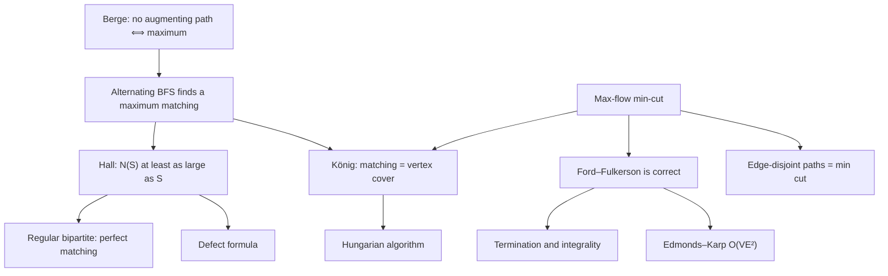
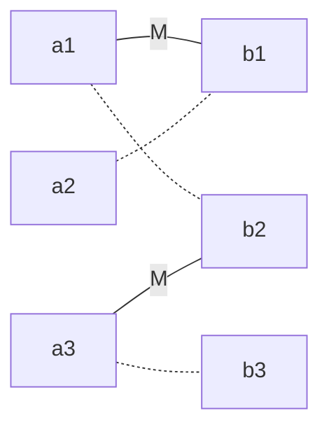

# Matching and Flows

> [Mathematics](../../README.md) › [Graph Theory](../README.md) › Matching and Flows · Level: Advanced · Prerequisites: [Graph Basics](../01-graph-basics/README.md), [Trees](../02-trees/README.md), [Paths and Connectivity](../03-paths-and-connectivity/README.md), [Proof Techniques](../../00-foundations/04-proof-techniques/README.md), [Mathematical Induction](../../09-discrete-mathematics/01-mathematical-induction/README.md), [Algorithms and Complexity](../../09-discrete-mathematics/03-algorithms-and-complexity/README.md) · Estimated time: 540 min

## 1. Introduction

Every year thousands of medical graduates are assigned to hospital residencies; airlines assign crews
to flights; universities timetable exams into rooms; compilers allocate registers. In every case one set
of objects must be paired with another set, each object used at most once, and the pairing must be as
large or as cheap as possible. Written as a graph, such a pairing is a **matching**: a set of edges no
two of which share a vertex.

This topic develops the theory of matchings and of its twin, **network flows**. Three theorems organise
the subject, and all three say that *a maximum equals a minimum*:

* **Hall's marriage theorem** (Philip Hall, 1935). A bipartite graph has a matching that saturates one
  side if and only if every group of vertices on that side has at least as many neighbours as members.
* **König's theorem** (Dénes Kőnig, 1931). In a bipartite graph the largest matching and the smallest
  set of vertices covering every edge have the same size.
* **The max-flow min-cut theorem** (Ford and Fulkerson, 1956; independently Elias, Feinstein and
  Shannon, 1956). The largest flow from source to sink equals the cheapest set of arcs that separates
  them.

They are not independent: Hall follows from König, König follows from max-flow min-cut, and max-flow
min-cut is proved by the same **augmenting-path** argument that Berge's theorem uses to characterise
maximum matchings. Keeping the dependencies visible matters, because "maximum equals minimum, certified
by a dual object" is one of the most transferable patterns in mathematics: it reappears as
linear-programming duality in [Optimization](../../18-optimization/README.md) and as Menger's theorem in
[Paths and Connectivity](../03-paths-and-connectivity/README.md).

The algorithmic side matters too. Matchings and flows are polynomially solvable and practically fast:
bipartite matching in $O(m\sqrt n)$ (Hopcroft–Karp), assignment in $O(n^3)$ (Hungarian algorithm, Kuhn
1955 and Munkres 1957), max-flow in $O(VE^2)$ (Edmonds–Karp). Each algorithm below is proved correct and
each returns a *certificate*: a matching is certified optimal by a vertex cover of the same size, a flow
by a cut of the same capacity. Certificates let a user check an answer without trusting the program.

**Scope.** All graphs are finite. Graphs are simple unless the word *multigraph* appears; flows need
directed graphs, defined in Section 5.4 and not assumed known. Capacities are integers in every worked
example, and Section 7.10 states exactly where integrality is used. Matchings in general graphs appear
only as remarks: Edmonds' blossom algorithm and Tutte's theorem are named, never used in a proof.

## 2. Prerequisites

* **Graphs, degree, paths, cycles, components, bipartite graphs.** $G = (V,E)$, $\deg(v)$, walks and
  paths, connectedness, and "bipartite $\iff$ no odd cycle". [Graph Basics](../01-graph-basics/README.md),
  Sections 5 and 7.6–7.8.
* **Trees and spanning trees.** A connected acyclic graph has $n-1$ edges. [Trees](../02-trees/README.md),
  Sections 7.2 and 7.5.
* **Cuts and connectivity.** $G - S$, separating sets, and Menger's theorem — the same max-equals-min
  pattern for disjoint paths. [Paths and Connectivity](../03-paths-and-connectivity/README.md), Sections
  7.6–7.9.
* **Proof techniques.** Direct proof, contrapositive, contradiction, induction, and the extremal pattern
  "choose a largest object". [Proof Techniques](../../00-foundations/04-proof-techniques/README.md).
* **Induction and strong induction.** Used for Hall's theorem and for the flow invariants.
  [Mathematical Induction](../../09-discrete-mathematics/01-mathematical-induction/README.md).
* **Sets and functions.** Injections, surjections, images of sets: a matching is an injective partial
  function. [Set Theory](../../00-foundations/03-set-theory/README.md),
  [Relations and Functions](../../00-foundations/05-relations-and-functions/README.md).
* **Orders of growth.** $O$, $\Omega$, $\Theta$, polynomial time.
  [Algorithms and Complexity](../../09-discrete-mathematics/03-algorithms-and-complexity/README.md).
* **Binomial coefficients.** $\binom{n}{k}$ and the product rule, for counting matchings.
  [Counting Principles](../../20-combinatorics/01-counting-principles/README.md).

Conventions, following [MATHEMATICAL_NOTATION.md](../../MATHEMATICAL_NOTATION.md): $\mathbb{N}=\{1,2,3,\dots\}$;
$n=\lvert V\rvert$, $m=\lvert E\rvert$; "$uv$" abbreviates $\{u,v\}$; $\lvert M\rvert$ counts **edges**;
in a bipartite graph the sides are $A$ and $B$, and $N(S)=\{v\in B:\exists u\in S,\ uv\in E\}$ for $S\subseteq A$.

## 3. Learning Objectives

By the end of this tutorial you will be able to:

1. Define matching, saturated vertex, perfect, maximal and maximum matching, and separate the last two
   with an example where they differ by a factor of two.
2. Prove that a maximal matching has at least half as many edges as a maximum matching, and that the
   constant is best possible.
3. State and prove Berge's theorem: a matching is maximum if and only if it has no augmenting path.
4. Run the alternating-path algorithm on a bipartite graph, exhibit each augmenting path, and justify
   termination at a maximum matching in $O(nm)$ time.
5. Prove both directions of Hall's theorem, including the two-case induction for sufficiency.
6. Prove that every $k$-regular bipartite graph with $k\ge1$ has a perfect matching and splits into $k$
   perfect matchings.
7. Prove the defect form: $\alpha'(G)=\lvert A\rvert-\max_{S\subseteq A}(\lvert S\rvert-\lvert N(S)\rvert)$.
8. Prove König's theorem by constructing a cover $(A\setminus Z)\cup(B\cap Z)$ from alternating
   reachability, and explain why $\tau(G)\le 2\alpha'(G)$ is the best general bound.
9. Describe the Hungarian algorithm — potentials, equality graph, König-based cover, $\delta$-adjustment —
   and prove it returns an optimal assignment in $O(n^3)$.
10. Define flows, residual networks and cuts; prove weak duality and the max-flow min-cut theorem.
11. Prove Ford–Fulkerson terminates and is integral on integer capacities, and explain the irrational
    counterexample.
12. Prove the $O(VE^2)$ bound for Edmonds–Karp.
13. Model assignment, transportation, bipartite scheduling and two-label image segmentation as matching
    or flow problems.

## 4. Intuition

### 4.1 Pairing things up

A dance class has followers and leaders; a matching is a set of disjoint pairs. A matching is *perfect*
when nobody is left out and *maximum* when as many people as possible are paired. If some pairs are
forbidden, the question "can everyone be paired?" has the answer given by Hall's condition: **every
group of followers must be willing to dance with at least as many leaders as the group has members**. If
four followers accept only three leaders, one of the four must sit down. Hall's theorem says this
necessary counting condition is also sufficient; no further obstruction exists.

### 4.2 Greedy fails, and trades repair it

Take any available pair, then the next, and so on: this greedy rule can strand a vertex even when a
perfect matching exists (Section 9.2). The failure is structural: a rule that never *undoes* an earlier
decision can be trapped. Suppose the pairs chosen so far are $M$, and some vertices are free. Walk from
a free vertex along an edge not in $M$, then back along an edge of $M$, then forward along a non-$M$
edge, and so on. If the walk reaches another free vertex, the whole chain has one more non-$M$ edge than
$M$ edges; swapping the roles of the two kinds of edge along it grows the matching by one. Such a chain
is an **augmenting path**, and Berge's theorem says it is the only possible improvement.

### 4.3 Bottlenecks

Water flows from a source to a sink through pipes of limited capacity. Whatever the routing, the amount
arriving cannot exceed the capacity of any set of pipes separating source from sink. The max-flow min-cut
theorem says the bound is attained. The proof is constructive: run any augmenting algorithm, then look
at which vertices the residual network still reaches from the source. The arcs leaving that set are
saturated, their capacity equals the flow already sent, and the failed search for a better flow *is* the
optimality certificate.

## 5. Formal Definition

### 5.1 Matchings, covers, alternating paths

**Definition 5.1.1 (Matching).** A **matching** in $G=(V,E)$ is a set $M\subseteq E$ of edges no two of
which share a vertex. A vertex incident with an edge of $M$ is **saturated**; the others are
**unsaturated**. $M$ is **perfect** if it saturates every vertex, and **maximum** if no matching of $G$
has more edges. Write $\alpha'(G)$ for the number of edges of a maximum matching, the **matching number**.

**Definition 5.1.2 (Maximal matching).** $M$ is **maximal** if no edge of $E\setminus M$ can be added,
equivalently if every edge of $G$ has an endpoint saturated by $M$.

*Maximal* is local ("no single edge can be added"), *maximum* is global ("nothing larger exists"). Every
maximum matching is maximal; the converse fails (Section 9.1).

**Definition 5.1.3 (Vertex cover).** A **vertex cover** is a set $C\subseteq V$ meeting every edge;
$\tau(G)$ is the minimum size of a cover. Since the edges of a matching are disjoint and each needs its
own cover vertex, $\alpha'(G)\le\tau(G)$ for every graph; for a triangle $1=\alpha'<\tau=2$.

**Definition 5.1.4 (Alternating and augmenting paths).** Let $M$ be a matching. A path
$v_0v_1\cdots v_k$ is **$M$-alternating** if its edges alternate between $E\setminus M$ and $M$. It is
**$M$-augmenting** if, in addition, $v_0$ and $v_k$ are unsaturated.

An augmenting path has length $2r+1$ with $r+1$ edges outside $M$ and $r$ inside it, so
$\lvert M\triangle P\rvert=\lvert M\rvert+1$, where $\triangle$ denotes symmetric difference
$(X\triangle Y)=(X\setminus Y)\cup(Y\setminus X)$.

**Lemma 5.1.5.** If $M$ is a matching and $P$ an $M$-augmenting path, then $M\triangle P$ is a matching
with $\lvert M\triangle P\rvert=\lvert M\rvert+1$.

*Proof.* The count is immediate. For the matching property, only vertices of $P$ can conflict. An
internal vertex of $P$ meets exactly one edge of $M$ and one of $E\setminus M$ on $P$, so exactly one
edge of $M\triangle P$; an endpoint of $P$ is unsaturated by $M$ and meets only the one edge of $P$ that
is outside $M$, so exactly one edge of $M\triangle P$; vertices off $P$ are unchanged. $\blacksquare$

### 5.2 Hall's condition

**Definition 5.2.1.** For $S\subseteq V$, $N(S)=\{v\in V\setminus S:\ uv\in E \text{ for some } u\in S\}$.

**Definition 5.2.2.** A bipartite graph with sides $A,B$ satisfies **Hall's condition** (with respect to
$A$) if $\lvert N(S)\rvert\ge\lvert S\rvert$ for every $S\subseteq A$. A set with
$\lvert N(S)\rvert<\lvert S\rvert$ is **deficient**, and
$d=\max_{S\subseteq A}(\lvert S\rvert-\lvert N(S)\rvert)$ (with $d=0$ if $A=\varnothing$) is the
**deficiency**. A matching saturating $A$ is a **system of distinct representatives** of the family
$\{N(a)\}_{a\in A}$.

Hall's condition is asymmetric: it asks for a matching saturating $A$ only. When $\lvert A\rvert=\lvert B\rvert$,
saturating $A$ forces perfection (Corollary 7.4.2), and then no separate condition on $B$ is needed.

### 5.3 Networks, flows and cuts

**Definition 5.3.1 (Directed graph).** $D=(V,\vec E)$ has **arcs** $(u,v)\in\vec E$ with tail $u$ and head
$v$; parallel arcs are allowed.

**Definition 5.3.2 (Flow network).** $N=(V,\vec E,c,s,t)$ where $c:\vec E\to\mathbb{R}_{\ge0}$ is the
**capacity** and $s\ne t$ are the **source** and **sink**; other vertices are **internal**.

**Definition 5.3.3 (Feasible flow).** $f:\vec E\to\mathbb{R}$ is a feasible $s$–$t$ **flow** if
$0\le f(e)\le c(e)$ for every arc (**capacity constraint**) and
$\sum_{e\text{ into }v}f(e)=\sum_{e\text{ out of }v}f(e)$ for every internal $v$ (**conservation**). Its
**value** is $\lvert f\rvert=\sum_{e\text{ out of }s}f(e)-\sum_{e\text{ into }s}f(e)$.

**Definition 5.3.4 (Cut).** An **$s$–$t$ cut** is a partition $V=S\cup T$ with $s\in S$, $t\in T$, both
parts non-empty. Its **capacity** is $c(S,T)=\sum_{(u,v)\in\vec E,\ u\in S,\ v\in T}c(u,v)$: only arcs
*leaving* $S$ count. Write $\lambda(N)$ for the minimum capacity of a cut.

**Definition 5.3.5 (Residual network).** Given $N$ and $f$, the **residual capacity** is
$c_f(u,v)=c(u,v)-f(u,v)$, taking $c(u,v)=0$ for non-arcs. The **residual network** $N_f$ has an arc
$(u,v)$ of capacity $c_f(u,v)$ whenever that number is positive. Arcs of $N_f$ not in $N$ are **backward**
arcs and represent cancellation of earlier flow.

### 5.4 The assignment and transportation problems

**Definition 5.4.1 (Assignment).** Given $n$ workers, $n$ jobs and costs $c_{ij}$, find a permutation
$\sigma$ minimising $\sum_i c_{i,\sigma(i)}$ — a minimum-weight perfect matching of $K_{n,n}$.

**Definition 5.4.2 (Transportation).** Given supplies $a_i\ge0$, demands $b_j\ge0$ and unit costs
$c_{ij}\ge0$, find $x_{ij}\ge0$ with $\sum_j x_{ij}=a_i$, $\sum_i x_{ij}=b_j$, minimising
$\sum_{i,j}c_{ij}x_{ij}$. A solution exists if $\sum_i a_i=\sum_j b_j$.

## 6. Mathematical Notation

| Symbol | Read as | Meaning |
|---|---|---|
| $M$, $\lvert M\rvert$ | matching, its size | set of disjoint edges, number of edges |
| $\alpha'(G)$ | matching number | size of a maximum matching |
| $\tau(G)$ | cover number | size of a minimum vertex cover |
| $N(S)$ | neighbourhood | vertices outside $S$ adjacent to $S$ |
| $G-S$ | $G$ minus $S$ | delete vertices of $S$ and incident edges |
| $X\triangle Y$ | symmetric difference | elements in exactly one set |
| $d$ | deficiency | $\max_S(\lvert S\rvert-\lvert N(S)\rvert)$ |
| $c(u,v)$, $f(u,v)$ | capacity, flow | bound on the arc, amount sent |
| $\lvert f\rvert$ | value of $f$ | net amount leaving $s$ |
| $c_f(u,v)$ | residual capacity | $c(u,v)-f(u,v)$ |
| $(S,T)$, $c(S,T)$ | cut, its capacity | partition with $s\in S,t\in T$; flow out of $S$ |
| $\lambda(N)$ | min-cut value | minimum capacity of an $s$–$t$ cut |
| $c_{ij}$, $x_{ij}$ | cost, shipment | assignment cost; transported amount |
| $u_i+v_j\le c_{ij}$ | dual feasibility | potentials below reduced costs |
| $u_i+v_j=c_{ij}$ | tight edge | equality; edge of the equality graph |

## 7. Core Concepts

### 7.1 First examples and counting

| Graph | $\alpha'(G)$ | Reason |
|---|---|---|
| $P_n$, $C_n$ | $\lfloor n/2\rfloor$ | pair consecutive vertices around the path or cycle |
| $K_n$ | $\lfloor n/2\rfloor$ | every pair is an edge |
| $K_{m,n}$ | $\min(m,n)$ | saturate the smaller side |
| $K_{1,n}$ | $1$ | all edges share the centre |

Perfect matchings are counted as follows: $K_{2k}$ has $(2k-1)!!=1\cdot3\cdots(2k-1)$ of them (the
smallest unused vertex chooses a partner in $2k-1$ ways, then $2k-3$, and so on); $K_{n,n}$ has $n!$;
$C_{2k}$ has exactly $2$; $C_{2k+1}$ has none.

**Lemma 7.1.1.** A tree has at most one perfect matching.

*Proof.* If $M_1\ne M_2$ were perfect matchings, every vertex would have degree $2$ in $M_1\cup M_2$
(one edge of each matching), so $M_1\cup M_2$ would be a disjoint union of even cycles — impossible in a
tree. $\blacksquare$

### 7.2 Maximal versus maximum: Berge's theorem

**Lemma 7.2.1.** If $M$ is maximal and $M^*$ maximum, then $\lvert M\rvert\ge\tfrac12\lvert M^*\rvert$.

*Proof.* By maximality every edge of $M^*$ has an endpoint saturated by $M$; give the edge of $M^*$ to
such an endpoint. An edge $uv$ of $M$ can receive at most two edges of $M^*$ (at most one through $u$,
at most one through $v$), so $\lvert M^*\rvert\le2\lvert M\rvert$. $\blacksquare$

The bound is attained by $k$ disjoint copies of $P_4$ with vertices $a_ib_ic_id_i$: the matching
$\{b_ic_i\}$ is maximal (each $a_i$ sees only the saturated $b_i$, each $d_i$ only the saturated $c_i$)
but has half the size of the maximum $\{a_ib_i,\ c_id_i\}$.

**Theorem 7.2.2 (Berge, 1957).** A matching $M$ in a graph $G$ is maximum if and only if $G$ has no
$M$-augmenting path.

*Proof.* If $P$ is $M$-augmenting, Lemma 5.1.5 gives the larger matching $M\triangle P$, so $M$ is not
maximum. Conversely, suppose $M$ is not maximum and let $M^*$ be maximum with
$\lvert M^*\rvert>\lvert M\rvert$. In $H=(V,M\triangle M^*)$ every vertex has degree $0$, $1$ or $2$, so
each component is an isolated vertex, an even cycle alternating between the two matchings, or a path
alternating between them. Cycles contribute equally many edges of each matching and vertices
contribute none; since $\lvert M^*\rvert>\lvert M\rvert$, some path component $P$ contains more edges of
$M^*$ than of $M$. An alternating path with this property starts and ends with edges of $M^*$, so its
endpoints are incident with no edge of $M$: they are unsaturated. Hence $P$ is $M$-augmenting in $G$.
$\blacksquare$

**Corollary 7.2.3.** The greedy algorithm "scan edges, add an edge when both endpoints are free" returns
a maximal matching, hence at least half of the optimum; by the $kP_4$ example the ratio $\tfrac12$ cannot
be improved by any such one-pass rule.

### 7.3 Finding augmenting paths in bipartite graphs

**Algorithm 7.3.1.** Given a bipartite $G=(A\cup B,E)$ and a matching $M$, repeat: direct every edge of
$E\setminus M$ from $A$ to $B$ and every edge of $M$ from $B$ to $A$; join a super-source $s$ to every
$M$-unsaturated vertex of $A$; search from $s$ by BFS. If a free vertex of $B$ is reached, the BFS path
is $M$-augmenting — swap along it and restart. If not, stop.

**Theorem 7.3.2.** Algorithm 7.3.1 is correct and runs in $O(nm)$ time.

*Proof.* A directed path from $s$ to a free vertex of $B$ uses non-matching edges $A\to B$ and matching
edges $B\to A$, begins and ends outside $M$, and is therefore an $M$-augmenting path; conversely every
augmenting path is such a directed path, so BFS finds one whenever it exists. Each augmentation raises
$\lvert M\rvert$ by one and $\lvert M\rvert\le n/2$, so there are at most $n/2$ rounds, each costing
$O(m)$. When BFS fails, no augmenting path exists and Theorem 7.2.2 applies. $\blacksquare$

Hopcroft–Karp augments along a maximal set of *shortest* augmenting paths in each phase, giving
$O(m\sqrt n)$. For non-bipartite graphs the directed-graph trick fails, because an alternating path can
return to the wrong side through an odd cycle; Edmonds' **blossom algorithm** (1965) contracts such
cycles and runs in $O(n^3)$.

### 7.4 Hall's marriage theorem

**Theorem 7.4.1 (Hall, 1935).** Let $G$ be bipartite with sides $A,B$. There is a matching saturating $A$
if and only if $\lvert N(S)\rvert\ge\lvert S\rvert$ for every $S\subseteq A$.

*Proof.* **Necessity.** A matching saturating $A$ maps each $a\in S$ injectively to a partner in $N(S)$;
hence $\lvert N(S)\rvert\ge\lvert S\rvert$.

**Sufficiency.** Induct on $k=\lvert A\rvert$; $k=0$ is trivial. Assume the theorem for smaller left
sides and let $k\ge1$.

*Case 1: some non-empty proper $S\subsetneq A$ has $\lvert N(S)\rvert=\lvert S\rvert$ (a tight set).*
Every $T\subseteq S$ has $N_G(T)\subseteq N(S)$, so Hall's condition passes to the subgraph on
$S\cup N(S)$, which by induction has a matching $M_1$ saturating $S$. Put $A'=A\setminus S$,
$B'=B\setminus N(S)$, $G'=G[A'\cup B']$. For $T\subseteq A'$,
$$N_{G'}(T)=N_G(S\cup T)\setminus N(S),$$
since a neighbour of $S\cup T$ either lies in $N(S)$ or is a neighbour of $T$ outside $N(S)$. Now
$\lvert N_G(S\cup T)\rvert\ge\lvert S\cup T\rvert=\lvert S\rvert+\lvert T\rvert$ and
$N_G(S)\subseteq N_G(S\cup T)$, so
$$\lvert N_{G'}(T)\rvert=\lvert N_G(S\cup T)\rvert-\lvert N(S)\rvert\ge\lvert T\rvert .$$
By induction $G'$ has a matching $M_2$ saturating $A'$, and $M_1\cup M_2$ saturates $A$ because the
vertex sets are disjoint.

*Case 2: no non-empty proper subset of $A$ is tight.* If $k=1$, then $N(A)\ne\varnothing$ by Hall and any
$b\in N(A)$ works. If $k\ge2$, choose $a\in A$, $b\in N(a)$, delete $a$ and $b$ and let $G'=G-\{a,b\}$,
$A'=A\setminus\{a\}$. For non-empty $T\subseteq A'$ we have $N_{G'}(T)\supseteq N_G(T)\setminus\{b\}$,
so $\lvert N_{G'}(T)\rvert\ge\lvert N_G(T)\rvert-1\ge\lvert T\rvert$: here either $T\subsetneq A$ is
proper, so $\lvert N_G(T)\rvert\ge\lvert T\rvert+1$ by hypothesis, or $T=A'$, which is itself a
non-empty proper subset of $A$ because $k\ge2$. Induction gives a matching saturating $A'$, and adding
$ab$ saturates $A$. $\blacksquare$

**Corollary 7.4.2.** If $\lvert A\rvert=\lvert B\rvert$ and Hall's condition holds, then $G$ has a
perfect matching.

*Proof.* A matching saturating $A$ has $\lvert A\rvert$ edges with distinct endpoints in $B$, so all of
$B$ is saturated. $\blacksquare$

The empty set is automatic ($0\ge0$), but every other subset must be checked: in Example 9.4 all
singletons and all pairs are fine and only the triple $\{a_1,a_2,a_3\}$ fails. Note also that Hall's
condition gives a criterion but not an efficient test — there are $2^{\lvert A\rvert}$ subsets; Algorithm
7.3.1 decides the same question in $O(nm)$.

### 7.5 Corollaries: regular graphs and the defect formula

**Theorem 7.5.1.** Every $k$-regular bipartite multigraph with $k\ge1$ has a perfect matching.

*Proof.* Counting edges from both sides gives $k\lvert A\rvert=\lvert E\rvert=k\lvert B\rvert$, so
$\lvert A\rvert=\lvert B\rvert$ and Corollary 7.4.2 applies once Hall's condition is verified. For
$S\subseteq A$ the $k\lvert S\rvert$ edges out of $S$ all end in $N(S)$, where each vertex receives at
most $k$ of them; hence $k\lvert S\rvert\le k\lvert N(S)\rvert$ and $\lvert S\rvert\le\lvert N(S)\rvert$.
$\blacksquare$

**Corollary 7.5.2.** The edge set of a $k$-regular bipartite multigraph splits into $k$ perfect
matchings; hence its edge-chromatic number is $k$.

*Proof.* Remove a perfect matching from Theorem 7.5.1 and repeat on the remaining $(k-1)$-regular graph;
each colour class is a matching, so this is a proper edge colouring with $k$ colours, and $k=\Delta$ is
the trivial lower bound. $\blacksquare$

**Theorem 7.5.3 (Defect form).** For bipartite $G$ with sides $A,B$,
$$\alpha'(G)=\lvert A\rvert-\max_{S\subseteq A}\bigl(\lvert S\rvert-\lvert N(S)\rvert\bigr).$$

*Proof.* Let $d$ be the maximum and form $G^*$ by adding $d$ new vertices to $B$, each adjacent to all of
$A$. For $S\subseteq A$ the new neighbourhood is $N_G(S)$ together with all $d$ new vertices, so
$\lvert N_{G^*}(S)\rvert=\lvert N_G(S)\rvert+d\ge\lvert S\rvert$: Hall holds in $G^*$. A matching $M^*$
saturating $A$ uses at most $d$ new vertices, so at least $\lvert A\rvert-d$ of its edges lie inside $G$,
giving $\alpha'(G)\ge\lvert A\rvert-d$. Conversely, if $S$ attains the maximum $d$, any matching saturates
at most $\lvert N(S)\rvert=\lvert S\rvert-d$ vertices of $S$, hence leaves at least $d$ vertices of $A$
unsaturated and has at most $\lvert A\rvert-d$ edges. $\blacksquare$

### 7.6 König's theorem

**Theorem 7.6.1 (König, 1931).** In a bipartite graph, $\alpha'(G)=\tau(G)$.

*Proof.* Let $M$ be maximum; by Theorem 7.2.2 there is no $M$-augmenting path. Let $U$ be the set of
$M$-unsaturated vertices of $A$ and $Z$ the set of vertices reachable from $U$ by $M$-alternating paths
that start with an edge outside $M$ (so: $A\to B$ along non-matching edges, $B\to A$ along matching
edges). Define $C=(A\setminus Z)\cup(B\cap Z)$.

*$C$ is a cover.* Let $ab\in E$. If $a\notin Z$, then $a\in C$. If $a\in Z$: when $ab\notin M$ the
alternating walk to $a$ extends by $ab$, so $b\in Z$; when $ab\in M$, either $a\in U$ — impossible, as
$a$ would be unsaturated — or $a$ was reached through the matching edge $ba$, so $b\in Z$. Either way
$b\in B\cap Z\subseteq C$.

*Every vertex of $B\cap Z$ is saturated*, since an unsaturated such $b$ would end an $M$-augmenting path.
Moreover a matched $a\in A\cap Z$ was reached through its own matching edge, so its partner lies in
$B\cap Z$, and a matched $b\in B\cap Z$ reaches its partner by extending the walk with the matching edge,
so that partner lies in $A\cap Z$. Hence $M$ matches $B\cap Z$ bijectively onto $A\cap Z\setminus U$.

*Counting.* All $u=\lvert U\rvert$ vertices of $U$ lie in $A\cap Z$ and are unmatched, so
$\lvert B\cap Z\rvert=\lvert A\cap Z\rvert-u$. Also $A\setminus Z$ contains no unmatched vertex, so
$\lvert A\setminus Z\rvert$ matching edges leave $Z$. Therefore
$$\lvert C\rvert=\lvert A\setminus Z\rvert+\lvert B\cap Z\rvert=\bigl(\lvert A\rvert-\lvert A\cap Z\rvert\bigr)+\bigl(\lvert A\cap Z\rvert-u\bigr)=\lvert A\rvert-u=\lvert M\rvert .$$
With $\lvert M\rvert=\alpha'(G)\le\tau(G)\le\lvert C\rvert=\lvert M\rvert$ we get equality. $\blacksquare$

**Corollary 7.6.2 (König implies Hall).** If Hall's condition holds for $A$, then $\alpha'(G)=\lvert A\rvert$.

*Proof.* Let $C=X\cup Y$ with $X\subseteq A$, $Y\subseteq B$ be a cover. No edge joins $A\setminus X$ to
$B\setminus Y$, so $N(A\setminus X)\subseteq Y$ and
$\lvert C\rvert=\lvert X\rvert+\lvert Y\rvert\ge\lvert X\rvert+\lvert N(A\setminus X)\rvert\ge\lvert A\rvert$.
Hence $\tau(G)\ge\lvert A\rvert$, and $\alpha'=\tau$ with $\alpha'\le\lvert A\rvert$ gives equality. $\blacksquare$

**Remark 7.6.3.** A matching $M$ and a cover $C$ with $\lvert M\rvert=\lvert C\rvert$ certify each other's
optimality, and in a bipartite graph such a pair always exists. In general graphs it need not:
$\tau(G)\le2\alpha'(G)$, with equality for $K_3$.

### 7.7 The Hungarian algorithm

The assignment problem (Definition 5.4.1) is the linear programme
$\min\sum c_{ij}x_{ij}$ over $x\ge0$ with $\sum_j x_{ij}=1$ and $\sum_i x_{ij}=1$. Its dual has variables
$u_i,v_j$ and reads $\max\sum_i u_i+\sum_j v_j$ subject to $u_i+v_j\le c_{ij}$.

**Lemma 7.7.1 (Weak duality).** If $u_i+v_j\le c_{ij}$ for all $i,j$ and $\sigma$ is any permutation,
then $\sum_i u_i+\sum_j v_j\le\sum_i c_{i,\sigma(i)}$.

*Proof.* Sum $u_i+v_{\sigma(i)}\le c_{i,\sigma(i)}$ over $i$ and use $\sum_i v_{\sigma(i)}=\sum_j v_j$. $\blacksquare$

**Lemma 7.7.2.** If $(u,v)$ is dual feasible and $\sigma$ satisfies $u_i+v_{\sigma(i)}=c_{i,\sigma(i)}$
for every $i$ (all chosen edges are **tight**), then $\sigma$ is optimal and $(u,v)$ is an optimal dual
solution.

*Proof.* Every inequality in the proof of Lemma 7.7.1 is an equality, so the two objective values agree;
weak duality forbids anything better. $\blacksquare$

**Algorithm 7.7.3 (Kuhn 1955, Munkres 1957).** Maintain dual-feasible potentials and the **equality
graph** $E_==\{ij:u_i+v_j=c_{ij}\}$.

1. Set $u_i=\min_j c_{ij}$ and $v_j=0$; then $u_i+v_j\le c_{ij}$ everywhere.
2. Compute a maximum matching $M$ of the equality graph by Algorithm 7.3.1. If $\lvert M\rvert=n$, output
   it (optimal by Lemma 7.7.2) and stop.
3. Otherwise run the alternating search from the unmatched rows and let $X$ be the rows reached, $Y$ the
   columns reached. By König, (rows not in $X$)$\cup Y$ is a cover of $E_=$ of size $\lvert M\rvert<n$;
   in particular not every column lies in $Y$, so cells with row in $X$ and column outside $Y$ exist.
4. Set $\delta=\min\{c_{ij}-u_i-v_j:\ i\in X,\ j\notin Y\}>0$, update $u_i\leftarrow u_i+\delta$ for
   $i\in X$ and $v_j\leftarrow v_j-\delta$ for $j\in Y$, and return to step 2.

**Theorem 7.7.4.** Algorithm 7.7.3 terminates with a minimum-cost assignment.

*Proof.* *Dual feasibility is preserved.* The reduced cost $w_{ij}=c_{ij}-u_i-v_j$ changes by $-\delta$ for
$i\in X,j\notin Y$, by $+\delta$ for $i\notin X,j\in Y$, and by $0$ otherwise. Only the first group
decreases, and $\delta$ is their minimum, so no $w_{ij}$ becomes negative.

*Progress.* After the update at least one cell with $i\in X$, $j\notin Y$ has $w_{ij}=0$, so a tight edge
joins a reached row to a column outside $Y$: the alternating tree grows by at least one vertex. Also no
tight edge from $X$ to $B\setminus Y$ existed before the update, because such a cell would have had
$w=0$, contradicting $\delta>0$. With integer costs and integer starting potentials, $\delta\ge1$ and all
potentials stay integral; the tree has at most $n$ rows and $n$ columns, so each phase performs at most
$n$ updates, and after at most $n$ phases the matching has size $n$. That matching consists of tight
edges and is optimal by Lemma 7.7.2. $\blacksquare$

**Remark 7.7.5.** Computing $\delta$ from scratch costs $O(n^2)$, giving $O(n^4)$ naively; maintaining the
slacks incrementally gives the classical $O(n^3)$. The textbook recipe — "subtract row minima, subtract
column minima, cover all zeros with the fewest lines, subtract the smallest uncovered entry from all
uncovered entries and add it to doubly covered entries" — is step 4 written in matrix form: uncovered
rows are those in $X$, covered columns are those in $Y$. To maximise a profit matrix use costs $M-c_{ij}$;
for $p$ workers and $q>p$ jobs add $q-p$ dummy workers of cost $0$; forbid a pair by giving it a cost
larger than any feasible total.

### 7.8 Flows: the two elementary lemmas

**Lemma 7.8.1.** For a feasible flow $f$ and an $s$–$t$ cut $(S,T)$,
$\lvert f\rvert=f(S,T)-f(T,S)$, where $f(S,T)=\sum_{u\in S,v\in T}f(u,v)$.

*Proof.* Sum the net flow out of $u$ over $u\in S$. Terms with both endpoints in $S$ cancel, leaving
$f(S,T)-f(T,S)$; conservation makes every internal vertex contribute $0$, $t\notin S$ contributes
nothing, and $s$ contributes $\lvert f\rvert$. $\blacksquare$

**Corollary 7.8.2 (Weak duality).** $\lvert f\rvert\le c(S,T)$ for every feasible flow and every cut;
hence $\max_f\lvert f\rvert\le\min_{(S,T)}c(S,T)$.

**Lemma 7.8.3 (Augmentation).** Let $P$ be an $s$–$t$ path in $N_f$ and $\delta=\min\{c_f(e):e\in P\}>0$.
Adding $\delta$ to $f$ on forward arcs of $P$ and subtracting $\delta$ on backward arcs yields a feasible
flow of value $\lvert f\rvert+\delta$.

*Proof.* For a forward arc $e$, $f(e)+\delta\le f(e)+c_f(e)=c(e)$; for a backward arc $e$, the path uses
the residual arc of $e$, whose capacity is $f(e)$, so $\delta\le f(e)$ and $f(e)-\delta\ge0$. Internal
vertices of $P$ gain $\delta$ on one incident arc and lose $\delta$ on another, so conservation holds;
off $P$ nothing changes. The value increases by $\delta$ because $P$ starts at $s$ and ends at $t$. $\blacksquare$

### 7.9 Max-flow min-cut

**Theorem 7.9.1.** For a feasible flow $f$ in a network $N$, the following are equivalent: (1) $f$ is
maximum; (2) $N_f$ has no $s$–$t$ path; (3) $\lvert f\rvert=c(S,T)$ for some cut. Hence
$\max_f\lvert f\rvert=\min_{(S,T)}c(S,T)$, and both extrema are attained.

*Proof.* (1)$\Rightarrow$(2): a residual $s$–$t$ path would give a larger flow by Lemma 7.8.3.
(2)$\Rightarrow$(3): let $S$ be the set of vertices reachable from $s$ in $N_f$ and $T=V\setminus S$; then
$t\in T$. If $u\in S$, $v\in T$ and $(u,v)\in\vec E$ with $f(u,v)<c(u,v)$, then $v$ would be reachable, so
every arc from $S$ to $T$ is saturated. If $u\in T$, $v\in S$ and $f(u,v)>0$, then the residual arc $(v,u)$
would make $u$ reachable, so $f(u,v)=0$. By Lemma 7.8.1,
$\lvert f\rvert=c(S,T)-0=c(S,T)$. (3)$\Rightarrow$(1): Corollary 7.8.2 bounds every flow by $c(S,T)$. $\blacksquare$

**Remark 7.9.2.** The proof extracts the minimum cut from a maximum flow: reach in the residual network.
This is why implementations return the cut too, and why the theorem is a proof technique — a flow of value
$v$ together with a cut of capacity $v$ settles optimality in both directions.

**Remark 7.9.3 (Bipartite matching as a flow).** Direct every edge of a bipartite graph from $A$ to $B$,
add $s\to A$ and $B\to t$ of capacity $1$ and give each original edge capacity $1$. Integral flows are
exactly matchings and the value is the matching size. The minimum cut of this network has the shape of a
vertex cover, which is the standard second proof of König's theorem.

### 7.10 Ford–Fulkerson: termination and integrality

**Algorithm 7.10.1.** Start with $f\equiv0$. While $N_f$ contains an $s$–$t$ path $P$, push
$\delta=\min_{e\in P}c_f(e)$ along $P$. Return $f$ when no such path exists.

The rule for choosing $P$ is free; by Theorem 7.9.1 every terminal flow is maximum.

**Theorem 7.10.2.** If all capacities are integers, Ford–Fulkerson terminates after at most
$\lvert f^*\rvert\le c(\{s\},V\setminus\{s\})$ augmentations and returns an integral maximum flow.

*Proof.* Residual capacities start integral and $\delta$ is a minimum of finitely many of them, hence a
positive integer; pushing $\delta$ preserves integrality of $f$, hence of all residual capacities
$c(e)-f(e)$ and $f(e)$. So every augmentation adds at least $1$ to the value, which is bounded above by
the capacity of the cut $\{s\}$, and the process stops. $\blacksquare$

The same argument with rational capacities (clear denominators) shows termination, but only after a
number of steps proportional to the *value*, not to the input size: with capacity $10^6$ on a single
bottleneck arc the algorithm performs $10^6$ augmentations. Ford–Fulkerson is **pseudo-polynomial**, not
polynomial. With irrational capacities it can even fail to terminate, and a convergent run can converge
to a value below the min cut (Ford and Fulkerson's own caution; a standard explicit construction is due
to Zwick, 1995). Choosing $P$ by a rule repairs this, which is the content of Section 7.11.

### 7.11 The Edmonds–Karp bound

**Algorithm 7.11.1 (Edmonds–Karp, 1972).** Ford–Fulkerson, always choosing an $s$–$t$ path with the
fewest arcs (breadth-first search).

Let $d_f(v)$ be the residual distance from $s$ to $v$ (number of arcs, $\infty$ if unreachable).

**Lemma 7.11.2.** $d_{f_{i+1}}(v)\ge d_{f_i}(v)$ for every $v$ and every augmentation step.

*Proof.* Take a counterexample with $d_{f_{i+1}}(v)$ minimal, and a shortest $s$–$v$ path $P$ in
$N_{f_{i+1}}$ whose last arc is $(u,v)$. Then $d_{f_{i+1}}(v)=d_{f_{i+1}}(u)+1$ and, by minimality,
$d_{f_{i+1}}(u)\ge d_{f_i}(u)$. If $(u,v)\in N_{f_i}$, then $d_{f_i}(v)\le d_{f_i}(u)+1\le d_{f_{i+1}}(v)$,
contradiction. So $(u,v)$ is new, created by pushing flow along $(v,u)$; the augmented path was shortest,
so $d_{f_i}(u)=d_{f_i}(v)+1$, and then
$d_{f_{i+1}}(v)=d_{f_{i+1}}(u)+1\ge d_{f_i}(u)+1=d_{f_i}(v)+2$, again a contradiction. $\blacksquare$

**Lemma 7.11.3.** Call an arc of the augmenting path **critical** if its residual capacity equals $\delta$,
so that it disappears after the augmentation. Each arc is critical $O(V)$ times.

*Proof.* If $(u,v)$ is critical at step $i$, then $d_{f_i}(v)=d_{f_i}(u)+1$, and the arc is absent from
$N_{f_{i+1}}$. To reappear it must be "undone" by an augmentation at some step $j$ pushing flow along
$(v,u)$; on a shortest path, $d_{f_j}(u)=d_{f_j}(v)+1$. If $(u,v)$ is critical again at step $k>j$, then
$d_{f_k}(v)=d_{f_k}(u)+1\ge d_{f_j}(u)+1=d_{f_j}(v)+2\ge d_{f_i}(v)+2$ by Lemma 7.11.2. So each
reappearance raises $d(v)$ by at least $2$, and finite residual distances are at most $V-1$; hence the
arc is critical at most $\lceil(V-1)/2\rceil+1$ times. $\blacksquare$

**Theorem 7.11.4.** Edmonds–Karp runs in $O(VE^2)$ time.

*Proof.* Every augmentation has a critical arc, and no arc is critical more than $O(V)$ times, so there
are $O(VE)$ augmentations. Each is a breadth-first search plus an update along a path, costing $O(E)$.
$\blacksquare$

## 8. Formulas and Properties

| # | Statement | Hypotheses | Reason |
|---|---|---|---|
| 8.1 | $\alpha'(G)\le\lfloor n/2\rfloor$ | any graph | each matching edge uses two vertices |
| 8.2 | $\alpha'(G)\le\tau(G)$ | any graph | disjoint edges need distinct cover vertices |
| 8.3 | $\alpha'(G)=\tau(G)$ | bipartite | König, Theorem 7.6.1 |
| 8.4 | $\lvert M\rvert\ge\tfrac12\alpha'(G)$ | $M$ maximal | Lemma 7.2.1 |
| 8.5 | maximum $\iff$ no augmenting path | any graph | Berge, Theorem 7.2.2 |
| 8.6 | matching saturating $A$ $\iff$ $\lvert N(S)\rvert\ge\lvert S\rvert\ \forall S\subseteq A$ | bipartite | Hall, Theorem 7.4.1 |
| 8.7 | $\alpha'(G)=\lvert A\rvert-\max_S(\lvert S\rvert-\lvert N(S)\rvert)$ | bipartite | Theorem 7.5.3 |
| 8.8 | perfect matching exists | $k$-regular bipartite, $k\ge1$ | Theorem 7.5.1 |
| 8.9 | $\lvert f\rvert\le c(S,T)$ | any flow, any cut | Corollary 7.8.2 |
| 8.10 | $\max\lvert f\rvert=\min c(S,T)$ | any network | Theorem 7.9.1 |
| 8.11 | maximum flow is integral | integral capacities | Theorem 7.10.2 |
| 8.12 | at most $\lvert f^*\rvert$ augmentations | integral capacities | Theorem 7.10.2 |
| 8.13 | $O(VE^2)$ | Edmonds–Karp | Theorem 7.11.4 |
| 8.14 | $O(n^3)$ | Hungarian algorithm | Remark 7.7.5 |
| 8.15 | $n!$, $(2k-1)!!$, $2$ perfect matchings | $K_{n,n}$, $K_{2k}$, $C_{2k}$ | Section 7.1 |
| 8.16 | edge-chromatic number $=\Delta$ | bipartite multigraph | Corollary 7.5.2 |
| 8.17 | max edge-disjoint $s$–$t$ paths $=$ min cut | unit capacities | max-flow min-cut |

**On 8.15.** $(2k-1)!!=1\cdot3\cdots(2k-1)=(2k)!/(2^kk!)$ is the number of ways to split $2k$ objects into
$k$ unordered pairs.

**On 8.16.** A proper edge colouring partitions the edges into matchings, so a $\Delta$-colouring is a
partition into $\Delta$ matchings; on a bipartite multigraph it always exists, which is König's
line-colouring theorem. Corollary 7.5.2 proves the regular case, and padding with dummy edges reduces the
general case to it.

**On 8.17.** This is the edge version of Menger's theorem and literally max-flow min-cut with $c\equiv1$:
an integral flow decomposes into edge-disjoint $s$–$t$ paths, because conservation at internal vertices
lets paths be peeled off one at a time.

## 9. Step-by-Step Examples

### Example 9.1 (Easy): maximal but not maximum

In $G=P_6$ with vertices $1$–$2$–$3$–$4$–$5$–$6$, let $M=\{23,45\}$.

*$M$ is maximal*: each of the five edges $12,23,34,45,56$ has a saturated endpoint, so no edge can be
added. *$M$ is not maximum*: $M^*=\{12,34,56\}$ is perfect, so $\alpha'(P_6)=3$.

*Berge check.* The path $1$–$2$–$3$–$4$–$5$–$6$ alternates ($12\notin M$, $23\in M$, $34\notin M$,
$45\in M$, $56\notin M$) and joins the free vertices $1$ and $6$, so it is $M$-augmenting;
$M\triangle P_6=\{12,34,56\}=M^*$, as Lemma 5.1.5 predicts. Also $\lvert M\rvert=2=\tfrac12\lvert M^*\rvert$,
the worst case of Lemma 7.2.1.

### Example 9.2 (Easy): greedy fails on a bipartite graph

Let $A=\{a_1,a_2,a_3\}$, $B=\{b_1,b_2,b_3\}$ and
$E=\{a_1b_1,\ a_1b_2,\ a_2b_1,\ a_3b_2,\ a_3b_3\}$.

*Greedy*, taking edges in the listed order, chooses $a_1b_1$, then $a_3b_2$ (everything else is blocked),
leaving $a_2$ unmatched: size $2$. This matching is maximal. *Optimum*:
$\{a_2b_1,\ a_1b_2,\ a_3b_3\}$, size $3$ and perfect. The greedy choice $a_1b_1$ was the error, because
$a_2$ has only one neighbour.

*Repair.* From the free vertex $a_2$:
$$a_2\to b_1\ (\notin M),\quad b_1\to a_1\ (\in M),\quad a_1\to b_2\ (\notin M),\quad b_2\to a_3\ (\in M),\quad a_3\to b_3\ (\notin M),$$
and $b_3$ is free. Swapping along $a_2b_1a_1b_2a_3b_3$ gives the perfect matching above.

### Example 9.3 (Medium): two rounds of augmentation

Let $A=\{a_1,\dots,a_4\}$, $B=\{b_1,\dots,b_4\}$ and
$E=\{a_1b_1,\ a_1b_2,\ a_2b_1,\ a_3b_2,\ a_3b_3,\ a_4b_3,\ a_4b_4\}$. Run Algorithm 7.3.1 from $M_0=\varnothing$.

*Round 1.* $a_1b_1$: $b_1$ free. $M_1=\{a_1b_1\}$.

*Round 2.* From $a_2$: $a_2\to b_1$ (non-matching), $b_1\to a_1$ (matching), $a_1\to b_2$ (non-matching),
$b_2$ free. Augment along $a_2b_1a_1b_2$: $M_2=\{a_2b_1,\ a_1b_2\}$.

*Round 3.* From $a_3$: $a_3\to b_2\to a_1\to b_1\to a_2$, dead end ($a_2$ has no other edge); the other
edge of $a_3$ is $a_3b_3$ with $b_3$ free. Augment: $M_3=\{a_2b_1,\ a_1b_2,\ a_3b_3\}$.

*Round 4.* From $a_4$: $a_4\to b_3\to a_3\to b_2\to a_1\to b_1\to a_2$, dead end; the other edge is
$a_4b_4$ with $b_4$ free. Augment: $M_4=\{a_2b_1,\ a_1b_2,\ a_3b_3,\ a_4b_4\}$, perfect.

Four rounds were needed, and no augmenting path remains, so $M_4$ is maximum by Theorem 7.2.2. By
Corollary 7.4.2 Hall's condition must hold; Example 9.4 examines a graph where it does not.

### Example 9.4 (Medium): a König certificate and a Hall failure

Let $A=\{a_1,\dots,a_4\}$, $B=\{b_1,\dots,b_4\}$ and
$E=\{a_1b_1,\ a_2b_1,\ a_2b_2,\ a_3b_2,\ a_4b_2,\ a_4b_3,\ a_4b_4\}$.

*Hall fails.* $N(\{a_1,a_2,a_3\})=\{b_1,b_2\}$, so $\lvert N(S)\rvert=2<3=\lvert S\rvert$ and no matching
saturates $A$.

*Maximum matching.* $M=\{a_1b_1,\ a_3b_2,\ a_4b_3\}$ has size $3$. Size $4$ is impossible: at most two of
$a_1,a_2,a_3$ can be matched (into the two vertices $b_1,b_2$), and $a_4$ adds at most one more edge. The
defect formula agrees: the maximum of $\lvert S\rvert-\lvert N(S)\rvert$ is $3-2=1$, attained at
$S=\{a_1,a_2,a_3\}$; sets containing $a_4$ have larger neighbourhoods, so
$\alpha'=4-1=3$.

*König certificate.* The only unmatched $A$-vertex is $a_2$, so $U=\{a_2\}$. Alternating traversal:
$a_2\to b_1\to a_1$ (dead end), $a_2\to b_2\to a_3$ (dead end). Hence
$Z=\{a_2,b_1,a_1,b_2,a_3\}$ and
$$C=(A\setminus Z)\cup(B\cap Z)=\{a_4\}\cup\{b_1,b_2\}=\{a_4,b_1,b_2\}.$$
$C$ covers every edge ($a_1b_1,a_2b_1$ by $b_1$; $a_2b_2,a_3b_2,a_4b_2$ by $b_2$; $a_4b_3,a_4b_4$ by
$a_4$) and $\lvert C\rvert=3=\lvert M\rvert$. The pair $(M,C)$ certifies optimality.

### Example 9.5 (Medium–hard): Hungarian algorithm on a $4\times4$ instance

Minimise the total cost

| | $C_1$ | $C_2$ | $C_3$ | $C_4$ |
|---|---|---|---|---|
| $R_1$ | 7 | 2 | 4 | 5 |
| $R_2$ | 6 | 2 | 5 | 6 |
| $R_3$ | 1 | 7 | 2 | 3 |
| $R_4$ | 4 | 2 | 1 | 1 |

*Step 1.* Row minima are $2,2,1,1$, so $u=(2,2,1,1)$, $v=(0,0,0,0)$, and the reduced costs
$w_{ij}=c_{ij}-u_i-v_j$ are

| | $C_1$ | $C_2$ | $C_3$ | $C_4$ |
|---|---|---|---|---|
| $R_1$ | 5 | **0** | 2 | 3 |
| $R_2$ | 4 | **0** | 3 | 4 |
| $R_3$ | **0** | 6 | 1 | 2 |
| $R_4$ | 3 | 1 | **0** | **0** |

All column minima are $0$, so $v=0$ is already optimal for the columns.

*Step 2.* Zeros at $(1,2),(2,2),(3,1),(4,3),(4,4)$. A maximum zero-matching is
$\{R_1C_2,R_3C_1,R_4C_3\}$: row $R_2$ cannot be matched, since its only zero is $C_2$. Not perfect.

*Step 3.* Alternating search from $R_2$: $R_2\to C_2\to R_1$, and $R_1$ has no further zero. So
$X=\{R_1,R_2\}$, $Y=\{C_2\}$, and (rows not in $X$)$\cup Y=\{R_3,R_4,C_2\}$ is a cover of the zeros,
of size $3$.

*Step 4.* Cells with $i\in X$, $j\notin Y$ have reduced costs $5,2,3$ (row $R_1$) and $4,3,4$ (row $R_2$),
so $\delta=2$. Update $u_{R_1}=u_{R_2}=4$ and $v_{C_2}=-2$:

| | $C_1$ | $C_2$ | $C_3$ | $C_4$ |
|---|---|---|---|---|
| $R_1$ | 3 | **0** | **0** | 1 |
| $R_2$ | 2 | **0** | 1 | 2 |
| $R_3$ | **0** | 8 | 1 | 2 |
| $R_4$ | 3 | 3 | **0** | **0** |

*Step 5.* The zeros $R_1C_3$, $R_2C_2$, $R_3C_1$, $R_4C_4$ form a perfect matching. The assignment
$1\to3$, $2\to2$, $3\to1$, $4\to4$ costs $4+2+1+1=8$. The potentials $u=(4,4,1,1)$, $v=(0,-2,0,0)$ satisfy
$u_i+v_j\le c_{ij}$ on every cell and give $\sum u+\sum v=10-2=8$, so both are optimal by Lemma 7.7.2; a
brute-force check of all $24$ permutations confirms the minimum is $8$.

*Remark.* Choosing the other minimum cover $\{R_4,C_1,C_2\}$ gives $\delta=1$ and needs two adjustments;
the final assignment is the same. Only dual feasibility and $\delta>0$ are essential, not the particular
cover.

### Example 9.6 (Medium–hard): max-flow min-cut on six vertices

Arcs and capacities: $sv_1:16$, $sv_2:13$, $v_1v_2:10$, $v_2v_1:4$, $v_1v_3:12$, $v_3v_2:9$, $v_2v_4:14$,
$v_4v_3:7$, $v_3t:20$, $v_4t:4$.

*Augment 1.* $s\to v_1\to v_3\to t$, $\delta=12$; residuals become $4,0,8$.

*Augment 2.* $s\to v_2\to v_4\to t$, $\delta=\min(13,14,4)=4$; residuals $9,10,0$.

*Augment 3.* $s\to v_2\to v_4\to v_3\to t$, $\delta=\min(9,10,7,8)=7$; residuals $2,3,0,1$.

*Termination.* Reachable from $s$: $s$, $v_1$ (residual $4$), $v_2$ (residual $2$), and $v_4$ (through
$v_2$, residual $3$); also $v_1\to v_2$ (residual $10$). From $v_4$ nothing leaves, since $v_4v_3$
($7/7$) and $v_4t$ ($4/4$) are saturated. So $S=\{s,v_1,v_2,v_4\}$, $T=\{v_3,t\}$, and the arcs from $S$
to $T$ are $v_1v_3$ ($12$), $v_4v_3$ ($7$), $v_4t$ ($4$), totalling $23$; the arc $v_3v_2$ enters $S$ and
carries flow $0$. Hence $\lvert f\rvert=12+4+7=23=c(S,T)$, and by Theorem 7.9.1 both are optimal. The
final flow is $sv_1=12$, $sv_2=11$, $v_1v_3=12$, $v_2v_4=11$, $v_4v_3=7$, $v_4t=4$, $v_3t=19$; check
conservation at $v_3$: $12+7=19$ in, $19$ out.

*Consistency.* Other cuts have larger capacity — $\{s\}$ gives $29$, $\{s,v_1,v_2\}$ gives $12+14=26$,
$\{s,v_1,v_2,v_3,v_4\}$ gives $20+4=24$ — all above $23$, as weak duality requires.

### Example 9.7 (Hard): order matters and backward arcs are essential

Let $s,a,b,t$ have arcs $sa:1$, $sb:1$, $ab:1$, $at:1$, $bt:1$.

*Bad order.* Suppose Ford–Fulkerson first takes $s\to a\to b\to t$. This saturates $sa,ab,bt$. The
residual network still contains $s\to b$, $a\to t$ and the backward arcs $ba$, $as$, $tb$. The only
residual $s$–$t$ path is $s\to b\to a\to t$, which uses the backward arc $ba$ and cancels the flow on
$ab$; pushing $1$ gives $sa=sb=at=bt=1$, $ab=0$, of value $2$.

*Good order.* $s\to a\to t$ then $s\to b\to t$ also gives $2$, using only forward arcs.

*Moral.* The final value is the same by Theorem 7.9.1, but an implementation that only follows forward
arcs stops at value $1$. The cut $\{s\}$ has capacity $2$, so $2$ is optimal, and Theorem 7.10.2 predicts
at most $2$ augmentations.

### Example 9.8 (Hard): deficiency, matching and cover on five-by-five

Let $A=\{a_1,\dots,a_5\}$, $B=\{b_1,\dots,b_5\}$ and
$$E=\{a_1b_1,a_1b_2,\ a_2b_1,a_2b_2,\ a_3b_1,a_3b_2,\ a_4b_2,a_4b_3,\ a_5b_3,a_5b_4\}.$$

*Deficiency.* $N(\{a_1,a_2,a_3\})=\{b_1,b_2\}$ gives $\lvert S\rvert-\lvert N(S)\rvert=1$; also
$N(\{a_1,a_2,a_3,a_4\})=\{b_1,b_2,b_3\}$ and $N(A)=\{b_1,b_2,b_3,b_4\}$ both give deficiency $1$, while
sets omitting two of $a_1,a_2,a_3$ have deficiency $\le0$. So $d=1$ and Theorem 7.5.3 predicts
$\alpha'=5-1=4$.

*Matching.* $M=\{a_1b_1,\ a_2b_2,\ a_4b_3,\ a_5b_4\}$ has four edges. Five is impossible, since at most two
of $a_1,a_2,a_3$ can be matched and $a_4,a_5$ contribute at most two more.

*Cover.* With $U=\{a_3\}$ (the unmatched $A$-vertex), the traversal gives $a_3\to b_1\to a_1$ and
$a_3\to b_2\to a_2$, both dead ends, so $Z=\{a_3,b_1,a_1,b_2,a_2\}$ and
$C=\{a_4,a_5\}\cup\{b_1,b_2\}$, of size $4$. It covers all ten edges: the six edges at $a_1,a_2,a_3$ by
$b_1$ or $b_2$, and $a_4b_2$ by $b_2$, $a_4b_3,a_5b_3,a_5b_4$ by $a_4$ or $a_5$. König's equality holds.

## 10. Visual Explanations

### 10.1 The dependency graph of the theorems

Every arrow is a proof given in this tutorial.

### 10.2 An augmenting path

Example 9.2: thick links are matching edges, dotted links are not.

The path $a_2$–$b_1$–$a_1$–$b_2$–$a_3$–$b_3$ starts and ends at free vertices and alternates, so
flipping it grows the matching from $2$ to $3$ edges.

### 10.3 The same theorem in four languages

| Object | Matching | Cover | Flow | Optimisation |
|---|---|---|---|---|
| Primal | matching $M$ | — | flow $f$ | feasible solution |
| Dual | — | vertex cover $C$ | cut $(S,T)$ | dual feasible solution |
| Equality | $\lvert M\rvert=\lvert C\rvert$ | $\lvert C\rvert=\lvert M\rvert$ | $\lvert f\rvert=c(S,T)$ | complementary slackness |
| Proof of optimality | Berge | König | max-flow min-cut | weak duality |
| Algorithm | augmenting path | alternating reachability | residual path | primal–dual method |

## 11. Common Mistakes

1. **Confusing maximal with maximum.** A maximal matching forbids only adding one edge. In $P_6$,
   $\{23,45\}$ is maximal with $2$ edges while the maximum has $3$. Ask instead: "can two edges be
   swapped to gain one?"
2. **Counting vertices where edges are meant.** $\lvert M\rvert$ counts edges. A perfect matching of
   $K_{n,n}$ has $n$ edges and saturates $2n$ vertices; König compares an edge count with a *vertex*
   count.
3. **Checking Hall's condition on too few sets.** Singletons and pairs may all pass while a triple
   fails, as in Example 9.4. All $2^{\lvert A\rvert}$ subsets are required by the statement (though
   Algorithm 7.3.1 tests the same thing in polynomial time).
4. **Treating Hall's condition as symmetric.** It is a statement about $A$. A perfect matching needs
   $\lvert A\rvert=\lvert B\rvert$ together with Hall on one side, or Hall on both sides.
5. **Applying König to a non-bipartite graph.** $K_3$ has $\alpha'=1$ and $\tau=2$. The general bound is
   $\tau\le2\alpha'$.
6. **Adding the wrong arcs to a cut.** $c(S,T)$ counts arcs from $S$ to $T$ only. Including arcs from
   $T$ to $S$ (such as $v_3v_2$ in Example 9.6) gives a number that no flow can match.
7. **Forbidding backward arcs.** Augmenting paths live in the *residual* network, which contains backward
   arcs. Forward-only search stops at value $1$ in Example 9.7.
8. **Believing Ford–Fulkerson is polynomial.** Its step count is bounded by the flow *value*. Use
   Edmonds–Karp or Dinic for a polynomial guarantee.
9. **Running the Hungarian algorithm on a non-square matrix unchanged.** Pad with zero-cost dummy rows or
   columns, and model forbidden pairs by a finite cost larger than any feasible total, never by
   $+\infty$ (which produces NaNs in floating-point potential updates).
10. **Thinking "perfect" and "maximum" are synonyms.** Every perfect matching is maximum, but a maximum
    matching of a graph with isolated vertices is not perfect, and a graph with an odd number of vertices
    has no perfect matching at all.

## 12. Applications

### 12.1 Assignment

The Hungarian algorithm solves every assignment instance in $O(n^3)$; the practical variations are the
rectangular case (add dummy workers of cost $0$), forbidden pairs (cost larger than any feasible total),
and the *bottleneck* objective (minimise the largest cost rather than the sum): binary search a threshold
$T$, keep only pairs with $c_{ij}\le T$, and test for a perfect matching with Algorithm 7.3.1.

### 12.2 Transportation

The transportation problem (Definition 5.4.2) is a flow problem: connect a source to each supplier with
capacity $a_i$, each supplier to each customer with cost $c_{ij}$, and each customer to a sink with
capacity $b_j$. Finding a feasible plan is finding a flow of value $\sum_i a_i$; minimising cost is
minimum-cost flow, solved by successive shortest augmenting paths or by the network simplex.

For supplies $(20,30,25)$, demands $(15,20,25,15)$ and costs

| | $D_1$ | $D_2$ | $D_3$ | $D_4$ |
|---|---|---|---|---|
| $S_1$ | 8 | 6 | 10 | 9 |
| $S_2$ | 9 | 7 | 6 | 8 |
| $S_3$ | 7 | 8 | 5 | 7 |

the northwest-corner rule gives $x_{11}=15$, $x_{12}=5$, $x_{22}=15$, $x_{23}=15$, $x_{33}=10$,
$x_{34}=15$, which is feasible at cost $500$, whereas the optimal plan $x_{12}=20$, $x_{23}=15$,
$x_{24}=15$, $x_{31}=15$, $x_{33}=10$ costs $485$. Feasibility is not optimality, and closing the gap is
exactly the optimisation step.

### 12.3 Bipartite scheduling

If $n$ classes must each meet one available teacher, a feasible timetable for one hour is a matching
saturating the classes, and Hall's condition is the exact feasibility test. With several hours the
problem becomes an edge colouring of the class–teacher graph, and by Corollary 7.5.2 the minimum number
of hours equals the maximum degree $\Delta$ — the largest number of meetings any class or teacher must
attend. The proof is constructive: extract perfect matchings one at a time.

### 12.4 Image segmentation

For pixels $i$ with data costs $D_i(0),D_i(1)\ge0$ and neighbour penalties $V_{ij}\ge0$, minimise
$$E(L)=\sum_i D_i(L_i)+\sum_{i\sim j}V_{ij}\,\mathbf{1}[L_i\ne L_j].$$
Build a network with source $s$ (label $1$) and sink $t$ (label $0$), arcs $s\to i$ of capacity
$D_i(0)$, arcs $i\to t$ of capacity $D_i(1)$, and arcs $i\to j$, $j\to i$ of capacity $V_{ij}$ for
neighbouring pixels. For any cut $(S,T)$ the arcs crossing it are exactly the terms of $E$ for the
labelling $L_S(i)=1\iff i\in S$: $s\to i$ for pixels labelled $0$, $i\to t$ for pixels labelled $1$, and
$i\to j$ across the boundary. Hence $c(S,T)=E(L_S)$, so minimising the energy is exactly finding a
minimum cut — a maximum flow (Boykov and Jolly, 2001). The construction needs the pairwise terms to be
non-negative (submodular); with three or more labels the reduction fails and the problem is NP-hard in
general.

### 12.5 Two further models

**Kekulé structures.** A benzenoid hydrocarbon is a graph of carbon atoms; assigning alternating single
and double bonds so that every carbon has exactly one double bond is choosing a *perfect matching*. The
two Kekulé structures of benzene are the two perfect matchings of $C_6$, and the number of them measures
molecular stability.

**Baseball elimination.** A team $x$ is eliminated if it cannot finish first even by winning all its
remaining games. Give $x$ all its remaining wins, then build a network: source $\to$ game nodes (capacity
= games remaining), game nodes $\to$ the two teams (infinite capacity), team nodes $\to$ sink (capacity =
wins that team may still gain). A flow saturating all game nodes exists exactly when the remaining
schedule can be completed without eliminating $x$.

## 13. Exercises

The problem set is [exercises.md](exercises.md): 36 problems, Beginner → Challenge, on matchings, Hall's
theorem, König's theorem, the Hungarian algorithm, flows and applications. Each problem names the section
that supplies its technique.

## 14. Solutions

Complete worked solutions to all 36 problems are in [solutions.md](solutions.md). Each states its
strategy, then carries out every step, and each proof names the theorem it invokes.

## 15. Summary

* A **matching** is a set of disjoint edges. **Maximal** (no edge can be added) and **maximum** (no
  matching is larger) differ, but a maximal matching always has at least half the maximum size, and the
  constant $\tfrac12$ is attained.
* **Berge's theorem**: maximum $\iff$ no augmenting path; augmenting along a path raises the size by
  exactly one, and $M\triangle P$ is again a matching.
* In bipartite graphs, augmenting paths are directed paths in the "non-matching $A\to B$, matching
  $B\to A$" orientation; $O(nm)$ per run, $O(m\sqrt n)$ with Hopcroft–Karp.
* **Hall's theorem**: a matching saturating $A$ exists $\iff$ $\lvert N(S)\rvert\ge\lvert S\rvert$ for all
  $S\subseteq A$. Necessity is counting; sufficiency is induction with the tight-set case split.
* Consequences: $k$-regular bipartite graphs have perfect matchings and split into $k$ of them; the
  maximum matching size is $\lvert A\rvert-\max_S(\lvert S\rvert-\lvert N(S)\rvert)$.
* **König's theorem**: maximum matching $=$ minimum vertex cover in bipartite graphs, with the cover
  $(A\setminus Z)\cup(B\cap Z)$ read off from alternating reachability.
* The **Hungarian algorithm** keeps dual potentials $u_i+v_j\le c_{ij}$, matches inside the equality
  graph, uses König to find the minimum cover, and adjusts by
  $\delta=\min\{c_{ij}-u_i-v_j: i\in X,\ j\notin Y\}$; it is $O(n^3)$ and returns an optimal dual
  certificate.
* **Weak duality** for flows; **max-flow min-cut** attains it, with the cut read off from residual
  reachability.
* **Ford–Fulkerson** is correct, terminates on integral capacities, returns an integral flow, and is
  pseudo-polynomial; **Edmonds–Karp** (shortest residual paths) runs in $O(VE^2)$.
* Applications: assignment, transportation, timetabling, image segmentation, Kekulé structures, sports
  elimination.

## 16. Further Learning

* **Next in this discipline.** [Spectral Graph Theory](../06-spectral-graph-theory/README.md) proves the
  matrix-tree theorem and studies expansion — the quantitative counterpart of the cut arguments here.
* **Earlier in this discipline.** [Paths and Connectivity](../03-paths-and-connectivity/README.md) for
  Menger's theorem and connectivity; [Graph Basics](../01-graph-basics/README.md) for the vocabulary;
  [Trees](../02-trees/README.md) for the greedy exchange arguments that matchings generalise.
* **Linear programming.** The assignment problem is the standard example of an integer programme with an
  integral optimum; [Optimization](../../18-optimization/README.md) develops duality in general, and the
  Hungarian algorithm is the primal–dual method in miniature.
* **Counting.** [Pigeonhole Principle](../../20-combinatorics/03-pigeonhole-principle/README.md) for the
  counting style of Lemma 7.2.1 and Theorem 7.5.1.
* **Texts.** L. Lovász and M. D. Plummer, *Matching Theory* (1986); R. K. Ahuja, T. L. Magnanti and
  J. B. Orlin, *Network Flows* (1993); D. B. West, *Introduction to Graph Theory*, 2nd ed. (2001),
  Chapters 3–4; A. Schrijver, *Combinatorial Optimization* (2003).
* **Historical papers.** P. Hall, "On representatives of subsets", *J. London Math. Soc.* 10 (1935) 26–30;
  D. Kőnig, "Gráfok és mátrixok", *Mat. Fiz. Lapok* 38 (1931) 116–119; L. R. Ford and D. R. Fulkerson,
  "Maximal flow through a network", *Canad. J. Math.* 8 (1956) 399–404; J. Edmonds and R. M. Karp,
  "Theoretical improvements in algorithmic efficiency for network flow problems", *J. ACM* 19 (1972)
  248–264.
