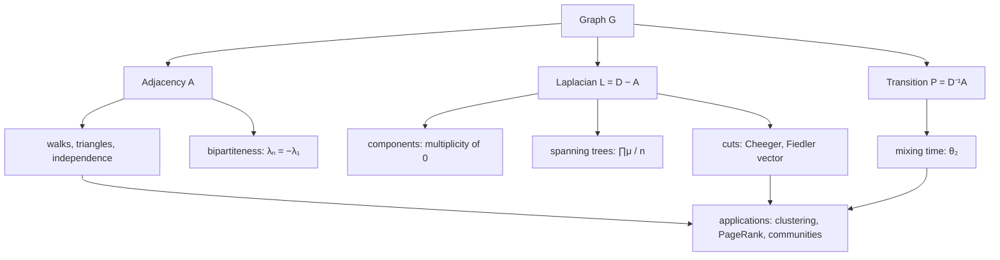

# Spectral Graph Theory

> [Mathematics](../../README.md) › [Graph Theory](../README.md) › Spectral Graph Theory · Level: Advanced · Prerequisites: [Graph Basics](../01-graph-basics/README.md), [Trees](../02-trees/README.md), [Matching and Flows](../05-matching-and-flows/README.md), [Eigenvalues and Eigenvectors](../../08-linear-algebra/07-eigenvalues-and-eigenvectors/README.md), [Inner Product Spaces](../../08-linear-algebra/08-inner-product-spaces/README.md), [Determinants](../../08-linear-algebra/06-determinants/README.md), [Probability Foundations](../../10-probability/01-probability-foundations/README.md) · Estimated time: 540 min

## 1. Introduction

Attach a number to a graph — its adjacency matrix, its Laplacian, the transition matrix of a random walk
— and compute the eigenvalues. The result is a finite list of real numbers, and the surprise of spectral
graph theory is how much of the graph they encode: the number of edges, the number of triangles, the
number of connected components, the number of spanning trees, whether the graph is bipartite, how fast a
random walk mixes, and how hard it is to cut the graph in two.

The subject begins with a classical fact of linear algebra: a real symmetric matrix has real eigenvalues
and an orthonormal basis of eigenvectors. Applied to the adjacency matrix $A$ of a graph, this makes
"count walks by multiplying matrices" into "count walks by summing powers of eigenvalues", because
$$(A^k)_{ij}=\sum_{t}\lambda_t^k\, v_t(i)v_t(j)$$
for an orthonormal eigenbasis $v_1,\dots,v_n$. Every combinatorial quantity expressible as a matrix trace
then becomes a symmetric function of the spectrum: the number of edges is $\tfrac12\sum\lambda_i^2$, the
number of triangles is $\tfrac16\sum\lambda_i^3$, and the number of closed walks of length $k$ is
$\sum\lambda_i^k$.

Three matrices organise the theory. The **adjacency matrix** $A$ governs walks and is the natural object
for extremal questions. The **Laplacian** $L=D-A$ governs cuts, spanning trees and diffusion; its
eigenvalues are non-negative, the number of zeros equals the number of connected components, and the
product of the non-zero eigenvalues counts spanning trees (the matrix-tree theorem of Kirchhoff, 1847).
The **transition matrix** $P=D^{-1}A$ of a random walk governs mixing, and its second largest eigenvalue
controls how quickly the walk forgets where it started.

Alongside the theorems there are two cautionary tales, and they are as important as the theorems.
First, **the spectrum is not a complete invariant**: non-isomorphic graphs can have identical spectra,
so no amount of spectral computation can decide isomorphism in general. Second, **spectral quantities are
bounds, not exact values**: the second Laplacian eigenvalue does not equal the edge expansion, but it
sandwiches it up to a square (the Cheeger inequality), which is enough for applications from expander
graphs to image segmentation.

**Scope.** All graphs are finite, simple and undirected unless stated otherwise; $n=\lvert V\rvert$,
$m=\lvert E\rvert$. Matrices are real and symmetric, so eigenvalues are real and eigenvectors can be
chosen orthonormal. Multisets of eigenvalues are written with multiplicities, e.g. $2,\,0,\,0,\,-2$.
Proofs use the spectral theorem for real symmetric matrices, quoted from
[Eigenvalues and Eigenvectors](../../08-linear-algebra/07-eigenvalues-and-eigenvectors/README.md), and
Perron–Frobenius, stated in Section 7.3 with its exact hypotheses. Results that are quoted without proof
(the Cheeger upper bound, Babai's algorithm for graph isomorphism) are marked as such.

## 2. Prerequisites

* **Graphs, degree, walks, paths, cycles, components, bipartiteness.** [Graph Basics](../01-graph-basics/README.md),
  Sections 5 and 7.3–7.8: $\deg(v)$, the handshake lemma $\sum_v\deg(v)=2m$, $A^k$ counting walks
  (Section 7.10 there), and "bipartite $\iff$ no odd cycle".
* **Trees and spanning trees.** A connected graph on $n$ vertices has a spanning tree with $n-1$ edges;
  Cayley's formula $n^{n-2}$ counts labelled trees. [Trees](../02-trees/README.md), Sections 7.5 and 7.9.
* **Matchings, cuts and flows.** Used in Section 7.7 for expansion and in exercises. [Matching and Flows](../05-matching-and-flows/README.md).
* **Matrices, transpose, trace, determinant, rank.** $A^{\mathsf T}$, $\operatorname{tr}A=\sum_iA_{ii}$,
  $\det A$, and $\det(AB)=\det A\det B$. [Matrices](../../08-linear-algebra/02-matrices/README.md),
  [Determinants](../../08-linear-algebra/06-determinants/README.md).
* **Eigenvalues, the characteristic polynomial, diagonalisability.** $\det(\lambda I-A)=0$, algebraic and
  geometric multiplicity, and the **spectral theorem**: a real symmetric matrix is orthogonally
  diagonalisable with real eigenvalues. [Eigenvalues and Eigenvectors](../../08-linear-algebra/07-eigenvalues-and-eigenvectors/README.md),
  Sections 7.3, 7.5 and 7.8.
* **Inner products, orthogonality, orthogonal projection.** $\langle x,y\rangle=\sum_ix_iy_i$,
  $\lVert x\rVert^2=\langle x,x\rangle$, orthonormal bases, and the decomposition of a vector into
  components along an orthonormal basis. [Inner Product Spaces](../../08-linear-algebra/08-inner-product-spaces/README.md).
* **Quadratic forms and positive semidefiniteness.** $x^{\mathsf T}Mx\ge0$ for all $x$, and the fact that
  this holds iff all eigenvalues of the symmetric $M$ are $\ge0$.
  [Vector Spaces](../../08-linear-algebra/04-vector-spaces/README.md).
* **Finite probability.** Distribution vectors, expectation, and convergence. Used in Section 7.8.
  [Probability Foundations](../../10-probability/01-probability-foundations/README.md).

Conventions following [MATHEMATICAL_NOTATION.md](../../MATHEMATICAL_NOTATION.md): eigenvalues of $A$ are
ordered $\lambda_1\ge\lambda_2\ge\cdots\ge\lambda_n$; eigenvalues of $L$ are ordered
$0=\mu_1\le\mu_2\le\cdots\le\mu_n$; $\mathbf{1}$ is the all-ones vector; $J=\mathbf{1}\mathbf{1}^{\mathsf T}$
is the all-ones matrix; $\log$ in complexity statements is base $2$, and $\ln$ is the natural logarithm.

## 3. Learning Objectives

By the end of this tutorial you will be able to:

1. Write the adjacency matrix, Laplacian, normalised Laplacian and transition matrix of a graph, and
   compute small spectra by hand.
2. Prove that $\sum_i\lambda_i=0$, $\sum_i\lambda_i^2=2m$, that $(A^k)_{ij}$ counts walks of length $k$,
   and that $\operatorname{tr}A^3=6\cdot(\text{number of triangles})$.
3. State the Perron–Frobenius theorem with its hypotheses, and apply it to a connected graph to obtain a
   simple positive largest eigenvalue with a positive eigenvector.
4. Prove that a graph is bipartite if and only if its spectrum is symmetric about $0$, and that for a
   connected graph this is equivalent to $\lambda_n=-\lambda_1$.
5. Prove that the Laplacian is positive semidefinite, identify its kernel, and prove that the multiplicity
   of $0$ equals the number of connected components.
6. State the matrix-tree theorem, outline its proof by Cauchy–Binet, and use the eigenvalue form
   $\tau(G)=\tfrac1n\prod_{i\ge2}\mu_i$ to count spanning trees of standard graphs.
7. Define the edge boundary, the conductance and the spectral gap, state the Cheeger inequality, prove
   its easy direction, and interpret both directions.
8. Derive the random-walk convergence bound in terms of the second largest eigenvalue and estimate mixing
   times for cycles, complete graphs and the hypercube.
9. State Cauchy's interlacing theorem and use it to bound the eigenvalues of induced subgraphs.
10. Explain why cospectral non-isomorphic graphs exist, give explicit examples, and describe the status of
    the graph isomorphism problem.
11. Use spectral ideas for clustering, PageRank and community detection, and explain what each method
    assumes about the graph.

## 4. Intuition

### 4.1 The graph as a linear map

The adjacency matrix $A$ acts on a vector of numbers attached to the vertices. If $x$ records "how much
something is at each vertex", then $(Ax)_u=\sum_{v\sim u}x_v$ is the amount that arrives at $u$ in one
step. So $A$ *is* the one-step diffusion operator, and $A^k$ is $k$ steps. An eigenvector is a
distribution that keeps its shape while diffusing: each step only rescales it. That is why eigenvalues
measure *rates* — of diffusion, of random walking, of mixing — and why the largest eigenvalue of a
connected graph is a strictly positive number attached to a strictly positive vector: the diffusion has a
stable profile.

### 4.2 Why the Laplacian measures cuts

The Laplacian's quadratic form has an exact meaning:
$$x^{\mathsf T}Lx=\sum_{uv\in E}(x_u-x_v)^2 .$$
This is the *energy* of the labelling $x$: it is small when neighbours have similar values and large when
they disagree. Minimising this energy over labelings orthogonal to the constant vector is precisely the
problem of splitting the graph into two parts with few edges between them. The minimiser is the
eigenvector of the second smallest eigenvalue (the **Fiedler vector**), and the eigenvalue itself is the
"best possible energy per unit mass" — a relaxation of the combinatorial cut problem. This single
identity explains spectral clustering, the Cheeger inequality and the matrix-tree theorem's appearance of
the Laplacian: the determinant of $L$ counts the ways to build the graph out of a tree, and the
eigenvalues of $L$ measure how well connected the graph is.

### 4.3 What the spectrum can and cannot see

The spectrum is an invariant: isomorphic graphs have equal spectra. The converse is false, and the
counterexamples are small: $K_{1,4}$ and $C_4\cup K_1$ both have spectrum $2,0,0,0,-2$. So spectra are
*certificates of non-isomorphism* (different spectrum $\Rightarrow$ not isomorphic) but not of
isomorphism. In practice this makes spectral methods fast filters: compute a few eigenvalues, discard
most non-isomorphic candidates, and confirm the survivors by other means.

## 5. Formal Definition

### 5.1 Matrices of a graph

**Definition 5.1.1 (Adjacency matrix).** For a graph $G$ with $V=\{1,\dots,n\}$, the **adjacency matrix**
$A\in\{0,1\}^{n\times n}$ has $A_{uv}=1$ if $uv\in E$ and $A_{uv}=0$ otherwise. It is symmetric with zero
diagonal, and $\sum_v A_{uv}=\deg(u)$.

**Definition 5.1.2 (Degree matrix, Laplacian).** $D=\operatorname{diag}(\deg(1),\dots,\deg(n))$ is the
**degree matrix** and $L=D-A$ is the **Laplacian** (or combinatorial Laplacian). Equivalently
$L_{uu}=\deg(u)$, $L_{uv}=-1$ for $uv\in E$, and $L_{uv}=0$ otherwise.

**Definition 5.1.3 (Normalised Laplacian and transition matrix).** For a graph with no isolated vertices,
$\mathcal{L}=I-D^{-1/2}AD^{-1/2}$ is the **normalised Laplacian** and $P=D^{-1}A$ is the **transition
matrix** of the simple random walk, $P_{uv}=1/\deg(u)$ if $uv\in E$ and $0$ otherwise. $P$ is row-stochastic:
its rows sum to $1$ and all entries are non-negative.

**Definition 5.1.4 (Spectrum).** The **spectrum** of $G$ is the multiset of eigenvalues of $A$ with
multiplicities, written $\operatorname{spec}(G)$. Eigenvalues are ordered
$\lambda_1\ge\lambda_2\ge\cdots\ge\lambda_n$. The **Laplacian spectrum** is the multiset of eigenvalues of
$L$, ordered $0=\mu_1\le\mu_2\le\cdots\le\mu_n$. The **spectral radius** is
$\rho(G)=\max_i\lvert\lambda_i\rvert=\max(\lambda_1,-\lambda_n)$.

**Definition 5.1.5 (Cospectral graphs).** Graphs $G$, $H$ are **cospectral** (or *isospectral*) if
$\operatorname{spec}(G)=\operatorname{spec}(H)$ as multisets. They are **Laplacian-cospectral** if their
Laplacians have equal spectra.

### 5.2 Eigenvalues as variational quantities

**Definition 5.2.1 (Rayleigh quotient).** For a symmetric matrix $M$ and $x\ne0$, the **Rayleigh quotient**
is $R_M(x)=\dfrac{x^{\mathsf T}Mx}{x^{\mathsf T}x}$.

**Theorem 5.2.2 (Courant–Fischer).** For a symmetric $n\times n$ matrix $M$ with eigenvalues
$\lambda_1\ge\cdots\ge\lambda_n$,
$$\lambda_k=\max_{\substack{U\le\mathbb{R}^n\\ \dim U=k}}\ \min_{0\ne x\in U}R_M(x)
=\min_{\substack{U\le\mathbb{R}^n\\ \dim U=n-k+1}}\ \max_{0\ne x\in U}R_M(x).$$
In particular $\lambda_1=\max_{x\ne0}R_M(x)$ and $\lambda_n=\min_{x\ne0}R_M(x)$.

This is the standard variational characterisation of eigenvalues of symmetric matrices; it is proved in
[Eigenvalues and Eigenvectors](../../08-linear-algebra/07-eigenvalues-and-eigenvectors/README.md) and used
here for the Laplacian identities and for interlacing.

### 5.3 Cuts, volume and conductance

**Definition 5.3.1 (Edge boundary and volume).** For $S\subseteq V$,
$$\partial S=\{uv\in E: u\in S,\ v\notin S\},\qquad \operatorname{vol}(S)=\sum_{v\in S}\deg(v).$$
Note that $\operatorname{vol}(V)=2m$.

**Definition 5.3.2 (Conductance).** For a $d$-regular graph,
$$h(G)=\min_{\substack{\varnothing\ne S\subsetneq V\\ \lvert S\rvert\le n/2}}\frac{\lvert\partial S\rvert}{\lvert S\rvert}.$$
For a general graph the same definition is used with $\lvert\partial S\rvert/\min(\operatorname{vol}(S),\operatorname{vol}(\bar S))$;
for regular graphs $\operatorname{vol}(S)=d\lvert S\rvert$ and the two differ by the factor $d$. This
topic uses the regular version above unless stated otherwise.

**Definition 5.3.3 (Spectral gap).** For a connected graph, $\mu_2$ is the **spectral gap** of the
Laplacian; for a $d$-regular graph the number $d-\lambda_2$ is called the spectral gap of the adjacency
matrix, and the two are equal, since $\mu_i=d-\lambda_i$ for regular graphs (Lemma 7.5.4).

## 6. Mathematical Notation

| Symbol | Read as | Meaning |
|---|---|---|
| $A$ | adjacency matrix | $A_{uv}=1$ iff $uv\in E$ |
| $D$ | degree matrix | diagonal, $D_{uu}=\deg(u)$ |
| $L=D-A$ | Laplacian | $L_{uu}=\deg(u)$, $L_{uv}=-1$ on edges |
| $\mathcal{L}$ | normalised Laplacian | $I-D^{-1/2}AD^{-1/2}$ |
| $P$ | transition matrix | $P=D^{-1}A$, random walk |
| $\lambda_i$ | adjacency eigenvalues | ordered decreasing, $\lambda_1\ge\cdots\ge\lambda_n$ |
| $\mu_i$ | Laplacian eigenvalues | ordered increasing, $0=\mu_1\le\cdots\le\mu_n$ |
| $\theta_i$ | random-walk eigenvalues | eigenvalues of $P$, $\theta_1=1$ |
| $\rho(G)$ | spectral radius | $\max_i\lvert\lambda_i\rvert$ |
| $\operatorname{spec}(G)$ | spectrum | multiset of eigenvalues of $A$ |
| $\tau(G)$ | number of spanning trees | computed by the matrix-tree theorem |
| $\partial S$ | edge boundary | edges with exactly one endpoint in $S$ |
| $\operatorname{vol}(S)$ | volume | $\sum_{v\in S}\deg(v)$ |
| $h(G)$ | conductance | $\min\lvert\partial S\rvert/\lvert S\rvert$ over small $S$ |
| $\mathbf{1}$ | all-ones vector | eigenvector of $L$ with eigenvalue $0$ |
| $J$ | all-ones matrix | $\mathbf{1}\mathbf{1}^{\mathsf T}$ |
| $R_M(x)$ | Rayleigh quotient | $x^{\mathsf T}Mx/x^{\mathsf T}x$ |
| $A\succeq0$ | positive semidefinite | $x^{\mathsf T}Ax\ge0$ for all $x$ |

## 7. Core Concepts

### 7.1 The adjacency matrix: first identities

**Lemma 7.1.1.** Let $G$ be a graph with adjacency matrix $A$ and spectrum $\lambda_1,\dots,\lambda_n$.

1. $\sum_i\lambda_i=\operatorname{tr}A=0$.
2. $\sum_i\lambda_i^2=\operatorname{tr}(A^2)=\sum_{u,v}A_{uv}^2=2m$.
3. $(A^k)_{uv}$ is the number of walks of length $k$ from $u$ to $v$.
4. $\operatorname{tr}(A^3)=6\cdot(\text{number of triangles})$.
5. If $G=G_1\sqcup G_2$ then $\operatorname{spec}(G)=\operatorname{spec}(G_1)\cup\operatorname{spec}(G_2)$ as multisets.

*Proof.* (1) The diagonal of $A$ is zero. (2) $\operatorname{tr}(A^2)=\sum_{u,v}A_{uv}A_{vu}=\sum_{u,v}A_{uv}^2$
because $A$ is symmetric, and $A_{uv}^2=1$ exactly for the $2m$ ordered pairs $(u,v)$ with $uv\in E$.
(3) Induction on $k$: $(A^{k+1})_{uv}=\sum_w(A^k)_{uw}A_{wv}$ counts walks of length $k$ from $u$ to $w$
extended by the edge $wv$. (4) A closed walk of length $3$ at $u$ is a triangle through $u$ traversed in
one of two directions, so each triangle contributes $3\cdot2=6$. (5) $A$ is block diagonal. $\blacksquare$

The spectral theorem adds the *spectral decomposition*. Choose an orthonormal eigenbasis
$v_1,\dots,v_n$ with $Av_t=\lambda_tv_t$. Then
$$A=\sum_{t=1}^{n}\lambda_t\,v_tv_t^{\mathsf T},\qquad
A^k=\sum_{t=1}^{n}\lambda_t^k\,v_tv_t^{\mathsf T},\qquad
(A^k)_{uv}=\sum_{t=1}^{n}\lambda_t^k\,v_t(u)v_t(v).$$
This is the bridge between combinatorics and eigenvalues: any quantity that counts walks becomes a
symmetric function of the spectrum. In particular the number of closed walks of length $k$ is
$\sum_t\lambda_t^k$, which is why cospectral graphs are indistinguishable by walk counts (Section 7.10).

### 7.2 Small spectra, computed by hand

| Graph | Spectrum of $A$ | Reason |
|---|---|---|
| $K_2$ | $1,-1$ | $A=\begin{pmatrix}0&1\\1&0\end{pmatrix}$, $\lambda^2-1=0$ |
| $C_3=K_3$ | $2,-1,-1$ | $A=J-I$: $2$ on $\mathbf{1}$, $-1$ on $\mathbf{1}^{\perp}$ |
| $C_4$ | $2,0,0,-2$ | eigenvectors $(1,1,1,1),(1,0,-1,0),(0,1,0,-1),(1,-1,1,-1)$ |
| $K_4$ | $3,-1,-1,-1$ | $A=J-I$ with $n=4$ |
| $K_{1,n}$ | $\sqrt n,\,0,\dots,0,\,-\sqrt n$ | see below |
| $K_{m,n}$ | $\sqrt{mn},\,0,\dots,0,\,-\sqrt{mn}$ | see below |
| $P_n$ | $2\cos\dfrac{k\pi}{n+1}$, $k=1,\dots,n$ | eigenvector $\sin\dfrac{jk\pi}{n+1}$ |
| $C_n$ | $2\cos\dfrac{2\pi k}{n}$, $k=0,\dots,n-1$ | eigenvector $(\omega^{0},\dots,\omega^{n-1})$, $\omega=e^{2\pi ik/n}$ |

*The star.* Let the centre be $0$ and the leaves $1,\dots,n$, and let $Ax=\lambda x$. For a leaf $i$,
$\lambda x_i=x_0$, and for the centre $\lambda x_0=\sum_ix_i$. If $\lambda\ne0$ then $x_i=x_0/\lambda$ for
all leaves, so $\lambda x_0=nx_0/\lambda$, giving $\lambda^2=n$. If $\lambda=0$ then $x_0=0$ and
$\sum_ix_i=0$, a subspace of dimension $n-1$. Hence the spectrum is $\sqrt n,0^{(n-1)},-\sqrt n$.

*The complete bipartite graph.* Write $x=(x_A,x_B)$. For $a\in A$, $(Ax)_a=\sum_{b\in B}x_b=\sigma$ and for
$b\in B$, $(Ax)_b=\sum_{a\in A}x_a=\tau$. If $\lambda\ne0$ then $x$ is constant on each side, $x_A=(\sigma/\lambda)\mathbf{1}$,
$x_B=(\tau/\lambda)\mathbf{1}$, and substituting gives $\sigma=n\tau/\lambda$, $\tau=m\sigma/\lambda$, hence
$\lambda^2=mn$. If $\lambda=0$ then $\sigma=\tau=0$, a subspace of dimension $(m-1)+(n-1)$. Hence
$\pm\sqrt{mn}$ with multiplicity one each and $0$ with multiplicity $m+n-2$.

*The cycle.* With $\omega=e^{2\pi ik/n}$ and $x_j=\omega^j$, the $j$-th coordinate of $Ax$ is
$x_{j-1}+x_{j+1}=\omega^j(\omega^{-1}+\omega)=2\cos(2\pi k/n)\,x_j$, using the identity
$e^{-i\theta}+e^{i\theta}=2\cos\theta$. Taking real and imaginary parts gives real eigenvectors, and the
$n$ values $k=0,\dots,n-1$ give $n$ distinct frequencies up to the symmetry $k\leftrightarrow n-k$.

*The path.* With $\theta=k\pi/(n+1)$ and $x_j=\sin(j\theta)$, the same computation gives
$(Ax)_j=2\cos\theta\,x_j$ for $j=2,\dots,n-1$, while at $j=1$ the missing term $x_0=\sin0=0$ and at $j=n$
the missing $x_{n+1}=\sin((n+1)\theta)=\sin(k\pi)=0$ both vanish. Hence $2\cos(k\pi/(n+1))$ is an
eigenvalue for $k=1,\dots,n$, and these $n$ numbers are distinct.

**Worked check.** For $P_4$ the formula gives $\lambda=2\cos36^\circ\approx1.618$,
$2\cos72^\circ\approx0.618$, $2\cos108^\circ\approx-0.618$, $2\cos144^\circ\approx-1.618$. The trace is
$0$, and the sum of squares is $2\cdot(1.618^2+0.618^2)=2\cdot3=6=2m$. For $C_4$: $2+0+0-2=0$ and
$4+0+0+4=8=2m$.

### 7.3 The Perron–Frobenius theorem

**Theorem 7.3.1 (Perron–Frobenius, irreducible case).** Let $M$ be a non-negative irreducible square
matrix and $\rho=\rho(M)$ its spectral radius. Then:

1. $\rho>0$ and $\rho$ is an eigenvalue of $M$;
2. the eigenspace for $\rho$ is one-dimensional and contains a vector all of whose entries are positive;
3. if $Mx=\lambda x$ with $x\ge0$, $x\ne0$, then $\lambda=\rho$;
4. $\lvert\lambda\rvert\le\rho$ for every eigenvalue $\lambda$.

If moreover $M$ is **primitive** — some power $M^k$ has all entries positive — then $\lvert\lambda\rvert<\rho$
for every eigenvalue $\lambda\ne\rho$.

"Reducible" here means that, after permuting rows and columns, $M$ is block upper triangular with two
square blocks; a non-negative matrix is irreducible exactly when its associated digraph is strongly
connected. For a symmetric matrix with zero diagonal, irreducibility is the same as the underlying graph
being connected and having at least two vertices.

**Corollary 7.3.2 (Connected graphs).** Let $G$ be connected with $n\ge2$. Then $A$ is irreducible, so:

* $\lambda_1=\rho(G)>0$, the eigenvalue $\lambda_1$ is simple, and there is an eigenvector $x>0$ for it;
* $\lvert\lambda_i\rvert\le\lambda_1$ for all $i$;
* if $G$ is not bipartite then $A$ is primitive, so $\lvert\lambda_i\rvert<\lambda_1$ for $i\ge2$.

Irreducibility of $A$ is exactly connectedness: for vertices $u\ne v$ there is a walk from $u$ to $v$ of
some length $k$, i.e. $(A^k)_{uv}>0$. Primitivity for a connected non-bipartite graph holds because such
a graph has closed walks of both even and odd length at every vertex, so some power of $A$ is positive.

**Lemma 7.3.3.** $\lambda_1\le\Delta$ (the maximum degree), with equality if and only if $G$ has a
$\Delta$-regular connected component.

*Proof.* Take a positive eigenvector $x$ for $\lambda_1$ and a vertex $v$ where $x_v$ is maximal. Then
$$\lambda_1x_v=\sum_{u\sim v}x_u\le\deg(v)\,x_v\le\Delta x_v,$$
so $\lambda_1\le\Delta$. If equality holds then $\deg(v)=\Delta$ and $x_u=x_v$ for every neighbour $u$ of
$v$. Repeating the argument at $u$ (whose eigenvalue equation also has equality, since $x_u=x_v$ is
maximal) shows every neighbour of $u$ is also maximal with degree $\Delta$, and by connectedness every
vertex of the component of $v$ has degree $\Delta$. Conversely, if a component is $\Delta$-regular, its
all-ones vector is an eigenvector with eigenvalue $\Delta$, so $\lambda_1\ge\Delta$. $\blacksquare$

**Lemma 7.3.4.** $\lambda_1\ge 2m/n=\bar d$, the average degree, with equality if and only if $G$ is
regular.

*Proof.* The Rayleigh quotient at $\mathbf{1}$ is $\mathbf{1}^{\mathsf T}A\mathbf{1}/\mathbf{1}^{\mathsf T}\mathbf{1}=2m/n$,
and $\lambda_1\ge R_A(x)$ for every $x$. Equality forces $\mathbf{1}$ to be an eigenvector, so
$(A\mathbf{1})_u=\deg(u)$ is the same for all $u$: the graph is regular. $\blacksquare$

### 7.4 Spectral radius and bipartiteness

**Theorem 7.4.1.** A graph $G$ is bipartite if and only if its spectrum is symmetric about $0$: for every
$\lambda$ and every $k\ge1$, $\lambda$ and $-\lambda$ have the same multiplicity.

*Proof.* ($\Rightarrow$) Let $V=A\cup B$ be a bipartition and $Ax=\lambda x$. Define $y$ by $y_v=x_v$ for
$v\in A$ and $y_v=-x_v$ for $v\in B$. For $u\in A$,
$$(Ay)_u=\sum_{v\sim u}y_v=-\sum_{v\sim u}x_v=-\lambda x_u=-\lambda y_u,$$
and for $u\in B$, $(Ay)_u=\sum_{v\sim u}x_v=\lambda x_u=-\lambda\,(-x_u)=-\lambda y_u$. So $y$ is an
eigenvector for $-\lambda$. The map $x\mapsto y$ is an involution, hence a bijection between the
eigenspaces of $\lambda$ and $-\lambda$, so the multiplicities agree.

($\Leftarrow$) Suppose the spectrum is symmetric. Then for every odd $k$,
$\operatorname{tr}(A^k)=\sum_i\lambda_i^k=0$, because the terms cancel in pairs. But
$\operatorname{tr}(A^k)$ is the number of closed walks of length $k$, so $G$ has no closed walk of odd
length; in particular no odd cycle. Hence $G$ is bipartite. $\blacksquare$

**Corollary 7.4.2.** If $G$ is connected, then $G$ is bipartite if and only if $\lambda_n=-\lambda_1$.

*Proof.* If $G$ is bipartite, Theorem 7.4.1 makes $-\lambda_1$ an eigenvalue, and by Corollary 7.3.2
$-\lambda_1$ is then the smallest, so $\lambda_n=-\lambda_1$. Conversely, if $\lambda_n=-\lambda_1$ then
Corollary 7.3.2 rules out a primitive $A$ (which would give $\lvert\lambda_n\rvert<\lambda_1$), so $G$ is
bipartite. $\blacksquare$

Consequently, for connected $G$, $\lambda_n=-\lambda_1$ characterises bipartiteness, and a strict inequality
$\lvert\lambda_i\rvert<\lambda_1$ for all $i\ge2$ characterises the non-bipartite case.

### 7.5 The Laplacian and its kernel

**Lemma 7.5.1.** For every $x\in\mathbb{R}^n$,
$$x^{\mathsf T}Lx=\sum_{uv\in E}(x_u-x_v)^2 .$$

*Proof.* Expand: $\sum_{uv\in E}(x_u-x_v)^2=\sum_{uv\in E}(x_u^2+x_v^2)-2\sum_{uv\in E}x_ux_v
=\sum_u\deg(u)x_u^2-2\sum_{uv\in E}x_ux_v=x^{\mathsf T}Dx-x^{\mathsf T}Ax$. $\blacksquare$

**Corollary 7.5.2.** $L$ is symmetric and positive semidefinite, and $L\mathbf{1}=0$.

*Proof.* The quadratic form is a sum of squares. $L\mathbf{1}$ has $u$-th entry
$\deg(u)-\sum_{v\sim u}1=0$. $\blacksquare$

**Theorem 7.5.3 (Number of components).** The multiplicity of the eigenvalue $0$ of $L$ equals the number
of connected components of $G$.

*Proof.* Let $C_1,\dots,C_c$ be the components and $\mathbf{1}_{C_j}$ the indicator vector of $C_j$. Each
$\mathbf{1}_{C_j}$ lies in the kernel of $L$ (it is constant on every edge, so $L\mathbf{1}_{C_j}=0$ by
the same computation as above), and the $c$ vectors are linearly independent. So the nullity is at least
$c$.

Conversely, if $Lx=0$ then $x^{\mathsf T}Lx=\sum_{uv}(x_u-x_v)^2=0$, so every edge has $x_u=x_v$: $x$ is
constant on each component. Hence $x$ is a linear combination of $\mathbf{1}_{C_1},\dots,\mathbf{1}_{C_c}$
and the nullity is exactly $c$. $\blacksquare$

**Lemma 7.5.4 (Regular graphs).** If $G$ is $d$-regular then $L=dI-A$ and therefore
$\mu_i=d-\lambda_i$ for each $i$ (with $\mu$ increasing and $\lambda$ decreasing).

*Proof.* $D=dI$. $\blacksquare$

**Lemma 7.5.5 (Variational form of $\mu_2$).** For a graph with $c$ components,
$$\mu_{c+1}=\min_{\substack{x\ne0\\ x\perp\mathbf{1}}}R_L(x),$$
and the minimiser may be taken orthogonal to the indicator vectors of the components. For a connected graph,
$\mu_2=\min_{x\perp\mathbf{1}}R_L(x)$, and a minimiser is called a **Fiedler vector**.

*Proof.* This is the Courant–Fischer characterisation at $k=c+1$, using that the first $c$ eigenvectors
span the space of functions constant on components. $\blacksquare$

**Examples.** For $K_n$: $L=nI-J$, so the spectrum is $0,n^{(n-1)}$. For $K_{m,n}$: $0$, $m$ with
multiplicity $n-1$, $n$ with multiplicity $m-1$, and $m+n$. For $C_n$: $2-2\cos(2\pi k/n)$,
$k=0,\dots,n-1$. For $P_n$: $2-2\cos(k\pi/n)$, $k=0,\dots,n-1$. (Note the different denominators: the
adjacency spectrum of $P_n$ has $k\pi/(n+1)$, the Laplacian spectrum has $k\pi/n$.) For the star $K_{1,n}$:
$0$, $1$ with multiplicity $n-1$, and $n+1$.

### 7.6 The matrix-tree theorem

**Theorem 7.6.1 (Kirchhoff, 1847).** Let $G$ be a connected graph and $L$ its Laplacian. Delete row $i$
and column $i$, obtaining the $(n-1)\times(n-1)$ matrix $L_i$. Then
$$\det L_i=\tau(G),$$
the number of spanning trees of $G$, and this number does not depend on $i$ for a connected graph.

*Outline of proof.* Let $B$ be the $n\times m$ **incidence matrix**: for an edge $e=uv$, put
$B_{ue}=1$, $B_{ve}=-1$ and all other entries $0$. Each column has one $+1$ and one $-1$, so
$\mathbf{1}^{\mathsf T}B=0$ and
$$(BB^{\mathsf T})_{uv}=\sum_{e}B_{ue}B_{ve}=\begin{cases}\deg(u)&u=v\\-1&uv\in E\\0&\text{otherwise,}\end{cases}$$
that is, $L=BB^{\mathsf T}$. Deleting row $i$ on both sides gives $L_i=B_iB_i^{\mathsf T}$, where $B_i$ is
$B$ without row $i$. The Cauchy–Binet formula now gives
$$\det L_i=\det(B_iB_i^{\mathsf T})=\sum_{\substack{S\subseteq E\\ \lvert S\rvert=n-1}}\det(B_i[S])^2,$$
where $B_i[S]$ is the square matrix formed by the columns indexed by $S$.

*The key lemma.* For a set $S$ of $n-1$ edges, $\lvert\det B_i[S]\rvert$ is $1$ if $S$ is the edge set of a
spanning tree, and $0$ otherwise. If $S$ contains a cycle, the signed incidence vectors of that cycle sum
to $0$, so the columns are dependent and the determinant vanishes. If $S$ is a spanning tree, choose a
leaf $\ell\ne i$ of the tree, order its incident edge first and the remaining edges in an order that
peels the tree towards $i$: the resulting matrix is triangular with $\pm1$ on the diagonal. Hence each
spanning tree contributes $1$ and everything else contributes $0$, so $\det L_i=\tau(G)$. $\blacksquare$

**Corollary 7.6.2 (Eigenvalue form).** For a connected graph,
$$\tau(G)=\frac{1}{n}\prod_{i=2}^{n}\mu_i .$$

*Proof.* Let $p(x)=\det(xI-L)=\prod_{i=1}^n(x-\mu_i)=x\prod_{i=2}^{n}(x-\mu_i)$, since $\mu_1=0$. Then
$p'(0)=\prod_{i=2}^n(-\mu_i)=(-1)^{n-1}\prod_{i\ge2}\mu_i$. On the other hand the coefficient of $x$ in
$p$ is, up to sign, the sum of the principal $(n-1)\times(n-1)$ minors of $L$, each of which equals
$\tau(G)$ by Theorem 7.6.1; hence $p'(0)=(-1)^{n-1}n\tau(G)$, and comparing gives the formula. $\blacksquare$

**Examples.** $K_4$: eigenvalues $0,4,4,4$, so $\tau=\tfrac14\cdot64=16$. $C_4$: $0,2,2,4$, so
$\tau=\tfrac14\cdot16=4$. $K_{3,3}$: $0,3,3,3,3,6$, so $\tau=\tfrac16\cdot3^4\cdot6=81$. $K_{2,3}$:
$0,2,2,3,5$, so $\tau=\tfrac15\cdot60=12$. The Petersen graph: $0,2^{(5)},5^{(4)}$, so
$\tau=\tfrac1{10}\cdot32\cdot625=2000$. The cube $Q_3$: $0,2^{(3)},4^{(3)},6$, so
$\tau=\tfrac18\cdot8\cdot64\cdot6=384$.

### 7.7 Expansion and the Cheeger inequality

Recall the conductance $h(G)$ of a $d$-regular graph from Definition 5.3.2. It is the graph-theoretic
measure of "how good a bottleneck exists": small $h$ means some set of vertices has very few edges
leaving it.

**Theorem 7.7.1 (Cheeger inequality, discrete form).** Let $G$ be a connected $d$-regular graph with
$d\ge1$, $\lambda_2$ the second largest adjacency eigenvalue and $\mu_2=d-\lambda_2$ the spectral gap
(Lemma 7.5.4). Then
$$\frac{\mu_2}{2}=\frac{d-\lambda_2}{2}\ \le\ h(G)\ \le\ \sqrt{2d\,\mu_2}=\sqrt{2d\,(d-\lambda_2)} .$$
In terms of the second eigenvalue $\mu_2^{\mathrm{norm}}$ of the normalised Laplacian $\mathcal L$ and the
volume-normalised conductance, the same statement reads
$\tfrac12\mu_2^{\mathrm{norm}}\le h_{\mathrm{vol}}\le\sqrt{2\mu_2^{\mathrm{norm}}}$; since
$\mu_2^{\mathrm{norm}}=\mu_2/d$ and $h_{\mathrm{vol}}=h(G)$ for regular graphs, the two versions agree.

*Proof of the lower bound.* Let $S$ achieve the minimum, with $\lvert S\rvert\le n/2$, and set
$x=\mathbf{1}_S-\frac{\lvert S\rvert}{\lvert\bar S\rvert}\mathbf{1}_{\bar S}$, so that $\sum_vx_v=0$ and hence
$x\perp\mathbf{1}$. Then
$$\sum_{uv\in E}(x_u-x_v)^2=\lvert\partial S\rvert\Bigl(1+\frac{\lvert S\rvert}{\lvert\bar S\rvert}\Bigr)^2,
\qquad \sum_vx_v^2=\lvert S\rvert\Bigl(1+\frac{\lvert S\rvert}{\lvert\bar S\rvert}\Bigr).$$
Dividing, and using $\lvert\bar S\rvert\ge n/2$,
$$R_L(x)=\lvert\partial S\rvert\cdot\frac{n}{\lvert S\rvert\lvert\bar S\rvert}
=\frac{\lvert\partial S\rvert}{\lvert S\rvert}\cdot\frac{n}{\lvert\bar S\rvert}\ \le\ \frac{2\lvert\partial S\rvert}{\lvert S\rvert}.$$
Since $\mu_2\le R_L(x)$ by Lemma 7.5.5, $\mu_2\le 2\lvert\partial S\rvert/\lvert S\rvert=2h(G)$, which is
$\mu_2/2\le h(G)$. $\blacksquare$

The upper bound $h(G)\le\sqrt{2d\mu_2}$ is the hard direction: one takes a Fiedler vector, sorts the
vertices by their value, and shows that some threshold set has small boundary; it is quoted here (see
Section 16 for a reference) and is not used in what follows.

**Interpretation.** The two inequalities say that the spectral gap $\mu_2=d-\lambda_2$ and the conductance
$h$ vanish together, and that each is at most the square of the other up to the factor $2d$: a graph has a
bottleneck if and only if its spectral gap is small. This is the theoretical basis of spectral
partitioning — computing an eigenvector is easy, while minimising $\lvert\partial S\rvert/\lvert S\rvert$
over all sets is NP-hard in general — and of the theory of **expanders**, $d$-regular graph families with
$h(G)\ge\varepsilon>0$ independent of $n$. Since $\mu_2\ge h^2/(2d)$ by the upper bound, an expander has
$\mu_2\ge\varepsilon^2/(2d)>0$, i.e. $\lambda_2\le d-\varepsilon^2/(2d)<d$: bounded expansion is the same
as a spectral gap bounded away from $0$. The Alon–Boppana bound says $\lambda_2\ge2\sqrt{d-1}-o(1)$ for
any infinite $d$-regular family, so the gap cannot be arbitrarily large; **Ramanujan graphs** attain
$\max(\lvert\lambda_2\rvert,\lvert\lambda_n\rvert)\le2\sqrt{d-1}$ and exist for infinitely many $d$
(Lubotzky–Phillips–Sarnak 1988, Margulis 1988).

**Checks.** For $C_5$: $d=2$, $\lambda_2=2-2\cos72^\circ\approx1.382$, so $\mu_2\approx0.618$, and $h=1$ (a
single vertex has $2/1=2$; two adjacent vertices have $2/2=1$; two non-adjacent have $4/2=2$). Then
$$\frac{\mu_2}{2}=0.309\ \le\ h=1\ \le\ \sqrt{2\cdot2\cdot0.618}=1.572 .$$
For the cube $Q_3$: $d=3$, $\lambda_2=2$ and $\mu_2=1$, while $h=1$ (a face has $4$ boundary edges over
$4$ vertices); here $0.5\le1\le\sqrt{2\cdot3\cdot1}=2.449$, so the expansion is strictly better than the
spectral bound requires. For any $Q_d$ the same computation gives $h\le1$ while $\lambda_2=2$, hence
$\mu_2=d-2$.

### 7.8 Random walks and mixing

Let $G$ be connected and $d$-regular. The **simple random walk** moves from $u$ to a uniformly random
neighbour, so its transition matrix is $P=D^{-1}A=A/d$. If $p_t\in\mathbb{R}^n$ is the distribution at time
$t$ (row vector), then $p_{t+1}=p_tP$ and $p_t=p_0P^t$.

**Lemma 7.8.1 (Stationary distribution).** For any graph, $\pi(v)=\deg(v)/(2m)$ satisfies $\pi P=\pi$; for
a $d$-regular graph this is the uniform distribution $\pi=\mathbf{1}/n$.

*Proof.* $(\pi P)_u=\sum_v\pi(v)P_{vu}=\sum_{v\sim u}\frac{\deg v}{2m}\cdot\frac{1}{\deg v}=\frac{\deg u}{2m}$. $\blacksquare$

**Theorem 7.8.2 (Convergence).** Let $G$ be connected, $d$-regular and non-bipartite, with adjacency
eigenvalues $d=\lambda_1>\lambda_2\ge\cdots\ge\lambda_n>-d$. Put $\theta_i=\lambda_i/d$ and
$\theta_*=\max_{i\ge2}\lvert\theta_i\rvert<1$. Then for every starting distribution $p_0$,
$$\lVert p_t-\pi\rVert_2\le\theta_*^{\,t}\,\lVert p_0-\pi\rVert_2,
\qquad\text{and hence}\qquad
\lVert p_t-\pi\rVert_1\le\sqrt n\,\theta_*^{\,t}.$$

*Proof.* Since $P$ is symmetric (as $G$ is regular), choose an orthonormal eigenbasis $v_1,\dots,v_n$ of
$P$ with $v_1=\mathbf{1}/\sqrt n$ and $Pv_i=\theta_iv_i$. Write $p_0-\pi=\sum_{i\ge2}c_iv_i$; this is
possible because $\pi=\mathbf{1}/n$ is the projection of $p_0$ onto $v_1$ (both are probability vectors).
Then $p_t-\pi=(p_0-\pi)P^t=\sum_{i\ge2}c_i\theta_i^tv_i$, and by orthonormality
$$\lVert p_t-\pi\rVert_2^2=\sum_{i\ge2}c_i^2\theta_i^{2t}\le\theta_*^{2t}\sum_{i\ge2}c_i^2=\theta_*^{2t}\lVert p_0-\pi\rVert_2^2.$$
The $\ell^1$ bound follows from Cauchy–Schwarz, $\lVert z\rVert_1\le\sqrt n\lVert z\rVert_2$. $\blacksquare$

**Definition 7.8.3 (Mixing time).** $t_{\mathrm{mix}}(\varepsilon)=\min\{t:\lVert p_t-\pi\rVert_1\le\varepsilon$ for
every starting vertex$\}$, and the **mixing time** is this quantity at $\varepsilon=1/4$ (any fixed
$\varepsilon<1/2$ gives the same order).

**Corollary 7.8.4.** Under the hypotheses of Theorem 7.8.2,
$$t_{\mathrm{mix}}(\varepsilon)\le\frac{\ln(\sqrt n/\varepsilon)}{1-\theta_*}$$
using $\ln(1/\theta_*)\ge1-\theta_*$.

**Example 7.8.5 (The pentagon).** For $C_5$, $d=2$ and the adjacency spectrum is
$2,\ 0.618,\ 0.618,\ -1.618,\ -1.618$, so $\theta_*=0.809$. Starting at a vertex, the exact
distributions give total-variation distances $0.600$, $0.400$, $0.350$, $0.275$, $0.225$, $0.181$ at
$t=1,\dots,6$. Theorem 7.8.2 bounds the total variation by
$\tfrac12\sqrt5\cdot\lVert p_0-\pi\rVert_2\cdot0.809^t=\tfrac12\sqrt5\cdot0.894\cdot0.809^t\approx0.809^t$,
which is $0.81$ at $t=1$. The bound is loose by a constant factor but captures the geometric decay.

**Example 7.8.6 (Cycles and the hypercube).** For $C_n$ the eigenvalues of $P$ are
$\cos(2\pi k/n)$, so $1-\theta_*\approx 2\pi^2/n^2$ and the walk needs $\Theta(n^2)$ steps to mix: the
square of the diameter, as for diffusion on a line. For the hypercube $Q_d$ (which is $d$-regular with
spectrum $d-2k$, multiplicity $\binom dk$), $\theta_2=1-2/d$, so mixing takes $\Theta(d\ln d)$ steps —
that is $\Theta(\ln n\cdot\ln\ln n)$ where $n=2^d$ is the number of vertices, much faster than the cycle.

For a complete graph $K_n$, $P=(\mathbf{1}\mathbf{1}^{\mathsf T}-I)/(n-1)$ has $\theta_i=-1/(n-1)$ for
$i\ge2$. After one step from any vertex the distribution is uniform on the other $n-1$ vertices, and after
two steps its total-variation distance from uniform is $1/(n(n-1))$: the complete graph mixes in a
constant number of steps, independently of $n$.

### 7.9 Interlacing

**Theorem 7.9.1 (Cauchy interlacing).** Let $A$ be a symmetric $n\times n$ matrix and $B$ an
$m\times m$ principal submatrix of $A$ (delete the same set of rows and columns). Then
$$\lambda_i(A)\ \ge\ \lambda_i(B)\ \ge\ \lambda_{i+n-m}(A),\qquad i=1,\dots,m .$$
For $m=n-1$ this reads $\lambda_1(A)\ge\lambda_1(B)\ge\lambda_2(A)\ge\lambda_2(B)\ge\cdots\ge\lambda_n(A)$.

*Proof sketch.* By Courant–Fischer, $\lambda_i(B)$ is the minimum over $(m-i+1)$-dimensional subspaces
$W$ of $B$ of the maximum of $R_B$ on $W$. Extending such a $W$ to a subspace of $\mathbb{R}^n$ by adding
$n-m$ coordinate directions and intersecting with a suitable $(n-i+1)$-dimensional space gives the two
inequalities; the details are a standard exercise in the minimax characterisation. $\blacksquare$

**Corollary 7.9.2.** For a graph $G$ and a vertex $v$,
$$\lambda_1(G)\ \ge\ \lambda_1(G-v)\ \ge\ \lambda_2(G)\ \ge\ \lambda_2(G-v)\ \ge\ \cdots .$$
More generally, if $H$ is an induced subgraph of $G$ on $m$ vertices, then
$\lambda_i(G)\ge\lambda_i(H)\ge\lambda_{i+n-m}(G)$. So eigenvalues of induced subgraphs are sandwiched by
eigenvalues of the whole graph — in particular $\lambda_1(G)\ge\lambda_1(H)$.

### 7.10 Isomorphism and cospectral graphs

Two graphs are **isomorphic** if some bijection of vertex sets preserves adjacency; the matrix form is
$A_H=PA_GP^{\mathsf T}$ for a permutation matrix $P$. Isomorphic graphs are cospectral (Definition 5.1.5),
so the spectrum is an **invariant**: a difference of spectra proves non-isomorphism.

**Example 7.10.1 (Smallest cospectral pair).** $K_{1,4}$ and $C_4\cup K_1$ both have spectrum
$$2,\ 0,\ 0,\ 0,\ -2 .$$
For $K_{1,4}$ this is the star formula $\pm\sqrt4$ with $0^{(3)}$; for $C_4\cup K_1$ it is
$\operatorname{spec}(C_4)\cup\operatorname{spec}(K_1)=\{2,0,0,-2\}\cup\{0\}$ by Lemma 7.1.1(5). The graphs
are not isomorphic: one is connected, the other is not. Their **Laplacian** spectra differ
($K_{1,4}$: $0,1,1,1,5$; $C_4\cup K_1$: $0,0,2,2,4$), which is no accident: the Laplacian detects the
number of components (Theorem 7.5.3) while the adjacency spectrum does not.

**Example 7.10.2 (A connected cospectral pair).** On six vertices take
$$G_1:\ 01,02,03,04,05,14,23 \qquad G_2:\ 02,03,05,12,13,14,23 .$$
Both are connected with seven edges, and both have characteristic polynomial
$$(x-1)(x+1)^2\bigl(x^3-x^2-5x+1\bigr),$$
so their spectra agree: approximately $2.709,\ 1,\ 0.194,\ -1,\ -1,\ -1.903$. They are not isomorphic:
the degree sequence of $G_1$ is $(5,2,2,2,2,1)$ and that of $G_2$ is $(3,3,3,3,1,1)$. So the adjacency
spectrum does not even determine the degree sequence. Their Laplacian spectra are
$(0,1,1,3,3,6)$ and $(0,4,3\pm\sqrt3,2\pm\sqrt2)$, which do differ.

**Theorem 7.10.3.** Cospectral graphs have the same number of edges, the same number of triangles, and the
same number of closed walks of every length.

*Proof.* These are $\tfrac12\sum\lambda_i^2$, $\tfrac16\sum\lambda_i^3$ and $\sum\lambda_i^k$, by Lemma 7.1.1
and the spectral decomposition. $\blacksquare$

**Remark 7.10.4 (The graph isomorphism problem).** Deciding whether two graphs are isomorphic is one of
the few natural problems that lie in NP and are known neither to be in P nor to be NP-complete. Babai
(2015) gave an algorithm running in quasi-polynomial time, $\exp\bigl((\log n)^{O(1)}\bigr)$, and
practical algorithms solve graphs of many thousands of vertices. Spectral methods play a heuristic
role: they give a fast *necessary* condition, and the eigenvector components can be used to guess a
matching of vertices that is then verified — but because cospectral non-isomorphic graphs exist
(Examples 7.10.1, 7.10.2) no spectral test can be complete.

### 7.11 Three applications of the spectrum

**Spectral clustering.** Given a graph (or a similarity matrix) that should split into two dense parts,
compute a Fiedler vector $x$ (an eigenvector for $\mu_2$), sort the vertices by $x_v$, and choose the
threshold minimising the conductance of the resulting set — the **sweep cut**. By the Cheeger inequality
the resulting conductance is at most $\sqrt{2d\mu_2}$, so a small spectral gap guarantees a good cut, and
$\mu_2$ itself is a certificate that no much better cut exists. Recursing on the two parts gives a
hierarchical clustering.

**PageRank.** Model a web surfer who follows a random link with probability $\alpha$ (typically $0.85$) and
jumps to a uniformly random page with probability $1-\alpha$. The transition matrix becomes
$P'=\alpha P+(1-\alpha)\frac{1}{n}\mathbf{1}\mathbf{1}^{\mathsf T}$, whose stationary distribution is the
PageRank vector. The damping makes $P'$ primitive even when the graph is disconnected or has dangling
vertices, so by Perron–Frobenius the stationary distribution exists, is unique, and is reached
geometrically fast with rate governed by $\alpha\theta_2$.

**Community detection.** Partition a graph into groups with many internal and few external edges. The
**modularity matrix** is $B=A-\frac{1}{2m}dd^{\mathsf T}$, where $d$ is the degree vector: $B_{uv}$ measures
how many more edges $uv$ has than expected if edges were placed at random with the given degrees. The
leading eigenvector of $B$ gives a bipartition (Newman's spectral method), and the sign of its entries
gives the two communities; unlike the Laplacian, whose second eigenvector finds *sparse cuts*, the
modularity matrix finds cuts that are denser than random.

## 8. Formulas and Properties

| # | Statement | Hypotheses | Reason |
|---|---|---|---|
| 8.1 | $\sum_i\lambda_i=0$ | any graph | $\operatorname{tr}A=0$, Lemma 7.1.1 |
| 8.2 | $\sum_i\lambda_i^2=2m$ | any graph | $\operatorname{tr}(A^2)=\sum A_{uv}^2$ |
| 8.3 | $\operatorname{tr}(A^3)=6\,t$ with $t$ triangles | any graph | closed $3$-walks |
| 8.4 | $(A^k)_{uv}=\#$ walks of length $k$ | any graph | Lemma 7.1.1(3) |
| 8.5 | $\operatorname{spec}(G_1\sqcup G_2)=\operatorname{spec}(G_1)\cup\operatorname{spec}(G_2)$ | any graphs | block diagonal |
| 8.6 | $\lambda_1\le\Delta$, equality iff a component is $\Delta$-regular | any graph | Lemma 7.3.3 |
| 8.7 | $\lambda_1\ge2m/n$, equality iff regular | any graph | Lemma 7.3.4 |
| 8.8 | bipartite $\iff$ spectrum symmetric $\iff\lambda_n=-\lambda_1$ | connected (for the last form) | Theorem 7.4.1, Cor. 7.4.2 |
| 8.9 | $x^{\mathsf T}Lx=\sum_{uv}(x_u-x_v)^2$ | any graph | Lemma 7.5.1 |
| 8.10 | $\dim\ker L=$ number of components | any graph | Theorem 7.5.3 |
| 8.11 | $\mu_i=d-\lambda_i$ | $d$-regular | Lemma 7.5.4 |
| 8.12 | $\operatorname{spec}(K_n)=n-1,\,(-1)^{n-1}$ | complete graph | $A=J-I$ |
| 8.13 | $\operatorname{spec}(K_{m,n})=\pm\sqrt{mn},\,0^{m+n-2}$ | complete bipartite | Section 7.2 |
| 8.14 | $\operatorname{spec}(C_n)=2\cos(2\pi k/n)$; $\mu_k=2-2\cos(2\pi k/n)$ | cycle | Section 7.2 |
| 8.15 | $\tau(G)=\det L_i=\tfrac1n\prod_{i\ge2}\mu_i$ | connected | Theorem 7.6.1, Cor. 7.6.2 |
| 8.16 | $\tau(K_n)=n^{n-2}$ | complete graph | 8.15 with $\mu_i=n$ |
| 8.17 | $\tfrac{d-\lambda_2}{2}\le h(G)\le\sqrt{2d(d-\lambda_2)}$ | $d$-regular, connected | Theorem 7.7.1 |
| 8.18 | $\lVert p_t-\pi\rVert_2\le\theta_*^t\lVert p_0-\pi\rVert_2$ | $d$-regular, connected, non-bipartite | Theorem 7.8.2 |
| 8.19 | $\lambda_i(A)\ge\lambda_i(B)\ge\lambda_{i+n-m}(A)$ | $B$ principal $m\times m$ | Cauchy interlacing |
| 8.20 | $\lambda_i(\bar G)=-1-\lambda_i(G)$ for $i\ge2$, $\lambda_1(\bar G)=n-1-d$ | $d$-regular $G$ | $\bar A=J-I-A$ |

**On 8.14.** The two formulas have different denominators from the path: for $P_n$ the adjacency
eigenvalues are $2\cos(k\pi/(n+1))$ but the Laplacian eigenvalues are $2-2\cos(k\pi/n)$. Mixing them up is
the most common computational error in this subject.

**On 8.15.** The cofactor formula and the eigenvalue formula are different faces of the same theorem:
$\det L_i$ is a sum of squares of $\pm1$ determinants over spanning trees (Cauchy–Binet), while
$\tfrac1n\prod_{i\ge2}\mu_i$ is the constant term of the characteristic polynomial's derivative.

**On 8.16.** For $K_n$, $\mu_i=n$ for $i\ge2$, so $\tau=\tfrac1n n^{n-1}=n^{n-2}$ — Cayley's formula,
proved analytically. Section 9.3 checks the case $n=4$: $4^2=16$.

**On 8.20.** For a $d$-regular $G$, $\bar A=J-I-A$. The all-ones vector is an eigenvector of $\bar A$ with
eigenvalue $(n-1)-d$, and on $\mathbf{1}^{\perp}$ the matrix $J$ acts as $0$, so $\bar A=-I-A$ there and
each remaining eigenvalue is $-1-\lambda_i$. Since $\bar G$ is itself $(n-1-d)$-regular, Exercise 25
shows that $\bar G$ is connected exactly when the eigenvalue $n-1-d$ of $\bar A$ is simple, i.e. exactly
when no eigenvalue of $G$ equals $d-n$. For $n>2d$ we have $d-n<-d\le\lambda_n$, so no eigenvalue can
equal $d-n$ and $\bar G$ is then automatically connected.

## 9. Step-by-Step Examples

### Example 9.1 (Easy): three spectra by hand

*$C_3=K_3$.* $A=J-I$. On $\mathbf{1}$: $A\mathbf{1}=(3-1)\mathbf{1}=2\mathbf{1}$. On $\mathbf{1}^\perp$
(dimension $2$), $J$ annihilates every vector, so $A=-I$ and the eigenvalue is $-1$ twice. Spectrum
$2,-1,-1$. Check: sum $=0$ ✓; sum of squares $=4+1+1=6=2\cdot3$ ✓.

*$C_4$.* Try the four vectors $(1,1,1,1)$, $(1,0,-1,0)$, $(0,1,0,-1)$, $(1,-1,1,-1)$. The first is
constant, so it is an eigenvector with eigenvalue $2$ (degree). The second: at vertex $1$ the neighbours
are $2,4$ with values $0,0$, sum $0$; at vertex $2$ the neighbours are $1,3$ with values $1,-1$, sum $0$;
and so on — eigenvalue $0$. The third likewise gives $0$, and the fourth gives $-2$ at every vertex.
Spectrum $2,0,0,-2$; sum $0$ ✓, squares $8=2m$ ✓.

*$K_4$.* $A=J-I$: eigenvalue $3$ on $\mathbf{1}$ and $-1$ on the $3$-dimensional $\mathbf{1}^\perp$.
Spectrum $3,-1,-1,-1$; squares $9+3=12=2m$ ✓.

Notice that $\lambda_1=\Delta$ in all three cases, in agreement with Lemma 7.3.3, and that $C_4$ is the only
one with a symmetric spectrum — it is the only bipartite graph here.

### Example 9.2 (Easy): a star and a path

*$K_{1,3}$.* The star formula gives $\sqrt3,\,0,\,0,\,-\sqrt3\approx1.732,\,0,\,0,\,-1.732$. Check with the
degree bounds: $\Delta=3$, average degree $2m/n=6/4=1.5$, and indeed
$1.5\le1.732\le3$. The spectrum is symmetric, as it must be for the bipartite star.

*$P_4$.* The path formula gives $2\cos(k\pi/5)$ for $k=1,\dots,4$, that is
$$1.618,\quad0.618,\quad-0.618,\quad-1.618 .$$
Check: sum $0$ ✓; squares $2(1.618^2+0.618^2)=2(2.618+0.382)=2\cdot3=6=2m$ ✓. Since $P_4$ is bipartite the
spectrum is symmetric, and $\lambda_1=1.618<2=\Delta$ although $P_4$ is not regular — consistent with
Lemma 7.3.3, which only claims equality for regular components.

*Laplacian of $P_4$.* The formula $\mu_k=2-2\cos(k\pi/4)$, $k=0,\dots,3$, gives
$0,\ 0.586,\ 2,\ 3.414$, i.e. $0,\,2-\sqrt2,\,2,\,2+\sqrt2$. By Corollary 7.6.2,
$\tau(P_4)=\tfrac14(2-\sqrt2)\cdot2\cdot(2+\sqrt2)=\tfrac14\cdot2\cdot2=1$: a path is a tree, so it has
exactly one spanning tree ✓.

### Example 9.3 (Medium): matrix-tree counts for $K_4$ and $C_4$

*$K_4$.* $L=4I-J$, so the Laplacian eigenvalues are $0$ (on $\mathbf{1}$) and $4$ with multiplicity $3$ (on
$\mathbf{1}^\perp$). Hence $\tau=\tfrac14\cdot4^3=16$.

*Check by Cayley.* The number of labelled trees on $4$ vertices is $4^{4-2}=16$ ✓.

*$C_4$.* The Laplacian eigenvalues are $2-2\cos(2\pi k/4)$ for $k=0,1,2,3$: $0$, $2$, $4$, $2$. Hence
$\tau=\tfrac14\cdot2\cdot2\cdot4=4$.

*Check by hand.* A spanning tree of $C_4$ is obtained by deleting exactly one of the four edges (deleting
two disconnects, deleting none leaves the cycle), so there are exactly $4$ ✓.

### Example 9.4 (Medium): reading bipartiteness from the spectrum

(a) $2,\,0,\,0,\,-2$: symmetric, so bipartite — and indeed the graph could be $C_4$ or $K_{1,3}$.
(b) $2,\,1,\,1,\,-1,\,-1,\,-2$: symmetric, so bipartite (this is $C_6$, with $2\cos(2\pi k/6)$ for
$k=0,\dots,5$, i.e. $2,1,-1,-2,-1,1$).
(c) $2,\,0.618,\,0.618,\,-1.618,\,-1.618$: **not** symmetric ($\pm1.618$ both appear, but $2$ has no
partner $-2$), so not bipartite — this is $C_5$, and indeed $C_5$ has odd cycles.
(d) $3,\,1,1,1,1,1,\,-2,-2,-2,-2$: the Petersen graph. Since $-3$ is not an eigenvalue, the spectrum is not
symmetric and the graph is not bipartite (it has $5$-cycles).

The test is exact by Theorem 7.4.1 and requires no search: comparing the multiplicities of $\lambda$ and
$-\lambda$ decides bipartiteness in polynomial time, though a $2$-colouring by BFS is cheaper.

### Example 9.5 (Medium–hard): a random walk on $C_5$

Label the vertices $1,\dots,5$ cyclically and start at $1$. Since $C_5$ is $2$-regular, $P=A/2$ with
eigenvalues $1,\ 0.309,\ 0.309,\ -0.809,\ -0.809$ (half of $2,0.618,0.618,-1.618,-1.618$). So
$\theta_*=0.809$ and the stationary distribution is uniform, $\pi=(0.2,\dots,0.2)$.

*Exact iterates.* $p_0=(1,0,0,0,0)$; $p_1=(0,0.5,0,0,0.5)$; $p_2=(0.5,0,0.25,0.25,0)$;
$p_3=(0,0.375,0.125,0.125,0.375)$. The total-variation distances $\tfrac12\lVert p_t-\pi\rVert_1$ are
$$0.600,\quad0.400,\quad0.350,\quad0.275,\quad0.225,\quad0.181,\quad0.147,\quad0.119$$
for $t=1,\dots,8$.

*The spectral bound.* Directly, $p_0-\pi=(0.8,-0.2,-0.2,-0.2,-0.2)$, so
$\lVert p_0-\pi\rVert_2^2=0.64+4(0.04)=0.8$ and $\lVert p_0-\pi\rVert_2=0.894$. Theorem 7.8.2 gives
$\lVert p_t-\pi\rVert_2\le0.894\cdot0.809^t$ and $\lVert p_t-\pi\rVert_1\le\sqrt5\cdot0.894\cdot0.809^t\approx2.0\cdot0.809^t$.
At $t=8$ this is $0.36$, above the true $0.24$: the bound is correct but pessimistic by a constant factor.

*Mixing time.* Corollary 7.8.4 with $\varepsilon=0.25$, $n=5$ gives
$t_{\mathrm{mix}}\le\ln(\sqrt5/0.25)/(1-0.809)=\ln8.94/0.191\approx11.5$, whereas the exact value is around
$t=5$ (where the distance $0.225$ is below $1/4$). The exponential decay is predicted correctly; the
constant is not.

### Example 9.6 (Medium–hard): a cospectral pair and what distinguishes it

*Spectra.* By the star formula, $\operatorname{spec}(K_{1,4})=\{\sqrt4,0,0,0,-\sqrt4\}=\{2,0,0,0,-2\}$. By
Lemma 7.1.1(5) and the cycle formula,
$\operatorname{spec}(C_4\cup K_1)=\{2,0,0,-2\}\cup\{0\}=\{2,0,0,0,-2\}$. The spectra coincide.

*Invariants that agree.* Both have five vertices, both are bipartite (symmetric spectra), both have
$\sum\lambda_i^2/2=4$ edges, and both have $\operatorname{tr}A^3/6=0$ triangles.

*Non-isomorphism.* $K_{1,4}$ is connected and has a vertex of degree $4$; $C_4\cup K_1$ is disconnected, with
maximum degree $2$. Connectivity is not a spectral invariant of the adjacency matrix.

*Laplacian spectra.* For $K_{1,4}$ the Laplacian eigenvalues are $0,\,1,\,1,\,1,\,5$ (star formula with
$n=4$: $0$, $1^{(3)}$, $n+1=5$). For $C_4\cup K_1$ they are $0,\,0,\,2,\,2,\,4$: two zeros because there
are two components, by Theorem 7.5.3. So the Laplacian spectrum *does* see the difference. It also
reports the spanning-tree counts: $\tau(K_{1,4})=\tfrac15\cdot1\cdot1\cdot1\cdot5=1$ (a star is a tree),
while $C_4\cup K_1$ has no spanning tree at all, and indeed the product contains the factor $0$.

### Example 9.7 (Hard): the Laplacian spectrum of $K_{2,3}$ and its spanning trees

By the complete-bipartite formula with $m=2$, $n=3$, the Laplacian spectrum of $K_{2,3}$ is
$$0,\quad \underbrace{2,2}_{n-1=2\ \text{times}},\quad \underbrace{3}_{m-1=1\ \text{time}},\quad 5 .$$
Check: the sum is $0+2+2+3+5=12$, and the sum of degrees is $3+3+2+2+2=12$ ✓ (for any graph
$\sum_i\mu_i=\operatorname{tr}L=2m$, since $\operatorname{tr}L=\sum_v\deg(v)$).

Hence
$$\tau(K_{2,3})=\frac{1}{5}\,(2\cdot2\cdot3\cdot5)=\frac{60}{5}=12 .$$
The classical formula for complete bipartite graphs, $\tau(K_{m,n})=m^{n-1}n^{m-1}$, gives
$2^{2}\cdot3^{1}=12$ ✓. Direct check: a spanning tree of $K_{2,3}$ has $4$ edges, so it is obtained by
deleting $2$ of the $6$ edges. Of the $\binom62=15$ pairs, exactly the three pairs $\{a_1b_j,a_2b_j\}$
isolate the vertex $b_j$ and disconnect the graph; every other pair leaves a connected graph on $4$ edges,
which is a tree. Hence $15-3=12$ spanning trees ✓.

### Example 9.8 (Hard): Cheeger numbers of $C_5$ and $Q_3$

*$C_5$.* Here $d=2$, $n=5$, and $\lambda_2=2-2\cos72^\circ\approx1.382$, so $\mu_2=2-1.382=0.618$.
Conductance: for $\lvert S\rvert=1$, $\lvert\partial S\rvert=2$, ratio $2$; for $\lvert S\rvert=2$
adjacent, $\lvert\partial S\rvert=2$, ratio $1$; for $\lvert S\rvert=2$ non-adjacent, $\lvert\partial S\rvert=4$,
ratio $2$. So $h=1$ and
$$\frac{\mu_2}{2}=0.309\ \le\ h=1\ \le\ \sqrt{2\cdot2\cdot0.618}=1.572 .$$

*$Q_3$.* Here $d=3$, $n=8$, and the Laplacian spectrum is $0,2,2,2,4,4,4,6$, so $\lambda_2=2$ and
$\mu_2=1$. Take $S$ to be a face of the cube — the four vertices with one fixed coordinate. Each vertex of
$S$ has exactly one neighbour outside $S$, so $\lvert\partial S\rvert=4$ and the ratio is $4/4=1$. No set
does better (checking all subsets of size $\le4$ gives minimum $1$), so $h=1$ and
$$\frac{\mu_2}{2}=0.5\ \le\ h=1\ \le\ \sqrt{2\cdot3\cdot1}=2.449 .$$
Here the expansion is strictly better than the spectral bound requires, in contrast with the cycle.

## 10. Visual Explanations

### 10.1 Which matrix answers which question

### 10.2 The Laplacian as an energy

For a labelling $x$ of the vertices, $x^{\mathsf T}Lx$ is the sum of squared differences across edges.
Cutting the graph into $S$ and $\bar S$ corresponds to the labelling $x=\mathbf{1}_S-\tfrac{\lvert S\rvert}{\lvert\bar S\rvert}\mathbf{1}_{\bar S}$,
whose energy is concentrated exactly on the boundary:

| $S$ | $x$ | $x^{\mathsf T}Lx$ | $x^{\mathsf T}x$ | $R_L(x)$ |
|---|---|---|---|---|
| one vertex of $C_4$ | $(1,-\tfrac13,-\tfrac13,-\tfrac13)$ | $\tfrac{32}{9}$ | $\tfrac43$ | $\tfrac83$ |
| an edge of $C_4$ | $(1,1,-1,-1)$ | $8$ | $4$ | $2=\mu_2(C_4)$ |
| a face of $Q_3$ | $(1,\dots,1,-1,\dots,-1)$ | $16$ | $8$ | $2=\mu_2(Q_3)$ |

The table illustrates the ingredients of the Cheeger inequality: for this labelling
$R_L(x)=\dfrac{\lvert\partial S\rvert}{\lvert S\rvert}\cdot\dfrac{n}{\lvert\bar S\rvert}$, and
$n/\lvert\bar S\rvert\in[1,2]$ when $\lvert S\rvert\le n/2$, so the smallest quotient over balanced cuts
lies between $h(G)$ and $2h(G)$. Since $\mu_2$ is the smallest quotient over *all* labelings orthogonal
to $\mathbf{1}$, the inequality $\mu_2\le2h(G)$ follows — that is exactly the proof in Section 7.7.

### 10.3 Theorems and their hypotheses

| Theorem | Needs | Fails without it |
|---|---|---|
| Perron–Frobenius, simple $\lambda_1$ | connected | two components: $\lambda_1$ repeated |
| symmetric spectrum $\iff$ bipartite | nothing beyond finiteness | — |
| nullity $L=c$ | nothing | — |
| $\tau=\tfrac1n\prod_{i\ge2}\mu_i$ | connected | disconnected: product is $0$ but $\tau=0$ trivially |
| $\mu_i=d-\lambda_i$ | $d$-regular | $P_4$: $2-\lambda_1=0.382\ne0.586=\mu_2$ |
| Cheeger: $(d-\lambda_2)/2\le h$ | $d$-regular, connected | for irregular graphs use the normalised Laplacian |

## 11. Common Mistakes

1. **Mixing the path formulas.** For $P_n$ the adjacency eigenvalues are $2\cos(k\pi/(n+1))$ but the
   Laplacian eigenvalues are $2-2\cos(k\pi/n)$. The denominators differ; using one for the other gives
   wrong answers already at $n=4$ ($0.382$ instead of $0.586$).
2. **Applying $\mu_i=d-\lambda_i$ to a non-regular graph.** The identity needs $D=dI$; for $P_4$ it fails
   (item 8.11 in the table above).
3. **Believing the spectrum determines the graph.** Cospectral non-isomorphic graphs exist, even
   connected ones with different degree sequences (Example 7.10.2).
4. **Confusing the adjacency and Laplacian spectra when counting components.** The number of components is
   the multiplicity of $0$ for $L$, not for $A$: $C_4\cup K_1$ has $A$-spectrum $2,0,0,0,-2$ with three
   zeros but only two components.
5. **Reading $\lambda_2$ as the conductance.** The Cheeger inequality bounds $h$ by $(d-\lambda_2)/2$ from
   below and by $\sqrt{2d(d-\lambda_2)}$ from above; the gap $d-\lambda_2$ and $h$ are of the same order
   only up to squaring, and the constants are not tight.
6. **Using the eigenvalue formula for $\tau$ on a disconnected graph.** Corollary 7.6.2 assumes
   connectedness; for a disconnected graph there is no spanning tree, and the product is $0$.
7. **Forgetting that random walks need aperiodicity to converge.** A bipartite graph has
   $\theta_n=-1$, so $p_t$ oscillates and never converges; the usual fix is the *lazy* walk
   $P'=\tfrac12(I+P)$, whose eigenvalues are $\tfrac12(1+\theta_i)\ge0$.
8. **Assuming $\lambda_1=\Delta$ always.** Equality needs a $\Delta$-regular component; for $P_4$,
   $\lambda_1=1.618<2=\Delta$.
9. **Adding spectra of graphs that share vertices.** The rule 8.5 is for *disjoint* unions; a union sharing
   vertices behaves completely differently.
10. **Treating eigenvalues as integers.** Even for small graphs they are algebraic numbers; the cospectral
    pair of Example 7.10.2 has eigenvalues that are roots of the irreducible cubic $x^3-x^2-5x+1$, so
    they are not rational and have no simple closed form.

## 12. Applications

### 12.1 Spectral clustering

Given data as a similarity graph, compute the Fiedler vector of $L$ (or of the normalised Laplacian, which
behaves better for graphs with very uneven degrees), sort the vertices by their eigenvector entry, and cut
at the threshold minimising the conductance. The Cheeger inequality guarantees that the resulting cut has
conductance at most $\sqrt{2d\mu_2}$, and that no cut can be much better than $\mu_2/2$ suggests; the
method is *relaxation* — an NP-hard discrete problem replaced by an eigenvector computation — and works
because the relaxation is tight up to a square. Recursion on both sides produces a hierarchical
clustering; choosing the number of clusters from the spectrum uses the multiplicities of small
eigenvalues.

### 12.2 PageRank

The web graph is huge, directed and badly connected. PageRank models a surfer who follows a random
outgoing link with probability $\alpha=0.85$ and teleports uniformly at random with probability $0.15$.
The resulting matrix $P'=\alpha P+(1-\alpha)\frac1n\mathbf{1}\mathbf{1}^{\mathsf T}$ has all entries
positive, hence is primitive, so Perron–Frobenius gives a unique stationary vector — the ranking — and
Theorem 7.8.2 gives geometric convergence at rate $\alpha\theta_2$. The damping is not cosmetic: without
it, pages with no outgoing links and disconnected components would destroy uniqueness and convergence.
Practical implementations do not form $P'$ but iterate the power method on sparse matrices, which is
exactly the random walk simulation of Section 7.8.

### 12.3 Community detection

Modularity compares the observed number of edges inside a group with the number expected under a
degree-preserving random model. With $B=A-\frac{1}{2m}dd^{\mathsf T}$, maximising modularity over
bipartitions is equivalent to maximising $x^{\mathsf T}Bx$ over $x\in\{\pm1\}^n$, whose spectral
relaxation is the leading eigenvector of $B$. Two features distinguish this from Laplacian partitioning:
the target is *more* edges inside groups than random (not fewer edges between them), and the leading
eigenvalue of $B$, not the smallest non-zero of $L$, carries the signal. Modularity has a known
resolution limit — small communities are invisible in large graphs — which is why multi-resolution and
likelihood-based spectral methods are used in practice.

### 12.4 Hückel theory in chemistry

In the Hückel model of a conjugated molecule, the adjacency matrix of the carbon skeleton is the
Hamiltonian: the eigenvalues are the molecular orbital energies (shifted by the carbon $2p$ level and
scaled by the resonance integral), and the eigenvectors are the orbital coefficients. The number of
bonding orbitals and the total $\pi$-electron energy are read off from the spectrum, and the
**nullity** of $A$ — the multiplicity of $0$ — counts non-bonding orbitals, which correlates with radical
stability. This is why spectral graph theory is used for benzenoid hydrocarbons, fullerenes and carbon
nanotubes; the connection to Kekulé structures (perfect matchings) is discussed in
[Matching and Flows](../05-matching-and-flows/README.md), Section 12.5.

### 12.5 Expanders and their uses

A family of $d$-regular graphs with $h(G)\ge\varepsilon>0$ independent of $n$ is an **expander**: sparse
graphs that are nevertheless extremely well connected. By Cheeger they are exactly the families with
$\lambda_2$ bounded away from $d$, and Ramanujan graphs achieve the optimal bound $2\sqrt{d-1}$.
Expanders underlie derandomisation, error-correcting codes, and the "small-world" behaviour of networks;
they are also the reason sparse random graphs mix fast, and they show that sparsity and good connectivity
are compatible — a fact that is far from obvious combinatorially.

## 13. Exercises

The problem set is [exercises.md](exercises.md): 36 problems, Beginner → Challenge, on spectra, the
Perron–Frobenius theorem, the Laplacian, the matrix-tree theorem, Cheeger, random walks, interlacing and
cospectrality. Each problem names the section that supplies the technique.

## 14. Solutions

Complete worked solutions to all 36 problems are in [solutions.md](solutions.md). Every solution states
its strategy, then carries out each step, and every proof cites the theorem it uses.

## 15. Summary

* The **adjacency spectrum** determines $\sum\lambda_i=0$, $\sum\lambda_i^2=2m$, the number of closed
  walks of every length, and hence the number of triangles; $(A^k)_{uv}$ counts walks.
* **Perron–Frobenius**: a connected graph has $\lambda_1>0$ simple with a positive eigenvector; if the
  graph is non-bipartite then $\lvert\lambda_i\rvert<\lambda_1$ for $i\ge2$.
* A graph is **bipartite** iff its spectrum is symmetric about $0$; for connected graphs this is
  $\lambda_n=-\lambda_1$.
* The **Laplacian** is positive semidefinite, $x^{\mathsf T}Lx=\sum_{uv}(x_u-x_v)^2$, its kernel is spanned
  by the component indicators, and the multiplicity of $0$ is the number of components.
* **Matrix-tree theorem**: $\tau(G)=\det L_i=\tfrac1n\prod_{i\ge2}\mu_i$ for connected $G$, which gives
  Cayley's formula $\tau(K_n)=n^{n-2}$ and the counts $16$ for $K_4$, $4$ for $C_4$, $81$ for $K_{3,3}$,
  $12$ for $K_{2,3}$, $384$ for $Q_3$ and $2000$ for the Petersen graph.
* **Cheeger**: $\dfrac{d-\lambda_2}{2}\le h(G)\le\sqrt{2d(d-\lambda_2)}$ for $d$-regular $G$; expansion and
  spectral gap vanish together, and this is the basis of spectral partitioning.
* A random walk on a connected non-bipartite $d$-regular graph converges to uniform at rate
  $\theta_*=\max_{i\ge2}\lvert\lambda_i\rvert/d$; $C_n$ needs $\Theta(n^2)$ steps, $Q_d$ needs
  $\Theta(d\ln d)$, $K_n$ a constant number.
* **Interlacing**: principal submatrices have eigenvalues sandwiched by those of the whole matrix, so
  induced subgraphs cannot have larger $\lambda_1$.
* **Cospectral non-isomorphic graphs exist**, so the spectrum is a necessary but not sufficient invariant;
  deciding isomorphism is in NP, is not known to be in P, and is not known to be NP-complete (Babai's
  quasi-polynomial algorithm, 2015).
* Applications: spectral clustering, PageRank, community detection, Hückel theory, expanders.

## 16. Further Learning

* **Earlier in this discipline.** [Matching and Flows](../05-matching-and-flows/README.md) for perfect
  matchings and cuts; [Trees](../02-trees/README.md) for Cayley's formula, which the matrix-tree theorem
  reproves; [Graph Basics](../01-graph-basics/README.md) for walks and the adjacency matrix.
* **Linear algebra behind it.** [Eigenvalues and Eigenvectors](../../08-linear-algebra/07-eigenvalues-and-eigenvectors/README.md)
  for the spectral theorem and Courant–Fischer; [Inner Product Spaces](../../08-linear-algebra/08-inner-product-spaces/README.md)
  for orthonormal bases and projections; [Determinants](../../08-linear-algebra/06-determinants/README.md)
  for Cauchy–Binet.
* **Probability.** [Probability Foundations](../../10-probability/01-probability-foundations/README.md) and
  [Expectation and Variance](../../10-probability/05-expectation-and-variance/README.md) for the random
  walk viewpoint.
* **Optimisation and algorithms.** [Optimization](../../18-optimization/README.md) for the semidefinite and
  spectral relaxations of partitioning; [Algorithms and Complexity](../../09-discrete-mathematics/03-algorithms-and-complexity/README.md)
  for the complexity of eigenvalue computation and of graph isomorphism.
* **Texts.** F. R. K. Chung, *Spectral Graph Theory* (1997), for the normalised Laplacian and Cheeger-type
  inequalities; D. Spielman, *Spectral and Algebraic Graph Theory* (lecture notes, Yale, 2019), for an
  algorithmic emphasis; S. Hoory, N. Linial and A. Wigderson, "Expander graphs and their applications",
  *Bull. Amer. Math. Soc.* 43 (2006) 439–561, for expanders; A. E. Brouwer and W. H. Haemers, *Spectra of
  Graphs* (2012), for an encyclopaedic treatment including cospectral constructions.
* **Historical papers.** G. Kirchhoff, "Über die Auflösung der Gleichungen, auf welche man bei der
  Untersuchung der linearen Vertheilung galvanischer Ströme geführt wird", *Ann. Phys. Chem.* 72 (1847)
  497–508; L. Babai, "Graph isomorphism in quasipolynomial time", *STOC* 2016, 684–697; A. Lubotzky,
  R. Phillips and P. Sarnak, "Ramanujan graphs", *Combinatorica* 8 (1988) 261–277.

