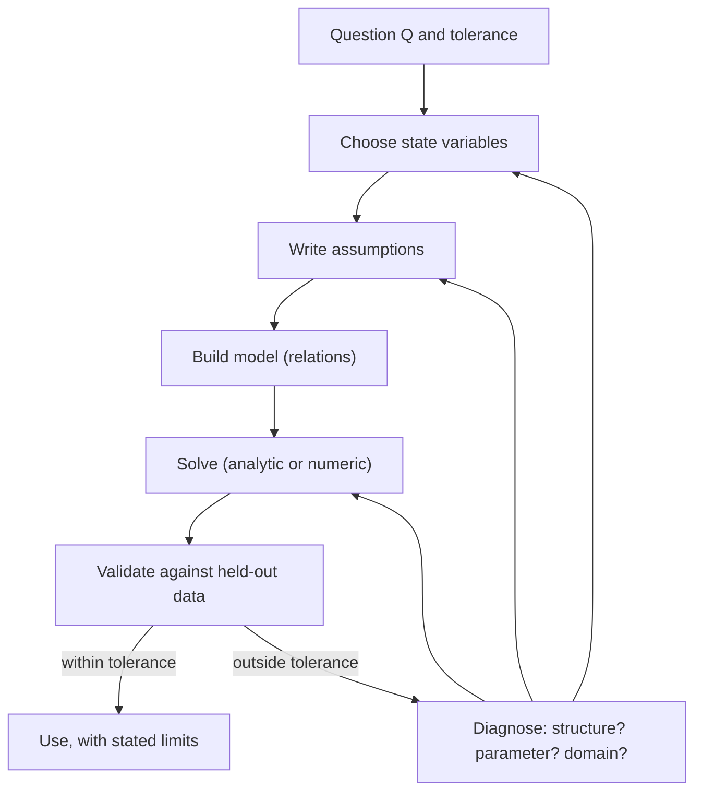
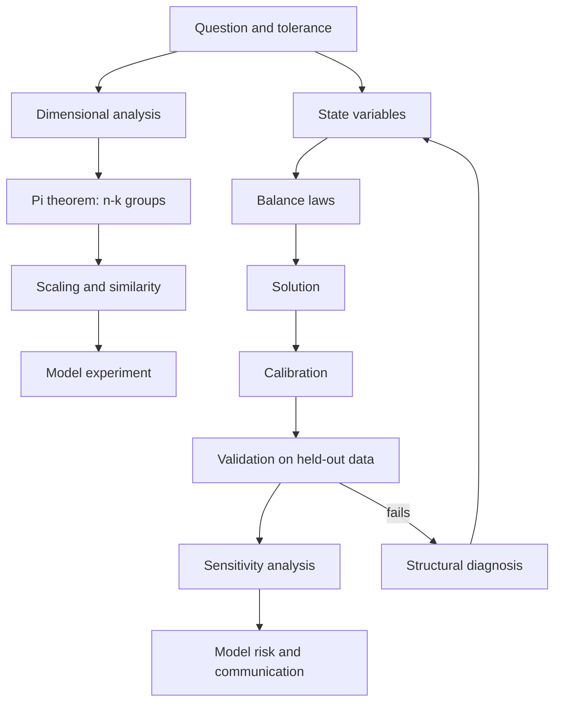

# Principles of Modeling

> [Mathematics](../../README.md) › [Mathematical Modeling](../README.md) · Level: Intermediate · Prerequisites: [Applications of Derivatives](../../07-calculus/05-applications-of-derivatives/README.md), [Multivariable Calculus](../../07-calculus/12-multivariable-calculus/README.md), [First-Order Differential Equations](../../16-differential-equations/01-first-order-odes/README.md), [Matrices](../../08-linear-algebra/02-matrices/README.md) · Estimated time: 7 h

## 1. Introduction

A model is a deliberately impoverished description of something real, built so that questions about the thing become questions about mathematics. Everything else in this discipline — population dynamics, epidemics, optimisation, stochastic simulation — is an application of the ideas gathered here. This topic asks the prior questions: what is a model, how is one built, how is one tested, and how does one know when the answer is about the world rather than about the assumptions?

The activity is old. Ptolemy's epicycles were a model of planetary motion; Newton's *Principia* was a model of motion itself, and it introduced the pattern that still governs the subject: choose state variables, write a rate law for each, solve, compare with observation. Fourier's heat equation (1807), Lotka's and Volterra's predator–prey equations (1925–1926), Black and Scholes' option formula (1973) and the general circulation models behind climate prediction are the same pattern applied to heat, fish, money and atmosphere. What has changed is not the logic but the size: a modern climate model is a few million lines of code whose behaviour nobody can inspect in full, and the question "is this model right?" has to be answered statistically, by comparison with data, rather than by checking a derivation.

The subject therefore has two halves. The **constructive** half is technique: how to abstract a system, what to keep and what to discard, how to check that an equation is not nonsense, how to reduce the number of parameters before any data are collected. **Dimensional analysis** is the sharpest tool here, and the **Buckingham π theorem** is its central result: a relation among $n$ dimensional quantities built from $k$ independent dimensions is equivalent to a relation among $n-k$ dimensionless groups, and nothing more can be said without further information. **Scaling** then turns those groups into predictions — why a pendulum's period does not depend on its mass, why a mouse eats far more per gram than an elephant, why a 1:50 model ship must be tested at $1/\sqrt{50}$ of the prototype's speed.

The **critical** half is judgement. A model is an argument, and every argument has premises. Section 7.7 catalogues the standard premises — well-mixedness, constant rates, independence, linearity, equilibrium — and shows what happens when each fails. Section 7.8 separates **calibration** (choosing parameters so the model matches data) from **validation** (testing whether it predicts data it has not seen), a distinction that is routinely blurred and whose blurring is the single most common way a model misleads. Section 7.9 quantifies **sensitivity**, because a prediction that changes by a factor of ten when a parameter changes by one per cent is not a prediction. Section 7.10 takes up **model risk**: the harm that comes not from a model being wrong but from its being believed.

The phrase usually attached to this is George Box's: *"all models are wrong, but some are useful"* (1976). The first clause is a tautology — a model is not its object — and the second is the whole problem, because "useful" is relative to a purpose. A model that predicts tomorrow's weather is useful for a picnic and useless for a bridge; a model that explains why hare and lynx populations cycle is useful for ecology and useless for forecasting. Sections 7.11–7.13 work through three case studies — predator and prey, traffic, scheduling — chosen because in each one the gap between what the mathematics shows and what a naive reader would infer is instructive.

## 2. Prerequisites

**Calculus** ([Applications of Derivatives](../../07-calculus/05-applications-of-derivatives/README.md)). Derivatives as instantaneous rates; the chain rule; the fact that a differentiable function is locally linear, which is the justification for every linearisation in Section 7.9. Maximisation of a one-variable function by setting the derivative to zero is used to derive the maximum sustainable yield in the sibling topic and the capacity of a road in Section 7.12.

**Multivariable calculus** ([Multivariable Calculus](../../07-calculus/12-multivariable-calculus/README.md)). Partial derivatives, the gradient, and the idea of a directional derivative — needed for sensitivity analysis of a model with several parameters, and for the implicit function theorem in the proof of the π theorem.

**Differential equations** ([First-Order Differential Equations](../../16-differential-equations/01-first-order-odes/README.md)). The balance law $\dot x = \text{in} - \text{out}$ as an ODE; separation of variables; equilibria and their linear stability in one dimension. Section 7.3 uses only these; the case studies in §7.11–7.13 use two-dimensional systems, but only their equilibria and nullclines.

**Linear algebra** ([Matrices](../../08-linear-algebra/02-matrices/README.md)). Matrix–vector multiplication, rank, null space and the rank–nullity theorem. The proof of the π theorem in Section 8 is a rank–nullity argument and nothing else.

**Not assumed.** No statistics beyond a mean and a residual, no programming, no numerical methods.

## 3. Learning Objectives

After this tutorial you will be able to:

1. State what a mathematical model is, distinguish it from the system it represents, and explain why "wrong" and "useless" are independent judgements.
2. Write down the modelling cycle and place any given modelling paper or report at a point on it.
3. Distinguish state variables from rate variables and derive a balance law from a verbal description of a system.
4. Check dimensional homogeneity of an equation, derive the dimensions of an unknown constant, and detect a physically impossible formula by inspection.
5. State the Buckingham π theorem with its hypotheses, prove it in the monomial case, and apply it to construct dimensionless groups from a variable list.
6. Distinguish what dimensional analysis determines (the form of a relation) from what it cannot (the dimensionless function or constant).
7. Apply geometric, kinematic and dynamic similarity to scale a model experiment, and explain why Froude and Reynolds scaling cannot both be satisfied.
8. Identify the four kinds of assumption in a model, locate the parameter range in which each fails, and describe the qualitative change in behaviour at failure.
9. Distinguish calibration from validation, describe what a residual plot can and cannot show, and explain why a model with zero training error may have no predictive value.
10. Compute local normalised sensitivity coefficients, propagate relative uncertainty linearly, and identify parameters at which sensitivity diverges.
11. Explain model risk, name three mechanisms by which a model can cause harm, and state the questions an honest model report answers.
12. Apply the checklist of Section 7.14 to a new problem and produce a written model specification.

## 4. Intuition

### 4.1 A map is not the territory

A road map is a model of a landscape. It is wrong in almost every respect: it omits buildings, gradients, trees, and the colour of the soil. It is useful because it preserves one relation — adjacency along roads — and because it is small enough to hold. Enlarge it to include everything and it becomes the landscape again, and loses its only advantage.

Three lessons come out of this analogy and they organise the whole topic. First, **omission is the point**: a model that omits nothing helps with nothing. Second, **omission must be selective**: the map preserves precisely the relation the traveller needs, and the modeller must decide, before building, which relations matter. Third, **usefulness is relative to a question**: the same landscape yields a road map, a geological map, a rainfall map, and a soil map, each useless for the others' purpose.

### 4.2 The best model is the simplest one that answers the question

There is a famous remark attributed to Einstein: "everything should be made as simple as possible, but not simpler." In modelling it has a precise form. Adding a mechanism that the data cannot distinguish adds parameters, and each parameter is a knob that can be turned to fit noise. A model with more parameters than the data can support will fit perfectly and predict nothing. The skill is not to build the most detailed model but to find the smallest one whose predictions are insensitive to what has been left out.

### 4.3 Every number carries its units

Physicists check equations by units, and the habit is worth acquiring before anything else. If a formula equates a length to a time, one of the two is wrong, and no amount of algebra will save it. Dimensional analysis goes further: it says that in a great many cases the *form* of a physical law is forced by the units alone, up to a single unknown function of dimensionless combinations. That is a remarkable amount of information from such a cheap test, and Section 7.5 extracts all of it.

### 4.4 A model is an argument, and an argument can be valid and false

In logic, an argument is valid if its conclusion follows from its premises, and sound if the premises are also true. A model is always *valid* in this sense when it is correctly derived — the mathematics is checkable — and it is *sound* only when the assumptions describe the situation. Almost every public disagreement about a model is a disagreement about a premise that neither side has stated. Writing the premises down, in order, with the range over which each is claimed to hold, is therefore not paperwork; it is the substance of the work.

## 5. Formal Definition

### 5.1 Models

**Definition 5.1.1 (Mathematical model).** Let $S$ be a system — a part of the world about which a question $Q$ has been asked. A *mathematical model of $S$ relative to $Q$* is a quadruple

$$M = (X,\ \phi,\ \mathcal{R},\ \iota)$$

where

* $X$ is the *state space*, a set of mathematical objects;
* $\phi$ assigns to each state of $S$ (as far as $Q$ distinguishes states) a point of $X$;
* $\mathcal{R}$ is a collection of relations on $X$ — equations, inequalities, recursions — asserted to hold for the states in $\phi[S]$;
* $\iota$ is an *interpretation*: a rule assigning to each $x \in X$ a statement about $S$.

The model is **well posed** if for every admissible initial state there is exactly one solution trajectory in $X$. It is **valid on a domain $D \subseteq X$ for a tolerance $\varepsilon$** if for every $x \in D$ the statement $\iota(x)$ agrees with measurement of $S$ to within $\varepsilon$.

Two consequences are worth stating explicitly, because they are usually left implicit. First, validity is *relative to $Q$ and to $\varepsilon$*: there is no such thing as a valid model in the abstract. Second, the same $X$ and $\mathcal{R}$ with a different $\iota$ is a different model for a different question — a point that Section 7.10 turns against careless reuse.

**Definition 5.1.2 (Modelling cycle).** The *modelling cycle* is the procedure

$$\text{question} \to \text{assumptions} \to \text{model} \to \text{solution} \to \text{validation} \to \text{revision}$$

where *revision* returns to any earlier stage, and where the cycle terminates only when the validated model answers the question to the required tolerance.

The cycle is not a pipeline: an arrow backwards is the normal case, and a model that survives validation unchanged on the first pass is unusual.

### 5.2 Assumptions

**Definition 5.2.1 (Kinds of assumption).** An *assumption* is a statement about $S$ adopted without proof in order to make the model determinate. Four kinds are distinguished, because they fail differently.

| Kind | What it fixes | Example | How it fails |
|---|---|---|---|
| structural | which variables exist and which may influence which | "the population is spatially uniform" | a new variable enters, or the neglected one becomes decisive |
| constitutive | the functional form of a relation | "the predation rate is proportional to $xy$" | saturation, thresholds, saturation of a response |
| parametric | numerical values of constants | "$r = 0.4$ per year" | the value drifts, or was estimated outside the fitted range |
| domain | the region in which the model is claimed to hold | "$0 \le N \le K$" | extrapolation outside the region |

A **simplifying assumption** is one that is adopted for tractability and is known to be false; a **substantive assumption** is one that is believed. The distinction matters because a simplifying assumption that fails produces an error that is often estimable, while a substantive assumption that fails produces an error that may be invisible.

### 5.3 State and rate

**Definition 5.3.1 (State and rate variables).** A *state variable* is a quantity whose value at time $t$ is fixed by the initial condition and the inputs; mathematically it is a coordinate of $X$. A *rate variable* is the derivative of a state variable with respect to time, or more generally a flux across the boundary of a control volume. A model of a dynamical system consists of one rate equation per state variable.

**Definition 5.3.2 (Balance law).** For a control volume $V$ and a quantity with density $\rho$,

$$\frac{d}{dt}\int_V \rho \, dV = \underbrace{-\oint_{\partial V} \mathbf{j}\cdot d\mathbf{A}}_{\text{net flux in}} + \underbrace{\int_V s\,dV}_{\text{net production}}$$

where $\mathbf{j}$ is the flux density and $s$ the source density. In the well-mixed case this becomes the ordinary differential equation $\dot X = (\text{inflow}) - (\text{outflow}) + (\text{production})$, which is the single most useful equation in applied mathematics.

The distinction between state and rate is not cosmetic. A model states which quantities are *remembered* by the system; everything else is computed from them. Choosing the memory wrongly is the most expensive of all modelling errors, because the resulting model can be fitted to data and still be structurally wrong: no value of the parameters repairs a missing state variable.

### 5.4 Dimensions

**Definition 5.4.1 (Dimension).** Write $L, M, T, \Theta$ for the dimensions of length, mass, time and thermodynamic temperature. The *dimension* of a quantity $q$ is a vector

$$[q] = (a_1,\dots,a_k) \in \mathbb{Z}^k$$

read as "length to the power $a_1$, mass to the power $a_2$, and so on". Products multiply dimension vectors, quotients subtract them, and powers scale them: $[q^p] = p\,[q]$.

**Definition 5.4.2 (Dimensional homogeneity).** An equation is *dimensionally homogeneous* if every additive term in it has the same dimension. A dimensionally homogeneous equation is invariant under a change of units; a non-homogeneous one changes meaning when the units change, and is therefore not a statement about the world.

**Definition 5.4.3 (Dimension matrix).** If $q_1,\dots,q_n$ are the quantities in a proposed law and $[q_j] = (a_{1j},\dots,a_{kj})$, the *dimension matrix* is the $k \times n$ matrix $A = (a_{ij})$. Its rank $k$ is the number of *independent* dimensions actually used.

**Definition 5.4.4 (Dimensionless group).** A monomial $\pi = q_1^{e_1}\cdots q_n^{e_n}$ is a *dimensionless group* for the list $q_1,\dots,q_n$ if $\sum_j a_{ij}e_j = 0$ for every $i$; equivalently if $A\mathbf{e} = \mathbf{0}$, so the exponent vectors are exactly the null space of $A$.

### 5.5 Sensitivity

**Definition 5.5.1 (Local normalised sensitivity).** Let $y = f(p_1,\dots,p_m)$ be a model output depending differentiably on parameters $p_i \ne 0$. The *(local normalised) sensitivity* of $y$ to $p_i$ is

$$S_i = \frac{\partial y}{\partial p_i}\cdot\frac{p_i}{y} = \frac{\partial \ln \lvert y\rvert}{\partial \ln \lvert p_i\rvert}.$$

The second form explains the name *logarithmic sensitivity*, and the interpretation: $S_i$ is the percentage change in $y$ per one per cent change in $p_i$, at the operating point. A model is *robust* to $p_i$ at that point when $\lvert S_i\rvert \ll 1$ and *fragile* when $\lvert S_i\rvert \gg 1$.

### 5.6 Calibration and validation

**Definition 5.6.1 (Calibration).** Given a model family $y = f(p;\,x)$ and data $\{(x_k,y_k)\}_{k=1}^{N}$, *calibration* is the choice of $\hat p$ minimising a discrepancy, usually

$$\hat p = \arg\min_p \sum_{k=1}^{N}\bigl(y_k - f(p;x_k)\bigr)^2 .$$

The resulting $\hat p$ are *estimates* and carry uncertainty, which the notation $\hat p$ is meant to signal.

**Definition 5.6.2 (Validation).** *Validation* is the comparison of model predictions with data not used in calibration. If the data used for calibration are $\mathcal{D}_{\text{train}}$ and those for validation are $\mathcal{D}_{\text{test}}$, with $\mathcal{D}_{\text{train}} \cap \mathcal{D}_{\text{test}} = \varnothing$, a model is *validated on $\mathcal{D}_{\text{test}}$ to tolerance $\varepsilon$* if the prediction error on $\mathcal{D}_{\text{test}}$ is at most $\varepsilon$.

Calibration error alone says nothing about predictive value. A polynomial of degree $N-1$ through $N$ points has zero calibration error and, in general, unbounded error everywhere else — see Section 9, Example 9.6.

## 6. Mathematical Notation

| Symbol | Read as | Meaning |
|---|---|---|
| $S$ | the system | the part of the world being modelled |
| $M$ | the model | the quadruple of Definition 5.1.1 |
| $X$ | state space | set of mathematical states |
| $\phi$, $\iota$ | encoding, interpretation | maps between system and mathematics |
| $x(t)$ | state at time $t$ | a point or vector in $X$ |
| $\dot x$, $x'$ | $x$ dot, $x$ prime | derivative with respect to time |
| $q_1,\dots,q_n$ | the quantities | the dimensional variables and constants in a proposed law |
| $[q]$ | dimension of $q$ | exponent vector in $\mathbb{Z}^k$ |
| $A$ | dimension matrix | $k \times n$ matrix of exponents |
| $k$ | number of independent dimensions | $\operatorname{rank} A$ |
| $n$ | number of quantities | length of the variable list |
| $m = n-k$ | number of groups | dimension of the null space of $A$ |
| $\pi_i$ | pi group | a dimensionless monomial |
| $\Phi$, $F$ | the unknown function | what dimensional analysis cannot determine |
| $\mathrm{Re} = \rho v L/\mu$ | Reynolds number | inertia over viscosity |
| $\mathrm{Fr} = v/\sqrt{gL}$ | Froude number | inertia over gravity |
| $\mathrm{Ma} = v/c$ | Mach number | speed over speed of sound |
| $\mathrm{Pe} = vL/D$ | Péclet number | advection over diffusion |
| $S_i$ | sensitivity | $\partial \ln y/\partial \ln p_i$ |
| $\hat p$ | p hat | an estimated (calibrated) parameter |
| $\mathcal{D}$ | script D | a data set |
| $\varepsilon$ | epsilon | a stated tolerance |

Read $[q]$ aloud as "the dimensions of $q$", and $\mathrm{Re}$ as "Reynolds number" or "Reynolds' number", never spelled out letter by letter.

## 7. Core Concepts

### 7.1 What a model is, and what it is not

A model is not a smaller copy of a system, and it is not a summary of the data. It is a *mechanism*: a set of relations that, given inputs, produces outputs. Three consequences follow.

*Prediction without mechanism is not a model.* Fitting a curve to a time series produces a rule for extending the curve. It is often useful, and it is called an empirical model, but its extrapolation is uncontrolled because nothing in it says what happens when the mechanism changes.

*Mechanism without validation is not a model either.* A beautiful derivation whose parameters were never compared with data is a conjecture about the world.

*A model is always for a purpose.* Define 5.1.1 makes the question $Q$ part of the definition, and this is not pedantry: "how many deer will there be in 2050?" and "why do deer populations cycle?" may need different models of the same forest, and a model good for one may be worthless for the other.

The practical test of whether something is a model is that it can be *wrong in a specific way*. A model that cannot fail — one with a free parameter for every contingency, or with an output that no observation could contradict — is not making a claim and cannot inform a decision.

### 7.2 The modelling cycle

Each arrow backwards corresponds to a different diagnosis, and the diagnosis is the skilled part.

*Return to the state variables* when the model cannot reproduce a qualitative feature no matter what the parameters are — for example, when observed populations oscillate but the model with any parameters converges to a constant. That is a *structural* failure.

*Return to the assumptions* when the fit is good in one regime and catastrophic in another, which usually means a constitutive relation (a rate law) changes form across the boundary.

*Return to the solution* when the equations are right but the numerical method is not converged, or when a closed-form approximation (a linearisation, a continuum limit) is used outside its range.

### 7.3 State, rate, and the balance law

Almost every dynamical model in this repository has the same skeleton. Partition the quantities into those the system *remembers* (state) and those it *computes* (rates, fluxes). Then write one balance per state variable.

**Example: a draining tank.** Let $h(t)$ be the water depth in a tank of cross-section $A$, fed at volume rate $q$ and drained through a hole of area $a$. Torricelli's law gives the efflux velocity $\sqrt{2gh}$, so

$$A\,\frac{dh}{dt} = q - a\sqrt{2gh}.$$

Here $h$ is the state, $q$ and $a\sqrt{2gh}$ are rates, and the equation says that the rate of change of volume equals inflow minus outflow. The model has one state variable and one parameter pair $(a,q)$; its equilibrium is $h^* = q^2/(2ga^2)$, obtained by setting $\dot h = 0$ and solving.

**Example: a bank account.** With balance $B$, interest rate $r$ and deposit rate $d$, $\dot B = rB + d$. The state is $B$; the interest is a rate proportional to the state, which is what makes the equation linear and its solution exponential.

**Why the choice of state matters.** Suppose a model of a queue keeps only the number of customers waiting, not their arrival times. Then it cannot represent a first-come-first-served discipline, because that discipline depends on information the state does not contain. Adding a parameter will not help: the missing structure is information, not a number. This is the sense in which a wrong state space is unfixable.

### 7.4 Dimensions and units

Every quantity in a physical model has a dimension, a product of powers of the fundamental ones. The following table is worth memorising; the right-hand column is obtained by substituting definitions ($F = ma$, $E = Fd$, $p = F/A$, and so on).

| Quantity | Symbol | Dimension |
|---|---|---|
| length | $L$ | $L$ |
| mass | $M$ | $M$ |
| time | $T$ | $T$ |
| velocity | $v$ | $LT^{-1}$ |
| acceleration | $a$, $g$ | $LT^{-2}$ |
| force | $F$ | $MLT^{-2}$ |
| energy, work | $E$, $W$ | $ML^2T^{-2}$ |
| power | $P$ | $ML^2T^{-3}$ |
| pressure, stress | $p$, $\sigma$ | $ML^{-1}T^{-2}$ |
| density | $\rho$ | $ML^{-3}$ |
| dynamic viscosity | $\mu$ | $ML^{-1}T^{-1}$ |
| kinematic viscosity | $\nu = \mu/\rho$ | $L^2T^{-1}$ |
| surface tension | $\gamma_s$ | $MT^{-2}$ |
| spring constant | $k$ | $MT^{-2}$ |
| thermal conductivity | $\kappa$ | $MLT^{-3}\Theta^{-1}$ |
| specific heat capacity | $c_p$ | $L^2T^{-2}\Theta^{-1}$ |
| diffusivity | $D$ | $L^2T^{-1}$ |

Three rules make the table usable.

1. **Only like may be added.** In $\sum_i t_i$, every $t_i$ must have the same dimension. Sums of a length and a time are forbidden; sums of a length and a length are fine whatever the units.
2. **Transcendental arguments are dimensionless.** The expressions $\sin z$, $\exp z$, $\ln z$, $\arctan z$ require $[z] = 0$. A formula containing $\exp(-t/\tau)$ is correct only because $t$ and $\tau$ share a dimension; writing $\exp(-rt)$ with $r$ a rate is fine, writing $\exp(-rt)$ with $r$ a length is not.
3. **Dimensionless is not the same as unitless.** An angle has dimension $0$ but two units, radian and degree, and a factor $180/\pi$ separates them. A strain, a ratio, a probability, a Reynolds number and a Mach number are all dimensionless and all carry information.

Dimensional homogeneity is *necessary* and not *sufficient*: $v = 2gh$ and $v = \sqrt{2gh}$ are both homogeneous ($[gh] = L^2T^{-2}$ and $[v^2] = L^2T^{-2}$), and only one is right. Homogeneity catches errors of the first kind, not of the second.

### 7.5 The Buckingham π theorem

The theorem answers a precise question: *given a list of quantities and the assumption that the law relating them is independent of the units chosen, how many independent dimensionless combinations can there be?*

**Theorem 7.5.1 (Buckingham, 1914).** Let $q_1,\dots,q_n > 0$ have dimension matrix $A \in \mathbb{Z}^{k\times n}$ of rank $k$. Let $f : \mathbb{R}_{>0}^n \to \mathbb{R}$ satisfy, for all $\lambda_1,\dots,\lambda_k > 0$,

$$f\Bigl(\lambda_1^{a_{11}}\cdots\lambda_k^{a_{k1}}q_1,\ \dots,\ \lambda_1^{a_{1n}}\cdots\lambda_k^{a_{kn}}q_n\Bigr) = f(q_1,\dots,q_n).$$

Then $m = n - k$ dimensionless groups $\pi_1,\dots,\pi_m$ exist such that $f(q) = F(\pi_1(q),\dots,\pi_m(q))$ for some function $F$ of $m$ arguments. In particular, the equation $f(q) = 0$ is equivalent to $F(\pi_1,\dots,\pi_m) = 0$.

**Proof.** Work in logarithms: put $u_j = \ln q_j$ and $g(u) = f(e^{u_1},\dots,e^{u_n})$. A scaling by $\lambda$ acts on $u$ as $u \mapsto u + A^{\mathsf T}w$ with $w = (\ln\lambda_1,\dots,\ln\lambda_k)$, so the hypothesis becomes $g(u + A^{\mathsf T}w) = g(u)$ for all $w \in \mathbb{R}^k$. Relabel the quantities so that the first $k$ columns of $A$ form an invertible block $A_1$; this is possible because $\operatorname{rank} A = k$. Given $u$, choose $w$ with $A_1^{\mathsf T} w = -u_I$, where $u_I$ is the first $k$ entries of $u$; the block invertibility gives $w = -(A_1^{\mathsf T})^{-1}u_I$, uniquely. Then $u + A^{\mathsf T}w$ has first $k$ entries equal to $0$, and its remaining entries equal

$$u_{II} - A_2^{\mathsf T}(A_1^{\mathsf T})^{-1}u_I,$$

where $A_2$ is the $k\times m$ block of the last $m$ columns. Invariance gives

$$g(u) = g\bigl(0,\ u_{II} - A_2^{\mathsf T}(A_1^{\mathsf T})^{-1}u_I\bigr),$$

so $g$ depends only on those $m$ combinations. Writing $C = A_2^{\mathsf T}(A_1^{\mathsf T})^{-1} = (c_{ij})$, the $i$-th combination is $\ln q_{k+i} - \sum_{j \le k}c_{ij}\ln q_j$, and exponentiation gives $m$ groups

$$\pi_i \;=\; q_{k+i}\prod_{j=1}^{k} q_j^{-c_{ij}}, \qquad i = 1,\dots,m .$$

Hence $f(q) = F(\pi(q))$ with $F$ the function of $m$ variables just described. $\blacksquare$

The proof shows more than the statement: the groups are constructed by solving for $m$ of the variables in terms of the other $k$, and the exponent vectors $-C$ are exactly a basis of the null space of $A$ (row-reduction of $A$ produces the same $C$). It also shows where the theorem stops. It reduces $n$ unknowns to $n-k$, and no further: the function $F$ is *not* determined. In a formula, the theorem gives the form *up to a dimensionless function*.

**Procedure.** To apply the theorem:

1. **List the quantities.** Include every dimensional quantity that could matter, and no others. This is a modelling decision: the theorem cannot detect a variable you forgot, and a forgotten variable silently inflates the number of groups.
2. **Write the dimension matrix** $A$, with one column per quantity and one row per fundamental dimension actually appearing.
3. **Compute $k = \operatorname{rank} A$** and $m = n - k$. This is the number of independent groups.
4. **Find a basis of the null space** of $A$: $m$ exponent vectors $\mathbf e^{(1)},\dots,\mathbf e^{(m)}$.
5. **Exponentiate**: $\pi_i = \prod_j q_j^{e^{(i)}_j}$.
6. **Write the law** as $F(\pi_1,\dots,\pi_m) = 0$, and solve for the group containing the output.
7. **Obtain $F$ elsewhere** — from a further model, from experiment, or from a numerical solution.

Step 7 is where most of the work lives, and step 1 is where most of the mistakes live.

**Worked form: the pendulum.** Quantities: period $T$, length $L$, gravitational acceleration $g$, bob mass $m$. With rows $(M,L,T)$,

$$A = \begin{pmatrix} 0 & 0 & 0 & 1\\ 0 & 1 & 1 & 0\\ 1 & 0 & -2 & 0\end{pmatrix}, \qquad \operatorname{rank} A = 3,\quad n = 4,\quad m = 1 .$$

The null space is spanned by $(-1/2,\,1/2,\,-1/2,\,0)$, so the single group (up to a power) is

$$\pi = T\sqrt{\frac{g}{L}}, \qquad\text{hence}\qquad T = C\sqrt{\frac{L}{g}} .$$

The theorem has produced the structure and the fact that $T$ is independent of $m$ — a real, checkable prediction — and has left $C$ undetermined. In fact $C = 2\pi$, which requires solving the equation of motion.

**What the theorem cannot do.** It cannot supply $C$; it cannot tell you that your variable list is complete; it cannot represent a law with an additive constant of fixed dimension (an offset $q_0$ must be carried as an extra variable); and it gives no information at all about already-dimensionless inputs, which simply enter $F$ as extra arguments. The last point is the one most often missed: the period of a *large-amplitude* pendulum depends on the amplitude $\theta_0$, which is dimensionless, so the correct statement is $T\sqrt{g/L} = \Phi(\theta_0)$ with $\Phi(0) = 2\pi$ and $\Phi(\pi/2) \approx 7.416$ — dimensional analysis alone can never produce the number $7.416$.

### 7.6 Scaling and similarity

**Geometric similarity.** Two bodies are geometrically similar with scale factor $\lambda$ if every length in the second equals $\lambda$ times the corresponding length in the first. Then every area scales by $\lambda^2$, every volume by $\lambda^3$, and — with equal densities — every mass by $\lambda^3$.

**Kinematic similarity.** Two motions are kinematically similar if corresponding particles traverse corresponding distances in corresponding times. If lengths scale by $\lambda$ and velocities by $\mu$, then times scale by $\lambda/\mu$.

**Dynamic similarity.** Two flows are dynamically similar if the forces are in the same ratio at corresponding points. Equivalently, every dimensionless group formed from the governing variables is equal in the two flows.

The link to Section 7.5 is one line: if both systems obey the same law $F(\pi_1,\dots,\pi_m)=0$, and all $\pi_i$ agree, then the dimensionless output agrees. So a model experiment predicts a prototype exactly when all groups match. That requirement is usually impossible to meet when $m \ge 2$: matching one group fixes the test speed, matching another fixes a different speed.

**Froude and Reynolds scaling.** For a ship, the two groups that matter are the Froude number $\mathrm{Fr} = v/\sqrt{gL}$ (inertia over gravity, governing wave-making resistance) and the Reynolds number $\mathrm{Re} = \rho vL/\mu$ (inertia over viscosity, governing skin friction). At scale factor $\lambda = L_m/L_p$:

* Froude matching $\mathrm{Fr}_m = \mathrm{Fr}_p$ requires $v_m = v_p\sqrt{\lambda}$.
* Reynolds matching $\mathrm{Re}_m = \mathrm{Re}_p$ requires $v_m = v_p/\lambda$ (same fluid).

For $\lambda = 1/50$ these differ by a factor $\lambda^{-3/2} = 50^{3/2} \approx 354$. No single test satisfies both, so naval architects test at Froude speed (waves dominate) and add an empirical friction correction — a *modelling compromise*, made explicit, rather than a solution.

**Galileo's square–cube law.** Consider a family of geometrically similar animals of density $\rho$, characterised by a length $L$. Mass $M \propto \rho L^3$; the cross-sectional area of a supporting bone $A \propto L^2$; the compressive stress under self-weight is

$$\sigma = \frac{Mg}{A} \propto \frac{L^3}{L^2} = L .$$

Stress grows *linearly with size*. This is the fundamental reason why an ant scaled to human size would collapse, and why large animals have disproportionately thick limb bones. It is also the reason that "just build it bigger" is a modelling error: geometric similarity of a structure does not preserve its safety factor.

**Allometry.** Where geometry fixes the exponent, the relation is *isometric*: any quantity with dimension $L^p$ scales as $M^{p/3}$. Metabolism has dimension of power, $ML^2T^{-3}$, so isometry would give $B \propto M^{2/3}$. Measurements give $B \propto M^{3/4}$ (Kleiber's law, 1932), a regularity that holds across an enormous range of body masses, from unicellular organisms to whales. The exponent $3/4$ is *allometric*: it reflects an internal organisation (a space-filling transport network is the standard explanation) that is not geometrically similar across sizes. Consequently specific metabolic rate $B/M \propto M^{-1/4}$ decreases with size, which is why small mammals must eat a far larger fraction of their body mass each day.

### 7.7 Simplifying assumptions, and when they break

Each assumption below buys tractability and costs fidelity. The third column is the diagnostic signature: what a modeller sees when the assumption has failed.

| Assumption | What it buys | Failure signature |
|---|---|---|
| well-mixed (no spatial structure) | state is a finite vector, no PDEs | pattern formation, sharp fronts, localised outbreaks |
| constant environment | autonomous equations | parameters drift; the same model works one year and not the next |
| constant parameters | one calibration for all time | residual trend; the estimate depends on the fitting window |
| linearity | superposition, closed-form solutions | thresholds, hysteresis, sudden jumps |
| independence of individuals | mass action; no correlations | clustering, herding, Allee effects |
| deterministic dynamics | unique trajectories | unpredictability at small scales; extinction in finite populations |
| no adaptation or evolution | fixed parameters | resistance, learning, regime change |
| closed system | conservation laws | unexplained drift in totals |
| equilibrium | static analysis applies | transients dominate the observed data |
| scale separation | averaging is legitimate | the small scale contaminates the large one |

Two distinctions make this table usable. The first is **approximation versus idealisation**. Approximating $1.01^{100}$ by $e$ is an approximation: the error is bounded and can be estimated. Treating a population as infinite is an idealisation: there is no error bound, and the qualitative predictions can differ in kind. The second is **robustness versus fragility**. A conclusion is robust if it survives relaxing the assumption; fragile if it does not. The most valuable sentence in any modelling report states which conclusions are robust and which depend on a premise.

**Structural instability.** When an assumption fails, the model may not merely become inaccurate: its qualitative behaviour may change. The classical example is the harvested logistic model, whose equilibrium count drops from two to zero at a critical harvest: nothing about the formula changes, but the number of solutions does. Such a change is a **bifurcation**, and a parameter value at which one occurs is a **tipping point**. Models near a bifurcation are exactly the models whose predictions are least reliable, because the qualitative answer depends on which side of the threshold the parameter lies.

### 7.8 Calibration and validation

**Calibration** chooses parameters to make the model match data. Minimising the sum of squared residuals is the default; it is a *choice*, justified by a noise model (independent, equal-variance, Gaussian errors) that should be stated. Calibration is not evidence that the structure is right.

**Identifiability** is the first thing to check. If two parameters always occur in the combination $ab$, no data can separate them: the model has a one-parameter family of equally good fits. The cure is reparameterisation (use $ab$ as the parameter) or new data (a different input regime in which the combination changes). A model with non-identifiable parameters cannot be validated parameter by parameter, however good its fit.

**Validation** compares predictions with data not used in calibration. Four grades, in increasing strength:

1. *In-sample fit* — residuals on the calibration data. Weakest; a $N-1$ degree polynomial passes it with $N$ points.
2. *Hold-out* — fit on a subset, test on the rest. The minimum credible standard.
3. *Prospective* — predict before observing. Standard in clinical trials and weather forecasting.
4. *Out-of-regime* — predict in conditions never seen in calibration. This is where models actually fail and the only test that speaks to extrapolation.

**Residuals.** Plot $e_k = y_k - \hat y_k$ against fitted value, against each input, and against time. Structure in the residuals means the model has missed something systematic; a residual mean of zero with a trend is a misspecification, not noise. Residuals cannot detect a wrong model that happens to fit — **equifinality**, the existence of genuinely different structures with indistinguishable outputs. Since the 1970s, hydrology has produced many examples of structurally different catchment models with equal fit and different predictions under changed conditions.

### 7.9 Sensitivity analysis

Sensitivity asks: which inputs does the answer depend on, and how strongly? The local normalised coefficient of Definition 5.5.1 is the standard instrument, with two elementary properties that follow from the product rule.

**Proposition 7.9.1 (Chain and product rules).** For differentiable positive functions,
$$S_i(fg) = S_i(f) + S_i(g), \qquad S_i(f/g) = S_i(f) - S_i(g), \qquad S_i(f^{\alpha}) = \alpha S_i(f).$$

*Proof.* Each identity is the logarithmic derivative of the corresponding multiplicative identity: $\ln(fg) = \ln f + \ln g$, and differentiation with respect to $\ln p_i$ is linear. $\blacksquare$

**Uncertainty propagation.** If the parameters vary by small relative amounts $\delta p_i/p_i$, then to first order
$$\frac{\delta y}{y} \approx \sum_{i} S_i\,\frac{\delta p_i}{p_i}, \qquad\text{so}\qquad \left\lvert\frac{\delta y}{y}\right\rvert \le \sum_i \lvert S_i\rvert\left\lvert\frac{\delta p_i}{p_i}\right\rvert .$$
For independent random relative errors with variances $\sigma_i^2$, the variance of $\ln y$ is approximately $\sum_i S_i^2\sigma_i^2$. The quadratic sum is the right rule when errors are independent, and the linear sum is the right bound when they are adversarial.

**Local versus global.** $S_i$ is a derivative at one operating point. It says nothing about behaviour elsewhere, and it is undefined or misleading at a kink or a bifurcation. Global sensitivity varies each parameter over its full plausible range and reports the resulting spread; the standard screening design is Morris's elementary-effects method, and the variance-based decomposition is Sobol's. When a model has a threshold, the local derivative at the threshold is infinite, so a local analysis will report either "no sensitivity" or "infinite sensitivity" depending on which side it is evaluated.

**Sensitivity to structure usually dominates.** Changing a rate law from linear to saturating typically moves predictions further than any plausible change in its parameters. A sensitivity analysis that varies parameters but holds the structure fixed can therefore be comforting and irrelevant. State the structure explicitly, and test at least one alternative.

### 7.10 Model risk and the ethics of models

**Model risk** is the risk of loss from decisions based on a model that is wrong or misapplied. It is not the same as model error: a model may have small error and large risk if its error is systematically in the direction that flatters a decision, or if its users cannot see its assumptions.

Five mechanisms account for most harm.

1. **False precision.** Reporting \$1,234,567 from inputs known to one significant figure. Precision is a claim about knowledge, and unearned precision propagates into decisions. Report intervals, not point estimates.
2. **Hidden assumptions.** A model reported without its premises cannot be criticised, and an uncriticisable model accumulates authority it has not earned. Every assumption in Section 7.7 that the model relies on should be named.
3. **Feedback and Goodhart's law.** When a measure becomes a target, behaviour changes to optimise the measure rather than the thing measured. A model calibrated on a system it influences is no longer predicting that system. Credit scores, university rankings and hospital waiting-time targets are standard examples.
4. **Distributional harm.** A model can be accurate on average and harmful to a subgroup. If a score is used for selection, small differences in error rates translate into large differences in who is selected, and the harm falls on those with least recourse.
5. **Opacity.** A model whose reasoning cannot be inspected cannot be appealed against. This is a procedural objection, independent of accuracy: an accurate but unexplainable decision procedure denies the affected person the possibility of correcting an error specific to them.

The ethical requirements follow from these mechanisms, and they are procedural rather than technical: state the purpose and the intended user; state the assumptions and the validity domain; state the uncertainty; state who bears the cost when the model is wrong; provide a route to contest an individual decision; and re-validate when the system changes. A model is advice, never a decision, and the responsibility for the decision stays with the decision-maker.

### 7.11 Case study: predator and prey

**System and question.** Two species in one habitat; does the pair oscillate, and with what period?

**State.** Prey density $x(t)$ and predator density $y(t)$.

**Assumptions.** (i) Prey have unlimited food, so their per-capita growth is constant, $a$. (ii) Encounters are proportional to $xy$ (well-mixed, random search), and each encounter removes one prey and creates predators at rate $\delta xy$. (iii) Predators die at a constant per-capita rate $c$. (iv) No carrying capacity, no age structure, no spatial structure, no satiation.

**Model.** $\dot x = ax - bxy$, $\dot y = \delta xy - cy$, all constants positive.

**What it shows.** Writing $H = \delta x - c\ln x + by - a\ln y$, a direct computation gives $\dot H = 0$, so orbits are the level curves of $H$. Since $H$ is strictly convex with a single minimum at $(c/\delta,\,a/b)$, those level curves are closed loops: every solution is periodic. This is a genuine prediction of sustained oscillation, with amplitude set by the initial condition.

**What it does not show.** The model predicts that the amplitude depends on where the system starts and that the cycles neither grow nor decay. Both are artefacts. Real predator–prey systems are noisy, damped or forced; the neutral cycles exist because the model has no self-limitation and no satiation. Two further failures are well documented: the model cannot represent a predator that saturates (so it predicts that enriching the prey always increases predator numbers, which fails when predators are limited by handling time), and it has no threshold below which the predator dies out.

**Lesson.** A model can be exactly solvable, internally beautiful, and wrong in its central qualitative prediction. The derivation validates the algebra, not the biology.

### 7.12 Case study: traffic

**System and question.** A single lane of road; why do jams form with no obstruction?

**State.** Vehicle density $\rho(x,t)$ in vehicles per kilometre, treated as a continuum.

**Assumptions.** (i) Cars are conserved: no entries or exits. (ii) The speed depends only on the local density through a *fundamental diagram* $v = v(\rho)$, here linear, $v(\rho) = v_{\max}(1-\rho/\rho_{\max})$. (iii) Drivers respond instantaneously (no reaction time).

**Model.** With flux $q = \rho v$, conservation of cars gives

$$\frac{\partial \rho}{\partial t} + \frac{\partial q}{\partial x} = 0, \qquad q(\rho) = v_{\max}\,\rho\left(1 - \frac{\rho}{\rho_{\max}}\right).$$

This is the Lighthill–Whitham–Richards model (1955–1956).

**What it shows.** The flux is a downward parabola in $\rho$, maximal at $\rho_c = \rho_{\max}/2$ with capacity $q_{\max} = v_{\max}\rho_{\max}/4$. With $v_{\max} = 80$ km/h and $\rho_{\max} = 120$ veh/km, this is $2400$ veh/h at $60$ veh/km. The characteristics of the conservation law move with speed

$$c(\rho) = q'(\rho) = v_{\max}\left(1 - \frac{2\rho}{\rho_{\max}}\right),$$

which is *negative* whenever $\rho > \rho_c$. Information and disturbances therefore travel backwards through dense traffic: this is the mathematical content of "the jam moved upstream while I stood still". At $\rho = 90$ veh/km the wave speed is $-40$ km/h.

Across a discontinuity the correct speed is the Rankine–Hugoniot average

$$s = \frac{q(\rho_2) - q(\rho_1)}{\rho_2 - \rho_1} = v_{\max}\left(1 - \frac{\rho_1+\rho_2}{\rho_{\max}}\right),$$

so a jump from $60$ to $100$ veh/km propagates at $-26.7$ km/h.

**What it does not show.** The model has no driver, no reaction time, no lane change and no capacity drop at a bottleneck (observed capacity just downstream of a merge is often $10$–$20\%$ below free-flow capacity). It overestimates capacity because the linear fundamental diagram is a crude fit. It predicts that a jam can form from a smooth initial condition — a genuine and surprising success — but it cannot predict its internal structure.

**Lesson.** A continuum model can capture an emergent phenomenon (backward-propagating jams) while being wrong about every individual.

### 7.13 Case study: scheduling

**System and question.** $n$ jobs must be run on one machine; in what order should they go to minimise the total time customers spend in the system?

**Model.** Job $j$ has processing time $p_j > 0$. If $C_j$ is the completion time of job $j$, the objective is $\sum_{j=1}^n C_j$. This is the classical notation $1\,||\,\sum C_j$.

**What it shows.** Shortest-processing-time first is optimal. *Proof (interchange argument).* Consider two adjacent jobs $A$ and $B$ starting at time $t$, with all else fixed. If $A$ runs first the pair contributes $(t+p_A) + (t+p_A+p_B) = 2t + 2p_A + p_B$; if $B$ runs first the contribution is $2t + 2p_B + p_A$. The first ordering is smaller exactly when $p_A < p_B$. Hence any schedule containing an adjacent inversion (a longer job before a shorter one) can be improved by swapping, and repeated swapping terminates in the SPT order, which is therefore optimal among all $n!$ orders. $\blacksquare$

For $p = (3,1,4,1,5)$ in arrival order, completion times are $3,4,8,9,14$ with sum $38$. The SPT order gives $1,2,5,9,14$ with sum $31$ — a $18\%$ improvement from a one-line rule.

**What it does not show.** The model assumes all jobs are available at time zero, that no due dates matter, that the machine is always available, and that all jobs are equally important. Add release dates and the problem becomes NP-hard; add due dates and the natural objective changes character completely. The lesson is the one this whole topic is about: the answer is only as good as the objective function, and the objective function is a modelling choice, not a fact about the factory.

### 7.14 A checklist for building a model

1. **State the question and the tolerance.** What decision does the answer inform, and how accurate must it be?
2. **Draw the boundary.** What is inside the system, what crosses the boundary, what is treated as external?
3. **List the state variables.** What does the system remember? Justify each; delete any that the question cannot distinguish.
4. **List the rate laws.** For each state, write inflow minus outflow plus production, and name the constitutive assumption for each flux.
5. **Write the assumptions explicitly, with their kind** — structural, constitutive, parametric, domain — and the range over which each is claimed.
6. **Check dimensions** of every equation, and compute the dimensionless groups.
7. **Count the parameters** and check identifiability before collecting data. If two parameters always occur in one combination, reparameterise.
8. **Solve, or compute, and check limiting cases** — zero, infinity, symmetry, and any case with a known answer.
9. **Calibrate** on a stated subset with a stated loss and a stated noise model.
10. **Validate** on held-out data, and report the errors, not only the successes.
11. **Do a sensitivity analysis**, local and at least one global or structural variant; report which conclusions are robust.
12. **State the validity domain, the uncertainty, and the failure consequences**, and say plainly what the model does not show.

## 8. Formulas and Properties

| Result | Statement | Hypothesis | Why it is true |
|---|---|---|---|
| Dimensional homogeneity | every additive term of a physical equation has the same dimension | equation describes the world | a change of units must not change the equation |
| Dimension of a product | $[q^a r^b] = a[q] + b[r]$ | $q,r$ positive | exponents add |
| Rank–nullity | $\dim\ker A = n - \operatorname{rank} A$ | linear map $A:\mathbb{R}^n \to \mathbb{R}^k$ | rank–nullity theorem |
| π theorem | $f(q) = F(\pi_1,\dots,\pi_{n-k})$ | $f$ invariant under all unit scalings, rank $A = k$ | Theorem 7.5.1 |
| Number of groups | $m = n - k$ | as above | rank–nullity |
| Geometric scaling | areas $\propto \lambda^2$, volumes $\propto \lambda^3$ | geometric similarity | similar figures |
| Square–cube law | stress $\propto L$ at constant density | geometric similarity, self-weight loading | $\sigma = Mg/A \propto L^3/L^2$ |
| Isometric exponent | any $L^p$-quantity $\propto M^{p/3}$ | geometric similarity, constant density | $M \propto L^3$ |
| Froude number | $\mathrm{Fr} = v/\sqrt{gL}$ | free-surface flow | ratio of inertia to gravity |
| Reynolds number | $\mathrm{Re} = \rho vL/\mu$ | viscous flow | ratio of inertia to viscosity |
| Froude scaling | $v_m = v_p\sqrt{L_m/L_p}$ | same $g$ | $\mathrm{Fr}$ equality |
| Reynolds scaling | $v_m = v_p (L_p/L_m)$ | same fluid | $\mathrm{Re}$ equality |
| Sensitivity | $S_i = \partial \ln y/\partial \ln p_i$ | $y$, $p_i$ positive and differentiable | chain rule |
| Sensitivity of a product | $S_i(fg) = S_i(f)+S_i(g)$ | $f,g>0$ | logarithm of a product |
| Linear error bound | $\lvert\delta y/y\rvert \le \sum_i \lvert S_i\rvert\lvert\delta p_i/p_i\rvert$ | first order, small relative errors | total differential |
| Independent errors | $\operatorname{Var}(\ln y) \approx \sum_i S_i^2\operatorname{Var}(\ln p_i)$ | independence | variance of a sum |
| OLS estimate | $\hat p = \arg\min \sum_k (y_k - f(p;x_k))^2$ | chosen loss and noise model | definition |
| LWR capacity | $q_{\max} = v_{\max}\rho_{\max}/4$ | linear fundamental diagram | maximum of a downward parabola |
| Kinematic wave speed | $c(\rho) = q'(\rho)$ | scalar conservation law | method of characteristics |
| Shock speed | $s = \Delta q/\Delta\rho$ | jump discontinuity | Rankine–Hugoniot |
| SPT optimality | shortest processing time first minimises $\sum C_j$ | one machine, all jobs at time $0$ | interchange argument (§7.13) |

Two rows deserve a warning. The π theorem's conclusion is *not* "the law has $n-k$ parameters"; it is "the law is a function of $n-k$ dimensionless arguments", and that function may be arbitrarily complicated. And the linear error bound is a *bound*, not an estimate: for independent random errors the quadratic sum is the right first-order estimate, and using the linear sum then overstates the uncertainty.

## 9. Step-by-Step Examples

### Example 9.1 (Easy): dimensions of derived quantities, and one wrong formula

**Problem.** (a) Find the dimensions of pressure, power per unit area, and the ideal-gas constant $R$ in $pV = nRT$. (b) One of the following is a force, one is not: $F_1 = \rho v^2 L^2$, $F_2 = \rho v^2 L$. Decide without knowing any theory. (c) Find the dimension of the spring constant $k$ from $T = 2\pi\sqrt{m/k}$.

**Solution.** (a) Pressure is force per area:
$$[p] = \frac{MLT^{-2}}{L^2} = ML^{-1}T^{-2}.$$
Power is energy per time, so power per area is
$$\frac{ML^2T^{-3}}{L^2} = MT^{-3}.$$
The gas law gives $[R] = [pV]/([n][T])$. Since $[n]$ is a pure number (moles) and $[T] = \Theta$,
$$[R] = \frac{ML^{-1}T^{-2}\cdot L^3}{\Theta} = ML^2T^{-2}\Theta^{-1}.$$
That is energy per kelvin per mole, which is what the gas constant is.

(b) Compute both:
$$[\rho v^2 L^2] = ML^{-3}\cdot L^2T^{-2}\cdot L^2 = MLT^{-2}, \qquad [\rho v^2 L] = ML^{-3}\cdot L^2T^{-2}\cdot L = MT^{-2}.$$
The first is a force; the second is not — it is force per length, a surface tension. No experiment is needed: $F_2$ is dimensionally impossible as a force, so the correct formula must be $F_1$-shaped, i.e. proportional to an area.

(c) Solve for $k$ dimensionally: $[T] = \sqrt{[m]/[k]}$ gives $T = \sqrt{M/[k]}$, hence $[k] = MT^{-2}$. That is force per length, as it should be for a spring obeying $F = kx$.

*Check.* $F_1 = \rho v^2L^2 = \frac12 C_D(\rho v^2/2)\cdot(\text{area})\cdot 2$; the two agree up to a dimensionless factor, which is exactly the freedom the π theorem predicts.

### Example 9.2 (Easy): Kepler's third law from the dimension matrix alone

**Problem.** A planet of mass $m$ orbits a star of mass $M$ at radius $R$ with period $T$; gravity supplies the force, with constant $G$. Use $T, R, M, G$ to find the form of $T(R,M,G)$. Evaluate for the Earth–Sun system.

**Solution.** With rows $(M,L,T)$ and columns in the order $(T, R, M, G)$,

$$A = \begin{pmatrix}0 & 0 & 1 & -1\\ 1 & 1 & 0 & 3\\ -1 & 0 & 0 & -2\end{pmatrix}.$$

The three rows are independent, so $k = 3$; with $n = 4$, there is $m = 1$ group. Solve $A\mathbf e = \mathbf 0$: the first row gives $e_3 = e_4$; the third gives $e_1 = -2e_4$; the second gives $e_1 + e_2 + 3e_4 = 0$, so $e_2 = -e_4$. Choosing $e_4 = 1$ gives $\mathbf e = (-2,-1,1,1)$, i.e.

$$\pi = T^{-2}R^{-1}MG, \qquad\text{equivalently}\qquad \pi' = \frac{T^2GM}{R^3}.$$

Hence $T^2 = C\,R^3/(GM)$ — Kepler's third law, with the constant $C$ undetermined by dimensions. Newton's solution of the orbit gives $C = 4\pi^2$, and the mass of the planet cancels out, which is itself a testable prediction: all planets have the same $T^2/R^3$.

**Numbers.** For the Earth, $R = 1.496\times10^{11}$ m, $M_\odot = 1.989\times10^{30}$ kg, $G = 6.674\times10^{-11}$ m³ kg⁻¹ s⁻²:
$$GM = 1.327\times10^{20}, \quad R^3 = 3.348\times10^{33}, \quad T^2 = \frac{4\pi^2\cdot3.348\times10^{33}}{1.327\times10^{20}} = 9.96\times10^{14}.$$
So $T = 3.156\times10^{7}$ s, which is $365.2$ days. The agreement is a check of the *constant*, not of the scaling.

### Example 9.3 (Easy–medium): the same water, two different variable lists

**Problem.** (a) For waves in shallow water of depth $h$, take the wave speed to be a function of $h$ and $g$ only. Find the form of $c$. (b) For deep water, $h$ is irrelevant but surface tension $\gamma_s$ and density $\rho$ are not. With $c, g, \lambda, \rho, \gamma_s$, find the number of groups and the form.

**Solution.** (a) With $n=3$ and $k=2$ (dimensions $L$ and $T$; mass does not occur), $m = 1$. The dimension matrix, with rows $L,T$ and columns $c,g,h$, is
$$A = \begin{pmatrix}1&1&0\\-1&-2&0\end{pmatrix},$$
whose null space is spanned by $(-2,1,1)$, since $e_c = -2e_g$ and $e_h = e_g$ from the two rows. Exponentiating gives $\pi = hg/c^2$, or in the usual orientation
$$c = C\sqrt{gh}.$$
The exact shallow-water result has $C = 1$: a long wave travels at $\sqrt{gh}$ regardless of its length, because the only length in the problem is the depth.

(b) Columns $(c,g,\lambda,\rho,\gamma_s)$, rows $(M,L,T)$:
$$A = \begin{pmatrix}0&0&0&1&1\\ 1&1&1&-3&0\\ -1&-2&0&0&-2\end{pmatrix},\qquad \operatorname{rank} A = 3,\quad m = 5-3 = 2 .$$
Two independent null vectors are $(1,-\tfrac12,-\tfrac12,0,0)$ and $(0,-1,-2,-1,1)$, giving
$$\pi_1 = \frac{c}{\sqrt{g\lambda}}, \qquad \pi_2 = \frac{\gamma_s}{\rho g\lambda^2}.$$
Check $\pi_2$: $MT^{-2}/(ML^{-3}\cdot LT^{-2}\cdot L^2) = MT^{-2}/MT^{-2} = 1$. Hence
$$c = \sqrt{g\lambda}\;\Phi\!\left(\frac{\gamma_s}{\rho g\lambda^2}\right).$$
The two classical limits are $\Phi \to 1/\sqrt{2\pi}$ (gravity waves, long $\lambda$) and $c = \sqrt{2\pi\gamma_s/(\rho\lambda)}$ (capillary waves, short $\lambda$).

**Lesson.** The theorem does not know the physics: the shallow-water list and the deep-water list give different groups because the modeller chose different variables. Justifying that choice is the modelling step, and it is precisely the step that is not mathematics.

### Example 9.4 (Medium): drag on a sphere, two groups, and a scale-invariant crossover

**Problem.** A sphere of radius $R$ moves at speed $v$ through a fluid of density $\rho$ and viscosity $\mu$; the drag is $F$. (a) Show that $F = \rho v^2R^2\Phi(\mathrm{Re})$ with $\mathrm{Re} = \rho vR/\mu$. (b) Show that the Stokes law $F = 6\pi\mu Rv$ corresponds to $\Phi = 6\pi/\mathrm{Re}$ and the quadratic law $F = \frac12C_D\rho v^2\pi R^2$ to a constant $\Phi$. (c) Find the radius at which the two agree for a sphere in water at $1$ mm/s.

**Solution.** (a) Columns $(F,R,v,\rho,\mu)$, rows $(M,L,T)$:
$$A = \begin{pmatrix}1&0&0&1&1\\ 1&1&1&-3&-1\\ -2&0&-1&0&-1\end{pmatrix}.$$
The determinant of the first three columns is
$$1\cdot\bigl(1\cdot(-1) - 1\cdot 0\bigr) - 0 + 0 = -1 \ne 0,$$
so $k = 3$ and $m = 2$. Write the exponent vector as $(e_F, e_R, e_v, e_\rho, e_\mu)$; setting $e_F = -1$, the three rows give
$$e_\rho + e_\mu = 1,\qquad -2(-1) - e_v - e_\mu = 0,\qquad -1 + e_R + e_v - 3e_\rho - e_\mu = 0 .$$
Choosing $(e_\rho,e_\mu) = (1,0)$ gives $(e_F,e_R,e_v,e_\rho,e_\mu) = (-1,2,2,1,0)$, and choosing $(0,1)$ gives $(-1,1,1,0,1)$. Hence the two groups may be taken as
$$\pi_1 = \frac{\rho v^2R^2}{F}, \qquad \pi_2 = \frac{\mu R v}{F}, \qquad \frac{\pi_1}{\pi_2} = \frac{\rho v R}{\mu} = \mathrm{Re}.$$
Replacing $\pi_2$ by the ratio of the two (an invertible change of basis, Exercise 24) gives the standard pair $\bigl(F/(\rho v^2R^2),\ \mathrm{Re}\bigr)$, and rearranging,
$$F = \rho v^2R^2\,\Phi(\mathrm{Re}).$$

(b) Stokes: $\Phi = \dfrac{6\pi\mu Rv}{\rho v^2R^2} = \dfrac{6\pi\mu}{\rho vR} = \dfrac{6\pi}{\mathrm{Re}}$. Quadratic: $\Phi = \dfrac{\frac12C_D\rho v^2\pi R^2}{\rho v^2R^2} = \dfrac{\pi C_D}{2}$, a constant independent of $\mathrm{Re}$.

(c) Equate: $\dfrac{6\pi}{\mathrm{Re}} = \dfrac{\pi C_D}{2}$ gives $\mathrm{Re} = \dfrac{12}{C_D}$. With $C_D \approx 0.47$ this is $\mathrm{Re} \approx 25.5$. In water ($\mu = 10^{-3}$ Pa s, $\rho = 10^3$ kg m⁻³) at $v = 10^{-3}$ m s⁻¹,
$$R = \frac{12\mu}{C_D\rho v} = \frac{12\times10^{-3}}{0.47\times10^3\times10^{-3}} = 2.6\times10^{-2}\ \text{m}.$$

**Why this is a good answer.** The crossover occurs at a fixed Reynolds number, not at a fixed size or speed. That is a prediction of the π theorem before any dynamics is solved: the product $\rho vR/\mu$ is the only combination that can decide. The numerical values of $C_D$ and of the crossover are *not* predicted — that is the part the theorem leaves to experiment.

### Example 9.5 (Medium): the diffusion time scale and the similarity variable

**Problem.** The temperature $u(x,t)$ in a solid obeys $u_t = Du_{xx}$ with diffusivity $D$. (a) Find the time for a change at the surface to penetrate a depth $L$. (b) Reduce the equation to an ODE by a similarity substitution. (c) Estimate the cooking time of a steak.

**Solution.** (a) $[D] = L^2T^{-1}$, so the only dimensionless combination of $D$, $L$ and a time $\tau$ is $D\tau/L^2$. Hence $\tau \sim L^2/D$, up to a constant.

(b) Seek $u(x,t) = U(\eta)$ with $\eta = x/\sqrt{Dt}$. Then
$$\frac{\partial \eta}{\partial t} = -\frac{x}{2t\sqrt{Dt}} = -\frac{\eta}{2t},\qquad \frac{\partial \eta}{\partial x} = \frac{1}{\sqrt{Dt}},$$
so $u_t = -\dfrac{\eta}{2t}U'(\eta)$ and $u_{xx} = \dfrac{1}{Dt}U''(\eta)$. Substituting and multiplying by $t$:
$$U'' + \frac{\eta}{2}U' = 0 .$$
This is first order in $U'$ and solvable: $U' = A e^{-\eta^2/4}$, so $U = A\int_0^\eta e^{-s^2/4}ds + B$, an error-function profile. One PDE in two variables has become one ODE.

(c) For meat, $D \approx 1.4\times10^{-7}$ m² s⁻¹. A steak $2$ cm thick has a half-thickness $L = 1$ cm $= 10^{-2}$ m, so
$$\tau \sim \frac{(10^{-2})^2}{1.4\times10^{-7}} = 714\ \text{s} \approx 12\ \text{min}.$$
Doubling the thickness gives $2857$ s $\approx 48$ min, four times as long. That factor of four is the reason thick roasts cannot be cooked by scaling the time linearly, and it is a prediction of the dimensional argument alone.

### Example 9.6 (Medium–hard): zero calibration error, unbounded prediction error

**Problem.** Three measurements are $(0,1)$, $(1,2)$, $(2,5)$. (a) Find the quadratic through them and predict at $x = 3$. (b) Show that there are infinitely many other models with exactly zero error on the data and arbitrarily different predictions at $x = 3$. (c) State what this implies for model selection.

**Solution.** (a) Let $p(x) = a + bx + cx^2$. Then
$$p(0) = a = 1,\qquad p(1) = 1 + b + c = 2,\qquad p(2) = 1 + 2b + 4c = 5 .$$
The last two give $b + c = 1$ and $b + 2c = 2$, so $c = 1$ and $b = 0$: $p(x) = 1 + x^2$, and $p(3) = 10$.

(b) For any real $k$, the function
$$p_k(x) = 1 + x^2 + k\,x(x-1)(x-2)$$
satisfies $p_k(0) = 1$, $p_k(1) = 2$, $p_k(2) = 5$, because the added term vanishes at $x = 0,1,2$. Yet
$$p_k(3) = 10 + 6k,$$
which takes every real value as $k$ varies. Zero calibration error therefore constrains nothing about $x = 3$.

(c) The extra term is a polynomial of degree $3$ vanishing at the three data points; the space of such polynomials is one-dimensional for three points and $N$-dimensional for $N$ points, which is the precise content of "a degree $N-1$ polynomial fits $N$ points exactly". Model selection must therefore be driven by something other than fit: prior structure, a penalty on complexity, or held-out data. With three points, one cannot distinguish (a) from (b) by any amount of internal evidence; only a fourth measurement can.

### Example 9.7 (Medium–hard): the square–cube law, with numbers

**Problem.** Model an animal as a cube of side $L$ and density $\rho = 1000$ kg m⁻³ supported on four identical legs, each of bone cross-section $A_1 = 2.5\times10^{-4}$ m². Bone fails in compression at about $150$ MPa. (a) Compute the stress in the legs at $L = 1$ m. (b) At what $L$ does a geometrically similar animal fail? (c) Comment on the answer.

**Solution.** (a) The mass is $M = \rho L^3 = 1000\times1^3 = 1000$ kg, so the weight is $Mg = 9810$ N and each leg carries $2452$ N. The stress is
$$\sigma = \frac{2452}{2.5\times10^{-4}} = 9.81\times10^{6}\ \text{Pa} = 9.81\ \text{MPa}.$$
The safety factor against the stated strength is $150/9.81 = 15.3$.

(b) Under scaling by $\lambda$, the mass scales as $\lambda^3$ and each bone area as $\lambda^2$, so
$$\sigma(\lambda) = 9.81\,\lambda\ \text{MPa}.$$
Failure is reached at $\lambda = 150/9.81 = 15.3$, that is, at $L = 15.3$ m and $M = 1000\times15.3^3 = 3.6\times10^{6}$ kg.

(c) The scaling conclusion — stress proportional to $L$ — is correct and is the reason elephants have thick legs. The *failure threshold* is not: no 15-metre, 3600-tonne land animal exists, because the binding constraint is not static compression but bending, fatigue, the strength of the connection between bone and tendon, and the requirement to move and to eat. The model answers the question it was asked ("when does uniform compression fail?") and not the question one wanted answered. Reporting "3600 tonnes is possible" without that sentence is the error this topic exists to prevent.

### Example 9.8 (Hard): sensitivity of a harvested population, and its divergence

**Problem.** A population obeys $\dot N = rN(1 - N/K) - H$ with $r = 0.6$ yr⁻¹, $K = 1000$, and constant harvest $H$. (a) Find the stable equilibrium $N^*(H)$ and its domain. (b) Compute the normalised sensitivity $S_H$ at $H = 60, 120, 148$. (c) Interpret.

**Solution.** (a) Setting $\dot N = 0$ and multiplying by $K/r$:
$$N^2 - KN + \frac{KH}{r} = 0 \quad\Longrightarrow\quad N = \frac{K \pm \sqrt{K^2 - 4KH/r}}{2}.$$
The roots are real when $H \le rK/4 = 150$. Since $f'(N) = r - 2rN/K$ is positive at the smaller root and negative at the larger, the *stable* equilibrium is the larger one:
$$N^*(H) = \frac{K + \sqrt{K^2 - 4KH/r}}{2},\qquad 0 \le H < \frac{rK}{4}.$$

(b) Differentiate, using $\dfrac{d}{dH}\sqrt{K^2 - 4KH/r} = \dfrac{-2K/r}{\sqrt{K^2-4KH/r}}$:
$$\frac{dN^*}{dH} = \frac{-K/r}{\sqrt{K^2 - 4KH/r}}, \qquad S_H = \frac{H}{N^*}\frac{dN^*}{dH} = \frac{-(K/r)H}{N^*\sqrt{K^2-4KH/r}} .$$
With $r = 0.6$, $K = 1000$:

| $H$ | $N^*$ | $\sqrt{K^2-4KH/r}$ | $dN^*/dH$ | $S_H$ |
|---|---|---|---|---|
| $0$ | $1000.0$ | $1000.0$ | $-1.667$ | $0$ |
| $60$ | $887.3$ | $774.6$ | $-2.152$ | $-0.146$ |
| $120$ | $723.6$ | $447.2$ | $-3.727$ | $-0.618$ |
| $148$ | $557.7$ | $115.5$ | $-14.43$ | $-3.83$ |
| $149$ | $540.8$ | $81.7$ | $-20.41$ | $-5.62$ |

*Check.* At $H = 120$ the quadratic is $N^2 - 1000N + 200000$, whose roots $723.61$ and $276.39$ sum to $1000$ and multiply to $200003 \approx 200000$. The small discrepancy is rounding of both roots to two decimals.

(c) At $H = 60$, a $1\%$ error in the harvest produces a $0.15\%$ error in the predicted population: the model is robust. At $H = 148$, a $1\%$ error in the harvest produces a $3.8\%$ error in the prediction, and as $H \to 150$ the coefficient diverges. The reason is structural rather than numerical: $H = rK/4$ is a **fold bifurcation**, the point where the stable and unstable equilibria collide and disappear, and the square-root dependence of $N^*$ on $H$ has infinite derivative there. Any model whose recommendation sits at such a point has an unbounded sensitivity to its own inputs, so it cannot support a precise recommendation — a conclusion that no amount of extra data will remove, because it is a property of the model's structure.

### Example 9.9 (Hard): the blast wave, and how a photograph weighed a bomb

**Problem.** A point release of energy $E$ in air of density $\rho_0$ produces a spherical blast wave of radius $R$ at time $t$. (a) Use the π theorem to find the scaling law. (b) During the first Trinity test, the fireball radius was about $80$ m at $t = 6$ ms. Estimate $E$ and express it in kilotons of TNT.

**Solution.** (a) The variables are $R$, $E$, $t$, $\rho_0$; masses occur, so the dimensions are $M, L, T$ with $k = 3$, $n = 4$, $m = 1$. Solve $A\mathbf e = 0$ for columns $(R,E,t,\rho_0)$:
$$A = \begin{pmatrix}0&1&0&1\\ 1&2&0&-3\\ 0&-2&1&0\end{pmatrix}.$$
The first row gives $e_2 = -e_4$; the third gives $e_3 = 2e_2 = -2e_4$; the second gives $e_1 + 2e_2 - 3e_4 = 0$, so $e_1 = 5e_4$. With $e_4 = 1$:
$$\pi = R^5\rho_0\,E^{-1}t^{-2}, \qquad R = C\left(\frac{Et^2}{\rho_0}\right)^{1/5}.$$
The exponent $2/5$ is the prediction: it says the fireball decelerates in a specific way, and that is checkable against a film sequence — a far stronger test than a single frame.

(b) Solve for $E$: $E = \rho_0R^5/(C^5t^2)$. With $\rho_0 = 1.2$ kg m⁻³, $R = 80$ m, $t = 6\times10^{-3}$ s and $C \approx 1$,
$$E = \frac{1.2\times3.2768\times10^{9}}{3.6\times10^{-5}} = 1.09\times10^{14}\ \text{J}.$$
One kiloton of TNT is $4.184\times10^{12}$ J, so
$$E \approx \frac{1.09\times10^{14}}{4.184\times10^{12}} \approx 26\ \text{kt}.$$
Taylor's published estimate from the photographs was about $17$ kt; the declassified yield is about $21$ kt. The discrepancy is accounted for by the exact value of $C$, which for air with $\gamma = 1.4$ is close to $1.03$: since $E \propto C^{-5}$, a $3\%$ error in $C$ is a $16\%$ error in $E$. Values obtained this way are therefore quoted to a factor of two, and that is the honest precision.

## 10. Visual Explanations

### 10.1 How the ideas depend on one another

The two branches meet at validation: dimensional analysis constrains the *form* before any data are seen, and calibration fixes the surviving constants after. A model with a dimensional error fails the first branch, and no amount of data repairs it.

### 10.2 The model hierarchy

| Level | What it contains | Answers | Cannot answer | Typical failure |
|---|---|---|---|---|
| correlation | a fitted relation between observed variables | interpolation within the observed range | anything about intervention | spurious association |
| lumped mechanistic | states, rates, constant parameters | trajectories, equilibria, thresholds | spatial pattern | wrong rate law |
| distributed | fields, PDEs, boundary conditions | spatial structure, fronts | individual behaviour | unresolved scales |
| microscopic | agents, rules, simulation | heterogeneity, fluctuations | analytic tractability | parameter explosion |

Higher is not better. Each level costs parameters and adds failure modes; the correct level is the lowest one whose predictions are insensitive to what has been omitted.

### 10.3 Dimensionless groups and what they compare

| Group | Definition | Ratio of | Use |
|---|---|---|---|
| Reynolds $\mathrm{Re}$ | $\rho vL/\mu$ | inertia to viscosity | laminar–turbulent transition; scale modelling of pipes and ships |
| Froude $\mathrm{Fr}$ | $v/\sqrt{gL}$ | inertia to gravity | free-surface flow, ship resistance, hydraulic models |
| Mach $\mathrm{Ma}$ | $v/c_s$ | flow speed to sound speed | compressibility; transonic effects near $1$ |
| Péclet $\mathrm{Pe}$ | $vL/D$ | advection to diffusion | when a scalar is carried rather than spread |
| Prandtl $\mathrm{Pr}$ | $\nu/D$ | momentum to heat diffusion | boundary-layer thickness ratios |
| Damköhler $\mathrm{Da}$ | reaction rate / transport rate | chemistry to flow | whether a reaction is transport-limited |

Two flows are dynamically similar exactly when every relevant group agrees. The practical difficulty, illustrated in §7.6, is that a scale model can match one group and not the others.

### 10.4 Where the error comes from

| Source | Typical size | Detectable by |
|---|---|---|
| wrong structure (missing state or mechanism) | qualitative | only by external validation or by changing regime |
| non-identifiable parameters | arbitrary | inspecting the parameter combinations |
| measurement error in inputs | $1$–$10\%$ | replicate measurements |
| parameter drift over time | $10$–$100\%$ | residual trend against time |
| numerical discretisation | depends on scheme | convergence study |
| extrapolation beyond the domain | unbounded | not detectable internally |

The ordering is the point: the largest errors are the ones internal diagnostics cannot see.

### 10.5 What each of the three case studies does and does not deliver

| Case study | Genuine prediction | Artefact | What would fix it |
|---|---|---|---|
| predator–prey | sustained oscillation; time averages equal the equilibrium | amplitude set by initial condition; no damping | saturating response, prey self-limitation |
| traffic | backward-propagating kinematic waves from a smooth initial state | capacity value; no capacity drop | car-following or second-order model |
| scheduling | SPT optimality for $1\,\vert\,\vert\,\sum C_j$ | the choice of objective | state the real objective; add release dates |

## 11. Common Mistakes

**1. Treating the model as the system.** "The model says the fishery collapses in 2030" is shorthand for "the model, under these assumptions, produces a collapse in 2030". The difference is not pedantry: when the assumptions are stated, the sentence can be checked and improved; when they are not, the only available responses are belief and disbelief.

**2. Adding quantities with different dimensions.** A model cannot add a cost to a distance, or a time to a rate. Every additive term in every equation must be checked once, at the start; the check costs a minute and catches the most common modelling error. A subtler form is adding quantities whose dimensions agree but whose *meaning* does not: adding a stock to a flow.

**3. Believing "dimensionless" means "unimportant".** A Reynolds number of $10^{8}$ and one of $10^{-2}$ describe different physics. Dimensionless numbers carry the entire scale dependence of a problem; that is why they are the whole content of the π theorem.

**4. Using a transcendental function of a dimensional argument.** Writing $\exp(-r t)$ with $r$ a rate is correct because $rt$ is dimensionless; writing $\exp(-k)$ with $k$ a spring constant is meaningless. In practice this error appears as $\ln(\text{concentration})$ without a reference concentration: the logarithm of a dimensional quantity is not defined, and the reference value is a real modelling choice that affects the answer.

**5. Thinking the π theorem can produce the constant.** The theorem gives $T = C\sqrt{L/g}$; it cannot give $C = 2\pi$. A report that claims to "derive" the constant from dimensional analysis is either using additional physics implicitly or is wrong.

**6. Omitting a relevant variable from the list.** Every omitted variable silently reduces $k$ or changes $n$, and the resulting group can look plausible and be wrong. The protection is to ask, for each omitted quantity, which dimensionless group it would have formed — if that group could plausibly be of order one, the omission matters.

**7. Confusing calibration with validation.** Zero calibration error means the parameters were chosen well, not that the structure is right. Example 9.6 makes the point exactly: the family $p_k$ fits the data perfectly for every $k$ and predicts anything you like.

**8. Extrapolating outside the fitted range and calling it a prediction.** A model calibrated on $N \le K$ has nothing to say about $N \gg K$. Extrapolation is a *structural* claim — that the same mechanism continues — and must be argued separately, never inferred from a good fit.

**9. Reporting more precision than the inputs support.** If the harvest is known to $\pm10\%$, quoting the equilibrium to four significant figures is false precision, and it is worse than a round number because it borrows authority from arithmetic.

**10. Reading causation from a regression coefficient.** A fitted coefficient measures association within the data. If a variable is a proxy for something unmeasured, the coefficient estimates the proxy's association and will not change as predicted when the variable is intervened on. The formal statement is that regression estimates $\mathbb{E}[y \mid x]$, while intervention requires $\mathbb{E}[y \mid \mathrm{do}(x)]$, and the two coincide only under conditions that must be argued.

**11. Ignoring feedback from the model's own use.** A model that is used to set a target changes the system it models. Where the feedback is strong, the model's predictions become self-defeating or self-fulfilling, and validation on historical data is no longer evidence.

**12. Treating a local sensitivity as a global uncertainty.** A derivative at one operating point says nothing about a parameter's importance elsewhere, and at a bifurcation it is infinite. Local sensitivity answers "what happens if I nudge this?", not "how wrong could I be?".

**13. Assuming a validated model is validated everywhere.** Validation is on a domain. A hydrological model validated on a wet decade can fail systematically in a dry one without any parameter changing, because the dominant flow path changes — a structural failure produced by a change of regime.

**14. Confusing an exact solution with a correct model.** Algebra can be checked perfectly and biology not. The predator–prey system of §7.11 is exactly solvable and its central prediction (neutral cycles of arbitrary amplitude) is false. Solvability is a property of the mathematics; fidelity is not.

**15. Presenting a point estimate without an interval, and an interval without its method.** An interval from a linearised Gaussian model and an interval from an ensemble of structurally different models answer different questions. Say which.

## 12. Applications

**Engineering and physical scale modelling.** Wind tunnels, towing tanks and shake tables are applications of §7.6: a model is useful exactly when the relevant dimensionless groups match, and the discipline consists of knowing which groups can be neglected. The same logic underlies the design of hydraulic models of estuaries and of the thermal-vacuum chambers used for spacecraft.

**Climate and Earth systems.** General circulation models discretise the primitive equations and add *parameterisations* for processes below the grid scale — clouds, convection, turbulence, sea ice. The parameterisations are models inside models, and their structural uncertainty dominates the ensemble spread. This is why climate projections are reported as ranges across models rather than as intervals from a single model, and why the π-theorem intuition — that the answer depends on dimensionless combinations — is less useful here than the calibration/validation discipline of §7.8.

**Medicine and pharmacology.** Allometric scaling (§7.6) is used to translate drug doses between species; the exponent $3/4$ for metabolic rate and the resulting quarter-power scaling of clearance are the basis of the standard dose-conversion rules. The failure of simple isometric scaling across species is a textbook case of an assumption that works within a range and breaks outside it.

**Finance.** The Black–Scholes model is a textbook case study in model risk: an exact solution of an idealised problem (continuous trading, no transaction costs, log-normal returns) that became an industry standard and failed in the regime it did not describe. The lesson is not that the mathematics was wrong but that a model's validity domain was mistaken for the world.

**Operations and logistics.** Queueing models, inventory models and scheduling models (as in §7.13) are used to set staffing and stock levels. Their parameters are usually estimated from short windows of data, so their sensitivity to drift is the practical issue; the standard remedy is to re-estimate frequently and to design for robustness rather than for the optimum.

**Public policy and epidemiology.** Compartmental epidemic models are the canonical recent example of model risk in public view: a small structural choice (whether immunity is permanent, whether contacts are homogeneous) changes the predicted trajectory qualitatively, while the parameter estimates carry wide intervals. The communication lesson of §7.10 — state the assumptions, state the range, state what would change the conclusion — is now standard practice, and it was learned expensively.

**Machine learning.** A trained network is a model in the sense of Definition 5.1.1 with an enormous parameter count and no explicit mechanism. §7.8 applies unchanged: a low training error is calibration, held-out error is validation, and performance under a change of regime is the only evidence for extrapolation. The additional hazard is that the model class is not inspectable, which is the opacity problem of §7.10 in its sharpest form.

## 13. Exercises

The problem set is in [exercises.md](exercises.md). It contains 36 problems in four groups:

* **Beginner (1–12)** — dimensions of derived quantities, homogeneity checks, unit conversion, one-group π-theorem problems, state and rate identification, scale factors, identifiability of parameters, and a first sensitivity computation.
* **Intermediate (13–22)** — projectile and diffusion scaling, allometric exponents, Froude versus Reynolds similarity, a near-cancellation sensitivity, large-amplitude pendulums, harvesting sensitivity, a critique of the predator–prey model, a linear-reservoir balance law, and traffic capacity.
* **Advanced (23–30)** — a proof of the π theorem, non-uniqueness of the groups, the logarithmic-derivative calculus of sensitivities, the square–cube law with a variable bone fraction, overfitting as a theorem, the Rankine–Hugoniot shock speed, an interchange proof for scheduling, and the non-dimensionalisation of the logistic equation.
* **Challenge (31–36)** — the limits of dimensional analysis in the degenerate cases, local versus global sensitivity at a kink, the unidentifiability of $K$ from exponential data, disparate impact from a proxy variable, queue delay at a bottleneck, and a full null-space construction for a six-variable problem.

Attempt each problem in writing before consulting [solutions.md](solutions.md). Each problem names the section that supplies the technique.

## 14. Solutions

Full worked solutions are in [solutions.md](solutions.md). Every solution states the strategy, carries out the computation with each significant step displayed, and checks numerical answers where a formula is involved. Proof problems receive complete proofs.

## 15. Summary

* A **model** is a quadruple (state space, encoding, relations, interpretation) and is always relative to a question and a tolerance. "Wrong" and "useless" are independent judgements.
* The **modelling cycle** is question → assumptions → model → solution → validation → revision. Backward arrows are normal, and the diagnosis (structure, parameter, or domain) decides which arrow to take.
* **State variables** are what the system remembers; **rate variables** are what it computes. A missing state variable cannot be repaired by adding parameters.
* **Balance laws** — rate of change equals inflow minus outflow plus production — generate almost every dynamical model in applied mathematics.
* **Dimensional homogeneity** is necessary and cheap. It detects impossible formulas, and it forces every transcendental argument to be dimensionless.
* The **Buckingham π theorem**: with $n$ quantities and a dimension matrix of rank $k$, the law reduces to $F(\pi_1,\dots,\pi_{n-k}) = 0$. The proof is rank–nullity plus the invariance of the law under unit changes.
* The theorem determines the **form**, never the **constant**, and it cannot detect a missing variable. Step 1 of the procedure — choosing the variable list — is the modelling step.
* **Similarity** requires matching all independent groups. Geometric, kinematic and dynamic similarity are successive strengths; Froude and Reynolds matching conflict at any scale other than $1$.
* The **square–cube law** makes stress proportional to size; isometric exponents follow from $M \propto L^3$, and allometric exponents (Kleiber's $3/4$) signal organisation that is not geometrically similar.
* Assumptions come in four kinds — structural, constitutive, parametric, domain — and fail with different signatures. Failure near a **bifurcation** changes the qualitative behaviour and is not repairable by better data.
* **Calibration** fits parameters; **validation** tests prediction on unseen data. Only out-of-regime validation speaks to extrapolation, and only external evidence can defeat **equifinality**.
* **Sensitivity** $S_i = \partial \ln y/\partial \ln p_i$ measures fragility. It obeys product and quotient rules, adds linearly as a worst-case bound, and adds in quadrature for independent random errors. It diverges at bifurcations, where predictions must be reported as conditional.
* **Model risk** arises from false precision, hidden assumptions, feedback, distributional harm and opacity. The response is procedural: state purpose, assumptions, uncertainty, domain, who bears the cost of error, and how a decision can be contested.
* The three **case studies** show the pattern in miniature: an exactly solvable model can be qualitatively wrong (predator–prey); a crude continuum model can predict an emergent phenomenon (traffic); a one-line rule can be optimal for the stated objective and irrelevant for the real one (scheduling).

## 16. Further Learning

**Within this repository.**

* [Population Dynamics](../02-population-dynamics/README.md) — the next topic: exponential and logistic growth, harvesting and the maximum sustainable yield, the discrete logistic map, Leslie matrices, and the Lotka–Volterra system whose case study appears in §7.11.
* [First-Order Differential Equations](../../16-differential-equations/01-first-order-odes/README.md) — the technique behind every rate equation here: separation, integrating factors, equilibria, stability.
* [Systems of ODEs](../../16-differential-equations/03-systems-of-odes/README.md) — phase portraits, linearisation at equilibria, and Lyapunov functions, which is the machinery the case studies point towards.
* [Multivariable Calculus](../../07-calculus/12-multivariable-calculus/README.md) — partial derivatives and the gradient, used in §7.9 for sensitivity analysis.
* [Linear Regression](../../11-statistics/04-linear-regression/README.md) — the statistical side of calibration: least squares, residuals, and the assumptions that make the estimates meaningful.
* [Sampling and Estimation](../../11-statistics/02-sampling-and-estimation/README.md) — parameter uncertainty, which is what a calibrated model's interval actually represents.
* [Matrices](../../08-linear-algebra/02-matrices/README.md) — rank and null space, the two ideas in the proof of the π theorem.
* [Discrete Mathematics](../../09-discrete-mathematics/README.md) and [Graph Theory](../../21-graph-theory/README.md) — the discrete modelling style behind scheduling and networks.

**Standard texts.** The classical account of dimensional analysis and similarity is G. I. Barenblatt, *Scaling, Self-Similarity and Intermediate Asymptotics* (Cambridge, 1996); P. W. Bridgman, *Dimensional Analysis* (Yale, 1922) is the origin of much of the modern presentation. For the practice of modelling, M. M. Meerschaert, *Mathematical Modeling* (4th ed., Academic Press, 2013) is a systematic and honest introduction, and C. C. Lin and L. A. Segel, *Mathematics Applied to Deterministic Problems in the Natural Sciences* (SIAM Classics, 1988) is the standard rigorous treatment. On validation, calibration and model risk the best short book is E. A. Bender, *Mathematical Models in the Social Sciences*; on the statistical side, D. R. Cox and D. V. Hinkley, *Theoretical Statistics*, for residuals and identifiability. On the ethics and communication of models, P. Humphreys, *Extending Ourselves* (Oxford, 2004), and the essays collected in *The Oxford Handbook of Philosophy of Economics* on models and idealisation. G. Box's "Science and Statistics" (*JASA*, 1976) is the source of the epigraph.

**What to study next.** Continue with [Population Dynamics](../02-population-dynamics/README.md), which takes each of the ideas here — balance laws, equilibria, stability, dimensional reduction, the difference between prediction and explanation — and uses it on a single well-developed family of models. After that, the discipline's remaining topics apply the same checklist to epidemics, optimisation and stochastic systems.

