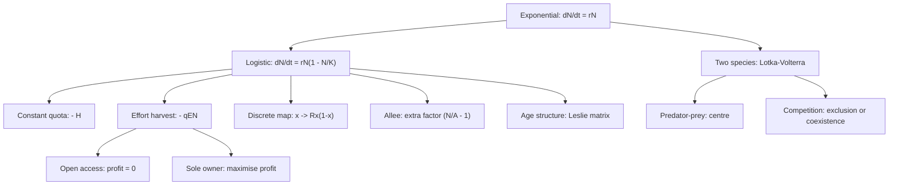

# Population Dynamics

> [Mathematics](../../README.md) › [Mathematical Modeling](../README.md) · Level: Intermediate · Prerequisites: [Exponential and Logarithmic Functions](../../03-algebra/12-exponential-and-logarithmic-functions/README.md), [Applications of Derivatives](../../07-calculus/05-applications-of-derivatives/README.md), [First-Order Differential Equations](../../16-differential-equations/01-first-order-odes/README.md), [Eigenvalues and Eigenvectors](../../08-linear-algebra/07-eigenvalues-and-eigenvectors/README.md) · Estimated time: 8 h

## 1. Introduction

How many deer will there be in ten years? How many fish can be taken from a stock each year without destroying it? Why do hare and lynx numbers rise and fall together? Each question is about a number that changes, and each has a standard mathematical answer built from the same three ingredients: a **state variable** (the population), a **rate law** (how births and deaths depend on the state), and a **solution** of the resulting equation. This topic develops that machinery for the simplest and most consequential family of models in applied mathematics.

The starting point is Thomas Malthus's *Essay on the Principle of Population* (1798): if each individual produces on average $r$ offspring per unit time more than it loses, the population obeys $\dot N = rN$ and grows exponentially, doubling every $\ln 2/r$. Malthus used the conclusion to argue that population must outrun food supply. The mathematics is unimpeachable and the conclusion does not follow, because $r$ cannot remain constant while resources are consumed. Pierre-François Verhulst (1838) supplied the correction that is still the default model: make the per-capita growth rate decrease linearly with density, $r(1 - N/K)$. The resulting **logistic equation** has an explicit solution, two equilibria, and a stability structure that can be read off a sign diagram. Almost every later model in this topic is a variation on it.

The variations are where the applications live. **Harvesting** turns the logistic equation into a management problem: the sustainable yield as a function of harvest is a downward parabola, maximised at half the carrying capacity by the **maximum sustainable yield**, and the algebra says something uncomfortable — the maximum sits exactly at a bifurcation, so the policy that maximises the yield is the policy with the least margin for error. **Age structure** replaces the single number $N$ by a vector of age classes and the differential equation by a matrix; the **Leslie matrix** then delivers the asymptotic growth rate as its dominant eigenvalue and the stable age distribution as the corresponding eigenvector. **Predation** couples two equations; the **Lotka–Volterra** system has closed orbits, an exact first integral, and an equilibrium that is a centre — a prediction that is elegant, exactly checkable and, in its strict form, false. **Competition** couples two equations of a different kind and yields the competitive exclusion principle.

Two warnings run through the whole topic, and both belong to the discipline of [Principles of Modeling](../01-principles-of-modeling/README.md). First, **the model is not the population**: exact solvability is a property of the equations, not evidence about the world. Second, **a parameter estimated from data is not a constant of nature**: $r$ and $K$ are summaries of a particular environment over a particular interval, and models that treat them as fixed fail precisely when the environment changes. Section 7.11 collects the ways in which these models mislead, and the exercises are designed to make you compute both the success and the failure.

The topic is the second in the discipline, and it assumes the modelling vocabulary — state, rate, assumption, validation, sensitivity — developed in [Principles of Modeling](../01-principles-of-modeling/README.md). The mathematics is one-dimensional ODEs, one two-dimensional system, and one matrix iteration; nothing beyond first-year calculus and the eigenvalue theory of [Eigenvalues and Eigenvectors](../../08-linear-algebra/07-eigenvalues-and-eigenvectors/README.md) is required.

## 2. Prerequisites

**Exponential and logarithmic functions** ([Exponential and Logarithmic Functions](../../03-algebra/12-exponential-and-logarithmic-functions/README.md)). The identity $e^{a+b} = e^ae^b$, the derivative $\frac{d}{dt}e^{rt} = re^{rt}$, the definition and manipulation of $\ln$, and the solution of $e^{x} = c$ as $x = \ln c$. Every closed form in this topic is built from these.

**Differential calculus** ([Applications of Derivatives](../../07-calculus/05-applications-of-derivatives/README.md)). The product and chain rules, the sign of the derivative as a statement about monotonicity, the second derivative as a statement about concavity, and the location of a maximum by setting the derivative to zero. The stability analysis of §7.3 is a sign argument throughout.

**First-order differential equations** ([First-Order Differential Equations](../../16-differential-equations/01-first-order-odes/README.md)). Separation of variables, the integrating factor for $\dot y + p(t)y = q(t)$, and the logistic equation as the standard example of a separable equation. The substitution $u = 1/N$ used in §7.2 is the standard reduction of the logistic equation to a linear one.

**Linear algebra** ([Eigenvalues and Eigenvectors](../../08-linear-algebra/07-eigenvalues-and-eigenvectors/README.md)). Matrix–vector multiplication, the characteristic polynomial $\det(L - \lambda I) = 0$, eigenvalues and eigenvectors, and the fact that eigenvectors for distinct eigenvalues are linearly independent. The Leslie matrix of §7.7 is a matrix iteration, and everything about it is eigenvalue theory.

**Two-dimensional systems.** Section 7.8 uses the Jacobian matrix at an equilibrium and the trace–determinant classification, both developed from scratch in §7.8. Nothing beyond matrix multiplication and the eigenvalues of a $2\times2$ matrix is assumed.

## 3. Learning Objectives

After this tutorial you will be able to:

1. Derive the Malthusian equation from a per-capita rate assumption, solve it, and compute doubling times and doubling-time estimates by the rule of 70.
2. Solve the logistic equation explicitly by the substitution $u = 1/N$, locate its inflection, and explain what the carrying capacity is and is not.
3. Define equilibrium, Lyapunov stability and asymptotic stability, and prove the one-dimensional linearisation criterion $f'(N^*) < 0$.
4. Analyse constant-yield harvesting, compute the maximum sustainable yield algebraically and graphically, and explain why the MSY is a bifurcation point and therefore a fragile policy target.
5. Analyse proportional (effort-based) harvesting, derive the open-access equilibrium and the profit-maximising effort, and explain the dissipation of rent.
6. Non-dimensionalise the logistic equation and derive the discrete logistic map $x_{t+1} = Rx_t(1-x_t)$.
7. Determine the stability of the map's fixed points, compute the period-2 cycle and its multiplier, and describe the period-doubling route to chaos with its principal thresholds.
8. Construct a Leslie matrix, compute its characteristic polynomial, find the dominant eigenvalue and the stable age distribution, and interpret them biologically.
9. Analyse the Lotka–Volterra system: find its equilibria, classify them, verify the first integral, prove the orbits are closed, and derive the time averages.
10. Analyse two-species competition, derive the invasion criteria, state and apply the competitive exclusion principle, and identify the four qualitative outcomes.
11. Analyse a model with a strong Allee effect, identify the threshold and the bistability, and explain the conservation implication.
12. State precisely what these models do not predict, and design an observation that would distinguish a model's genuine prediction from an artefact of its structure.

## 4. Intuition

### 4.1 Growth is a rate, and a rate can depend on the state

Suppose a colony of bacteria doubles every hour. In one hour it is twice as large, in two hours four times, in ten hours a thousand times. This is exponential growth, and its defining property is that the *rate* is proportional to the *amount*: the more there is, the faster it grows. Written as an equation, $\dot N = rN$, and the constant $r$ is the number of offspring per individual per unit time minus the losses per individual.

Everything interesting happens when $r$ stops being constant. Suppose the colony lives in a flask with a fixed supply of nutrient. While the colony is small, food is abundant and $r$ is at its maximum. As the colony grows, individuals compete, and the *per-capita* growth rate falls. The simplest assumption is that it falls linearly — from $r$ when the population is negligible to zero when the population has reached the largest size the flask can support. That largest size is the carrying capacity $K$, and the assumption gives

$$\dot N = rN\left(1 - \frac{N}{K}\right).$$

Read it as a sentence: the rate of increase equals the per-capita rate $r$ times the number of individuals, discounted by the fraction of the capacity not yet available.

### 4.2 The S-curve, and why it has an inflection

The solution of the logistic equation is an S-shaped curve: nearly exponential at first, then flattening as it approaches $K$. The change of shape occurs at $N = K/2$, which is the point of inflection. The reason is a competition between two factors in $\dot N = rN(1 - N/K)$: the first factor grows with $N$ and the second shrinks. Their product is a downward parabola in $N$, maximal at the midpoint.

That parabola is the most useful picture in the topic. The horizontal axis is population and the vertical axis is the growth rate; the curve starts at zero, rises to a peak of $rK/4$ at $N = K/2$, and returns to zero at $N = K$. An equilibrium is a place where the curve crosses the *harvest line*: a constant harvest $H$ is a horizontal line at height $H$, and its intersections with the parabola are the equilibria.

### 4.3 Two equilibria, and only one of them is an answer

The logistic equation has the equilibria $N = 0$ and $N = K$. The first is an equilibrium in the mathematical sense but not a stable one: a few individuals introduced into an empty habitat grow away from zero. The second is stable: a population slightly below $K$ grows toward it and slightly above $K$ declines toward it. This pattern — one unstable and one stable equilibrium, with the stable one being the interesting answer — recurs in almost every model in this topic, and Section 7.3 gives the one-line test that decides which is which.

### 4.4 Harvesting turns a curve into a policy problem

Now add a harvest. If $H$ is a fixed number of individuals removed per year, the equilibria solve $rN(1-N/K) = H$: the intersections of the parabola with a horizontal line. Raise the line and the two intersections move together; at a critical height they coincide, and above it there are no equilibria at all. That critical height is the maximum sustainable yield, and its coincidence with the tangency is not a coincidence but the definition of a maximum. The economic and ecological content is in what happens next: a manager who aims exactly at the tangency has chosen the parameter value at which the two equilibria merge, and any error in the estimate of $H$ — or any bad year — pushes the population past the point of no return.

### 4.5 Discrete generations behave completely differently

Bacteria reproduce continuously; mayflies and annual plants reproduce once a year and then die. For such species the natural model is a *map*: next year's population is a function of this year's. The simplest such map with density dependence is the discrete logistic, and its behaviour is startling. For small growth rates it converges to an equilibrium, as the continuous model does. Increase the growth rate and the equilibrium loses stability to a two-year cycle, then a four-year cycle, then eight, in a cascade that accumulates at a finite parameter value; beyond it, the sequence is chaotic, with arbitrarily long cycles embedded in it and no predictability over long horizons despite the model being completely deterministic.

### 4.6 Populations have ages

A single number cannot represent a population in which no individual reproduces in its first year of life and every individual dies after its fourth. Replacing the number by a vector of age classes and the equation by a matrix turns out to cost nothing conceptually: the asymptotic growth rate is the dominant eigenvalue, and the stable age distribution is the corresponding eigenvector. The lesson is that age structure does not merely add detail — it changes the answer, because a population of juveniles cannot reproduce no matter how favourable the conditions.

## 5. Formal Definition

### 5.1 Populations and their models

**Definition 5.1.1 (Continuous population model).** A *continuous-time population model* for a single species is an autonomous ordinary differential equation

$$\frac{dN}{dt} = f(N), \qquad N \ge 0,$$

where $N(t)$ is the population size or density at time $t$ and $f : [0,\infty)\to\mathbb{R}$ is the *rate law*. The model is *biologically admissible* if $f(0) \ge 0$, which is exactly the condition that the non-negative half-line is forward invariant: a population at zero cannot become positive, and a positive population cannot cross zero.

**Definition 5.1.2 (Per-capita growth rate).** For $N > 0$ the *per-capita growth rate* is

$$g(N) := \frac{f(N)}{N} = \frac{1}{N}\frac{dN}{dt}.$$

It has units of inverse time and is the average number of offspring minus deaths per individual per unit time. Any single-species model is equivalently specified by $f$ or by $g$, since $f(N) = Ng(N)$.

**Definition 5.1.3 (Discrete population model).** A *discrete-time population model* is a recursion

$$N_{t+1} = F(N_t), \qquad N_t \ge 0, \quad t = 0,1,2,\dots$$

where $t$ now counts generations. If $F(N) = \lambda N$ with constant $\lambda > 0$, the model is *geometric* and $N_t = \lambda^tN_0$.

### 5.2 Equilibria and stability

**Definition 5.2.1 (Equilibrium).** A point $N^* \ge 0$ is an *equilibrium* (or *fixed point*, or *steady state*) of $\dot N = f(N)$ if $f(N^*) = 0$; of $N_{t+1} = F(N_t)$ if $F(N^*) = N^*$.

**Definition 5.2.2 (Stability).** Let $N^*$ be an equilibrium of $\dot N = f(N)$.

* $N^*$ is **Lyapunov stable** if for every $\varepsilon > 0$ there is $\delta > 0$ such that $\lvert N_0 - N^*\rvert < \delta$ implies $\lvert N(t) - N^*\rvert < \varepsilon$ for all $t \ge 0$.
* $N^*$ is **attracting** if there is $\delta > 0$ such that $\lvert N_0 - N^*\rvert < \delta$ implies $N(t) \to N^*$ as $t \to \infty$.
* $N^*$ is **asymptotically stable** if it is both stable and attracting, and **globally asymptotically stable** on a set $S$ if $N(t)\to N^*$ for every $N_0 \in S$.
* $N^*$ is **unstable** if it is not stable.

The corresponding definitions for a map replace $N(t)$ by $N_t$ and $t\ge0$ by $t \in \mathbb{N}_0$.

**Definition 5.2.3 (Cycle and multiplier).** For a map $F$, a *cycle of period $p$* is a set of $p$ distinct points $x_1,\dots,x_p$ with $F(x_i) = x_{i+1}$ (indices mod $p$). Its *multiplier* is $\mu = (F^p)'(x_1) = \prod_{i=1}^{p}F'(x_i)$. A cycle is attracting if $\lvert\mu\rvert<1$, repelling if $\lvert\mu\rvert>1$.

**Definition 5.2.4 (Bifurcation).** A *bifurcation* is a qualitative change in the number or stability of equilibria or cycles as a parameter varies. The parameter value at which it occurs is a *bifurcation point*. Three types occur in this topic: the **saddle-node** (or fold), where two equilibria collide and disappear; the **transcritical**, where an equilibrium crosses another and they exchange stability; and the **period-doubling**, where a cycle of period $p$ loses stability and a cycle of period $2p$ is born.

**Definition 5.2.5 (Chaos, Devaney).** Let $J$ be an interval and $F : J \to J$ continuous. Then $F$ is *chaotic* if (i) it is topologically transitive (some orbit is dense in $J$), (ii) its periodic points are dense in $J$, and (iii) it has sensitive dependence on initial conditions: there is $\delta>0$ such that for every $x$ and every $\varepsilon>0$ there is $y$ with $\lvert y - x\rvert<\varepsilon$ and $\lvert F^n(y) - F^n(x)\rvert>\delta$ for some $n$. For interval maps, (i) and (ii) already imply (iii); the three-part definition is kept because each part is used separately.

### 5.3 Harvesting

**Definition 5.3.1 (Constant-yield and proportional harvesting).** For a stock obeying $\dot N = f(N)$, *constant-yield* (quota) harvesting removes $H$ individuals per unit time:

$$\dot N = f(N) - H .$$

*Proportional* (effort-based) harvesting removes a fraction of the stock per unit time at a rate proportional to *effort* $E$:

$$\dot N = f(N) - qEN,$$

where $q > 0$ is the *catchability*. The product $qE$ is the fishing mortality rate and $Y = qEN$ is the *yield*.

**Definition 5.3.2 (Maximum sustainable yield).** For a stock with rate law $f$, the *sustainable yield* at equilibrium $N^*$ is $Y(N^*) = f(N^*)$ — the harvest that exactly balances growth. The *maximum sustainable yield* is

$$Y_{\mathrm{MSY}} = \max_{N \ge 0} f(N),$$

attained at the *MSY stock level* $N_{\mathrm{MSY}}$. For the logistic law, $Y_{\mathrm{MSY}} = rK/4$ and $N_{\mathrm{MSY}} = K/2$.

### 5.4 Age structure

**Definition 5.4.1 (Leslie matrix).** Let females be classified into age classes $0,1,\dots,m$, and let $n_i(t)$ be the number of females in class $i$ at census $t$. Let $p_i \in [0,1]$ be the probability that a female of class $i$ survives to class $i+1$, and let $f_i \ge 0$ be the expected number of daughters born to a female of class $i$ that survive to the next census. Then $\mathbf n(t+1) = L\mathbf n(t)$ with

$$L = \begin{pmatrix} f_0 & f_1 & \cdots & f_m\\ p_0 & 0 & \cdots & 0\\ 0 & p_1 & \ddots & \vdots\\ \vdots & & \ddots & 0\\ 0 & \cdots & 0 & p_{m-1} & 0\end{pmatrix}.$$

**Definition 5.4.2 (Primitivity).** A non-negative matrix $L$ is *primitive* if some power $L^k$ has all entries strictly positive. For a Leslie matrix this holds exactly when the life cycle is aperiodic: the greatest common divisor of the lengths of all reproductive pathways is $1$.

**Definition 5.4.3 (Perron eigenvalue and stable age distribution).** If $L$ is non-negative and primitive, the *Perron–Frobenius theorem* gives a unique eigenvalue $\lambda_1 > 0$ exceeding the modulus of every other eigenvalue, with a strictly positive eigenvector $\mathbf v$. Then $\lambda_1$ is the asymptotic growth rate per census and $\mathbf v/\lVert\mathbf v\rVert_1$ is the *stable age distribution*.

### 5.5 Two-species systems

**Definition 5.5.1 (Lotka–Volterra predator–prey).** With prey density $x$, predator density $y$ and positive constants $a,b,\delta,c$,

$$\dot x = ax - bxy, \qquad \dot y = \delta xy - cy .$$

**Definition 5.5.2 (First integral).** A differentiable function $H(x,y)$ is a *first integral* of a planar system if $\dot H = 0$ along every solution, i.e. $\partial_xH\,\dot x + \partial_yH\,\dot y \equiv 0$. Its level sets are invariant curves.

**Definition 5.5.3 (Centre).** An equilibrium of a planar system is a *centre* if a neighbourhood of it is filled with closed orbits surrounding it. A centre is Lyapunov stable but not attracting.

**Definition 5.5.4 (Lotka–Volterra competition).** With $r_1,r_2,K_1,K_2>0$ and competition coefficients $\alpha,\beta>0$,

$$\dot x = r_1x\left(1 - \frac{x + \alpha y}{K_1}\right), \qquad \dot y = r_2y\left(1 - \frac{y + \beta x}{K_2}\right).$$

The coefficient $\alpha$ measures the competitive effect on species $x$ of one individual of species $y$, expressed in units of $x$: $\alpha y$ is the *x-equivalent* of $y$ individuals.

**Definition 5.5.5 (Competitive exclusion).** *Competitive exclusion* is the assertion that two species competing for a single limiting resource cannot both persist at a stable equilibrium; one drives the other to extinction. In the Lotka–Volterra model of Definition 5.5.4, stable coexistence requires all three of $\alpha\beta<1$, $K_1>\alpha K_2$ and $K_2>\beta K_1$; in every other case one species is excluded, although which one may depend on the initial condition. The precise statements are in §7.9.

## 6. Mathematical Notation

| Symbol | Read as | Meaning |
|---|---|---|
| $N(t)$ | N of t | population size or density |
| $N_0$ | N nought | initial population |
| $r$ | r | intrinsic (per-capita) growth rate, inverse time |
| $K$ | K | carrying capacity |
| $g(N) = f(N)/N$ | g of N | per-capita growth rate |
| $t_d$ | doubling time | $\ln 2/r$ |
| $u = 1/N$ | u | reciprocal population, used to linearise the logistic equation |
| $H$ | H | constant harvest rate (individuals per time) |
| $E$ | E | harvesting effort |
| $q$ | q | catchability: catch per unit effort per unit stock |
| $Y = qEN$ | yield | catch rate at equilibrium |
| $Y_{\mathrm{MSY}}$ | M S Y | maximum sustainable yield |
| $p$, $c$ | price, cost | price per unit catch; cost per unit effort |
| $x_t$ | x sub t | scaled population at generation $t$ in a map |
| $R$ | R | map parameter, $R = 1 + r$ for the discrete logistic |
| $\mu$ | mu | multiplier of a cycle, $(F^p)'$ |
| $n_i(t)$ | n sub i | number of females in age class $i$ at time $t$ |
| $f_i$, $p_i$ | f sub i, p sub i | fecundity and survival of age class $i$ |
| $L$ | L | Leslie matrix |
| $\lambda_1$ | lambda one | Perron (dominant) eigenvalue; asymptotic growth factor |
| $\mathbf v$ | v bold | eigenvector; stable age distribution |
| $a, b, \delta, c$ | — | Lotka–Volterra prey growth, attack, conversion, predator death |
| $\alpha, \beta$ | alpha, beta | competition coefficients |
| $A$ | A | Allee threshold |
| $H(x,y)$ | H | first integral of the Lotka–Volterra system |

**A note on $\lambda$.** In the biological literature $\lambda$ is the finite rate of increase of a discrete model ($N_{t+1} = \lambda N_t$) and also the dominant eigenvalue of a Leslie matrix; these are the same thing, since a Leslie matrix is a discrete model in vector form. In linear algebra $\lambda$ denotes any eigenvalue. This topic writes $\lambda_1$ when the Perron eigenvalue is meant and $\lambda$ for a generic eigenvalue, and it never uses $\lambda$ for the continuous growth rate, which is always $r$.

## 7. Core Concepts

### 7.1 Exponential growth and its limits

**Derivation.** Suppose each individual produces offspring at a constant per-capita rate $b$ and dies at a constant per-capita rate $d$, independently of how many individuals there are and of how much resource remains. In a short interval $\Delta t$ the change in population is $\Delta N \approx (b-d)N\Delta t$, so $\frac{dN}{dt} = rN$ with $r := b-d$. Separating and integrating,

$$\int\frac{dN}{N} = \int r\,dt \;\Longrightarrow\; \ln N = rt + C \;\Longrightarrow\; N(t) = N_0e^{rt},$$

where $N_0 = N(0)$ and $C = \ln N_0$.

**Properties.** The population doubles when $e^{rt} = 2$, i.e. after $t_d = \frac{\ln 2}{r} \approx \frac{0.693}{r}$. Expressed per cent per year, $t_d \approx 70/(100r)$ years — the **rule of 70**. At $1\%$ and $2\%$ per year the rule gives $70$ and $35$ years against exact values $69.3$ and $34.7$. The relative growth rate is constant, $\frac{1}{N}\dot N = r$, which is the defining property; in a semi-logarithmic plot the graph is a straight line of slope $r$.

**Why it fails.** Nothing in the derivation refers to resources, so the model cannot fail *within* its assumptions; it fails because the assumptions are wrong. A constant $r$ requires unlimited food, space and absence of enemies, and no population has those forever. The model is nevertheless the right local description of any population at low density, because every smooth per-capita rate $g(N)$ satisfies $g(N) \approx g(0) = r$ for small $N$. That is its real status: the linearisation of every density-dependent model at zero.

### 7.2 Logistic growth

**The model.** Replace the constant per-capita rate by one that decreases linearly with population:

$$g(N) = r\left(1 - \frac{N}{K}\right), \qquad\text{so}\qquad \frac{dN}{dt} = rN\left(1 - \frac{N}{K}\right).$$

The constant $K > 0$ is the **carrying capacity**: the population at which the per-capita rate falls to zero. The term $-rN^2/K$ models *intraspecific competition*.

**Explicit solution.** The equation is separable, but the substitution $u = 1/N$ linearises it. Since

$$\frac{du}{dt} = -\frac{1}{N^2}\frac{dN}{dt} = -\frac{rN(1-N/K)}{N^2} = -\frac{r}{N} + \frac{r}{K} = -ru + \frac{r}{K},$$

$u$ solves the linear equation $u' + ru = r/K$. Multiplying by the integrating factor $e^{rt}$,

$$\frac{d}{dt}\left(ue^{rt}\right) = \frac{r}{K}e^{rt} \;\Longrightarrow\; ue^{rt} = \frac{1}{K}e^{rt} + C \;\Longrightarrow\; u = \frac{1}{K} + Ce^{-rt}.$$

The initial condition $u(0) = 1/N_0$ gives $C = 1/N_0 - 1/K = (K-N_0)/(KN_0)$, so

$$N(t) = \frac{1}{u(t)} = \frac{K}{1 + \left(\frac{K-N_0}{N_0}\right)e^{-rt}} .$$

*Check.* $N(0) = K/(1 + (K-N_0)/N_0) = K\cdot N_0/K = N_0$; as $t\to\infty$, $N\to K$; and for $N_0 = K$ the solution is constant, as it must be.

**Shape.** Differentiating $f(N) = rN(1-N/K)$ gives $f'(N) = r(1-2N/K)$, so

$$\frac{d^2N}{dt^2} = f'(N)f(N) = r\left(1 - \frac{2N}{K}\right)\cdot rN\left(1-\frac{N}{K}\right).$$

For $0<N<K$ the second factor is positive, so the sign of $N''$ is the sign of $1 - 2N/K$: the curve is convex below $K/2$ and concave above it. The inflection is at $N = K/2$, reached at $t_{\text{infl}} = \frac{1}{r}\ln\left(\frac{K - N_0}{N_0}\right)$, obtained by solving $K/2 = K/(1 + \frac{K-N_0}{N_0}e^{-rt})$.

**The growth-rate parabola.** As a function of $N$, the rate $f(N) = rN - rN^2/K$ is a downward parabola with roots $0$ and $K$ and maximum

$$f\left(\frac{K}{2}\right) = r\frac{K}{2}\left(1 - \frac{1}{2}\right) = \frac{rK}{4}.$$

This single fact drives §7.4.

**What the carrying capacity is not.** $K$ is not a property of the species; it is a property of the species in an environment, and it changes when the environment does. A logistic fit to a growing population returns a $K$ that is a summary of the conditions during the fitted interval, and extrapolating it across a change of conditions is the structural error discussed in [Principles of Modeling](../01-principles-of-modeling/README.md) §7.8.

### 7.3 Equilibria and stability in one dimension

**The criterion.** For a one-dimensional equation $\dot N = f(N)$ the whole stability theory is a derivative test, and it can be proved completely.

**Theorem 7.3.1 (Linearisation in one dimension).** Let $f$ be continuously differentiable on an open interval containing an equilibrium $N^*$, with $f(N^*) = 0$.

1. If $f'(N^*) < 0$, then $N^*$ is asymptotically stable; moreover solutions starting close enough decay at least as fast as $e^{f'(N^*)t/2}$.
2. If $f'(N^*) > 0$, then $N^*$ is unstable.
3. If $f'(N^*) = 0$, the derivative decides nothing: $f(N) = -N^3$ has an asymptotically stable equilibrium at $0$, $f(N) = N^3$ an unstable one, and $f(N) = N^2$ an unstable one on $N\ge0$.

**Proof.** (1) Let $c = -f'(N^*) > 0$. By continuity of $f'$ there is $\rho>0$ with $f'(N) \le -c/2$ for $\lvert N - N^*\rvert < \rho$. For $N$ in that interval, the mean value theorem gives $f(N) = f(N) - f(N^*) = f'(\xi)(N - N^*)$ for some $\xi$ between $N$ and $N^*$, hence

$$(N - N^*)f(N) = f'(\xi)(N-N^*)^2 \le -\frac{c}{2}(N-N^*)^2 .$$

If $\lvert N_0 - N^*\rvert < \rho$, then $N(t)$ cannot leave the interval $(N^*-\rho, N^*+\rho)$: as long as it stays inside, $\frac{d}{dt}(N-N^*)^2 \le 0$, so $\lvert N-N^*\rvert$ is non-increasing and the solution exists for all $t\ge0$ and remains in the interval. Then

$$\frac{d}{dt}(N-N^*)^2 = 2(N-N^*)f(N) \le -c(N-N^*)^2 ,$$

and Grönwall's inequality (or direct integration) gives

$$\lvert N(t) - N^*\rvert \le \lvert N_0 - N^*\rvert\,e^{-ct/2} \to 0 .$$

So $N^*$ is asymptotically stable.

(2) If $f'(N^*)>0$, continuity gives $f'(N)\ge c/2>0$ near $N^*$, and then $f(N)$ has the same sign as $N - N^*$ in that neighbourhood. A solution starting above $N^*$ increases and one starting below decreases, so for $\varepsilon$ small enough no $\delta$ can keep it within $\varepsilon$ of $N^*$: the equilibrium is unstable.

(3) The examples show that both behaviours are possible when the derivative vanishes; the borderline case must be settled by the sign of $f$ itself. $\blacksquare$

**Application to the logistic equation.** Here $f(N) = rN(1-N/K)$ and $f'(N) = r(1-2N/K)$, so $f'(0) = r > 0$ (unstable) and $f'(K) = r(1-2) = -r < 0$ (stable).

The sign diagram confirms it without calculus: for $0<N<K$ the rate is positive (population increases) and for $N>K$ it is negative (population decreases), so every positive initial population is driven toward $K$. Hence $K$ is not merely locally but globally asymptotically stable on $(0,\infty)$.

**Reading a sign diagram.** Draw the axis, mark the equilibria, and record the sign of $f$ on each interval. Every interval with $f>0$ carries a rightward arrow and every interval with $f<0$ a leftward arrow. An equilibrium with arrows pointing toward it is stable; with arrows pointing away, unstable. In one dimension this diagram is the complete phase portrait, and it is worth drawing before any algebra.

### 7.4 Constant-yield harvesting and the maximum sustainable yield

**The model.** Remove a fixed number $H$ of individuals per unit time (a quota):

$$\frac{dN}{dt} = rN\left(1 - \frac{N}{K}\right) - H .$$

**Equilibria.** Setting the right side to zero and multiplying by $K/r$:

$$N^2 - KN + \frac{KH}{r} = 0 \;\Longrightarrow\; N = \frac{K \pm \sqrt{K^2 - 4KH/r}}{2}.$$

Real roots exist exactly when the discriminant is non-negative, $K^2 - \frac{4KH}{r} \ge 0$, which is the condition $H \le \frac{rK}{4} = Y_{\mathrm{MSY}}$.

**Stability.** Since $f'(N) = r(1 - 2N/K)$, the smaller root (which lies below $K/2$) has $f' > 0$ and is unstable, and the larger root (above $K/2$) has $f' < 0$ and is stable.

**The graphical picture, and the theorem behind the maximum.** The equilibria are the intersections of the parabola $y = f(N)$ with the horizontal line $y = H$. Raising the line moves the intersections together; at $H = rK/4$ they coincide at $N = K/2$, where the line is tangent to the parabola; above that value there is no intersection, the rate is negative everywhere and the population collapses to zero in finite time. So

$$Y_{\mathrm{MSY}} = \max_{N\ge0} f(N) = \frac{rK}{4}, \qquad N_{\mathrm{MSY}} = \frac{K}{2},$$

and the maximum is a maximum precisely because the line is tangent — the value $H = rK/4$ is a **saddle-node (fold) bifurcation** of the harvested system.

**Why the MSY is a dangerous target.** At the bifurcation the two equilibria have merged, which means:

* the stable equilibrium is at $K/2$, where $\lvert f'(N)\rvert = 0$ — the *return speed* after a perturbation is zero, so recovery is not exponential but algebraic and slow;
* the distance from the operating point to the collapse point is zero: any overestimate of $H$, or any year with lower $r$, moves the system past the fold;
* the sensitivity $\partial N^*/\partial H$ diverges as $H \to rK/4$, as computed in [Principles of Modeling](../01-principles-of-modeling/README.md) Example 9.8.

The correct conclusion is not that the MSY is wrong but that it is a *boundary* value: a policy aiming at it has no margin, and the algebra says so before any data are collected.

**Terminology.** The unstable branch $N_-$ is called the *depensation threshold*: below it, the harvest exceeds growth and the population declines to zero even though a stable positive equilibrium exists above it. For the logistic this threshold is the smaller root.

### 7.5 Effort-based harvesting, open access, and the dissipation of rent

**The model.** Real harvesting is limited by effort, not by a quota. Let $E$ be effort (boat-days, trawler-years), $q$ the catchability, so that the catch per unit time is $qEN$. Then

$$\frac{dN}{dt} = rN\left(1 - \frac{N}{K}\right) - qEN = N\left[r\left(1 - \frac{N}{K}\right) - qE\right].$$

**Equilibria.** $N = 0$ and, provided $E < r/q$, $N^*(E) = K\left(1 - \frac{qE}{r}\right)$. At $E = r/q$ the nonzero equilibrium reaches zero and exchanges stability with $N=0$: a **transcritical bifurcation**. The value $E_c = r/q$ is the *open-access critical effort* — the effort at which the stock is wiped out.

**Sustainable yield.** At equilibrium the catch equals the growth:

$$Y(E) = qEN^*(E) = qEK\left(1 - \frac{qE}{r}\right),$$

a downward parabola in $E$ with roots at $E=0$ and $E = r/q$ and maximum at $E = r/(2q)$, where $Y = qK\frac{r}{2q}\cdot\frac12 = rK/4$. The maximum sustainable yield is the same number as in §7.4, which it must be: both are the maximum of the growth parabola.

**Economics: the sole owner.** Let $p$ be the price per unit catch and $c$ the cost per unit effort. Profit at equilibrium is

$$\Pi(E) = pqEN^*(E) - cE = E\left[pqK\left(1 - \frac{qE}{r}\right) - c\right],$$

a concave quadratic in $E$. Differentiating,

$$\Pi'(E) = pqK\left(1 - \frac{2qE}{r}\right) - c = 0 \;\Longrightarrow\; E^* = \frac{r}{2q}\left(1 - \frac{c}{pqK}\right).$$

So $E^* < r/(2q) = E_{\mathrm{MSY}}$ whenever $c>0$: a profit-maximising sole owner harvests *less* than the MSY and therefore maintains a *larger* stock. The MSY is not the economically optimal policy, and the difference is not small when costs are a large fraction of revenue.

**Open access: the tragedy of the commons.** Under open access, effort enters until profit is zero. Setting $\Pi(E) = 0$ for $E>0$:

$$pqK\left(1 - \frac{qE}{r}\right) = c \;\Longrightarrow\; N_{oa} = K\left(1 - \frac{qE_{oa}}{r}\right) = \frac{c}{pq}.$$

The open-access stock depends only on the ratio of cost to price times catchability — not on $r$ or $K$ at all. Write $\theta = c/(pqK) \in (0,1)$; then

$$N_{oa} = \theta K, \qquad Y_{oa} = rK\,\theta(1-\theta) \le \frac{rK}{4} = Y_{\mathrm{MSY}},$$

with equality only at $\theta = 1/2$. So open access is *always* inefficient in this model: the biological yield is at or below the MSY, and the economic rent, which the sole owner would capture, is entirely dissipated. The gap $\Pi(E^*) - 0$ is the *rent dissipation* of open access.

**What the model leaves out.** Real fisheries have age structure, spatial structure, bycatch, subsidies (which shift $c$ effectively to zero and make the rent dissipation worse) and stochastic recruitment. The qualitative conclusion — that open access dissipates rent and depresses the stock — is robust; the numbers are not.

### 7.6 Discrete time and the logistic map

**From differential to difference equation.** For a species with non-overlapping generations, a rate law sampled once per generation gives the *Euler discretisation*

$$N_{t+1} = N_t + rN_t\left(1 - \frac{N_t}{K}\right).$$

**Non-dimensionalisation.** Put $x_t = \dfrac{rN_t}{K(1+r)}$ and $R = 1+r$. Then

$$x_{t+1} = \frac{r}{K(1+r)}N_{t+1} = \frac{r}{K(1+r)}\left[N_t + rN_t - \frac{rN_t^2}{K}\right] = x_t - (1+r)x_t^2 = R\,x_t(1 - x_t).$$

*Check.* $\dfrac{r}{K(1+r)}\cdot rN_t^2/K = \dfrac{r^2N_t^2}{K^2(1+r)} = (1+r)\left(\dfrac{rN_t}{K(1+r)}\right)^2 = (1+r)x_t^2$. $\checkmark$

So the discrete logistic map is $x_{t+1} = F(x_t)$ with $F(x) = Rx(1-x)$ and one parameter $R = 1+r > 1$. The state space is $[0,1]$: if $x_0 \in [0,1]$ then $x_t \in [0,1]$ for all $t$, because $F$ has maximum $R/4$ at $x=1/2$, so the map is self-consistent for $R \le 4$. For $R>4$ it sends some points outside $[0,1]$ and the model requires a convention (absorption at zero, or extinction), which is itself a modelling decision.

**Fixed points and their stability.** $F(x) = x$ gives $x(1 - R + Rx) = 0$, so

$$x_0^* = 0, \qquad x_1^* = 1 - \frac{1}{R} \quad (\text{positive iff } R>1).$$

With $F'(x) = R(1-2x)$: $F'(0) = R > 1$, so $0$ is unstable; and

$$F'(x_1^*) = R\left(1 - 2 + \frac{2}{R}\right) = 2 - R .$$

The fixed point $x_1^*$ is attracting exactly when $\lvert 2 - R\rvert < 1$, i.e.

$$1 < R < 3 .$$

At $R = 3$ the multiplier is $-1$: a **period-doubling bifurcation**.

**The 2-cycle.** For $R>3$ the fixed point is repelling and the map has a cycle of period $2$. Solving $F(F(x)) = x$ and dividing out the fixed points gives the quadratic $R^2x^2 - R(R+1)x + (R+1) = 0$, whose roots are

$$x_\pm = \frac{R+1 \pm \sqrt{(R-3)(R+1)}}{2R},$$

real exactly when $R \ge 3$. Its multiplier is

$$\mu = F'(x_+)F'(x_-) = 4 + 2R - R^2 ,$$

and $\lvert\mu\rvert < 1$ exactly when $3 < R < 1+\sqrt6 \approx 3.44949$.

*Check at $R = 3.2$.* $x_\pm = \frac{4.2 \pm \sqrt{0.2\cdot4.2}}{6.4} = \frac{4.2\pm0.9165}{6.4}$, giving $0.79946$ and $0.51305$; indeed $3.2(0.79946)(0.20054) = 0.51305$, and $\mu = 4 + 6.4 - 10.24 = 0.16$, so the cycle is strongly attracting.

**The cascade.** At $R = 1+\sqrt6$ the 2-cycle doubles to a 4-cycle, which doubles at $R \approx 3.5441$, then at $3.5644$, and so on. The bifurcation values accumulate at

$$R_\infty \approx 3.56995,$$

and the ratio of successive intervals tends to Feigenbaum's constant $\delta \approx 4.6692$ — the same constant that appears in every unimodal map, which is the content of Feigenbaum's universality.

**Chaos, and a window of order.** For $R > R_\infty$ the typical orbit is aperiodic and the map satisfies Definition 5.2.5. That statement is not vague: for $R = 4$ there is an exact conjugacy. Put $x = \sin^2(\pi\theta)$ with $\theta \in [0,1]$. Then

$$4x(1-x) = 4\sin^2(\pi\theta)\cos^2(\pi\theta) = \sin^2(2\pi\theta),$$

so in the variable $\theta$ the map is $\theta \mapsto 2\theta \bmod 1$: the doubling map. Everything about $R=4$ follows from that. A perturbation of size $2^{-n}$ in $\theta$ becomes of order one after $n$ steps — sensitive dependence with a *positive Lyapunov exponent* $\ln 2$, meaning errors double each iteration. Periodic points are dense (every rational $\theta$ with odd denominator is periodic), and there are orbits that visit every interval: the three conditions of Devaney. And yet the map is not featureless: for $R = 1+\sqrt8 \approx 3.8284$ an attracting 3-cycle appears and persists over a whole interval of $R$ — the "period-3 window" — inside which the dynamics is again periodic. Li and Yorke's 1975 theorem makes the window dramatic: *period three implies chaos*, in the sense that the existence of a 3-cycle forces cycles of every period and an uncountable set of aperiodic orbits.

**What the map does and does not tell us.** It tells us that a deterministic, one-line, biologically motivated rule can produce dynamics that are unpredictable in practice: the model is exact and its long-term behaviour is inaccessible because the initial condition is never known exactly. It does not tell us that any particular population is chaotic — establishing that from field data is hard, because demographic and environmental noise produce irregular series too. The map's status is a *warning*, not a measurement.

### 7.7 Age structure and the Leslie matrix

**Why age structure changes the answer.** A population of juveniles cannot reproduce. Two populations of equal size, one composed of newborns and one of mature adults, have completely different futures. The single-number model cannot distinguish them, so it must be wrong whenever the age distribution is far from its typical shape — after a disturbance, a disease, or a change in harvesting that selects particular ages.

**The model.** Classify females into classes $0,1,\dots,m$; let $n_i(t)$ be the number in class $i$ at census $t$; let $p_i$ be the probability of surviving from class $i$ to $i+1$; let $f_i$ be the expected number of daughters born to a female in class $i$ that survive to the next census. Then

$$n_0(t+1) = \sum_{i=0}^{m} f_in_i(t), \qquad n_i(t+1) = p_{i-1}n_{i-1}(t),\quad i = 1,\dots,m,$$

which is $\mathbf n(t+1) = L\mathbf n(t)$ with the matrix of Definition 5.4.1.

**The characteristic polynomial.** Expanding $\det(\lambda I - L) = 0$ along the last column gives the recursion

$$\lambda^{m+1} = f_0\lambda^{m} + f_1p_0\lambda^{m-1} + f_2p_0p_1\lambda^{m-2} + \dots + f_mp_0p_1\cdots p_{m-1}.$$

Dividing by $\lambda^{m+1}$ and writing $l_a = p_0p_1\cdots p_{a-1}$ for the probability of surviving to age $a$ and $m_a = f_{a-1}$ for the fecundity at age $a$,

$$1 = \sum_{a=1}^{m+1} l_a m_a\,\lambda^{-a},$$

the **discrete Euler–Lotka equation**. Because the right side is strictly decreasing in $\lambda > 0$, it has at most one positive root, and it has one exactly when some $l_am_a > 0$; that root is the Perron eigenvalue.

**Perron–Frobenius, in the form used here.** If $L$ is non-negative and *primitive*, then:

1. $L$ has a real eigenvalue $\lambda_1 > 0$ that is strictly greater in modulus than every other eigenvalue;
2. $\lambda_1$ is simple, and its eigenvector $\mathbf v$ can be chosen strictly positive;
3. every solution satisfies $\mathbf n(t) \sim c\lambda_1^t\mathbf v$ as $t\to\infty$, where $c$ depends on $\mathbf n(0)$;
4. the left eigenvector $\mathbf u$ (with $\mathbf u^{\mathsf T}L = \lambda_1\mathbf u^{\mathsf T}$) has positive entries, the *reproductive values*: $u_i$ measures the contribution of an individual of class $i$ to all future generations.

**Interpretation.** $\lambda_1 > 1$ means growth, $\lambda_1 = 1$ replacement, $\lambda_1 < 1$ decline. The normalised eigenvector $\mathbf v$ is the **stable age distribution**: the shape the age distribution approaches, whatever it starts as. Convergence is at the rate $\lvert\lambda_2/\lambda_1\rvert^t$.

**Primitivity matters.** If the life cycle has period $d>1$ — for instance a biennial that reproduces only in even years — then $L$ is imprimitive, the eigenvalues of maximal modulus are $\lambda_1$ times the $d$-th roots of unity, and the population does not converge to a stable age distribution; instead the age structure oscillates with period $d$ forever. This is a real biological phenomenon, not a pathology: it is why some plant populations fluctuate strongly between years.

### 7.8 Predator–prey: the Lotka–Volterra system

**The model.** Let $x$ be prey density and $y$ predator density, and assume: prey grow exponentially in the absence of predators (rate $a$); encounters occur at rate proportional to $xy$ (random search in a well-mixed habitat); each encounter converts prey into predators at rate $\delta xy$; predators die at per-capita rate $c$. Then

$$\dot x = ax - bxy, \qquad \dot y = \delta xy - cy,$$

with $a,b,\delta,c > 0$.

**Equilibria.** Setting both rates to zero: $x(a - by) = 0$ and $y(\delta x - c) = 0$. So the equilibria are $(0,0)$ and $(x^*,y^*) = (c/\delta,\ a/b)$. Note what the second says: the equilibrium prey density is set by *predator* parameters and the equilibrium predator density by *prey* parameters.

**Linearisation.** The Jacobian is

$$J = \begin{pmatrix}a - by & -bx\\ \delta y & \delta x - c\end{pmatrix}.$$

At $(0,0)$, $J = \begin{pmatrix}a & 0\\ 0 & -c\end{pmatrix}$: eigenvalues $a>0$ and $-c<0$, so the origin is a **saddle**. At $(x^*,y^*)$, using $by^* = a$ and $\delta x^* = c$,

$$J = \begin{pmatrix}0 & -b c/\delta\\ \delta a/b & 0\end{pmatrix}, \qquad \operatorname{tr}J = 0,\quad \det J = ac > 0 .$$

Zero trace with positive determinant means purely imaginary eigenvalues $\pm i\sqrt{ac}$: the linearisation is a **centre**, so the linear test is inconclusive and the nonlinear analysis is needed.

**The first integral.** Define

$$H(x,y) = \delta x - c\ln x + by - a\ln y .$$

Then $\partial_xH = \delta - c/x$ and $\partial_yH = b - a/y$, so along a solution

$$\dot H = \left(\delta - \frac{c}{x}\right)(ax - bxy) + \left(b - \frac{a}{y}\right)(\delta xy - cy) = (\delta x - c)(a - by) + (by - a)(\delta x - c) = 0 .$$

So $H$ is constant on each orbit.

**Why the orbits are closed.** $H$ is strictly convex on the positive quadrant, because

$$H_{xx} = \frac{c}{x^2} > 0,\qquad H_{yy} = \frac{a}{y^2} > 0,\qquad H_{xy} = 0 .$$

Its only stationary point solves $\delta = c/x$ and $b = a/y$, i.e. $(x^*,y^*)$, so that point is the unique global minimum. The level sets of a strictly convex function with a unique minimum are simple closed curves surrounding it. Since $\dot H = 0$, each orbit stays on one level set; since the only equilibria are the saddle at the origin (which is not on any positive level set) and the centre, no orbit on a positive level set can stop. Hence every orbit with $x,y>0$ is periodic, and the equilibrium is a **nonlinear centre**.

**Time averages.** This is the model's sharpest quantitative prediction. From $\dot x/x = a - by$, integrating over one period $T$,

$$0 = \ln x(T) - \ln x(0) = \int_0^T\left(a - by\right)dt = aT - b\int_0^T y\,dt \;\Longrightarrow\; \bar y := \frac{1}{T}\int_0^Ty\,dt = \frac{a}{b}.$$

Similarly, from $\dot y/y = \delta x - c$,

$$\bar x = \frac{c}{\delta}.$$

The averages are independent of the initial condition and of the amplitude, even though the amplitude and period are not.

**Period near the equilibrium.** Linearising with $x = x^*+u$, $y = y^*+v$ gives $\dot u = -bc\,v/\delta$ and $\dot v = \delta a\,u/b$, hence

$$\ddot u = -\frac{bc}{\delta}\cdot\frac{\delta a}{b}\,u = -ac\,u, \qquad \omega = \sqrt{ac},\qquad T \to \frac{2\pi}{\sqrt{ac}} .$$

The period grows with amplitude: for $a = 2$, $b = 0.01$, $\delta = 0.001$, $c = 0.5$ (so $x^* = 500$, $y^* = 200$ and $2\pi/\sqrt{ac} = 2\pi$), numerical integration gives $T = 6.295$ for an initial prey excess of $20\%$, $6.345$ at $50\%$ and $6.453$ at $90\%$.

### 7.9 Competition and competitive exclusion

**The model.** Two species competing for a shared resource:

$$\dot x = r_1x\left(1 - \frac{x + \alpha y}{K_1}\right), \qquad \dot y = r_2y\left(1 - \frac{y + \beta x}{K_2}\right).$$

Each species grows logistically in isolation, and the presence of the other reduces its effective carrying capacity. The coefficients convert one species into the other's units.

**Nullclines and the four cases.** The $x$-nullcline is the line $x + \alpha y = K_1$ and the $y$-nullcline is $\beta x + y = K_2$. Their intercepts are what decide the outcome: species $x$ can invade a resident $y$ exactly when $K_1 > \alpha K_2$, and $y$ can invade a resident $x$ exactly when $K_2 > \beta K_1$. (The invasion growth rate of $y$ at $(K_1,0)$ is $r_2(1 - \beta K_1/K_2)$.)

| Case | Condition | Outcome |
|---|---|---|
| 1 | $K_1 > \alpha K_2$ and $K_2 > \beta K_1$ | stable coexistence at an interior equilibrium |
| 2 | $K_1 < \alpha K_2$ and $K_2 < \beta K_1$ | bistability: the resident wins, founder control |
| 3 | $K_1 > \alpha K_2$ and $K_2 < \beta K_1$ | $x$ excludes $y$ |
| 4 | $K_1 < \alpha K_2$ and $K_2 > \beta K_1$ | $y$ excludes $x$ |

**The interior equilibrium.** Solving the two nullcline equations:

$$\hat x = \frac{K_1 - \alpha K_2}{1 - \alpha\beta}, \qquad \hat y = \frac{K_2 - \beta K_1}{1 - \alpha\beta},$$

finite and positive exactly in Case 1. *Check:* $\hat x + \alpha\hat y = \frac{K_1 - \alpha K_2 + \alpha K_2 - \alpha\beta K_1}{1-\alpha\beta} = K_1$. $\checkmark$

**Its stability.** The Jacobian at $(\hat x,\hat y)$ is

$$J = \begin{pmatrix} -r_1\hat x/K_1 & -r_1\alpha\hat x/K_1\\ -r_2\beta\hat y/K_2 & -r_2\hat y/K_2\end{pmatrix},$$

with

$$\operatorname{tr}J = -\frac{r_1\hat x}{K_1} - \frac{r_2\hat y}{K_2} < 0, \qquad \det J = \frac{r_1r_2\hat x\hat y}{K_1K_2}\left(1 - \alpha\beta\right).$$

So the interior equilibrium is asymptotically stable exactly when $\alpha\beta < 1$, which is precisely the condition for Case 1. The condition has a biological reading: **each species must inhibit itself more than it inhibits the other**. Equivalently, intraspecific competition must exceed interspecific competition — the ecological definition of "occupying different niches".

**Competitive exclusion.** In Case 3 or 4 one species is driven to extinction from every initial condition with both present. And when the two species are ecologically identical ($\alpha = \beta = 1$), the nullclines are parallel: if $K_1 > K_2$ then $x$ excludes $y$ for every initial condition, and if $K_2 > K_1$ the reverse. This is the **competitive exclusion principle** in its model form: two species limited by the same single resource cannot coexist at a stable equilibrium. Coexistence in nature is therefore evidence that the species are *not* identical in their resource use — that they differ in some axis the model has not written down.

### 7.10 Allee effects and thresholds

**The phenomenon.** For some species, low density is *worse* than moderate density: individuals cannot find mates, cannot mount a group defence, or cannot modify the habitat. The per-capita growth rate then *increases* with density at low density, the opposite of the logistic assumption.

**The model.** The simplest rate law with this property is

$$f(N) = rN\left(1 - \frac{N}{K}\right)\left(\frac{N}{A} - 1\right), \qquad 0 < A < K,$$

where $A$ is the **Allee threshold**. The per-capita rate is $r(1-N/K)(N/A-1)$, which is negative for $N<A$, positive for $A<N<K$, and negative again for $N>K$.

**Equilibria and stability.** The zeros are $N = 0$, $N = A$ and $N = K$. Differentiating the product form with $f = \frac{r}{A}N(1-N/K)(N-A)$:

$$f'(0) = \frac{r}{A}\cdot 1\cdot(-A) = -r < 0 \quad\text{(stable)},$$
$$f'(A) = \frac{r}{A}\cdot A\left(1 - \frac{A}{K}\right)\cdot 1 = r\left(1 - \frac{A}{K}\right) > 0 \quad\text{(unstable)},$$
$$f'(K) = \frac{r}{A}\cdot K\cdot\left(-\frac{1}{K}\right)(K - A) = -\frac{r}{A}(K-A) < 0 \quad\text{(stable)}.$$

So the system is **bistable**: $0$ and $K$ are both stable and $A$ separates their basins. A population above $A$ grows to $K$; a population below $A$ declines to extinction. The threshold is not a mathematical artefact but the model's central claim, and it changes the management problem completely: a harvest that removes a fixed number of individuals can push a population across $A$ even when the harvest is sustainable at high density.

### 7.11 What these models do not say

**They do not predict extinction risk.** Nothing in a deterministic model with a stable positive equilibrium predicts extinction; a population at $K$ stays at $K$ forever. Real extinction is driven by *demographic stochasticity* (chance events in a finite population) and *environmental stochasticity* (fluctuations in $r$ and $K$), both of which require a different formalism. A deterministic model can say how *close* a population gets to zero, not how likely it is to arrive.

**They do not identify density dependence.** Many rate laws produce similar fits to short series. The logistic's concave parabola, a theta-logistic $rN(1-(N/K)^\theta)$, and a model with a time lag can all fit the same twenty years of data and diverge wildly when extrapolated. The shape of density dependence must come from mechanism, experiment or long data, not from the fit.

**They do not support "the carrying capacity" as a constant.** $K$ is a fitted summary of one environment over one interval. Changing the environment changes $K$, and no amount of mathematical precision in the model repairs a parameter that is a moving target.

**They do not represent space.** Well-mixedness fails whenever dispersal is slow relative to growth: outbreaks spread as travelling waves, populations persist in refuges while going extinct elsewhere, and a metapopulation can persist globally even when every local patch goes extinct. All of this requires spatial structure.

**They do not represent evolution.** $r$, $K$ and the competition coefficients are fixed. In reality harvesting selects for slower growth (fishing selects large individuals, and the stock evolves), and competition selects the very traits that determine the coefficients.

## 8. Formulas and Properties

| Result | Statement | Hypothesis | Why it is true |
|---|---|---|---|
| Exponential solution | $N = N_0e^{rt}$ | $\dot N = rN$, $r$ constant | separation of variables |
| Doubling time | $t_d = \ln 2/r$ | $r>0$ | solve $e^{rt}=2$ |
| Logistic solution | $N = K/\left(1 + \frac{K-N_0}{N_0}e^{-rt}\right)$ | $0<N_0$, $r,K>0$ | $u=1/N$ linearises |
| Logistic equilibria | $0$ (unstable), $K$ (stable) | $r,K>0$ | $f'(0)=r$, $f'(K)=-r$ |
| Logistic inflection | at $N=K/2$, time $\frac1r\ln\frac{K-N_0}{N_0}$ | $0<N_0<K$ | $f'=0$ at $K/2$ |
| Maximum growth | $rK/4$ at $N=K/2$ | logistic law | vertex of a parabola |
| MSY | $Y_{\mathrm{MSY}} = rK/4$ at $N=K/2$ | logistic, constant-yield harvest | maximum of growth rate |
| Quota equilibria | $\frac{K\pm\sqrt{K^2-4KH/r}}{2}$ | $0\le H\le rK/4$ | quadratic formula |
| Quota fold | collapses for $H>rK/4$ | logistic | saddle-node bifurcation |
| Effort equilibrium | $N^*=K(1-qE/r)$ | logistic, $E<r/q$ | set $\dot N=0$ |
| Critical effort | $E_c = r/q$ | logistic | transcritical bifurcation |
| Yield curve | $Y(E) = qEK(1-qE/r)$, max $rK/4$ at $E=r/(2q)$ | logistic, effort harvesting | parabola in $E$ |
| Optimal effort | $E^*=\frac{r}{2q}\left(1-\frac{c}{pqK}\right)$ | profit maximisation | $\Pi'(E)=0$ |
| Open-access stock | $N_{oa} = c/(pq)$ | zero-profit equilibrium | $\Pi=0$, $E>0$ |
| Open-access yield | $Y_{oa}=rK\theta(1-\theta)$, $\theta = c/(pqK)$ | as above | substitute $N_{oa}$ |
| Discrete logistic | $x_{t+1}=Rx_t(1-x_t)$, $R=1+r$ | Euler step, one generation | rescaling |
| Map fixed points | $0$, $1-1/R$; stable iff $1<R<3$ | $R>1$ | $\lvert 2-R\rvert<1$ |
| 2-cycle | $\frac{R+1\pm\sqrt{(R-3)(R+1)}}{2R}$, multiplier $4+2R-R^2$ | $R>3$ | solve $F^2(x)=x$ |
| 2-cycle stability | $3<R<1+\sqrt6$ | as above | $\lvert\mu\rvert<1$ |
| Period doubling | cascade accumulates at $R_\infty\approx3.56995$ | unimodal map | Feigenbaum universality |
| $R=4$ conjugacy | $x=\sin^2(\pi\theta)$, $\theta\mapsto2\theta$ | $R=4$ | double-angle identity |
| Leslie recursion | $\lambda^{m+1}=\sum_{i}f_i\lambda^{m-i}\prod_{j<i}p_j$ | Leslie matrix | $\det(\lambda I-L)=0$ |
| Euler–Lotka | $1=\sum_a l_am_a\lambda^{-a}$ | Leslie matrix | divide by $\lambda^{m+1}$ |
| Perron growth | $\mathbf n(t)\sim c\lambda_1^t\mathbf v$ | $L$ non-negative, primitive | Perron–Frobenius |
| L–V equilibrium | $(c/\delta,\ a/b)$ | Lotka–Volterra | set both rates to zero |
| L–V first integral | $H=\delta x-c\ln x+by-a\ln y$ | Lotka–Volterra | $\dot H=0$ |
| L–V averages | $\bar x=c/\delta$, $\bar y=a/b$ | periodic orbit | integrate $\dot x/x$ over one period |
| L–V period | $\to 2\pi/\sqrt{ac}$ near equilibrium | small amplitude | linearisation |
| Competition coexistence | $\hat x=\frac{K_1-\alpha K_2}{1-\alpha\beta}$, $\hat y=\frac{K_2-\beta K_1}{1-\alpha\beta}$ | $\alpha\beta\ne1$ | solve nullclines |
| Coexistence stability | stable iff $\alpha\beta<1$ | interior equilibrium positive | trace/determinant |
| Invasion criteria | $x$ invades iff $K_1>\alpha K_2$; $y$ iff $K_2>\beta K_1$ | competition model | growth rate at boundary |
| Allee equilibria | $0$ stable, $A$ unstable, $K$ stable | $0<A<K$ | sign of $f'$ |

Two entries need care. The 2-cycle formula exists only for $R\ge3$; below that the square root is imaginary and the expression is not a real cycle. And the Perron–Frobenius conclusion $\mathbf n(t)\sim c\lambda_1^t\mathbf v$ requires primitivity: for an imprimitive matrix the population oscillates with period equal to the period of the life cycle and never settles to a fixed age distribution.

## 9. Step-by-Step Examples

### Example 9.1 (Easy): Malthusian growth, and a check against history

**Problem.** (a) World population was $1.3\times10^9$ in 1960 and about $8.0\times10^9$ in 2022. Assuming exponential growth, find $r$ and the doubling time. (b) With $r = 0.02$ yr⁻¹ and $N_0 = 1.3\times10^9$, compute $N(50)$. (c) How long does a population growing at $2\%$ per year take to increase eightfold?

**Solution.** (a) $N(t) = N_0e^{rt}$ gives $e^{62r} = 8.0/1.3 = 6.1538$, so

$$r = \frac{\ln 6.1538}{62} = \frac{1.8171}{62} = 0.02931\ \text{yr}^{-1} \approx 2.93\%\ \text{per year}.$$

The doubling time over that interval was $t_d = \ln 2/0.02931 = 23.65$ years, so the population doubled roughly $62/23.65 = 2.62$ times, and indeed $2^{2.62} = 6.15$. $\checkmark$

(b) $N(50) = 1.3\times10^{9}\cdot e^{1.0} = 1.3\times10^9\times2.71828 = 3.53\times10^{9}$.

(c) $e^{rt} = 8$ gives $t = \ln 8/0.02 = 2.0794/0.02 = 104.0$ years. The rule of 70 would give three doublings of $35$ years, i.e. $105$ years — accurate to $1\%$.

*What the example shows.* A constant-rate model fits a sixty-year interval of world population growth with a single number. That is a genuine success of the model *as a description of that interval*, and it says nothing about any other interval: the fitted $r$ is an average of a period that included a demographic transition, and applying it forward predicts a population that no demographer expects.

### Example 9.2 (Easy–medium): the logistic solution, with all the landmarks

**Problem.** A population obeys the logistic equation with $r = 0.6$ yr⁻¹, $K = 1000$ and $N_0 = 50$. Find (a) $N(5)$ and $N(10)$; (b) the time of the inflection; (c) the time at which the population reaches $90\%$ of $K$; (d) the maximum growth rate.

**Solution.** The solution is

$$N(t) = \frac{1000}{1 + 19e^{-0.6t}}, \qquad\text{since } \frac{K - N_0}{N_0} = \frac{950}{50} = 19 .$$

(a) At $t=5$: $e^{-3} = 0.049787$, so the denominator is $1 + 19(0.049787) = 1.94595$ and

$$N(5) = \frac{1000}{1.94595} = 513.9 .$$

At $t=10$: $e^{-6} = 0.0024788$, denominator $1 + 0.047096 = 1.047096$, so $N(10) = 955.0$.

*Check.* $N(5) = 513.9$ is just above $K/2 = 500$, so $t = 5$ should be just after the inflection; and $N(10)$ is within $5\%$ of $K$. Both are consistent with (b).

(b) $t_{\text{infl}} = \frac{1}{r}\ln\frac{K-N_0}{N_0} = \frac{\ln 19}{0.6} = \frac{2.9444}{0.6} = 4.907$ years. At that time $N = 500$, as the formula requires.

(c) $N = 900$ requires $1 + 19e^{-0.6t} = 1000/900 = 1.11111$, so $e^{-0.6t} = 0.11111/19 = 0.005848$ and

$$t = \frac{-\ln(0.005848)}{0.6} = \frac{5.1417}{0.6} = 8.569\ \text{years}.$$

(d) The growth rate is the parabola $rN(1-N/K)$, maximal at $N=K/2$ with value $rK/4 = 0.6\times1000/4 = 150$ individuals per year. Between $t=5$ and $t=10$ the population rises by $441$, an average of $88$ per year, which must be below the maximum $150$ because both endpoints straddle the peak. It is.

### Example 9.3 (Medium): quota harvesting, and the fold at the MSY

**Problem.** For the population of Example 9.2 ($r=0.6$, $K=1000$) with a constant quota $H$: (a) find the equilibria for $H = 120$ and $H = 140$; (b) confirm the fold at $H = 150$; (c) explain the practical meaning of the two roots.

**Solution.** The equilibria solve $N^2 - 1000N + 1000H/0.6 = 0$, i.e. $N^2 - 1000N + 1666.67H = 0$, so

$$N = \frac{1000 \pm \sqrt{10^6 - 6666.67H}}{2}.$$

(a) For $H = 120$: the discriminant is $10^6 - 800\,000 = 200\,000$, whose square root is $447.21$, so

$$N = \frac{1000 \pm 447.21}{2} = 723.61\ \text{or}\ 276.39 .$$

*Check.* Sum $= 1000 = K$ $\checkmark$; product $= 723.61\times276.39 = 200\,003 \approx 1666.67\times120 = 200\,000$ $\checkmark$ (the discrepancy is rounding).

For $H = 140$: the discriminant is $10^6 - 933\,333 = 66\,667$, square root $258.20$, giving $N = 629.10$ or $370.90$.

(b) At $H = 150$ the discriminant is $10^6 - 10^6 = 0$ and the roots coincide at $N = 500 = K/2$. For $H>150$ the discriminant is negative: no equilibrium, the rate is negative for every $N>0$, and the population is driven to zero.

(c) The larger root is the stable equilibrium (there $f'(N) = r(1-2N/K) < 0$); the smaller is unstable. If the population is above the smaller root it rises to the larger; if it is below, the harvest exceeds growth and it falls to zero. The unstable root is the **depensation threshold**: at $H = 120$ a stock that falls below $276$ individuals cannot recover under the same quota.

*The point.* At $H = 150$ the threshold and the target have merged. The MSY is not "the safe maximum"; it is the value at which the safe region has zero width.

### Example 9.4 (Medium): a fishery from open access to sole ownership

**Problem.** A stock obeys the logistic law with $r = 0.5$ yr⁻¹ and $K = 10^6$ tonnes. Catch is $qEN$ with $q = 10^{-5}$ per vessel-year per tonne. Price is $p = 1000$ per tonne and cost is $c = 2000$ per vessel-year. Compute (a) the MSY and the effort that achieves it; (b) the sole owner's optimal effort, stock, catch and profit; (c) the open-access effort, stock, catch and profit; (d) the rent dissipated.

**Solution.** Here $qE$ has units of yr⁻¹ and $qEN$ of tonnes per year. The growth parabola has maximum $rK/4 = 0.5\times10^6/4 = 125\,000$ t/yr.

(a) $E_{\mathrm{MSY}} = r/(2q) = 0.5/(2\times10^{-5}) = 25\,000$ vessel-years, giving $N = K/2 = 5\times10^5$ t and $Y = qEN = 10^{-5}\times25\,000\times5\times10^5 = 125\,000$ t/yr. $\checkmark$ (equal to $rK/4$).

(b) $E^* = \dfrac{r}{2q}\left(1 - \dfrac{c}{pqK}\right)$. With

$$\frac{c}{pqK} = \frac{2000}{1000\times10^{-5}\times10^6} = \frac{2000}{10^{4}} = 0.2,$$

$E^* = 25\,000\times0.8 = 20\,000$. Then

$$N^* = K\left(1 - \frac{qE^*}{r}\right) = 10^6\left(1 - \frac{0.2}{0.5}\right) = 6\times10^5\ \text{t},$$
$$Y^* = qE^*N^* = 10^{-5}\times20\,000\times6\times10^5 = 120\,000\ \text{t/yr},$$
$$\Pi^* = pY^* - cE^* = 1000(120\,000) - 2000(20\,000) = 1.2\times10^8 - 4\times10^7 = 8\times10^7\ \text{per year}.$$

(c) Open access sets profit to zero. The stock is $N_{oa} = c/(pq) = 2000/(1000\times10^{-5}) = 2\times10^5$ t, and the effort is

$$E_{oa} = \frac{r}{q}\left(1 - \frac{N_{oa}}{K}\right) = \frac{0.5}{10^{-5}}\left(1 - 0.2\right) = 40\,000 .$$

*Check on profit:* $p\,qE_{oa}N_{oa} = 1000\times10^{-5}\times40\,000\times2\times10^5 = 8\times10^7$, and $cE_{oa} = 2000\times40\,000 = 8\times10^7$. Zero. $\checkmark$ Catch is $8\times10^4$ t/yr.

(d) The rent dissipated is $\Pi^* - 0 = 8\times10^7$ per year, and the stock is a third of the sole owner's and $40\%$ of the MSY level, while the catch is $36\%$ below the MSY. Twice as much effort produces less catch.

| Regime | Effort | Stock (t) | Catch (t/yr) | Profit |
|---|---|---|---|---|
| MSY | $25\,000$ | $5\times10^5$ | $125\,000$ | — |
| Sole owner | $20\,000$ | $6\times10^5$ | $120\,000$ | $8\times10^7$ |
| Open access | $40\,000$ | $2\times10^5$ | $80\,000$ | $0$ |

Note also that the profit-maximising stock is *above* the MSY stock: the sole owner conserves more than the yield-maximiser, because the marginal cost of effort is positive.

### Example 9.5 (Medium): a Leslie matrix, exactly solvable

**Problem.** A species has three age classes with fecundities $f_0 = 0$, $f_1 = 2$, $f_2 = 24$ and survivals $p_0 = p_1 = 0.5$. (a) Write the Leslie matrix. (b) Find all eigenvalues. (c) Find the stable age distribution and the asymptotic growth rate. (d) Confirm with the Euler–Lotka equation.

**Solution.** (a)

$$L = \begin{pmatrix}0&2&24\\ 0.5&0&0\\ 0&0.5&0\end{pmatrix}.$$

(b) The characteristic equation is

$$\lambda^3 - f_0\lambda^2 - f_1p_0\lambda - f_2p_0p_1 = \lambda^3 - 0 - 1\cdot\lambda - 24(0.25) = \lambda^3 - \lambda - 6 = 0 .$$

$\lambda = 2$ is a root: $8 - 2 - 6 = 0$. Factoring,

$$\lambda^3 - \lambda - 6 = (\lambda - 2)(\lambda^2 + 2\lambda + 3),$$

and the quadratic has roots

$$\lambda = \frac{-2\pm\sqrt{4 - 12}}{2} = -1 \pm i\sqrt2, \qquad \lvert\lambda\rvert = \sqrt{1+2} = \sqrt3 \approx 1.732 .$$

So $\lambda_1 = 2$ and $\lvert\lambda_{2,3}\rvert = \sqrt3 < 2$: the Perron eigenvalue is $2$, and the population doubles each census asymptotically. *Check on the trace:* the trace of $L$ is $0 + 0 + 0 = 0$, and the sum of the roots is $2 + (-1+i\sqrt2) + (-1-i\sqrt2) = 0$. $\checkmark$

(c) Solve $(L - 2I)\mathbf v = 0$:

$$\begin{pmatrix}-2&2&24\\ 0.5&-2&0\\ 0&0.5&-2\end{pmatrix}\begin{pmatrix}v_0\\ v_1\\ v_2\end{pmatrix} = \mathbf 0 .$$

The second row gives $v_0 = 4v_1$ and the third gives $v_1 = 4v_2$; the first row is then $-2(16v_2) + 2(4v_2) + 24v_2 = 0$, consistent. Taking $v_2 = 1$:

$$\mathbf v = \begin{pmatrix}16\\4\\1\end{pmatrix}, \qquad \text{stable age distribution} = \frac{1}{21}\begin{pmatrix}16\\4\\1\end{pmatrix} \approx (0.762,\ 0.190,\ 0.048).$$

(d) Euler–Lotka: $1 = \dfrac{f_1p_0}{\lambda^2} + \dfrac{f_2p_0p_1}{\lambda^3} = \dfrac{2(0.5)}{\lambda^2} + \dfrac{24(0.25)}{\lambda^3} = \dfrac{1}{\lambda^2} + \dfrac{6}{\lambda^3}$. At $\lambda = 2$: $\frac14 + \frac68 = 0.25 + 0.75 = 1$. $\checkmark$

*Remark on primitivity.* The three-class matrix is primitive: the two reproductive pathways from age $0$ back to age $0$ are $0\to1\to0$ (length $2$, through $f_1$) and $0\to1\to2\to0$ (length $3$, through $f_2$), and $\gcd(2,3)=1$, so the life cycle is aperiodic. In contrast, the related matrix $\begin{pmatrix}0&4\\0.5&0\end{pmatrix}$ has eigenvalues $\pm\sqrt2$, of equal modulus; its only pathway is $0\to1\to0$, of length $2$, so the matrix is imprimitive and the age distribution oscillates with period $2$ for ever instead of converging — exactly the case described in §7.7.

### Example 9.6 (Medium–hard): the discrete logistic map through the first bifurcations

**Problem.** For $x_{t+1} = Rx_t(1-x_t)$: (a) find the nonzero fixed point and its stability range; (b) at $R = 2.5$ iterate from $x_0 = 0.1$ and describe the behaviour; (c) at $R = 3.5$ find the 2-cycle exactly and classify it; (d) explain what happens at $R = 4$.

**Solution.** (a) $Rx(1-x) = x$ gives $x = 0$ or $x^* = 1 - 1/R$. With $F'(x) = R(1-2x)$,

$$F'(x^*) = R\left(1 - 2 + \frac{2}{R}\right) = 2 - R,$$

so $\lvert 2-R\rvert<1$, i.e. $1<R<3$.

(b) For $R = 2.5$ the fixed point is $1 - 1/2.5 = 0.6$ and $F'(0.6) = -0.5$, so it is attracting with alternating approach. Iterating from $0.1$: $0.225$, $0.4359$, $0.6147$, $0.5921$, $0.6038$, $0.5981$, $0.6009$, $0.5996$, $\dots$ The even and odd iterates bracket $0.6$ and converge to it, as the negative multiplier predicts.

(c) For $R = 3.5 = 7/2$ the formula gives

$$x_\pm = \frac{4.5 \pm \sqrt{(0.5)(4.5)}}{7} = \frac{4.5\pm1.5}{7},$$

so $x_+ = 6/7$ and $x_- = 3/7$. *Check:* $F(6/7) = \frac72\cdot\frac67\cdot\left(1-\frac67\right) = \frac72\cdot\frac67\cdot\frac17 = \frac{42}{98} = \frac37$. $\checkmark$ The multiplier is

$$\mu = 4 + 2R - R^2 = 4 + 7 - 12.25 = -1.25,$$

so $\lvert\mu\rvert > 1$: the 2-cycle *exists* but is *repelling*. Since $R = 3.5 > 1+\sqrt6 \approx 3.4495$, the attracting object is a 4-cycle, and the 2-cycle is the remnant of the previous regime.

(d) At $R = 4$ the map is conjugate to the doubling map by $x = \sin^2(\pi\theta)$: from the identity $4\sin^2(\pi\theta)\cos^2(\pi\theta) = \sin^2(2\pi\theta)$, the dynamics of $\theta$ is $\theta \mapsto 2\theta \bmod 1$. Consequently the Lyapunov exponent is $\ln 2$, errors double every iteration, periodic orbits are dense, and the orbit is aperiodic for almost every initial condition. Numerically, iterating $x_0 = 0.1$ gives a sequence that never repeats and that changes completely if $x_0$ is altered in the tenth decimal place.

*The lesson.* A single-parameter, one-line, biologically motivated model contains a transition from a stable equilibrium to a two-year cycle, then to four, and then to chaos — all at parameter values that are not exotic ($r = R - 1$ between $2$ and $3$). Determinism does not imply predictability.

### Example 9.7 (Hard): a Lotka–Volterra system end to end

**Problem.** Take $a = 2$, $b = 0.01$, $\delta = 0.001$, $c = 0.5$ (prey per year, per predator, per prey, per year respectively). (a) Find the interior equilibrium. (b) Classify both equilibria. (c) Verify the first integral at two nearby states. (d) Compute the small-amplitude period and compare with numerically integrated periods at larger amplitudes. (e) State the time averages.

**Solution.** (a) $x^* = c/\delta = 0.5/0.001 = 500$; $y^* = a/b = 2/0.01 = 200$.

(b) At $(0,0)$ the Jacobian is $\operatorname{diag}(a,-c) = \operatorname{diag}(2,-0.5)$: eigenvalues of opposite sign, a **saddle**. At $(500,200)$,

$$J = \begin{pmatrix}0 & -b x^*\\ \delta y^* & 0\end{pmatrix} = \begin{pmatrix}0 & -5\\ 0.2 & 0\end{pmatrix},$$

with trace $0$ and determinant $0 - (-5)(0.2) = 1 > 0$: eigenvalues $\pm i$, a linear **centre**. Since the linear test is inconclusive, §7.8's first integral settles it: the equilibrium is a nonlinear centre.

(c) $H(x,y) = 0.001x - 0.5\ln x + 0.01y - 2\ln y$. Then

$$H(500,200) = 0.5 - 0.5(6.2146) + 2 - 2(5.2983) = -11.2039,$$
$$H(600,200) = 0.6 - 3.1985 + 2 - 10.5966 = -11.1951 .$$

The two values differ, so the perturbed state lies on a different level set — a different closed orbit, as §7.8 guarantees. Both are above the minimum $H(500,200)$, as they must be.

(d) $\omega = \sqrt{ac} = \sqrt{1} = 1$, so the small-amplitude period is $2\pi = 6.2832$. Numerical integration from $(x_0,y_0) = (500(1+\alpha),200)$ gives

| $\alpha$ | period |
|---|---|
| $0.05$ | $6.2840$ |
| $0.20$ | $6.2948$ |
| $0.50$ | $6.3452$ |
| $0.90$ | $6.4532$ |

The period increases with amplitude, slowly at first; the linear value is the limit as $\alpha\to0$, not an approximation valid everywhere.

(e) $\bar x = c/\delta = 500$ and $\bar y = a/b = 200$ for every closed orbit, whatever its amplitude and whatever the initial condition. This is the model's testable prediction: a long record should average to the equilibrium values even though it never settles there.

### Example 9.8 (Hard): the four outcomes of competition

**Problem.** For the competition model take $K_1 = 1000$, $K_2 = 800$ and $r_1 = r_2 = 1$. (a) With $\alpha = \beta = 0.5$, determine the outcome and compute the coexistence equilibrium and its stability. (b) Repeat with $\alpha = \beta = 1.5$. (c) Explain the difference.

**Solution.** (a) $K_1 = 1000 > \alpha K_2 = 400$: species $x$ can invade a resident $y$. $K_2 = 800 > \beta K_1 = 500$: species $y$ can invade a resident $x$. Both can invade, so this is Case 1 and

$$\hat x = \frac{K_1 - \alpha K_2}{1-\alpha\beta} = \frac{1000 - 400}{1 - 0.25} = 800, \qquad \hat y = \frac{K_2 - \beta K_1}{1-\alpha\beta} = \frac{800 - 500}{0.75} = 400 .$$

*Check:* $\hat x + \alpha\hat y = 800 + 200 = 1000 = K_1$ $\checkmark$ and $\beta\hat x + \hat y = 400 + 400 = 800 = K_2$ $\checkmark$.

Stability: with $r_1 = r_2 = 1$,

$$\operatorname{tr}J = -\frac{800}{1000} - \frac{400}{800} = -0.8 - 0.5 = -1.3 < 0, \qquad \det J = \frac{1\cdot1\cdot800\cdot400}{1000\cdot800}(1 - 0.25) = 0.4\times0.75 = 0.3 > 0 .$$

Negative trace, positive determinant: a stable node. Coexistence.

(b) Now $\alpha K_2 = 1.5\times800 = 1200 > K_1$ and $\beta K_1 = 1500 > K_2$: neither species can invade the other's monoculture. This is Case 2. The interior equilibrium is

$$\hat x = \frac{1000 - 1200}{1 - 2.25} = \frac{-200}{-1.25} = 160, \qquad \hat y = \frac{800 - 1500}{-1.25} = 560,$$

which is positive, and again checks: $160 + 1.5(560) = 160 + 840 = 1000$ $\checkmark$; $1.5(160) + 560 = 240 + 560 = 800$ $\checkmark$. But $\det J \propto (1 - \alpha\beta) = -1.25 < 0$, so this equilibrium is a **saddle**, not a stable node. Both monocultures are stable; the interior point is the boundary between their basins.

(c) The difference is the sign of $\alpha\beta - 1$, i.e. whether interspecific competition is weaker ($\alpha\beta<1$) or stronger ($\alpha\beta>1$) than intraspecific competition. With weak interspecific competition each species limits itself more than it limits the other, so coexistence is stable. With strong interspecific competition each species suppresses the other more than itself, so whichever arrives first wins — **founder control**, or bistability. Biologically, (a) describes two species on partly different resources and (b) describes two species on the same resource.

## 10. Visual Explanations

### 10.1 The family of models in this topic

Every arrow is obtained by changing exactly one assumption of the parent model. That is why the family is teachable: the differences between the answers can be attributed to the differences between the assumptions.

### 10.2 One-dimensional models at a glance

| Model | Rate law $f(N)$ | Equilibria | Stable | Signature |
|---|---|---|---|---|
| exponential | $rN$ | $0$ | none if $r>0$ | unbounded growth |
| logistic | $rN(1-N/K)$ | $0$, $K$ | $K$ | S-curve to $K$ |
| quota $H$ | $rN(1-N/K)-H$ | $0$ if $H=0$; two roots if $H<rK/4$ | larger root | fold at $H=rK/4$ |
| effort $E$ | $N[r(1-N/K)-qE]$ | $0$, $K(1-qE/r)$ | $K(1-qE/r)$ if $E<r/q$ | transcritical at $E=r/q$ |
| Allee | $rN(1-N/K)(N/A-1)$ | $0$, $A$, $K$ | $0$ and $K$ | bistability, threshold $A$ |

The table is a decision aid: identify the rate law, read the equilibria, apply Theorem 7.3.1. Only the last row requires anything beyond the derivative test, and even there the test suffices — the bistability is visible in the signs.

### 10.3 The discrete logistic by parameter range

| $R$ | Attractor | Multiplier of the attractor | Consequence |
|---|---|---|---|
| $1<R<3$ | fixed point $1-1/R$ | $2-R\in(-1,1)$ | monotone or damped oscillation |
| $3<R<1+\sqrt6\approx3.4495$ | 2-cycle | $4+2R-R^2$ | alternating years |
| $1+\sqrt6<R<3.5441$ | 4-cycle | — | four-year cycle |
| $R_\infty\approx3.56995$ | aperiodic | — | onset of chaos |
| $1+\sqrt8\approx3.8284$ (window) | 3-cycle | — | order inside chaos |
| $R=4$ | aperiodic, dense periodic points | Lyapunov $\ln2$ | errors double per step |

A "window" is an interval of $R$ inside the chaotic range in which an attracting cycle exists. The period-3 window is the widest and most famous; there are windows for every period, arranged in a self-similar pattern.

### 10.4 Phase-plane summary for two species

| System | Equilibria | Local type | Global picture |
|---|---|---|---|
| Lotka–Volterra predator–prey | $(0,0)$, $(c/\delta,a/b)$ | saddle, centre | nested closed orbits, one per level of $H$ |
| Competition, $\alpha\beta<1$ | $(0,0)$, $(K_1,0)$, $(0,K_2)$, interior | saddle, saddles, stable node | coexistence from every interior start |
| Competition, $\alpha\beta>1$ | as above | saddle, stable nodes, saddle | bistability; interior saddle is the separatrix |
| Competition, exclusion case | $(0,0)$, $(K_1,0)$, $(0,K_2)$ | saddle, node + saddle | winner depends only on parameters |

## 11. Common Mistakes

**1. Treating $r$ as a species constant.** $r$ is a measured quantity that depends on temperature, food, predators and the age structure of the population, and it varies between years. A model with a constant $r$ is a model of a constant environment.

**2. Treating $K$ as a constant of nature.** The carrying capacity is an equilibrium of a model in an environment. Change the environment and $K$ changes; the logistic equation has no mechanism that could update it.

**3. Fitting a logistic to the exponential phase and believing $K$.** Section 7.2, together with [Principles of Modeling](../01-principles-of-modeling/README.md) Exercise 33, shows that the sensitivity of $N$ to $K$ is of order $N_0/K$ while the population is small: the data that determine $r$ say almost nothing about $K$. A logistic curve drawn through the first ten years of a growth series is a guess about $K$, not an estimate.

**4. Calling the MSY the safe yield.** The maximum of the yield curve is a tangency, i.e. a fold bifurcation. At the MSY the stable equilibrium has zero return rate and the distance to collapse is zero. The word "maximum" describes the yield, not the safety.

**5. Confusing the two equilibria of a quota-harvested stock.** The larger root is stable and the smaller is a threshold. Reporting "the equilibrium is 276" for $H=120$ in Example 9.3 is reporting the threshold, and a manager who treats it as a target will lose the stock.

**6. Supposing that a profit-maximising owner harvests more than the MSY.** The opposite is true. Because effort costs money, the sole owner operates at lower effort and higher stock than the yield-maximiser (Example 9.4). The MSY is a biological criterion, not an economic one.

**7. Forgetting the units of $q$ and $E$ separately.** Only the product $qE$ is a rate. Scaling $E$ by a factor and $q$ by its reciprocal leaves the model unchanged, which is why "effort" is defined only up to a conventional unit.

**8. Applying the continuous logistic to a species with discrete generations.** The two models differ qualitatively, not just quantitatively: the map has cycles and chaos where the ODE has a stable equilibrium. Which model applies is a biological question about the life cycle.

**9. Assuming the discrete logistic's chaos means real populations are chaotic.** The map demonstrates that chaos is *possible* in a simple deterministic model; establishing it in a real population requires distinguishing chaos from noise, which is difficult and rarely conclusive.

**10. Using only the dominant eigenvalue of a Leslie matrix.** The dominant eigenvalue gives the asymptotic rate; the subdominant eigenvalues give the transient, and for a population far from its stable age distribution the transient can last decades. Population momentum is exactly this: a population with $\lambda_1$ reduced to $1$ still grows for a generation because of its age structure.

**11. Treating the Lotka–Volterra cycles as a prediction of stable oscillations.** The cycles are neutral: the amplitude is fixed by the initial condition and never recovers if perturbed. A model with a centre is structurally fragile, and any real mechanism turns the centre into a focus or a limit cycle.

**12. Reading the Lotka–Volterra equilibrium as "the" population sizes.** The equilibrium is where the time averages are, not where the populations sit. The populations spend most of their time away from it, and the equilibrium values can be far outside the observed range of either species.

**13. Believing that competitive exclusion predicts that similar species cannot coexist.** The theorem is about a model with a single limiting factor in a homogeneous, constant environment. Coexistence in nature is evidence that one of those assumptions fails — spatial structure, fluctuating conditions, multiple resources, or frequency-dependent predation. That is information, not a contradiction.

**14. Forgetting that the Allee threshold makes a stable equilibrium fragile.** A population at $K$ with a strong Allee effect is stable against small perturbations but not against a large one, and a constant-quota harvest can cross the threshold at a stock level where the same quota is perfectly sustainable at high density.

**15. Reporting a point prediction from a model whose parameters are uncertain.** A deterministic model with fitted parameters produces a number, not an interval. The interval requires the parameter uncertainty and the sensitivity, as in [Principles of Modeling](../01-principles-of-modeling/README.md) §7.9.

## 12. Applications

**Ecology and conservation.** The logistic equation is the default null model of population growth and the reference against which density dependence is measured. The Allee threshold of §7.10 is the basis of the "critical population size" used in reintroduction programmes: below the threshold a released population declines, so releases are sized and repeated accordingly. Predator–prey theory explains why cycles are common in boreal food chains and why removing a top predator can restructure a community.

**Fisheries, wildlife management and common-pool resources.** The Gordon–Schaefer analysis of §7.5 is the standard framework behind catch quotas and effort limits. Its two central lessons — that open access dissipates rent and depresses stocks, and that the MSY is a boundary rather than a target — are the reasons modern management uses harvest-control rules with explicit precautionary margins rather than a single number. Individual transferable quotas are an institutional response to the open-access problem, and the model predicts their effect: giving somebody an ownership share converts the zero-profit equilibrium into the sole-owner one. The same structure recurs for groundwater, grazing land and atmospheric sinks; only the interpretation of $E$, $p$ and $c$ changes.

**Demography.** The Leslie matrix is the standard tool of national population projections, with age classes in five-year bands and sex-specific fecundity. The dominant eigenvalue gives the intrinsic rate of natural increase, the eigenvector the stable age distribution, and the subdominant eigenvalues the "population momentum" that keeps a population growing after fertility falls to replacement. The imprimitive case corresponds to the real phenomenon of cohort oscillation in some age-structured populations.

**Pest and disease control.** The threshold structure of the Allee model appears in pest control: reducing a pest population below a critical density may be more effective than reducing it by a constant fraction, because a sparse population cannot find mates. The same logic, with different rate laws, underlies the critical community size for measles persistence.

**Evolutionary ecology.** Replacing fixed parameters by heritable traits turns these models into models of evolution. Harvesting that selects large individuals is the standard example: the model predicts selection for earlier maturity and smaller size, and fisheries data show exactly that. The mechanism is a consequence of the size-selective mortality term, which is a modelling assumption that can be checked.

## 13. Exercises

The problem set is in [exercises.md](exercises.md). It contains 38 problems in four groups:

* **Beginner (1–14)** — doubling times, exponential solutions, logistic landmarks, equilibria and sign diagrams, a first map iteration, a Leslie eigenvalue, Lotka–Volterra equilibria and first integrals, and invasion criteria.
* **Intermediate (15–24)** — the exponential approximation to the logistic, quota and effort harvesting, the MSY computation, open-access stocks, map fixed points and 2-cycles, Leslie eigenvalues with the Euler–Lotka check, the yield derivation, and Lotka–Volterra averages and harvesting.
* **Advanced (25–32)** — proofs of the stability criterion and of the closed-orbit property, the fold normal form, the Allee threshold and its maximum harvest, the competition case analysis, the 2-cycle derivation, the $\tanh$ form of the logistic solution, and the open-access inequality.
* **Challenge (33–38)** — the sensitivity of harvested equilibria, population momentum in a Leslie model, a critical reading of a claimed chaotic population, quota versus open access, stabilisation by prey self-limitation, and the doubling-map conjugacy with its periodic-point count.

Attempt each problem in writing before consulting [solutions.md](solutions.md). Section references are given so that a stuck reader knows where to reread.

## 14. Solutions

Full worked solutions are in [solutions.md](solutions.md). Each solution states the strategy, displays every significant step, verifies numerical claims by a second route where possible, and gives complete proofs for the proof problems.

## 15. Summary

* **Exponential growth** $\dot N = rN$ has solution $N_0e^{rt}$ and doubling time $\ln 2/r$. It is the correct local description of any population at low density, and it is never the correct global description.
* The **logistic equation** $\dot N = rN(1-N/K)$ has the explicit solution $K/(1+\frac{K-N_0}{N_0}e^{-rt})$, equilibria $0$ (unstable) and $K$ (stable), an inflection at $N=K/2$, and a maximum growth rate $rK/4$.
* The **linearisation criterion** in one dimension is a complete theorem: $f'(N^*)<0$ implies asymptotic stability, $f'(N^*)>0$ instability, and $f'(N^*)=0$ requires the sign of $f$ itself.
* **Constant-yield harvesting** produces a fold: two equilibria for $H<rK/4$, one at $H=rK/4$, none above. The **MSY** is that critical value, so it is a bifurcation point and a policy with no margin.
* **Effort-based harvesting** gives a transcritical bifurcation at $E=r/q$. The **sole owner** operates below the MSY effort and above the MSY stock; **open access** drives profit to zero, leaves a stock $c/(pq)$, and dissipates the entire rent.
* The **discrete logistic map** $x_{t+1}=Rx_t(1-x_t)$ has a stable fixed point for $1<R<3$, a 2-cycle for $3<R<1+\sqrt6$, a period-doubling cascade accumulating at $R_\infty\approx3.56995$, chaos beyond, and exact solvability at $R=4$ through the conjugacy to the doubling map.
* A **Leslie matrix** turns age structure into a linear iteration. Its Perron eigenvalue is the asymptotic growth rate, its eigenvector the stable age distribution, and the subdominant eigenvalues govern the transient and the oscillation. **Primitivity** decides whether the age distribution converges.
* **Lotka–Volterra** has a saddle at the origin, a nonlinear **centre** at $(c/\delta,a/b)$, closed orbits given by the first integral $H = \delta x - c\ln x + by - a\ln y$, time averages equal to the equilibrium values, and a period that approaches $2\pi/\sqrt{ac}$ at small amplitude. Its neutral cycles are its principal artefact.
* **Competition** has four outcomes determined by two invasion inequalities; stable coexistence requires $\alpha\beta<1$, i.e. intraspecific competition stronger than interspecific. **Competitive exclusion** holds when the two species share a single limiting factor.
* The **Allee effect** inserts a threshold: $0$ and $K$ stable, $A$ unstable, and a harvest that crosses $A$ destroys the population even at sustainable yield.
* None of these models predicts extinction risk, identifies density dependence, or survives extrapolation across a change of environment. Each is a **conditional** statement, and the condition is the assumption list.

## 16. Further Learning

**Within this repository.**

* [Principles of Modeling](../01-principles-of-modeling/README.md) — the discipline that supplies the vocabulary: assumptions, validation, sensitivity, model risk. Its §7.4 and Example 9.8 are the general versions of the harvesting bifurcation here.
* [First-Order Differential Equations](../../16-differential-equations/01-first-order-odes/README.md) — separation of variables, integrating factors and the logistic equation as a standard example.
* [Systems of ODEs](../../16-differential-equations/03-systems-of-odes/README.md) — phase portraits, the trace–determinant classification, and Lyapunov functions, which put §7.8 and §7.9 on a general footing.
* [Eigenvalues and Eigenvectors](../../08-linear-algebra/07-eigenvalues-and-eigenvectors/README.md) — the characteristic polynomial and the eigenvector computation behind the Leslie matrix.
* [Exponential and Logarithmic Functions](../../03-algebra/12-exponential-and-logarithmic-functions/README.md) — the algebra of every closed form in this topic.
* [Applications of Derivatives](../../07-calculus/05-applications-of-derivatives/README.md) — the maximisation that produces the MSY and the inflection of the logistic curve.
* [Recurrence Relations](../../09-discrete-mathematics/02-recurrence-relations/README.md) — the discrete side: linear recursions, characteristic equations, and the stability of their solutions.
* [Sampling and Estimation](../../11-statistics/02-sampling-and-estimation/README.md) and [Linear Regression](../../11-statistics/04-linear-regression/README.md) — how $r$ and $K$ are actually estimated, and what the resulting uncertainty means.
* [Law of Large Numbers and Central Limit Theorem](../../10-probability/06-law-of-large-numbers-and-central-limit-theorem/README.md) — the tools behind demographic stochasticity, which is what a deterministic model cannot represent.

**Standard texts.** J. D. Murray, *Mathematical Biology I: An Introduction* (3rd ed., Springer, 2002) is the standard reference for everything in this topic and much more, written for mathematicians. L. Edelstein-Keshet, *Mathematical Models in Biology* (SIAM Classics, 2005) is the best textbook treatment of the modelling choices. For the discrete side, R. M. May's *Stability and Complexity in Model Ecosystems* (Princeton, 1973) contains the original discussion of the logistic map, and M. J. Feigenbaum's papers of 1978–1979 establish the universality of the cascade. For age structure, H. Caswell, *Matrix Population Models* (2nd ed., Sinauer, 2001) is definitive. For fisheries, C. W. Clark, *Mathematical Bioeconomics* (3rd ed., Wiley, 2010) develops the Gordon–Schaefer model and its economics properly. For the ecology, N. J. Gotelli, *A Primer of Ecology* (4th ed., Sinauer, 2008) covers the same models from the biological side.

