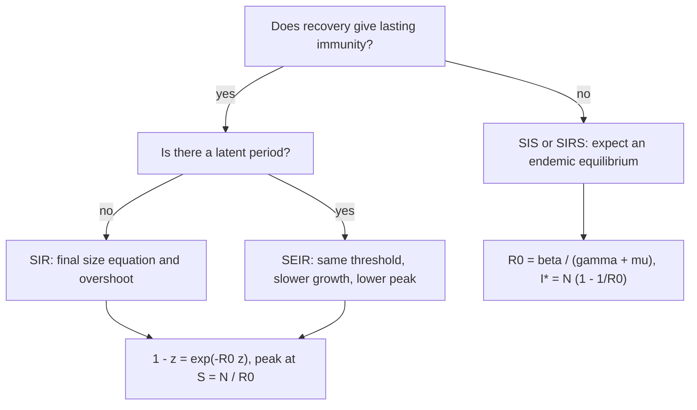

# Epidemic Models

> [Mathematics](../../README.md) › [Mathematical Modeling](../README.md) · Level: Intermediate · Prerequisites: [First-Order Differential Equations](../../16-differential-equations/01-first-order-odes/README.md), [Systems of ODEs](../../16-differential-equations/03-systems-of-odes/README.md), [Applications of Derivatives](../../07-calculus/05-applications-of-derivatives/README.md), [Exponential and Logarithmic Functions](../../03-algebra/12-exponential-and-logarithmic-functions/README.md), [Sampling and Estimation](../../11-statistics/02-sampling-and-estimation/README.md) · Estimated time: 8 h

## 1. Introduction

In 1927 W. O. Kermack and A. G. McKendrick published *A Contribution to the Mathematical Theory of Epidemics*. They divided a population into three groups — those who can still catch the disease, those currently infectious, and those who have been removed from the chain of transmission by recovery or death — wrote down two differential equations for the flow between them, and proved a threshold theorem: an outbreak can grow only if a certain dimensionless combination of rates exceeds $1$. Nearly a century later the same three compartments, and the same threshold, are the first things anyone writes down in an epidemic.

That is the subject of this topic: **compartmental thinking**. A population is cut into a small number of states; each state has a size; each arrow between states is a rate; the model is the system of ODEs that conservation of people forces. Everything else — the reproduction number, herd immunity, the final size, the peak — is a consequence of that bookkeeping plus a handful of assumptions about how people mix.

The mathematics is elementary. The SIR model is two nonlinear ODEs in the plane, and almost every question one can ask about it is answered by dividing one equation by the other, which turns a dynamical problem into an integration. The final-size equation, the peak height and the herd immunity threshold are all obtained this way, without solving the system. What is *not* elementary is the interpretation: the same symbols carry very different meanings depending on which population, which time scale and which contact structure they describe, and the gap between a model and the world is where most public misunderstanding of epidemics is manufactured.

Three results form the spine of the topic.

* **The threshold.** With transmission rate $\beta$ and removal rate $\gamma$, the basic reproduction number is $R_0 = \beta/\gamma$. If $R_0 < 1$ the infection dies out; if $R_0 > 1$ it invades. The proof is a linearisation at the disease-free state, and the general version — the next-generation matrix — handles models with many infected compartments.
* **The final size.** An SIR epidemic in a closed population infects a fraction $z$ solving $1 - z = e^{-R_0 z}$, regardless of how fast it runs. For $R_0 = 2$ that is $79.7\%$, for $R_0 = 3$ it is $94.0\%$. This is the sharpest statement of why "herd immunity by infection" is expensive: the epidemic does not stop at the herd immunity threshold, it overshoots it.
* **Herd immunity.** Vaccination needs to protect a fraction $1 - 1/R_0$ of the population to push the effective reproduction number below $1$; with a vaccine of efficacy $\varepsilon$ the required coverage is $(1-1/R_0)/\varepsilon$, which may exceed $1$, in which case elimination by vaccination alone is impossible.

Around these three results the topic adds the SEIR model (what a latent period does and does not change), the SIS model (where the disease settles into an endemic equilibrium instead of burning out), parameter estimation (why the exponential phase identifies the growth rate but not the reproduction number without independent information about the generation time), stochastic extinction (why a single case often fails to start an outbreak), and a critical discussion of what these models can and cannot support.

The last point deserves emphasis at the outset. Compartmental models are **not forecasts**. They are machines that turn assumptions into consequences: given the mixing pattern, the duration of infectiousness, the fraction susceptible and the behaviour of people, they say what follows. Change an assumption and the output changes, often by a factor. In 2020 reproduction numbers, herd immunity thresholds and peak projections were quoted in public debate as if they were measurements of nature, when they were outputs of models whose parameters were uncertain and whose structure was contested. A reader who can derive the final-size equation is in a position to see exactly which numbers are theorems and which are guesses.

## 2. Prerequisites

**Differential equations** ([First-Order Differential Equations](../../16-differential-equations/01-first-order-odes/README.md), [Systems of ODEs](../../16-differential-equations/03-systems-of-odes/README.md)). Separable equations and the logistic equation, which is the SIS model in disguise; autonomous systems in the plane, equilibria, the phase line for one-dimensional systems; linearisation at an equilibrium and the eigenvalue criterion for stability; the existence–uniqueness theorem, which guarantees that the SIR initial value problem has a unique solution and hence that "the model's prediction" is well defined. The reduction of a two-dimensional system to a single separable equation by computing $dI/dS$ is the one technique used repeatedly in §7.

**Calculus** ([Applications of Derivatives](../../07-calculus/05-applications-of-derivatives/README.md)). Derivatives as rates, the chain rule, monotonicity, concavity and the intermediate value theorem, all used to prove that the final-size equation has exactly one positive root. Integration of $1/S$, which produces the logarithm in the final-size equation.

**Exponentials and logarithms** ([Exponential and Logarithmic Functions](../../03-algebra/12-exponential-and-logarithmic-functions/README.md)). Exponential growth and decay, the doubling time $T_d = \ln 2/r$, and the manipulation of $e^{-x}$ in the threshold and final-size formulas. Logarithms are also the reason that the early phase of an epidemic looks linear on a log scale, which is the basis of the estimation method of §7.8.

**Probability and statistics** ([Probability Distributions](../../10-probability/04-probability-distributions/README.md), [Sampling and Estimation](../../11-statistics/02-sampling-and-estimation/README.md), [Linear Regression](../../11-statistics/04-linear-regression/README.md)). The Poisson distribution and the Poisson process; expectation; the idea of a likelihood and of a maximum-likelihood estimate; simple linear regression, used for fitting $\log(\text{incidence})$ against time. The branching-process argument of §7.10 needs only the notion of a probability generating function evaluated at a point, which is introduced there.

**Numerical root finding** ([Numerical Analysis](../../19-numerical-analysis/README.md)). The final-size equation has no closed-form solution; it is solved by bisection or Newton's method. The worked examples use bisection, which requires nothing beyond the intermediate value theorem.

## 3. Learning Objectives

After this tutorial you will be able to:

1. Explain what a compartmental model is, what its state variables mean, and why the flows between compartments must satisfy a conservation law.
2. Write down the SIR initial value problem, verify that $S + I + R$ is constant, and reduce the system to a single separable equation for $I$ as a function of $S$.
3. Derive $R_0 = \beta/\gamma$ both by the heuristic "rate of infection $\times$ duration of infectiousness" and by the next-generation matrix, and explain why the two agree.
4. Prove the threshold theorem: the disease-free state is locally stable if and only if $R_0 < 1$, and an introduced case grows initially if and only if $R_0 S_0/N > 1$.
5. Derive the final-size equation $1 - z = e^{-R_0 z}$, prove that it has a unique positive solution exactly when $R_0 > 1$, and compute $z$ numerically for given $R_0$.
6. Derive the peak-height formula and locate the peak time qualitatively as the moment $S = N/R_0$.
7. Derive the herd immunity threshold $1 - 1/R_0$, extend it to a vaccine of efficacy $\varepsilon$, and state the hypotheses under which it is valid.
8. Write the SEIR equations, compute its $R_0$ by the next-generation matrix, relate the early growth rate to $R_0$ and the latent and infectious periods, and explain why the latent period changes the timing but not the threshold or the final size.
9. Analyse the SIS model, find its endemic equilibrium $I^{*} = N(1-1/R_0)$, and explain why the disease persists rather than burning out.
10. Estimate a growth rate from incidence data, convert it to $R_0$ under stated assumptions, and explain why the conversion is sensitive to the generation time and why $R_0$ is not identifiable from the exponential phase alone.
11. State the assumptions behind the basic models — homogeneous mixing, mass-action incidence, exponentially distributed infectious periods, closed population, deterministic limit — and describe what changes when each fails.
12. Compute the extinction probability of a branching process with a Poisson offspring distribution, and interpret stochastic extinction for outbreak control.
13. Explain, with specific examples, the difference between a scenario and a forecast, and identify at least four ways in which compartmental models have been misused in public discussion.

## 4. Intuition

**The bathtub.** Imagine three tanks connected by pipes. The first, $S$, holds people who have never been infected and can still be. The second, $I$, holds people who are infectious now. The third, $R$, holds people who have left the chain — recovered with immunity, or dead. Water flows from $S$ to $I$ when a susceptible meets an infectious person and the encounter transmits; it flows from $I$ to $R$ when an infectious person recovers or dies. There is no pipe back, and no water enters or leaves the system. The model is the statement that the level in each tank changes at the rate water flows through its pipes.

The analogy is exact, and it immediately gives the two structural facts that no amount of data can overturn: the total $S+I+R$ is constant, and the epidemic must end when the flow into $I$ falls below the flow out. The second fact is the surprising one. An epidemic does not end because the pathogen weakens or because everyone has been infected; it ends because the tank $S$ runs low enough that each infectious person meets too few susceptibles to replace themselves.

**Why a ratio of rates.** An infectious person generates new infections at a rate proportional to the number of susceptibles around them. If almost everyone is susceptible, that rate is $\beta$ per day; the person remains infectious for an average of $1/\gamma$ days. The expected number of people they infect is therefore the product

$$R_0 = \beta \times \frac{1}{\gamma} = \frac{\beta}{\gamma}.$$

This is a *ratio of rates*, and it is dimensionless. A disease with a high transmission rate but a very short infectious period can have the same $R_0$ as one with a low transmission rate and a long infectious period, and the two epidemics will look completely different in time even though they infect similar numbers in the end.

**The threshold.** Suppose $R_0 = 2$. The first case infects two people on average; those two infect four; the epidemic grows. Suppose $R_0 = 0.8$: the first case infects $0.8$ people on average, the next generation is smaller, and the chain dies out with probability $1$. The number $1$ is special because it is the replacement level: below it, each generation is smaller than the last; above it, larger. This is the same arithmetic as a population growing or declining, with $R_0$ playing the role of the net reproductive rate.

**Why the epidemic overshoots.** When a fraction $1 - 1/R_0$ of the population has been infected, the *remaining* susceptibles are few enough that the average infectious person infects exactly one other: this is the herd immunity threshold. But the epidemic does not stop at that moment. There are still infectious people, and each of them still infects around one susceptible; the incidence declines only gradually, and the total fraction infected at the end exceeds the threshold. For $R_0 = 2$ the threshold is $50\%$ but the final size is $79.7\%$ — the epidemic overshoots by nearly thirty percentage points. The difference between the threshold and the final size is the single most important quantitative fact in the public discussion of "herd immunity".

**Why the latent period matters less than it seems.** A latent period delays the moment a newly infected person becomes infectious, which slows the observable growth of an outbreak. But it does not change how many people one infectious person infects: $R_0$ is unaffected. What changes is the *speed*, and therefore the height of the peak: a slower epidemic with the same $R_0$ has a lower peak and a longer duration. Confusing the growth rate with $R_0$ is the most common error in reading epidemic data, and §7.8 shows exactly how the two are related.

**Why the beginning is a coin flip.** The deterministic model says that $R_0 = 2$ grows. It does not say that one imported case will start an epidemic: that case may infect nobody, with probability $e^{-2} \approx 0.135$ if the number of secondary cases is Poisson with mean $2$; the chain may die out after two or three generations. The probability that a single case sparks a major outbreak is about $80\%$ for $R_0 = 2$, but only about $6\%$ of introductions fail to matter when $R_0 = 3$, and about $58\%$ when $R_0 = 1.5$. At the start of an outbreak, and near the elimination threshold, randomness dominates.

## 5. Formal Definition

**Definition 5.1** (SIR model). Let $N > 0$ be a constant population size and let $S(t), I(t), R(t) \ge 0$ denote the numbers of susceptible, infectious and removed individuals at time $t \ge 0$. Parameters are $\beta > 0$ (transmission rate per infectious individual in a fully susceptible population, units $\text{time}^{-1}$) and $\gamma > 0$ (removal rate, units $\text{time}^{-1}$). The **SIR initial value problem** is

$$S' = -\frac{\beta S I}{N}, \qquad I' = \frac{\beta S I}{N} - \gamma I, \qquad R' = \gamma I,$$

with initial data $S(0) = S_0 > 0$, $I(0) = I_0 > 0$, $R(0) = R^{\text{init}} \ge 0$ and $S_0 + I_0 + R^{\text{init}} = N$.

**Definition 5.2** (basic reproduction number). For a model with a disease-free equilibrium, the **basic reproduction number** $R_0$ is the expected number of secondary infections generated by one typical infectious individual introduced into a population in which everyone else is susceptible. Equivalently, in models where it can be computed this way, it is the spectral radius of the next-generation matrix of Definition 5.4.

**Definition 5.3** (effective reproduction number). At a state with a fraction $s = S/N$ of the population susceptible, the **effective reproduction number** is $R_{\text{eff}} = R_0\,s$, the expected number of secondary infections per infectious individual in that state. For the SIR model with $S = S(t)$, $R_{\text{eff}}(t) = R_0S(t)/N$.

**Definition 5.4** (next-generation matrix). Suppose the infected compartments are $x = (x_1,\dots,x_m)$ and the model can be written near the disease-free equilibrium as $x' = \mathcal{F}(x) - \mathcal{V}(x)$, where $\mathcal{F}$ collects the terms describing new infections and $\mathcal{V}$ collects all other transitions (recovery, death, progression between infected stages). Let $F = D\mathcal{F}(0)$ and $V = D\mathcal{V}(0)$ be the Jacobians at the disease-free equilibrium, with $V$ invertible. The **next-generation matrix** is

$$K := F V^{-1},$$

and the basic reproduction number is its spectral radius,

$$R_0 = \rho(K) = \max\{\lvert\lambda\rvert : \lambda \text{ is an eigenvalue of } K\}.$$

**Definition 5.5** (final size). For the SIR model, the **final size** is $z := (S_0 - S_\infty)/N$, the fraction of the initial population that is ever infected, where $S_\infty = \lim_{t\to\infty}S(t)$.

**Definition 5.6** (endemic equilibrium). An equilibrium of an epidemic model with $I^{*} > 0$ is an **endemic equilibrium**: a state in which the infection persists at a constant level.

**Definition 5.7** (herd immunity threshold). The **herd immunity threshold** for a model with basic reproduction number $R_0$ is the smallest fraction $p_c$ of the population that must be immune (by vaccination or prior infection) for the effective reproduction number of an introduced case to be at most $1$: $R_0(1-p_c) \le 1$, so $p_c = 1 - 1/R_0$ when $R_0 > 1$.

Throughout, "removed" means "no longer infectious and, in the SIR model, permanently immune". The model does not distinguish recovery from death, and it does not allow reinfection.

## 6. Mathematical Notation

| Symbol | Read as | Meaning |
|---|---|---|
| $S, I, R$ | S, I, R | numbers of susceptible, infectious, removed individuals |
| $N$ | N | total population size (constant in the basic models) |
| $s$ | little s | $S/N$, the susceptible fraction |
| $\beta$ | beta | transmission rate per infectious individual per unit time, $\text{time}^{-1}$ |
| $\gamma$ | gamma | removal rate, $\text{time}^{-1}$; $1/\gamma$ is the mean infectious period |
| $\sigma$ | sigma | progression rate from exposed to infectious, $\text{time}^{-1}$; $1/\sigma$ is the mean latent period |
| $\mu$ | mu | birth and death rate, $\text{time}^{-1}$; $1/\mu$ is the life expectancy |
| $R_0$ | R nought | basic reproduction number, dimensionless |
| $R_{\text{eff}}$ | R effective | $R_0S/N$, the reproduction number at the current state |
| $r$ | little r | intrinsic growth rate of the early exponential phase, $\text{time}^{-1}$ |
| $T_d$ | T d | doubling time, $\ln 2/r$ |
| $z$ | z | final size, the fraction ever infected |
| $s_\infty$ | s infinity | limiting susceptible fraction; $z = 1-s_\infty$ when nobody is removed initially |
| $I_{\text{peak}}$ | I peak | maximum number of infectious individuals |
| $p_c$ | p c | herd immunity threshold, or critical vaccination coverage |
| $\varepsilon$ | epsilon | vaccine efficacy (fraction of vaccinated who are protected) |
| $q$ | q | probability that a single introduction causes no major outbreak |
| $K$ | capital K | next-generation matrix; $R_0 = \rho(K)$ |
| $\rho(K)$ | rho of K | spectral radius (largest eigenvalue modulus) |
| $w(\tau)$ | w of tau | generation-time or serial-interval density |
| $\mathcal{F}, \mathcal{V}$ | script F, script V | new-infection terms and transfer terms of a compartmental model |

Read $R_0$ as "R nought" or "R zero", never as a subscripted variable $R_0$ of the removed compartment; the symbol clashes with $R(t)$ and the collision is unfortunate but universal. Read $R_{\text{eff}}$ as "R effective" and $S/N$ as "the susceptible fraction".

## 7. Core Concepts

### 7.1 Compartmental thinking

A compartmental model is built in four steps.

1. **Choose the states.** Divide the population into groups whose members behave identically with respect to the disease: susceptible, exposed (infected but not yet infectious), infectious, removed. The state variables are the numbers in each group.
2. **Write the flows.** For each ordered pair of groups, write the rate at which individuals move from one to the other. The rate must have units of individuals per unit time, and it must be *constitutive*: it should depend only on the state variables and the parameters.
3. **Impose conservation.** If nobody enters or leaves the population and the groups are exhaustive and disjoint, the sum of the state variables is constant. This is not an extra assumption but a consequence of writing flows as transfers rather than as independent births and deaths; getting it wrong is the commonest modelling error in the literature and the easiest to detect.
4. **Analyse, then compare.** Find the equilibria and their stability, compute thresholds, solve what can be solved, and compare the output with data. The comparison usually sends you back to step 1.

The **incidence** term — the rate at which new infections appear — is the modelling crux. The SIR model uses

$$\text{incidence} = \frac{\beta S I}{N},$$

called **frequency-dependent** or **standard** incidence. It says that each infectious person makes contacts at a rate proportional to $N$ and that a fraction $S/N$ of those contacts are with susceptibles, so the per-capita force of infection is $\beta I/N$. An alternative convention, common in the older literature and in models of vector-borne disease, is **mass-action** incidence $\beta SI$, in which contacts are assumed proportional to density rather than frequency; the two agree when $N$ is constant and $\beta$ is rescaled. The distinction matters as soon as $N$ changes: with standard incidence, a doubling of the population does not change the per-capita contact rate, while with mass action it doubles it. The SIR model in this topic uses standard incidence throughout, and its $R_0$ is $\beta/\gamma$; with mass-action incidence the same model has $R_0 = \beta N/\gamma$, which shows how a modelling convention can change a headline number by a factor of $N$.

**Dimensional analysis** is a useful check. $\beta$ has units of $\text{time}^{-1}$ in standard incidence (it is a rate per infectious individual), $\gamma$ has units of $\text{time}^{-1}$, and $\beta/\gamma$ is dimensionless, as a number of secondary cases must be. In mass-action incidence $\beta$ has units $\text{individual}^{-1}\text{time}^{-1}$, and $\beta N/\gamma$ is again dimensionless.

### 7.2 The SIR model

The model of Definition 5.1 is

$$S' = -\frac{\beta SI}{N}, \qquad I' = \frac{\beta SI}{N} - \gamma I, \qquad R' = \gamma I .$$

**Well-posedness and invariant region.** The right-hand side is a polynomial, hence continuously differentiable, so the existence–uniqueness theorem for ODEs applies: through every initial condition there passes exactly one solution, defined for all $t \ge 0$ because the vector field is globally bounded on the compact simplex. Moreover the closed simplex

$$\Delta = \{(S,I,R) : S,I,R \ge 0,\ S+I+R = N\}$$

is positively invariant. On the face $S=0$ we have $S' = 0$; on $I=0$ we have $I'=0$; on $R=0$ we have $R' = \gamma I \ge 0$. A solution starting on the boundary of $\Delta$ cannot leave it, so a solution starting inside stays inside for all time. (Formally, the faces are invariant and the vector field points into the simplex along them; uniqueness then excludes crossing.)

**Conservation.** Adding the three equations gives $(S+I+R)' = 0$, so $S+I+R = N$ for all $t$. This lets us discard $R$ and study the planar system

$$S' = -\frac{\beta SI}{N}, \qquad I' = \frac{\beta SI}{N} - \gamma I,$$

with $R = N - S - I$ recovered at the end. The pair $(S,I)$ lives in the triangle $S \ge 0$, $I \ge 0$, $S+I \le N$.

**Monotonicity.** $S' \le 0$ always, with equality only if $I=0$ or $S=0$: the susceptible pool never increases. $I' = I(\beta S/N - \gamma)$, so $I$ increases exactly while $S > N/R_0$ and decreases afterwards. Hence $I$ has at most one interior maximum, and the epidemic curve is unimodal. The maximum occurs at the moment when $S = N/R_0$ — a fact used in §7.4 to compute its height.

**Long-time behaviour.** $S$ is non-increasing and bounded below by $0$, so $S(t)\to S_\infty$ exists. Since $R' = \gamma I$, we have $\int_0^\infty I\,dt = (R_\infty - R(0))/\gamma < \infty$. If $I(t)$ stayed above some $\delta>0$ on a set of times of infinite measure, the integral would diverge; hence $I(t)\to0$. Both limits exist, and $S_\infty > 0$ whenever $R_0 < \infty$: the epidemic always leaves some susceptibles untouched.

**The phase-plane reduction.** Dividing the second equation by the first, valid whenever $SI > 0$,

$$\frac{dI}{dS} = \frac{\beta SI/N - \gamma I}{-\beta SI/N} = -1 + \frac{\gamma N}{\beta S} = -1 + \frac{N}{R_0 S}.$$

This is separable and linear in $I$ as a function of $S$. Integrating from $(S_0,I_0)$ to $(S,I)$,

$$I - I_0 = -(S - S_0) + \frac{N}{R_0}\ln\frac{S}{S_0}.$$

The quantity

$$I + S - \frac{N}{R_0}\ln S = \text{constant}$$

is a first integral of the SIR flow: every orbit lies on one of these curves. This single formula contains the peak, the final size and the qualitative shape of every SIR epidemic; the rest of §7 is an unpacking of it.

### 7.3 The epidemic threshold and the basic reproduction number

**Heuristic derivation.** An infectious individual in a fully susceptible population transmits at rate $\beta$ per unit time and remains infectious for an expected time $1/\gamma$. The expected number of secondary infections is therefore $\beta \times (1/\gamma) = \beta/\gamma$. That is $R_0$.

Two remarks. First, $1/\gamma$ is the mean of the exponential distribution with rate $\gamma$, which is the distribution of the infectious period implied by the constant removal rate $\gamma$ — the model assumes that an infectious person is equally likely to recover in the next instant regardless of how long they have been infectious (the memoryless property). Second, $\beta$ is a *composite* parameter: if an infectious person makes $c$ contacts per day and each contact transmits with probability $p$, then $\beta = cp$. Interventions act on $c$ (distancing), on $p$ (masks, ventilation) or on $1/\gamma$ (isolation, treatment), and the model's parameters should be read accordingly.

**Linearisation.** Near the disease-free state $(S,I) = (N,0)$, write $S = N - x$ with $x$ small and $I$ small; then

$$I' = I\left(\frac{\beta S}{N} - \gamma\right) = I\left(\beta - \gamma - \frac{\beta x}{N}\right) \approx (\beta-\gamma)I .$$

Hence $I$ grows exponentially at rate $r = \beta - \gamma$ if $\beta > \gamma$ and decays if $\beta < \gamma$. The threshold is $\beta = \gamma$, i.e. $R_0 = 1$. More generally, if the initial susceptible fraction is $s_0 = S_0/N$ rather than $1$, the initial growth rate is $r = \gamma(R_0 s_0 - 1)$, so the condition for an outbreak is $R_0s_0 > 1$, i.e. $R_{\text{eff}} > 1$.

**The next-generation argument.** The linearisation above is the $1 \times 1$ case of a general construction. Write the infected compartment as $I$, with

$$\mathcal{F}(I) = \frac{\beta SI}{N}, \qquad \mathcal{V}(I) = \gamma I .$$

At the disease-free equilibrium $S = N$:

$$F = \left.\frac{\partial \mathcal{F}}{\partial I}\right|_{I=0} = \beta, \qquad V = \left.\frac{\partial \mathcal{V}}{\partial I}\right|_{I=0} = \gamma, \qquad K = FV^{-1} = \frac{\beta}{\gamma}, \qquad R_0 = \rho(K) = \frac{\beta}{\gamma}.$$

The matrix $K$ has an interpretation: its $(i,j)$ entry is the expected number of secondary infections in compartment $i$ produced by an individual who starts in compartment $j$, accumulated over the whole course of infection. Summing over generations, the expected number of infections in generation $n$ is $K^n$ applied to the initial vector, so the growth of the epidemic is governed by the eigenvalues of $K$; the largest one, $\rho(K)$, is the per-generation multiplication factor. This is why $R_0$ is a threshold: generations grow if and only if $\rho(K)>1$.

**Theorem 7.1** (threshold theorem; van den Driessche and Watmough 2002). *Under regularity conditions on $\mathcal{F}$ and $\mathcal{V}$ (both continuously differentiable, $\mathcal{F}(0)=0$, $\mathcal{V}$ with non-negative off-diagonal entries and invertible Jacobian at the disease-free equilibrium), the disease-free equilibrium is locally asymptotically stable if $R_0 = \rho(FV^{-1}) < 1$ and unstable if $R_0 > 1$.*

The theorem is a statement about the linearisation; it says nothing about global behaviour, and it does not say that $R_0 < 1$ implies extinction (that is true in the SIR model with $I(0)>0$ by the argument of §7.2, but it needs a separate proof in general).

**What $R_0$ is not.** $R_0$ is a property of the *model in a specified population at a specified time*, not of the pathogen alone. It depends on contact rates (which depend on behaviour and culture), on the duration of infectiousness (which depends on healthcare), and on the fraction susceptible. Two countries with the same virus can have different $R_0$; the same country can have different $R_0$ in March and in June. Estimates of $R_0$ from data are therefore estimates of a model parameter, and they inherit both the model's structural assumptions and the data's reporting biases.

### 7.4 The final-size equation

Let $I(0) = I_0$ and $S(0) = N - I_0$ (take $R(0)=0$ for simplicity). Since $I(t)\to0$ and $S(t)\to S_\infty$, the first integral of §7.2 evaluated at $t=0$ and at $t=\infty$ gives

$$0 - I_0 = -(S_\infty - (N-I_0)) + \frac{N}{R_0}\ln\frac{S_\infty}{N-I_0}.$$

Writing $s_\infty = S_\infty/N$ and $i_0 = I_0/N$ and dividing by $N$,

$$-i_0 = -(s_\infty - 1 + i_0) + \frac{1}{R_0}\ln\frac{s_\infty}{1-i_0}.$$

In the limit of a small initial seed $i_0\to0$ this becomes

$$1 - s_\infty = \frac{1}{R_0}\ln\frac{1}{s_\infty}, \qquad\text{equivalently}\qquad s_\infty = e^{-R_0(1-s_\infty)} .$$

With $z := 1 - s_\infty$ (the final size, Definition 5.5),

$$1 - z = e^{-R_0 z}.$$

This is the **final-size equation**. It is implicit, transcendental, and independent of $\gamma$ and of the population size: only $R_0$ matters.

**Theorem 7.2** (existence and uniqueness of the final size). *Let $R_0 > 0$. The equation $g(z) := 1 - z - e^{-R_0z} = 0$ has the root $z=0$ for every $R_0$. It has a root in $(0,1)$ if and only if $R_0 > 1$, and that root is unique.*

*Proof.* $g(0) = 1-0-1 = 0$ and $g(1) = -e^{-R_0} < 0$. Differentiate: $g'(z) = -1 + R_0e^{-R_0z}$, so $g'(0) = R_0-1$. If $R_0 \le 1$ then $g'(z) \le -1 + R_0e^{0} \le 0$ for all $z \ge 0$ (since $e^{-R_0z}\le1$), so $g$ is non-increasing on $[0,1]$ and, being $0$ at $0$, is negative on $(0,1]$: no positive root. If $R_0 > 1$ then $g'(0) > 0$, so $g$ initially increases; it is strictly concave on $[0,\infty)$ because $g''(z) = -R_0^2e^{-R_0z} < 0$. A strictly concave function with $g(0)=0$, $g'(0)>0$ and $g(1)<0$ crosses zero exactly once in $(0,1)$: the first crossing exists by the intermediate value theorem, and a second crossing $0<z_1<z_2<1$ would contradict strict concavity (the chord from $(0,0)$ to $(z_2,0)$ would lie strictly below the graph, forcing $g<0$ in between, whereas $g>0$ just after $0$). $\blacksquare$

| $R_0$ | $z$ (final size) | $1-z$ (untouched) | Herd immunity threshold $1-1/R_0$ |
|---|---|---|---|
| $1.2$ | $0.3137$ | $0.6863$ | $0.1667$ |
| $1.5$ | $0.5828$ | $0.4172$ | $0.3333$ |
| $2.0$ | $0.7968$ | $0.2032$ | $0.5000$ |
| $2.5$ | $0.8926$ | $0.1074$ | $0.6000$ |
| $3.0$ | $0.9405$ | $0.0595$ | $0.6667$ |
| $4.0$ | $0.9802$ | $0.0198$ | $0.7500$ |
| $6.0$ | $0.9975$ | $0.0025$ | $0.8333$ |
| $12.0$ | $0.999994$ | $0.000006$ | $0.9167$ |

The table makes the **overshoot** explicit: for $R_0 = 2$ the herd immunity threshold is $50\%$ but the epidemic infects $79.7\%$ before it stops, and for $R_0 = 3$ it infects $94.0\%$ against a threshold of $66.7\%$. The gap is not a modelling artefact; it follows from the same equation, and it is why "reach herd immunity by letting the infection spread" is a strategy that necessarily costs far more infections than the threshold suggests.

Two further properties are worth recording. For $R_0$ just above $1$, expanding the equation gives

$$z \approx \frac{2(R_0-1)}{R_0^{2}},$$

so the final size grows linearly with $R_0-1$ near the threshold (the exact value at $R_0=1.2$ is $0.3137$ against the approximation $2(0.2)/1.44 = 0.2778$). And a **pre-existing immune fraction** $1-s_0$ changes the equation to

$$s_\infty = s_0\,e^{-R_0(s_0-s_\infty)},$$

so that $z = s_0 - s_\infty$. With $s_0 = 0.7$ and $R_0 = 3$ this gives $s_\infty = 0.1246$, i.e. $57.5\%$ of the whole population infected — much less than the $94.0\%$ of a fully susceptible population, which is the quantitative version of "pre-existing immunity helps".

**The peak.** The maximum of $I$ occurs when $S = N/R_0$ (§7.2). Substituting into the first integral with $(S_0,I_0) = (N,0)$,

$$\frac{I_{\text{peak}}}{N} = 1 - \frac{1}{R_0} + \frac{1}{R_0}\ln\frac{1}{R_0} = 1 - \frac{1+\ln R_0}{R_0}.$$

For $R_0 = 2$ this is $0.1534$, for $R_0 = 2.5$ it is $0.2335$ and for $R_0 = 3$ it is $0.3005$: a third of the population infectious at the same time when $R_0 = 3$. The formula is the basis of the "flatten the curve" argument — reducing $R_0$ by distancing lowers the peak roughly in proportion — but it is also a warning, because the peak fraction depends on $R_0$ alone and not on how quickly the epidemic runs.

### 7.5 Vaccination and herd immunity

Suppose a fraction $p$ of the population is immune before the epidemic starts, so $s_0 = 1-p$. The effective reproduction number at the start is $R_{\text{eff}} = R_0(1-p)$. An introduced case fails to grow if $R_{\text{eff}} \le 1$, i.e.

$$p \ge 1 - \frac{1}{R_0} =: p_c .$$

This $p_c$ is the **herd immunity threshold** of Definition 5.7. It is the fraction immune at which the average infectious person infects exactly one other; below it, chains grow; above it, chains shrink.

| Disease | Typical $R_0$ | $p_c = 1-1/R_0$ |
|---|---|---|
| Measles | $12$–$18$ | $91.7\%$–$94.4\%$ |
| Pertussis | $12$–$17$ | $91.7\%$–$94.1\%$ |
| Diphtheria | $6$–$7$ | $83.3\%$–$85.7\%$ |
| Smallpox | $3.5$–$6$ | $71.4\%$–$83.3\%$ |
| Polio | $5$–$7$ | $80.0\%$–$85.7\%$ |
| SARS (2003) | $2$–$4$ | $50.0\%$–$75.0\%$ |
| Influenza (seasonal) | $1.3$–$1.8$ | $23.1\%$–$44.4\%$ |
| COVID-19 (original strain) | $2.5$–$3$ | $60.0\%$–$66.7\%$ |

The table is the standard one and it carries the standard caveat: the ranges reflect both biological differences and differences in the populations and models from which the numbers were estimated. They are not constants of nature.

**Imperfect vaccines.** If a vaccine protects only a fraction $\varepsilon$ of those who receive it (an *all-or-nothing* vaccine), then immunising a fraction $p$ of the population immunises $\varepsilon p$ effectively, and the condition becomes

$$\varepsilon p \ge 1 - \frac{1}{R_0}, \qquad\text{so}\qquad p_c = \frac{1 - 1/R_0}{\varepsilon} .$$

If $\varepsilon \le 1-1/R_0$ then $p_c \ge 1$: **vaccination alone cannot eliminate the infection**, however high the coverage, because even a fully vaccinated population does not reach the threshold. For measles with $R_0 = 15$ the threshold is $93.3\%$; a vaccine with $90\%$ efficacy would require $103.7\%$ coverage, which is impossible. This is the arithmetic behind the 2019 measles outbreaks in populations with high but not sufficient coverage. A *leaky* vaccine, which reduces susceptibility by a factor $\varepsilon$ for everyone, leads to the same threshold formula to first order but a different final-size equation.

**What herd immunity is and is not.** It is a statement about transmission: when enough people are immune, an introduced infection does not spread, and people who cannot be vaccinated are protected indirectly. It is not a property an individual acquires, it is not a fixed percentage valid for all settings (heterogeneity, superspreading, population structure and behaviour all change it), and it is not a strategy: *arriving* at the threshold by natural infection requires overshooting it (§7.4), and the overshoot is paid in hospitalisations and deaths. Countries that explicitly pursued this route in 2020 found the cost unacceptable before the threshold was reached, and the policy was abandoned; the episode is discussed in §7.12.

**Heterogeneity.** If some individuals have far more contacts than others, the homogeneous-mixing threshold overestimates the coverage needed in one sense (the highly connected are likely to be infected or vaccinated early) and underestimates it in another (clusters of unvaccinated people sustain transmission even when the average coverage is high). Neither correction is a small perturbation, and both require a model with structure — age groups, households, networks — rather than a single scalar $p_c$.

### 7.6 SEIR and the effect of a latent period

The SIR model assumes that a newly infected person becomes infectious immediately. Most infections have a latent period: the pathogen replicates before it can be transmitted. The **SEIR model** adds an exposed compartment $E$ of infected-but-not-yet-infectious individuals:

$$S' = -\frac{\beta SI}{N}, \qquad E' = \frac{\beta SI}{N} - \sigma E, \qquad I' = \sigma E - \gamma I, \qquad R' = \gamma I,$$

with $\sigma>0$ the progression rate and $1/\sigma$ the mean latent period. Again $S+E+I+R = N$.

**$R_0$ by the next-generation matrix.** The infected compartments are $(E,I)$, so

$$\mathcal{F} = \begin{pmatrix} \beta SI/N \\ 0\end{pmatrix}, \qquad \mathcal{V} = \begin{pmatrix} \sigma E \\ \gamma I - \sigma E\end{pmatrix}.$$

At the disease-free equilibrium $S=N$,

$$F = \begin{pmatrix} 0 & \beta \\ 0 & 0\end{pmatrix}, \qquad V = \begin{pmatrix} \sigma & 0 \\ -\sigma & \gamma\end{pmatrix}, \qquad V^{-1} = \begin{pmatrix} 1/\sigma & 0 \\ 1/\gamma & 1/\gamma\end{pmatrix},$$

$$K = FV^{-1} = \begin{pmatrix} \beta/\gamma & \beta/\gamma \\ 0 & 0\end{pmatrix}, \qquad R_0 = \rho(K) = \frac{\beta}{\gamma}.$$

So the latent period does **not** change $R_0$: an individual still spends an expected $1/\gamma$ time infectious, and the transmission rate while infectious is still $\beta$. The exposed state delays infection but does not reduce the total number of transmissions. (This is true for the model with exponentially distributed sojourns; if the infectious period is shortened by isolation triggered at symptom onset, then $\gamma$ changes and so does $R_0$.)

**The early growth rate is different.** Linearising at the disease-free state with $S\approx N$, look for solutions $(E,I) \propto e^{rt}$:

$$rE = \beta I - \sigma E, \qquad rI = \sigma E - \gamma I .$$

Rearranging, $(r+\sigma)E = \beta I$ and $(r+\gamma)I = \sigma E$; multiplying gives the **characteristic equation**

$$(r+\sigma)(r+\gamma) = \sigma\beta, \qquad\text{so}\qquad R_0 = \frac{\beta}{\gamma} = \left(1+\frac{r}{\sigma}\right)\left(1+\frac{r}{\gamma}\right).$$

This is the fundamental relation between the observed growth rate and the reproduction number. It shows two things. First, $R_0$ is not identifiable from $r$ alone: $r$ is one number and $R_0$ depends on $r$, $\sigma$ and $\gamma$, so independent information about the generation time is needed. Second, ignoring the latent period biases the estimate: fitting an SIR model (which assumes $\sigma = \infty$) to data generated by an SEIR model with the same $r$ and $\gamma$ underestimates $R_0$ by the factor $1+r/\sigma$. With $r = 0.2$ per day, a four-day latent period and a five-day infectious period, the true $R_0$ is $3.6$; the SIR fit gives $2.0$. That is not a small error, and it is the reason epidemiological estimates always report the assumed generation time alongside $R_0$.

**The final size is unchanged.** Since $R' = \gamma I$ and $S' = -\beta SI/N$ in both models, $dR/dS = -\gamma N/(\beta S)$ in both, and the integrated relation — hence the final-size equation — is identical. Latency changes *when* things happen, not *how many* are infected in the end, in this family of models.

**The peak is lower and later.** With the same $R_0$ and the same $\gamma$, the SEIR epidemic grows more slowly at first (the characteristic root $r$ solves a quadratic with $\sigma$ finite) and lasts longer, so the infectious curve is flatter and wider. The total number infected is the same, spread over more time. The peak of $I$ occurs when $\sigma E = \gamma I$, i.e. when the inflow to the infectious class equals the outflow. Numerical solution confirms the ordering: with $\gamma = 1$ and $R_0 = 3$, the SIR peak is $I/N = 0.3006$, while the SEIR peak is $0.1965$ for $\sigma = 2$, $0.1467$ for $\sigma = 1$ and $0.0982$ for $\sigma = 0.5$ — the longer the latent period, the lower and later the peak, and the SIR model is recovered in the limit $\sigma\to\infty$.

### 7.7 SIS and endemic equilibria

The SIR model gives permanent immunity. Many infections do not: recovery confers little or no protection, and a recovered person returns to the susceptible pool. The **SIS model** with births and deaths is

$$S' = \mu N - \frac{\beta SI}{N} - \mu S + \gamma I, \qquad I' = \frac{\beta SI}{N} - (\gamma+\mu) I,$$

where $\mu$ is the per-capita birth and death rate and recovery returns people to $S$. Note the $+\gamma I$ term in the first equation: recovery is a transfer, not a removal, and omitting it violates conservation. With these terms, $S+I = N$ is conserved, so the system reduces to the one-dimensional equation

$$I' = \frac{\beta (N-I)I}{N} - (\gamma+\mu)I = I\left[\beta\left(1-\frac{I}{N}\right) - (\gamma+\mu)\right].$$

**Basic reproduction number.** An infectious individual transmits at rate $\beta$ while in $I$ and leaves that compartment at rate $\gamma+\mu$ (recovery or death), so

$$R_0 = \frac{\beta}{\gamma+\mu}.$$

The same value is obtained from the next-generation matrix, with $F = \beta$ and $V = \gamma+\mu$.

**Equilibria.** Setting $I'=0$ gives $I = 0$ or

$$\beta\left(1-\frac{I}{N}\right) = \gamma+\mu \quad\Longrightarrow\quad \frac{I^{*}}{N} = 1 - \frac{\gamma+\mu}{\beta} = 1 - \frac{1}{R_0}.$$

So the **endemic equilibrium** is

$$\frac{S^{*}}{N} = \frac{1}{R_0}, \qquad \frac{I^{*}}{N} = 1 - \frac{1}{R_0},$$

and it is biologically meaningful exactly when $R_0 > 1$. When $R_0 \le 1$ the only non-negative equilibrium is $I=0$.

**Stability.** The right-hand side is $f(I) = I\left[\beta(1-I/N) - (\gamma+\mu)\right]$, a logistic-type scalar equation. For $R_0>1$, $f(I)>0$ on $(0,I^{*})$ and $f(I)<0$ on $(I^{*},N)$, so $I$ increases towards $I^{*}$ from below and decreases towards it from above: the endemic equilibrium is globally asymptotically stable on $(0,N)$. For $R_0<1$, $f(I)<0$ for all $I>0$, so $I\to0$ and the disease-free equilibrium is globally stable. At $R_0 = 1$ the two equilibria collide — a transcritical bifurcation.

**The contrast with SIR.** In the SIR model the infection always burns out, because the removed compartment is absorbing: even with $R_0 = 5$ the infectious population tends to zero and the disease disappears (leaving $99.3\%$ infected behind it). In the SIS model the infection persists at a positive endemic level forever, because there is a steady supply of new susceptibles. This is the mathematical content of the difference between an epidemic and an endemic infection, and it is the reason measles (immunising, SIR-like) can be eliminated while the common cold coronaviruses (partially immunising, SIRS-like) cannot.

**Without demography.** With $\mu = 0$ the SIS model becomes

$$I' = I\left[\beta\left(1-\frac{I}{N}\right)-\gamma\right],$$

with $R_0 = \beta/\gamma$ and the same endemic equilibrium $I^{*}/N = 1-1/R_0$. The endemic state survives the removal of births and deaths because recovery itself replenishes the susceptible pool; this is precisely what an SIR model lacks.

### 7.8 Parameter estimation and model fitting, in principle

A model with the right structure and the wrong parameters is worse than useless, because it produces confident nonsense. Estimating parameters from data is therefore half the subject. The principles are simple even when the practice is not.

**What the data are.** Surveillance data are usually *incidence*: the number of newly reported cases per day. They are not infections. A case is reported only if the person is symptomatic, seeks care, is tested and the result is recorded, so

$$\text{reported}(t) \approx \rho \cdot \text{new infections}(t - d),$$

where $\rho \in (0,1]$ is the reporting fraction and $d$ is the delay from infection to report. The parameters $\rho$ and $d$ are usually unknown and time-varying, and they confound every estimate of the epidemic parameters. Serological surveys estimate the cumulative attack rate directly and are the only reliable way to measure $\rho$, but they are expensive and lag the epidemic.

**The exponential phase.** Early in an outbreak, $S/N \approx 1$ and the model is linear:

$$I(t) \approx I(0)e^{rt}, \qquad r = \gamma(R_0-1) \ \text{(SIR)} .$$

So a plot of $\log(\text{incidence})$ against time is a straight line of slope $r$, and a least-squares fit to that line gives an estimate $\hat r$. This is the most robust part of epidemic parameter estimation, because it requires neither $\rho$ nor $d$ (both shift the intercept, not the slope) and it is insensitive to the details of the model.

**From $r$ to $R_0$.** The conversion is where the assumptions enter. In the SIR model,

$$\hat R_0 = 1 + \frac{\hat r}{\gamma} = 1 + \hat r\,T_{\text{inf}},$$

and in the SEIR model

$$\hat R_0 = \left(1+\frac{\hat r}{\sigma}\right)\left(1+\frac{\hat r}{\gamma}\right).$$

The general relation, valid for any model in which the generation time has density $w(\tau)$ (the probability that a secondary infection occurs $\tau$ time units after the infecting one), is the **Euler–Lotka equation**

$$1 = R_0\int_0^\infty e^{-r\tau}w(\tau)\,d\tau .$$

For the SIR model $w(\tau) = \gamma e^{-\gamma\tau}$ and the integral is $\gamma/(r+\gamma)$, recovering $1 = R_0\gamma/(r+\gamma)$; for the SEIR model $w$ is the convolution of an exponential latent period and an exponential infectious period, and its Laplace transform is the product $\frac{\sigma}{r+\sigma}\cdot\frac{\gamma}{r+\gamma}$, recovering the formula above. The equation is the epidemic analogue of the Euler–Lotka equation of demography, with $R_0$ in place of the net reproductive rate.

**Identifiability.** The Euler–Lotka equation shows that $r$ determines $R_0$ only if $w$ is known. Since $w$ is a distribution, not a number, $R_0$ is *not identifiable* from the exponential phase alone: a fast-growing epidemic with a short generation time and a slower one with a long generation time can have the same $r$ and different $R_0$. This is not a technicality. Estimates of $R_0$ for the same virus in the same month of 2020 differed substantially, in part because different groups assumed mean generation times between roughly four and eight days; for $r = 0.15$ per day, changing the infectious period from four to eight days changes the SIR estimate of $R_0$ from $1.60$ to $2.20$. Reporting $R_0$ without $w$ is reporting an unidentified parameter.

**Likelihood methods.** Beyond the exponential phase, fitting is done by maximising a likelihood. For counts $y_t$ of new cases, a Poisson or negative-binomial model is standard:

$$\log L(\theta) = \sum_t \left[y_t\log \lambda_t(\theta) - \lambda_t(\theta) - \log(y_t!)\right],$$

where $\lambda_t(\theta)$ is the model's expected incidence under parameters $\theta$, and the negative binomial is used when counts are overdispersed (which they almost always are). Evaluating $\lambda_t$ requires solving the ODEs or iterating the discrete-time map, so each likelihood evaluation costs a numerical solution; Bayesian inference adds a prior and produces a posterior, which is the honest way to report uncertainty. **Trajectory matching** (fit the model's deterministic path to data) and **state-space models** (model the data as a noisy observation of a latent process) are the two standard frameworks.

**What can go wrong.** Fitting a flexible model to a single epidemic wave can always succeed, because there are enough parameters to trace any curve; this is overfitting, and it is why out-of-sample validation is essential. Structural uncertainty is usually larger than parameter uncertainty: choosing SIR rather than SEIR changes $R_0$ by tens of percent, while the confidence interval from a given model may be a few percent. Reporting the second without the first is the commonest form of false precision in the field.

### 7.9 The assumptions, and what happens when they fail

Every result in §7 rests on the same list. It is worth writing the list down and saying what each assumption does.

| Assumption | What it buys | What happens when it fails |
|---|---|---|
| **Homogeneous mixing**: every pair of individuals is equally likely to interact | incidence $\beta SI/N$; a single scalar $R_0$ | superspreading, households, schools, geography: $R_0$ becomes an average over a structured population, and the epidemic can persist in one cluster while the national average falls |
| **Mass action / frequency dependence** with constant contact rate | $\beta$ constant; simple threshold | behaviour change, distancing, seasonality: $\beta(t)$ becomes a function of time and of the model's own output |
| **Exponentially distributed infectious period** (constant hazard $\gamma$) | one-parameter sojourn; ODEs close in $I$ | real infectious periods are more concentrated: the exponential over-represents both very short and very long periods, and overestimates the chance of a long infectious tail |
| **Closed population**, no births, deaths, migration | conservation; planar reduction | demography matters for multi-year dynamics; travellers re-seed |
| **Permanent immunity** (SIR) or none (SIS) | two clean extremes | waning immunity, variants, partial cross-protection: need SIRS or multi-strain models |
| **Deterministic limit**, $N\to\infty$ | ODEs; sharp thresholds | at low prevalence or small populations, extinction is likely and the ODE overstates persistence |
| **Parameters constant in time** | stationary analysis; single $R_0$ | the parameters change with policy, season and behaviour; $R_0$ is then only a description of the initial state |
| **Perfect observation** | data = model output | reporting fraction, delay, ascertainment bias; estimates of $R_0$ inherit the bias in $\rho$ only weakly (through the slope) but estimates of the final size do not |

**Homogeneous mixing.** The assumption that each infectious person contacts a random sample of the population at a constant rate is the strongest and the least realistic. Real contacts are highly heterogeneous: a minority of individuals account for a large majority of transmissions (the "20/80 rule" of superspreading), contacts are concentrated in households, schools and workplaces, and mobility couples cities. Structured models replace the single equation for $I$ by one equation per group, with a contact matrix $C_{ij}$ giving the average number of contacts between a person in group $i$ and a person in group $j$; then the next-generation matrix is built from $C$, and $R_0$ becomes the spectral radius of a matrix rather than a ratio of scalars. The qualitative conclusions — threshold, overshoot, herd immunity — survive, but the numbers change, often substantially.

**The exponential sojourn.** The ODE formulation forces the time spent in a compartment to be exponential, because a constant per-capita rate $\gamma$ means a constant hazard. For a disease with an infectious period that is nearly fixed (say, seven days with small variance), the exponential assumption is badly wrong: it implies that $37\%$ of cases are still infectious after seven days and $5\%$ after three weeks. **Stage-structured** models with several infected compartments in series (**gamma-distributed** sojourn times) fix this at the cost of more equations, and they change the timing of the peak while leaving $R_0$ unchanged.

### 7.10 Stochastic extinction and the 1927 threshold

The deterministic SIR model says that an epidemic with $R_0>1$ grows. It does not say that a single imported case starts one. In the first generations, when the number of infectious people is small, the process is a **branching process** and can die out by chance.

**The branching process.** Let each infectious individual produce a random number $X$ of secondary cases, with $\mathbb{E}[X] = R_0$, independently of the others, and let $G(s) = \mathbb{E}[s^{X}] = \sum_{k\ge0}\Pr(X=k)s^{k}$ be its probability generating function. Let $q$ be the probability that the whole chain, starting from one case, eventually dies out. Conditioning on the first generation,

$$q = \sum_{k\ge0}\Pr(X=k)\,q^{k} = G(q).$$

The extinction probability is the **smallest fixed point of $G$ in $[0,1]$**; the function $G$ is increasing and convex on $[0,1]$ with $G(1)=1$, so the set of fixed points is either $\{1\}$ or $\{1, q^{*}\}$ with $q^{*}<1$. Since $G'(1) = R_0$, a fixed point below $1$ exists exactly when $R_0>1$. This is the stochastic version of the threshold theorem, and it is a genuinely different statement: $R_0>1$ makes a major outbreak *possible*, not certain.

**Poisson offspring.** If $X\sim\operatorname{Poisson}(R_0)$ then $G(s) = e^{-R_0(1-s)}$ and the equation is

$$q = e^{-R_0(1-q)} .$$

This is the same transcendental equation as the final-size equation with $z$ replaced by $q$; its smallest root is the extinction probability and $1-q$ is the probability of a major outbreak.

| $R_0$ | Extinction probability $q$ | Major outbreak $1-q$ |
|---|---|---|
| $0.8$ | $1$ | $0$ |
| $1.0$ | $1$ | $0$ |
| $1.25$ | $0.6286$ | $0.3714$ |
| $1.5$ | $0.4172$ | $0.5828$ |
| $2.0$ | $0.2032$ | $0.7968$ |
| $2.5$ | $0.1074$ | $0.8926$ |
| $3.0$ | $0.0595$ | $0.9405$ |
| $4.0$ | $0.0198$ | $0.9802$ |

The numerical coincidence with the final-size column of §7.4 is exact for the Poisson case, and it is a coincidence of algebra, not a general law: both problems reduce to $x = e^{-R_0(1-x)}$, but for a different reason in each case. It is a useful mnemonic and a dangerous one if taken as epidemiology.

**The offspring distribution matters.** With a geometric offspring distribution of mean $R_0$ the generating function is $G(s) = 1/(1+R_0(1-s))$, and solving $q = G(q)$ gives $q = 1/R_0$ — for $R_0 = 2$ that is $0.5$, against $0.2032$ for the Poisson. Overdispersion (a high variance of $X$ with the same mean) *raises* the extinction probability, because it makes the early generations more likely to produce zero. So even the probability that an introduction fizzles is not determined by $R_0$ alone.

**Consequences.** A single imported case of a disease with $R_0 = 2$ fails to start an outbreak about $20\%$ of the time; five independent introductions fail with probability $q^{5} \approx 0.00035$. This is why repeated introductions matter for countries pursuing elimination, and why border controls can succeed even when they are imperfect, provided the number of introductions is small. Conversely, as incidence falls towards zero at the end of an epidemic, the process becomes stochastic again, and extinction — not the deterministic decline — is what actually happens. The **critical community size** of measles (roughly 250,000–500,000, in the classical estimates of Bartlett) is the population below which the virus cannot persist between epidemics because it repeatedly goes extinct.

### 7.11 History: the 1927 paper and what came after

The mathematical theory of epidemics has a short list of founding moments.

* **1906.** W. H. Hamer suggests that the course of a measles epidemic is governed by the rate of contact between susceptible and infectious people — the first statement of mass-action incidence.
* **1911.** Ronald Ross, in *The Prevention of Malaria*, states a threshold theorem for malaria: transmission can be sustained only if the mosquito density exceeds a critical value. Ross's insight is the direct ancestor of $R_0$: control need not eliminate the vector, only push its density below the threshold.
* **1927.** W. O. Kermack and A. G. McKendrick publish *A Contribution to the Mathematical Theory of Epidemics* in the *Proceedings of the Royal Society A*. They introduce the S, I and R compartments, prove the threshold theorem, derive the final-size equation, and show that the epidemic curve is unimodal. Almost every formula in §7.4 is in that paper.
* **1928.** Reed and Frost teach the chain-binomial model (a discrete-time epidemic process), published later; it is the first fully stochastic epidemic model.
* **1932.** Kermack and McKendrick extend the theory to endemicity, introducing the equilibrium analysis of §7.7.
* **1950s–1960s.** M. S. Bartlett develops the stochastic theory of epidemics and identifies the critical community size for measles; N. T. J. Bailey publishes *The Mathematical Theory of Epidemics* (1957), the first textbook.
* **1979–1991.** R. M. Anderson and R. M. May publish their synthesis, culminating in *Infectious Diseases of Humans* (1991), which installs $R_0$, the next-generation method and compartmental modelling as standard tools in biology and public health. The notation $R_0$ is borrowed from demography (the net reproduction rate of Lotka and Dublin).
* **1980.** The World Health Assembly certifies the eradication of smallpox, the first human disease eliminated by vaccination — and a triumph of the threshold arithmetic of §7.5, achieved with a vaccine of high efficacy and a virus with no animal reservoir.
* **2001.** Foot-and-mouth disease in the United Kingdom. Models of the epidemic were used in real time to justify a massive culling programme; the episode made clear both the power and the political weight of epidemic modelling, and it remains a standard case study in model validation.
* **2003–2014.** SARS, pandemic influenza (2009) and Ebola (2014) each produced influential real-time projections, and each generated a literature on why the projections differed.
* **2020.** COVID-19. Reproduction numbers, herd immunity thresholds and model projections became front-page news for two years. The models informed policy to a degree unprecedented in the history of applied mathematics, and they were criticised to a degree unprecedented as well.

### 7.12 Limitations, and how these models were misused

The models of this topic are the simplest members of their family. Their limitations are not hidden; they follow from the assumptions listed in §7.9. What follows is a checklist for reading an epidemic model critically, followed by a short account of the ways in which such models were misused in public.

**1. A model is an implication, not an observation.** A compartmental model says: *if* mixing is homogeneous, *if* the infectious period has mean $1/\gamma$, *if* the reporting fraction is $\rho$, *then* the epidemic will look like this. Every number it produces is conditional on the "if"s. A model cannot tell you what the world is like; it can only tell you what follows from what you assumed. When a model's output is quoted as a fact, one of the conditional clauses has been dropped.

**2. Scenario, projection, forecast.** These are three different objects, and conflating them is the commonest abuse.
   * A **scenario** answers "what would happen under these specified assumptions?" — the answer is a conditional statement, and is the only thing a model strictly delivers.
   * A **projection** carries those assumptions into the future on the basis of current data; it is still conditional, but the conditions are claimed to hold now.
   * A **forecast** claims to say what *will* happen, and requires the assumptions to continue to hold and the model to be structurally correct. Very few epidemic models deserve the name.

**3. Structural uncertainty dominates parameter uncertainty.** Choosing between SIR and SEIR changes the inferred $R_0$ by tens of percent (§7.6); choosing homogeneous mixing over a household model changes the predicted final size for the same $R_0$. Confidence intervals computed within one model are usually much narrower than the spread across models, and reporting only the former is a form of false precision.

**4. The parameters are not identifiable from the data alone.** $R_0$ cannot be estimated from the exponential growth rate without a generation time (§7.8). Published estimates that omitted the generation time were not estimates of $R_0$ at all, but of a one-parameter family of possible values.

**5. Behaviour feeds back.** People change their contacts in response to the epidemic and to the model. A model that assumes constant $\beta$ will over-predict precisely when its predictions are taken seriously. This is not a technicality: it is why models fitted to the first wave failed on the second, and why "the model said X" is not a refutation of a policy that changed the model's parameters.

**6. Fitting is not validation.** A model with enough parameters can be fitted to any single epidemic curve. Validation requires out-of-sample prediction, comparison of competing models on held-out data, or calibration against independent data (serology, hospital admissions, deaths) that the model did not use.

**7. The data are not the epidemic.** Reported cases are a time-delayed, under-ascertained fraction of infections, with a reporting rate that changed over time and differed between countries. The infection fatality ratio is not the case fatality ratio; ignoring the denominator was the source of some of the most alarming and least defensible early numbers of 2020.

**8. What models are good for.** Comparing scenarios under a common set of assumptions; identifying which parameters the conclusions are sensitive to; designing surveillance and testing; estimating the *direction* and rough magnitude of effects; ruling out explanations that are quantitatively impossible; and making the assumptions of a policy explicit. This is a long and valuable list, and it is shorter than what models were asked to do.

**A short, careful account of the misuse.** In 2020 the following failures recurred.

* **$R_0$ treated as a constant of the virus.** It was quoted as a fixed property, compared across countries as if it measured virulence, and used as a scorecard for policy. In fact $R_0$ is a property of a population's contacts and behaviour at a moment, and a policy that reduces it is a success, not a contradiction of the earlier estimate.
* **Herd immunity treated as a strategy.** The threshold $1-1/R_0$ describes the state at which transmission stops growing; it does not describe a safe route to that state. Reaching it by infection requires overshooting it (§7.4), and the cost is measured in hospitalisations and deaths. Proposals in 2020 to pursue "herd immunity by infection" under the label of focused protection — most visibly the Great Barrington Declaration of October 2020 — were criticised on precisely these grounds by the World Health Organization and by large numbers of epidemiologists, and the signatories' assumptions about the feasibility of shielding vulnerable people were not supported by the models they invoked. No country adopted the strategy explicitly, and the settings that came closest — parts of Sweden in 2020, which never imposed a full lockdown — recorded high mortality and seroprevalence well below the threshold for the prevailing variants, a combination that undercut the argument for the approach.
* **Projections reported as forecasts.** The CDC's September 2014 projection of up to 1.4 million Ebola cases by January 2015 was explicitly conditional on no further interventions; it was widely reported without the condition, and the actual outbreak totalled about 28,600 cases. Similar episodes occurred in 2001 (foot-and-mouth), 2009 (influenza) and 2020 (COVID-19). The pattern is consistent: the worst-case branch of a scenario analysis is the one that gets a headline, and the caveat is the first thing to be lost.
* **The metric becomes the target.** Once a quantity such as $R_t$ or daily cases becomes the public measure of success, effort is directed at the measure rather than at the thing measured. Testing policy, case definitions and reporting schedules all changed in ways that made the metric look better; this is Goodhart's law, and epidemic indicators are not exempt.
* **Single numbers without intervals.** Publishing a point estimate of a peak date or a final size without its uncertainty invites the conclusion that the model failed when the number did not materialise, when in fact the interval may have contained the truth. The failure here is one of communication, and it damaged the credibility of the whole enterprise.

**What is not a legitimate criticism.** "Models are always wrong" is true and unhelpful: all maps are wrong, and some maps are useful. "The model changed its prediction, therefore it was worthless" confuses a projection with a forecast and ignores that new data should change a conditional prediction. The reasonable standard is the one used in any applied mathematics: are the assumptions stated, are they plausible, is the uncertainty quantified, does the model reproduce data it was not fitted to, and are its conclusions robust to changes in structure?

## 8. Formulas and Properties

| # | Result | Statement | Hypotheses | Why |
|---|---|---|---|---|
| 8.1 | Conservation | $S+I+R = N$ (or $S+E+I+R=N$) | closed population, transfers only | sum the equations |
| 8.2 | Final-size equation | $1-z = e^{-R_0z}$ | SIR, closed, $I_0\to0$, $R(0)=0$ | divide $I'$ by $S'$ and integrate |
| 8.3 | Final size exists | unique $z\in(0,1)$ iff $R_0>1$ | as 8.2 | strict concavity of $1-z-e^{-R_0z}$ |
| 8.4 | Peak height | $I_{\text{peak}}/N = 1-(1+\ln R_0)/R_0$ | SIR, $S_0=N$, $I_0\to0$ | evaluate the first integral at $S=N/R_0$ |
| 8.5 | Basic reproduction number | $R_0=\beta/\gamma$ | SIR, standard incidence | rate $\times$ duration |
| 8.6 | Threshold | outbreak iff $R_0S_0/N>1$ | SIR, small $I_0$ | linearisation $I'=(\beta S_0/N-\gamma)I$ |
| 8.7 | Next-generation matrix | $R_0=\rho(FV^{-1})$ | disease-free equilibrium, $V$ invertible, regularity | generations multiply by $K$ |
| 8.8 | Effective reproduction number | $R_{\text{eff}} = R_0S/N$ | SIR at state $S$ | each case meets a fraction $S/N$ of susceptibles |
| 8.9 | Herd immunity threshold | $p_c = 1-1/R_0$ | homogeneous mixing, perfect vaccine, $R_0>1$ | require $R_0(1-p)\le1$ |
| 8.10 | Imperfect vaccine | $p_c = (1-1/R_0)/\varepsilon$ | all-or-nothing vaccine of efficacy $\varepsilon$ | fraction effectively immune is $\varepsilon p$ |
| 8.11 | SEIR reproduction number | $R_0=\beta/\gamma$ | SEIR, standard incidence | $K$ has one non-zero eigenvalue $\beta/\gamma$ |
| 8.12 | SEIR growth relation | $(r+\sigma)(r+\gamma)=\sigma\beta$ | SEIR near the disease-free state | exponential ansatz |
| 8.13 | Euler–Lotka | $1=R_0\int_0^\infty e^{-r\tau}w(\tau)\,d\tau$ | any generation-time distribution $w$ | generations overlap exponentially |
| 8.14 | Doubling time | $T_d=\ln 2/r$ | exponential phase | definition of exponential growth |
| 8.15 | SIS endemic equilibrium | $S^{*}/N=1/R_0$, $I^{*}/N=1-1/R_0$ | SIS (with or without demography), $R_0>1$ | set $I'=0$ |
| 8.16 | SIS $R_0$ with demography | $R_0=\beta/(\gamma+\mu)$ | births and deaths at rate $\mu$ | mean infectious lifetime $1/(\gamma+\mu)$ |
| 8.17 | Extinction probability | $q=G(q)$, smallest root in $[0,1]$ | branching process, offspring pgf $G$ | first-generation decomposition |
| 8.18 | Extinction, Poisson offspring | $q=e^{-R_0(1-q)}$ | offspring $\operatorname{Poisson}(R_0)$ | substitute $G(s)=e^{-R_0(1-s)}$ |
| 8.19 | Final size with pre-immunity | $s_\infty = s_0e^{-R_0(s_0-s_\infty)}$, $z=s_0-s_\infty$ | fraction $s_0$ susceptible initially | same integration |

Three cautions about the table.

* **8.2 and 8.4 assume $I_0\to0$.** With a non-negligible initial seed the exact relation is the one displayed in the derivation, with $i_0$ terms retained; the difference matters only when the initial prevalence is a sizeable fraction of the population.
* **8.5 and 8.11 are the same number for different reasons.** In the SIR model the latent period is zero, in the SEIR model it is exponential with mean $1/\sigma$; neither changes the expected number of transmissions per case, so neither changes $R_0$. What changes is the growth rate (8.12).
* **8.9 is a statement about averages.** It says nothing about an individual's risk, and it is exact only under homogeneous mixing with a perfect vaccine. In a structured population the threshold is the solution of a matrix inequality, not a single fraction.

## 9. Step-by-Step Examples

### 9.1 From rates to the reproduction number and the doubling time

An infection has transmission rate $\beta = 0.6$ per day and removal rate $\gamma = 0.2$ per day.

*Basic reproduction number.* $R_0 = \beta/\gamma = 0.6/0.2 = 3$. One infectious person in a fully susceptible population infects three others on average.

*Mean infectious period.* $1/\gamma = 5$ days.

*Transmission per contact.* If an infectious person makes $c = 12$ close contacts per day, the per-contact transmission probability is $p = \beta/c = 0.6/12 = 0.05$. The decomposition matters for policy: halving $c$ halves $\beta$ and hence $R_0$; halving $p$ does the same.

*Early growth rate.* $r = \beta-\gamma = 0.4$ per day, so the doubling time is

$$T_d = \frac{\ln 2}{r} = \frac{0.69315}{0.4} = 1.7329\ \text{days}.$$

*Check.* $R_0>1$, $r>0$ and $T_d$ is positive; and $R_0 = 1 + r/\gamma = 1 + 0.4/0.2 = 3$, consistent with §7.8. ✓

### 9.2 Solving the final-size equation for $R_0 = 3$

Solve $g(z) = 1 - z - e^{-3z} = 0$ on $(0,1)$ by bisection.

*Evaluations.* $g(0.9) = 0.1 - e^{-2.7} = 0.1-0.06721 = 0.03279 > 0$.
$g(0.95) = 0.05 - e^{-2.85} = 0.05-0.05784 = -0.00784 < 0$.
So the root lies in $(0.9,0.95)$. Next, $g(0.94) = 0.06 - e^{-2.82} = 0.06-0.05961 = 0.00039 > 0$, and
$g(0.945) = 0.055-e^{-2.835} = 0.055-0.05870 = -0.00370 < 0$, so the root lies in $(0.94,0.945)$.
Continuing the bisection,

$$z = 0.94048\ldots$$

*Interpretation.* $94.05\%$ of the population is infected before the epidemic ends and $5.95\%$ remains
susceptible. The herd immunity threshold is $1-1/3 = 66.67\%$, so the epidemic overshoots the threshold
by $27.4$ percentage points.

### 9.3 Peak height for $R_0 = 2.5$

$$\frac{I_{\text{peak}}}{N} = 1 - \frac{1+\ln R_0}{R_0} = 1 - \frac{1+0.91629}{2.5} = 1 - 0.76652 = 0.23348 .$$

So $23.3\%$ of the population is infectious simultaneously at the peak of the epidemic. The herd
immunity threshold is $1-1/2.5 = 60\%$, and the final size, from the table in §7.4, is $89.26\%$.

*Meaning for capacity.* If the population is $10$ million and $1\%$ of simultaneous infections require
hospital admission, the peak demands $0.01 \times 0.2335 \times 10^7 = 23{,}350$ beds — a number that
can be compared with the capacity of the health system, which is what "flattening the curve" is about.

### 9.4 Estimating $R_0$ from a growth rate, with and without a latent period

An outbreak doubles every four days. The mean latent period is four days and the mean infectious
period is five days.

*Growth rate.* $r = \ln 2/4 = 0.173287$ per day.

*SEIR conversion.* With $\sigma = 1/4 = 0.25$ and $\gamma = 1/5 = 0.2$, the relation of §7.6 gives

$$R_0 = \left(1+\frac{r}{\sigma}\right)\left(1+\frac{r}{\gamma}\right) = (1+0.693147)(1+0.866434) = (1.693147)(1.866434) = 3.1601 .$$

The characteristic-equation form gives the same number:
$(r+\sigma)(r+\gamma)/(\sigma\gamma) = (0.423287)(0.373287)/(0.05) = 3.1601$.

*SIR conversion.* If the latent period is ignored — that is, if an SIR model is fitted to data generated
with a four-day latent period — the same $r$ and $\gamma$ give

$$R_0^{\text{(SIR)}} = 1+\frac{r}{\gamma} = 1+0.866434 = 1.8664 .$$

Ignoring the latent period therefore underestimates $R_0$ by about $41\%$: $1.87$ against $3.16$. The
estimate is not merely imprecise; it is biased in a known direction, and the bias grows with $r/\sigma$.

*Check.* Both conversions agree with the Euler–Lotka equation
$1 = R_0\frac{\sigma}{r+\sigma}\cdot\frac{\gamma}{r+\gamma}$, which is the general form of which both are
special cases. ✓

### 9.5 The SIS endemic equilibrium

An infection with no immunity has $\gamma = 1/7$ per day (mean infectious period $7$ days) and
demographic turnover $\mu = 1/70$ per year — that is, $\mu = 1/(70\cdot365) = 3.91\times10^{-5}$ per
day, so $\gamma+\mu \approx \gamma$ and $R_0 \approx \beta/\gamma$. Take $R_0 = 2$.

$$S^{*}/N = 1/2 = 0.5, \qquad I^{*}/N = 1 - 1/2 = 0.5 .$$

Half the population is infectious at equilibrium. This is the behaviour of a simple SIS model: with
permanent susceptibility, prevalence settles at $1-1/R_0$ for ever, and the disease is endemic.

*Demography matters for the parameter, not the formula.* If the same infection had a mean duration of
$7$ days but the demographic rate were not negligible (say a livestock population with $\mu = 1/30$ per
day), then $R_0 = \beta/(\gamma+\mu) = \beta/0.17619$, so the same $\beta$ that gave $R_0 = 2$ without
demography ($\beta = 0.28571$) gives $R_0 = 0.28571/0.17619 = 1.62$, and the equilibrium prevalence
falls to $1-1/1.62 = 38.3\%$. Deaths remove infectious individuals without any recovery, so they lower
$R_0$.

*Check.* $S^{*}+I^{*} = N$, as conservation requires, and $I^{*}>0$ exactly because $R_0>1$. ✓

### 9.6 Stochastic extinction and repeated introductions

A country with no immunity receives imported cases of an infection with $R_0 = 2$ and a Poisson
offspring distribution.

*Single introduction.* Solve $q = e^{-2(1-q)}$: $q = 0.20319$, so the introduction sparks a major
outbreak with probability $1-q = 0.79681$.

*Three independent introductions.* They fail to start an outbreak only if every one of them fizzles:

$$\Pr(\text{no outbreak}) = q^{3} = 0.20319^{3} = 0.008389, \qquad \Pr(\text{at least one outbreak}) = 0.991611 .$$

*Ten introductions at $R_0 = 1.25$.* Here $q = 0.62863$, so $q^{10} = 0.00964$ and the probability of at
least one outbreak is $0.99036$. Even a barely transmissible infection is almost certain to take hold
once it is introduced ten times.

*Check.* The probabilities are in $[0,1]$, they increase with $R_0$ in the right direction, and for
$R_0\le1$ the formula gives $q=1$. ✓

### 9.7 Fitting a growth rate and the sensitivity to the generation time

An epidemic's reported cases double every four days over the early phase.

*Growth rate.* $r = \ln2/4 = 0.17329$ per day.

*SIR conversion for two assumptions about the infectious period.*

$$T_{\text{inf}} = 6\ \text{days}: \quad R_0 = 1+rT_{\text{inf}} = 1+0.17329(6) = 2.0397,$$
$$T_{\text{inf}} = 4\ \text{days}: \quad R_0 = 1+0.17329(4) = 1.6932 .$$

The same data therefore support $R_0 = 2.04$ or $R_0 = 1.69$, a difference of about $17\%$, with the only
change being an assumption about a quantity the early data do not identify.

*What would resolve it.* Direct observation of the generation time (contact tracing of infector–infectee
pairs gives the serial interval), or a comparison of models on a later part of the epidemic, when the
depletion of susceptibles and the height of the peak carry information about $R_0$ that the exponential
phase does not.

*Check.* Both estimates exceed $1$, consistent with a growing epidemic, and both are larger for a longer
infectious period, as $R_0 = 1+rT_{\text{inf}}$ requires. ✓

### 9.8 Vaccination with an imperfect vaccine

An infection has $R_0 = 3$. What coverage is needed for herd immunity if the vaccine has efficacy
$\varepsilon$?

$$p_c = \frac{1-1/R_0}{\varepsilon} = \frac{0.66667}{\varepsilon}.$$

*Efficacy $1.0$:* $p_c = 66.7\%$.
*Efficacy $0.9$:* $p_c = 74.1\%$.
*Efficacy $0.7$:* $p_c = 95.2\%$.
*Efficacy $0.6$:* $p_c = 111.1\%$ — impossible.

The critical efficacy, below which vaccination alone can never eliminate the infection, is
$\varepsilon_{\text{crit}} = 1-1/R_0 = 66.7\%$. A vaccine with $60\%$ efficacy can still reduce
morbidity substantially, but it cannot interrupt transmission on its own.

*Check.* $p_c$ decreases as $\varepsilon$ increases, and $p_c\le1$ exactly when
$\varepsilon\ge1-1/R_0$. ✓

## 10. Visual Explanations

### 10.1 The SIR flow

Every arrow is a rate in individuals per unit time, and every arrow out of one box is an arrow into
another: the diagram conserves people by construction. The two numbers that determine everything are
the transmission rate $\beta$ (which labels the first arrow) and the removal rate $\gamma$ (which labels
the second).

### 10.2 SEIR and SIS

In SEIR an extra compartment delays infectiousness without changing the total number of transmissions;
in SIS the removal arrow points back into $S$, which is why an endemic equilibrium exists at all.

### 10.3 Choosing a model

### 10.4 The four models side by side

| Model | Compartments | $R_0$ | Long-time behaviour | Typical use |
|---|---|---|---|---|
| SIR | $S,I,R$ | $\beta/\gamma$ | $I\to0$, $S\to S_\infty>0$, final size $z$ | single epidemic wave with lasting immunity |
| SEIR | $S,E,I,R$ | $\beta/\gamma$ | same final size, lower and later peak | infections with a latent period |
| SIS | $S,I$ | $\beta/(\gamma+\mu)$ | endemic equilibrium $I^{*}=N(1-1/R_0)$ | infections with no immunity |
| SIRS | $S,I,R$ | $\beta/\gamma$ (initial) | damped oscillations towards an endemic level | waning immunity, seasonal pathogens |

The SIRS model is not analysed in this topic; it is mentioned because its oscillations are the reason
measles epidemics were biennial before vaccination, and because a model that is stable in SIR can
oscillate once immunity wanes.

### 10.5 The shape of an SIR epidemic

| Phase | What happens | Formula |
|---|---|---|
| Introduction | $I$ small; growth is exponential if $R_0S_0/N>1$ | $I\approx I_0e^{(\beta S_0/N-\gamma)t}$ |
| Growth | $S$ falls; $I$ grows more slowly than exponentially | $I' = I(\beta S/N-\gamma)$ |
| Peak | inflow equals outflow; $S = N/R_0$ | $I_{\text{peak}}/N = 1-(1+\ln R_0)/R_0$ |
| Decline | $R_{\text{eff}}<1$; $I$ falls towards $0$ | $I = -S+(N/R_0)\ln S + \text{const}$ |
| End | $I\to0$; some susceptibles remain | $1-z = e^{-R_0z}$ |

The peak is not the moment at which the epidemic "turns"; it is the moment at which the *rate* of new
infections equals the *rate* of removals, which happens before the susceptible pool is exhausted. The
epidemic then continues for a long, low tail: for $R_0 = 3$ the peak occurs when two thirds of the
population has been infected, and the remaining $29\%$ of the final total is infected after the peak.

## 11. Common Mistakes

**1. Treating $R_0$ as a constant of the pathogen.** $R_0 = \beta/\gamma$ depends on contact rates and
on the duration of infectiousness, both of which are properties of the population and of behaviour, not
of the virus. Two cities with the same variant can have different $R_0$; one city can have different
$R_0$ in two months. What is approximately a property of the pathogen is the transmission probability
per contact and the natural history, not the reproduction number.

**2. Confusing $R_0$ with $R_{\text{eff}}$.** $R_0$ is defined at the start, with everyone susceptible;
$R_{\text{eff}} = R_0S/N$ is what governs the epidemic now. A headline that says "R has fallen below 1"
is about $R_{\text{eff}}$ (or its estimate $R_t$) and says nothing about $R_0$.

**3. Confusing $R_0$ with severity.** $R_0$ measures transmissibility, not virulence. A pathogen with
$R_0 = 15$ and a case fatality ratio of $0.1\%$ (measles in a well-nourished population) and one with
$R_0 = 2$ and a case fatality ratio of $10\%$ (SARS) demand completely different responses. Ranking
diseases by $R_0$ is not ranking them by danger.

**4. Confusing the herd immunity threshold with the final size.** The threshold is the fraction immune
at which transmission stops growing; the final size is the fraction ever infected when the epidemic
burns out. For $R_0 = 3$ these are $66.7\%$ and $94.0\%$. The gap is the overshoot, and it is the reason
"herd immunity" is not a plan.

**5. Confusing the growth rate with $R_0$.** The epidemic grows at rate $r = \gamma(R_0-1)$ in the SIR
model, and the relation changes with the latent period. Two epidemics with the same $r$ can have
different $R_0$; two with the same $R_0$ can have different $r$. Converting one into the other requires
the generation time.

**6. Getting the units wrong.** $\beta$ and $\gamma$ are rates (units $\text{time}^{-1}$), not
probabilities and not durations. An infectious period is $1/\gamma$, not $\gamma$; a doubling time is
$\ln2/r$, not $r$. Dimensional analysis catches most such errors: $R_0$ must be dimensionless.

**7. Writing $\beta SI$ when the model needs $\beta SI/N$.** The two conventions differ by a factor of
$N$, and $R_0$ differs by the same factor. A model written in one convention and interpreted in the
other will produce a reproduction number that is wrong by the size of the population.

**8. Omitting the recovery term in SIS.** In the SIS model, recovery is a transfer from $I$ back to $S$,
so $S'$ must contain $+\gamma I$. Omitting it breaks the conservation law $S+I=N$ and produces a
spurious "endemic equilibrium" that depends on the demographic rate in the wrong way.

**9. Believing that $R_0<1$ means no outbreak.** It means no *sustained* outbreak from a single case;
imported cases still occur, and $R_0$ near $1$ with repeated introductions can produce substantial
clusters. Conversely $R_0>1$ does not mean an outbreak is certain: extinction probabilities are large
for $R_0$ close to $1$ (§7.10).

**10. Believing that the epidemic ends because the pathogen becomes milder.** In the SIR model the
epidemic ends because $S$ falls below $N/R_0$; the pathogen is unchanged. Evolution towards milder
disease is possible but is not needed to explain the curve, and the two explanations make different
predictions.

**11. Reading $I\to0$ as "the disease has gone".** At the end of an SIR epidemic the removed compartment
holds most of the population and the pathogen may be extinct locally — or may persist elsewhere and be
reintroduced. "Zero cases today" is not "eliminated".

**12. Ignoring heterogeneity.** Homogeneous mixing gives a single $R_0$ and a single threshold. With
superspreading and clustered contacts, the same average $R_0$ can produce very different epidemics, and
control targeted at the most connected individuals can be far more efficient than mass measures.

**13. Overfitting and calling it validation.** A model with enough parameters can fit any single wave.
Validation is out-of-sample prediction or calibration against independent data, not a good fit to the
data used for fitting.

## 12. Applications

### 12.1 Public health planning

The peak-height formula of §7.4 converts an estimate of $R_0$ into an estimate of the maximum
simultaneous caseload, which is what hospital capacity planning needs. The same formula shows why
"flattening the curve" works: reducing $R_0$ (by distancing) lowers $I_{\text{peak}}/N$ and stretches the
epidemic in time, so that the same total number of cases is spread over a longer period. The final-size
equation converts an estimate of $R_0$ into an estimate of the total burden, which is what vaccine
procurement and mortality projections need.

### 12.2 Vaccination policy and eradication

The herd immunity threshold $1-1/R_0$ is the arithmetic behind every vaccination target ever published:
measles needs $92$–$94\%$ coverage because its $R_0$ is $12$–$18$, and that is why measles resurges
whenever coverage falls by a few percent. Smallpox was eradicated in 1980 with a vaccine of high
efficacy and a virus with no animal reservoir; polio is close, with $R_0$ around $5$–$7$ and a vaccine
that interrupts transmission. The same arithmetic explains why an infection with an animal reservoir
(influenza, Ebola) cannot be eradicated by vaccinating humans alone, however high the coverage.

### 12.3 Vector-borne disease

The Ross–Macdonald model of malaria is a two-compartment model in which the "compartments" include the
mosquito population. Its reproduction number is proportional to the *square* of the mosquito density
divided by the mosquito mortality rate, which is why insecticide-treated nets — which both kill
mosquitoes and reduce biting — are so effective, and why the threshold of §7.3 can be crossed by
reducing vector density rather than by treating every human case.

### 12.4 Livestock and plant disease

The 2001 foot-and-mouth epidemic in the United Kingdom, the 2018 African swine fever epidemic in Asia
and the ongoing fight against citrus greening are all managed with compartmental models, because
culling and movement restrictions are exactly the interventions that the models represent. In
agriculture the population is often known exactly (animals are registered), which removes the reporting
bias that dominates human epidemiology and makes the models correspondingly more reliable.

### 12.5 Within-host dynamics, ecology and social contagion

The same equations describe a viral infection inside one patient, with $S$ the target cells, $I$ the
infected cells and $R$ the dead or refractory cells. HIV, hepatitis C and influenza dynamics are
routinely fitted with SIR-like models, and the estimated parameters (viral production rate, infected-cell
death rate, drug efficacy) guide treatment. Here $N$ is a cell count and $R_0$ a number of secondary
infected cells per infected cell; the mathematics is identical.

Epidemic models are used for wildlife diseases (amphibian chytridiomycosis, white-nose syndrome in
bats, tuberculosis in badgers and cattle), where the "population" is structured by territory and the
threshold determines whether a pathogen can persist in a reserve. The critical community size of §7.10
is an ecological concept before it is an epidemiological one.

Rumours, viral marketing, computer worms and information cascades are modelled with SIR-like equations,
with "infection" meaning adoption or infection by malware and "recovery" meaning loss of interest or
patching. The analogy is exact for the *mathematics* and loose for the mechanisms: behavioural
transmission depends on who is influential, not on random mixing, so network models replace the
homogeneous ones.

### 12.6 Economic and policy modelling

Macroeconomic models that incorporate an epidemic block (with $S$, $I$, $R$ and a labour-supply
constraint) were used extensively in 2020 to compare the economic consequences of different policy
packages. They inherit every assumption of the epidemic block plus the assumptions of the economic
model, and their outputs should be read as scenario comparisons rather than as forecasts — the same
caveat as §7.12, squared.

## 13. Exercises

The problem set is [exercises.md](exercises.md): 36 problems graded Beginner, Intermediate, Advanced and
Challenge, covering the derivation and solution of the SIR and SEIR equations, the next-generation
matrix, the final-size equation, vaccination and herd immunity, SIS equilibria, parameter estimation
and stochastic extinction. The Challenge problems include an analysis of the model's assumptions and a
critical reading of a model-based claim.

## 14. Solutions

Complete worked solutions, with the strategy, every algebraic step and a numerical check where one is
available, are in [solutions.md](solutions.md). Attempt each problem before reading its solution.

## 15. Summary

* **Compartmental thinking**: cut the population into states, write transfers between them, and the ODEs follow from conservation. In the basic models $S+I+R=N$.
* **SIR**: $S'=-\beta SI/N$, $I'=\beta SI/N-\gamma I$, $R'=\gamma I$. The orbit relation $I+S-(N/R_0)\ln S=\text{const}$ contains the whole epidemic.
* **$R_0=\beta/\gamma$**: expected secondary cases per infectious individual in a fully susceptible population; derived heuristically and by the next-generation matrix $R_0=\rho(FV^{-1})$.
* **Threshold**: an introduced case grows if and only if $R_0S_0/N>1$; for $R_0<1$ the disease-free state is stable.
* **Final size**: $1-z=e^{-R_0z}$, with a unique positive root exactly when $R_0>1$. For $R_0=2$, $z=0.7968$; for $R_0=3$, $z=0.9405$.
* **Peak**: at $S=N/R_0$, with $I_{\text{peak}}/N=1-(1+\ln R_0)/R_0$.
* **Herd immunity**: $p_c=1-1/R_0$, and $p_c=(1-1/R_0)/\varepsilon$ for a vaccine of efficacy $\varepsilon$; if $\varepsilon\le1-1/R_0$ elimination by vaccination alone is impossible. The threshold is not the final size: the epidemic overshoots it.
* **SEIR**: $R_0=\beta/\gamma$ is unchanged by latency; the growth rate satisfies $(r+\sigma)(r+\gamma)=\sigma\beta$, so ignoring latency biases $R_0$ downwards; the final size is unchanged and the peak is lower and later.
* **SIS**: $R_0=\beta/(\gamma+\mu)$, endemic equilibrium $S^{*}/N=1/R_0$, $I^{*}/N=1-1/R_0$; the infection persists instead of burning out.
* **Estimation**: fit $r$ to $\log$ incidence, then convert with the Euler–Lotka equation $1=R_0\int e^{-r\tau}w(\tau)\,d\tau$; $R_0$ is not identifiable without the generation time.
* **Assumptions**: homogeneous mixing, frequency-dependent incidence, exponential sojourns, closed population, constant parameters, perfect observation. Each one, when relaxed, changes the numbers and sometimes the qualitative conclusions.
* **Stochastic extinction**: the extinction probability is the smallest root of $q=G(q)$; for Poisson offspring $q=e^{-R_0(1-q)}$, giving $q=0.2032$ at $R_0=2$, so a single introduction fails about one time in five.
* **History and criticism**: Kermack–McKendrick (1927) gave the threshold and the final size; the models have been used well (smallpox eradication, vaccination targets) and badly (threshold mistaken for policy, scenarios reported as forecasts, $R_0$ treated as a constant of the pathogen).

## 16. Further Learning

**Next in this discipline**

* [Mathematical Modeling](../README.md) — the discipline index; optimization models and stochastic models follow.
* [Systems of ODEs](../../16-differential-equations/03-systems-of-odes/README.md) — linearisation, stability and phase portraits, which is the theory behind §7.3 and the SIS analysis of §7.7.

**Supporting mathematics**

* [First-Order Differential Equations](../../16-differential-equations/01-first-order-odes/README.md) — the separable equation that gives the first integral of the SIR model.
* [Probability Distributions](../../10-probability/04-probability-distributions/README.md) — Poisson and exponential distributions, which underlie the offspring model and the sojourn times.
* [Sampling and Estimation](../../11-statistics/02-sampling-and-estimation/README.md) and [Linear Regression](../../11-statistics/04-linear-regression/README.md) — the statistical machinery of §7.8.
* [Numerical Analysis](../../19-numerical-analysis/README.md) — root finding for the final-size equation and numerical solution of the ODEs.
* [Optimization](../../18-optimization/README.md) — the next topic in this discipline; allocating vaccines or tests is an optimisation problem constrained by an epidemic model.

**Standard references**

* W. O. Kermack and A. G. McKendrick, "A Contribution to the Mathematical Theory of Epidemics", *Proceedings of the Royal Society A* 115 (1927), 700–721 — the founding paper, still the best place to see the final-size argument in its original form.
* R. M. Anderson and R. M. May, *Infectious Diseases of Humans: Dynamics and Control* (1991) — the standard synthesis; Chapters 2–4 cover everything in §§7.2–7.6.
* O. Diekmann and J. A. P. Heesterbeek, *Mathematical Epidemiology of Infectious Diseases* (2000) — the next-generation matrix and its justification.
* M. J. Keeling and P. Rohani, *Modeling Infectious Diseases in Humans and Animals* (2008) — the modern textbook, with stochastic and structured models.
* H. W. Hethcote, "The Mathematics of Infectious Diseases", *SIAM Review* 42 (2000), 599–653 — a survey with careful attention to assumptions.
* P. van den Driessche and J. Watmough, "Reproduction numbers and sub-threshold endemic equilibria for compartmental models of disease transmission", *Mathematical Biosciences* 180 (2002), 29–48 — the general threshold theorem of §7.3.
* N. M. Ferguson et al., "Report 9: Impact of non-pharmaceutical interventions (NPIs) to reduce COVID-19 mortality and healthcare demand", Imperial College COVID-19 Response Team (2020) — the most cited modelling report of the pandemic, and a useful case study in how assumptions become policy.
