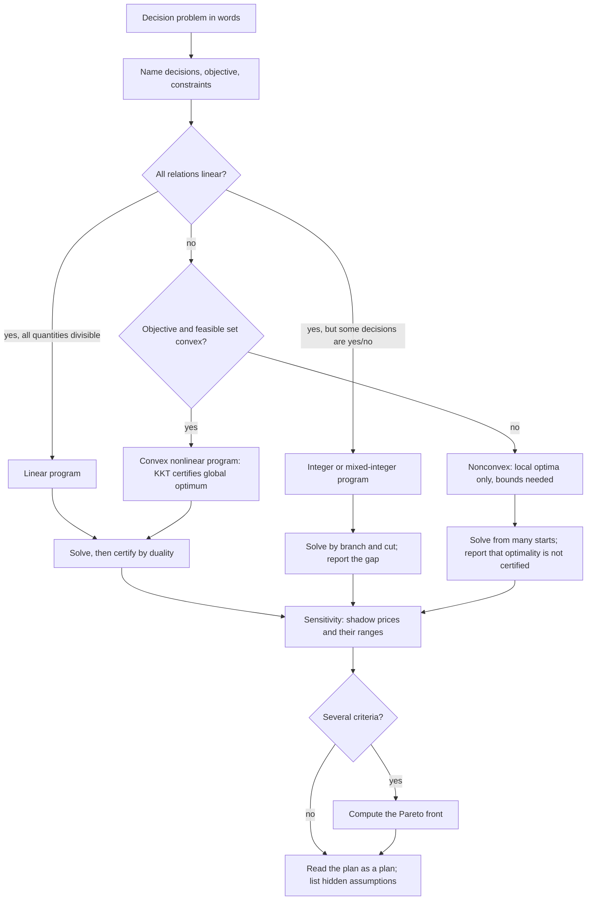
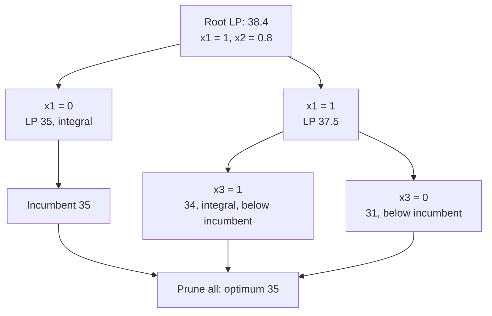
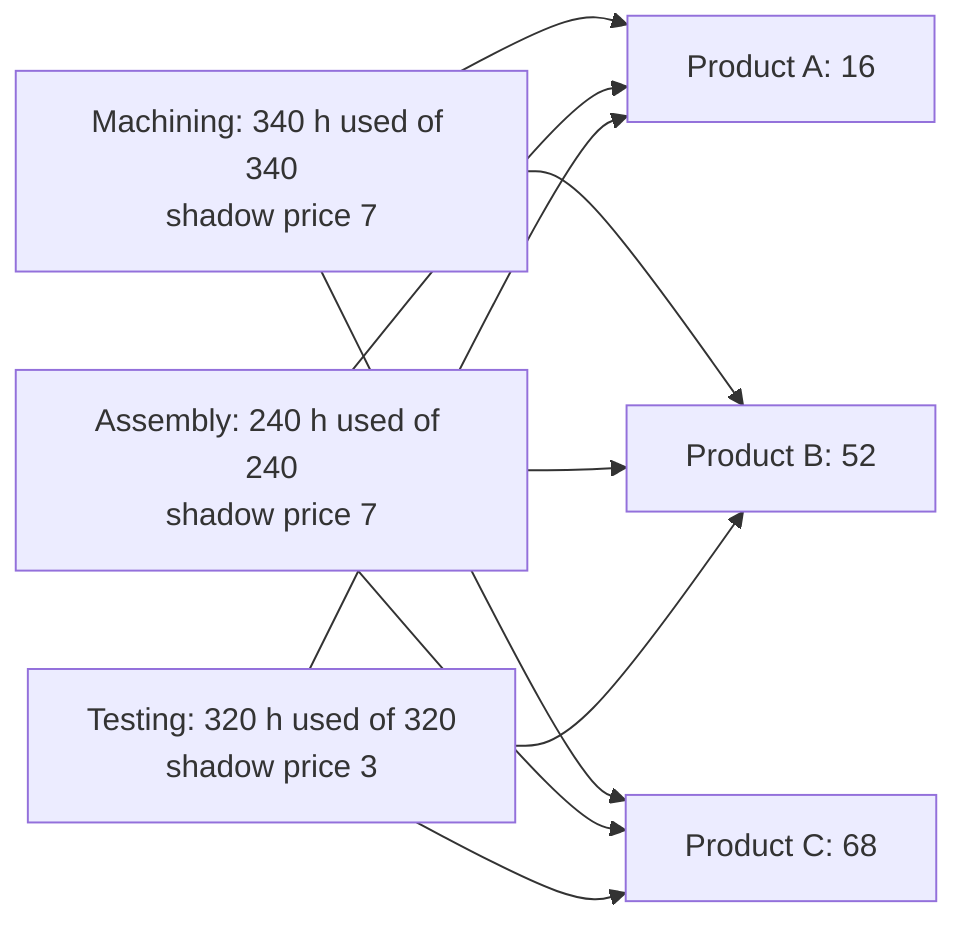

# Optimization Models

> [Mathematics](../../README.md) › [Mathematical Modeling](../README.md) · Level: Advanced · Prerequisites: [Linear Programming](../../18-optimization/01-linear-programming/README.md), [Convex Optimization](../../18-optimization/02-convex-optimization/README.md), [Lagrange Multipliers](../../18-optimization/03-lagrange-multipliers/README.md), [Systems of Linear Equations](../../08-linear-algebra/03-systems-of-linear-equations/README.md), [Multivariable Calculus](../../07-calculus/12-multivariable-calculus/README.md), [Principles of Modeling](../01-principles-of-modeling/README.md) · Estimated time: 9 h

## 1. Introduction

A decision problem becomes an optimisation model when three things are written down: the **decisions** that are under our control, the **criterion** by which a decision is judged, and the **rules** that no admissible decision may break. Everything else — algorithms, software, sensitivity reports, duality — is machinery that operates on those three objects. The hard, creative, and error-prone part is the translation itself.

This topic is about that translation. It is not a course in algorithms: the simplex method, branch and bound and interior-point methods are developed in [Linear Programming](../../18-optimization/01-linear-programming/README.md) and [Convex Optimization](../../18-optimization/02-convex-optimization/README.md). Here the questions are the ones a modeller must answer before any solver runs. What exactly is a decision variable? When is a constraint legitimate? What does the optimal objective value *mean*? What does the sensitivity report actually license you to say? Where does integrality break the theory, and why? When is a local optimum the global one? What does "best" mean when there are two criteria?

Four ideas organise the material.

* **The formulation is a model, not the problem.** The same real situation can be written as several different optimisation problems, all defensible, with different optimal solutions. A formulation that is valid (it admits exactly the real-world feasible decisions) can still be *weak* (its continuous relaxation is a poor approximation) or numerically fragile. Formulation quality is a modelling decision, and it is measurable — §9.6 measures it.
* **Duality converts an answer into a certificate and a price.** For a linear program the optimal dual variables are simultaneously a proof that no better solution exists (weak duality gives a matching bound) and the marginal rate at which the objective responds to relaxing each constraint (the shadow price). Both interpretations are exact only inside a range that must be computed, not guessed.
* **Integrality destroys the geometry.** Linear programming is tractable because the feasible set is a convex polyhedron and an optimum sits at a vertex. Requiring integer decisions removes the vertices, the duality theorem and the shadow prices; what remains is a hard combinatorial problem whose continuous relaxation gives only a bound. That bound can be arbitrarily weak, which is why the choice of formulation matters so much.
* **Convexity is the dividing line for nonlinear models.** If the objective is convex and the feasible set convex, a local optimum is global and the KKT conditions are sufficient. If not, a solver's answer is a local optimum and nothing more — a distinction that is routinely lost when a nonlinear model is handed to a solver and the output is read as "the optimum".

The topic ends with a full case study: data, formulation, solution, sensitivity, interpretation, and an explicit list of what the answer does *not* establish. That last list is not decoration. An optimisation model answers the question "what is best if the model is right?"; it never answers "what should we do?" on its own, because the objective is a choice, the constraints are a choice, and the data are estimates.

## 2. Prerequisites

**Linear programming** ([Linear Programming](../../18-optimization/01-linear-programming/README.md)). Standard form, slack variables, basic feasible solutions, the simplex method, duality, complementary slackness and the economic interpretation of dual variables. This topic reuses all of it and concentrates on where the model comes from and what it licenses.

**Convex optimisation** ([Convex Optimization](../../18-optimization/02-convex-optimization/README.md)). Convex sets and functions, the first- and second-order characterisations, the fact that a local minimum of a convex function on a convex set is global, and the KKT conditions with Slater's condition. §7.10 and §9.7 depend on these; no new convex analysis is introduced.

**Lagrange multipliers** ([Lagrange Multipliers](../../18-optimization/03-lagrange-multipliers/README.md)). Equality-constrained optimisation via $\nabla f = \lambda \nabla g$, and the interpretation of $\lambda$ as a rate of change of the optimal value with respect to the constraint level. That interpretation is the continuous ancestor of the shadow price.

**Linear algebra** ([Systems of Linear Equations](../../08-linear-algebra/03-systems-of-linear-equations/README.md)). Solving square systems, matrix inverses, rank, and the fact that a system $Bx = b$ with $\det B \ne 0$ has the unique solution $x = B^{-1}b$. Every sensitivity range in this topic is a sign condition on the entries of $B^{-1}$.

**Multivariable calculus** ([Multivariable Calculus](../../07-calculus/12-multivariable-calculus/README.md)). Partial derivatives, gradients, Hessians, and the second-derivative test. The convexity checks of §7.10 are Hessian computations.

**Modelling practice** ([Principles of Modeling](../01-principles-of-modeling/README.md)). Assumptions, dimensional consistency, validation and the difference between a model's output and a prediction. This topic assumes that vocabulary and applies it to decision problems.

## 3. Learning Objectives

After this tutorial you will be able to:

1. Translate a written decision problem into decision variables, an objective and constraints, and state the units and the owner of each.
2. Write production, blending, transportation and assignment problems as linear programs, solve small instances exactly, and interpret every number in the solution.
3. Derive the dual of a linear program, verify optimality by complementary slackness, and read off shadow prices with their exact range of validity.
4. Formulate knapsack, facility-location and scheduling problems as integer or mixed-integer programs, and explain why the linear relaxation does not solve them.
5. Compute an integrality gap, run branch and bound by hand on a small instance, and explain why the choice of formulation changes the bound.
6. Decide whether a nonlinear model is convex, and if it is, solve it by KKT conditions and certify global optimality.
7. Compute a Pareto front for a small multi-objective model, and explain what a weighted-sum scalarisation can and cannot find.
8. Recognise the standard failure modes — hidden constraints, unboundedness, infeasibility, bad scaling, invalid big-M — and repair them.

## 4. Intuition

Think of a machine with three kinds of parts.

**Dials.** Each decision variable is a dial you can turn. "How many chairs to build" is a dial; "how much steel to order" is a dial; "whether to open the Leeds depot" is a switch, which is a dial with only two positions. A variable that you cannot set is not a decision variable — it is data. Confusing the two is the most common formulation error: a price that the market sets is data, a price you choose is a variable.

**A scoreboard.** The objective is a single number computed from the dials, and the model's job is to make it as large (or small) as possible. The scoreboard must be a *function*: turning the dials to a particular setting must determine the score. "Maximise shareholder value" is not an objective; "maximise contribution margin over the next quarter, in euros, given the standard cost sheet" is.

**Fences.** Constraints are fences the dials may not cross. A fence is legitimate when violating it is genuinely impossible or genuinely forbidden, and when you could say who would notice. "Machining hours used $\le$ machining hours available" is legitimate; "production $\le$ 500" with no reason is a fence built from a guess, and it will silently determine the answer.

The geometry that follows is simple to picture. With two dials the fences enclose a polygon, and a linear scoreboard is a family of parallel straight lines; the best line that still touches the polygon touches it at a corner. That is why linear programs have optimal *vertices*, and why their solutions are stable in a peculiar way: as data change slowly, the optimal corner stays put, and the *value* changes linearly. The slope of that change is the shadow price.

Two things break this picture.

* Islands instead of a polygon. If the dials must be whole numbers, the feasible set is a scatter of isolated points inside the polygon. The best island need not be near the best corner. The polygon's best corner gives a bound and nothing more.
* Curved fences and a curved scoreboard. If either is curved, the optimum can sit in the interior of an edge or in the middle of the region, and the first-order conditions give candidates that may be maxima, minima or saddles. Only convexity restores the guarantee that a local answer is the global one.

## 5. Formal Definition

**Definition 5.1 (optimisation problem).** An optimisation problem is a triple $(\mathcal{X}, f, \mathcal{F})$ where $\mathcal{X} \subseteq \mathbb{R}^n$ is the space of decision vectors, $f : \mathcal{X} \to \mathbb{R}$ is the objective and $\mathcal{F} \subseteq \mathcal{X}$ is the feasible set. The problem is to find $x^\ast \in \mathcal{F}$ with $f(x^\ast) \le f(x)$ for all $x \in \mathcal{F}$ (a minimisation; maximisation is the same problem with $-f$). The **optimal value** is $f^\ast := \inf_{x \in \mathcal{F}} f(x) \in \mathbb{R} \cup \{-\infty, +\infty\}$. If $\mathcal{F} = \varnothing$ the problem is **infeasible** and $f^\ast = +\infty$ by convention; if $f$ is unbounded below on $\mathcal{F}$ the problem is **unbounded** and $f^\ast = -\infty$. A point attaining the infimum is an **optimal solution**; the set of them is $\arg\min_{x\in\mathcal{F}} f(x)$.

*Reading.* An infimum need not be attained: $f(x)=e^x$ on $\mathcal{F}=\mathbb{R}$ has $f^\ast = 0$ and no optimal solution. A model whose optimal value is an infimum that is not attained has no implementable answer, which is a modelling defect, not a numerical one.

**Definition 5.2 (linear program, standard form).** Given $c \in \mathbb{R}^n$, $A \in \mathbb{R}^{m\times n}$ and $b \in \mathbb{R}^m$,

$$
\min_{x} \ c^{\mathsf{T}} x \quad \text{subject to} \quad Ax = b, \quad x \ge 0 .
$$

The **feasible set** is the polyhedron $P = \{x \in \mathbb{R}^n : Ax = b,\ x \ge 0\}$. Any problem with linear objective and linear inequality constraints can be put in this form by adding slack variables and splitting free variables into positive and negative parts.

**Definition 5.3 (mixed-integer linear program, MILP).** With $I \subseteq \{1,\dots,n\}$ an index set,

$$
\min_{x}\ c^{\mathsf{T}}x \quad \text{s.t.}\quad Ax \le b, \quad x \ge 0, \quad x_i \in \mathbb{Z}\ \text{for all } i \in I .
$$

If $I = \{1,\dots,n\}$ the problem is a **pure integer program**; if $x_i \in \{0,1\}$ for $i \in I$ it is a **0–1 program**. The **LP relaxation** is the same problem with the integrality conditions dropped; its optimal value $z_{\mathrm{LP}}$ satisfies $z_{\mathrm{LP}} \le z_{\mathrm{IP}}$ in minimisation.

**Definition 5.4 (convex problem).** The problem $\min\{f(x) : x \in \mathcal{F}\}$ is convex if $\mathcal{F}$ is a convex set and $f$ is convex on $\mathcal{F}$. It is a **linear program** when both are polyhedral, a **quadratic program** when $f(x) = \tfrac12 x^{\mathsf{T}}Qx + q^{\mathsf{T}}x$ with $Q \succeq 0$ and $\mathcal{F}$ polyhedral.

**Definition 5.5 (dual of a linear program).** The dual of the standard-form problem of Definition 5.2 is

$$
\max_{y}\ b^{\mathsf{T}} y \quad \text{subject to} \quad A^{\mathsf{T}} y \le c ,
$$

with $y \in \mathbb{R}^m$ free. A vector $y$ satisfying $A^{\mathsf{T}}y \le c$ is **dual feasible**; the components of an optimal $y$ are the **dual variables**, **multipliers** or **shadow prices**.

**Definition 5.6 (shadow price).** Let $v(b) = \min\{c^{\mathsf{T}}x : Ax = b,\ x\ge 0\}$ be the optimal value as a function of the right-hand side. If $v$ is differentiable at $b$, the shadow price of constraint $i$ is $\partial v/\partial b_i$. When $v$ is not differentiable, the one-sided derivatives exist for a polyhedral problem and are the limits of the corresponding optimal dual components.

**Definition 5.7 (Pareto dominance).** Let $f = (f_1,\dots,f_k)$ with all $f_i$ to be minimised. A point $x \in \mathcal{F}$ **dominates** $y \in \mathcal{F}$ if $f_i(x) \le f_i(y)$ for every $i$ and $f_i(x) < f_i(y)$ for at least one $i$. A point is **Pareto optimal** (efficient, non-dominated) if no feasible point dominates it. The **Pareto front** is the image of the Pareto-optimal set in objective space.

**Definition 5.8 (integrality gap, integer hull).** For a minimisation problem, the integrality gap of a formulation is $z_{\mathrm{IP}} - z_{\mathrm{LP}} \ge 0$ (or the ratio $z_{\mathrm{IP}}/z_{\mathrm{LP}}$ when $z_{\mathrm{LP}} > 0$). The **integer hull** $P_I := \operatorname{conv}(P \cap \mathbb{Z}^n)$ is the smallest polyhedron containing every integer feasible point; a formulation is **ideal** when $P = P_I$ for the LP relaxation.

**Definition 5.9 (valid and stronger formulations).** Let $\mathcal{F}_{\text{real}}$ be the set of decisions admissible in the world. A formulation with feasible set $\mathcal{F}$ is **valid** if $\mathcal{F} \cap \mathbb{Z}^n = \mathcal{F}_{\text{real}}$. If two valid formulations have LP relaxations $P_1, P_2$ and $P_1 \subseteq P_2$, then $P_1$ is **stronger** for minimisation, because $z_{\mathrm{LP}}(P_2) \le z_{\mathrm{LP}}(P_1) \le z_{\mathrm{IP}}$.

## 6. Mathematical Notation

| Symbol | Read as | Meaning |
|---|---|---|
| $x \in \mathbb{R}^n$ | decision vector | the quantities chosen by the modeller |
| $x_j$ | component $j$ | the level of activity $j$ (units of that activity) |
| $c$ | cost or profit vector | coefficient of $x_j$ in the objective |
| $f(x)$ | objective | the single number being optimised |
| $A$, $a_{ij}$ | constraint matrix, coefficient | amount of resource $i$ consumed per unit of activity $j$ |
| $b$ | right-hand side | resource availability, demand, or requirement |
| $\mathcal{F}$, $P$ | feasible set | $\{x : Ax \le b,\ x \ge 0\}$ and its variants |
| $z^\ast$, $f^\ast$ | optimal value | best achievable objective |
| $s_i$ | slack variable | unused amount of resource $i$: $s_i = b_i - (Ax)_i$ |
| $y$, $u_i$, $v_j$ | dual variables | shadow prices, potentials, marginal values |
| $\bar c_j$ | reduced cost | $c_j - a_j^{\mathsf{T}}y$; rate at which using activity $j$ destroys value |
| $B$, $B^{-1}$ | basis matrix, its inverse | the columns of the tight constraints at a vertex |
| $z_{\mathrm{LP}}, z_{\mathrm{IP}}$ | relaxation, integer optimum | bounds and the true optimum of an integer model |
| $M$ | big-M | a constant large enough that a constraint is inactive when a binary is $0$ |
| $y_i \in \{0,1\}$ | binary variable | "open / closed", "selected / not selected", "before / after" |
| $\rho$ | rate of substitution | here, the marginal rate of transformation between two objectives |
| $\succeq$ | positive semidefinite order | $Q \succeq 0$ means $x^{\mathsf{T}}Qx \ge 0$ for all $x$ |
| $[a]^+$ | positive part | $\max\{a, 0\}$ |
| $\mathbf{1}\{\cdot\}$ | indicator | $1$ if the statement holds, $0$ otherwise |

*Reading.* "$c^{\mathsf{T}}x$" is read "c transpose x" and means $\sum_j c_j x_j$. "$Ax \le b$" is read "A x is at most b" and means one inequality per row. "$\bar c_j \ge 0$" is read "the reduced cost of activity $j$ is non-negative", which for a minimisation means that forcing a unit of activity $j$ into the solution cannot improve the objective.

## 7. Core Concepts

### 7.1 From words to symbols: the five-step recipe

Every formulation in this topic is produced by the same five steps. They are worth stating because most formulation failures are failures to complete one of them.

1. **Name the decisions.** Write a sentence for each: "we choose $x_j$ = the number of units of product $j$ produced next week". Fix the unit and the time period. If a quantity is not under the decision-maker's control, it is data and belongs on the right-hand side.
2. **Name the objective.** One number, with its unit. If two criteria matter, either combine them with explicit weights (and say so) or treat the problem as multi-objective (§7.11). Never average quantities with different units.
3. **Name the constraints.** For each, write the sentence that justifies it and the unit of both sides. A constraint that cannot be justified in a sentence is either redundant or a hidden assumption.
4. **Check the arithmetic of the units.** Every term in a sum must have the same unit; every constraint must compare like with like. A model that adds hours to kilograms will produce numbers, and the numbers will be meaningless.
5. **Test the model on cases you already know.** Feed it a plan you can evaluate by hand; if the model disagrees, the model is wrong. Then check the boundary cases: zero production, full capacity, a single constraint removed.

Steps 1–3 produce the model; steps 4–5 decide whether it is worth solving.

### 7.2 Linear models I: production planning

A workshop makes $n$ products from $m$ resources. Producing one unit of product $j$ consumes $a_{ij}$ units of resource $i$; resource $i$ is available up to $b_i$; product $j$ earns contribution $p_j$ and cannot be sold beyond demand $d_j$. The **production planning** model is

$$
\max_{x}\ \sum_{j=1}^{n} p_j x_j
\quad\text{subject to}\quad
\sum_{j=1}^{n} a_{ij} x_j \le b_i \ \ (i=1,\dots,m),
\qquad 0 \le x_j \le d_j \ \ (j=1,\dots,n).
$$

Three features recur in every variant.

* **The demand cap is a constraint, not a detail.** Without $x_j \le d_j$ the model sells unlimited quantities at a fixed price, which is a statement about the world that is almost never true. Omitting it produces overproduction and, frequently, unboundedness when a product uses no scarce resource.
* **Contribution, not revenue.** Fixed costs do not depend on $x$ and therefore cannot change which plan is best; including them changes the objective *value* but not the *decision*. Fixed costs that are incurred only if a product is made are a different matter — they require binary variables (§7.8).
* **Multiple periods need a state variable.** With inventory, the model gains $I_t = I_{t-1} + x_t - d_t$, $I_t \ge 0$, and the objective discounts each period's contribution. The inventory balance is a constraint, not an accounting identity: it is what makes today's production able to serve tomorrow's demand.

### 7.3 Linear models II: blending

A blend is a mixture: $x_i \ge 0$ is the quantity of ingredient $i$ in a batch, and the batch size $Q = \sum_i x_i$ may be fixed (make exactly $Q$ tonnes) or free (make as much as is profitable). Each ingredient has a quality measurement $a_i$ — protein content, octane number, ore grade — and the blend must meet a specification: the *weighted average* quality must be at least $q$:

$$
\frac{\sum_i a_i x_i}{\sum_i x_i} \ge q .
$$

At first sight this is not linear, because a variable appears in the denominator. Multiply through by $\sum_i x_i > 0$:

$$
\sum_i (a_i - q)\, x_i \ \ge\ 0 .
$$

This is a linear inequality. The multiplication is legitimate precisely because $\sum_i x_i$ is a decision variable constrained to be positive; it would not be legitimate if the denominator were data that could vanish. The same device handles "at most" specifications ($\sum_i (a_i - q)x_i \le 0$) and several simultaneous specifications, one per quality attribute.

The economics are equally simple. With the batch size fixed at $Q$, the problem becomes a transportation-like selection: minimise $\sum_i c_i x_i$ subject to $\sum_i x_i = Q$, $\sum_i (a_i - q_k)x_i \ge 0$ for each attribute $k$, $x \ge 0$. Each additional quality requirement raises the cost, and the dual variable of requirement $k$ is the marginal cost of tightening it by one unit of quality — the number a buyer should be quoted when asking for a better specification. §9.2 works a three-ingredient example and computes the exact range over which that price holds.

### 7.4 Linear models III: transportation

Plants $i = 1,\dots,m$ hold supply $s_i$; warehouses $j = 1,\dots,n$ require demand $d_j$; shipping one unit from $i$ to $j$ costs $c_{ij}$. With $x_{ij} \ge 0$ the shipped quantity,

$$
\min_{x}\ \sum_{i=1}^{m}\sum_{j=1}^{n} c_{ij} x_{ij}
\quad\text{s.t.}\quad
\sum_{j=1}^{n} x_{ij} = s_i, \quad
\sum_{i=1}^{m} x_{ij} = d_j, \quad
x_{ij} \ge 0 .
$$

Two structural facts make this model special.

* **Feasibility is a single equation.** Summing the first set gives $\sum_i s_i$; summing the second gives $\sum_j d_j$. The problem is feasible only if the totals agree. If supply exceeds demand, add a dummy warehouse with demand equal to the excess and zero shipping cost; if demand exceeds supply, add a dummy plant. If the totals agree but a subset of plants cannot reach a subset of warehouses, infeasibility is subtler and is detected by a max-flow check on the bipartite network.
* **The constraint matrix is totally unimodular.** It is the node–arc incidence matrix of a bipartite graph, so every basic feasible solution is integral whenever $s$ and $d$ are integers. This is why a transportation problem stated with continuous variables nevertheless ships whole units, and why no branch and bound is needed for it.

The classical solution technique is the **transportation simplex**: build an initial basic feasible solution with the north-west corner rule or Vogel's approximation, then test optimality with potentials $u_i, v_j$ satisfying $u_i + v_j \le c_{ij}$ on every route, and improve along a cycle in the current basis. The potentials are the dual variables; a route with $c_{ij} - u_i - v_j < 0$ is worth using, and $c_{ij} - u_i - v_j$ is its reduced cost. §9.3 carries this out on a $3\times 3$ instance.

A caution that matters for interpretation: the individual values $u_i$ and $v_j$ are **not unique**. Adding a constant $t$ to every $u_i$ and subtracting $t$ from every $v_j$ leaves all reduced costs unchanged, so the dual solution is determined only up to this shift, and a single $v_j$ has no meaning on its own. What is meaningful is $u_i + v_j$: the marginal cost of an extra unit shipped from $i$ to $j$.

### 7.5 Linear models IV: assignment

Workers $i$ must be assigned to jobs $j$, one each, at cost $c_{ij}$. With $x_{ij} = 1$ if worker $i$ takes job $j$,

$$
\min\ \sum_{i,j} c_{ij}x_{ij}
\quad\text{s.t.}\quad
\sum_{j} x_{ij} = 1 \ \ \forall i, \qquad
\sum_{i} x_{ij} = 1 \ \ \forall j, \qquad
x_{ij} \in \{0,1\}.
$$

The assignment problem is a transportation problem with all supplies and demands equal to $1$, so its LP relaxation is already integral: the vertices of the polytope of doubly stochastic matrices are exactly the permutation matrices (the Birkhoff–von Neumann theorem). Two consequences follow. First, $x_{ij}\in[0,1]$ can replace $x_{ij}\in\{0,1\}$ without changing the optimal value — a rare luxury. Second, the dual variables have a clean reading: $u_i$ is the "wage" of worker $i$, $v_j$ the "value" of job $j$, and complementary slackness says that a worker is assigned only to a job whose cost equals the sum of the two.

The greedy instinct — repeatedly take the cheapest remaining pair — is *not* optimal, because a cheap pair can block two moderately cheap ones. §9.4 gives a $4\times 4$ instance where greedy costs $24$ and the optimum is $22$, and verifies that the LP relaxation reaches $22$ integrally. The polynomial algorithm is the Hungarian method; the modelling lesson is that a problem can look combinatorial and still be an LP in disguise.

### 7.6 Duality: certificates and prices

Where does the dual come from? Suppose we want an upper bound on the maximum of $c^{\mathsf{T}}x$ over $\{x \ge 0 : Ax \le b\}$. Any non-negative combination $y \ge 0$ of the constraints gives, for every feasible $x$,

$$
y^{\mathsf{T}}A x \le y^{\mathsf{T}} b .
$$

If we choose $y$ so that $A^{\mathsf{T}}y \ge c$, then $c^{\mathsf{T}}x \le y^{\mathsf{T}}Ax \le y^{\mathsf{T}}b$ for every feasible $x$. So each such $y$ certifies the bound $b^{\mathsf{T}}y$, and the best certificate is the solution of

$$
\min_{y}\ b^{\mathsf{T}} y \quad \text{s.t.}\quad A^{\mathsf{T}}y \ge c,\ y \ge 0 .
$$

That is the dual (written here for the inequality form; Definition 5.5 is the standard-form version). **Weak duality** is the statement $c^{\mathsf{T}}x \le b^{\mathsf{T}}y$ for every feasible pair; its proof is the two-line display above. **Strong duality** says that when both problems are feasible, the two optimal values coincide, so the best bound is attained.

Three uses follow, and they are the reason duality is not merely a computational trick.

* **A certificate.** A solver returns $x^\ast$ and $y^\ast$. Anyone can verify optimality in polynomial time by checking primal feasibility, dual feasibility and $c^{\mathsf{T}}x^\ast = b^{\mathsf{T}}y^\ast$ — no re-solving, no trust in the solver required. This is what makes an optimisation answer auditable.
* **A price.** Complementary slackness forces $y_i(b_i - (Ax^\ast)_i) = 0$: a resource that is not fully used has zero price, and a resource with a positive price is fully used. The value $y_i$ is the rate at which the optimal objective improves per unit increase in $b_i$ — the shadow price of Definition 5.6.
* **A diagnostic.** If the dual is unbounded, the primal is infeasible; if the primal is unbounded, the dual is infeasible. An unbounded dual with a feasible primal therefore means "your primal is infeasible", and a solver report saying "unbounded or infeasible" is telling you exactly this.

Degeneracy weakens the price interpretation: when more constraints are tight than there are variables, several dual optimal solutions exist and the shadow price of a constraint is not unique. The safe statement is always an interval, or a directional derivative, never a single number quoted without qualification.

### 7.7 Sensitivity analysis: ranges and their meaning

Consider the standard-form problem with an optimal basis $B$ (the columns of the tight constraints). Then

$$
x_B = B^{-1}b, \qquad y^{\mathsf{T}} = c_B^{\mathsf{T}}B^{-1}, \qquad \bar c_j = c_j - a_j^{\mathsf{T}} y .
$$

The basis remains optimal as long as two conditions hold: **primal feasibility** $B^{-1}b \ge 0$ and **dual feasibility** $\bar c_j \ge 0$ for the non-basic columns. Both conditions are linear in the data, so each gives an interval:

* **Right-hand side of constraint $k$.** $b \mapsto b + \Delta e_k$ changes $x_B$ by $\Delta\,(B^{-1})_{:,k}$. Requiring $x_B \ge 0$ gives $\Delta \in [\underline\Delta_k, \overline\Delta_k]$, and inside that interval $v(b+\Delta e_k) = v(b) + \Delta y_k$. Outside it the basis changes and the formula fails; the value function remains convex but its slope changes.
* **Objective coefficient of a basic variable $j$.** $c_j \mapsto c_j + \Delta$ changes $y$ by $\Delta\,(B^{-1})_{j,:}$. Requiring the reduced costs of all non-basic variables to stay non-negative gives the interval in which the *same basis* stays optimal; when the constraints are inequalities with non-negative duals, this reduces to $y \ge 0$. If $j$ is non-basic, the condition is instead $\bar c_j + \Delta \ge 0$, i.e. $\Delta \ge -\bar c_j$: raising the price of an unused activity by more than its reduced cost makes it worth using.

Three cautions. First, these ranges are *local*: they assume every other coefficient stays fixed. Second, the often-quoted "100 % rule" for simultaneous changes is a *sufficient* condition for the basis to survive, not a necessary one — violating it does not imply the answer is wrong. Third, a shadow price is a rate for an infinitesimal change in a *model parameter*; it says nothing about what happens if the underlying reality changes in a way the model does not represent.

The **reduced cost** deserves its own reading. For a non-basic activity $j$, $\bar c_j$ is the amount by which the optimal objective would worsen if one unit of $j$ were forced into the solution at the current prices. For a minimisation with $\bar c_j = 7$, forcing one unit raises cost by at least $7$; the "at least" matters because forcing a unit may also make other constraints bind and change the basis.

### 7.8 Integer and mixed-integer models

Many decisions are not divisible: build or not build, hire or not hire, before or after. Three formulations carry most of the load.

**Knapsack.** With $v_j$ the value and $w_j$ the weight of item $j$, capacity $W$,

$$
\max\ \sum_j v_j x_j \quad \text{s.t.}\quad \sum_j w_j x_j \le W, \quad x_j \in \{0,1\}.
$$

The LP relaxation is solved exactly by the greedy rule "take items in decreasing order of $v_j/w_j$, and take a fraction of the first item that does not fit". The integer problem is NP-hard, weakly so: it has a dynamic programme running in $O(nW)$ time, which is polynomial in $W$ but not in $\log W$, the length of the input.

**Facility location.** With $f_i$ the fixed cost of opening site $i$, $\mathrm{cap}_i$ its capacity, $d_j$ the demand of customer $j$ and $c_{ij}$ the unit delivery cost,

$$
\min\ \sum_i f_i y_i + \sum_{i,j} c_{ij}x_{ij}
\quad\text{s.t.}\quad
\sum_i x_{ij} = d_j,\ \
\sum_j x_{ij} \le \mathrm{cap}_i\, y_i,\ \
x_{ij} \ge 0,\ y_i \in \{0,1\}.
$$

The constraint $\sum_j x_{ij} \le \mathrm{cap}_i y_i$ is a **linking constraint**: it is what makes $y_i = 0$ mean "site $i$ serves nobody". A formulation that instead writes $x_{ij} \le M y_i$ with a single constant $M$ is valid only if $M$ is at least the largest flow the link can ever carry; taking $M$ = total demand is valid but weak, and §9.6 measures exactly how weak.

**Scheduling.** "Job $j$ starts at $t_j$, lasts $p_j$, and the machine can process one job at a time" needs a disjunction: for every pair $i \ne j$, either $i$ precedes $j$ or $j$ precedes $i$. With $y_{ij} \in \{0,1\}$,

$$
t_j \ge t_i + p_i - M(1 - y_{ij}), \qquad t_i \ge t_j + p_j - M y_{ij}.
$$

For the formulation to be valid, $M$ must exceed the largest possible difference between any two completion times. If a valid upper bound $T$ on the makespan is known, $M = T$ suffices; if not, the model silently forbids schedules, and the solver returns "optimal" for a problem that is not the one you posed.

### 7.9 Why integrality is hard

Three separate difficulties hide behind the word "hard".

**Geometry disappears.** The feasible set of an integer program is a finite set of points. There are no vertices, no edge directions, no basis, hence no dual variables with the meaning of §7.6. The LP relaxation has all these things, but they describe a different problem.

**Rounding can be arbitrarily bad.** Consider a fixed-charge model: pay $F$ to open a facility, then serve at unit cost, with demand $1$ and capacity $M$:

$$
\min\ x + F y \quad \text{s.t.}\quad x \le M y,\ \ x \ge 1,\ \ y \in \{0,1\}.
$$

The integer optimum is $1 + F$ (open the facility and serve). The LP relaxation sets $y = 1/M$, $x = 1$, and costs $1 + F/M$. The ratio of the two values is $(1+F)/(1+F/M) \to M$ as $F \to \infty$: the relaxation can be off by an arbitrary factor. The economic content is exact — the relaxation pays a *fraction* of the fixed cost for a *fraction* of the facility — and it is precisely this fractionality that branch and bound must remove.

**The combinatorics explode.** $n$ binary variables give $2^n$ candidate vectors, and no algorithm is known that solves general integer programs in time polynomial in the input length; 0–1 knapsack, facility location and machine scheduling are all NP-hard. Practical solvers succeed because they combine three ideas: the LP relaxation for bounds, **branch and bound** to split the feasible set, and **cutting planes** to tighten the relaxation (the branch-and-cut method). None of them changes the worst case; all of them change the typical case.

A useful mental model of branch and bound: solve the relaxation; if it is integral, it is optimal; if some variable $x_j$ is fractional, split the problem into $x_j \le \lfloor x_j\rfloor$ and $x_j \ge \lceil x_j \rceil$; recurse, keeping the best integer solution found so far as an incumbent, and prune any node whose relaxation bound is no better than the incumbent. §9.5 runs the tree by hand on a four-item knapsack.

### 7.10 Nonlinear models and the convexity check

Nonlinearity enters through prices that depend on volume, costs with economies of scale, distances, dilution, decay, and risk. Two questions decide whether the resulting model is tractable.

**Is the feasible set convex?** Equality constraints of the form $g(x) = 0$ with $g$ nonlinear usually destroy convexity; inequalities $g(x) \le 0$ with $g$ convex preserve it. In particular $\sum_i x_i = Q$ is fine (linear), but $x_1 x_2 = 1$ is not, and "$x$ is a percentage" constraints such as $\sum_i a_ix_i / \sum_i x_i \ge q$ are fine only after the linearisation of §7.3.

**Is the objective convex?** Compute the Hessian and test $Q \succeq 0$ on the feasible set, or use composition rules: sums of convex functions are convex, a positive multiple of a convex function is convex, $e^{g}$ is convex when $g$ is convex, $\sqrt{g}$ is concave on $g \ge 0$, and a concave function of an affine function is concave. Note the direction: *maximising* a concave function is a convex problem (it is minimising a convex one), and *minimising* a concave function is not.

If both answers are yes, the problem is convex and three guarantees hold: every local minimum is global; the KKT conditions are necessary and sufficient (under a constraint qualification such as Slater's condition); and the optimal value is a convex function of the right-hand side, so marginal values increase as constraints tighten. If either answer is no, a solver returns a local optimum, and the only honest description of the output is "a feasible point that no small perturbation improves".

A common false economy illustrates the danger. Replacing a random quantity by its mean inside a nonlinear model does not give the mean of the output: by Jensen's inequality, $\mathbb{E}[g(X)] \ne g(\mathbb{E}[X])$ unless $g$ is affine. A model that uses average demand in a function with capacity limits systematically *understates* the cost of variability. The remedy is either to model the distribution (see [Stochastic Models](../05-stochastic-models/README.md)) or to add a safety margin and to say that it is a margin.

### 7.11 Multi-objective optimisation and Pareto fronts

With two criteria — profit and emissions, cost and waiting time, return and risk — there is no single "best". The replacement for optimality is **Pareto efficiency** (Definition 5.7). Three ways to compute a front, and what each can and cannot find:

* **Weighted sum.** Minimise $w_1f_1(x) + \dots + w_kf_k(x)$ for weights $w \ge 0$. Every solution is Pareto optimal (provided the weights are positive), and every minimiser of a weighted sum lies on the front. But if the front is non-convex, some Pareto points minimise no weighted sum; they are called **unsupported**. Conversely, on a convex problem every Pareto point is supported (Theorem 8.8), so the weighted sum is complete exactly in the convex case.
* **$\varepsilon$-constraint.** Minimise $f_1$ subject to $f_2 \le \varepsilon_2, \dots, f_k \le \varepsilon_k$, and sweep the $\varepsilon$ values. This finds unsupported points too, which is why it is the safer default; the price is one optimisation per point on the front.
* **Lexicographic.** Optimise $f_1$, then optimise $f_2$ among the minimisers of $f_1$. This encodes a strict priority and returns a single point, not a front.

The output of a multi-objective study is the front, not a point. Choosing a point on it requires a value judgement — an exchange rate between profit and emissions, say — that the mathematics cannot supply. Presenting a single weighted solution without the weights, or without the front it sits on, hides that judgement.

### 7.12 The modelling pitfalls

**Hidden constraints.** A model can impose restrictions that were never intended. The commonest is a non-negativity assumption that is wrong: a variable that should be free (a temperature deviation, a cash balance, a difference of two quantities) is declared $x \ge 0$ and the model silently chooses the boundary. The second commonest is a big-M that is too small, which forbids feasible plans without any message. A third is an "$\le$" where the requirement is "$\ge$" (or "at most" where it is "exactly"), which changes the feasible set and usually also the sign of the shadow price. The test is always the same: take an optimal solution and *read it as a plan*. If the plan is non-sensical, a constraint is doing something you did not intend.

**Unboundedness.** The optimal value is $-\infty$ (in a minimisation). It almost always means a missing constraint: an activity with negative cost and no capacity limit. Detect it structurally by looking for a **recession direction** $d \ge 0$ with $Ad \le 0$ and $c^{\mathsf{T}}d < 0$ — a way to improve forever while respecting every constraint. The repair is a genuine capacity limit or a different objective, never an arbitrary bound added to silence the solver.

**Infeasibility.** No plan satisfies all constraints. It is usually a units error, a demand that exceeds capacity, or two constraints that contradict each other. Diagnose by solving an **elastic** version — add non-negative violation variables with large penalties and minimise the total violation — and then read which constraints are violated. That report identifies the culprit far more reliably than staring at the model. Do not "fix" infeasibility by deleting constraints until the solver is happy.

**Scaling.** Coefficients that differ by many orders of magnitude destroy accuracy in floating point. If one constraint is expressed in grams and another in tonnes, the simplex basis inverse contains entries spanning $10^{6}$ or more, and feasibility tolerances of $10^{-7}$ become meaningless relative to the data. Remedies: choose units so that typical coefficients are of order $1$; rescale rows and columns; avoid $M = 10^{9}$ when $M = 10^{3}$ would do. The mathematical model is scale-invariant; the solver is not.

### 7.13 A case study, end to end

**The situation.** Meridian Instruments assembles three products — A, B and C — in three work centres: machining, assembly and testing. The industrial engineer supplies the following data, all per unit produced.

| | A | B | C | Capacity (hours/week) |
|---|---|---|---|---|
| Machining | 3 | 3 | 2 | 340 |
| Assembly | 1 | 3 | 1 | 240 |
| Testing | 4 | 1 | 3 | 320 |
| Contribution (€) | 40 | 45 | 30 | |

**Formulation.** Let $x_A, x_B, x_C \ge 0$ be weekly production. The model is

$$
\max\ 40x_A + 45x_B + 30x_C
\quad\text{s.t.}\quad
\begin{aligned}
3x_A + 3x_B + 2x_C &\le 340,\\
x_A + 3x_B + x_C &\le 240,\\
4x_A + x_B + 3x_C &\le 320,\\
x_A, x_B, x_C &\ge 0 .
\end{aligned}
$$

**Solution.** The three constraints are tight at the optimum: $x^\ast = (16, 52, 68)$ with objective $€\,5020$. Check the arithmetic: machining $48 + 156 + 136 = 340$; assembly $16 + 156 + 68 = 240$; testing $64 + 52 + 204 = 320$; contribution $640 + 2340 + 2040 = 5020$. The corresponding dual solution is $y = (7, 7, 3)$, and indeed $3(7) + 1(7) + 4(3) = 40$, $3(7) + 3(7) + 1(3) = 45$, $2(7) + 1(7) + 3(3) = 30$: all three reduced costs are zero, as they must be for basic variables.

**Interpretation.** Every hour of machining and every hour of assembly is worth $€7$ of contribution at the margin, every hour of testing $€3$, and all three resources are exhausted. The basis inverse is

$$
B^{-1} = \begin{pmatrix} 8/5 & -7/5 & -3/5\\ 1/5 & 1/5 & -1/5\\ -11/5 & 9/5 & 6/5\end{pmatrix},
$$

from which the ranges follow by requiring $x_B + \Delta (B^{-1})_{:,k} \ge 0$: machining $[330, 370.9]$, assembly $[202.2, 251.4]$, testing $[263.3, 346.7]$. Within these ranges the shadow prices are constant; outside them the basis changes and the prices must be recomputed. Note how asymmetric the ranges are — machining can fall by only $10$ hours before its price changes, yet rise by almost $31$ — and that a manager who quotes "$€7$ per machining hour" without the range is overstating what the model establishes.

**What the answer does not say.** The model assumes constant contribution per unit, unlimited demand, no set-up times, no labour variability and no substitution between work centres. It optimises one week in isolation, so it ignores learning, maintenance and the cost of firing and hiring. It treats the capacities as hard, whereas overtime is usually available at a premium. And the contributions are standard costs, so if prices are set by the market the true objective is revenue net of material, not standard margin. Each of these is a testable assumption, and the first thing to do with the model is to re-solve it with a plausible change in each and see which answer moves.

## 8. Formulas and Properties

### 8.1 Weak duality

**Theorem 8.1 (weak duality).** Let $x$ be feasible for $\min\{c^{\mathsf{T}}x : Ax = b,\ x \ge 0\}$ and $y$ feasible for $\max\{b^{\mathsf{T}}y : A^{\mathsf{T}}y \le c\}$. Then $c^{\mathsf{T}}x \ge b^{\mathsf{T}}y$.

*Proof.* Since $x \ge 0$ and $c - A^{\mathsf{T}}y \ge 0$,

$$
c^{\mathsf{T}}x = (c - A^{\mathsf{T}}y)^{\mathsf{T}}x + y^{\mathsf{T}}Ax \ \ge\ y^{\mathsf{T}}Ax = y^{\mathsf{T}}b . \qquad \blacksquare
$$

**Corollary 8.1a (certificate of optimality).** If $x^\ast$ and $y^\ast$ are feasible and $c^{\mathsf{T}}x^\ast = b^{\mathsf{T}}y^\ast$, then both are optimal and the common value is the optimal value.

*Why it matters.* The corollary turns an answer into a proof: a claimed optimum can be checked by exhibiting a feasible dual with the same value. No re-solving, no comparison with other heuristics, and no trust in the solver is required. This is the property that makes linear optimisation auditable.

### 8.2 Strong duality and complementary slackness

**Theorem 8.2 (strong duality).** If either the primal or the dual of a linear program is feasible and has a finite optimal value, then so does the other and the two optimal values are equal.

This is proved in [Linear Programming](../../18-optimization/01-linear-programming/README.md) (via the simplex method or Farkas' lemma); it is not available for integer programs, which is the formal content of §7.9.

**Theorem 8.3 (complementary slackness).** Let $x^\ast$ be primal feasible and $y^\ast$ dual feasible. Then both are optimal if and only if

$$
x_j^\ast\,\bigl(c_j - a_j^{\mathsf{T}}y^\ast\bigr) = 0 \quad \text{for every } j .
$$

*Proof.* Because $Ax^\ast = b$,

$$
c^{\mathsf{T}}x^\ast - b^{\mathsf{T}}y^\ast = c^{\mathsf{T}}x^\ast - (Ax^\ast)^{\mathsf{T}}y^\ast = \sum_{j=1}^{n} x_j^\ast\,\bigl(c_j - a_j^{\mathsf{T}}y^\ast\bigr).
$$

Each summand is a product of a non-negative primal variable and a non-negative dual slack, so the sum is $\ge 0$, with equality exactly when every summand vanishes. By weak duality the sum is zero if and only if both points are optimal, which proves both directions. $\blacksquare$

*Reading.* Complementary slackness is an "either–or" for every activity: either the activity is used ($x_j > 0$), in which case its reduced cost is zero and it exactly covers its opportunity cost, or it is unused, in which case its reduced cost may be positive and measures how far it is from being worth using.

### 8.3 The value function is convex

**Theorem 8.4 (convexity in the right-hand side).** Let $v(b) = \min\{c^{\mathsf{T}}x : Ax = b,\ x \ge 0\}$. Then $v$ is a convex function of $b$ on the set where it is finite.

*Proof.* Take $b^{1}, b^{2}$ with optimal solutions $x^{1}, x^{2}$ and let $\lambda \in [0,1]$. The point $x = \lambda x^{1} + (1-\lambda)x^{2}$ is non-negative and satisfies $Ax = \lambda b^{1} + (1-\lambda)b^{2}$, so it is feasible for the right-hand side $\lambda b^{1} + (1-\lambda)b^{2}$. Hence

$$
v\bigl(\lambda b^{1} + (1-\lambda)b^{2}\bigr) \le c^{\mathsf{T}}x = \lambda v(b^{1}) + (1-\lambda) v(b^{2}). \qquad \blacksquare
$$

### 8.4 Shadow prices are optimal dual variables

**Theorem 8.5 (subgradient inequality).** Let $y^\ast$ be optimal for the dual at $b$. Then for every $b'$ for which $v(b')$ is finite,

$$
v(b') \ \ge\ v(b) + (y^\ast)^{\mathsf{T}}(b' - b).
$$

*Proof.* Let $x'$ be optimal for $b'$. Then $Ax' = b'$ and, by dual feasibility $A^{\mathsf{T}}y^\ast \le c$ with $x' \ge 0$,

$$
v(b') = c^{\mathsf{T}}x' \ \ge\ (y^\ast)^{\mathsf{T}}A x' = (y^\ast)^{\mathsf{T}} b' = v(b) + (y^\ast)^{\mathsf{T}}(b' - b). \qquad \blacksquare
$$

Thus every optimal dual solution is a subgradient of $v$ at $b$. The converse — every subgradient is an optimal dual solution — is also true and follows from the polyhedral structure of the dual feasible set; it means the **set** of optimal dual solutions is exactly the subdifferential $\partial v(b)$. When that set is a singleton, $v$ is differentiable at $b$ and $y^\ast = \nabla v(b)$; when it is not, the one-sided derivatives of $v$ in direction $e_i$ are the smallest and largest values of $y_i$ over the optimal dual face. A single "shadow price" quoted without that face is an artefact of the solver's tie-breaking.

### 8.5 Why an optimum is attained at a vertex

**Theorem 8.6 (vertex optimality).** If $P = \{x \ge 0 : Ax \le b\}$ is non-empty and $c^{\mathsf{T}}x$ is bounded below on $P$, then some optimal solution is a basic feasible solution of $P$.

*Proof.* Among all optimal solutions choose $x$ with the largest number of zero coordinates, and suppose $x$ is not a basic feasible solution. Let $A_{\text{act}}$ be the rows of $A$ that are tight at $x$. Since $x$ is not a vertex, the system $A_{\text{act}}d = 0$ has a non-zero solution $d$ with $d_j = 0$ whenever $x_j = 0$. For small $\varepsilon > 0$ both $x + \varepsilon d$ and $x - \varepsilon d$ are feasible. Since both are optimal (they are feasible and $c^{\mathsf{T}}x$ is already minimal), $c^{\mathsf{T}}d = 0$. Increase $\varepsilon$ from $0$ until either some previously positive coordinate of $x + \varepsilon d$ hits zero or a new constraint becomes tight; both events occur at finite $\varepsilon$, and the resulting point is optimal with strictly more zero coordinates or one more tight constraint, contradicting maximality. Repeating finitely often produces an optimal point with $n$ linearly independent tight constraints, i.e. a vertex. $\blacksquare$

*Why the proof fails for integer programs.* The argument moves along a line, and a line through a lattice point leaves the lattice as soon as $\varepsilon$ is not an integer. That single obstruction is the source of everything in §7.9.

### 8.6 Integrality: the facts that survive

**(a) The relaxation is a bound.** For a minimisation with LP relaxation value $z_{\mathrm{LP}}$ and integer optimum $z_{\mathrm{IP}}$, $z_{\mathrm{LP}} \le z_{\mathrm{IP}}$, because every integer feasible point is feasible for the relaxation. The bound is tight only when the relaxation happens to have an integral optimum.

**(b) Total unimodularity gives integrality for free.** A matrix $A \in \mathbb{Z}^{m\times n}$ is **totally unimodular** if every square submatrix has determinant $0$, $1$ or $-1$. If $A$ is totally unimodular and $b$ is integral, then every basic feasible solution of $\{x \ge 0 : Ax = b\}$ is integral, by Cramer's rule applied to the basis system $Bx_B = b$. Node–arc incidence matrices of bipartite graphs are totally unimodular, which covers the transportation and assignment models of §7.4–7.5.

**(c) Knapsack: an exact LP solution, an inexact gap.** For the 0–1 knapsack of §7.8 the LP relaxation is solved by the ratio-greedy rule: sort by $v_j/w_j$ descending, set $x_j = 1$ while the item fits, set one fractional $x_k = f$, and set the rest to $0$. (Exchange argument: if two items with $v_i/w_i > v_j/w_j$ satisfy $x_i < 1$ and $x_j > 0$, shifting mass from $j$ to $i$ improves the objective while respecting the constraint.) Writing $P$ for the value of the integral prefix and $v_{\max} = \max_j v_j$,

$$
z_{\mathrm{LP}} = P + f v_k \le P + v_{\max} \le z_{\mathrm{IP}} + v_{\max}.
$$

So the *absolute* gap is at most the largest item value, but the *relative* gap can be arbitrarily large: with capacity $10$ and items $(w,v) = (11, 100)$ and $(10,1)$ the ratios are $9.09$ and $0.1$, so the LP takes $10/11$ of the first item and none of the second, giving $90.9\overline{09}$ against an integer optimum of $1$. The ratio is $90.9$, and it can be made as large as desired.

**(d) A 2-approximation by rounding.** Let $G$ be the value of the ratio-greedy solution that takes whole items and skips those that no longer fit. Then $G \ge P$, and comparing the better of $G$ and the single best item,

$$
\max\{G, v_{\max}\} \ \ge\ \max\{P, v_{\max}\} \ \ge\ \frac{P + v_{\max}}{2} \ \ge\ \frac{z_{\mathrm{LP}}}{2} \ \ge\ \frac{z_{\mathrm{IP}}}{2}.
$$

The factor $\tfrac12$ is attained: with capacity $2$ and items $(1, 1+\varepsilon)$ and $(2,2)$, greedy takes the first and cannot take the second, for $1+\varepsilon$ against an optimum of $2$.

### 8.7 Convexity makes KKT sufficient

**Theorem 8.7 (KKT sufficiency).** Suppose $f, g_1,\dots,g_m$ are convex and differentiable, $h_1,\dots,h_p$ are affine, and $(x^\ast, \lambda, \mu)$ satisfies

$$
\nabla f(x^\ast) + \sum_{i=1}^{m}\lambda_i \nabla g_i(x^\ast) + \sum_{j=1}^{p}\mu_j \nabla h_j(x^\ast) = 0,
\quad \lambda \ge 0,
\quad \lambda_i g_i(x^\ast) = 0,
\quad g_i(x^\ast)\le 0,
\quad h_j(x^\ast) = 0 .
$$

Then $x^\ast$ is a global minimiser.

*Proof.* Let $y$ be feasible. Convexity of $g_i$ gives $g_i(y) \ge g_i(x^\ast) + \nabla g_i(x^\ast)^{\mathsf{T}}(y - x^\ast)$, and since $g_i(y) \le 0$ and $g_i(x^\ast) \le 0$, we get $\nabla g_i(x^\ast)^{\mathsf{T}}(y - x^\ast) \le g_i(y) - g_i(x^\ast) \le -g_i(x^\ast)$. For affine $h_j$, $\nabla h_j(x^\ast)^{\mathsf{T}}(y-x^\ast) = h_j(y) - h_j(x^\ast) = 0$. Using stationarity and then convexity of $f$,

$$
f(y) \ge f(x^\ast) + \nabla f(x^\ast)^{\mathsf{T}}(y - x^\ast)
= f(x^\ast) - \sum_i \lambda_i \nabla g_i(x^\ast)^{\mathsf{T}}(y-x^\ast) - \sum_j \mu_j \underbrace{\nabla h_j(x^\ast)^{\mathsf{T}}(y-x^\ast)}_{=\,0}.
$$

Each term $-\lambda_i\nabla g_i(x^\ast)^{\mathsf{T}}(y-x^\ast) \ge \lambda_i g_i(x^\ast) = 0$ by $\lambda_i \ge 0$ and complementary slackness. Hence $f(y) \ge f(x^\ast)$. $\blacksquare$

**Corollary 8.7a.** Under the hypotheses, a local minimum is global: if $x$ is locally minimal then KKT holds at $x$ (under a constraint qualification), and Theorem 8.7 makes $x$ globally minimal. Without convexity, KKT is necessary but not sufficient, and the "optimum" a solver reports is local.

### 8.8 Weighted sums and the Pareto front

**Theorem 8.8.** Let all $f_i$ be minimised.

(i) If $w > 0$ and $x^\ast$ minimises $\sum_i w_i f_i(x)$ over $\mathcal{F}$, then $x^\ast$ is Pareto optimal.

(ii) Conversely, if the set $S = \{f(x) + r : x \in \mathcal{F},\ r \ge 0\}$ is convex and $x^\ast$ is Pareto optimal, then there is $w \ge 0$, $w \ne 0$, such that $x^\ast$ minimises $\sum_i w_i f_i(x)$.

*Proof.* (i) If $y$ dominated $x^\ast$ then $f_i(y) \le f_i(x^\ast)$ for all $i$ and strictly for one, so $\sum_i w_i f_i(y) < \sum_i w_i f_i(x^\ast)$ since all $w_i > 0$, contradicting minimality.

(ii) $S$ is convex and $f(x^\ast)$ lies on its boundary (otherwise a small uniform improvement of all coordinates would be feasible and would dominate $x^\ast$). By the supporting hyperplane theorem there is $w \ne 0$ with $w^{\mathsf{T}}f(x^\ast) \le w^{\mathsf{T}}s$ for all $s \in S$. Taking $s = f(x) + r$ and letting $r_i \to \infty$ in coordinate $i$ forces $w_i \ge 0$. Hence $w^{\mathsf{T}}f(x^\ast) \le w^{\mathsf{T}}f(x)$ for all $x \in \mathcal{F}$. $\blacksquare$

### 8.9 The fixed-charge gap is unbounded

**Proposition 8.9.** For $\min\{x + Fy : x \le My,\ x \ge 1,\ y \in \{0,1\}\}$ the LP relaxation value is $1 + F/M$ and the integer value is $1 + F$, so the ratio tends to $M$ as $F \to \infty$.

*Proof.* In the relaxation, $x \ge 1$ and $x \le My$ force $y \ge 1/M$; the objective $x + Fy$ is increasing in both variables, so the optimum is $x = 1$, $y = 1/M$ with value $1 + F/M$. With $y \in \{0,1\}$, $x \ge 1$ forces $y = 1$, hence $x = 1$ and value $1 + F$. The ratio is $(1+F)/(1+F/M) \to M$. $\blacksquare$

This is the cleanest illustration of why integrality is not a technicality: no amount of rounding or local search repairs a relaxation that pays $1/M$ of a fixed cost.

## 9. Step-by-Step Examples

### 9.1 Example 1 (easy): a two-product plan, solved by vertices

A workshop makes desks ($x_1$) and chairs ($x_2$). Each desk earns €50 and each chair €30. Carpentry takes $4$ hours per desk and $2$ per chair, with $120$ hours available; finishing takes $1$ hour per unit of either product, with $40$ hours available.

$$
\max\ 50x_1 + 30x_2 \quad \text{s.t.}\quad 4x_1 + 2x_2 \le 120,\quad x_1 + x_2 \le 40,\quad x_1, x_2 \ge 0 .
$$

**Vertices.** The feasible region is a quadrilateral. Its corners are where two of the four constraint lines meet, subject to feasibility:

| Corner | Equations | Objective |
|---|---|---|
| $(30,0)$ | $4x_1 = 120$, $x_2 = 0$ | $1500$ |
| $(0,40)$ | $x_1 = 0$, $x_2 = 40$ | $1200$ |
| $(20,20)$ | $4x_1 + 2x_2 = 120$, $x_1 + x_2 = 40$ | $1600$ |

At the last corner, subtracting twice the second equation from the first gives $2x_1 = 40$, so $x_1 = 20$ and then $x_2 = 20$. The optimum is €1600 per day at $(20,20)$; both constraints are tight and both slacks are zero.

**Duals.** With $y_1$ for carpentry and $y_2$ for finishing, dual feasibility reads $4y_1 + y_2 \ge 50$ and $2y_1 + y_2 \ge 30$. For basic variables the reduced costs vanish: $4y_1 + y_2 = 50$, $2y_1 + y_2 = 30$. Subtracting, $2y_1 = 20$, so $y = (10, 10)$, which is non-negative and gives $120(10) + 40(10) = 1600$ — equal to the primal value, so by Theorem 8.1 the solution is certified optimal. Every hour of either resource is worth €10 at the margin.

**Ranges.** With basis $B = \begin{pmatrix}4 & 2\\ 1 & 1\end{pmatrix}$ we have $B^{-1} = \frac{1}{2}\begin{pmatrix}1 & -2\\ -1 & 4\end{pmatrix} = \begin{pmatrix}1/2 & -1\\ -1/2 & 2\end{pmatrix}$, so $x_B = \tfrac12(b_1 - 2b_2,\ -b_1 + 4b_2)$. Primal feasibility $x_B \ge 0$ requires $b_1 \ge 2b_2 = 80$ and $b_1 \le 4b_2 = 160$: carpentry hours are worth €10 each only between $80$ and $160$ hours. For finishing, $30 \le b_2 \le 60$. The profit range for $x_1$ follows from $y = c_B^{\mathsf{T}}B^{-1} = \bigl(\tfrac{c_1 - c_2}{2},\ -c_1 + 2c_2\bigr) \ge 0$, i.e. $30 \le c_1 \le 60$.

*Check.* At $b_1 = 160$ the answer would be $x_B = (40, 0)$ with value $2000$, and €10 × 40 extra hours = €400 more than €1600 — consistent with the shadow price at the boundary. ✓

### 9.2 Example 2 (easy–medium): blending, a shadow price and where it stops being valid

Three ingredients are blended into one tonne of feed. Costs and qualities are:

| Ingredient | Cost €/t | Protein | Fibre |
|---|---|---|---|
| A | 200 | 10 % | 8 % |
| B | 320 | 25 % | 3 % |
| C | 260 | 14 % | 5 % |

The specification is protein $\ge 18\,\%$ and fibre $\le 6\,\%$. Let $x_A, x_B, x_C$ be the fractions of a tonne.

$$
\min\ 200x_A + 320x_B + 260x_C
\quad\text{s.t.}\quad
x_A + x_B + x_C = 1,\ \
0.10x_A + 0.25x_B + 0.14x_C \ge 0.18,\ \
0.08x_A + 0.03x_B + 0.05x_C \le 0.06,\ \
x \ge 0 .
$$

**Reduce to two variables.** Write $x_C = 1 - x_A - x_B$. The cost becomes

$$
200x_A + 320x_B + 260(1 - x_A - x_B) = 260 - 60x_A + 60x_B,
$$

so, per tonne, C is the reference; A saves €60 and B costs €60 relative to C. The protein constraint becomes

$$
0.10x_A + 0.25x_B + 0.14(1 - x_A - x_B) \ge 0.18
\iff -0.04x_A + 0.11x_B \ge 0.04
\iff 11x_B - 4x_A \ge 4 ,
$$

and the fibre constraint becomes $0.03x_A - 0.02x_B \le 0.01$, i.e. $3x_A - 2x_B \le 1$. The remaining requirements are $x_A \ge 0$, $x_B \ge 0$ and $x_A + x_B \le 1$.

**Protein is tight at the optimum.** If protein were slack, a small amount of B could be replaced by C: the cost would fall by €60 per unit and protein would still be satisfied. Hence at the optimum $11x_B - 4x_A = 4$, i.e. $x_B = (4 + 4x_A)/11$. Substituting into the cost,

$$
260 - 60x_A + 60\cdot\frac{4 + 4x_A}{11}
= 260 + \frac{240}{11} - \frac{420}{11}x_A
= 281.818 - 38.182\,x_A ,
$$

which decreases in $x_A$: we should make A as large as the remaining constraints allow.

**Which constraint stops us?** On the protein-tight line there are two candidates. The requirement $x_C \ge 0$ means $\frac{4+4x_A}{11} \le 1 - x_A$, i.e. $4 + 4x_A \le 11 - 11x_A$, i.e. $x_A \le 7/15 = 0.4667$. The fibre constraint gives $3x_A - 2\frac{4+4x_A}{11} \le 1$, i.e. $33x_A - 8 - 8x_A \le 11$, i.e. $x_A \le 19/25 = 0.76$.

The constraint $x_C \ge 0$ — equivalently $x_A + x_B \le 1$ — binds first. Hence

$$
x_A = \tfrac{7}{15},\qquad x_B = \tfrac{8}{15},\qquad x_C = 0,
\qquad \text{cost} = 260 - 60\cdot\tfrac{7}{15} + 60\cdot\tfrac{8}{15} = 260 - 28 + 32 = €264 .
$$

*Checks.* Protein: $0.10(7/15) + 0.25(8/15) = (0.7 + 2)/15 = 0.18$ ✓ tight. Fibre: $0.08(7/15) + 0.03(8/15) = 0.8/15 = 0.0533 \le 0.06$ ✓ slack.

**A trap worth naming.** The protein and fibre lines also meet, at

$$
-0.04x_A + 0.11x_B = 0.04,\quad 3x_A - 2x_B = 1
\ \Longrightarrow\ x_A = 0.76,\ x_B = 0.64,\ x_C = -0.40 .
$$

The intersection of two constraint lines is a *candidate* only if it is feasible, and this one is not: it requires a negative amount of C. Solving equations without checking feasibility is the commonest error in hand-solved linear programs.

**Duals and the price of protein.** Perturb the protein requirement to $0.18 + \delta$ and repeat the calculation: the binding limit becomes $x_A = (0.07 - \delta)/0.15$, so

$$
\text{cost} = 260 - 60x_A + 60(1 - x_A) = 320 - 120\cdot\frac{0.07-\delta}{0.15} = 264 + 800\delta .
$$

The shadow price of protein is €800 per unit of protein fraction, i.e. **€8 per percentage point per tonne**. The dual variables are $\mu_{\text{mass}} = 120$ (€ per tonne of batch) and $\mu_{\text{protein}} = 800$; the reduced cost of C at these prices is

$$
260 - \bigl(0.14 \times 800 + 0.05\times 0 + 120\bigr) = 260 - 232 = €28 ,
$$

so C is €28/t too expensive to enter the blend. Equivalently: C's protein is worth $0.14 \times 800 = €112$ and its bulk €120, against a price of €260.

**Where the price stops.** The linear formula presupposes that protein binds and fibre does not. On the protein-tight line, fibre slack means $3x_A - 2(1-x_A) \le 1$, i.e. $x_A \le 0.6$, i.e. $0.07 - \delta \le 0.09$, i.e. $\delta \ge -0.02$. So the price is valid for a protein requirement in $[16\,\%, 25\,\%]$: at $17\,\%$ the cost is $264 - 8 = €256$, and at $16\,\%$ it is $€248$. Below $16\,\%$ the fibre constraint alone binds, the optimal blend stays at $x_A = 0.6$, $x_B = 0.4$, and the cost stays at €248 — a looser protein specification buys nothing, because the cheaper mix it would permit is blocked by fibre.

*Check.* At $17\,\%$: $x_A = 0.08/0.15 = 0.5333$, cost $= 320 - 120(0.5333) = 256$ ✓.

### 9.3 Example 3 (medium): a transportation plan and its potentials

Three plants supply three warehouses. Costs are € per unit; supplies and demands are in units.

| | W1 | W2 | W3 | Supply |
|---|---|---|---|---|
| P1 | 8 | 6 | 10 | 30 |
| P2 | 9 | 13 | 7 | 40 |
| P3 | 5 | 8 | 11 | 30 |
| Demand | 25 | 45 | 30 | 100 |

**An initial plan, and three pivots.** The north-west corner rule fills from the top-left: $x_{11} = 25$, $x_{12} = 5$, $x_{22} = 40$, $x_{33} = 30$, at a cost of $25(8) + 5(6) + 40(13) + 30(11) = 1080$. Three stepping-stone pivots — entering the routes $(2,1)$, then $(3,2)$, then $(3,1)$, with step lengths $25$, $15$ and $15$ — reduce the cost to $930$, then $795$, then $675$. The final plan is

$$
x_{12} = 30,\quad x_{21} = 10,\quad x_{23} = 30,\quad x_{31} = 15,\quad x_{32} = 15,
$$

with all other flows zero. Row sums: $30$, $40$, $30$ ✓. Column sums: $0 + 10 + 15 = 25$, $30 + 0 + 15 = 45$, $0 + 30 + 0 = 30$ ✓.

$$
\text{cost} = 30(6) + 10(9) + 30(7) + 15(5) + 15(8) = 180 + 90 + 210 + 75 + 120 = 675 .
$$

**Potentials.** These five cells form a spanning tree of the bipartite graph, so $u_i + v_j = c_{ij}$ on them determines $u, v$ up to a shift. Set $u_1 = 0$. From $(1,2)$: $v_2 = 6$. From $(3,2)$: $u_3 = 8 - 6 = 2$. From $(3,1)$: $v_1 = 5 - 2 = 3$. From $(2,1)$: $u_2 = 9 - 3 = 6$. From $(2,3)$: $v_3 = 7 - 6 = 1$. Reduced costs of the unused routes:

$$
r_{11} = 8 - 3 = 5,\quad r_{13} = 10 - 1 = 9,\quad r_{22} = 13 - 12 = 1,\quad r_{33} = 11 - 3 = 8 .
$$

All are strictly positive, so by complementary slackness (Theorem 8.3) the plan is optimal, and it is the unique optimal plan.

**Certificate.** The dual objective is

$$
30(0) + 40(6) + 30(2) + 25(3) + 45(6) + 30(1) = 0 + 240 + 60 + 75 + 270 + 30 = 675,
$$

identical to the primal value, which certifies optimality without any appeal to the algorithm (Theorem 8.1).

**Interpretation, and the catch.** $u_3 = 2$ and $v_1 = 3$ are not separately meaningful: adding $t$ to all $u_i$ and $-t$ to all $v_j$ leaves every reduced cost unchanged. What is meaningful is $u_i + v_j$ — the marginal cost of serving warehouse $j$ from plant $i$ — and the reduced costs, which are unique. A report that quotes "$v_1 = 3$" as the value of a unit of demand at W1 is quoting an artefact of the normalisation $u_1 = 0$.

### 9.4 Example 4 (medium): an assignment where the greedy rule loses

Four workers are to be assigned to four jobs, one each. Costs are:

| | J1 | J2 | J3 | J4 |
|---|---|---|---|---|
| W1 | 12 | 4 | 9 | 6 |
| W2 | 5 | 11 | 7 | 8 |
| W3 | 8 | 6 | 13 | 10 |
| W4 | 7 | 9 | 5 | 14 |

**Greedy.** The cheapest pair is W1→J2 at €4. Remove W1 and J2: the cheapest is W2→J1 at €5. Remove W2 and J1: the remaining pairs are W3, W4 with J3, J4, and the cheapest is W4→J3 at €5. Then W3→J4 at €10. Total $4 + 5 + 5 + 10 = 24$.

**Optimum.** Try the alternative that avoids the expensive W3→J4: W1→J4 (6), W2→J1 (5), W3→J2 (6), W4→J3 (5). Total $22$. Since this beats the greedy plan, greedy is not optimal. To be sure that $22$ is the best of all $4! = 24$ permutations, note that any plan must use one cell from each row and column; enumerating the $24$ permutations gives a minimum of $22$, attained only by $(J4, J1, J2, J3)$.

**LP relaxation.** Replace $x_{ij}\in\{0,1\}$ by $0 \le x_{ij} \le 1$ and solve. The optimum is again $22$, attained at the permutation matrix above. This is not a coincidence: the constraint matrix is the incidence matrix of a bipartite graph, hence totally unimodular (§8.6b), and the polytope's vertices are exactly the permutation matrices. The LP relaxation therefore *is* a solution method — the Hungarian algorithm is an efficient way of solving it.

**Why greedy fails.** Choosing €4 for W1→J2 forces W3 into J4 at €10. The true cost of that choice is not €4 but $4 + 10 - 12 = 2$ relative to the alternative, where the $12$ is the opportunity cost of the J2 column. Greedy ignores opportunity costs; the dual variables of the assignment problem are exactly the prices that make opportunity costs explicit.

*Check.* $6 + 5 + 6 + 5 = 22$ ✓, and each row and column is used once ✓.

### 9.5 Example 5 (medium–hard): knapsack, the LP bound, and branch and bound

Items and a capacity of $20$:

| Item | 1 | 2 | 3 | 4 |
|---|---|---|---|---|
| Weight $w_j$ | 12 | 10 | 6 | 4 |
| Value $v_j$ | 24 | 18 | 10 | 7 |
| Ratio $v_j/w_j$ | 2.00 | 1.80 | 1.667 | 1.75 |

**LP relaxation.** Sort by ratio: 1, 2, 4, 3. Take item 1 (weight 12, value 24); take item 2 (weight 10) — but only $8$ units of capacity remain, so $x_2 = 8/10 = 0.8$. Thus $x = (1, 0.8, 0, 0)$ and

$$
z_{\mathrm{LP}} = 24 + 0.8(18) = 38.4 .
$$

**Branch on $x_1$.** Two subproblems.

*$x_1 = 0$.* Capacity 20, items 2, 3, 4 with weights $10 + 6 + 4 = 20$ exactly. The LP takes all three, value $18 + 10 + 7 = 35$, which is integral, so it is also the integer optimum of this branch. Incumbent $= 35$.

*$x_1 = 1$.* Remaining capacity $8$. Item 2 weighs $10 > 8$, so $x_2 = 0$. Take item 3 (weight 6, value 10), leaving $2$; item 4 has weight $4$, so $x_4 = 2/4 = 0.5$. Value $24 + 10 + 0.5(7) = 37.5$.

Now branch on $x_3$ within this node.

*$x_3 = 1$*: remaining capacity $2$, nothing fits, value $24 + 10 = 34$. Integral; $34 < 35$, pruned.
*$x_3 = 0$*: remaining capacity $8$, item 4 fits entirely, value $24 + 7 = 31 < 35$, pruned.

The tree had five nodes; the incumbent $35$ is optimal, attained by items 2, 3 and 4 (weight $10 + 6 + 4 = 20$, value $35$).

**Integrality gap.** $38.4 - 35 = 3.4$, i.e. $9.7\,\%$ of the optimum. Note that the root bound $38.4$ is not even close enough to certify $35$: the branch $x_1 = 1$ had to be explored because its bound $37.5$ exceeded the incumbent.

*Check.* Enumerate the $16$ subsets: weights $12, 10, 6, 4$ and capacity $20$. The feasible subsets with value $> 35$ would need to beat items $\{2,3,4\}$; adding item 1 to any subset already containing item 3 and item 4 exceeds the capacity ($12 + 6 + 4 = 22$), and item 1 with item 2 is $22$. So $35$ is maximal ✓.

### 9.6 Example 6 (hard): facility location — five valid formulations and their bounds

Four customers with demands $d = (20,25,15,30)$ are served from three candidate sites with capacities $\mathrm{cap} = (60,70,50)$ and fixed costs $f = (100,120,90)$. Unit delivery costs (rows customers, columns sites):

$$
C = \begin{pmatrix} 4 & 6 & 9\\ 5 & 4 & 7\\ 8 & 6 & 3\\ 6 & 5 & 6 \end{pmatrix}.
$$

**Integer optimum by enumeration.** A set of open sites must have enough capacity and be able to serve all demand.

| Open sites | Fixed | Best delivery | Total |
|---|---|---|---|
| $\{1,2\}$ | 220 | 420 | 640 |
| $\{1,3\}$ | 190 | 430 | 620 |
| $\{2,3\}$ | 210 | 420 | 630 |
| $\{1,2,3\}$ | 310 | 375 | 685 |

The optimum is $620$: open sites 1 and 3, serve customer 1 from site 1 (20), customer 2 from site 1 (25), customer 3 from site 3 (15), and customer 4 from both (15 from site 1, 15 from site 3). Capacity check: site 1 ships $20+25+15 = 60$ of $60$; site 3 ships $30$ of $50$. Delivery cost $= 4(20) + 5(25) + 3(15) + 6(15) + 6(15) = 80 + 125 + 45 + 90 + 90 = 430$ ✓, total $190 + 430 = 620$ ✓.

Note that opening the third site *increases* cost ($685 > 620$): fixed charges change the economics of "more choice is better", and the optimum uses only two of the three sites.

**Five formulations, all valid, very different bounds.** Each states the same integer problem; they differ only in how $y$ is linked to $x$.

| Linking constraints | LP bound | Gap to 620 |
|---|---|---|
| $x_{ij} \le M y_i$ with $M = \sum_j d_j = 90$ | 450.56 | 169.44 |
| $x_{ij} \le \mathrm{cap}_i y_i$ (plus $\sum_j x_{ij} \le \mathrm{cap}_i$) | 483.19 | 136.81 |
| $\sum_j x_{ij} \le \mathrm{cap}_i y_i$ | 529.62 | 90.38 |
| $x_{ij} \le d_j y_i$ (plus $\sum_j x_{ij} \le \mathrm{cap}_i$) | 585.56 | 34.44 |
| both $x_{ij} \le d_j y_i$ and $\sum_j x_{ij} \le \mathrm{cap}_i y_i$ | 611.43 | 8.57 |

All five bounds are correct; none is the answer. The spread from $450.56$ to $611.43$ is a pure consequence of formulation, and it is the difference between a branch-and-bound tree of a few hundred nodes and one of a few million.

Two lessons, one of which contradicts a common slogan. The slogan says "replace big-M linking by capacity linking; the capacity linking is stronger". Here the *tightest per-link constant*, $M = d_j$, gives $585.56$, better than the aggregate capacity linking at $529.62$, and the two together give $611.43$. The slogan is a statement about replacing $M$ = total demand; it is not a theorem that the aggregate form dominates every per-link form. Formulation strength is a property to be *measured* on the instance at hand, not assumed.

**Strengthening in practice.** The best bound, $611.43$, still leaves a gap of $8.57$, which is why the solver must branch; the relaxation's role remains what it was in §9.5 — a bound, not a plan.

### 9.7 Example 7 (hard): a convex nonlinear model, KKT, and the Pareto front

A firm splits an advertising budget $B$ between two channels. Channel $i$ generates sales $s_i\sqrt{a_i}$ with $s_1 = 10$, $s_2 = 8$, where $a_i \ge 0$ is the spend. Total spend is capped at $B$.

**Convexity check.** Maximising $10\sqrt{a_1} + 8\sqrt{a_2} - C(a)$ is the same as minimising $-10\sqrt{a_1} - 8\sqrt{a_2} + C(a)$. Each $-\sqrt{a_i}$ has second derivative $\tfrac14 a_i^{-3/2} > 0$ on $a_i > 0$, so it is convex; a sum of convex functions is convex; the constraint $a_1 + a_2 \le B$, $a \ge 0$ is a polyhedron. The problem is convex, so KKT is sufficient (Theorem 8.7) and any solution found is global.

**KKT.** With multipliers $\lambda \ge 0$ for the budget and $\mu_i \ge 0$ for $a_i \ge 0$, stationarity reads $-5/\sqrt{a_1} + \lambda - \mu_1 = 0$ and $-4/\sqrt{a_2} + \lambda - \mu_2 = 0$, together with complementary slackness $\lambda(B - a_1 - a_2) = 0$.

Suppose both $a_i > 0$, so $\mu_i = 0$. Then $5/\sqrt{a_1} = 4/\sqrt{a_2} = \lambda$, hence $\sqrt{a_1}/\sqrt{a_2} = 5/4$ and $a_1/a_2 = 25/16 = 1.5625$.

With the budget tight, $a_1 = \frac{25}{41}B$ and $a_2 = \frac{16}{41}B$. For $B = 100$: $a_1 = 60.976$, $a_2 = 39.024$, and the resulting sales are

$$
10\sqrt{60.976} + 8\sqrt{39.024} = 78.087 + 49.975 = 128.06 .
$$

**Verification by an exact formula.** By the Cauchy–Schwarz inequality, for any split with $a_1 + a_2 = B$,

$$
10\sqrt{a_1} + 8\sqrt{a_2} \le \sqrt{10^2 + 8^2}\,\sqrt{a_1 + a_2} = \sqrt{164\,B},
$$

with equality exactly when $(a_1,a_2)$ is proportional to $(100, 64)$, i.e. $a_1 = \frac{100}{164}B$, $a_2 = \frac{64}{164}B$ — the same split, since $100/164 = 25/41$. For $B = 100$ the bound is $\sqrt{16400} = 128.0625$ ✓.

*Check the multiplier.* $\lambda = 5/\sqrt{60.976} = 5/7.8087 = 0.6403$; the marginal sales per euro is $0.640$ at both channels, as KKT requires. The value $1/\lambda = 1.562$ is the marginal cost of a euro of sales.

**The Pareto front.** Now treat this as a two-objective problem: maximise sales $S$ and minimise spend $C$. For each budget level $C$ the best sales are $S(C) = \sqrt{164\,C}$, so the efficient frontier is the curve $S = \sqrt{164C}$ for $0 \le C \le B$. Every point on it is supported: the weighted sum $w_1S - w_2C$ is maximised by

$$
\frac{d}{dC}\Bigl(w_1\sqrt{164C} - w_2C\Bigr) = \frac{w_1\sqrt{164}}{2\sqrt{C}} - w_2 = 0
\iff C = \frac{164\,w_1^2}{4w_2^2},
$$

which traces the whole curve as the ratio $w_1/w_2$ varies. This is Theorem 8.8(ii) in action: the attainable set $\{(C,S) : S \le \sqrt{164C}\}$ is convex (the hypograph of a concave function), so supported points are all the Pareto points.

Three points on the front, with the implied marginal spend per euro of sales $2C/S$: $(C,S) = (25, 64.03)$ at €0.781, $(50, 90.55)$ at €1.104, and $(100, 128.06)$ at €1.562. The marginal rate worsens as spending rises — that is diminishing returns, and it is exactly the slope of the front. The choice of a point on the front is a decision about how much a euro of sales is worth, which is a management judgement, not a mathematical one. Reporting "the optimum is €100 of spend" without the front hides that judgement.

*Check.* $S(50) = \sqrt{8200} = 90.554$ ✓; $S(25) = \sqrt{4100} = 64.031$ ✓.

## 10. Visual Explanations

The modelling cycle, and where each section of this topic sits in it:

| Question | If yes | If no |
|---|---|---|
| Are all relations linear in the decisions? | LP or MILP | nonlinear |
| Are all decisions divisible? | LP | MILP |
| Is the nonlinear model convex? | KKT, global optimum | local methods, no certificate |
| Are there several criteria? | Pareto front | single optimum |

The branch-and-bound tree of §9.5, with the numbers from that example. Boxes show the bound and, where the node closes, the reason:

The case study of §7.13 as a network: three resources feeding three products, with the shadow price of each resource shown on the arc.

What the figures say. The second figure is the reason branch and bound terminates: every node is either integral, and so yields a plan, or bounded below by its relaxation, and a node whose bound is worse than the incumbent cannot contain a better plan. The third reads duality as a network: a resource's price is zero exactly when it is not exhausted.

## 11. Common Mistakes

1. **Optimising a rate instead of a total.** "Maximise profit per unit" is not the same as "maximise profit". If a shared resource is fixed, maximising the margin per unit of the scarce resource is right; maximising margin per unit of output is not. Write the objective in the same units as the decision, then check.

2. **Omitting non-negativity, or imposing it wrongly.** Most solvers add $x \ge 0$ by default, which silently forbids negative decisions that the model needs (inventory drawdown, a deviation from a baseline). Declare the sign of every variable deliberately.

3. **Confusing "at least" with "at most".** A demand requirement is $\ge$, a capacity is $\le$, an exact recipe is $=$. Swapping two of these changes the problem completely and is invisible in the output — the solver is happy to maximise profit subject to producing *at least* the demand cap.

4. **Rounding the LP solution and calling it optimal.** Rounding is a heuristic. It may violate a constraint (rounding up a fractional machine) or be far from optimal (§7.9). The only correct use of the relaxation is as a bound.

5. **Quoting a shadow price outside its range.** A shadow price is a derivative. The number is valid only within the basis-stable interval of §7.7, and quoting it for a capacity increase of 50 % when the range is 3 % is a fabrication.

6. **Reading a dual variable without fixing the normalisation.** In transportation and assignment models the duals are determined only up to a shift (§9.3). Only sums $u_i + v_j$ and reduced costs are meaningful.

7. **Treating a local optimum as the optimum.** Without convexity there is no certificate. Reporting "the solver found the optimum" for a nonconvex model is a category error; the correct statement is "the solver found this local optimum, from these starting points".

8. **A big-M that is too small.** If $M$ is smaller than a feasible value of the expression it relaxes, the formulation silently excludes feasible plans, and the solver returns "optimal" for a different problem. Derive $M$ from data (a bound on capacity, demand or horizon), never from convenience.

9. **Mixing units or time periods.** Constraints that compare monthly capacity with annual production, or kilograms with tonnes, produce a model that solves but is wrong. The dimensional check of §7.1, step 4, catches this in minutes.

10. **Believing the optimum is a recommendation.** The model optimises the objective you wrote down subject to the constraints you wrote down. If the objective omits risk, quality or reputation, the "optimal" plan may be the worst available. Always report the assumptions alongside the answer.

11. **Replacing a random quantity by its mean in a nonlinear model.** By Jensen's inequality the result is biased, and the bias has a sign: for a convex cost of demand, using the mean demand understates expected cost. This is the bridge to [Stochastic Models](../05-stochastic-models/README.md).

## 12. Applications

**Supply chain and logistics.** Production planning, blending, transportation, distribution-network design and inventory control are the classical territory of linear and mixed-integer programming. The models are large (millions of variables) and the formulations are chosen for the strength of their relaxation, exactly as in §9.6.

**Scheduling.** Staff rostering, machine sequencing, timetabling and project scheduling are integer programs, often with a time-indexed formulation whose size grows with the horizon. The disjunctive big-M of §7.8 is the standard tool, and the quality of the bound decides whether an instance is solvable in seconds or not at all.

**Energy.** Unit commitment — which generators to start, and at what output — is a mixed-integer program with thousands of binaries, solved every day by every large grid operator. The fixed costs of starting a plant are exactly the fixed charges of §7.9, and the LP relaxation's fractional "half-started" plants are the reason the problem is hard.

**Finance.** Portfolio selection with a risk constraint is a quadratic program; index tracking and trade execution are LPs; cardinality-constrained portfolios are MILPs. The multi-objective structure of §7.11 — return against risk — is the reason the answer is a frontier rather than a portfolio.

**Machine learning.** Training a support vector machine is a convex quadratic program; Lasso regression is a convex problem with an $\ell_1$ penalty; nearly every training procedure is the minimisation of a loss plus a regulariser. Convexity is what makes the guarantee "the optimizer found the global optimum" meaningful, and non-convexity is why neural-network training reports a loss rather than an optimum.

**Public policy.** Facility siting, ambulance location, school districting and emission trading are optimisation models with multiple, contested objectives. Here §7.11 is not a technicality: the choice of weights *is* the policy, and a study that reports one weighted solution without the front has hidden the decision.

**A caution that applies everywhere.** An optimisation model is a conditional statement: *if* the objective and constraints are right, *then* this plan is best. It is not a prediction, because it does not model how the world will respond to the plan. The moment a plan is implemented, prices move, competitors react and the constraints of next period are different. The correct use of the model is to compare alternatives and to identify which constraints are expensive — not to forecast.

## 13. Exercises

The problem set is in [exercises.md](exercises.md): 36 problems in four levels, from reading a formulation to proving duality statements and measuring integrality gaps. Numbers are chosen so that every instance can be checked by hand or with a small script. Attempt them before opening the solutions.

## 14. Solutions

Full worked solutions — strategy, every algebraic step, and a numerical check where one exists — are in [solutions.md](solutions.md). The numbering matches the exercises exactly.

## 15. Summary

* An optimisation model is three objects: decision variables with units, one objective with a unit, and constraints each of which can be justified in a sentence.
* Linear programs are solved by vertices; duality turns an answer into a certificate ($c^{\mathsf{T}}x^\ast = b^{\mathsf{T}}y^\ast$) and into prices ($y_i$ = marginal value of constraint $i$).
* Shadow prices are derivatives: they are valid only inside the basis-stable range, they are not unique under degeneracy, and in transportation models only sums $u_i + v_j$ are meaningful.
* Integrality destroys the vertex theory. The LP relaxation gives a bound; its quality depends on the formulation, and can range from excellent to useless on the same instance (§9.6: $450.56$ to $611.43$ against an optimum of $620$).
* Branch and bound is the systematic use of bounds: split on a fractional variable, prune by bound, keep the best integer solution as an incumbent.
* Nonlinear models are trustworthy only when convex; then KKT conditions are sufficient and a local optimum is global.
* Multi-objective models have fronts, not optima. Weighted sums find only supported points; $\varepsilon$-constraints find all points; the choice on the front is a value judgement.
* The standard failures — hidden constraints, unboundedness, infeasibility, bad scaling, invalid big-M — are detectable, and each has a specific diagnostic rather than a workaround.
* An optimum is conditional on the model. Reporting it without the assumptions, the ranges and the alternatives overstates what has been established.

## 16. Further Learning

**Within this repository.** The algorithmic core is in [Linear Programming](../../18-optimization/01-linear-programming/README.md) (simplex, duality, branch and bound, transportation) and [Convex Optimization](../../18-optimization/02-convex-optimization/README.md) (KKT, duality, certificates). [Lagrange Multipliers](../../18-optimization/03-lagrange-multipliers/README.md) covers the equality-constrained case in more depth, and [Gradient Methods](../../18-optimization/04-gradient-methods/README.md) the algorithms for large nonlinear models. Matching and network flow are treated in [Matching and Flows](../../21-graph-theory/05-matching-and-flows/README.md); numerical issues in [Floating-Point Arithmetic](../../19-numerical-analysis/01-floating-point-arithmetic/README.md); the modelling philosophy in [Principles of Modeling](../01-principles-of-modeling/README.md). The stochastic counterpart of this topic is [Stochastic Models](../05-stochastic-models/README.md), and applications to markets are in [Financial Mathematics](../../23-applied-mathematics/04-financial-mathematics/README.md) and [Game Theory](../../23-applied-mathematics/03-game-theory/README.md).

**Standard texts.**

* D. Bertsimas and J. N. Tsitsiklis, *Introduction to Linear Optimization* — the clearest treatment of duality, sensitivity and the geometry of polyhedra.
* H. P. Williams, *Model Building in Mathematical Programming* — the canonical book on formulation, with dozens of worked cases and a catalogue of modelling pitfalls.
* L. A. Wolsey, *Integer Programming* — formulations, relaxations, branch and bound, and why some formulations are stronger than others.
* S. Boyd and L. Vandenberghe, *Convex Optimization* — free online; the reference for convexity, duality and KKT.
* M. Ehrgott, *Multicriteria Optimization* — Pareto optimality, scalarisation and the supported/unsupported distinction.
* R. J. Vanderbei, *Linear Programming: Foundations and Extensions* — simplex, interior point and network flows in one volume.

**Software.** Open-source solvers such as HiGHS, CBC, GLPK and SCIP, with modelling layers such as PuLP, Pyomo or OR-Tools, are enough for every example in this topic. The modelling skill transfers; the solver does not matter much, and the formulation matters enormously.

