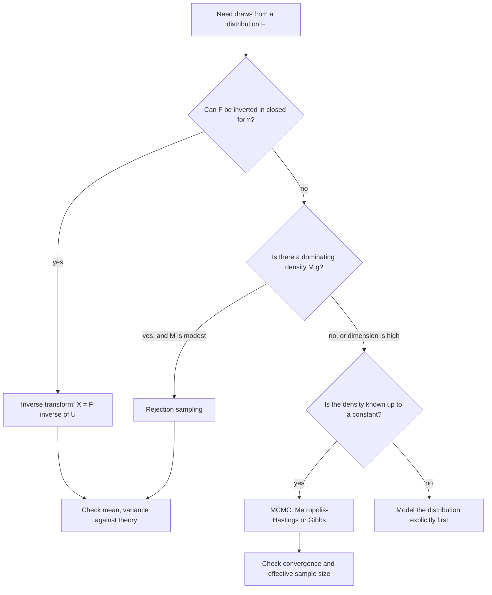
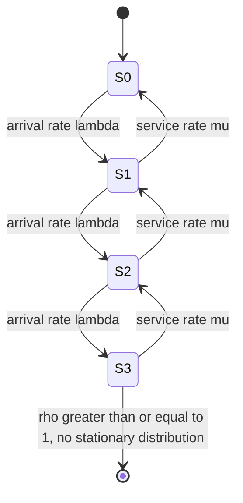

# Stochastic Models

> [Mathematics](../../README.md) › [Mathematical Modeling](../README.md) · Level: Advanced · Prerequisites: [Random Variables](../../10-probability/03-random-variables/README.md), [Probability Distributions](../../10-probability/04-probability-distributions/README.md), [Expectation and Variance](../../10-probability/05-expectation-and-variance/README.md), [Law of Large Numbers and the Central Limit Theorem](../../10-probability/06-law-of-large-numbers-and-central-limit-theorem/README.md), [Numerical Integration](../../19-numerical-analysis/04-numerical-integration/README.md), [Principles of Modeling](../01-principles-of-modeling/README.md) · Estimated time: 10 h

## 1. Introduction

A deterministic model says: given the inputs, here is the output. A stochastic model says: given the inputs, here is a *distribution* of outputs, or at least its mean and spread. The change is not cosmetic. It changes what a prediction is, what an error bar means, what "the model is wrong" can mean, and what a decision under uncertainty should optimise.

Randomness enters a model in two very different ways, and confusing them is the first mistake this topic tries to prevent.

* **Variability that is really there.** Individual customers arrive at random times; a machine fails after a random lifetime; a stock price moves unpredictably; a coin lands heads. Even with perfect knowledge of the system, individual outcomes are not predictable. This is *aleatory* uncertainty, and it does not go away with more data — it is a property of the system.
* **Ignorance.** A parameter is unknown and estimated from data; a model structure is a simplification; a future policy is undecided. This is *epistemic* uncertainty, and it shrinks as knowledge grows. A confidence interval for a mean is epistemic; the spread of a queue's length at 3 p.m. is aleatory.

A stochastic model of the first kind is a probability model of the system; a stochastic treatment of the second is a statistical model of our knowledge. Both are legitimate, they are computed differently, and a report that mixes them ("the 95 % interval is the range of outcomes") misleads.

Four ideas organise the material.

* **Simulation is an experiment, and an experiment without an error bar is an anecdote.** A Monte Carlo estimate is a random variable. It has a mean (the quantity of interest, if the sampler is unbiased), a variance (which governs the precision) and a distribution (which, by the central limit theorem, is approximately normal). Reporting "the simulated cost is \$4.2 m" without the standard error is reporting one draw from a distribution as if it were a number.
* **Variance is a budget.** The precision of a simulation improves as $1/\sqrt{n}$, so a factor of ten in accuracy costs a hundredfold in computing. Variance reduction — antithetic variates, importance sampling, control variates — buys precision by changing *what is sampled*, not how much. Done well it can be worth orders of magnitude; done badly it produces a confident wrong answer.
* **Queueing and random walks are the two canonical stochastic processes.** The M/M/1 queue yields closed-form answers from a balance equation and Little's law; the random walk yields hitting probabilities from a difference equation and, under scaling, the Brownian motion that underlies continuous-time models. Between them they cover most of the intuition needed elsewhere.
* **Risk measures are model outputs too.** Value at Risk and expected shortfall are functions of a distribution, and a distribution estimated badly produces a risk number that is precise, plausible and wrong. Both measures have pitfalls — VaR is not subadditive, ES is hard to backtest — and neither is a description of the worst case.

The topic closes with validation. A stochastic model cannot be checked by comparing a single output with a single observation; it must be checked distributionally, with the sampling error of the check itself accounted for. That is a genuinely different discipline from the deterministic case, and it is the part most often skipped.

## 2. Prerequisites

**Random variables and distributions** ([Random Variables](../../10-probability/03-random-variables/README.md), [Probability Distributions](../../10-probability/04-probability-distributions/README.md)). Discrete and continuous random variables, probability mass and density functions, the cumulative distribution function and its properties, independence, and the standard families: Bernoulli, binomial, geometric, Poisson, uniform, exponential, normal, lognormal.

**Expectation and variance** ([Expectation and Variance](../../10-probability/05-expectation-and-variance/README.md)). Linearity of expectation, the variance of a sum, covariance, correlation, conditional expectation, and the moment generating function of the normal distribution. The identity $\mathbb{E}[e^{\sigma Z}] = e^{\sigma^2/2}$ for $Z \sim \mathcal{N}(0,1)$ is used repeatedly.

**Limit theorems** ([Law of Large Numbers and the Central Limit Theorem](../../10-probability/06-law-of-large-numbers-and-central-limit-theorem/README.md)). The weak law, the strong law, and the central limit theorem in the i.i.d. case. Every confidence interval in this topic is an application of the CLT, and every claim that a simulation "converges" is an application of a law of large numbers.

**Differential equations, first order** ([First-Order ODEs](../../16-differential-equations/01-first-order-odes/README.md)). The exponential solution of $\dot x = ax$, used for the deterministic skeleton of a stochastic model and for the exact solution of geometric Brownian motion.

**Modelling practice** ([Principles of Modeling](../01-principles-of-modeling/README.md)). Assumptions, validation, dimensional consistency, and the distinction between a model's output and a prediction.

## 3. Learning Objectives

After this tutorial you will be able to:

1. Decide whether randomness belongs in a model, and whether the uncertainty at hand is aleatory or epistemic.
2. Build a Monte Carlo estimator, compute its standard error, and report a confidence interval that accounts for both bias and variance.
3. Apply antithetic variates and importance sampling, quantify the variance reduction, and recognise when each method fails.
4. Generate samples from a specified distribution by inverse transform and by rejection, and compute the acceptance probability.
5. Solve the M/M/1 balance equations, derive $L, L_q, W, W_q$ and $P(N = n)$, and prove Little's law.
6. Compute hitting probabilities and expected durations for a simple random walk, and relate them to Brownian motion through the diffusion approximation.
7. Write down an SDE, simulate it with Euler–Maruyama, and explain the difference between strong and weak error.
8. Compute VaR and expected shortfall, state their properties, and explain why VaR is not subadditive.
9. Validate a stochastic model distributionally, backtest a risk model, and report simulation results reproducibly.

## 4. Intuition

**Dice, not decimals.** A deterministic model answers "what happens?"; a stochastic model answers "how often does each thing happen?". The output is a distribution, and a distribution is reported by its shape, its centre and its spread — not by a single number. When someone quotes one number from a stochastic model, ask which summary it is: a mean, a median, a mode, or one simulation run.

**The average of many draws is more predictable than any draw.** This is the content of the law of large numbers, and it is the engine of simulation. Individual outcomes are wild; their average is tame, with error shrinking like $1/\sqrt{n}$. The same law explains why insurance works and why a casino is profitable: the house does not need to know the next spin, only the distribution of many spins.

**A queue is a bathtub.** Arrivals flow in at rate $\lambda$, service flows out at rate $\mu$ when the queue is non-empty. If $\lambda < \mu$ the water level fluctuates but stays bounded; if $\lambda \ge \mu$ it grows without limit. The average level is not zero and not a little above zero — it is $\rho/(1-\rho)$ customers, which is $1.5$ when the utilisation $\rho = 0.6$ but $9$ when $\rho = 0.9$. Queues are the clearest example in applied mathematics of a nonlinear response to a small change in a parameter.

**A random walk is a coin tossed in space.** Each step is $\pm 1$; after $n$ steps the position is a sum of independent increments, so it is approximately normal with variance $n$. Rescale space by $\sqrt{n}$ and time by $n$, and the walk converges to Brownian motion. Everything in continuous-time finance, diffusion approximations and the Euler–Maruyama scheme is built on that scaling.

**Risk is a quantile, and a quantile is not a loss.** Value at Risk at 99 % is the loss exceeded one day in a hundred. It says nothing about *how much* is lost on that day — a fact that matters enormously and that expected shortfall repairs by averaging the tail. Neither number is the worst case, and neither is meaningful without the model that produced it.

## 5. Formal Definition

**Definition 5.1 (probability space and random variable).** A probability space is a triple $(\Omega, \mathcal{F}, \Pr)$ with $\Omega$ a set of outcomes, $\mathcal{F}$ a $\sigma$-algebra of events and $\Pr$ a probability measure. A random variable is a measurable map $X : \Omega \to \mathbb{R}$; its distribution is the push-forward measure $\Pr_X$, described by the cumulative distribution function $F_X(x) = \Pr(X \le x)$.

**Definition 5.2 (stochastic process).** A stochastic process is a family $(X_t)_{t \in T}$ of random variables on a common probability space, indexed by time $T \subseteq \mathbb{R}$. A **discrete-time** process has $T = \mathbb{N}_0$; a **continuous-time** process has $T = [0,\infty)$. The **sample paths** are the functions $t \mapsto X_t(\omega)$ for fixed $\omega$.

**Definition 5.3 (Monte Carlo estimator).** Let $X_1, \dots, X_n$ be independent copies of a random variable with mean $\theta$. The Monte Carlo estimator of $\theta$ is $\hat\theta_n = \frac1n\sum_{i=1}^n X_i$. It is unbiased, $\mathbb{E}[\hat\theta_n] = \theta$, and its standard error is $\operatorname{se}(\hat\theta_n) = \sigma/\sqrt n$, estimated by $s/\sqrt n$ with $s^2 = \frac{1}{n-1}\sum_i (X_i - \hat\theta_n)^2$.

If $\theta = \mathbb{E}[f(U)]$ for $U$ uniform on $[0,1]^d$ and $f$ is square-integrable, the same construction with $X_i = f(U_i)$ estimates an integral:

$$
\theta = \int_{[0,1]^d} f(u)\,du .
$$

**Definition 5.4 (importance sampling estimator).** Let $p$ be a density with $p(x) > 0$ wherever $f(x)p(x) \ne 0$, and let $q$ be another density with the same property. Then

$$
\theta = \mathbb{E}_p[f(X)] = \mathbb{E}_q\!\left[\frac{f(X)p(X)}{q(X)}\right],
$$

and the importance sampling estimator is $\hat\theta^{\mathrm{IS}}_n = \frac1n\sum_{i=1}^n f(Y_i)p(Y_i)/q(Y_i)$ with $Y_i \sim q$ i.i.d. The ratios $w_i = p(Y_i)/q(Y_i)$ are the **weights**.

**Definition 5.5 (M/M/1 queue).** Customers arrive in a Poisson process of rate $\lambda$; service times are i.i.d. exponential with rate $\mu$; there is one server and an unbounded waiting room; service is first-come first-served. Let $N(t)$ be the number in the system. The process is a continuous-time Markov chain on $\mathbb{N}_0$ with transition rates $q_{n,n+1} = \lambda$ and $q_{n,n-1} = \mu$ for $n \ge 1$. Its **traffic intensity** is $\rho = \lambda/\mu$, and it is **stable** if $\rho < 1$.

**Definition 5.6 (Little's law).** For a stable queueing system in steady state, $L = \lambda W$, where $L$ is the long-run average number of customers in the system, $\lambda$ the long-run arrival rate and $W$ the long-run average time a customer spends in the system.

**Definition 5.7 (simple random walk).** Let $\xi_1, \xi_2, \dots$ be i.i.d. with $\Pr(\xi_i = +1) = p$ and $\Pr(\xi_i = -1) = 1 - p = q$. The random walk is $S_0 = 0$, $S_n = \sum_{i=1}^n \xi_i$. The **drift** is $m = \mathbb{E}[\xi_i] = p - q = 2p - 1$ and the **step variance** is $\sigma^2 = \operatorname{Var}(\xi_i) = 1 - m^2 = 4pq$.

**Definition 5.8 (Brownian motion).** A standard Brownian motion is a continuous-time process $(W_t)_{t \ge 0}$ with $W_0 = 0$, independent increments, $W_t - W_s \sim \mathcal{N}(0, t-s)$ for $t > s$, and continuous sample paths. A process $X_t = x_0 + \mu t + \sigma W_t$ is a Brownian motion with drift $\mu$ and volatility $\sigma$.

**Definition 5.9 (stochastic differential equation).** An Itô stochastic differential equation is

$$
dX_t = a(X_t, t)\,dt + b(X_t, t)\,dW_t, \qquad X_0 = x_0,
$$

interpreted as the integral equation $X_t = x_0 + \int_0^t a(X_s,s)\,ds + \int_0^t b(X_s,s)\,dW_s$, where the last integral is the Itô integral. $a$ is the **drift** and $b$ the **diffusion** coefficient.

**Definition 5.10 (value at risk and expected shortfall).** Let $L$ be a loss random variable (positive means loss) with distribution function $F_L$, and let $\alpha \in (0,1)$. The value at risk at level $\alpha$ is

$$
\operatorname{VaR}_\alpha(L) = \inf\{\ell \in \mathbb{R} : F_L(\ell) \ge \alpha\},
$$

the $\alpha$-quantile of the loss. When $F_L$ is continuous and $\mathbb{E}[|L|] < \infty$, the expected shortfall is

$$
\operatorname{ES}_\alpha(L) = \frac{1}{1-\alpha}\int_{\alpha}^{1} \operatorname{VaR}_u(L)\,du = \mathbb{E}\bigl[L \mid L \ge \operatorname{VaR}_\alpha(L)\bigr].
$$

**Definition 5.11 (coherent risk measure).** A risk measure $\rho$ is coherent if it satisfies monotonicity ($L_1 \le L_2 \Rightarrow \rho(L_1) \le \rho(L_2)$), translation invariance ($\rho(L + c) = \rho(L) + c$), positive homogeneity ($\rho(\lambda L) = \lambda\rho(L)$ for $\lambda > 0$) and subadditivity ($\rho(L_1 + L_2) \le \rho(L_1) + \rho(L_2)$).

**Definition 5.12 (validation).** A stochastic model is validated when (i) its inputs are consistent with data or with stated assumptions, (ii) its output distribution is statistically compatible with observations, using a test whose own sampling error is reported, and (iii) the conclusions are shown to survive plausible changes in the inputs.

## 6. Mathematical Notation

| Symbol | Read as | Meaning |
|---|---|---|
| $\Omega$, $\Pr$ | sample space, probability | the underlying experiment |
| $X$, $L$, $N(t)$ | random variable, loss, queue length | functions of the outcome |
| $F_X$, $f_X$ | distribution function, density | $F_X(x) = \Pr(X \le x)$ |
| $\mathbb{E}$, $\operatorname{Var}$ | expectation, variance | mean and mean squared deviation |
| $\hat\theta_n$ | estimator of $\theta$ | a statistic, hence random |
| $\operatorname{se}$ | standard error | estimated standard deviation of an estimator |
| $s$ | sample standard deviation | with $n-1$ in the denominator |
| $\Phi$, $\phi$ | standard normal CDF, density | $\Phi(z) = \int_{-\infty}^{z}\phi(u)du$ |
| $z_{1-\alpha}$ | normal quantile | $\Phi(z_{1-\alpha}) = 1-\alpha$ |
| $U$ | uniform variate | $U \sim \mathcal{U}(0,1)$ |
| $q$, $w$ | proposal density, weight | importance sampling |
| $\lambda$, $\mu$, $\rho$ | arrival rate, service rate, utilisation | $\rho = \lambda/\mu$ |
| $L$, $L_q$, $W$, $W_q$ | queue metrics | customers and times, with and without service |
| $\xi_i$, $S_n$ | step, position | random walk increments and partial sums |
| $W_t$ | Brownian motion | the continuous-time limit |
| $\mu$, $\sigma$ | drift, volatility | parameters of an SDE |
| $\Delta t$, $Z_k$ | time step, normal draw | Euler–Maruyama ingredients |
| $\operatorname{VaR}_\alpha$ | value at risk | the $\alpha$-quantile of the loss |
| $\operatorname{ES}_\alpha$ | expected shortfall | mean of the loss beyond VaR |
| $[x]^+$ | positive part | $\max\{x,0\}$ |

*Reading.* "$\hat\theta_n \to \theta$ in probability" means that for every $\varepsilon > 0$, $\Pr(|\hat\theta_n - \theta| > \varepsilon) \to 0$. "$X \sim \mathcal{N}(\mu,\sigma^2)$" is read "X is normally distributed with mean mu and variance sigma squared". "$\operatorname{se}(\hat\theta_n)$" is read "the standard error of theta hat sub n", never "the standard deviation of the data" — the two differ by a factor $\sqrt n$.

## 7. Core Concepts

### 7.1 Why randomness enters a model

Three questions decide whether a model should be stochastic.

1. **Is the quantity of interest a single outcome or a distribution?** If the decision depends on the spread — a safety stock, a capital buffer, a staffing level — then a deterministic model of the mean answers a different question. The mean is not enough whenever the objective is nonlinear (Jensen's inequality) or whenever a constraint is a probability.
2. **Is the randomness real or epistemic?** Arrival times and failures are real; an uncertain parameter is not. Modelling an unknown parameter as a random variable is legitimate (a prior), but the resulting spread is a statement about *our knowledge*, and it shrinks as data arrive. The two must be reported separately, because a decision-maker can act on one and not the other.
3. **Does the model need the distribution, or only its first two moments?** Many queueing and inventory results depend on the mean and variance alone (Little's law, the newsvendor critical fractile with a normal approximation), while tail risk, ruin probabilities and rare events depend on the whole distribution. Assuming normality when only moments are known is a *choice*, and it is the choice that most often fails in the tail.

A stochastic model is not automatically more honest than a deterministic one. A deterministic model with a sensitivity analysis can be more informative than a stochastic model whose distributions are invented. The test is whether the randomness is doing work: does the answer change materially when the distribution changes, and is that distribution estimated or assumed?

### 7.2 Monte Carlo: the estimator and its error

Monte Carlo turns an expectation into an average. If $X_1,\dots,X_n$ are i.i.d. with mean $\theta$ and finite variance $\sigma^2$, then $\hat\theta_n = \frac1n\sum_i X_i$ is unbiased and, by the central limit theorem,

$$
\frac{\hat\theta_n - \theta}{\sigma/\sqrt n} \xrightarrow{d} \mathcal{N}(0,1),
\qquad\text{so}\qquad
\Pr\Bigl(|\hat\theta_n - \theta| \le 1.96\,\frac{s}{\sqrt n}\Bigr) \approx 0.95
$$

for large $n$. Three features of this formula govern practice.

* **The rate is $n^{-1/2}$.** Four times the work buys twice the precision. This is slow, and it is why variance reduction matters more than hardware.
* **The constant is $\sigma$, not $n$.** Precision is bought by reducing the variance of the *integrand*, not by adding samples. A simulation with a variance of $10^4$ needs $10^8$ samples for a standard error of $0.001$; with a variance of $1$ it needs $10^4$.
* **The interval is asymptotic and conditional on the sampler.** If $X_i$ are correlated (a queue observed over time), if the variance is infinite (heavy tails), or if the sampler is biased (a discretised SDE), the interval is wrong even when $n$ is large.

**Bias and variance are separate.** A simulation may be biased by discretisation (Euler–Maruyama with a large step), by truncation (a queue simulated for too short a horizon), or by an estimator that is a nonlinear function of unbiased pieces. The mean squared error decomposes as $\operatorname{bias}^2 + \text{variance}$, and reducing the variance of a biased estimator produces a precise wrong answer. The standard remedy is a convergence study: run at two resolutions and check that the difference is consistent with the estimated error.

**Choosing $n$.** To achieve a relative standard error $\varepsilon$ when estimating a positive quantity of size $\theta$, one needs $n \approx (\sigma/(\varepsilon\theta))^2$. For a probability $p$ this is $n \approx (1-p)/(\varepsilon^2 p)$, which is why estimating a probability of $10^{-4}$ to 10 % relative precision needs about $9\times10^5$ samples — and why rare-event simulation uses importance sampling rather than brute force.

### 7.3 The law of large numbers in practice

The weak law says $\hat\theta_n \to \theta$ in probability; the strong law says the convergence is almost sure. Both require only a finite mean (for the weak law in the i.i.d. case, a finite first moment suffices). Three practical consequences follow, and one warning.

* **Convergence is not monotone.** A simulation can appear to settle and then move. The standard error is the correct measure of how far it can move, not the visual stability of a running-average plot.
* **The error is in the average, not in the individual draw.** A simulated queue can have a sample mean of 1.5 customers and a single observation of 12. Both are correct statements about different objects.
* **The law is silent about the rate.** The CLT supplies the rate, and it needs a finite variance. For distributions with infinite variance the average still converges (if the mean exists) but at a slower, random rate, and the normal confidence interval is invalid.

The warning: **the law of large numbers does not validate the model.** It says that the average of many draws converges to the expectation *under the model*. If the model is wrong, the simulation converges beautifully to the wrong number. This is the single most important sentence in this topic.

### 7.4 Variance reduction: antithetic variates

Suppose $\theta = \mathbb{E}[f(U)]$ with $U \sim \mathcal{U}(0,1)$ and $f$ monotone. Instead of $2n$ independent draws, use $n$ draws and their mirror images $1 - U_i$, and average the pair:

$$
\hat\theta^{\mathrm{anti}}_n = \frac{1}{n}\sum_{i=1}^{n}\frac{f(U_i) + f(1-U_i)}{2}.
$$

Its variance is

$$
\operatorname{Var}\!\left(\frac{f(U)+f(1-U)}{2}\right) = \frac{1}{2}\bigl(\operatorname{Var} f(U) + \operatorname{Cov}(f(U), f(1-U))\bigr),
$$

so antithetic sampling helps exactly when the covariance is negative, which for a monotone $f$ it is: a large $U$ makes $f(U)$ large and $f(1-U)$ small. The reduction can be dramatic. For $f(u) = e^u$ on $[0,1]$, $\operatorname{Var} f(U) = 0.24204$ and the antithetic pair has variance $0.003913$, so

$$
\frac{\text{variance of antithetic estimator with } 2n \text{ evaluations}}{\text{variance of naive estimator with } 2n \text{ evaluations}} = \frac{2(0.003913)}{0.24204} = 0.0323 :
$$

the same precision for about $31$ times fewer evaluations. For $f(u) = u^2$ the ratio is $0.125$, an eightfold saving.

Two cautions. First, the method relies on negative correlation; for a non-monotone $f$ the covariance can be positive and the method can *hurt*. Second, the estimator is still unbiased, but the naive standard error $\frac{1}{\sqrt n}s$ computed on the $2n$ values is wrong — the pairs are dependent, so the correct variance uses the $n$ pair-averages, not the $2n$ individual values. Getting this wrong is a classic way to report an interval that is too wide by a factor $\sqrt 2$ or, worse, too narrow.

### 7.5 Variance reduction: importance sampling

Importance sampling changes the distribution being sampled, weighting each draw by the ratio of densities (Definition 5.4). It is the standard tool for rare events, because it puts the samples where the event happens.

**Unbiasedness.** For any density $q$ with $q > 0$ wherever $fp \ne 0$,

$$
\mathbb{E}_q\!\left[\frac{f(Y)p(Y)}{q(Y)}\right] = \int f(y)\frac{p(y)}{q(y)}\,q(y)\,dy = \int f(y)p(y)\,dy = \theta .
$$

**The variance is what matters.** $\operatorname{Var}_q = \int f^2p^2/q\,dy - \theta^2$, which is small when $q$ is large where $|f|p$ is large. The *optimal* proposal is $q^\ast(y) \propto |f(y)|p(y)$, which gives zero variance when $f \ge 0$ — but it depends on the unknown $\theta$, so in practice one chooses $q$ close to that shape. The diagnostics are the effective sample size $\mathrm{ESS} = (\sum w_i)^2/\sum w_i^2$ and the maximum weight: if one weight dominates, the estimate is effectively one sample, and the nominal standard error is meaningless.

**A worked magnitude.** Let $X \sim \mathrm{Exp}(1)$ and estimate $p = \Pr(X > 10) = e^{-10} = 4.540\times10^{-5}$. Naive simulation gives a relative standard error of $\sqrt{(1-p)/p} \approx 148$ per sample, so even $10^5$ samples leave a 47 % relative error. Tilt the proposal to $\mathrm{Exp}(0.1)$, whose mean is $10$ — the threshold — and use the estimator $\frac{1}{0.1}e^{-0.9X}\mathbf{1}\{X > 10\}$. Its second moment is

$$
\frac{1}{0.1}\cdot\frac{e^{-1.9 \times 10}}{1.9} = \frac{10\,e^{-19}}{1.9} = 2.949\times10^{-8},
$$

so the variance is $2.949\times10^{-8} - p^2 \approx 2.743\times10^{-8}$ against $p(1-p) = 4.540\times10^{-5}$: a variance ratio of about $1655$, i.e. $40$ times fewer samples for the same relative error. The mechanism is visible in the weights: under $q$ the event has probability $e^{-1} = 0.368$ rather than $4.5\times10^{-5}$, and the weights are bounded by $10$.

**When it fails.** If $q$ has thinner tails than $p$, the ratio $p/q$ is unbounded and the estimator can have infinite variance — it will look excellent for a while and then produce an enormous value. A safe proposal is one that is *heavier* in the tail than the target, not lighter.

### 7.6 Simulating random variables

**Inverse transform.** If $U \sim \mathcal{U}(0,1)$ and $F$ is a distribution function, then $X = F^{-1}(U) := \inf\{x : F(x) \ge U\}$ has distribution $F$. The proof is one line: $\Pr(X \le x) = \Pr(F^{-1}(U) \le x) = \Pr(U \le F(x)) = F(x)$, using that $F^{-1}(u) \le x \iff u \le F(x)$ for the generalised inverse.

Examples worth knowing by heart: $X = -\ln(U)/\lambda$ is exponential with rate $\lambda$; $X = a + (b-a)U$ is uniform on $[a,b]$; for a discrete distribution with cumulative probabilities $c_0 = 0 < c_1 < \dots < c_k = 1$, take $X = x_j$ where $j$ is the smallest index with $U \le c_j$. For demand $10, 20, 30, 40$ with probabilities $0.2, 0.3, 0.4, 0.1$, the thresholds are $0.2, 0.5, 0.9, 1.0$; $U = 0.35$ gives demand $20$, and $U = 0.05$ gives $10$.

**Rejection sampling.** To sample from a density $f$ using an easy density $g$ with $f(x) \le M g(x)$ for all $x$: draw $Y \sim g$ and $V \sim \mathcal{U}(0,1)$ independently; accept $Y$ if $V \le f(Y)/(Mg(Y))$, otherwise redraw. The accepted value has density $f$, and the acceptance probability is $1/M$. The proof is a two-dimensional integral: the accepted mass in a region $A$ is $\int_A \int_0^{f/(Mg)} g(y)\,dv\,dy = \frac{1}{M}\int_A f(y)\,dy$, and dividing by the total acceptance probability $1/M$ gives $\int_A f$.

For the Beta$(2,2)$ density $f(x) = 6x(1-x)$ on $[0,1]$, the maximum is $1.5$ at $x = 0.5$, so taking $g$ uniform and $M = 1.5$ accepts with probability $2/3$: on average $1.5$ proposals per accepted draw. The acceptance rate is the price of the method, and it degrades fast in high dimensions — which is why more sophisticated samplers exist for multivariate problems.

### 7.7 The M/M/1 queue and the balance equations

Let $P_n = \Pr(N = n)$ in steady state. In steady state the probability of being in state $n$ is constant, so the flow into $n$ equals the flow out:

$$
\underbrace{\lambda P_{n-1} + \mu P_{n+1}}_{\text{flow in}} = \underbrace{(\lambda + \mu)P_n}_{\text{flow out}} \quad (n \ge 1),
\qquad
\lambda P_0 = \mu P_1 .
$$

The first equation rearranges to $\lambda(P_{n-1} - P_n) = \mu(P_n - P_{n+1})$, so the differences form a geometric sequence, and with the boundary equation $P_1 = \rho P_0$ one gets $P_n = \rho^n P_0$. Normalising, $\sum_{n\ge0}\rho^n = 1/(1-\rho)$ for $\rho < 1$, so

$$
P_n = (1-\rho)\rho^n, \qquad n \ge 0 .
$$

If $\rho \ge 1$ the normalising constant diverges: no stationary distribution exists and the queue grows without bound. This is the **stability condition**, and it is a theorem, not a rule of thumb.

From the geometric distribution:

$$
L = \sum_{n\ge0} nP_n = (1-\rho)\frac{\rho}{(1-\rho)^2} = \frac{\rho}{1-\rho},
\qquad
L_q = L - (1 - P_0) = L - \rho = \frac{\rho^2}{1-\rho},
$$

using that the mean number in service is $\Pr(N \ge 1) = \rho$. Little's law then gives $W = L/\lambda = 1/(\mu - \lambda)$ and $W_q = L_q/\lambda = \rho/(\mu-\lambda)$. For $\lambda = 3$ and $\mu = 5$ per hour: $\rho = 0.6$, $L = 1.5$, $L_q = 0.9$, $W = 0.5$ h, $W_q = 0.3$ h, $P_0 = 0.4$ and $\Pr(N \ge 5) = \rho^5 = 0.07776$.

The nonlinearity is the lesson: at $\rho = 0.6$ the average queue is $0.9$; at $\rho = 0.9$ it is $8.1$; at $\rho = 0.99$ it is $98.01$. A 10 % increase in utilisation near saturation multiplies the queue. No deterministic model of "average service capacity" reproduces this, because the queue is created by variability, not by insufficient capacity.

### 7.8 Little's law

**Theorem 7.1 (Little's law).** For a queueing system in which the long-run averages exist, $L = \lambda W$.

*Proof (sample-path version).* Consider one sample path on $[0,T]$, assume the system is empty at time $0$ and at time $T$, and let $A(T)$ be the number of arrivals in $(0,T]$, each with sojourn time $W_i$. Counting the total time spent in the system, once by customers and once by the clock,

$$
\int_0^T N(t)\,dt = \sum_{i=1}^{A(T)} W_i .
$$

Dividing by $T$ gives $\frac1T\int_0^T N(t)dt = \frac{A(T)}{T}\cdot\frac{1}{A(T)}\sum_i W_i$, i.e. $L_T = \lambda_T W_T$ exactly. If the system is non-empty at the endpoints, the identity acquires boundary terms bounded by the maximum sojourn time, which is finite and is divided by a growing $T$; they vanish as $T \to \infty$. Taking limits (which exist by hypothesis) gives $L = \lambda W$. $\blacksquare$

Three remarks make the theorem usable. First, it needs **no distributional assumption at all** — not Poisson arrivals, not exponential service, not independence. Second, $\lambda$ is the *arrival* rate and $W$ the time in the *whole system*; applying it with the waiting-time average $W_q$ gives $L_q = \lambda W_q$ for the queue. Third, it requires steady state: during a transient, $L$, $\lambda$ and $W$ are time-dependent and the identity relates their averages over the same interval, not their limiting values.

### 7.9 Random walks and the diffusion approximation

For the simple random walk of Definition 5.7, the position after $n$ steps has mean $nm$ and variance $n\sigma^2$, so $S_n/\sqrt n$ is approximately normal. Two classical results come from solving a difference equation.

**Gambler's ruin.** Let $h(i)$ be the probability of reaching $N$ before $0$ starting from $i$. Conditioning on the first step, $h(i) = ph(i+1) + qh(i-1)$ with $h(0) = 0$, $h(N) = 1$. The characteristic equation $p r^2 - r + q = 0$ has roots $1$ and $q/p$, so

$$
h(i) = \frac{1 - (q/p)^i}{1 - (q/p)^N}\ \ (p \ne q),
\qquad
h(i) = \frac{i}{N}\ \ (p = q).
$$

The expected duration $T(i)$ solves $T(i) = 1 + pT(i+1) + qT(i-1)$ with $T(0) = T(N) = 0$, giving $T(i) = i(N-i)$ for $p = q$ and, for $p \ne q$,

$$
T(i) = \frac{i}{q-p} - \frac{N}{q-p}\cdot\frac{1-(q/p)^i}{1-(q/p)^N}.
$$

For $p = 0.55$, $i = 50$, $N = 100$: $(q/p)^{50} = 4.4\times10^{-5}$, so the probability of reaching 100 before 0 is $0.999956$ and the expected duration is $499.96$ steps. The drift, not the variance, decides the fate; the variance decides how long it takes.

**The diffusion approximation.** Rescale a random walk by letting the step size shrink and the step rate grow: set $X^{(n)}_t = S_{\lfloor nt\rfloor}/\sqrt n$ for the symmetric walk. Then $X^{(n)} \Rightarrow W$ (Donsker's theorem), the covariance being $\mathbb{E}[S_{\lfloor ns\rfloor}S_{\lfloor nt\rfloor}]/n \to \min(s,t)$, which is the covariance of Brownian motion. With drift, the limit is $\mu t + \sigma W_t$ where $\mu$ is the drift per unit time and $\sigma^2$ the variance per unit time.

The approximation is used in the other direction: replace a discrete process by a Brownian one to get closed forms. Replacing the gambler's ruin by a Brownian motion with drift and variance, the hitting probability becomes

$$
\Pr(\text{hit } +a \text{ before } -b) \approx \frac{1 - e^{-2\mu b/\sigma^2}}{1 - e^{-2\mu(a+b)/\sigma^2}} .
$$

For the walk above, $\mu = 0.1$ and $\sigma^2 = 0.99$ per step; with $a = b = 50$ the formula gives $0.999959$ against the exact $0.999956$. The approximation is excellent in the interior and deteriorates for very small $a$ or $b$, where the lattice matters.

### 7.10 Brownian motion and stochastic differential equations

Brownian motion is the scaling limit of the random walk, and it is the noise source for continuous-time models. Its key properties: $W_t \sim \mathcal{N}(0,t)$; increments over disjoint intervals are independent; paths are continuous but nowhere differentiable; the quadratic variation over $[0,t]$ is $t$ in the sense that $\sum_k (W_{t_{k+1}} - W_{t_k})^2 \to t$ along refining partitions. That last property is why ordinary calculus does not apply, and why the Itô integral is defined as a limit of non-anticipating sums.

**Itô's lemma.** For $f \in C^{2}$ and $dX_t = a\,dt + b\,dW_t$,

$$
df(X_t) = \Bigl(f'(X_t)a + \tfrac12 f''(X_t)b^2\Bigr)dt + f'(X_t)b\,dW_t .
$$

The extra term $\tfrac12 f''b^2$ is the correction that ordinary calculus misses; it comes from the quadratic variation of $W$.

**Geometric Brownian motion.** With $dS_t = \mu S_t\,dt + \sigma S_t\,dW_t$ and $f(s) = \ln s$: $f' = 1/s$, $f'' = -1/s^2$, so

$$
d\ln S_t = \Bigl(\frac{\mu S_t}{S_t} - \frac12\frac{\sigma^2S_t^2}{S_t^2}\Bigr)dt + \frac{\sigma S_t}{S_t}dW_t = \Bigl(\mu - \tfrac12\sigma^2\Bigr)dt + \sigma\,dW_t .
$$

Integrating, $S_t = S_0\exp\bigl((\mu - \tfrac12\sigma^2)t + \sigma W_t\bigr)$, and therefore

$$
\mathbb{E}[S_t] = S_0e^{\mu t}, \qquad \operatorname{Var}(S_t) = S_0^2e^{2\mu t}\bigl(e^{\sigma^2t} - 1\bigr),
$$

using $\mathbb{E}[e^{\sigma W_t}] = e^{\sigma^2t/2}$. Note that the *median* grows like $e^{(\mu - \sigma^2/2)t}$, slower than the mean: the mean is pulled up by a thin right tail. Quoting the mean growth rate of a lognormal process as if it were the typical outcome is a common and expensive error.

### 7.11 The Euler–Maruyama scheme

The scheme discretises $dX_t = a(X_t,t)dt + b(X_t,t)dW_t$ on a grid $t_k = k\Delta t$:

$$
X_{k+1} = X_k + a(X_k,t_k)\,\Delta t + b(X_k,t_k)\sqrt{\Delta t}\,Z_{k+1},
\qquad Z_{k+1} \sim \mathcal{N}(0,1)\ \text{i.i.d.}
$$

The $\sqrt{\Delta t}$ is not a detail: it is forced by $\operatorname{Var}(W_{t+\Delta t} - W_t) = \Delta t$, and using $\Delta t$ instead would make the noise vanish too fast and produce a deterministic limit.

**Two error notions.**

* **Strong error** $\mathbb{E}[|X_T - \bar X_T|]$ (or its mean square) for *the same Brownian path*. Euler–Maruyama has strong order $\tfrac12$: the error is $O(\Delta t^{1/2})$. Halving the step reduces the pathwise error only by $\sqrt2$.
* **Weak error** $|\mathbb{E}[g(X_T)] - \mathbb{E}[g(\bar X_T)]|$ for a smooth $g$. Euler–Maruyama has weak order $1$: the error is $O(\Delta t)$. Halving the step halves the bias in a computed expectation.

The distinction matters because simulation studies usually want expectations (prices, probabilities, costs), so the weak order is the relevant one; pathwise accuracy matters for hedging or for estimating a functional of the whole path.

**A worked bias.** For geometric Brownian motion with $S_0 = 100$, $\mu = 0.1$, $\sigma = 0.2$, $T = 1$, the exact mean is $\mathbb{E}[S_T] = 100e^{0.1} = 110.5171$. The Euler–Maruyama recursion is multiplicative, $S_{k+1} = S_k(1 + \mu\Delta t + \sigma\sqrt{\Delta t}Z_{k+1})$, so its expectation is exactly $100(1 + \mu\Delta t)^{n}$ with $n = T/\Delta t$. For $n = 12$ (monthly steps) this is $100(1 + 0.1/12)^{12} = 110.4713$: a bias of $-0.0458$, or $-0.041\,\%$. The bias is $O(\Delta t)$, as the weak order predicts, and it is small here because $\mu$ and $\sigma$ are moderate. With a large volatility or a long horizon it is not small, and a simulation that reports four significant figures without a convergence check is reporting discretisation error as if it were the answer.

**Practical rules.** Choose $\Delta t$ so that both drift and diffusion move the state by a small fraction of its scale per step; run at two step sizes and check that the difference is consistent with the $O(\Delta t)$ prediction; use the exact solution when it exists (as for GBM) and reserve the scheme for the cases that need it.

### 7.12 Risk measures: value at risk and expected shortfall

For a loss $L$ and a level $\alpha$ (typically $0.95$ or $0.99$), $\operatorname{VaR}_\alpha$ is the $\alpha$-quantile of the loss distribution: the smallest loss that is exceeded with probability at most $1-\alpha$. For a normal loss $L \sim \mathcal{N}(\mu, \sigma^2)$,

$$
\operatorname{VaR}_\alpha = \mu + \sigma z_\alpha, \qquad
\operatorname{ES}_\alpha = \mu + \sigma\,\frac{\phi(z_\alpha)}{1-\alpha},
$$

with $z_\alpha = \Phi^{-1}(\alpha)$. For $\mu = 0$, $\sigma = 10$ and $\alpha = 0.99$: $z = 2.3263$, $\operatorname{VaR} = 23.26$ and $\operatorname{ES} = 10(0.026652)/0.01 = 26.65$ — the tail average is $14.6\,\%$ larger than the quantile. At $\alpha = 0.975$: $\operatorname{VaR} = 19.60$ and $\operatorname{ES} = 23.38$.

**VaR is not subadditive.** Take two independent bonds, each defaulting with probability $0.04$ and losing $100$, and nothing otherwise. At $\alpha = 0.95$:

* Each bond's loss is $100$ with probability $0.04 < 0.05$, so $\operatorname{VaR}_{0.95} = 0$ for each.
* The portfolio loses at least $100$ with probability $1 - 0.96^2 = 0.0784 > 0.05$, so $\operatorname{VaR}_{0.95} = 100$.

Thus $\operatorname{VaR}(L_1 + L_2) = 100 > 0 + 0 = \operatorname{VaR}(L_1) + \operatorname{VaR}(L_2)$: diversification *appears* to increase risk. The reason is that VaR asks only whether the probability of a large loss crosses $5\,\%$, not how large the loss is. Expected shortfall is subadditive (Theorem 8.18) and gives, for the same example, $\operatorname{ES}_{0.95} = 80$ per bond and $103.2$ for the portfolio: less than $80 + 80 = 160$, as it must be.

**Pitfalls that survive the choice of measure.**

* **The tail is estimated, not observed.** A 99 % VaR estimated from 250 days has about $2.5$ observations beyond it. Any estimate of the tail is dominated by the model used to extrapolate, not by the data.
* **Scaling by $\sqrt{t}$ is a model.** VaR over a 10-day horizon is not $\sqrt{10}$ times the 1-day VaR unless returns are i.i.d. normal with zero mean. With autocorrelation, fat tails or time-varying volatility, the scaling is wrong and usually too small.
* **Dependence is not correlation.** Elliptical models with a correlation matrix imply tail independence for the normal, while real losses show tail dependence. A portfolio VaR computed from a correlation matrix can understate joint crashes by an order of magnitude.
* **VaR is not elicitable on its own.** There is no scoring function whose expectation is minimised by the true VaR, which is why backtesting VaR is a test of *exceedance counts* rather than a proper scoring rule; expected shortfall is not elicitable alone either, though the pair (VaR, ES) is jointly elicitable. This is a technical limitation of both measures as forecast targets.
* **A risk measure is a model output.** It inherits every assumption of the model that produced it. Reporting "VaR is €4.2 m" without the model, the sample and the estimation error is reporting a number with no content.

### 7.13 Validating a stochastic model

Validation of a deterministic model compares a predicted number with an observed number. Validation of a stochastic model compares a *distribution* with data, and every comparison has its own sampling error. Four layers are needed.

1. **Input validation.** Are the distributions of the inputs consistent with data? Check the marginal fits (histograms, quantile–quantile plots, goodness-of-fit tests), but also the dependence: a model with correct marginals and the wrong copula reproduces every univariate statistic and fails on every joint one.
2. **Structural validation.** Does the model reproduce features that were not used in its calibration? A queueing model calibrated on the mean should also reproduce the variance, the 95th percentile of the wait and the autocorrelation of the queue length. Agreement on quantities not used for fitting is evidence; agreement on fitted quantities is not.
3. **Output validation and backtesting.** Compare the predicted distribution with realised outcomes using a test with a known null distribution and report the test's power. For VaR, the standard test is Kupiec's proportion-of-failures test: with $n$ days, $x$ exceedances and nominal probability $p$, the likelihood ratio statistic is
$$
\mathrm{LR} = -2\Bigl[(n-x)\ln(1-p) + x\ln p - (n-x)\ln\Bigl(1-\tfrac{x}{n}\Bigr) - x\ln\tfrac{x}{n}\Bigr] \ \sim\ \chi^2_1 .
$$
With $n = 250$, $p = 0.05$ and $x = 12$ exceedances, $\mathrm{LR} = 0.021$ (p-value $0.88$): 12 failures in 250 days is entirely consistent with a correct 95 % model. With $x = 20$, $\mathrm{LR} = 4.04$ (p-value $0.044$): evidence of a problem. Note how weak the test is — it cannot distinguish a good model from a mediocre one without hundreds of days, and it ignores the *clustering* of failures, which is the symptom that matters most. Christoffersen's independence test, or a test on the pair (exceedance, previous exceedance), addresses that.
4. **Robustness.** Re-run with plausible alternative inputs and alternative structures, and report how the conclusion moves. If the answer changes sign under a defensible change of the dependence assumption, the model has not established anything.

Two engineering requirements complete the list. **Reproducibility:** fix and report the seed, the software version, and the number of streams; a result that cannot be reproduced cannot be checked. **Convergence diagnostics:** for independent sampling, report the standard error; for correlated output, report an effective sample size or use batch means; for MCMC, report a convergence diagnostic such as $\hat R$ across chains. A simulation whose error is unknown is not evidence.

## 8. Formulas and Properties

### 8.1 The laws of large numbers

**Theorem 8.1 (weak law of large numbers).** Let $X_1, X_2, \dots$ be i.i.d. with $\mathbb{E}[X_i] = \theta$ and $\operatorname{Var}(X_i) = \sigma^2 < \infty$. Then for every $\varepsilon > 0$,

$$
\Pr\bigl(|\hat\theta_n - \theta| > \varepsilon\bigr) \le \frac{\sigma^2}{n\varepsilon^2} \longrightarrow 0 .
$$

*Proof.* $\mathbb{E}[\hat\theta_n] = \theta$ and $\operatorname{Var}(\hat\theta_n) = \sigma^2/n$ by independence. Chebyshev's inequality gives the display. $\blacksquare$

### 8.2 The central limit theorem and simulation error

**Theorem 8.2 (central limit theorem).** Under the hypotheses of Theorem 8.1,

$$
\frac{\hat\theta_n - \theta}{\sigma/\sqrt n} \xrightarrow{d} \mathcal{N}(0,1).
$$

**Corollary 8.2a (interval).** If $s_n$ is the sample standard deviation, then the interval $\hat\theta_n \pm z_{1-\alpha/2}\,s_n/\sqrt n$ covers $\theta$ with probability tending to $1-\alpha$.

Three warnings, all of which are violated routinely:

* The interval is for the **mean of the draws**, not for a single draw and not for the median unless the sample is large and the distribution smooth.
* It requires **independent** draws. For correlated output, $\operatorname{Var}(\hat\theta_n) \ne \sigma^2/n$; the correct variance is $\frac{\sigma^2}{n}(1 + 2\sum_{k\ge1}\rho_k)$, where $\rho_k$ is the lag-$k$ autocorrelation. With an AR(1) correlation $\rho_k = \rho^k$ the inflation factor is $(1+\rho)/(1-\rho)$: at $\rho = 0.8$ the naive interval is three times too narrow.
* It requires **finite variance**. For a Pareto tail with index $\alpha \le 2$ the variance is infinite, the CLT fails, and the sample mean converges at rate $n^{1-1/\alpha}$ with a non-normal limit.

### 8.3 Antithetic variates

**Theorem 8.3 (antithetic variance).** Let $f$ be square-integrable on $[0,1]$ and $U \sim \mathcal{U}(0,1)$. Then

$$
\operatorname{Var}\!\left(\frac{f(U) + f(1-U)}{2}\right) = \frac{1}{2}\Bigl(\operatorname{Var} f(U) + \operatorname{Cov}\bigl(f(U), f(1-U)\bigr)\Bigr).
$$

If moreover $f$ is monotone, then $\operatorname{Cov}(f(U), f(1-U)) \le 0$ and the antithetic estimator has variance at most $\tfrac12\operatorname{Var} f(U)$ for the same number of pairs.

*Proof.* Expand the square: $\operatorname{Var}\bigl(\tfrac12(f(U)+f(1-U))\bigr) = \tfrac14(2\operatorname{Var} f + 2\operatorname{Cov}) = \tfrac12(\operatorname{Var} f + \operatorname{Cov})$, using that $f(1-U)$ has the same distribution as $f(U)$. For monotonicity, suppose $f$ is non-decreasing; then $g(u) = f(1-u)$ is non-increasing, so $(f(u)-f(v))(g(u)-g(v)) \le 0$ for all $u, v$; integrating over independent $U, V$ gives $2\operatorname{Cov}(f(U), g(U)) \le 0$ (Chebyshev's integral inequality). $\blacksquare$

### 8.4 Importance sampling

**Theorem 8.4 (unbiasedness and variance).** Let $p, q$ be densities with $q > 0$ wherever $fp \ne 0$, and let $Y \sim q$. Then $\mathbb{E}_q[fp/q] = \theta$ and

$$
\operatorname{Var}_q\!\left(\frac{f(Y)p(Y)}{q(Y)}\right) = \int \frac{f(y)^2p(y)^2}{q(y)}\,dy - \theta^2 .
$$

*Proof.* The first identity is the change of measure in §7.5; the second is the definition of variance applied to the estimator. $\blacksquare$

**Theorem 8.5 (optimal proposal).** Among all densities $q$, the second moment $\int f^2p^2/q$ is minimised by $q^\ast(y) = \dfrac{|f(y)|p(y)}{\int |f(u)|p(u)\,du}$, for which the second moment equals $\theta^2$; when $f \ge 0$ the estimator then has zero variance.

*Proof.* By Cauchy–Schwarz, $\bigl(\int |f|p\bigr)^2 = \bigl(\int \frac{|f|p}{\sqrt q}\sqrt q\bigr)^2 \le \int \frac{f^2p^2}{q}\cdot\int q$, so the second moment is at least $(\int|f|p)^2$, with equality at $q = q^\ast$. $\blacksquare$

The optimal proposal depends on the unknown normalising constant, which is exactly the quantity being estimated; the theorem is a target, not an algorithm. It also shows why a proposal with thinner tails than $p$ is fatal: $q$ in a denominator makes the ratio explode.

### 8.5 Inverse transform

**Theorem 8.6 (inverse transform).** Let $F$ be a distribution function and $F^{-1}(u) = \inf\{x : F(x) \ge u\}$ its generalised inverse. If $U \sim \mathcal{U}(0,1)$ then $X = F^{-1}(U)$ has distribution function $F$.

*Proof.* For any $x$, $F^{-1}(u) \le x$ if and only if $u \le F(x)$: if $F^{-1}(u) \le x$ then $F(x) \ge F(F^{-1}(u)) \ge u$ by monotonicity and right-continuity; conversely if $u \le F(x)$ then $x$ belongs to the set whose infimum is $F^{-1}(u)$, so $F^{-1}(u) \le x$. Hence

$$
\Pr(X \le x) = \Pr\bigl(F^{-1}(U) \le x\bigr) = \Pr\bigl(U \le F(x)\bigr) = F(x). \qquad \blacksquare
$$

### 8.6 Rejection sampling

**Theorem 8.7 (rejection sampling).** Let $f$ be a density, $g$ a density with $f(x) \le Mg(x)$ for all $x$ and some $M < \infty$. Draw $Y \sim g$, $V \sim \mathcal{U}(0,1)$ independently and accept $Y$ if $V \le f(Y)/(Mg(Y))$; otherwise repeat. Then the accepted value has density $f$, and the number of proposals per acceptance is geometric with mean $M$.

*Proof.* For a measurable set $A$,

$$
\Pr(Y \in A \text{ and accept}) = \int_A \int_0^{f(y)/(Mg(y))} g(y)\,dv\,dy = \frac{1}{M}\int_A f(y)\,dy .
$$

Taking $A = \mathbb{R}$ gives acceptance probability $1/M$, and dividing the two displays gives $\Pr(Y \in A \mid \text{accept}) = \int_A f$, which is the assertion. $\blacksquare$

### 8.7 The M/M/1 stationary distribution

**Theorem 8.8 (stationary distribution).** The M/M/1 queue has a stationary distribution if and only if $\rho = \lambda/\mu < 1$, and then

$$
P_n = (1-\rho)\rho^n, \qquad n = 0, 1, 2, \dots
$$

*Proof.* In stationarity, the flow balance for state $n \ge 1$ reads $\lambda P_{n-1} + \mu P_{n+1} = (\lambda+\mu)P_n$, and for $n = 0$, $\lambda P_0 = \mu P_1$. The first equation rearranges to $\mu(P_{n+1} - P_n) = \lambda(P_n - P_{n-1})$, so $P_n - P_{n-1} = \rho^n (P_0 - P_{-1})$; with the boundary equation $P_1 = \rho P_0$ one gets $P_n - P_{n-1} = -(1-\rho)\rho^{n-1}P_0$ and, summing the telescoping series, $P_n = P_0\rho^n$. Normalising: $1 = P_0/(1-\rho)$ requires $\rho < 1$, and then $P_0 = 1-\rho$. If $\rho \ge 1$ no normalising constant exists, and the chain is transient (for $\rho > 1$) or null-recurrent (for $\rho = 1$). $\blacksquare$

**Theorem 8.9 (performance measures).** For $\rho < 1$,

$$
L = \frac{\rho}{1-\rho},\qquad L_q = \frac{\rho^2}{1-\rho},\qquad W = \frac{1}{\mu-\lambda},\qquad W_q = \frac{\lambda}{\mu(\mu-\lambda)} .
$$

*Proof.* $L = \sum_n n(1-\rho)\rho^n = \rho/(1-\rho)$ by differentiating the geometric series. The mean number in service is $\Pr(N \ge 1) = \rho$, so $L_q = L - \rho = \rho^2/(1-\rho)$. Little's law (Theorem 7.1) applied to the system and to the queue gives $W = L/\lambda$ and $W_q = L_q/\lambda$. $\blacksquare$

### 8.8 Little's law: what it does and does not require

Theorem 7.1 was proved for a single sample path, and the proof shows exactly what is assumed: that the long-run averages $L_T \to L$, $\lambda_T \to \lambda$ and $W_T \to W$ exist and are finite. Nothing else — no assumption is made on the arrival process, the service distribution, the number of servers, the queue discipline or independence.

**Theorem 8.10 (ruin probability).** For the walk of Definition 5.7 with absorbing barriers at $0$ and $N$, the probability of hitting $N$ before $0$ starting from $i$ is

$$
h(i) = \frac{1-(q/p)^i}{1-(q/p)^N}\ (p \ne q), \qquad h(i) = \frac{i}{N}\ (p = q).
$$

*Proof.* $h$ satisfies $h(i) = ph(i+1) + qh(i-1)$ with $h(0) = 0$, $h(N) = 1$. The characteristic equation $pr^2 - r + q = 0$ has roots $1$ and $q/p$, so $h(i) = A + B(q/p)^i$; the boundary conditions give $A + B = 0$ and $A + B(q/p)^N = 1$, hence the formula. For $p = q$ the root is double and $h(i) = A + Bi$, giving $h(i) = i/N$. $\blacksquare$

**Theorem 8.11 (expected duration).** With $T = \inf\{n : S_n \in \{0,N\}\}$ and $T(i) = \mathbb{E}[T \mid S_0 = i]$,

$$
T(i) = i(N-i)\ (p = q), \qquad
T(i) = \frac{i}{q-p} - \frac{N}{q-p}\cdot\frac{1-(q/p)^i}{1-(q/p)^N}\ (p \ne q).
$$

*Proof.* $T$ solves $T(i) = 1 + pT(i+1) + qT(i-1)$ with $T(0) = T(N) = 0$. The particular solution $i/(q-p)$ plus the homogeneous solution reproduces the boundary conditions exactly as in Theorem 8.10. $\blacksquare$

**Theorem 8.12 (diffusion limit).** Let $S_n$ be a random walk with drift $m$ and step variance $\sigma^2$, and define $X^{(n)}_t = S_{\lfloor nt\rfloor}/\sqrt n$. Then $X^{(n)}$ converges in distribution to $\mu t + \sigma W_t$ with $\mu = m$ and the same $\sigma$, in the sense that all finite-dimensional distributions converge and the covariance converges to $\min(s,t)\sigma^2$.

*Proof sketch.* For fixed $t$, $X^{(n)}_t$ is a sum of $\lfloor nt\rfloor$ i.i.d. terms scaled by $n^{-1/2}$, so the CLT gives $\mathcal{N}(mt, \sigma^2t)$; the multivariate version applied to a finite set of times gives the finite-dimensional distributions; tightness follows from the uniform moment bounds on the increments. The covariance limit is $\mathbb{E}[S_{\lfloor ns\rfloor}S_{\lfloor nt\rfloor}]/n = \sigma^2\min(s,t) + o(1)$. $\blacksquare$

### 8.10 Itô's lemma and geometric Brownian motion

**Theorem 8.13 (Itô's lemma).** If $dX_t = a_t\,dt + b_t\,dW_t$ and $f \in C^2$, then

$$
df(X_t) = \Bigl(f'(X_t)a_t + \tfrac12 f''(X_t)b_t^2\Bigr)dt + f'(X_t)b_t\,dW_t .
$$

The proof expands $f$ to second order; the term that would be $o(dt)$ in ordinary calculus is $O(dW^2) = O(dt)$ because the quadratic variation of Brownian motion is $t$.

**Theorem 8.14 (geometric Brownian motion).** The solution of $dS_t = \mu S_t\,dt + \sigma S_t\,dW_t$ with $S_0 > 0$ is

$$
S_t = S_0 \exp\Bigl(\bigl(\mu - \tfrac12\sigma^2\bigr)t + \sigma W_t\Bigr),
$$

and therefore $\mathbb{E}[S_t] = S_0e^{\mu t}$ and $\operatorname{Var}(S_t) = S_0^2e^{2\mu t}(e^{\sigma^2t}-1)$.

*Proof.* Apply Theorem 8.13 to $f(s) = \ln s$: $d\ln S_t = (\mu - \tfrac12\sigma^2)dt + \sigma dW_t$, and integrate. The moments follow from $W_t \sim \mathcal{N}(0,t)$ and $\mathbb{E}[e^{\sigma W_t}] = e^{\sigma^2t/2}$. $\blacksquare$

### 8.11 The Euler–Maruyama scheme

**Theorem 8.15 (orders of convergence).** For an SDE with globally Lipschitz drift and diffusion coefficients, Euler–Maruyama with step $\Delta t$ satisfies, for a terminal time $T$ and a constant $C$ independent of $\Delta t$,

$$
\mathbb{E}\bigl[|X_T - \bar X_T|\bigr] \le C\,\Delta t^{1/2}
\quad\text{and}\quad
\bigl|\mathbb{E}[g(X_T)] - \mathbb{E}[g(\bar X_T)]\bigr| \le C'\,\Delta t
$$

for the same driving Brownian path (strong error) and for smooth $g$ (weak error).

**Proposition 8.16 (the GBM mean bias).** For $dS = \mu S\,dt + \sigma S\,dW$ the Euler–Maruyama recursion has $\mathbb{E}[\bar S_T] = S_0(1+\mu\Delta t)^{T/\Delta t}$, which differs from $S_0e^{\mu T}$ by $\tfrac12\mu^2T\,\Delta t\,S_0e^{\mu T} + O(\Delta t^2)$.

*Proof.* The recursion $\bar S_{k+1} = \bar S_k(1 + \mu\Delta t + \sigma\sqrt{\Delta t}Z_{k+1})$ has conditional mean $\bar S_k(1+\mu\Delta t)$ because $\mathbb{E}[Z_{k+1}] = 0$; iterating gives $S_0(1+\mu\Delta t)^n$. Expanding $n\ln(1+\mu\Delta t) = \mu T - \tfrac12\mu^2T\Delta t + O(\Delta t^2)$ and exponentiating gives the stated bias, which is negative — the scheme understates the mean. $\blacksquare$

### 8.12 Risk measures

**Theorem 8.17 (Rockafellar–Uryasev representation).** For an integrable loss $L$ and $\alpha \in (0,1)$,

$$
\operatorname{ES}_\alpha(L) = \min_{c \in \mathbb{R}}\Bigl\{c + \frac{1}{1-\alpha}\mathbb{E}\bigl[(L-c)^+\bigr]\Bigr\},
$$

and the minimising $c$ is a value at risk at level $\alpha$.

**Theorem 8.18 (expected shortfall is coherent).** $\operatorname{ES}_\alpha$ is monotone, translation invariant, positively homogeneous and subadditive; in particular $\operatorname{ES}_\alpha(L_1 + L_2) \le \operatorname{ES}_\alpha(L_1) + \operatorname{ES}_\alpha(L_2)$.

*Proof.* Monotonicity, translation invariance and homogeneity are immediate from the definition. For subadditivity, use Theorem 8.17: for any $c_1, c_2$,

$$
\operatorname{ES}_\alpha(L_1+L_2) \le (c_1+c_2) + \frac{1}{1-\alpha}\mathbb{E}\bigl[(L_1-c_1)^+ + (L_2-c_2)^+\bigr],
$$

using $(x+y)^+ \le x^+ + y^+$. Taking the minimum over $c_1$ and $c_2$ separately gives $\operatorname{ES}_\alpha(L_1) + \operatorname{ES}_\alpha(L_2)$. $\blacksquare$

**Proposition 8.19 (VaR is not subadditive).** Let $L_1, L_2$ be independent, each equal to $100$ with probability $0.04$ and $0$ otherwise. Then $\operatorname{VaR}_{0.95}(L_1) = \operatorname{VaR}_{0.95}(L_2) = 0$ while $\operatorname{VaR}_{0.95}(L_1+L_2) = 100$.

*Proof.* For a single bond, $\Pr(L_1 = 100) = 0.04 < 0.05$, so the $95\,\%$ quantile is $0$. For the sum, $\Pr(L_1 + L_2 \ge 100) = 1 - 0.96^2 = 0.0784 > 0.05$, so the $95\,\%$ quantile is at least $100$; and $100$ is attained with probability $0.0784 > 0$, so it is the quantile. $\blacksquare$

The same example gives $\operatorname{ES}_{0.95}(L_1) = 80$ and $\operatorname{ES}_{0.95}(L_1+L_2) = 103.2$: the average of the loss beyond the quantile is finite and subadditive, even though the quantile is not.

## 9. Step-by-Step Examples

### 9.1 Example 1 (easy): a Monte Carlo estimate with an error bar

A newsvendor buys at €6 and sells at €10; unsold units are salvaged at €2. Demand is uniform on $[80,160]$ units. The order quantity is $Q = 120$. Profit is

$$
\Pi = 10\min(D, Q) - 6Q + 2(Q - D)^+ .
$$

**Exact mean.** For $D < Q$: $\Pi = 10D - 720 + 2(120 - D) = 8D - 480$. For $D \ge Q$: $\Pi = 1200 - 720 = 480$. Since the density is $1/80$,

$$
\mathbb{E}[\Pi] = \frac{1}{80}\int_{80}^{120}(8d - 480)\,dd + \frac{1}{80}\int_{120}^{160}480\,dd
= \frac{12800}{80} + \frac{19200}{80} = 160 + 240 = 400 .
$$

**Exact spread.** $\mathbb{E}[\Pi^2] = \frac{1}{80}\int_{80}^{120}(8d-480)^2dd + \frac{1}{80}(480)^2(40) = 4437333.3/80 + 9216000/80 = 55466.7 + 115200 = 170666.7$, so $\operatorname{Var}(\Pi) = 170666.7 - 160000 = 10666.7$ and the standard deviation is $103.28$.

**Simulation.** With $n = 10^4$ draws, the standard error is $103.28/\sqrt{10^4} = 1.0328$, and the 95 % interval is $400 \pm 2.03$, i.e. $[397.97, 402.03]$. Any simulated average outside this interval indicates a coding error, not bad luck — which is exactly why the exact value is worth computing first.

**The deterministic trap.** A deterministic model that replaces demand by its mean gives $\Pi = 10(120) - 720 = 480$, $20\,\%$ above the true expected profit of $400$. The gap is not a rounding error: it is the cost of variability, and it disappears only if the model is allowed to see the distribution.

*Check.* The order quantity $Q = 120$ is the median of demand, which is the optimal fractile for this cost structure, since the critical ratio is $(p-c)/(p-s) = 4/8 = 0.5$ ✓.

### 9.2 Example 2 (easy–medium): inverse transform and rejection sampling

**A discrete demand.** Demand takes the values $10, 20, 30, 40$ with probabilities $0.2, 0.3, 0.4, 0.1$. The cumulative probabilities are $0.2, 0.5, 0.9, 1.0$, so the inverse transform is

$$
X = \begin{cases}10, & U \le 0.2,\\ 20, & 0.2 < U \le 0.5,\\ 30, & 0.5 < U \le 0.9,\\ 40, & 0.9 < U \le 1.\end{cases}
$$

Thus $U = 0.05 \mapsto 10$, $U = 0.35 \mapsto 20$, $U = 0.70 \mapsto 30$, $U = 0.95 \mapsto 40$. The distribution's mean is $0.2(10) + 0.3(20) + 0.4(30) + 0.1(40) = 24$ and its second moment is $0.2(100) + 0.3(400) + 0.4(900) + 0.1(1600) = 660$, so the variance is $660 - 576 = 84$.

**Exponential.** For $\lambda = 2$, $X = -\ln(U)/2$. With $U = 0.3$: $X = 1.20397/2 = 0.6020$. The mean is $0.5$ and the standard deviation $0.5$; a simulated sample should reproduce both within the standard error.

**Beta(2,2) by rejection.** The density $f(x) = 6x(1-x)$ on $[0,1]$ has its maximum $1.5$ at $x = 0.5$. Take $g$ uniform and $M = 1.5$: draw $Y \sim \mathcal{U}(0,1)$ and $V \sim \mathcal{U}(0,1)$, accept if

$$
V \le \frac{f(Y)}{Mg(Y)} = \frac{6Y(1-Y)}{1.5} = 4Y(1-Y).
$$

The acceptance probability is $1/M = 2/3$, so the number of proposals per accepted draw is geometric with mean $1.5$. The accepted draws have density $f$, with mean $1/2$ and variance

$$
\operatorname{Var} = \frac{\alpha\beta}{(\alpha+\beta)^2(\alpha+\beta+1)} = \frac{4}{16 \cdot 5} = 0.05
$$

for $\alpha = \beta = 2$.

*Check.* $\int_0^1 4y(1-y)dy = 4(1/2 - 1/3) = 2/3$ ✓.

### 9.3 Example 3 (medium): antithetic variates and a control variate

Estimate $\theta = \int_0^1 e^x\,dx = e - 1 = 1.71828$ by Monte Carlo with $X = e^U$.

**Naive.** $\operatorname{Var}(e^U) = \mathbb{E}[e^{2U}] - (\mathbb{E}[e^U])^2 = \frac{e^2-1}{2} - (e-1)^2 = 3.19453 - 2.95249 = 0.24204$. With $n = 10^4$ the standard error is $0.49197/100 = 0.004920$.

**Antithetic.** Use the pair average $g(U) = \frac12(e^U + e^{1-U})$. Its mean is still $\theta$, and

$$
\mathbb{E}[g(U)^2] = \tfrac14\bigl(\mathbb{E}[e^{2U}] + 2\mathbb{E}[e^Ue^{1-U}] + \mathbb{E}[e^{2-2U}]\bigr) = \tfrac14\bigl(3.19453 + 2e + 3.19453\bigr) = 2.95641,
$$

so $\operatorname{Var}(g(U)) = 2.95641 - 2.95249 = 0.003913$. For the same $2n = 2\times10^4$ evaluations, the naive estimator has variance $0.24204/(2\times10^4) = 1.210\times10^{-5}$ and the antithetic estimator has variance $0.003913/10^4 = 3.913\times10^{-7}$: a ratio of $0.0323$, equivalent to $31$ times fewer evaluations for the same precision.

**Control variate.** Use $h(U) = U$, whose mean $1/2$ is known. The optimal coefficient is

$$
\beta^\ast = \frac{\operatorname{Cov}(e^U, U)}{\operatorname{Var}(U)} = \frac{1 - \tfrac12(e-1)}{1/12} = \frac{0.140859}{0.083333} = 1.6903,
$$

and the residual variance is $\operatorname{Var}(e^U)(1-\rho^2)$ with $\rho^2 = 0.98372$, i.e. $0.003940$ — almost exactly the antithetic variance, and a variance reduction factor of $61.4$ for the same number of draws. The two methods are comparable here because $e^U$ is almost linear in $U$ over $[0,1]$.

*Check.* $0.003913 \approx 0.003940$ ✓, and both are far below $0.24204$ ✓.

### 9.4 Example 4 (medium): importance sampling a rare event

Let $X \sim \mathrm{Exp}(1)$ and estimate $p = \Pr(X > 10) = e^{-10} = 4.540\times10^{-5}$.

**Naive.** Each draw is Bernoulli$(p)$, so the relative standard error after $n$ draws is $\sqrt{(1-p)/(np)}$. With $n = 10^5$:

$$
\frac{\text{se}}{\hat p} = \sqrt{\frac{1-p}{np}} = \sqrt{\frac{0.99995}{10^5 \times 4.540\times10^{-5}}} = 0.469,
$$

i.e. a 47 % relative error. A useful estimate would need about $2\times10^6$ draws.

**Tilted proposal.** Let $q$ be exponential with rate $\lambda = 0.1$ (mean 10, the threshold). Then

$$
\frac{p(x)}{q(x)} = \frac{e^{-x}}{0.1e^{-0.1x}} = 10\,e^{-0.9x},
\qquad
\hat p^{\mathrm{IS}} = \frac1n\sum_{i=1}^n 10\,e^{-0.9Y_i}\,\mathbf{1}\{Y_i > 10\}.
$$

Under $q$, $\Pr(Y > 10) = e^{-1} = 0.3679$: the event is common instead of rare. Unbiasedness:

$$
\mathbb{E}_q\bigl[10e^{-0.9Y}\mathbf{1}\{Y>10\}\bigr] = \int_{10}^{\infty}10e^{-0.9y}\cdot 0.1e^{-0.1y}dy = \int_{10}^\infty e^{-y}dy = e^{-10} \ \checkmark
$$

**Variance.** The second moment is

$$
\mathbb{E}_q\bigl[100e^{-1.8Y}\mathbf{1}\{Y>10\}\bigr] = 100\int_{10}^{\infty}e^{-1.8y}\cdot 0.1e^{-0.1y}dy = 10\cdot\frac{e^{-19}}{1.9} = 2.949\times10^{-8}.
$$

So $\operatorname{Var} = 2.949\times10^{-8} - (4.540\times10^{-5})^2 = 2.743\times10^{-8}$, against the naive $p(1-p) = 4.540\times10^{-5}$: a variance ratio of $1655$. The relative standard error per sample is $\sqrt{2.743\times10^{-8}}/4.540\times10^{-5} = 3.648$, so $10^5$ samples give a relative error of $1.15\,\%$ instead of $47\,\%$ — a factor of 40.

*Check.* $10e^{-19}/1.9 = 2.9488\times10^{-8}$ ✓ and $2.9488\times10^{-8}/(4.540\times10^{-5})^2 = 14300$, so the variance is dominated by the second moment, as expected for a rare event ✓.

### 9.5 Example 5 (medium–hard): an M/M/1 queue and Little's law

Customers arrive at $\lambda = 3$ per hour and are served at $\mu = 5$ per hour.

**Stability and stationary distribution.** $\rho = 3/5 = 0.6 < 1$, so the queue is stable and $P_n = 0.4(0.6)^n$. In particular $P_0 = 0.4$, $P_1 = 0.24$, and

$$
\Pr(N \ge 5) = \rho^5 = 0.6^5 = 0.07776 .
$$

**Performance measures.**

$$
L = \frac{0.6}{0.4} = 1.5,\quad
L_q = \frac{0.36}{0.4} = 0.9,\quad
W = \frac{1}{5-3} = 0.5\ \text{h},\quad
W_q = \frac{3}{5\cdot2} = 0.3\ \text{h}.
$$

**Little's law as a check.** $\lambda W = 3(0.5) = 1.5 = L$ ✓ and $\lambda W_q = 3(0.3) = 0.9 = L_q$ ✓. The two identities are not independent checks — one follows from the other and from $L - L_q = \rho$ — but a simulation that violates either has a bug.

**The nonlinearity.** Raise the arrival rate to $4.5$ per hour, so $\rho = 0.9$. Then $L = 9$ and $L_q = 8.1$: a $50\,\%$ increase in load multiplies the average queue by nine. This is the single most useful fact about queues, and no deterministic "capacity utilisation" model reproduces it.

**A staffing calculation.** To keep the average wait below $0.1$ h at $\lambda = 3$, solve

$$
W_q = \frac{\lambda}{\mu(\mu-\lambda)} \le 0.1
\iff 3 \le 0.1\mu(\mu-3)
\iff \mu^2 - 3\mu - 30 \ge 0,
$$

so $\mu \ge \frac{3 + \sqrt{129}}{2} = 7.179$ per hour. Note that the required capacity is $2.4$ times the load: the excess is what buys the short wait, and it is bought nonlinearly.

*Check.* At $\mu = 7.1789$: $W_q = 3/(7.1789 \times 4.1789) = 3/30.0 = 0.1$ ✓.

### 9.6 Example 6 (hard): gambler's ruin against a diffusion approximation

A gambler starts with 50 units and plays until reaching 100 or 0, winning each round with probability $p = 0.55$.

**Exact.** With $q = 0.45$, $q/p = 0.81818$. Then

$$
(q/p)^{50} = e^{50\ln 0.81818} = e^{-10.030} = 4.39\times10^{-5},
\qquad
(q/p)^{100} = 1.93\times10^{-9},
$$

so the probability of reaching 100 before 0 is

$$
h(50) = \frac{1 - 4.39\times10^{-5}}{1 - 1.93\times10^{-9}} = 0.999956 .
$$

The probability of ruin is $4.39\times10^{-5}$ — about one in 22 800. The expected duration is

$$
T(50) = \frac{50}{-0.10} - \frac{100}{-0.10}(0.999956) = -500 + 999.956 = 499.96\ \text{rounds}.
$$

**Diffusion approximation.** With $\mu = 2p - 1 = 0.1$ and $\sigma^2 = 4pq = 0.99$,

$$
\Pr(\text{hit } 100 \text{ before } 0) \approx \frac{1 - e^{-2(0.1)(50)/0.99}}{1 - e^{-2(0.1)(100)/0.99}} = \frac{1 - e^{-10.101}}{1 - e^{-20.202}} = 0.999959 .
$$

The approximation is right to five decimal places. It is also much easier to compute, and it generalises to barriers that are not integers.

**Interpretation.** The example separates two questions. *Which* boundary is reached is decided by the drift relative to the noise (the ratio $\mu/\sigma^2$); *how long* it takes is decided by the noise (the diffusion coefficient). A gambler with a small edge is almost certain to win eventually, but the expected time can be long, and a real gambler has finite capital and finite patience — which is why the idealised model overstates the practical advantage.

*Check.* $1 - 0.999956 = 4.4\times10^{-5}$, matching $(q/p)^{50}$ to leading order ✓ (the exact ruin probability is $(q/p)^{50}(1-(q/p)^{50})/(1-(q/p)^{100}) \approx 4.39\times10^{-5}$).

### 9.7 Example 7 (hard): Euler–Maruyama, then VaR and ES of the terminal value

An asset follows $dS_t = \mu S_t\,dt + \sigma S_t\,dW_t$ with $S_0 = 100$, $\mu = 0.1$, $\sigma = 0.2$ and $T = 1$.

**Exact distribution.** $S_T = 100\exp(0.08 + 0.2W_1)$ with $W_1 \sim \mathcal{N}(0,1)$, so $\ln S_T \sim \mathcal{N}(\ln 100 + 0.08,\ 0.04)$. Hence

$$
\mathbb{E}[S_T] = 100e^{0.1} = 110.5171,\quad
\text{median} = 100e^{0.08} = 108.3287,\quad
\operatorname{sd}(S_T) = 100e^{0.1}\sqrt{e^{0.04}-1} = 22.3263 .
$$

**Euler–Maruyama.** Discretise with $n$ steps: $\bar S_{k+1} = \bar S_k(1 + 0.1\Delta t + 0.2\sqrt{\Delta t}Z_{k+1})$. Its exact mean is $100(1 + 0.1/n)^{n}$:

| $n$ | $\mathbb{E}[\bar S_T]$ | bias |
|---|---|---|
| 12 (monthly) | 110.4713 | $-0.0458$ |
| 52 (weekly) | 110.5065 | $-0.0106$ |
| 252 (daily) | 110.5149 | $-0.0022$ |

The bias roughly halves when $n$ doubles, consistent with weak order $1$. The *strong* (pathwise) error behaves differently: it falls only like $1/\sqrt n$, so a chart of a single simulated path converges much more slowly than the average does, and a pathwise comparison at daily steps is still visibly different from the exact path.

**VaR and ES of the loss.** A holder of the asset faces the loss $L = 100 - S_T$ if the asset falls. At $\alpha = 0.95$, the $5\,\%$ quantile of $S_T$ is

$$
q_{0.05} = 100\exp\bigl(0.08 + 0.2(-1.6449)\bigr) = 100e^{-0.24897} = 77.9603,
$$

so $\operatorname{VaR}_{0.95}(L) = 100 - 77.9603 = 22.0397$.

For the expected shortfall, use $\mathbb{E}[S_T\mathbf{1}\{S_T \le q\}] = 100e^{0.1}\Phi(d)$ with

$$
d = \frac{\ln(q/100) - (0.1 + 0.02)}{0.2} = \frac{-0.24897 - 0.12}{0.2} = -1.8449,
\qquad \Phi(d) = 0.032529 .
$$

So $\mathbb{E}[S_T\mathbf{1}\{S_T \le q\}] = 110.5171 \times 0.032529 = 3.5951$, and since $\Pr(S_T \le q) = 0.05$,

$$
\operatorname{ES}_{0.95}(L) = 100 - \frac{3.5951}{0.05} = 100 - 71.902 = 28.098 .
$$

**Interpretation.** The average loss in the worst $5\,\%$ of outcomes is $28.10$, which is $27.5\,\%$ larger than the $95\,\%$ quantile of $22.04$. A risk report quoting only the VaR would miss that amplification. Both numbers are statements about the *model*: they assume the lognormal law, a constant volatility and no jumps. With a jump component the quantile moves modestly while the expected shortfall moves a great deal, which is precisely why the tail average is the more informative of the two — and why it is harder to estimate.

**Simulation check.** An Euler–Maruyama simulation with $n = 12$ has a mean of $110.4713$ rather than $110.5171$, and its quantiles inherit an $O(\Delta t)$ bias; a study reporting $\operatorname{VaR}$ to three decimal places should therefore run $n = 12$ and $n = 252$ and check that the difference is below the reported precision. The Monte Carlo standard error is a separate quantity and must be reported on its own.

*Check.* $110.5171 \times 0.032529 = 3.5951$ ✓; $3.5951/0.05 = 71.902$ ✓; $100 - 71.902 = 28.098$ ✓; $100 - 77.9603 = 22.0397$ ✓.

## 10. Visual Explanations

Choosing a sampling method is a decision procedure, not a matter of taste:

The M/M/1 queue as a birth–death chain. Each arrow is a rate, and in stationarity the flow across every cut is equal — which is what the balance equations say:

What the figures say. The first is the practical content of §7.6: inversion is exact and cheap when available, rejection is exact and wasteful, MCMC is approximate and needs diagnostics. The second is the reason the stationary distribution exists only for $\rho < 1$: with $\lambda \ge \mu$ the chain drifts to the right and never returns often enough to normalise. Both are decision procedures rather than illustrations — each branch is chosen by a property that can be checked, and each check is a place where a modelling error can be caught before the simulation runs.

## 11. Common Mistakes

1. **Reporting a simulation without an error bar.** "The simulated cost is €4.2 m" is one draw from a distribution. Report the estimate, its standard error and the number of runs; otherwise the number cannot be distinguished from any other draw.

2. **Treating the standard deviation of the output as the standard error of the estimate.** They differ by $\sqrt n$. With $n = 10^4$ the estimate is a hundred times more precise than a single run, and confusing the two makes a good simulation look useless — or, in the other direction, a useless one look precise.

3. **Dividing by $\sqrt n$ when the draws are correlated.** Queue lengths, asset returns and MCMC samples are autocorrelated. The naive interval is too narrow by the factor $\sqrt{(1+\rho)/(1-\rho)}$, which is $3$ at $\rho = 0.8$ and $9.9$ at $\rho = 0.98$.

4. **Assuming the law of large numbers validates the model.** It says the average converges to the expectation *under the model*. A wrong model converges to the wrong answer with great precision.

5. **Using a fixed seed and calling the result reproducible.** Reproducibility means reporting the seed, the software and the number of streams — and, more importantly, checking that the conclusion does not depend on the seed.

6. **Believing that more samples fix discretisation bias.** Euler–Maruyama bias is $O(\Delta t)$; $10^9$ paths at a coarse step give a precise estimate of the wrong expectation. Bias is fixed by refining the grid, not by adding paths.

7. **Importance sampling with a proposal that is too light in the tail.** The weights become unbounded, the estimator has infinite variance, and the simulation looks fine until it produces a value orders of magnitude larger than every previous one.

8. **Using VaR as if it were subadditive or as if it described the worst case.** VaR can increase when risks are pooled, and it says nothing about the size of the loss beyond the quantile. ES is subadditive but is not a worst case either.

9. **Scaling risk by $\sqrt{t}$ without checking the assumptions.** The square-root rule needs i.i.d. returns with finite variance and zero mean. With autocorrelation, fat tails or stochastic volatility it understates longer-horizon risk.

10. **Estimating a tail from too few observations.** A 99 % VaR from one year of daily data rests on about 2.5 observations. The estimate is a model extrapolation and must be presented as one, with a stress test that does not depend on the fitted tail.

11. **Validating on the data used to calibrate.** In-sample agreement is not evidence. The check must use features, periods or instruments that played no role in fitting.

## 12. Applications

**Finance and insurance.** Option pricing (the lognormal model of §7.10, Monte Carlo for path-dependent payoffs), portfolio risk (VaR and ES of §7.12), credit portfolio models and operational risk. The dominant practical issue is not the mathematics of the estimator but the estimation of the tail and the dependence structure, both of which are dominated by modelling choices rather than by data.

**Queueing and service operations.** Call centres, hospital emergency departments, computer servers, toll booths and check-in desks. The M/M/1 formulas give the right qualitative law — waiting explodes as utilisation approaches one — even when the assumptions are wrong; the quantitative answers require simulation of the actual arrival and service distributions.

**Inventory and supply chains.** The newsvendor model of §9.1, multi-echelon inventory, and supply-chain risk. Here the stochastic model is essential because the optimal order quantity depends on the *shape* of the demand distribution near the critical fractile, not only on its mean.

**Epidemiology.** Stochastic SIR models capture extinction of small outbreaks and the variability of final sizes, which deterministic models cannot represent; see [Epidemic Models](../03-epidemic-models/README.md) for the deterministic skeleton.

**Engineering and reliability.** Time-to-failure distributions, maintenance scheduling, warranty reserves and structural reliability. Monte Carlo is the standard tool when the limit-state function is a black box, and the variance reduction of §7.4–7.5 is what makes rare failure probabilities computable.

**Machine learning.** Stochastic gradient descent is a stochastic process whose noise is essential to its behaviour, generalisation error is estimated by resampling, and the law of large numbers is the reason a test-set average estimates anything at all.

## 13. Exercises

The problem set is in [exercises.md](exercises.md): 40 problems in four levels, from inverse transform to the coherence of risk measures and the validation of a simulation study. Every numerical exercise is designed to be checked against an exact value. Attempt them before opening [solutions.md](solutions.md).

## 14. Solutions

Full worked solutions — strategy, every computational step, and a numerical check against theory where one exists — are in [solutions.md](solutions.md). The numbering matches the exercises exactly.

## 15. Summary

* Randomness in a model is either aleatory (a property of the system) or epistemic (a property of our knowledge); they are reported differently and behave differently under new data.
* A Monte Carlo estimate is a random variable with standard error $\sigma/\sqrt n$; the interval is asymptotic, requires independent draws and finite variance, and says nothing about bias.
* Variance reduction changes the constant, not the rate: antithetic variates exploit negative correlation (a factor 31 here), control variates exploit a known mean (a factor 61), importance sampling moves the samples to where the event is (a factor 1655 for a probability of $4.5\times10^{-5}$).
* Inverse transform is exact and cheap when $F^{-1}$ is available; rejection sampling is exact and costs $M$ proposals per draw; both are proved, not assumed.
* The M/M/1 queue has $P_n = (1-\rho)\rho^n$ exactly when $\rho < 1$; $L$, $L_q$, $W$ and $W_q$ follow, and $L = \lambda W$ holds for any stable queue with no distributional assumption.
* Random walks give hitting probabilities from a difference equation, and rescaled by $\sqrt n$ they converge to Brownian motion — which is what makes the diffusion approximation and the SDE models built on it legitimate rather than merely convenient.
* Euler–Maruyama is strong order $\tfrac12$ and weak order $1$; a coarse grid gives a precise answer to the wrong equation, so a convergence study is part of the method, not an optional extra.
* VaR is a quantile, is not subadditive, and says nothing beyond the quantile; ES averages the tail, is coherent, and is harder to backtest. Both are model outputs, not observations of the world.
* A stochastic model is validated distributionally, with the sampling error of the validation itself reported, on features that played no part in calibration, and with a robustness check that varies the assumptions.
## 16. Further Learning

**Within this repository.** The probability background is in [Random Variables](../../10-probability/03-random-variables/README.md), [Probability Distributions](../../10-probability/04-probability-distributions/README.md) and [Law of Large Numbers and the Central Limit Theorem](../../10-probability/06-law-of-large-numbers-and-central-limit-theorem/README.md). Deterministic counterparts are in [First-Order ODEs](../../16-differential-equations/01-first-order-odes/README.md) and [Epidemic Models](../03-epidemic-models/README.md); the optimisation of decisions under uncertainty is in [Optimization Models](../04-optimization-models/README.md); statistical estimation and testing in [Sampling and Estimation](../../11-statistics/02-sampling-and-estimation/README.md) and [Hypothesis Testing](../../11-statistics/03-hypothesis-testing/README.md); numerical integration in [Numerical Integration](../../19-numerical-analysis/04-numerical-integration/README.md); financial applications in [Financial Mathematics](../../23-applied-mathematics/04-financial-mathematics/README.md).

**Standard texts.**

* S. M. Ross, *Introduction to Probability Models* — the standard first course, with queueing, renewal theory and simulation.
* A. M. Law and W. D. Kelton, *Simulation Modeling and Analysis* — the practical reference on simulation, variance reduction and validation.
* S. Asmussen and P. W. Glynn, *Stochastic Simulation* — the rigorous treatment, including rare-event methods.
* P. Glasserman, *Monte Carlo Methods in Financial Engineering* — variance reduction and discretisation for SDEs, with error analysis.
* J. M. Steele, *Stochastic Calculus and Financial Applications* — Itô calculus with the intuition kept intact.
**Software.** Any scientific stack will do: the examples here need only a uniform random number generator, a normal generator and a loop. For serious work, use a library with documented streams (for example NumPy's `Generator` with `PCG64`) and record the seed and version, because a simulation whose stream cannot be reproduced cannot be checked.

