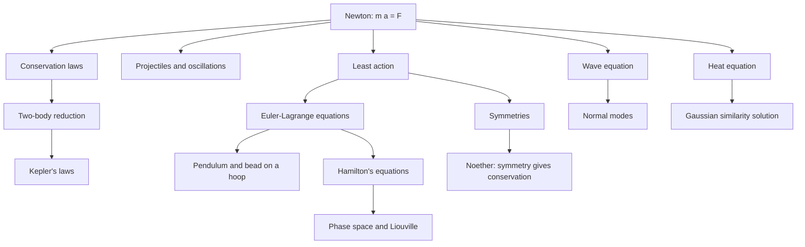

# Mathematical Physics

> [Applied Mathematics](../README.md) · Level: Advanced · Prerequisites: [Derivatives](../../07-calculus/03-derivatives/README.md), [Applications of Derivatives](../../07-calculus/05-applications-of-derivatives/README.md), [Integrals](../../07-calculus/06-integrals/README.md), [Multivariable Calculus](../../07-calculus/12-multivariable-calculus/README.md), [Vector Calculus](../../07-calculus/13-vector-calculus/README.md), [Matrices](../../08-linear-algebra/02-matrices/README.md), [Eigenvalues and Eigenvectors](../../08-linear-algebra/07-eigenvalues-and-eigenvectors/README.md), [First-Order ODEs](../../16-differential-equations/01-first-order-odes/README.md), [Second-Order Linear ODEs](../../16-differential-equations/02-second-order-linear-odes/README.md), [Systems of ODEs](../../16-differential-equations/03-systems-of-odes/README.md) · Estimated time: 720 min

## 1. Introduction

Physics is the science that tries to describe motion, matter and radiation with the smallest possible set of
quantitative laws. Mathematics is not an optional language for that project: it is the only known way to make the laws
precise enough to be tested, to deduce their consequences before an experiment is performed, and to recognise that two
apparently different phenomena are the same phenomenon.

This tutorial studies the mathematical skeleton of classical physics. It begins with Newton's second law, which is a
second-order ordinary differential equation for the position of a particle, and shows how the whole of elementary
mechanics is obtained by solving that equation, by finding quantities that do not change, and by exploiting the geometry
of the situation. It then reformulates mechanics in the two ways that turned out to generalise: the **Lagrangian**
formulation, where a single scalar function and a variational principle replace all the vector bookkeeping, and the
**Hamiltonian** formulation, where motion becomes a flow on an even-dimensional phase space. The same mathematics is
then applied to the two great linear partial differential equations of physics, the wave equation and the heat equation.
The tutorial closes with two ideas that dominate modern physics: **symmetry** as the source of conservation laws
(Noether's theorem) and **dimensional analysis**, which extracts the structure of a physical law before any equation is
solved.

The historical arc is worth keeping in mind because it explains the order of the sections. Newton (1687) formulated
mechanics as differential equations and solved the two-body problem geometrically. Euler and Lagrange (eighteenth
century) recast mechanics as a variational problem; Lagrange's
*Mécanique analytique* (1788) contains no figures at all, only algebra. Hamilton (1834–1835) produced the
phase-space formulation that later became the language of quantum mechanics and of control theory. Fourier (1822)
introduced the heat equation and, with it, the idea that complicated functions decompose into oscillations. Kepler's
three laws (1609–1619) had been empirical; Newton derived them from the inverse-square law, a spectacular demonstration
that a mathematical model can predict data it was not fitted to. Noether's theorem (1918) completed the circle by
explaining *why* energy, momentum and angular momentum are conserved: they are consequences of the symmetries of the
laws under time translation, space translation and rotation.

Two warnings run through the whole tutorial. First, a model is not a theorem about the world: Newtonian mechanics is a
fantastically accurate model in its domain and false outside it. Second, results always carry hypotheses — energy is
conserved for a closed system with conservative internal forces, not "always"; Kepler's laws assume an isolated two-body
system with an inverse-square force, not "planets". Every statement below states its assumptions, and the exercises test
whether you can tell when they fail.

## 2. Prerequisites

* **Differentiation** — derivatives, the chain rule, and what an ODE is:
  [Derivatives](../../07-calculus/03-derivatives/README.md),
  [Applications of Derivatives](../../07-calculus/05-applications-of-derivatives/README.md).
* **Integration** — definite integrals, integration by parts (needed for the variational derivation),
  and the fundamental theorem:
  [Integrals](../../07-calculus/06-integrals/README.md).
* **Multivariable calculus** — partial derivatives, gradient, chain rule along a curve:
  [Multivariable Calculus](../../07-calculus/12-multivariable-calculus/README.md).
* **Vector calculus** — divergence, line integrals, conservative fields:
  [Vector Calculus](../../07-calculus/13-vector-calculus/README.md).
* **Linear algebra** — matrices, eigenvalues, quadratic forms and positive definiteness (used for the
  stability of equilibria and for normal modes):
  [Matrices](../../08-linear-algebra/02-matrices/README.md),
  [Eigenvalues and Eigenvectors](../../08-linear-algebra/07-eigenvalues-and-eigenvectors/README.md).
* **Differential equations** — first-order equations (separation of variables), second-order linear
  equations with constant coefficients, and linear systems:
  [First-Order ODEs](../../16-differential-equations/01-first-order-odes/README.md),
  [Second-Order Linear ODEs](../../16-differential-equations/02-second-order-linear-odes/README.md),
  [Systems of ODEs](../../16-differential-equations/03-systems-of-odes/README.md).

No prior physics is assumed. No PDE course is assumed: the wave and heat equations are solved by separation of variables
and by an explicit similarity ansatz, with every step shown. The Fourier series appears only in the specific form needed
for a string with fixed ends.

## 3. Learning Objectives

After working through this tutorial you will be able to:

1. Translate a mechanical situation into a system of ODEs using Newton's second law, choosing
   coordinates that respect the constraints.
2. Solve projectile motion with and without linear drag, and interpret the terminal velocity.
3. Solve the damped and driven harmonic oscillator, classify the damping regime, and compute the
   resonance frequency and amplitude.
4. Derive conservation of energy, momentum and angular momentum from the equations of motion, stating
   the assumptions each requires.
5. Reduce the two-body problem to a one-body problem with the reduced mass, and explain what happens to
   the centre of mass.
6. Derive Kepler's three laws from the inverse-square law, including the orbit equation via Binet's
   equation and the $T^2 \propto a^3$ relation.
7. Derive the Euler–Lagrange equations from the principle of least action, including the boundary term.
8. Construct Lagrangians for constrained systems (pendulum, bead on a wire, bead on a rotating hoop)
   and read off equilibria and their stability.
9. Pass from the Lagrangian to the Hamiltonian by a Legendre transform and write Hamilton's equations.
10. Derive the wave equation for a stretched string and solve it by d'Alembert's formula and by normal
    modes.
11. Derive the heat equation from conservation and Fourier's law, and find its similarity solution.
12. State Noether's theorem, prove the version for a one-parameter family of symmetries, and identify
    the conserved quantity for time translation, space translation and rotation.
13. Use dimensional analysis and the Buckingham Pi theorem to deduce the form of physical laws, and
    distinguish a scaling law from a numerical constant.
14. Recognise when the assumptions behind a computation fail.

## 4. Intuition

**Motion is a curve, and the law is a differential equation.** A particle's history is a curve
$\mathbf{r}(t)$ in space. Newton's second law does not tell you the curve; it tells you the curvature at every instant, in the
form "acceleration equals force divided by mass". Starting from a position and a velocity you can therefore reconstruct
the whole future, provided the force depends only on position, velocity and time in a sufficiently regular way. This is
what "deterministic" means in classical mechanics: not that the future is predictable in practice, but that the initial
state determines it.

**Conserved quantities are shortcuts.** Solving the ODE is one way to understand a system. Finding a
quantity that never changes is often better: it reduces the dimension of the problem and it survives approximation.
Energy conservation turns a second-order equation into a first-order one. Angular momentum conservation forces the
motion into a plane and gives Kepler's second law for free. The deepest result in the subject, Noether's theorem, says
that every such quantity comes from a symmetry of the underlying law.

**The action is a cost, and nature minimises it.** Among all conceivable paths between two points at
two times, the actual path is the one for which a certain integral, the action, is stationary. This sounds mystical but
is a precise statement about a functional, and it is equivalent to Newton's law. Its power is practical: constraints are
handled by choosing coordinates, and the scalar Lagrangian replaces vectors and unknown constraint forces.

**Waves are many coupled oscillators.** A stretched string is a continuum of masses joined by springs.
Each point accelerates because its neighbours pull on it; the result is the wave equation. Because the equation is
linear, solutions add, and because the string is finite, the natural motions are standing waves with a discrete set of
frequencies. The same equation describes sound, light in one polarisation, and the small vibrations of any elastic
structure.

**Diffusion is smoothing.** Heat flows from hot to cold at a rate proportional to the temperature
gradient. The consequence is that temperature profiles become smoother and eventually constant. Unlike the wave
equation, the heat equation is not reversible in time: a hot spot spreads and never spontaneously reassembles.

**Dimensions are a filter.** Any correct equation must balance in its physical dimensions. That single
observation rules out most guesses, and when only one combination of the given quantities has the right dimensions, it
determines the answer up to a dimensionless constant. Scaling laws such as $T \propto \sqrt{l/g}$ or $R \propto (Et^2/\rho)^{1/5}$ are obtained this way, without
solving any differential equation.

## 5. Formal Definition

**Definition 5.1 (mechanical system and Lagrangian).** A *mechanical system with $n$ degrees of freedom*
consists of a smooth configuration space $Q$ of dimension $n$, coordinates $q = (q_1,\dots,q_n)$, and a smooth function
$$L : TQ \times \mathbb{R} \to \mathbb{R}, \qquad L = L(q, \dot{q}, t),$$
called the *Lagrangian*. Here $TQ$ is the tangent bundle: the set of pairs (position, velocity). The
*trajectory* of the system is a curve $q : [t_0,t_1] \to Q$.

**Definition 5.2 (action and stationary paths).** For a trajectory with fixed endpoints
$q(t_0) = q_0$, $q(t_1) = q_1$, the *action* is
$$S[q] = \int_{t_0}^{t_1} L(q(t),\dot q(t),t)\,dt.$$
A *variation* is a one-parameter family $q_\varepsilon = q + \varepsilon\,\delta q$ with $\delta q(t_0) = \delta q(t_1) = 0$. The path $q$ is *stationary* if
$$\left.\frac{d}{d\varepsilon}S[q_\varepsilon]\right|_{\varepsilon=0} = 0$$
for every such variation.

**Definition 5.3 (Hamiltonian).** If the map $\dot q \mapsto p = \partial L/\partial \dot q$ is invertible,
the *Hamiltonian* is the Legendre transform
$$H(q,p,t) = \sum_{i=1}^{n} p_i\,\dot q_i(q,p,t) - L\bigl(q,\dot q(q,p,t),t\bigr).$$
The variables $(q,p)$ are *canonical coordinates* and the space of pairs $(q,p)$ is *phase space*.

**Definition 5.4 (conserved quantity).** A function $F(q,\dot q,t)$ is a *first integral* or *conserved
quantity* of the equations of motion if $\dfrac{d}{dt}F(q(t),\dot q(t),t) = 0$ for every solution.

**Definition 5.5 (symmetry of the Lagrangian).** A smooth one-parameter family of transformations
$q \mapsto \Phi_\varepsilon(q)$ with $\Phi_0 = \mathrm{id}$ is a *symmetry* of $L$ if $L(\Phi_\varepsilon(q), \Phi_\varepsilon'(\dot q), t) = L(q,\dot q,t)$ for all $\varepsilon$ in a neighbourhood of $0$. The *infinitesimal
generator* is $\delta q = \left.\dfrac{d}{d\varepsilon}\Phi_\varepsilon(q)\right|_{\varepsilon=0}$.

**Definition 5.6 (conservative force and potential).** A force field $\mathbf{F} : \mathbb{R}^3 \to \mathbb{R}^3$
is *conservative* on a domain $\Omega$ if there is a scalar $V : \Omega \to \mathbb{R}$ with $\mathbf{F} = -\nabla V$. On a simply connected domain this is
equivalent to $\nabla \times \mathbf{F} = \mathbf{0}$.

**Definition 5.7 (central force).** A force on a particle at position $\mathbf{r}$ is *central* if
$\mathbf{F}(\mathbf{r}) = f(\lVert \mathbf{r}\rVert)\,\hat{\mathbf{r}}$ with $\hat{\mathbf{r}} = \mathbf{r}/\lVert\mathbf{r}\rVert$.

**Definition 5.8 (linear PDEs of physics).** Let $u = u(x,t)$ be a field. The *wave equation* with speed
$c>0$ is $u_{tt} = c^2 u_{xx}$; the *heat (diffusion) equation* with diffusivity $\alpha>0$ is $u_t = \alpha u_{xx}$. A *solution on a domain* is a twice
continuously differentiable function satisfying the equation in the interior and the prescribed initial and boundary
conditions.

**Definition 5.9 (dimensions and dimensional homogeneity).** The *dimensions* of a physical quantity are
its expression as a product $M^a L^b T^c$ of the base dimensions mass $M$, length $L$ and time $T$ (plus current,
temperature and amount where needed). An equation is *dimensionally homogeneous* if every term has the same dimensions.
A *dimensionless group* is a product of the relevant quantities whose dimensions are $M^0L^0T^0$.

## 6. Mathematical Notation

| Symbol | Read as | Meaning |
|---|---|---|
| $t$ | time | the independent variable |
| $q_i$, $\dot q_i$ | coordinate $i$, its velocity | generalised position and velocity |
| $m$, $M$ | mass, total mass | inertia; $M = \sum_i m_i$ |
| $\mathbf{r}$, $\mathbf{v}$, $\mathbf{a}$ | position, velocity, acceleration | $\mathbf{v} = \dot{\mathbf{r}}$, $\mathbf{a} = \ddot{\mathbf{r}}$ |
| $\mathbf{F}$, $\mathbf{p}$ | force, momentum | $\mathbf{p} = m\mathbf{v}$ |
| $T$, $V$, $U$ | kinetic energy, potential energy | $T = \tfrac12 m\lVert\dot{\mathbf{r}}\rVert^2$; $V$ and $U$ are both used for potential energy |
| $L$ | Lagrangian | $L = T - V$ for standard systems |
| $H$ | Hamiltonian | Legendre transform of $L$ |
| $S$ | action | $\int L\,dt$ |
| $\delta q$ | variation of $q$ | infinitesimal displacement at fixed time |
| $p_i$ | conjugate momentum | $\partial L/\partial\dot q_i$ |
| $\mu$ | reduced mass | $m_1m_2/(m_1+m_2)$ |
| $G$ | gravitational constant | $6.674\times10^{-11}\ \mathrm{m^3\,kg^{-1}\,s^{-2}}$ |
| $h$ | specific angular momentum | $h = r^2\dot\theta$ (angular momentum per unit reduced mass) |
| $a$, $e$ | semi-major axis, eccentricity | parameters of a conic |
| $\omega$, $\omega_0$ | angular frequency, natural frequency | radians per second |
| $f$ | frequency | $f = \omega/(2\pi)$ hertz |
| $\zeta$ | damping ratio | $\zeta = c/(2\sqrt{km})$ |
| $Q$ | quality factor | $Q = 1/(2\zeta)$ |
| $c$ | wave speed | $\sqrt{\tau/\rho}$ for a string |
| $\alpha$ | thermal diffusivity | $\alpha = k/(\rho c_p)$ |
| $\tau$, $\rho$ | tension, linear density | string parameters |
| $\Delta$, $\Pi$ | dimension, dimensionless group | see §7.14 |
| $\hat{\mathbf{r}}$, $\hat{\boldsymbol\theta}$ | radial and angular unit vectors | polar basis |
| $\mathcal{O}(\varepsilon^2)$ | of order epsilon squared | terms that vanish faster than $\varepsilon$ |

## 7. Core Concepts

### 7.1 Newtonian mechanics: vectors and differential equations

Newton's laws are usually stated in three parts.

1. *Inertial frames.* There exist frames of reference in which a particle with no force acting on it
   moves with constant velocity. Such a frame is called inertial.
2. *Second law.* In an inertial frame, the rate of change of momentum equals the net force:
   $\dfrac{d\mathbf{p}}{dt} = \mathbf{F}$, with $\mathbf{p} = m\mathbf{v}$. For constant mass this is
   $m\ddot{\mathbf{r}} = \mathbf{F}$.
3. *Third law.* If body $i$ exerts a force $\mathbf{F}_{ij}$ on body $j$, then
   $\mathbf{F}_{ji} = -\mathbf{F}_{ij}$ and the force acts along the line joining them (the *strong*
   form, needed for angular momentum conservation).

The second law is not an algebraic equation but a system of second-order ODEs. Writing $\mathbf{r} = (x,y,z)$ and $\mathbf{F} = (F_x,F_y,F_z)$,
$$m\ddot x = F_x(\mathbf{r},\dot{\mathbf{r}},t), \qquad m\ddot y = F_y(\mathbf{r},\dot{\mathbf{r}},t), \qquad m\ddot z = F_z(\mathbf{r},\dot{\mathbf{r}},t).$$
Given $\mathbf{r}(t_0)$ and $\dot{\mathbf{r}}(t_0)$, the Picard–Lindelöf theorem guarantees a unique solution at least for a short time, provided
$\mathbf{F}$ is locally Lipschitz in $(\mathbf{r},\dot{\mathbf{r}})$. This is the precise content of determinism in classical mechanics. The theorem is
local: solutions can blow up in finite time, and a force that is not Lipschitz (for example a dry-friction force with a
jump at zero velocity) can destroy uniqueness.

Three remarks that matter for everything that follows.

* *Vectors are not decoration.* The law must hold in every inertial frame. If you write it in
  components in a rotating frame you must add fictitious forces (centrifugal, Coriolis). The coordinate-free
  form $m\ddot{\mathbf{r}} = \mathbf{F}$ is the statement that survives a change of frame.
* *Constraints reduce the number of equations.* A bead on a wire has one degree of freedom even though it
  lives in three-dimensional space. The constraint force is unknown, but it does no work along the wire.
  Lagrangian mechanics (below) exploits exactly this.
* *The equation is second order, so the state is (position, velocity).* Phase space has dimension $2n$.
  This is why initial conditions require both a position and a velocity, and it is the reason the
  Hamiltonian formulation is natural.

**Example: a particle in a uniform gravitational field.** Take $z$ upward and $\mathbf{F} = (0,0,-mg)$.
Then $\ddot z = -g$, $\ddot x = \ddot y = 0$. The solution is a parabola in the $(x,z)$ plane, $x = x_0 + v_{x0}t$, $z = z_0 + v_{z0}t - \tfrac12 gt^2$, which is the content of §7.2.

### 7.2 Projectiles

A projectile is a particle under gravity alone. With $z$ upward and the launch point at the origin,
$$\ddot x = 0, \qquad \ddot z = -g.$$
Integrating once, $\dot x = v_0\cos\theta$, $\dot z = v_0\sin\theta - gt$; integrating again,
$$x(t) = (v_0\cos\theta)\,t, \qquad z(t) = (v_0\sin\theta)\,t - \tfrac12 g t^2,$$
where $\theta$ is the launch angle above the horizontal and $v_0 = \lVert\mathbf{v}(0)\rVert$. Eliminating $t = x/(v_0\cos\theta)$ gives the trajectory
$$z(x) = x\tan\theta - \frac{gx^2}{2v_0^2\cos^2\theta},$$
a downward-opening parabola. The time of flight to $z=0$ is $t_f = 2v_0\sin\theta/g$; the range is
$$R = \frac{v_0^2\sin 2\theta}{g},$$
maximal at $\theta = 45^\circ$; the maximum height is $H = (v_0\sin\theta)^2/(2g)$.

**With linear drag.** If the drag is $-b\mathbf{v}$, the equations decouple:

$$m\ddot x = -b\dot x, \qquad m\ddot z = -mg - b\dot z.$$
With $x(0)=z(0)=0$ and initial velocity $(v_{0x},v_{0z})$,
$$x(t) = \frac{m v_{0x}}{b}\bigl(1-e^{-bt/m}\bigr), \qquad z(t) = \frac{m}{b}\Bigl(v_{0z}+\frac{mg}{b}\Bigr)\bigl(1-e^{-bt/m}\bigr) - \frac{mg}{b}\,t.$$
The horizontal motion saturates: the particle travels at most $m v_{0x}/b$ horizontally, because drag removes horizontal
momentum exponentially. The vertical velocity tends to the *terminal velocity* $-mg/b$. This is the first example of a
general lesson: a model that ignores a small force can predict a qualitatively different long-time behaviour.

### 7.3 Oscillations

A mass on a spring with Hooke's law $F = -kx$ obeys
$$m\ddot x + kx = 0, \qquad \text{that is} \qquad \ddot x + \omega_0^2 x = 0, \quad \omega_0 = \sqrt{k/m}.$$
The general solution is $x(t) = A\cos(\omega_0 t) + B\sin(\omega_0 t) = C\cos(\omega_0 t - \phi)$, with $C = \sqrt{A^2+B^2}$ and $\tan\phi = B/A$. The period is $T = 2\pi/\omega_0 = 2\pi\sqrt{m/k}$, the frequency is $f = 1/T$ and the angular
frequency is $\omega_0 = 2\pi f$. The energy
$$E = \tfrac12 m\dot x^2 + \tfrac12 kx^2$$
is constant, because $\dot E = \dot x(m\ddot x + kx) = 0$.

**Damping.** With a viscous force $-c\dot x$,

$$\ddot x + 2\zeta\omega_0\dot x + \omega_0^2 x = 0, \qquad \zeta = \frac{c}{2\sqrt{km}}.$$
The characteristic equation is $\lambda^2 + 2\zeta\omega_0\lambda + \omega_0^2 = 0$ with roots $\lambda = \omega_0\bigl(-\zeta \pm \sqrt{\zeta^2-1}\bigr)$. There are three regimes:

| Regime | Condition | Roots | Behaviour |
|---|---|---|---|
| underdamped | $0 \le \zeta < 1$ | $-\zeta\omega_0 \pm i\omega_d$, $\omega_d = \omega_0\sqrt{1-\zeta^2}$ | decaying oscillation |
| critically damped | $\zeta = 1$ | $-\omega_0$ (double) | fastest return without oscillation |
| overdamped | $\zeta > 1$ | two distinct negative reals | slow return, no oscillation |

In the underdamped case $x = Ce^{-\zeta\omega_0 t}\cos(\omega_d t - \phi)$: the envelope decays with time constant $1/(\zeta\omega_0)$ and the oscillation frequency is shifted
from $\omega_0$ to $\omega_d$. The quality factor $Q = 1/(2\zeta)$ measures how many oscillations occur before the energy decays
substantially; the energy decays like $e^{-2\zeta\omega_0 t}$.

**Forcing and resonance.** Add a harmonic force $F_0\cos\omega t$:

$$\ddot x + 2\zeta\omega_0\dot x + \omega_0^2 x = \frac{F_0}{m}\cos\omega t.$$
The steady-state solution is $x_p = X\cos(\omega t - \varphi)$ with
$$X = \frac{F_0/m}{\sqrt{(\omega_0^2-\omega^2)^2 + (2\zeta\omega_0\omega)^2}}, \qquad \tan\varphi = \frac{2\zeta\omega_0\omega}{\omega_0^2-\omega^2}.$$
The amplitude is maximal at $\omega = \omega_0\sqrt{1-2\zeta^2}$ (for $\zeta < 1/\sqrt2$), where $X_{\max} = (F_0/m)\big/\bigl(2\zeta\omega_0^2\sqrt{1-\zeta^2}\bigr)$. For small damping the peak is near $\omega_0$ and its height
is approximately $Q\,F_0/(m\omega_0^2)$. Resonance is not a curiosity: it is why bridges have to be designed against marching soldiers
and why a radio receiver can select one station.

### 7.4 Central forces

A central force is $\mathbf{F} = f(r)\hat{\mathbf{r}}$. Its torque about the origin vanishes:
$$\boldsymbol{\tau} = \mathbf{r}\times\mathbf{F} = \mathbf{r}\times f(r)\hat{\mathbf{r}} = \mathbf{0},$$
because $\mathbf{r}$ and $\hat{\mathbf{r}}$ are parallel. Since $\dot{\mathbf{L}} = \boldsymbol{\tau}$ with $\mathbf{L} = \mathbf{r}\times m\dot{\mathbf{r}}$, angular momentum is conserved. A conserved vector
orthogonal to the motion forces the motion into the plane perpendicular to $\mathbf{L}$: every central force problem is
two-dimensional.

Use polar coordinates in that plane, $\mathbf{r} = r\hat{\mathbf{r}}$. Then
$$\dot{\mathbf{r}} = \dot r\,\hat{\mathbf{r}} + r\dot\theta\,\hat{\boldsymbol\theta}, \qquad \ddot{\mathbf{r}} = \bigl(\ddot r - r\dot\theta^2\bigr)\hat{\mathbf{r}} + \bigl(r\ddot\theta + 2\dot r\dot\theta\bigr)\hat{\boldsymbol\theta}.$$
The angular equation is $\dfrac{1}{r}\dfrac{d}{dt}\bigl(r^2\dot\theta\bigr) = 0$, so
$$h := r^2\dot\theta = \text{constant}.$$
The constant $h$ is the *specific angular momentum*; the areal velocity is $\tfrac12 r^2\dot\theta = \tfrac12 h$, which is Kepler's second law
already. The radial equation is
$$m\bigl(\ddot r - r\dot\theta^2\bigr) = f(r), \qquad\text{equivalently}\qquad m\ddot r = f(r) + \frac{mh^2}{r^3}.$$
The last term is the *centrifugal term*. It is convenient to write the radial motion as a one-dimensional problem with
the *effective potential*
$$U_{\text{eff}}(r) = U(r) + \frac{mh^2}{2r^2}, \qquad f(r) = -U'(r),$$
because then $m\ddot r = -U_{\text{eff}}'(r)$: the radial coordinate moves in one dimension under $U_{\text{eff}}$. A circular orbit at $r_0$ is a critical
point, $U_{\text{eff}}'(r_0)=0$, and it is stable exactly when $U_{\text{eff}}''(r_0)>0$. Indeed, setting $r = r_0+\delta r$ and linearising,
$$m\,\delta\ddot r = -U_{\text{eff}}''(r_0)\,\delta r,$$
so $\delta r$ oscillates about $0$ if and only if $U_{\text{eff}}''(r_0)>0$. For the inverse-square attraction $U = -k/r$ this becomes
$U_{\text{eff}}''(r_0) = k/r_0^3 > 0$: all circular orbits are stable.

### 7.5 Conservation laws from the equations of motion

The conservation laws of mechanics are not independent axioms; they follow from Newton's equations plus assumptions on
the forces.

**Energy.** Let a particle move under a conservative force $\mathbf{F} = -\nabla V$. Then

$$\frac{d}{dt}\Bigl(\tfrac12 m\lVert\dot{\mathbf{r}}\rVert^2 + V(\mathbf{r})\Bigr) = m\dot{\mathbf{r}}\cdot\ddot{\mathbf{r}} + \nabla V\cdot\dot{\mathbf{r}} = \dot{\mathbf{r}}\cdot\bigl(m\ddot{\mathbf{r}} + \nabla V\bigr) = 0.$$
The key step is the chain rule $\frac{d}{dt}V(\mathbf{r}(t)) = \nabla V\cdot\dot{\mathbf{r}}$. If $V$ depends explicitly on time (a moving constraint, a time-varying
field), then $\frac{dE}{dt} = \frac{\partial V}{\partial t}$ and energy is not conserved.

**Momentum.** For $N$ particles with momenta $\mathbf{p}_i$,

$$\frac{d}{dt}\sum_i \mathbf{p}_i = \sum_i \mathbf{F}_i^{\text{ext}} + \sum_{i<j}\bigl(\mathbf{F}_{ij}+\mathbf{F}_{ji}\bigr) = \sum_i \mathbf{F}_i^{\text{ext}},$$
using the weak third law $\mathbf{F}_{ij} = -\mathbf{F}_{ji}$. Total momentum is conserved exactly when the net external force vanishes.

**Angular momentum.** With $\mathbf{L} = \sum_i \mathbf{r}_i\times\mathbf{p}_i$,

$$\frac{d\mathbf{L}}{dt} = \sum_i \mathbf{r}_i\times\mathbf{F}_i^{\text{ext}} + \sum_{i<j}(\mathbf{r}_i-\mathbf{r}_j)\times\mathbf{F}_{ij}.$$
The second sum vanishes if the internal forces are central, because $\mathbf{F}_{ij}$ is parallel to $\mathbf{r}_i-\mathbf{r}_j$. So angular momentum
is conserved when the net external torque vanishes and internal forces are central. The strong third law is doing real
work here: a pair of equal and opposite but non-central forces conserves momentum and not angular momentum.

A useful mnemonic is that each conservation law has a hypothesis: *closed system* for momentum,
*conservative forces* for energy, *central internal forces and no external torque* for angular momentum.
Dropping the hypothesis is the most common error in the subject.

### 7.6 The two-body problem

Two bodies of masses $m_1,m_2$ interact through a force that depends only on their separation. The equations are
$$m_1\ddot{\mathbf{r}}_1 = \mathbf{F}(\mathbf{r}_1-\mathbf{r}_2), \qquad m_2\ddot{\mathbf{r}}_2 = -\mathbf{F}(\mathbf{r}_1-\mathbf{r}_2).$$
Introduce the centre of mass and the relative coordinate:
$$\mathbf{R} = \frac{m_1\mathbf{r}_1+m_2\mathbf{r}_2}{m_1+m_2}, \qquad \mathbf{r} = \mathbf{r}_1-\mathbf{r}_2.$$
Adding the equations gives $(m_1+m_2)\ddot{\mathbf{R}} = \mathbf{0}$: the centre of mass moves uniformly. Dividing by the masses and subtracting,
$$\ddot{\mathbf{r}} = \ddot{\mathbf{r}}_1-\ddot{\mathbf{r}}_2 = \frac{\mathbf{F}}{m_1} + \frac{\mathbf{F}}{m_2} = \Bigl(\frac{1}{m_1}+\frac{1}{m_2}\Bigr)\mathbf{F}.$$
Defining the **reduced mass**
$$\mu = \frac{m_1m_2}{m_1+m_2}, \qquad \frac{1}{\mu} = \frac{1}{m_1}+\frac{1}{m_2},$$
the relative coordinate obeys the one-body equation
$$\mu\ddot{\mathbf{r}} = \mathbf{F}(\mathbf{r}).$$
The kinetic energy splits in the same way:
$$T = \tfrac12 m_1\lVert\dot{\mathbf{r}}_1\rVert^2 + \tfrac12 m_2\lVert\dot{\mathbf{r}}_2\rVert^2 = \tfrac12 (m_1+m_2)\lVert\dot{\mathbf{R}}\rVert^2 + \tfrac12\mu\lVert\dot{\mathbf{r}}\rVert^2.$$
So the total energy is the centre-of-mass kinetic energy plus an effective one-body energy. For gravity, $\mathbf{F} = -Gm_1m_2\,\hat{\mathbf{r}}/r^2$ and the
relative equation becomes
$$\ddot{\mathbf{r}} = -\frac{G(m_1+m_2)}{r^2}\,\hat{\mathbf{r}}.$$
The relative motion is therefore a Kepler problem with gravitational parameter $GM = G(m_1+m_2)$, and the mass of the smaller body
drops out of the *shape* of the orbit but not out of the *time scale*. This is why the Earth's orbit determines the
Sun's mass only through $G(m_1+m_2)$, and why one cannot determine the mass of a satellite from its orbit alone.

### 7.7 Kepler's laws derived

Kepler's three laws state: (1) planets move on ellipses with the Sun at one focus; (2) the radius vector sweeps equal
areas in equal times; (3) the square of the period is proportional to the cube of the semi-major axis. All three follow
from the inverse-square law.

**The orbit equation.** With $h = r^2\dot\theta$ and the relative equation
$\ddot{\mathbf{r}} = -\dfrac{GM}{r^2}\hat{\mathbf{r}}$, the radial component reads
$$\ddot r - r\dot\theta^2 = -\frac{GM}{r^2}.$$
Put $u = 1/r$ and use $\dfrac{d}{dt} = \dot\theta\dfrac{d}{d\theta} = \dfrac{h}{r^2}\dfrac{d}{d\theta} = hu^2\dfrac{d}{d\theta}$. Then $\dot r = -h u'$ (where $u' = du/d\theta$) and $\ddot r = -h^2u^2u''$. Also $r\dot\theta^2 = h^2u^3$. Substituting,
$$-h^2u^2u'' - h^2u^3 = -GMu^2,$$
and dividing by $-h^2u^2$ gives **Binet's equation**
$$u'' + u = \frac{GM}{h^2}.$$
Its general solution is
$$u(\theta) = \frac{GM}{h^2}\bigl(1+e\cos(\theta-\theta_0)\bigr),$$
so
$$r(\theta) = \frac{p}{1+e\cos(\theta-\theta_0)}, \qquad p = \frac{h^2}{GM}.$$
For $0<e<1$ this is an ellipse with one focus at the origin; $e=0$ is a circle, $e=1$ a parabola and $e>1$ a
hyperbola. **This is Kepler's first law**, together with the classification of open orbits. The perihelion and aphelion
distances are $r_p = p/(1+e)$ and $r_a = p/(1-e)$, so the semi-major axis is $a = (r_p+r_a)/2 = p/(1-e^2)$.

**The area law.** The area swept out is $A = \int \tfrac12 r^2\,d\theta$, so
$\dfrac{dA}{dt} = \tfrac12 r^2\dot\theta = \tfrac12h$, a constant. **This is Kepler's second law**, and it is nothing but conservation of angular momentum.

**The period.** The area of the ellipse is $\pi ab$ with $b = a\sqrt{1-e^2}$. Since the areal velocity is
$h/2$, the period is
$$T = \frac{2\pi ab}{h} = \frac{2\pi a^2\sqrt{1-e^2}}{h}.$$
From $p = a(1-e^2) = h^2/(GM)$ we get $h = \sqrt{GMa(1-e^2)}$, hence
$$T = \frac{2\pi a^2\sqrt{1-e^2}}{\sqrt{GMa(1-e^2)}} = 2\pi\sqrt{\frac{a^3}{GM}}, \qquad\text{that is}\qquad T^2 = \frac{4\pi^2}{GM}\,a^3.$$

**This is Kepler's third law.** For the solar system $M = M_\odot + m \approx M_\odot$, so $T^2/a^3$ is the
same for every planet; the small correction due to the planet's mass is measurable for Jupiter.

The energy of the relative motion is $E = -\dfrac{GM\mu}{2a}$. It is negative for ellipses, zero for parabolas and positive for
hyperbolas, which is the cleanest way to classify orbits. A useful companion formula is the *vis-viva equation*
$$v^2 = GM\Bigl(\frac{2}{r}-\frac{1}{a}\Bigr),$$
obtained by equating $\tfrac12\mu v^2 - GM\mu/r$ to $-GM\mu/(2a)$.

### 7.8 The principle of least action and the Euler–Lagrange equations

The Lagrangian formulation starts from a scalar $L(q,\dot q,t)$ and the action $S[q] = \int_{t_0}^{t_1}L\,dt$. The physical path is a stationary point
of $S$. To see what that means, compute the first variation. Let $q_\varepsilon = q + \varepsilon\,\delta q$ with $\delta q(t_0) = \delta q(t_1) = 0$. Then
$$\frac{d}{d\varepsilon}S[q_\varepsilon]\Big|_{\varepsilon=0} = \int_{t_0}^{t_1}\sum_i\Bigl(\frac{\partial L}{\partial q_i}\,\delta q_i + \frac{\partial L}{\partial\dot q_i}\,\delta\dot q_i\Bigr)dt.$$
The second term is integrated by parts:
$$\int_{t_0}^{t_1}\frac{\partial L}{\partial\dot q_i}\,\delta\dot q_i\,dt = \Bigl[\frac{\partial L}{\partial\dot q_i}\,\delta q_i\Bigr]_{t_0}^{t_1} - \int_{t_0}^{t_1}\frac{d}{dt}\Bigl(\frac{\partial L}{\partial\dot q_i}\Bigr)\delta q_i\,dt.$$
The boundary term vanishes because $\delta q_i(t_0) = \delta q_i(t_1) = 0$. Hence
$$\frac{d}{d\varepsilon}S[q_\varepsilon]\Big|_{\varepsilon=0} = \int_{t_0}^{t_1}\sum_i\Bigl(\frac{\partial L}{\partial q_i} - \frac{d}{dt}\frac{\partial L}{\partial\dot q_i}\Bigr)\delta q_i\,dt.$$
If this vanishes for every variation $\delta q$, then each bracket vanishes (the fundamental lemma of the calculus of
variations), giving the **Euler–Lagrange equations**
$$\frac{d}{dt}\frac{\partial L}{\partial\dot q_i} - \frac{\partial L}{\partial q_i} = 0, \qquad i = 1,\dots,n.$$

**Equivalence with Newton.** For a particle in a potential,
$L = \tfrac12 m\lVert\dot{\mathbf{r}}\rVert^2 - V(\mathbf{r})$. Then $\partial L/\partial\dot{\mathbf{r}} = m\dot{\mathbf{r}}$ and $\partial L/\partial\mathbf{r} = -\nabla V$, so the Euler–Lagrange equation is exactly $m\ddot{\mathbf{r}} = -\nabla V$. The variational principle is
therefore not a new law of physics; it is a reformulation of Newton's law for conservative forces. Its advantages are
that it is scalar (one function instead of three components), that it handles constraints by a change of coordinates,
and that it makes symmetries visible.

**Adding a total derivative.** If $L' = L + \dfrac{dF(q,t)}{dt}$, then
$S' = S + F(q(t_1),t_1) - F(q(t_0),t_0)$, and the added term is a constant on the class of paths with fixed endpoints. Hence $L$ and $L'$ have the
same Euler–Lagrange equations. This freedom is used constantly: it lets one simplify a Lagrangian without changing the
physics.

### 7.9 The pendulum and the bead on a wire

**The pendulum.** A mass $m$ on a massless rod of length $l$, constrained to a vertical plane. It has one
degree of freedom, the angle $\theta$ from the downward vertical. The speed is $l\dot\theta$, so
$$T = \tfrac12 ml^2\dot\theta^2, \qquad V = -mgl\cos\theta, \qquad L = \tfrac12 ml^2\dot\theta^2 + mgl\cos\theta.$$
The Euler–Lagrange equation is $ml^2\ddot\theta = -mgl\sin\theta$, that is
$$\ddot\theta + \frac{g}{l}\sin\theta = 0.$$
For small $\theta$, $\sin\theta\approx\theta$ and $\ddot\theta + (g/l)\theta = 0$: simple harmonic motion with $\omega_0 = \sqrt{g/l}$ and $T = 2\pi\sqrt{l/g}$, independent of the mass and
(for small amplitude) of the amplitude. The energy $E = \tfrac12 ml^2\dot\theta^2 - mgl\cos\theta$ is conserved. The constraint force (the tension in the rod)
never appears: this is the payoff of using a coordinate adapted to the constraint.

**The bead on a rotating straight wire.** A bead slides without friction on a horizontal straight wire
that rotates with constant angular velocity $\Omega$ about a vertical axis through one end. With $r$ the distance
from the axis, the bead's speed has a radial part $\dot r$ and a tangential part $\Omega r$, so
$$L = \tfrac12 m\bigl(\dot r^2 + \Omega^2 r^2\bigr).$$
The Euler–Lagrange equation is $\ddot r = \Omega^2 r$. The general solution is
$$r(t) = r_0\cosh(\Omega t) + \frac{v_0}{\Omega}\sinh(\Omega t).$$
The origin $r=0$ is an equilibrium, but it is *unstable*: any small displacement grows exponentially. The centrifugal
term in $L$ acts like a repulsive spring with a negative stiffness. This is the simplest example of an instability
produced by a constraint that is itself moving.

**The bead on a rotating hoop.** Let a hoop of radius $a$ rotate about its vertical diameter with angular
velocity $\Omega$, and let $\theta$ be the angle of the bead from the bottom of the hoop. The distance from the axis is
$a\sin\theta$, so
$$T = \tfrac12 ma^2\bigl(\dot\theta^2 + \Omega^2\sin^2\theta\bigr), \qquad V = -mga\cos\theta,$$

$$L = \tfrac12 ma^2\dot\theta^2 + \tfrac12 ma^2\Omega^2\sin^2\theta + mga\cos\theta.$$
The equation of motion is
$$ma^2\ddot\theta = ma^2\Omega^2\sin\theta\cos\theta - mga\sin\theta, \qquad \ddot\theta = \sin\theta\Bigl(\Omega^2\cos\theta - \frac{g}{a}\Bigr).$$
The equilibria are $\sin\theta = 0$ (that is $\theta = 0$ or $\pi$) and, when $\Omega^2 > g/a$, $\cos\theta = g/(a\Omega^2)$. The bottom position is stable for
$\Omega^2 < g/a$; at $\Omega = \Omega_c = \sqrt{g/a}$ it loses stability and the two symmetric equilibria at $\pm\theta^*$ appear. This is a **pitchfork
bifurcation**, analysed numerically in §9.6.

### 7.10 Hamilton's equations and phase space

The Lagrangian describes motion as a curve in configuration space. The Hamiltonian describes it as a flow in phase
space, the space of positions and momenta. Define the conjugate momentum and the Hamiltonian:
$$p_i = \frac{\partial L}{\partial\dot q_i}, \qquad H(q,p,t) = \sum_i p_i\dot q_i - L.$$
The Legendre transform is invertible when the Hessian $\partial^2L/\partial\dot q_i\partial\dot q_j$ is positive definite, which holds for $L = T-V$ when $T$
is a positive definite quadratic form in the velocities.

To derive the equations of motion, compute the differential of $H$ in two ways. From the definition,
$$dH = \sum_i\bigl(\dot q_i\,dp_i + p_i\,d\dot q_i\bigr) - \sum_i\Bigl(\frac{\partial L}{\partial q_i}dq_i + \frac{\partial L}{\partial\dot q_i}d\dot q_i\Bigr) - \frac{\partial L}{\partial t}dt.$$
The $d\dot q_i$ terms cancel by the definition of $p_i$. Using the Euler–Lagrange equation $\partial L/\partial q_i = \dot p_i$,
$$dH = \sum_i\bigl(\dot q_i\,dp_i - \dot p_i\,dq_i\bigr) - \frac{\partial L}{\partial t}dt.$$
Comparing with $dH = \sum_i\bigl(\frac{\partial H}{\partial q_i}dq_i+\frac{\partial H}{\partial p_i}dp_i\bigr)+\frac{\partial H}{\partial t}dt$ gives
**Hamilton's equations**

$$\dot q_i = \frac{\partial H}{\partial p_i}, \qquad \dot p_i = -\frac{\partial H}{\partial q_i}, \qquad \frac{\partial H}{\partial t} = -\frac{\partial L}{\partial t}.$$
For a particle in a potential, $H = \lVert\mathbf{p}\rVert^2/(2m) + V(\mathbf{r})$, so $\dot{\mathbf{r}} = \mathbf{p}/m$ and $\dot{\mathbf{p}} = -\nabla V$: the same physics, split into two first-order equations.

**The harmonic oscillator.** With $H = \dfrac{p^2}{2m} + \dfrac12 m\omega_0^2 q^2$, Hamilton's equations are
$\dot q = p/m$ and $\dot p = -m\omega_0^2q$. Solutions are ellipses
$$\frac{q^2}{2E/(m\omega_0^2)} + \frac{p^2}{2mE} = 1$$
in the $(q,p)$ plane, one ellipse for each energy $E$. The phase-space portrait is a family of nested closed curves;
the period is the same on every ellipse (isochronism).

**Liouville's theorem.** Hamiltonian flow preserves phase-space volume. The velocity field is
$(\dot q,\dot p) = (\partial H/\partial p, -\partial H/\partial q)$, whose divergence is $\partial^2H/\partial q\partial p - \partial^2H/\partial p\partial q = 0$; a divergence-free flow has constant volume. This is the classical ancestor of the
uncertainty principle and the reason statistical mechanics can define a phase-space density.

### 7.11 Waves and the wave equation

**Derivation for a stretched string.** Consider a string of linear density $\rho$ under tension $\tau$,
with small transverse displacement $y(x,t)$. Look at the segment between $x$ and $x+dx$. Its mass is $\rho\,dx$ and its
vertical acceleration is $y_{tt}$. The vertical component of the tension at a point is $\tau\sin\alpha \approx \tau y_x$ for small slopes. The net
vertical force on the segment is therefore
$$\tau\bigl(y_x(x+dx,t) - y_x(x,t)\bigr) \approx \tau\,y_{xx}(x,t)\,dx.$$
Newton's second law for the segment, $\rho\,dx\,y_{tt} = \tau\,y_{xx}\,dx$, gives
$$y_{tt} = c^2 y_{xx}, \qquad c = \sqrt{\frac{\tau}{\rho}}.$$
The same equation, with different meanings for the field $y$ and the speed $c$, describes longitudinal
vibrations of a rod, sound in a pipe, and the electric field in a transmission line.

**d'Alembert's solution.** Because the equation factors as
$\bigl(\partial_t - c\partial_x\bigr)\bigl(\partial_t + c\partial_x\bigr)y = 0$, every solution on the whole line has the form
$$y(x,t) = f(x-ct) + g(x+ct),$$
a right-moving wave $f$ and a left-moving wave $g$. This is verified by direct differentiation: $y_{tt} = c^2f'' + c^2g'' = c^2y_{xx}$. Given
initial displacement $y(x,0) = y_0(x)$ and initial velocity $y_t(x,0) = v_0(x)$, the solution is
$$y(x,t) = \tfrac12\bigl[y_0(x-ct)+y_0(x+ct)\bigr] + \frac{1}{2c}\int_{x-ct}^{x+ct}v_0(s)\,ds.$$

**Normal modes on a finite string.** For a string of length $L$ fixed at both ends, separate variables,
$y = X(x)T(t)$. Then $X''/X = T''/(c^2T) = -k^2$, so $X = A\sin kx + B\cos kx$ and $T$ oscillates at $\omega = ck$. The boundary conditions $X(0)=X(L)=0$ force $B=0$ and
$k_n = n\pi/L$, hence
$$y_n(x,t) = \sin\Bigl(\frac{n\pi x}{L}\Bigr)\bigl(a_n\cos\omega_n t + b_n\sin\omega_n t\bigr), \qquad \omega_n = \frac{n\pi c}{L}, \quad n = 1,2,\dots$$
The general solution is a superposition of these modes with coefficients determined by the initial data (a Fourier sine
series). The fundamental frequency is $f_1 = c/(2L)$; the harmonics are integer multiples of it. A guitar string tuned to
$f_1$ has $c = 2Lf_1$, so tightening the string (larger $\tau$) raises the pitch and using a heavier string (larger
$\rho$) lowers it.

### 7.12 Heat and diffusion

**Derivation.** Let $u(x,t)$ be the temperature of a rod of unit cross-section, density $\rho$ and specific
heat $c_p$. Conservation of energy for a segment says that the rate of change of heat content equals the net heat flux
in plus any source:
$$\rho c_p\,\frac{\partial u}{\partial t} = -\frac{\partial q}{\partial x} + s,$$
where $q$ is the heat flux (energy per unit area per unit time, positive to the right) and $s$ a source density.
Fourier's law says the flux is proportional to the negative gradient,
$$q = -k\,\frac{\partial u}{\partial x},$$
with thermal conductivity $k>0$: heat flows from hot to cold. Substituting,
$$u_t = \alpha u_{xx} + \frac{s}{\rho c_p}, \qquad \alpha = \frac{k}{\rho c_p} > 0.$$
The constant $\alpha$ has dimensions $L^2T^{-1}$ (m²/s).

**Basic properties.** The equation is linear, so solutions superpose. It is first order in time and second
order in space, so it needs one initial condition $u(x,0)$ and two boundary conditions. It is *parabolic*: disturbances
propagate infinitely fast (the fundamental solution is nonzero everywhere for every $t>0$), but their amplitude
decays. It is irreversible: if $u$ solves the equation, then $u(-t)$ solves the backward heat equation $u_t = -\alpha u_{xx}$,
which is violently ill-posed. The *maximum principle* says that a solution on a bounded interval attains its maximum and
minimum either initially or on the boundary: heat never spontaneously creates a new hot spot in the interior.

**The fundamental solution.** On the whole line with $u(x,0) = \delta(x)$,

$$u(x,t) = \frac{1}{\sqrt{4\pi\alpha t}}\exp\Bigl(-\frac{x^2}{4\alpha t}\Bigr),$$
a Gaussian of variance $2\alpha t$. Its integral in $x$ is $1$ for every $t>0$, which is conservation of total
heat; its peak height decays like $t^{-1/2}$ and its width grows like $\sqrt{t}$. This is the mathematical content of "a hot
spot spreads and cools".

**Separation of variables.** On $0<x<L$ with $u(0,t)=u(L,t)=0$, separation gives
$u = X(x)T(t)$, $X''/X = T'/(\alpha T) = -k^2$, so $X = \sin(n\pi x/L)$ and $T = e^{-\alpha(n\pi/L)^2t}$. Every mode decays, the slowest at rate $\alpha\pi^2/L^2$; the long-time behaviour is
dominated by the first mode.

### 7.13 Symmetries and conservation laws

**Noether's theorem (one-parameter version).** Suppose the Lagrangian $L(q,\dot q,t)$ is invariant under a
one-parameter family of transformations with infinitesimal generator $\delta q$, that is $L(q+\varepsilon\delta q,\dot q+\varepsilon\delta\dot q,t) = L(q,\dot q,t) + \mathcal{O}(\varepsilon^2)$. Then, along every
solution of the Euler–Lagrange equations,
$$J = \sum_i \frac{\partial L}{\partial\dot q_i}\,\delta q_i$$
is constant in time.

*Proof.* Compute the variation of the action under the transformation, using the Euler–Lagrange equations.
Invariance gives
$$0 = \frac{d}{d\varepsilon}S\Big|_{\varepsilon=0} = \int_{t_0}^{t_1}\sum_i\Bigl(\frac{\partial L}{\partial q_i}\delta q_i + \frac{\partial L}{\partial\dot q_i}\delta\dot q_i\Bigr)dt.$$
Integrating the second term by parts,
$$0 = \int_{t_0}^{t_1}\sum_i\Bigl(\frac{\partial L}{\partial q_i} - \frac{d}{dt}\frac{\partial L}{\partial\dot q_i}\Bigr)\delta q_i\,dt + \Bigl[\sum_i\frac{\partial L}{\partial\dot q_i}\delta q_i\Bigr]_{t_0}^{t_1}.$$
On a solution the bracket vanishes by the Euler–Lagrange equations, so the boundary term is zero for all $t_0,t_1$; hence
$J$ is constant. $\blacksquare$

Note the logical structure: the Euler–Lagrange equations are used to kill the bulk term, and invariance of the action
kills the total variation. Noether's theorem therefore converts a symmetry of $L$ into a first integral of the
equations of motion.

**The three classical cases.**

* *Space translation.* If $L$ does not depend on a coordinate $q_k$ (a *cyclic* coordinate), then
  translation $q_k \mapsto q_k+\varepsilon$ is a symmetry, and $J = p_k$ is conserved. A Lagrangian
  independent of position means no force in that direction: momentum conservation.
* *Rotation.* If $L$ depends on the position only through $r = \lVert\mathbf{r}\rVert$, then an
  infinitesimal rotation $\delta\mathbf{r} = \boldsymbol{\epsilon}\times\mathbf{r}$ is a symmetry and
  $J = \mathbf{p}\cdot(\boldsymbol{\epsilon}\times\mathbf{r}) = \boldsymbol{\epsilon}\cdot(\mathbf{r}\times\mathbf{p})$,
  so angular momentum $\mathbf{L} = \mathbf{r}\times\mathbf{p}$ is conserved.
* *Time translation.* If $\partial L/\partial t = 0$, shifting the whole trajectory in time,
  $t\mapsto t+\varepsilon$ with $q(t)\mapsto q(t-\varepsilon)$, is a symmetry. In the fixed-time
  description the generator is $\delta q = -\dot q\,\delta t$, and the boundary contribution
  $\sum_i p_i\,\delta q_i + L\,\delta t = -H\,\delta t$ identifies the conserved quantity as the
  Hamiltonian $H = \sum_i p_i\dot q_i - L$ (not $L$ and not $\sum_i p_i\dot q_i$ separately). Directly,
  $\dfrac{dH}{dt} = -\dfrac{\partial L}{\partial t} = 0$.

The theorem also runs in reverse in spirit: if a conserved quantity exists, one looks for the symmetry that produces it.
This is how the conservation of electric charge, baryon number and the various quantum numbers is understood: each is
tied to a symmetry of the underlying field theory. The field-theoretic version is outside this tutorial, but the
one-parameter statement proved here is the prototype.

### 7.14 Dimensional analysis and scaling

Physical laws cannot depend on the units chosen to express them. This trivial-sounding statement is a powerful
constraint. Write the dimensions of a quantity as $[X] = M^aL^bT^c$ (adding current, temperature and amount when needed). Every
term of a physically meaningful equation must have the same dimensions, and the arguments of transcendental functions
must be dimensionless.

**The Buckingham Pi theorem.** If a physical relation involves $n$ dimensional quantities built from $k$
independent base dimensions, then the relation can be rewritten as a relation among $n-k$ independent dimensionless
groups:
$$\Pi_1 = \Phi(\Pi_2,\dots,\Pi_{n-k}).$$
The proof is linear algebra: the exponents of a dimensionless product satisfy a homogeneous linear system with $k$
equations and $n$ unknowns, whose solution space has dimension at least $n-k$ (exactly $n-k$ when the dimension
matrix has rank $k$).

**The pendulum.** The period $T$ can depend on the length $l$, the gravitational acceleration $g$ and the
mass $m$. In base dimensions $M,L,T$,
$$[T] = T, \qquad [l] = L, \qquad [g] = LT^{-2}, \qquad [m] = M.$$
Four quantities, three independent dimensions, so one dimensionless group. Seek $\Pi = T^a l^b g^c m^d$ with $M^0L^0T^0$:
$$M:\ d = 0, \qquad L:\ b+c = 0, \qquad T:\ a - 2c = 0.$$
Choosing $c = -\tfrac12$ gives $a = -1$, $b = \tfrac12$, $d=0$, so $\Pi = T^{-1}l^{1/2}g^{-1/2}$ and
$$T = C\sqrt{\frac{l}{g}}.$$
Mass drops out because $d=0$: there is no other mass in the problem, so no dimensionless group can contain $m$
alone. The constant $C$ cannot be determined by dimensional analysis; the exact small-angle result gives $C = 2\pi$.

**The blast wave.** A powerful explosion releases energy $E$ in a very short time; a spherical shock wave
of radius $R$ expands into air of density $\rho$. Suppose $R = R(E,\rho,t)$. Then
$$[R] = L, \qquad [E] = ML^2T^{-2}, \qquad [\rho] = ML^{-3}, \qquad [t] = T.$$
Four quantities, three dimensions, one group. Write $R = C\,E^a\rho^b t^c$:
$$M:\ a+b = 0, \qquad L:\ 2a-3b = 1, \qquad T:\ -2a+c = 0.$$
From $b = -a$, $2a+3a = 1$, so $a = \tfrac15$, $b = -\tfrac15$, $c = \tfrac25$. Hence
$$R = C\Bigl(\frac{Et^2}{\rho}\Bigr)^{1/5}.$$
The $t^{2/5}$ growth is a genuine prediction of the scaling argument, confirmed by Taylor's analysis of atomic-bomb
photographs. The constant $C$ requires solving the fluid equations; dimensional analysis gives the exponent but not
the prefactor.

**Scaling versus constants.** Dimensional analysis produces *scaling laws* — how a quantity depends on the
parameters — up to dimensionless constants. It cannot produce numerical coefficients, and it cannot distinguish between
two terms that have the same dimensions. It is a filter, not an oracle: it tells you that a formula is impossible, not
that a guessed formula is right. Two dimensionless groups that are numerically small can often be neglected, which is
the idea behind the Reynolds, Mach and Froude numbers in fluid mechanics.

## 8. Formulas and Properties

| Name | Statement | Hypotheses and why it holds |
|---|---|---|
| Newton's second law | $m\ddot{\mathbf{r}} = \mathbf{F}$ | inertial frame, constant mass; definition of force |
| Work–energy theorem | $W = \Delta T$ | any force; integrate $m\ddot{\mathbf{r}}\cdot\dot{\mathbf{r}}$ |
| Energy conservation | $\tfrac12m\lVert\dot{\mathbf{r}}\rVert^2 + V = E$ | $\mathbf{F} = -\nabla V$ and $\partial_tV=0$; chain rule |
| Momentum conservation | $\sum_i\mathbf{p}_i = \text{const}$ | zero net external force and $\mathbf{F}_{ij}=-\mathbf{F}_{ji}$ |
| Angular momentum | $\mathbf{L} = \mathbf{r}\times\mathbf{p}$ conserved | central internal forces and zero external torque |
| Effective potential | $U_{\text{eff}} = U + \dfrac{mh^2}{2r^2}$ | central force with $h=r^2\dot\theta$; radial reduction |
| Circular-orbit stability | stable iff $U_{\text{eff}}''(r_0)>0$ | linearise $m\ddot r = -U_{\text{eff}}'(r)$ |
| Two-body reduction | $\mu\ddot{\mathbf{r}} = \mathbf{F}(\mathbf{r})$ | $\mu = m_1m_2/(m_1+m_2)$; internal central force |
| Binet's equation | $u''+u = GM/h^2$ | inverse-square law, $u=1/r$ |
| Orbit | $r = \dfrac{p}{1+e\cos(\theta-\theta_0)}$ | conic with $p=h^2/(GM)$; $e<1$ ellipse |
| Kepler III | $T^2 = 4\pi^2a^3/[G(m_1+m_2)]$ | inverse-square, isolated two-body system |
| Vis-viva | $v^2 = GM(2/r - 1/a)$ | energy $E = -GM\mu/(2a)$ |
| Euler–Lagrange | $\dfrac{d}{dt}\dfrac{\partial L}{\partial\dot q_i} - \dfrac{\partial L}{\partial q_i} = 0$ | stationary action, fixed endpoints |
| Hamiltonian | $\dot q = \partial H/\partial p$, $\dot p = -\partial H/\partial q$ | invertible Legendre transform |
| Noether | $J = \sum_i p_i\,\delta q_i$ conserved | $L$ invariant under the symmetry, on-shell |
| Wave equation | $y_{tt} = c^2y_{xx}$, $c=\sqrt{\tau/\rho}$ | small slopes, uniform string, no damping |
| d'Alembert | $y = f(x-ct)+g(x+ct)$ | whole line, twice differentiable $f,g$ |
| String modes | $\omega_n = n\pi c/L$ | fixed ends, uniform string |
| Heat equation | $u_t = \alpha u_{xx}$ | Fourier's law, constant $\alpha$, no source |
| Gaussian kernel | $u = (4\pi\alpha t)^{-1/2}e^{-x^2/(4\alpha t)}$ | whole line, $u(x,0)=\delta(x)$ |
| Buckingham Pi | $n-k$ dimensionless groups | $n$ quantities, rank $k$ dimension matrix |

## 9. Step-by-Step Examples

### 9.1 Projectile motion, with and without drag

A ball is launched at $v_0 = 20\ \mathrm{m/s}$ at $\theta = 40^\circ$ above the horizontal, from ground level, with $g = 9.81\ \mathrm{m/s^2}$. Ignore air resistance.

**Step 1: components.** $v_{0x} = 20\cos40^\circ = 15.321\ \mathrm{m/s}$ and
$v_{0z} = 20\sin40^\circ = 12.856\ \mathrm{m/s}$.

**Step 2: time of flight.** Setting $z = 0$ gives $t_f = 2v_{0z}/g = 2(12.856)/9.81 = 2.621\ \mathrm{s}$.

**Step 3: range.** $R = v_{0x}t_f = (15.321)(2.621) = 40.16\ \mathrm{m}$. The formula
$R = v_0^2\sin2\theta/g = 400\sin80^\circ/9.81 = 40.16\ \mathrm{m}$ agrees.

**Step 4: maximum height.** $H = v_{0z}^2/(2g) = (12.856)^2/19.62 = 8.42\ \mathrm{m}$.

**Step 5: energy check.** Per unit mass, $\tfrac12v_0^2 = 200\ \mathrm{J/kg}$. At the apex the speed is
$v_{0x} = 15.321\ \mathrm{m/s}$, so $\tfrac12v_{0x}^2 = 117.4\ \mathrm{J/kg}$, and $gH = (9.81)(8.424) = 82.6\ \mathrm{J/kg}$. The sum is $200.0\ \mathrm{J/kg}$: energy is conserved, as it must be for a conservative force.

**Step 6: what drag does.** With linear drag the horizontal range is bounded by $mv_{0x}/b$ no matter how
long the flight lasts. For $b/m = 0.1\ \mathrm{s^{-1}}$ the bound is $153\ \mathrm{m}$, but the actual range is smaller because the flight ends when
the ball lands. The qualitative point is that drag makes the trajectory asymmetric (steeper descent) and removes the
closed-form parabola.

### 9.2 A damped oscillator

A mass $m = 1\ \mathrm{kg}$ on a spring $k = 100\ \mathrm{N/m}$ is damped by a force $-c\dot x$ with $c = 4\ \mathrm{N\,s/m}$. It is released from $x(0) = 0.1\ \mathrm{m}$ at rest.

**Step 1: parameters.** $\omega_0 = \sqrt{k/m} = 10\ \mathrm{rad/s}$ and
$\zeta = c/(2\sqrt{km}) = 4/(2\cdot10) = 0.2$. Since $0<\zeta<1$ the motion is underdamped.

**Step 2: damped frequency.** $\omega_d = \omega_0\sqrt{1-\zeta^2} = 10\sqrt{0.96} = 9.798\ \mathrm{rad/s}$;
the period is $T_d = 2\pi/\omega_d = 0.6413\ \mathrm{s}$, slightly longer than the undamped $2\pi/10 = 0.6283\ \mathrm{s}$.

**Step 3: solution.** With $x = e^{-\zeta\omega_0 t}(A\cos\omega_dt + B\sin\omega_dt)$,
$x(0) = A = 0.1$ and $\dot x(0) = -\zeta\omega_0A + \omega_dB = 0$, so $B = \zeta\omega_0A/\omega_d = 0.0204\ \mathrm{m}$. Thus
$$x(t) = e^{-2t}\bigl(0.1\cos(9.798t) + 0.0204\sin(9.798t)\bigr)\ \mathrm{m}.$$

**Step 4: decay.** The amplitude envelope is $\sqrt{A^2+B^2}\,e^{-2t} = 0.1021\,e^{-2t}\ \mathrm{m}$, with
time constant $0.5\ \mathrm{s}$. After one period the amplitude is multiplied by $e^{-2(0.6413)} = 0.277$, so the energy is multiplied by $0.277^2 = 0.077$:
about $7.7\%$ of the energy remains. Equivalently $Q = 1/(2\zeta) = 2.5$.

**Step 5: check the limits.** As $c\to0$, $\zeta\to0$, $\omega_d\to\omega_0$ and the solution tends to the
undamped oscillation. As $c\to\infty$ the motion becomes overdamped and the two roots $\omega_0(-\zeta\pm\sqrt{\zeta^2-1})$ are both negative real, one
close to $-2\zeta\omega_0$ (fast) and one close to $-\omega_0/(2\zeta)$ (slow). Critical damping $\zeta = 1$ is the boundary and gives the fastest
non-oscillatory return.

### 9.3 A low-Earth orbit and the effective potential

A satellite orbits at altitude $400\ \mathrm{km}$ above the Earth. Take $GM_\oplus = 3.986\times10^{14}\ \mathrm{m^3/s^2}$ and $R_\oplus = 6.371\times10^6\ \mathrm{m}$, so $r = 6.771\times10^6\ \mathrm{m}$.

**Step 1: circular speed.** For a circular orbit $v = \sqrt{GM/r}$:

$$v = \sqrt{\frac{3.986\times10^{14}}{6.771\times10^6}} = \sqrt{5.887\times10^7} = 7.673\times10^3\ \mathrm{m/s}.$$

**Step 2: period.** $T = 2\pi r/v = 2\pi(6.771\times10^6)/(7.673\times10^3) = 5.545\times10^3\ \mathrm{s}$, that is
$92.4$ minutes.

**Step 3: the effective potential.** With specific angular momentum $h = rv = 5.195\times10^{10}\ \mathrm{m^2/s}$,

$$U_{\text{eff}}(r) = -\frac{GMm}{r} + \frac{mh^2}{2r^2}.$$
Differentiating, $U_{\text{eff}}'(r) = GMm/r^2 - mh^2/r^3 = 0$ gives $r_0 = h^2/(GM)$, which is the circular orbit. The second derivative at $r_0$ is
$$U_{\text{eff}}''(r_0) = -\frac{2GMm}{r_0^3} + \frac{3mh^2}{r_0^4} = \frac{mGM}{r_0^3} = m\omega^2 > 0,$$
where $\omega = v/r = 1.133\times10^{-3}\ \mathrm{rad/s}$. Hence the circular orbit is stable, and a small radial perturbation oscillates with angular frequency
$\omega$, the same as the orbital frequency. This equality is special to the inverse-square law: for a general power law
the radial and angular frequencies differ, which is why the orbit is not a closed ellipse in general. Bertrand's theorem
makes the statement precise: the inverse-square and harmonic-oscillator potentials are the only central potentials for
which every bounded orbit is closed.

### 9.4 Kepler's third law for the Earth and a comet

**Earth.** Take $a = 1.496\times10^{11}\ \mathrm{m}$ and $T = 3.15576\times10^7\ \mathrm{s}$ (one sidereal
year). Then
$$GM_\odot = \frac{4\pi^2a^3}{T^2} = \frac{39.478\,(1.496\times10^{11})^3}{(3.15576\times10^7)^2} = 1.327\times10^{20}\ \mathrm{m^3/s^2},$$
so $M_\odot = GM_\odot/G = 1.327\times10^{20}/6.674\times10^{-11} = 1.99\times10^{30}\ \mathrm{kg}$.

**A comet.** A comet has perihelion $0.5\ \mathrm{AU}$ and aphelion $30\ \mathrm{AU}$, with
$1\ \mathrm{AU} = 1.496\times10^{11}\ \mathrm{m}$. Then
$$a = \frac{r_p+r_a}{2} = 15.25\ \mathrm{AU}, \qquad e = \frac{r_a-r_p}{r_a+r_p} = \frac{29.5}{30.5} = 0.9672.$$
By Kepler's third law in solar units ($T^2 = a^3$ with $T$ in years and $a$ in AU),
$$T = a^{3/2} = (15.25)^{3/2} = 59.6\ \mathrm{years}.$$
At perihelion the vis-viva equation gives
$$v_p = \sqrt{GM_\odot\Bigl(\frac{2}{r_p}-\frac{1}{a}\Bigr)} = \sqrt{GM_\odot\Bigl(\frac{2}{0.5}-\frac{1}{15.25}\Bigr)\frac{1}{\mathrm{AU}}} = 59.1\ \mathrm{km/s},$$
where the last step uses $\sqrt{GM_\odot/\mathrm{AU}} = 29.78\ \mathrm{km/s}$ and $\sqrt{4-0.0656} = 1.986$. The comet spends most of its time near aphelion: the area law forces it to
move slowly when it is far from the Sun.

**Check.** The Earth's mean speed from the same formula with $r=a$ is
$\sqrt{GM_\odot/a} = 29.78\ \mathrm{km/s}$, the familiar orbital speed.

### 9.5 The pendulum from the Lagrangian

A mass of $1\ \mathrm{kg}$ hangs on a massless rod of length $l = 1.2\ \mathrm{m}$. Find the equation of motion and the period for small
oscillations; then estimate the period at an amplitude of $30^\circ$.

**Step 1: Lagrangian.** With $\theta$ measured from the downward vertical,

$$L = \tfrac12 ml^2\dot\theta^2 + mgl\cos\theta.$$

**Step 2: Euler–Lagrange.** $\partial L/\partial\dot\theta = ml^2\dot\theta$ and
$\partial L/\partial\theta = -mgl\sin\theta$, so
$$ml^2\ddot\theta + mgl\sin\theta = 0 \quad\Longrightarrow\quad \ddot\theta + \frac{g}{l}\sin\theta = 0.$$

**Step 3: small angles.** For $\lvert\theta\rvert\ll1$, $\sin\theta = \theta - \theta^3/6+\cdots$, so to
first order $\ddot\theta + (g/l)\theta = 0$. Hence
$$\omega_0 = \sqrt{\frac{g}{l}} = \sqrt{\frac{9.81}{1.2}} = 2.859\ \mathrm{rad/s}, \qquad T_0 = \frac{2\pi}{\omega_0} = 2.198\ \mathrm{s}.$$

**Step 4: amplitude correction.** The exact period is

$$T(\theta_0) = 4\sqrt{\frac{l}{g}}\,K\!\left(\sin\frac{\theta_0}{2}\right), \qquad K(k) = \int_0^{\pi/2}\frac{d\phi}{\sqrt{1-k^2\sin^2\phi}}.$$
For $\theta_0 = 30^\circ$, $k = \sin15^\circ = 0.2588$ and $K(k)\approx1.5981$ (using $K = \tfrac{\pi}{2}(1+\tfrac{k^2}{4}+\tfrac{9k^4}{64}+\cdots)$). Therefore
$$T(30^\circ) = 4\sqrt{\frac{1.2}{9.81}}(1.5981) = 2.236\ \mathrm{s},$$
about $1.7\%$ longer than the small-angle period. The cubic term in the expansion of $\sin\theta$ is what produces this
correction; a first-order analysis cannot see it.

**Step 5: energy check.** With $\theta(0)=\theta_0$ and $\dot\theta(0)=0$,
$\tfrac12ml^2\dot\theta^2 - mgl\cos\theta = -mgl\cos\theta_0$. At the bottom, $\dot\theta^2 = (2g/l)(1-\cos\theta_0)$; for $\theta_0=30^\circ$ this gives $\dot\theta = \sqrt{(2\cdot9.81/1.2)(0.1340)} = 1.480\ \mathrm{rad/s}$.

### 9.6 The bead on a rotating hoop: a pitchfork bifurcation

A hoop of radius $a = 0.2\ \mathrm{m}$ rotates about its vertical diameter at $\Omega = 8\ \mathrm{rad/s}$. From §7.9,
$$\ddot\theta = \sin\theta\Bigl(\Omega^2\cos\theta - \frac{g}{a}\Bigr), \qquad \Omega_c = \sqrt{\frac{g}{a}} = \sqrt{49.05} = 7.004\ \mathrm{rad/s}.$$

**Step 1: equilibria.** $\sin\theta=0$ gives $\theta=0$ and $\theta=\pi$. Since $\Omega>\Omega_c$, there are
also equilibria with
$$\cos\theta^* = \frac{g}{a\Omega^2} = \frac{9.81}{(0.2)(64)} = 0.7664, \qquad \theta^* = \pm39.97^\circ.$$

**Step 2: stability of the bottom.** Linearising about $\theta=0$ gives
$\ddot\theta \approx (\Omega^2-g/a)\theta = (64-49.05)\theta = 14.95\,\theta$. The coefficient is positive, so the bottom is unstable: a small displacement grows like $e^{\sqrt{14.95}\,t} = e^{3.867t}$. Below $\Omega_c$
the coefficient would be negative and the bottom would be stable.

**Step 3: stability of the tilted equilibria.** Let $\theta=\theta^*+\psi$. Since
$f(\theta) = \sin\theta(\Omega^2\cos\theta-g/a)$ has $f(\theta^*)=0$ and $f'(\theta^*) = -\Omega^2\sin^2\theta^*$,
$$\ddot\psi = -\Omega^2\sin^2\theta^*\,\psi = -(64)(0.4126)\psi = -26.41\,\psi.$$
The motion is oscillatory with $\omega = 5.139\ \mathrm{rad/s}$ and period $1.223\ \mathrm{s}$: the tilted positions are stable. At $\Omega=\Omega_c$ the three
equilibria merge and exchange stability: the bifurcation diagram is a pitchfork.

**Step 4: the energy view.** The effective potential is
$V_{\text{eff}}(\theta) = -\tfrac12ma^2\Omega^2\sin^2\theta - mga\cos\theta$. For $\Omega>\Omega_c$ the bottom becomes a local maximum of $V_{\text{eff}}$ and the two symmetric points become minima. This is
the mechanical prototype of a second-order phase transition, with $\Omega$ playing the role of temperature and $\theta^*$
the role of an order parameter.

### 9.7 A blast wave by dimensional analysis

A spherical explosion releases $E = 4.184\times10^{13}\ \mathrm{J}$ (about $10$ kilotons of TNT) into air of density $\rho = 1.225\ \mathrm{kg/m^3}$. Estimate the shock
radius at $t = 10\ \mathrm{ms}$.

**Step 1: the group.** From §7.14, $R = C(Et^2/\rho)^{1/5}$. To see the exponent again: $R$ has dimension
$L$, so with $R = CE^a\rho^bt^c$ the equations $a+b=0$, $2a-3b=1$, $-2a+c=0$ give $a=\tfrac15$, $b=-\tfrac15$, $c=\tfrac25$.

**Step 2: numbers.** With $C=1$,

$$R = \left(\frac{(4.184\times10^{13})(10^{-2})^2}{1.225}\right)^{1/5} = \left(\frac{4.184\times10^{9}}{1.225}\right)^{1/5} = (3.416\times10^{9})^{1/5}.$$
Now $\log_{10}(3.416\times10^9) = 9.5336$, so the fifth root is $10^{1.9067} = 80.7\ \mathrm{m}$.

**Step 3: growth.** Because $R\propto t^{2/5}$, at $t=0.1\ \mathrm{s}$ the radius is
$80.7\times10^{0.4} = 202.6\ \mathrm{m}$ and at $t=1\ \mathrm{s}$ it is $509.0\ \mathrm{m}$. A factor of $100$ in time gives a factor of $10^{0.8} = 6.31$ in radius.

**Step 4: what is missing.** The constant $C$ depends on the details of the air and on the ratio of specific
heats; Taylor's fit to photographs of the Trinity test gave a value of order unity. More importantly, the argument
assumes the shock is strong (pressure far above ambient) and the energy is released instantaneously at a point. As the
shock weakens, the ambient pressure and sound speed enter and a second dimensionless group, $p_\infty t^2/(\rho R^2)$ or equivalently the
Mach number, is needed. Dimensional analysis gives the scaling regime and the crossover, not the whole history.

## 10. Visual Explanations

The logical structure of the tutorial is a single chain with two branches to continuum physics:

Orbits are classified by energy and eccentricity:

| Total energy $E$ | Eccentricity $e$ | Orbit | Period |
|---|---|---|---|
| $E<0$ | $0\le e<1$ | ellipse (circle if $e=0$) | $T=2\pi\sqrt{a^3/(GM)}$ |
| $E=0$ | $e=1$ | parabola | infinite |
| $E>0$ | $e>1$ | hyperbola | infinite |

The damped oscillator has three regimes separated by the discriminant of the characteristic equation:

| $\zeta$ | Roots | Motion | Energy |
|---|---|---|---|
| $0$ | $\pm i\omega_0$ | perpetual oscillation | constant |
| $0<\zeta<1$ | $-\zeta\omega_0\pm i\omega_d$ | decaying oscillation | $e^{-2\zeta\omega_0t}$ |
| $\zeta=1$ | $-\omega_0$ double | fastest non-oscillatory return | decays like $te^{-2\omega_0t}$ |
| $\zeta>1$ | two negative reals | slow non-oscillatory return | dominated by slow root |

## 11. Common Mistakes

1. **Confusing $\omega$ and $f$.** Angular frequency is radians per second, $f = \omega/(2\pi)$ is cycles
   per second. Writing $T = 2\pi/\omega$ and then substituting a frequency in hertz gives an answer off by
   $2\pi$. Always carry units through the calculation.
2. **Forgetting the reduced mass.** In the two-body problem the relative coordinate obeys
   $\mu\ddot{\mathbf{r}} = \mathbf{F}$, not $m_2\ddot{\mathbf{r}} = \mathbf{F}$. For the Earth–Sun system the
   error is tiny ($\mu/m_\oplus \approx 1$), but for a binary star or a positronium atom it is a factor of
   two.
3. **Using energy conservation when it does not hold.** If there is friction, a time-dependent
   constraint, or an external drive, mechanical energy is not conserved. The correct statement is
   $\Delta E = W_{\text{nonconservative}}$.
4. **Assuming momentum is conserved because "the forces cancel".** Internal forces cancel only if the
   third law holds in its weak form; angular momentum needs the strong (central) form. A system with a net
   external force has no momentum conservation even if every internal force has a partner.
5. **Dropping the constraint force incorrectly.** In Newtonian coordinates, the normal force or tension is
   unknown and must be solved for. In Lagrangian coordinates adapted to the constraint it does no work and
   never appears. Mixing the two approaches usually produces a missing term.
6. **Treating the Lagrangian as the energy.** $L = T-V$ is not the energy; $H = T+V$ is (for standard
   systems). For a particle in an electromagnetic field, $L = \tfrac12m\dot{\mathbf{r}}^2 - q\phi + q\dot{\mathbf{r}}\cdot\mathbf{A}$,
   and $H$ contains the canonical momentum $\mathbf{p} = m\dot{\mathbf{r}}+q\mathbf{A}$, not $m\dot{\mathbf{r}}$.
7. **Sign errors in the potential.** $V = +mgh$ with $h$ upward, $V = -mgh$ with $h$ downward; $V=-Gm_1m_2/r$
   for gravity, $V=+\tfrac12kx^2$ for a spring. A sign error changes stability, not just the numbers.
8. **Using the small-angle approximation outside its range.** $\sin\theta\approx\theta$ is good to $1\%$ only
   up to about $14^\circ$; at $30^\circ$ the period error is already $1.7\%$ and at $90^\circ$ it is $18\%$.
   State the amplitude when you quote a period.
9. **Confusing the orbit equation with the trajectory.** $r(\theta)$ describes the shape of the orbit, not
   how the particle moves along it. The time dependence requires Kepler's equation, which is transcendental
   and is not solved in elementary terms.
10. **Thinking dimensional analysis gives the constant.** It gives the exponents. The constant $2\pi$ in the
    pendulum period and the constant $C$ in the blast law require dynamics. Guessing $C=1$ is an assumption,
    not a derivation.
11. **Believing that "linear" means "simple".** The heat equation is linear and smoothing; the wave equation
    is linear and non-smoothing; the advection equation is linear and moves information without changing
    shape. Linearity says solutions superpose, nothing more.
12. **Ignoring the domain of a PDE.** The d'Alembert formula solves the wave equation on the whole line;
    on a finite string the boundary conditions reflect waves and produce standing modes. Applying the
    whole-line formula to a finite string ignores the reflections.

## 12. Applications

**Celestial mechanics and spaceflight.** Kepler's laws and the vis-viva equation are the first tools of
mission design. A Hohmann transfer between two circular orbits uses two impulsive burns, and its cost is read off from
the vis-viva equation at the two radii. The two-body reduction is also the basis of the restricted three-body problem
used for Lagrange points.

**Vibrations and structural engineering.** Every elastic structure near equilibrium is a set of coupled
oscillators; its normal modes are eigenvectors of a stiffness matrix. Resonance, damping ratios and quality factors
decide whether a bridge, a building or an aircraft wing survives wind and traffic. The same mathematics describes
molecular vibrations and the infrared spectra of molecules.

**Quantum mechanics.** The Hamiltonian formulation is the classical limit of quantum mechanics: canonical
quantisation replaces Poisson brackets by commutators and $H$ becomes the operator whose eigenvalues are energy
levels. The harmonic oscillator, solved in §7.3, is one of the handful of exactly solvable quantum systems.

**Thermodynamics and diffusion.** The heat equation is the prototype of every diffusive transport law:
concentration in a fluid, neutrons in a reactor, price variance in the Black–Scholes model (which is a heat equation
after a change of variables — see [Financial Mathematics](../04-financial-mathematics/README.md)). The maximum principle
gives qualitative bounds without solving the equation.

**Numerical simulation.** Very few real mechanical systems have closed-form solutions. Numerical
integration of ODEs (Runge–Kutta, symplectic integrators) preserves the geometric structure of Hamilton's equations; a
naive integrator drifts in energy, a symplectic one does not. This is where the mathematical structure pays off directly
in computation (see [Numerical Integration](../../19-numerical-analysis/04-numerical-integration/README.md)).

**Control and robotics.** The state of a mechanical system is its position and velocity — exactly the
phase-space coordinates of §7.10. Control theory works with $\dot x = f(x,u)$ and linearises about equilibria, which is the same
linearisation used to study the stability of circular orbits and of the rotating hoop. The companion topic
[Control Theory](../05-control-theory/README.md) develops this.

## 13. Exercises

The problem set contains 36 problems, graded from direct computation to open-ended exploration:
[exercises.md](exercises.md). The problems cover projectiles, oscillators, central forces, Kepler orbits, Lagrangians,
Hamiltonians, waves, diffusion, Noether's theorem and dimensional analysis. Every problem is solvable from this
tutorial; the harder ones ask you to supply a proof or to interpret a result rather than to compute a number.

## 14. Solutions

Complete solutions, with strategy notes, every algebraic step and checks, are in [solutions.md](solutions.md). Attempt
the problems in writing before reading them.

## 15. Summary

* Newton's second law is a second-order ODE; its solutions are determined by position and velocity at one
  instant, provided the force is locally Lipschitz.
* Energy, momentum and angular momentum conservation follow from the equations of motion plus hypotheses:
  conservative forces, zero net external force, central internal forces respectively.
* A central force conserves angular momentum, so motion is planar; the radial motion is one-dimensional
  with an effective potential $U_{\text{eff}} = U + mh^2/(2r^2)$, and circular orbits are stable exactly
  when $U_{\text{eff}}''>0$.
* The two-body problem reduces to one body of reduced mass $\mu = m_1m_2/(m_1+m_2)$ orbiting a fixed
  centre with gravitational parameter $G(m_1+m_2)$; the centre of mass moves uniformly.
* Kepler's laws follow from the inverse-square law: the orbit equation $u''+u = GM/h^2$ gives conics, the
  area law is conservation of $h$, and the period satisfies $T^2 = 4\pi^2a^3/[G(m_1+m_2)]$.
* The principle of least action, $\delta\int L\,dt = 0$, yields the Euler–Lagrange equations; for
  $L = T-V$ these are Newton's equations. The formulation handles constraints by construction.
* The Hamiltonian is the Legendre transform of $L$, and Hamilton's equations make phase space the natural
  state space. Liouville's theorem says Hamiltonian flow preserves volume.
* The wave equation $y_{tt}=c^2y_{xx}$ arises from Newton's law on a continuum; it has d'Alembert
  solutions and, on a finite string, normal modes with $\omega_n = n\pi c/L$.
* The heat equation $u_t = \alpha u_{xx}$ arises from conservation plus Fourier's law; it smooths,
  dissipates and is time-irreversible, with a Gaussian fundamental solution.
* Noether's theorem converts a continuous symmetry of the action into a conserved quantity: time
  translation gives energy, space translation gives momentum, rotation gives angular momentum.
* Dimensional analysis and the Buckingham Pi theorem reduce a physical law to a relation among $n-k$
  dimensionless groups; they give the exponents of scaling laws but never the dimensionless constants.
* Every result above carries hypotheses. The skill is not only to compute but to know when the model
  applies.

## 16. Further Learning

* [Systems of ODEs](../../16-differential-equations/03-systems-of-odes/README.md) — the linear-algebra
  machinery behind normal modes and stability.
* [Laplace Transforms](../../16-differential-equations/04-laplace-transforms/README.md) — the standard
  tool for forced oscillations and for control theory.
* [Vector Calculus](../../07-calculus/13-vector-calculus/README.md) — divergence, curl and conservative
  fields, used throughout mechanics and in the derivation of the PDEs.
* [Sequences and Series in Calculus](../../07-calculus/11-sequences-and-series-in-calculus/README.md) —
  Fourier series, which turn the normal modes of a string into a general solution.
* [Lagrange Multipliers](../../18-optimization/03-lagrange-multipliers/README.md) — constrained
  optimisation, the finite-dimensional cousin of constrained mechanics.
* [Principles of Modeling](../../22-mathematical-modeling/01-principles-of-modeling/README.md) — how to
  choose a model and how to test it.
* [Control Theory](../05-control-theory/README.md) — state-space models, stability and feedback, built on
  the phase-space picture of §7.10.
* [Financial Mathematics](../04-financial-mathematics/README.md) — the Black–Scholes equation is a heat
  equation in disguise.

Standard texts for deeper study: Arnold, *Mathematical Methods of Classical Mechanics* (the geometric view); Goldstein,
Poole and Safko, *Classical Mechanics* (the standard physics course); Landau and Lifshitz,
*Mechanics* (terse and beautiful); Evans, *Partial Differential Equations* (the modern PDE treatment);
Barenblatt, *Scaling, Self-similarity and Intermediate Asymptotics* (dimensional analysis done properly).

