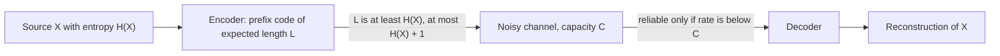

# Information Theory

> [Mathematics](../../README.md) › [Applied Mathematics](../README.md) · Level: Advanced · Prerequisites: [Conditional Probability and Independence](../../10-probability/02-conditional-probability-and-independence/README.md), [Random Variables](../../10-probability/03-random-variables/README.md), [Expectation and Variance](../../10-probability/05-expectation-and-variance/README.md), [Exponential and Logarithmic Functions](../../03-algebra/12-exponential-and-logarithmic-functions/README.md), [Techniques of Integration](../../07-calculus/08-techniques-of-integration/README.md), [Sequences and Series in Calculus](../../07-calculus/11-sequences-and-series-in-calculus/README.md) · Estimated time: 9 h

## 1. Introduction

In 1948 Claude Shannon published *A Mathematical Theory of Communication* and, in a single paper of some twenty pages, created a discipline. He asked a question that looks like engineering and turns out to be mathematics: **how much can a message be compressed, and how fast can it be sent through a noisy channel?** His answers are two numbers, both computable from probabilities alone.

The first number is the **entropy** $H$ of the source. It is the average number of yes/no questions needed to identify the output, and it is simultaneously

* a *lower* bound — no lossless code has a shorter expected length, and
* an *upper* bound that is *achievable* — block codes exist whose expected length per symbol is arbitrarily close to $H$.

That double role is the content of **Shannon's source coding theorem**, and it is why entropy is a property of the source rather than of any particular clever scheme.

The second number is the **capacity** $C$ of the channel. For a channel that flips each bit with probability $\varepsilon$ — a channel that destroys one bit in ten — the naive intuition says that reliable communication is impossible. It is not: one can still push $1 - H_b(\varepsilon) \approx 0.531$ bits per channel use through with arbitrarily small error, and one cannot do better. This is the **noisy channel coding theorem**, the result that made digital communication possible and that remains one of the most surprising theorems in applied mathematics.

Three warnings frame the whole subject. First, **information is not meaning**. The string `aaaaaaaa` and a line of Shakespeare with the same length may carry vastly different amounts of meaning, but if they are drawn from sources with the same statistics they carry the same number of bits. Shannon's theory is *syntactic*: it counts distinctions, not significances. Second, **entropy is a property of a probability distribution, not of a message**. A particular realisation of a random variable carries no entropy at all; what has entropy is the ensemble from which it was drawn. Third, **the theorems are asymptotic statements about long blocks**. They say what happens in the limit of long messages, and they are usually silent — or deliberately vague — about the one short message you actually have.

Where does the theory get used? In data compression (ZIP, JPEG, MP3, video codecs), in error-correcting codes (QR codes, hard disks, deep-space telemetry, 5G), in statistics (the Akaike information criterion, likelihood-ratio tests, the geometry of exponential families), in machine learning (cross-entropy loss, variational inference, the evidence lower bound), in cryptography (key entropy, perfect secrecy), in physics (Gibbs and Boltzmann entropy, the Landauer principle) and in neuroscience (the information carried by a spike train). The present topic develops the mathematical core: definition and axiomatic derivation of entropy, its algebra, two coding theorems (stated, with the source-coding bound proved in full), and the bridge from entropy to maximum likelihood.

## 2. Prerequisites

**Probability** ([Conditional Probability and Independence](../../10-probability/02-conditional-probability-and-independence/README.md), [Random Variables](../../10-probability/03-random-variables/README.md), [Expectation and Variance](../../10-probability/05-expectation-and-variance/README.md)). Joint, marginal and conditional distributions; the product rule $\Pr(A \cap B) = \Pr(A)\Pr(B \mid A)$ in the form $p(x,y) = p(x)p(y \mid x)$; independence and the factorisation $p(x,y) = p(x)p(y)$; expectation of a function of a random variable, $\mathbb{E}[g(X)] = \sum_x p(x)g(x)$; the normal, exponential and geometric distributions with their means and variances. Conditional entropy is an expectation of $-\log p(Y \mid X)$, so all of §7.4 rests on this material.

**Logarithms** ([Exponential and Logarithmic Functions](../../03-algebra/12-exponential-and-logarithmic-functions/README.md)). The identities $\log_b(xy) = \log_b x + \log_b y$, $\log_b(x^{c}) = c\log_b x$, the change of base $\log_b x = \ln x/\ln b$, the limits $\lim_{p \to 0^{+}} p\log p = 0$ and $\lim_{p\to 0^+} p \ln p = 0$. Every unit conversion in the subject is a change of base, and the single most common error in the subject is applying it to the wrong side of an equation.

**Calculus** ([Techniques of Integration](../../07-calculus/08-techniques-of-integration/README.md), [Sequences and Series in Calculus](../../07-calculus/11-sequences-and-series-in-calculus/README.md)). Integration by parts (used for the entropy of the exponential and the Gaussian), the Gaussian integral $\int_{-\infty}^{\infty} e^{-t^2}\,dt = \sqrt{\pi}$, Taylor expansion and Stirling's formula $n! \sim \sqrt{2\pi n}\,(n/e)^{n}$ in the weak form $\ln n! = n\ln n - n + \tfrac12\ln(2\pi n) + O(1/n)$. Stirling's formula is what converts a binomial coefficient into an entropy.

**Combinatorics and algorithms** ([Counting Principles](../../20-combinatorics/01-counting-principles/README.md), [Algorithms and Complexity](../../09-discrete-mathematics/03-algorithms-and-complexity/README.md), [Trees](../../21-graph-theory/02-trees/README.md)). Counting sequences and subsets, the binomial theorem, $\binom{n}{k} \le 2^{n}$; binary trees and leaves at depth; the idea of a greedy algorithm and of a proof by exchange argument. Huffman coding is a greedy algorithm whose correctness is an exchange argument, and prefix codes are binary trees.

## 3. Learning Objectives

After this tutorial you will be able to:

1. Explain why information is measured by $-\log_b p$, deriving the logarithm from the requirement that independent events have additive surprise.
2. State the Shannon–Khinchin axioms and reproduce the proof that they force $H(p) = -\sum_i p_i \log_2 p_i$.
3. Compute the entropy of a distribution, of a joint distribution and of a conditional distribution, and prove $H(X,Y) = H(X) + H(Y \mid X)$.
4. Prove that conditioning cannot increase entropy, that $H(X,Y) \le H(X)+H(Y)$, and that equality holds exactly when the variables are independent.
5. Define mutual information in four equivalent ways and prove $I(X;Y) = H(X)+H(Y)-H(X,Y) \ge 0$, with equality if and only if $X \perp\!\!\!\perp Y$.
6. Derive the entropy of the Bernoulli, uniform, geometric and Gaussian distributions, and state correctly the asymptotic entropies of the binomial and Poisson families.
7. Define differential entropy, give an example where it is negative, explain why it is not invariant under reparametrisation, and prove that the Gaussian maximises it for fixed variance.
8. Prove Kraft's inequality in both directions and use it to show that every binary prefix code satisfies $L \ge H$ and that some code satisfies $L < H+1$.
9. Construct a Huffman code for a given distribution, compute its expected length, and explain why it is optimal.
10. State Shannon's source coding theorem and the noisy channel coding theorem, and interpret what they do and do not claim.
11. Compute the capacity of the binary symmetric channel, $C = 1 - H_b(\varepsilon)$, and of the binary erasure channel, $C = 1-\varepsilon$.
12. Prove the identity $H(p,q) = H(p) + D(p \,\|\, q)$, prove Gibbs' inequality, and explain why maximum likelihood estimation is minimisation of cross-entropy.

## 4. Intuition

**Information is surprise.** Consider three announcements:

* "The sun rose this morning." A probability of essentially $1$. No information: you already knew it.
* "A fair coin came up heads." Probability $1/2$. One bit: the answer to one balanced yes/no question.
* "The lottery ticket you bought won the jackpot." Probability $10^{-8}$. Enormous information, because you would have bet heavily against it.

The quantity we want must decrease as probability increases, must vanish at probability $1$, and must be additive for independent events: if two announcements are independent, learning both should give the sum of what each gives separately. Only the logarithm converts a product of probabilities into a sum, so the measure of surprise is

$$i(x) = -\log_b p(x),$$

and the choice of $b$ is only a choice of unit: $b=2$ gives **bits**, $b=e$ gives **nats**, $b=10$ gives **hartleys**. Think of $-\log_2 p$ as "how many fair coin tosses would I have needed to see this outcome by chance".

**Entropy is expected surprise.** A source is not one announcement but a distribution of them. The **entropy** is the average of $-\log p$ under the distribution itself:

$$H(X) = \mathbb{E}[-\log_2 p(X)].$$

Equivalently, it is the number of bits needed, on average, to describe $X$. A fair coin has entropy $1$; a coin that always lands heads has entropy $0$; a coin biased $90{:}10$ has entropy $0.469$ bits, because you can predict it most of the time and only occasionally need to spend a bit to record a surprise.

**The compression picture.** Take $1000$ independent coin flips with $\Pr(\text{heads}) = 0.1$. Storing the raw outcomes costs $1000$ bits. But not all $2^{1000}$ strings are equally likely: a string with $k$ heads has probability $0.1^{k}0.9^{1000-k}$, which for $k$ near $100$ is about $2^{-469}$ (indeed $100\log_2 0.1 + 900\log_2 0.9 = -469.0$). Strings of this size therefore number about

$$2^{1000 H_b(0.1)} = 2^{469.0},$$

and they carry almost all the probability. So $469$ bits suffice to name one of them: less than half of $1000$. (The number of strings with *exactly* $100$ heads is the smaller quantity $\binom{1000}{100} \approx 2^{464.4}$; the typical set is the wider ensemble of strings with roughly $90$ to $110$ heads.) This is the whole of source coding in one example, and it is the reason entropy is called the *compressibility* of the source.

**The channel picture.** Now suppose the storage medium is unreliable and flips each bit with probability $\varepsilon$. Surely a rate of $\tfrac12$ is now impossible? No: the noise is random, and random damage is *recoverable in bulk* by adding carefully designed redundancy. Capacity measures how much redundancy is needed. It is not "the number of correct bits per use" but the largest rate at which the error probability can be driven to zero, and for the binary symmetric channel it is $1 - H_b(\varepsilon)$: at $\varepsilon = 0.1$ you keep $53\%$ of the raw rate, at $\varepsilon=0.5$ you keep nothing, exactly as intuition demands.

## 5. Formal Definition

Throughout, $\log$ without a subscript means $\log_2$, and "bit" means the unit so obtained. Every random variable in §§5–7.12 has a finite range unless explicitly stated; differential entropy in §7.7 relaxes this to densities.

**Definition 5.1** (finite source). A *finite source* (or finite random variable) is a pair $(\mathcal{X}, p)$ where $\mathcal{X}$ is a non-empty finite set and $p : \mathcal{X} \to [0,1]$ satisfies $\sum_{x \in \mathcal{X}} p(x) = 1$. We write $p(x) = \Pr(X = x)$ and call $\mathcal{X}$ the *alphabet*. The *support* is $\operatorname{supp} p = \{x : p(x) > 0\}$.

**Definition 5.2** (self-information). For $x$ with $p(x) > 0$, the *self-information* (or *surprisal*) of $x$ is

$$i(x) := -\log_2 p(x) \quad \text{bits.}$$

If $p(x) = 1$ then $i(x) = 0$; if $p(x) = 1/2$ then $i(x) = 1$; if $p(x) = 1/2^{k}$ then $i(x) = k$.

**Definition 5.3** (entropy). The *entropy* of a finite source is

$$H(X) := -\sum_{x \in \mathcal{X}} p(x)\log_2 p(x) = \mathbb{E}\left[-\log_2 p(X)\right],$$

with the convention $0\log_2 0 := 0$. The convention is forced by continuity: $\lim_{p\to 0^+} p\log_2 p = 0$, which follows from $\lim_{t\to\infty} 2^{-t}t = 0$ after substituting $t = -\log_2 p$.

**Definition 5.4** (joint entropy). For random variables $X$ and $Y$ with joint mass function $p(x,y)$,

$$H(X,Y) := -\sum_{x}\sum_{y} p(x,y)\log_2 p(x,y).$$

**Definition 5.5** (conditional entropy). With $p(x) > 0$ defining $p(y \mid x) = p(x,y)/p(x)$,

$$H(Y \mid X) := \sum_{x} p(x)\, H(Y \mid X = x) = -\sum_{x}\sum_{y} p(x,y)\log_2 p(y \mid x),$$

where the inner entropy is that of the conditional distribution $y \mapsto p(y \mid x)$. Terms with $p(x,y)=0$ contribute $0$ by the same convention. Note that $H(Y \mid X)$ is a number, not a random variable, and that it is defined as an average over $X$.

**Definition 5.6** (mutual information). The *mutual information* between $X$ and $Y$ is

$$I(X;Y) := H(X) - H(X \mid Y).$$

**Definition 5.7** (Kullback–Leibler divergence and cross-entropy). For two probability mass functions $p, q$ on the same finite alphabet $\mathcal{X}$,

$$D(p \,\|\, q) := \sum_{x \in \mathcal{X}} p(x)\log_2 \frac{p(x)}{q(x)}, \qquad H(p,q) := -\sum_{x \in \mathcal{X}} p(x)\log_2 q(x),$$

with the conventions $p\log(p/0) := +\infty$ when $p > 0$, and $0\log(0/q) := 0$. The divergence is defined whenever the sum is defined in $[0,\infty]$; it is not a distance. $H(p,q)$ is the *cross-entropy* of $p$ and $q$.

**Definition 5.8** (differential entropy). If $X$ has a probability density $f$ on $\mathbb{R}$, the *differential entropy* is

$$h(X) := -\int_{-\infty}^{\infty} f(x)\log_2 f(x)\,dx,$$

whenever the integral converges absolutely, and $+\infty$ otherwise.

**Definition 5.9** (binary entropy function). For $0 \le p \le 1$,

$$H_b(p) := -p\log_2 p - (1-p)\log_2(1-p),$$

with $H_b(0) = H_b(1) = 0$. This is the entropy of a Bernoulli$(p)$ variable, and it is the single most-used function in the subject.

**Definition 5.10** (binary prefix code). A *binary code* for a finite alphabet $\mathcal{X}$ is an injective map $c : \mathcal{X} \to \{0,1\}^{*}$ into the set of finite binary words; $l(x) := |c(x)|$ is the *length* of the codeword for $x$. The code is *prefix-free* (or *instantaneous*) if no codeword is a proper prefix of another. Its *expected length* under a distribution $p$ on $\mathcal{X}$ is

$$L(c, p) := \sum_{x \in \mathcal{X}} p(x)\, l(x) \quad \text{bits}.$$

**Definition 5.11** (channel, capacity). A *discrete memoryless channel* consists of a finite input alphabet $\mathcal{X}$, a finite output alphabet $\mathcal{Y}$ and transition probabilities $W(y \mid x)$; the channel acts on each use independently, $p(y_1,\dots,y_n \mid x_1,\dots,x_n) = \prod_i W(y_i \mid x_i)$. Its *capacity* is

$$C := \max_{p(x)} I(X;Y),$$

the maximum over all input distributions, where $X \to Y$ through $W$.

## 6. Mathematical Notation

| Symbol | Read as | Meaning |
|---|---|---|
| $\mathcal{X}, \mathcal{Y}$ | script X, script Y | finite alphabets (the possible values) |
| $X, Y, Z$ | random variables | functions from outcomes to alphabets |
| $p(x)$ | p of x | mass function $\Pr(X = x)$ |
| $p(x,y)$, $p(y\mid x)$ | joint, conditional | joint mass; conditional mass $p(x,y)/p(x)$ |
| $H(X)$ | entropy of X | $-\sum_x p(x)\log_2 p(x)$, in bits |
| $H(X,Y)$ | joint entropy | entropy of the pair $(X,Y)$ |
| $H(Y \mid X)$ | entropy of Y given X | average over $X$ of the entropy of $Y \mid X=x$ |
| $I(X;Y)$ | mutual information | $H(X)-H(X\mid Y)=H(X)+H(Y)-H(X,Y)$ |
| $I(X;Y \mid Z)$ | conditional mutual information | $H(X\mid Z)-H(X\mid Y,Z)$ |
| $D(p \,\|\, q)$ | KL divergence from q to p | $\sum_x p(x)\log_2\frac{p(x)}{q(x)}$; note the order |
| $H(p,q)$ | cross-entropy of p and q | $-\sum_x p(x)\log_2 q(x)$ |
| $H_b(p)$ | binary entropy | $-p\log_2 p-(1-p)\log_2(1-p)$ |
| $h(X)$ | differential entropy | $-\int f\log_2 f$ |
| $\lvert \mathcal{X}\rvert$ | size of the alphabet | number of distinct symbols |
| $l(x)$, $L$ | codeword length, expected length | $\lvert c(x)\rvert$ and $\sum_x p(x)l(x)$ |
| $C$ | capacity | $\max_{p(x)} I(X;Y)$ |
| $\varepsilon$ | epsilon | crossover probability of a BSC |
| $P_e$ | probability of error | $\Pr(\hat X \ne X)$ for a decoder |
| $\hat p$ | empirical distribution | $\hat p(x) = \#\{i : x_i = x\}/n$ |

Read $H(Y \mid X)$ aloud as "H of Y given X", never as "H of Y divided by X". Read $D(p \,\|\, q)$ as "the divergence from $q$ to $p$" (the first argument is the reference measure being averaged over). Read $I(X;Y)$ as "the information that X and Y share".

## 7. Core Concepts

### 7.1 Information as surprise: why the logarithm is forced

Before defining anything, ask what properties a measure of "surprise" ought to have. Write $i(p)$ for the information conveyed by an event of probability $p$.

1. **Dependence on probability only.** $i$ is a function of $p$ alone, continuous on $(0,1]$.
2. **Certainty carries nothing.** $i(1) = 0$.
3. **Independence is additive.** If $A$ and $B$ are independent, then learning both should give the sum of the two informations: $i(\Pr(A)\Pr(B)) = i(\Pr(A)) + i(\Pr(B))$, i.e. $i(pq) = i(p)+i(q)$.
4. **Rarer is more informative.** $i$ is strictly decreasing.

**Theorem 7.1.** *A function $i : (0,1] \to \mathbb{R}$ satisfies (1)–(4) if and only if there is a constant $c>0$ with*

$$i(p) = -c\log_2 p .$$

*Proof.* Put $t = -\ln p$, so $p = e^{-t}$ and $t \in [0,\infty)$, and define $g(t) := i(e^{-t})$. Property (3) becomes

$$g(t+u) = i(e^{-(t+u)}) = i(e^{-t}e^{-u}) = i(e^{-t}) + i(e^{-u}) = g(t) + g(u).$$

So $g$ is additive on $[0,\infty)$ and, by (1), continuous. A continuous additive function on $[0,\infty)$ is linear: $g(t) = ct$ with $c = g(1)$. (For rational $t = m/n$, additivity gives $g(m/n) = m\,g(1)/n$; continuity extends this to all real $t$ by density of $\mathbb{Q}$.) Therefore

$$i(p) = g(-\ln p) = -c\ln p = -\frac{c}{\ln 2}\log_2 p .$$

By (4), $c>0$. Conversely every $i(p) = -c\log_2 p$ with $c>0$ satisfies (1)–(4) because $\log_2(pq) = \log_2 p + \log_2 q$ and $\log_2$ is strictly increasing. $\blacksquare$

This is why the logarithm appears in every formula of the subject: it is the only continuous way to turn the multiplication of probabilities of independent events into addition. (Requiring $i(1/2)=1$ — one fair coin is the unit — fixes $c=1$ and gives $i(p)=-\log_2 p$.) The base is pure convention; it only decides how many nats make a bit ($1\ \text{bit} = \ln 2 \approx 0.6931$ nats).

### 7.2 Entropy from axioms

**The axioms.** For every $n \ge 1$ let $H_n$ be defined on the simplex $\Delta_n = \{(p_1,\dots,p_n) : p_i \ge 0,\ \sum_i p_i = 1\}$.

* **(H1) Continuity.** $H_n$ is continuous on $\Delta_n$ for each fixed $n$.
* **(H2) Symmetry.** $H_n$ is invariant under permutations of the arguments.
* **(H3) Normalisation.** $H_2\!\left(\tfrac12,\tfrac12\right) = 1$.
* **(H4) Grouping.** If $p_1 + p_2 > 0$ then
  $$H_n(p_1,p_2,p_3,\dots,p_n) = H_{n-1}(p_1+p_2,p_3,\dots,p_n) + (p_1+p_2)\,H_2\!\left(\frac{p_1}{p_1+p_2},\frac{p_2}{p_1+p_2}\right).$$
* **(H5) Monotonicity.** $A(n) := H_n\!\left(\tfrac1n,\dots,\tfrac1n\right)$ is strictly increasing in $n$.

Axiom (H4) is the mathematical content of "first decide which *group* the outcome lies in, then decide which member of the group": the uncertainty of the whole equals the uncertainty of the group plus the expected uncertainty inside the group.

**Lemma 7.3** (generalised grouping). Repeated application of (H4) to a partition into $k$ blocks $B_1,\dots,B_k$ with totals $P_j = \sum_{i\in B_j}p_i>0$ gives

$$H_n(p) = H_k(P_1,\dots,P_k) + \sum_{j=1}^{k} P_j\, H_{\lvert B_j\rvert}\!\left(\frac{p_i}{P_j} : i \in B_j\right).$$

*Proof.* Induct on the number of blocks: the case $k=2$ is (H4), and merging the first two blocks of a $k$-block partition and applying (H4) reduces $k$ to $k-1$. $\blacksquare$

**Theorem 7.4** (Shannon–Khinchin). *Let $(H_n)_{n\ge 1}$ satisfy (H1)–(H5). Then for every $n$ and every $p \in \Delta_n$,*

$$H_n(p) = -\sum_{i=1}^{n} p_i \log_2 p_i .$$

*Proof.* Write $A(n) = H_n(1/n,\dots,1/n)$.

**Step 1: $A(n^m) = m\,A(n)$ for all integers $n,m \ge 1$.** Take $n^m$ equally likely outcomes and group them into $n^{m-1}$ blocks of $n$ consecutive outcomes. By Lemma 7.3,

$$A(n^m) = H_{n^{m-1}}\!\left(\tfrac{1}{n^{m-1}},\dots\right) + \sum_{j=1}^{n^{m-1}} \tfrac{1}{n^{m-1}}\, A(n) = A(n^{m-1}) + A(n),$$

because each block is uniform on $n$ points, so its internal entropy is $A(n)$. Induction on $m$ gives $A(n^m) = mA(n)$.

**Step 2: $A(n) = \log_2 n$.** Fix integers $n,m \ge 2$. For every $\ell \ge 1$ choose the integer $k$ with $n^{k} \le m^{\ell} < n^{k+1}$. Because $A$ is strictly increasing and $A(n^j) = jA(n)$ by Step 1,

$$k\,A(n) = A(n^k) \le A(m^{\ell}) = \ell\,A(m) < A(n^{k+1}) = (k+1)A(n), \qquad\text{so}\qquad \frac{k}{\ell} \le \frac{A(m)}{A(n)} < \frac{k+1}{\ell}.$$

Taking base-2 logarithms of $n^k \le m^\ell < n^{k+1}$ gives the same bracket for $\log_2 m/\log_2 n$: both ratios lie in an interval of length $1/\ell$, for every $\ell\ge1$. Hence they are equal, and with $n=2$ and $A(2)=1$ from (H3),

$$\frac{A(m)}{A(n)} = \frac{\log_2 m}{\log_2 n} \quad\Longrightarrow\quad A(m) = \log_2 m .$$

**Step 3: rational probabilities.** Let $p_i = n_i/n$ with $n_i$ positive integers and $\sum_i n_i = n$. Consider $n$ equally likely outcomes split into $k$ blocks of sizes $n_1,\dots,n_k$. Lemma 7.3 with $P_j = n_j/n = p_j$ gives

$$\log_2 n = A(n) = H_k(p_1,\dots,p_k) + \sum_{j=1}^{k} p_j\, A(n_j) = H_k(p) + \sum_{j=1}^{k} p_j \log_2 n_j .$$

Therefore

$$H_k(p) = \log_2 n - \sum_{j=1}^{k} p_j\log_2 n_j = -\sum_{j=1}^{k} p_j \log_2\!\left(\frac{n_j}{n}\right) = -\sum_{j=1}^{k} p_j\log_2 p_j .$$

**Step 4: arbitrary probabilities.** The vectors with rational entries are dense in $\Delta_k$, and by (H1) both sides are continuous, so the identity extends to all $p \in \Delta_k$. (Probabilities equal to $0$ are handled by the convention $0\log 0 = 0$, which is the continuous extension.) $\blacksquare$

**Remarks on the axioms.** Every axiom is used: (H3) fixes the unit, (H5) rules out pathological additive solutions of $A(n^m)=mA(n)$, and (H4) pins down the *form* of the dependence on $p$. Weakening them admits other functionals: dropping (H4) while keeping a different additivity requirement leads to the Rényi entropies $H_\alpha(p) = \frac{1}{1-\alpha}\log_2\sum_i p_i^{\alpha}$, which agree with Shannon entropy only in the limit $\alpha \to 1$. Faddeev (1956) gave an axiomatisation in which a stronger form of grouping replaces monotonicity.

### 7.3 Elementary properties

**Proposition 7.5.** *Let $X$ be a finite random variable with mass function $p$ on $\mathcal{X}$.*

*(a) $H(X) \ge 0$, with equality if and only if $X$ is almost surely constant.*

*(b) $H(X) \le \log_2\lvert\operatorname{supp} p\rvert \le \log_2\lvert\mathcal{X}\rvert$, with equality if and only if $p$ is uniform on its support.*

*(c) $H$ is symmetric: $H(p_1,\dots,p_n)$ is unchanged by permuting the $p_i$.*

*(d) Expansibility: $H(p_1,\dots,p_n,0) = H(p_1,\dots,p_n)$.*

*(e) Concavity: if $p$ and $q$ are distributions on the same alphabet and $0\le\lambda\le1$, then $H(\lambda p + (1-\lambda)q) \ge \lambda H(p) + (1-\lambda)H(q)$.*

*Proof.* (a) Each $p \in (0,1]$ has $-\log_2 p \ge 0$, so every term $-p\log_2 p$ is non-negative, and a term vanishes only when $p = 1$.

(b) Let $u_i = 1/n$ on the support, $n = \lvert\operatorname{supp}p\rvert$. By concavity of $\log_2$ (equivalently weighted AM–GM, $\prod_i x_i^{p_i} \le \sum_i p_i x_i$),

$$\sum_i p_i \log_2 \frac{1}{p_i} = \sum_i p_i\log_2 \frac{1/n}{p_i} + \log_2 n \le \log_2\!\left(\sum_i p_i \cdot \frac{1/n}{p_i}\right) + \log_2 n = \log_2(n\cdot \tfrac1n) + \log_2 n = \log_2 n .$$

The left side is $H(X)$. Since $\log_2$ is strictly concave, equality holds if and only if all $p_i$ with $p_i>0$ equal $1/n$.

(c) is immediate from (H2) or from the commutativity of addition. (d) follows from $0\log 0 = 0$.

(e) The function $\varphi(p) = -p\log_2 p$ is concave on $(0,\infty)$ because $\varphi''(p) = -1/(p\ln 2) < 0$; extend to $[0,\infty)$ continuously. Sums of concave functions are concave, and $p \mapsto \sum_i \varphi(p_i)$ is a sum of concave functions of the components; hence $H(\lambda p + (1-\lambda)q) = \sum_i \varphi(\lambda p_i + (1-\lambda)q_i) \ge \lambda\sum_i\varphi(p_i) + (1-\lambda)\sum_i\varphi(q_i)$. $\blacksquare$

**Example 7.6.** Four values with probabilities $\tfrac12,\tfrac14,\tfrac18,\tfrac18$ have $H = \tfrac12(1)+\tfrac14(2)+\tfrac18(3)+\tfrac18(3) = 1.75$ bits, against the bound $\log_2 4 = 2$. The distribution is *dyadic*, and §7.9 shows that such a source can be coded with expected length exactly equal to its entropy.

### 7.4 Joint and conditional entropy

**Theorem 7.8** (chain rule). *For finite random variables $X,Y$,*

$$H(X,Y) = H(X) + H(Y \mid X) = H(Y) + H(X \mid Y).$$

*Proof.* For pairs with $p(x,y)>0$ the product rule gives $\log_2 p(x,y) = \log_2 p(x) + \log_2 p(y\mid x)$. Multiply by $p(x,y)$ and sum, treating zero-probability pairs as zero terms:

$$H(X,Y) = -\sum_{x,y} p(x,y)\log_2 p(x) - \sum_{x,y} p(x,y)\log_2 p(y\mid x).$$

In the first sum, summing over $y$ gives $\sum_y p(x,y) = p(x)$, so it equals $H(X)$. The second is $H(Y\mid X)$ by Definition 5.5. The second equality follows by symmetry. $\blacksquare$

**Corollary 7.9** (chain rule for $n$ variables). *For finite random variables $X_1,\dots,X_n$,*

$$H(X_1,\dots,X_n) = \sum_{i=1}^{n} H(X_i \mid X_1,\dots,X_{i-1}),$$

*with the convention that the last term for $i=1$ is $H(X_1)$.*

*Proof.* Induct on $n$: apply Theorem 7.8 to the pair $(X_1,\dots,X_{n-1})$ and $X_n$, then the induction hypothesis to the first factor. $\blacksquare$

**Theorem 7.10** (conditioning reduces entropy). *For finite $X,Y$,*

$$H(Y \mid X) \le H(Y),$$

*with equality if and only if $X$ and $Y$ are independent.*

*Proof.* Write $S = \{x : p(x) > 0\}$. If $S$ is empty there is nothing to prove, so assume otherwise. Then

$$H(Y) - H(Y\mid X) = \sum_{x \in S}\sum_{y} p(x,y)\log_2\frac{p(y\mid x)}{p(y)} .$$

Use $\ln t \le t-1$ for $t>0$, valid for all $t$ with equality only at $t = 1$, with $t = p(y)/p(y\mid x)$ for terms with $p(y\mid x)>0$. Multiplying by $p(x,y) \ge 0$ and summing,

$$\sum_{x,y} p(x,y)\ln\frac{p(y)}{p(y\mid x)} \le \sum_{x,y} p(x,y)\left(\frac{p(y)}{p(y\mid x)} - 1\right) = \sum_{y} p(y)\sum_{x \in S} p(x) - \sum_{x,y} p(x,y) = 1 - 1 = 0,$$

where $\sum_x p(x,y)/p(y\mid x) = \sum_x p(x) = 1$ was used. Dividing by $\ln 2 > 0$ reverses nothing; hence $H(Y)-H(Y\mid X) \ge 0$. Equality requires $\ln t = t-1$ for every pair with $p(x,y)>0$, i.e. $p(y) = p(y\mid x)$ whenever $p(x,y)>0$, which is precisely independence. $\blacksquare$

**Corollary 7.11.** *$H(X,Y) \le H(X) + H(Y)$, with equality if and only if $X$ and $Y$ are independent.*

*Proof.* Combine Theorem 7.8 with Theorem 7.10. $\blacksquare$

**Corollary 7.12** (subadditivity). *$H(X_1,\dots,X_n) \le \sum_{i=1}^n H(X_i)$, with equality if and only if the $X_i$ are mutually independent.*

*Proof.* By Corollary 7.9 and repeated use of Theorem 7.10, $H(X_i \mid X_1,\dots,X_{i-1}) \le H(X_i)$. Equality at every step is independence of $X_i$ from $(X_1,\dots,X_{i-1})$, which for all $i$ is mutual independence. $\blacksquare$

### 7.5 Mutual information

Definition 5.6 introduced $I(X;Y) = H(X) - H(X\mid Y)$, the reduction in the uncertainty of $X$ achieved by observing $Y$. Four expressions for the same quantity are used interchangeably.

**Theorem 7.13.** *For finite $X,Y$,*

$$I(X;Y) = H(X) - H(X\mid Y) = H(Y) - H(Y\mid X) = H(X) + H(Y) - H(X,Y) = D(p_{XY}\,\|\,p_X p_Y).$$

*Proof.* The first equality is the definition. Theorem 7.8 gives $H(X,Y) = H(Y)+H(X\mid Y)$, hence $H(X)-H(X\mid Y) = H(X)+H(Y)-H(X,Y)$; the same computation with the roles exchanged gives the second equality. For the last, expand

$$D(p_{XY}\|p_Xp_Y) = \sum_{x,y} p(x,y)\log_2\frac{p(x,y)}{p(x)p(y)} = -\sum_{x,y}p(x,y)\log_2 p(x) - \sum_{x,y}p(x,y)\log_2 p(y) + \sum_{x,y}p(x,y)\log_2 p(x,y),$$

which is $H(X)+H(Y)-H(X,Y)$. $\blacksquare$

**Theorem 7.14.** *(a) $I(X;Y) \ge 0$, with equality if and only if $X \perp\!\!\!\perp Y$. (b) $I(X;X) = H(X)$. (c) $I(X;Y) \le \min\{H(X),H(Y)\}$. (d) $I$ is symmetric: $I(X;Y) = I(Y;X)$.*

*Proof.* (a) By Theorem 7.13, $I(X;Y) = H(Y)-H(Y\mid X)$, which is $\ge 0$ by Theorem 7.10, with equality exactly on independence. (b) $H(X)-H(X\mid X) = H(X)-0$. (c) Combine (a) with $I = H(X)-H(X\mid Y)\le H(X)$ and symmetry. (d) The expression $H(X)+H(Y)-H(X,Y)$ is symmetric. $\blacksquare$

**Definition 7.15** (conditional mutual information). For finite $X,Y,Z$,

$$I(X;Y\mid Z) := H(X\mid Z) - H(X\mid Y,Z).$$

It is non-negative by two applications of Theorem 7.10, and $I(X;Y\mid Z) = 0$ if and only if $X$ and $Y$ are conditionally independent given $Z$.

**Theorem 7.16** (chain rule for mutual information).

$$I(X;Y,Z) = I(X;Z) + I(X;Y\mid Z).$$

*Proof.* Expanding the right side with the definition,

$$I(X;Z) + I(X;Y\mid Z) = \big[H(X)-H(X\mid Z)\big] + \big[H(X\mid Z)-H(X\mid Y,Z)\big] = H(X) - H(X\mid Y,Z) = I(X;Y,Z). \ \blacksquare$$

**Theorem 7.17** (data processing inequality). *If $X \to Y \to Z$ is a Markov chain — that is, $p(z\mid x,y) = p(z\mid y)$ for all $x,y,z$ — then*

$$I(X;Z) \le I(X;Y).$$

*Proof.* Two applications of Theorem 7.16 give

$$I(X;Y,Z) = I(X;Z) + I(X;Y\mid Z) = I(X;Y) + I(X;Z\mid Y).$$

The Markov property says $X$ and $Z$ are conditionally independent given $Y$, so $I(X;Z\mid Y) = 0$. Therefore $I(X;Z) = I(X;Y) - I(X;Y\mid Z) \le I(X;Y)$ because conditional mutual information is non-negative. $\blacksquare$

The data processing inequality is the precise statement of a slogan: **processing data cannot create information about the source**. If $Z = f(Y)$ is any function of $Y$ — a summary, a compressed file, a statistic — then applying it can only destroy mutual information with $X$, never create it. Equality holds exactly when $Z$ is a sufficient statistic for $X$ in $Y$.

### 7.6 Entropy of common distributions

**Uniform.** If $p(x) = 1/n$ on a set of size $n$, then every term is $\tfrac1n\log_2 n$ and

$$H(X) = \log_2 n .$$

For a fair die, $\log_2 6 = 2.5850$ bits; for a well-shuffled deck, $\log_2 52 = 5.7004$ bits; for $1000$ equally likely symbols, $9.9658$ bits.

**Bernoulli.** Let $X \sim \operatorname{Bernoulli}(p)$, so $\Pr(X=1) = p$ and $\Pr(X=0) = 1-p$. Then

$$H(X) = -p\log_2 p - (1-p)\log_2(1-p) = H_b(p).$$

Differentiating, $\dfrac{d}{dp}H_b(p) = \log_2\!\left(\dfrac{1-p}{p}\right)$, which vanishes at $p = \tfrac12$ and changes sign from $+$ to $-$ there; hence $H_b$ is concave with maximum $1$ bit at $p=\tfrac12$, and $H_b(0)=H_b(1)=0$. Values: $H_b(0.1)=0.4690$, $H_b(0.25)=0.8113$, $H_b(0.4)=0.9709$, $H_b(0.5)=1$.

**Geometric.** Let $\Pr(X=k) = q^{k-1}p$ for $k = 1,2,\dots$, with $q = 1-p$. Then

$$H(X) = -\sum_{k\ge1} p q^{k-1}\big[\log_2 p + (k-1)\log_2 q\big] = -\log_2 p - \log_2 q \sum_{k\ge1}(k-1)\,p q^{k-1}.$$

The remaining sum is $\mathbb{E}[X]-1$ for a geometric variable, and $\mathbb{E}[X] = 1/p$, so

$$H(X) = -\log_2 p - \frac{q}{p}\log_2 q = -\log_2 p - \frac{1-p}{p}\log_2(1-p).$$

Check with $p=\tfrac12$: $H = 1 + 1 = 2$ bits, the entropy of "the number of tosses until the first head" for a fair coin. With $p = 0.1$: $H = 3.3219 + 9(0.1520) = 4.6900$ bits.

**Binomial.** For $X \sim \operatorname{Bin}(n,p)$ there is no closed form, but Stirling's formula gives an asymptotic. Writing $k = np + z\sqrt{npq}$ with $q=1-p$, the local form of the binomial coefficient is $\ln p_k \approx -\tfrac12\ln(2\pi npq) - (k-np)^2/(2npq)$, so, using $\mathbb{E}[(X-np)^2]=npq$,

$$H(X) \approx \tfrac12\ln(2\pi npq) + \tfrac12 = \tfrac12\ln(2\pi e\,npq)\ \text{nats} = \tfrac12\log_2(2\pi e\,npq)\ \text{bits}.$$

For $\operatorname{Bin}(20,0.3)$ this predicts $3.0823$ against the true $3.0766$; the error is $O(1/n)$.

**Poisson.** For $X\sim\operatorname{Pois}(\lambda)$, $p_k = e^{-\lambda}\lambda^k/k!$. With $k = \lambda+u\sqrt{\lambda}$ and Stirling in the form $\ln k! = k\ln k-k+\tfrac12\ln(2\pi k)+o(1)$, one finds $\ln p_k \approx -\tfrac12\ln(2\pi\lambda)-u^2/2$, hence $H \approx \tfrac12\log_2(2\pi e\lambda)$ bits. At $\lambda=100$ this gives $5.3690$ against the computed $5.3678$; at $\lambda=10$, $3.7081$ against $3.6953$.

| Distribution | Entropy (bits) | Notes |
|---|---|---|
| Deterministic | $0$ | no uncertainty |
| Uniform on $n$ points | $\log_2 n$ | maximal for its support |
| Bernoulli$(p)$ | $H_b(p)$ | maximum $1$ at $p=\tfrac12$ |
| Geometric$(p)$ | $-\log_2 p - \frac{1-p}{p}\log_2(1-p)$ | exact; $2$ bits for $p=\tfrac12$ |
| Binomial$(n,p)$ | $\approx \tfrac12\log_2(2\pi e np(1-p))$ | asymptotic, error $O(1/n)$ |
| Poisson$(\lambda)$ | $\approx \tfrac12\log_2(2\pi e\lambda)$ | asymptotic as $\lambda\to\infty$ |
| Gaussian$(\mu,\sigma^2)$ | $\tfrac12\log_2(2\pi e\sigma^2)$ | exact, differential |

### 7.7 Differential entropy for continuous variables

For a density $f$ the sum of Definition 5.3 becomes an integral. Three exact computations cover every case we need.

**Uniform on $[a,b]$.** $f = 1/(b-a)$ on the interval, so

$$h(X) = -\int_a^b \frac{1}{b-a}\log_2\frac{1}{b-a}\,dx = \log_2(b-a).$$

**Exponential$(\lambda)$.** $f(x) = \lambda e^{-\lambda x}$ for $x\ge0$. Then $\ln f = \ln\lambda - \lambda x$ and

$$-\int_0^\infty f\ln f = -\ln\lambda + \lambda\int_0^\infty x f(x)\,dx = -\ln\lambda + 1, \qquad h(X) = \frac{1-\ln\lambda}{\ln 2} = \log_2\frac{e}{\lambda}.$$

**Gaussian$(\mu,\sigma^2)$.** With $f(x) = (2\pi\sigma^2)^{-1/2}e^{-(x-\mu)^2/(2\sigma^2)}$,

$$\ln f(x) = -\tfrac12\ln(2\pi\sigma^2) - \frac{(x-\mu)^2}{2\sigma^2},$$

$$-\int f\ln f = \tfrac12\ln(2\pi\sigma^2) + \frac{1}{2\sigma^2}\int (x-\mu)^2 f(x)\,dx = \tfrac12\ln(2\pi\sigma^2) + \tfrac12 = \tfrac12\ln(2\pi e\sigma^2),$$

$$h(X) = \tfrac12\log_2(2\pi e\sigma^2).$$

**Three warnings.** First, $h$ can be *negative*: the uniform density on $[0,\tfrac12]$ has $h=-1$ bit. Second, $h$ is not invariant under a change of variable: $h(aX+b) = h(X)+\log_2\lvert a\rvert$, so switching from metres to centimetres changes $h$ by $\log_2 100$. Third, $h$ is not the limit of the entropies of finer and finer discretisations: quantising into bins of width $\Delta$ gives $H(X_\Delta)\approx h(X)-\log_2\Delta$, which diverges as $\Delta\to0$. Differential entropy is therefore a *relative* measure of uncertainty; only differences of differential entropies, and mutual informations (which are divergences and hence invariant), are coordinate-free.

**Theorem 7.18** (maximum entropy with a variance constraint). *Among all densities on $\mathbb{R}$ with finite variance $\sigma^2$, the Gaussian $\mathcal{N}(\mu,\sigma^2)$ uniquely maximises $h$, and the maximum is $\tfrac12\log_2(2\pi e\sigma^2)$.*

*Proof.* Let $f$ have mean $\mu$ and variance $\sigma^2$, and let $g$ be the Gaussian density with the same mean and variance. Then

$$0 \le D(f\|g) = \int f\log_2\frac{f}{g} = \int f\log_2 f - \int f\log_2 g = -h(f) + \Big[-\int f\log_2 g\Big].$$

Now $\log_2 g(x) = -\tfrac12\log_2(2\pi\sigma^2) - \dfrac{(x-\mu)^2}{2\sigma^2\ln 2}$, so

$$-\int f\log_2 g = \tfrac12\log_2(2\pi\sigma^2) + \frac{1}{2\sigma^2\ln 2}\int (x-\mu)^2 f(x)\,dx = \tfrac12\log_2(2\pi\sigma^2) + \frac{1}{2\ln 2} = \tfrac12\log_2(2\pi e\sigma^2),$$

which is exactly $h(g)$. Therefore $0 \le h(g) - h(f)$, i.e. $h(f) \le h(g)$, with equality if and only if $D(f\|g)=0$, which for densities means $f = g$ almost everywhere. $\blacksquare$

The same argument, with $g$ the uniform density on a set $A$, proves that the uniform distribution maximises differential entropy among densities supported on $A$; with $g$ exponential it proves that the exponential maximises $h$ among densities on $[0,\infty)$ with a given mean. This is the **maximum-entropy principle**: among distributions satisfying stated constraints, choose the one of largest entropy, because it is the one that assumes the least beyond the constraints.

### 7.8 Kraft's inequality and what it forbids

A codeword is a leaf of a binary tree, and a prefix-free code is a set of leaves no one of which is an ancestor of another. Kraft's inequality says how much room such a set can occupy.

**Theorem 7.19** (Kraft, 1949). *Let $c$ be a binary prefix code for $n$ symbols with codeword lengths $l_1,\dots,l_n \ge 1$. Then*

$$\sum_{i=1}^{n} 2^{-l_i} \le 1.$$

*Conversely, if $l_1,\dots,l_n$ are positive integers satisfying this inequality, there exists a binary prefix code whose $i$-th codeword has length $l_i$.*

*Proof of necessity.* Map a binary word $w = w_1\cdots w_l$ to the interval $I(w) \subset [0,1)$ of all real numbers whose binary expansion begins with $w$. The interval has length $2^{-l}$, and $I(w') \subset I(w)$ exactly when $w$ is a prefix of $w'$. If the code is prefix-free, then no $I(c_i)$ contains another, so the intervals are pairwise disjoint — for two words of a prefix code, either one is a prefix of the other or they already differ in some position, in which case their intervals are disjoint. Disjoint intervals inside $[0,1)$ have total length at most $1$:

$$\sum_i \lvert I(c_i)\rvert = \sum_i 2^{-l_i} \le 1.$$

*Proof of sufficiency.* Order the lengths so that $l_1 \le \cdots \le l_n$ and put $a_1 = 0$, $a_{i+1} = a_i + 2^{-l_i}$; the Kraft condition says $a_i + 2^{-l_i}\le1$. Since $a_i$ is then an integer multiple of $2^{-l_i}$, it has a binary expansion of exactly $l_i$ digits; let $c_i$ be those digits. The intervals $I(c_i) = [a_i, a_i+2^{-l_i})$ are consecutive and hence disjoint, so the code is prefix-free. $\blacksquare$

Kraft's inequality is a *budget*: a codeword of length $l$ costs $2^{-l}$ of the unit budget, and a complete code spends exactly $1$.

**Corollary 7.20** (McMillan, 1956). *The same inequality holds for every uniquely decodable binary code, so prefix-free codes lose no generality in achievable rate.*

**Theorem 7.21** (entropy is a lower bound on code length). *Let $p$ be a distribution on $n$ symbols and let $c$ be a binary prefix code with expected length $L = \sum_i p_i l_i$. Then*

$$L \ge H(p) = -\sum_i p_i\log_2 p_i .$$

*Proof.* Let $K = \sum_i 2^{-l_i} \le 1$ and define $q_i = 2^{-l_i}/K$, a probability vector. Then

$$L = \sum_i p_i l_i = \sum_i p_i\log_2 \frac{1}{2^{-l_i}} = \sum_i p_i\log_2\frac{1}{K q_i} = \sum_i p_i \log_2\frac{p_i}{q_i} - \log_2 K + H(p).$$

For the first term use $\ln t \ge 1 - 1/t$, valid for all $t>0$ with equality only at $t=1$, with $t = p_i/q_i$:

$$\sum_i p_i\ln\frac{p_i}{q_i} \ge \sum_i p_i\left(1 - \frac{q_i}{p_i}\right) = 1 - 1 = 0 .$$

Hence $\sum_i p_i\log_2(p_i/q_i) \ge 0$, and since $K \le 1$ also $-\log_2 K \ge 0$. Therefore $L \ge H(p)$. $\blacksquare$

**Theorem 7.22** (Shannon code). *There is a binary prefix code with*

$$H(p) \le L < H(p) + 1 .$$

*Proof.* Set $l_i = \lceil \log_2(1/p_i)\rceil$. Then $2^{-l_i} \le p_i$, so $\sum_i 2^{-l_i} \le \sum_i p_i = 1$ and Kraft's theorem provides a prefix code with these lengths. Also $l_i < \log_2(1/p_i) + 1$, so on multiplying by $p_i$ and summing, $L < H(p) + 1$. The lower bound is Theorem 7.21. $\blacksquare$

So the optimal expected length $L^{*}(p)$ over binary prefix codes satisfies

$$H(p) \le L^{*}(p) < H(p) + 1 .$$

The lower bound is fundamental; the extra bit is an artefact of coding one symbol at a time and disappears when symbols are coded in long blocks (§7.10).

### 7.9 Huffman coding

**Algorithm 7.23** (Huffman). Given probabilities $p_1,\dots,p_n > 0$:

1. Create a leaf for each symbol, with weight $p_i$.
2. While at least two nodes remain, remove the two nodes of smallest weight, create a new node with weight equal to their sum, and make the two removed nodes its children.
3. The remaining node is the root. Label the two edges from each internal node $0$ and $1$; the codeword of a symbol is the sequence of labels on the path from the root to its leaf.

**Theorem 7.24** (optimality). *The Huffman code is a prefix code of minimum expected length.*

*Proof sketch.* *(i) Deepest leaves are siblings.* A leaf at maximum depth has a sibling, which is itself a leaf, at the same depth.

*(ii) The two least probable symbols can be placed at maximum depth.* Let $x,y$ have the smallest probabilities and let $a,b$ be siblings at maximum depth $L$ in an optimal tree. Swapping $x$ with $a$ and $y$ with $b$ changes the expected length by

$$\Delta = (p_x - p_a)(L - l_x) + (p_y - p_b)(L - l_y) \le 0,$$

because $p_x\le p_a$, $p_y\le p_b$ and $L\ge l_x,l_y$. Optimality forces $\Delta \ge 0$, so $\Delta=0$ and the swapped tree is optimal too.

Contracting $x,y$ into one leaf of weight $p_x+p_y$ gives a code for $n-1$ symbols with $L_{\text{original}} = L_{\text{contracted}} + (p_x+p_y)$; the contracted tree must be optimal, or expanding a better one would improve on the original. Induction on $n$ then shows that the greedy merge is safe. $\blacksquare$

**Worked code.** Let the source be

| Symbol | $a$ | $b$ | $c$ | $d$ | $e$ |
|---|---|---|---|---|---|
| $p$ | $0.4$ | $0.2$ | $0.2$ | $0.1$ | $0.1$ |

*Step 1.* Merge $d,e$ (weights $0.1,0.1$) into a node of weight $0.2$. Remaining: $a:0.4$, $b:0.2$, $c:0.2$, $(de):0.2$.
*Step 2.* Merge $b,c$ into a node of weight $0.4$. Remaining: $a:0.4$, $(bc):0.4$, $(de):0.2$.
*Step 3.* Merge $(de)$ with $a$ into a node of weight $0.6$. Remaining: $(bc):0.4$, $(ade):0.6$.
*Step 4.* Merge the last two into the root of weight $1$.

Labelling the first child $0$ and the second $1$ at every node:

| Symbol | Codeword | Length |
|---|---|---|
| $a$ | $10$ | $2$ |
| $b$ | $00$ | $2$ |
| $c$ | $01$ | $2$ |
| $d$ | $110$ | $3$ |
| $e$ | $111$ | $3$ |

Kraft's budget: $3\cdot\tfrac14 + 2\cdot\tfrac18 = \tfrac34+\tfrac14 = 1$, a complete code. Expected length

$$L = 2(0.4+0.2+0.2) + 3(0.1+0.1) = 1.6 + 0.6 = 2.2\ \text{bits}.$$

Entropy:

$$H = -0.4\log_2 0.4 - 2(0.2\log_2 0.2) - 2(0.1\log_2 0.1) = 0.52877 + 0.92877 + 0.66439 = 2.12193\ \text{bits}.$$

The redundancy is $2.2 - 2.1219 = 0.0781$ bits per symbol, consistent with $H \le L < H+1$. Note that the most probable symbol does *not* receive the shortest codeword in every Huffman tree — here $a$ has length $2$, tied with $b$ and $c$ — and that Huffman codes are not unique: ties can be broken in several ways, all giving the same optimal length but different words. For the dyadic source $(0.5,0.25,0.125,0.125)$ Huffman gives lengths $(1,2,3,3)$ and $L = 1.75 = H$ exactly: when every probability is a power of $2^{-l}$, the entropy bound is attained.

### 7.10 Shannon's source coding theorem

**Theorem 7.25** (Shannon's source coding theorem, 1948). *Let $X_1,X_2,\dots$ be independent and identically distributed with distribution $p$ on a finite alphabet and entropy $H = H(X_1)$ bits. Let $L_n^{*}$ be the minimum expected length, in bits, of a binary prefix code for blocks $(X_1,\dots,X_n)$.*

*(a) Achievability.* $L_n^{*} < nH + 1$, hence $L_n^{*}/n \to H$ and for every $\varepsilon>0$ there is $n$ with $L_n^{*}/n < H+\varepsilon$.

*(b) Converse.* For every uniquely decodable binary code for blocks of length $n$, the expected length satisfies $L_n \ge nH$; hence no sequence of codes has rate per symbol below $H$.

*Proof.* (a) Apply Theorem 7.22 to the product distribution on $\mathcal{X}^n$: $L_n^{*} < H(X_1,\dots,X_n) + 1 = nH + 1$, since the block entropy of independent symbols is $nH$ by Corollary 7.12 with equality. Divide by $n$.

(b) Theorem 7.21 applied to the block distribution gives $L_n \ge H(X_1,\dots,X_n) = nH$ for prefix codes, and Corollary 7.20 extends the bound to all uniquely decodable codes. $\blacksquare$

**Interpretation.** Entropy is the *rate of the source*: the smallest number of bits per symbol at which the source can be represented losslessly in the long run. Compression below $H$ is impossible in principle, not merely difficult; compression to $H+\varepsilon$ is possible for every $\varepsilon>0$. Nothing is said about a particular short file: a single message of length $100$ may well be incompressible, and a badly chosen block code may badly exceed $H$. The theorem is asymptotic. The counting form of the argument — the typical set of about $2^{nH}$ sequences, each of probability about $2^{-nH}$ — is the same statement proved by counting rather than by the one-symbol bound.

### 7.11 Channel capacity and the noisy channel coding theorem

**Definition 7.26** (binary symmetric channel). The **BSC** with crossover probability $\varepsilon \in [0,1]$ has $\mathcal{X} = \mathcal{Y} = \{0,1\}$ and

$$W(1\mid 0) = W(0\mid 1) = \varepsilon, \qquad W(0\mid 0) = W(1\mid 1) = 1-\varepsilon.$$

Equivalently, $Y = X \oplus Z$ where $Z \sim \operatorname{Bernoulli}(\varepsilon)$ is independent of $X$.

**Theorem 7.27** (capacity of the BSC). *For the binary symmetric channel with crossover probability $\varepsilon$,*

$$C = 1 - H_b(\varepsilon)\ \text{bits per channel use}.$$

*Proof.* By Theorem 7.13, $I(X;Y) = H(Y) - H(Y\mid X)$. Conditioned on $X=x$, the output is Bernoulli with parameter $\varepsilon$ or $1-\varepsilon$, and $H_b(\varepsilon) = H_b(1-\varepsilon)$; hence $H(Y\mid X) = H_b(\varepsilon)$ for every input distribution. Therefore

$$I(X;Y) = H(Y) - H_b(\varepsilon) \le 1 - H_b(\varepsilon),$$

because $Y$ is binary and a binary variable has entropy at most $1$ bit (Proposition 7.5(b)), with equality if and only if $Y$ is uniform. The bound is attained: if $X$ is uniform then $Y = X \oplus Z$ is uniform, since $\Pr(Y=0) = \tfrac12(1-\varepsilon) + \tfrac12\varepsilon = \tfrac12$. Hence $C = \max_{p(x)} I(X;Y) = 1 - H_b(\varepsilon)$. $\blacksquare$

Values: $C(0) = 1$; $C(0.1) = 1 - 0.4690 = 0.5310$; $C(0.11) = 1-0.4999 = 0.5001$; $C(0.25) = 0.1887$; $C(0.5) = 0$. The function is symmetric about $\varepsilon = \tfrac12$, because relabelling the output turns crossover probability $\varepsilon$ into $1-\varepsilon$, and $H_b(\varepsilon) = H_b(1-\varepsilon)$.

**Sanity check.** At $\varepsilon = 0.11$ the channel agrees with the input only $89\%$ of the time, yet $C \approx 0.5001$: it is *just* possible to send one bit per two channel uses with arbitrarily small error. At $\varepsilon = \tfrac12$ the output is independent of the input and $C = 0$.

**Aside.** For the binary erasure channel — each symbol erased with probability $\varepsilon$ and otherwise received perfectly — $H(X\mid Y) = \varepsilon H(X)$, so $I(X;Y) = (1-\varepsilon)H(X)$ and $C = 1-\varepsilon$. Erasures are less damaging than errors, because the decoder knows where the damage is.

**Theorem 7.28** (noisy channel coding theorem; Shannon 1948). *Let a discrete memoryless channel have capacity $C = \max_{p(x)} I(X;Y)$.*

*(a) Achievability.* *For every rate $R < C$ there exist, for all sufficiently large $n$, a code with $M = \lceil 2^{nR}\rceil$ codewords of length $n$ and a decoder whose maximum probability of error satisfies $P_e \le \exp(-nE(R))$ for some exponent $E(R) > 0$.*

*(b) Converse.* *For any sequence of codes with $M_n = \lceil 2^{nR}\rceil$ codewords and maximum error probability $P_e^{(n)}$ with $P_e^{(n)} \to 0$, necessarily $R \le C$.*

The converse is proved from **Fano's inequality**,

$$H(X \mid Y) \le H_b(P_e) + P_e\log_2(\lvert\mathcal{X}\rvert - 1),$$

which bounds how much the input can remain unknown when the decoder errs with probability $P_e$; combined with $nR \le I(X^n;Y^n) + 1$ it gives $R \le C$ in the limit $P_e \to 0$. We state both results without proof here; the achievability direction is proved by the probabilistic method (choose codewords at random and show the average error is small), and the reader is referred to Cover and Thomas for the complete argument.

**Interpretation.** The theorem is remarkable in three ways. It says the error probability can be made *arbitrarily small*, not merely small; it says this can be done with a *fixed positive rate*, not a rate tending to zero; and it identifies the exact threshold $C$. What it does not do is exhibit a practical code: the random-coding proof shows that good codes exist, not how to find or decode them in reasonable time. The engineering history of the last seventy years — Reed–Solomon, convolutional, turbo, LDPC, polar codes — is the search for codes that approach $C$ with tolerable complexity, and modern schemes now operate within a fraction of a decibel of it.

### 7.12 Cross-entropy and the Kullback–Leibler divergence

Definition 5.7 introduced the two quantities used everywhere in statistics and machine learning. Their relationship is an identity, not an approximation.

**Theorem 7.29** (cross-entropy decomposition). *For probability mass functions $p,q$ on the same finite alphabet,*

$$H(p,q) = H(p) + D(p\,\|\,q).$$

*Proof.* Expand the definition:

$$D(p\|q) = \sum_x p(x)\log_2\frac{p(x)}{q(x)} = \sum_x p(x)\log_2 p(x) - \sum_x p(x)\log_2 q(x) = -H(p) + H(p,q). \ \blacksquare$$

**Theorem 7.30** (Gibbs' inequality). *For probability mass functions $p,q$ on a finite alphabet,*

$$D(p\,\|\,q) \ge 0,$$

*with equality if and only if $p = q$.*

*Proof.* Using $\ln t \le t-1$ with $t = q(x)/p(x)$ for terms with $p(x)>0$,

$$-D(p\|q)\ln 2 = \sum_x p(x)\ln\frac{q(x)}{p(x)} \le \sum_x p(x)\left(\frac{q(x)}{p(x)} - 1\right) = \sum_x q(x) - \sum_x p(x) \le 1 - 1 = 0,$$

where the last inequality uses $\sum_x q(x) \le 1$, with equality only if the supports agree. Hence $D(p\|q)\ge0$. Equality requires $\ln t = t-1$ for all $x$ with $p(x)>0$, i.e. $q(x) = p(x)$ there; combined with equal total mass, $q = p$. $\blacksquare$

The same computation, read backwards, gives the inequality used in Theorems 7.10 and 7.21: Gibbs' inequality *is* "conditioning reduces entropy" *is* "entropy is a lower bound on code length". They are one fact in three costumes.

**Proposition 7.31** (elementary properties of $D$).

*(a) Asymmetry.* $D(p\|q) \ne D(q\|p)$ in general. For $p = (0.9,0.1)$ and $q = (0.5,0.5)$: $D(p\|q) = 0.5310$ but $D(q\|p) = 0.7370$.

*(b) No triangle inequality.* With $p = (0.9,0.1)$, $q = (0.5,0.5)$, $r = (0.1,0.9)$: $D(p\|q) = D(q\|r) = 0.5310$, while $D(p\|r) = 2.5358 > 2\cdot0.5310$. Thus $D$ is not a metric.

*(c) Convexity.* $(p,q) \mapsto D(p\|q)$ is jointly convex on the domain where it is finite.

*(d) Chain rule.* For joint distributions, $D(p(x,y)\,\|\,q(x,y)) = D(p(x)\,\|\,q(x)) + \sum_x p(x)\,D(p(y\mid x)\,\|\,q(y\mid x))$.

*(e) Divergence can be infinite*: if $p(x)>0$ and $q(x)=0$ the sum is $+\infty$, so a model that assigns zero probability to an observed event is infinitely wrong, which is why smoothing is used in practice.

*Proof of (d).* Write $p(x,y) = p(x)p(y\mid x)$ and $q(x,y) = q(x)q(y\mid x)$; then

$$\log_2\frac{p(x,y)}{q(x,y)} = \log_2\frac{p(x)}{q(x)} + \log_2\frac{p(y\mid x)}{q(y\mid x)},$$

and take the expectation over $p(x,y)$ term by term, using $\sum_y p(y\mid x) = 1$ in the second term. $\blacksquare$

**Cross-entropy as a loss.** In machine learning one meets $H(p,q)$ as the **cross-entropy loss**: $p$ is the empirical distribution of the labels in a batch and $q_\theta$ the model's predicted distribution. Theorem 7.29 says the loss equals the irreducible entropy of the labels plus the divergence of the model from them, so training can never drive the loss below $H(p)$, and the part that the parameters control is exactly $D(p\|q_\theta)$.

### 7.13 The connection to maximum likelihood

Let $x_1,\dots,x_n$ be a sample from an unknown distribution $p$ on a finite alphabet $\mathcal{X}$, and let $\{q_\theta\}$ be a parametric family. The **likelihood** and **log-likelihood** are

$$L(\theta) = \prod_{i=1}^{n} q_\theta(x_i), \qquad \ell(\theta) = \sum_{i=1}^{n}\log_2 q_\theta(x_i).$$

Let $\hat p$ be the **empirical distribution**, $\hat p(x) = \#\{i : x_i = x\}/n$.

**Theorem 7.32** (maximum likelihood is cross-entropy minimisation). *For every $\theta$,*

$$\frac{1}{n}\ell(\theta) = -\sum_{x}\hat p(x)\log_2 q_\theta(x) = -H(\hat p, q_\theta) = -H(\hat p) - D(\hat p\,\|\,q_\theta).$$

*Hence $\hat\theta$ maximises the likelihood if and only if it minimises the cross-entropy $H(\hat p,q_\theta)$, if and only if it minimises $D(\hat p\|q_\theta)$.*

*Proof.* Group the terms of the sum by the value of $x_i$: if $x$ occurs $n_x$ times then $n_x/n = \hat p(x)$, so

$$\frac{1}{n}\sum_i \log_2 q_\theta(x_i) = \sum_x \hat p(x)\log_2 q_\theta(x) = -H(\hat p,q_\theta).$$

Theorem 7.29 with $p = \hat p$ gives the last equality. Since $H(\hat p)$ does not depend on $\theta$, the three optimisation problems have the same solutions. $\blacksquare$

**The population version.** By the law of large numbers, $\frac1n\ell(\theta) \to \mathbb{E}_{p}[\log_2 q_\theta(X)] = -H(p,q_\theta) = -H(p) - D(p\|q_\theta)$ almost surely, for each fixed $\theta$. So the limit problem solved by maximum likelihood is

$$\min_\theta D(p\,\|\,q_\theta):$$

the MLE converges (under identifiability and regularity) to the point of the model family closest to the truth in the Kullback–Leibler sense. The consequence used constantly is:

* **Model comparison.** The excess loss $D(p\|q_\theta)$ measures how much the model costs relative to the truth. Akaike's information criterion, $\mathrm{AIC} = 2k - 2\ln\hat L$ for a model with $k$ parameters, adds the penalty $2k$ to the maximised log-likelihood precisely because the fitted likelihood is optimistically biased: it is an asymptotically unbiased estimate of the expected excess loss $2n\,\mathbb{E}[D(p\|q_{\hat\theta})]$, up to an additive constant that does not depend on the model.

**Perplexity and a worked instance.** In language modelling, $\operatorname{ppl} = 2^{H(\hat p,q_\theta)}$ is reported instead of the loss: a perplexity of $40$ means the model is as uncertain as a uniform choice among $40$ alternatives. For a coin tossed $n=10$ times with $7$ heads, $\hat p = (0.7,0.3)$, $H(\hat p) = 0.8813$ bits, the MLE is $\hat\theta = 0.7$ with cross-entropy exactly $0.8813$, and fixing $\theta = 0.5$ costs a divergence of $D((0.7,0.3)\|(0.5,0.5)) = 0.1187$ bits per toss.

## 8. Formulas and Properties

The table collects every result of §7 with its hypotheses and the one-line reason it is true. "Finite" means a random variable with finite range; "density" marks results that need a density rather than a mass function.

| # | Result | Statement | Hypotheses | Why |
|---|---|---|---|---|
| 8.1 | Self-information | $i(pq) = i(p)+i(q)$ | $p,q \in (0,1]$; independent events | $\log$ turns products into sums |
| 8.2 | Uniqueness of entropy | $H(p) = -\sum_i p_i\log_2 p_i$ | (H1)–(H5) of §7.2 | Theorem 7.4, four-step proof |
| 8.3 | Range | $0 \le H(X) \le \log_2\lvert\operatorname{supp}p\rvert$ | finite $X$ | each term $\ge 0$; Jensen for $\log$ |
| 8.4 | Chain rule | $H(X,Y) = H(X) + H(Y\mid X)$ | finite $X,Y$ | $\log p(x,y) = \log p(x)+\log p(y\mid x)$ |
| 8.5 | Conditioning | $H(Y\mid X) \le H(Y)$ | finite | $\ln t \le t-1$; equality iff independent |
| 8.6 | Subadditivity | $H(X_1,\dots,X_n) \le \sum_i H(X_i)$ | finite | iterate 8.5 |
| 8.7 | Mutual information | $I(X;Y) = H(X)-H(X\mid Y) = H(X)+H(Y)-H(X,Y) = D(p_{XY}\|p_Xp_Y)$ | finite | Theorem 7.13 |
| 8.8 | Non-negativity of $I$ | $I(X;Y)\ge0$, equality iff $X\perp\!\!\!\perp Y$ | finite | 8.5 |
| 8.9 | MI chain rule | $I(X;Y,Z) = I(X;Z)+I(X;Y\mid Z)$ | finite | telescoping |
| 8.10 | Data processing | $I(X;Z)\le I(X;Y)$ | $X\to Y\to Z$ Markov | $I(X;Z\mid Y)=0$ |
| 8.11 | Gibbs | $D(p\|q)\ge0$, equality iff $p=q$ | mass functions | $\ln t \le t-1$ |
| 8.12 | Cross-entropy split | $H(p,q) = H(p)+D(p\|q)$ | mass functions | expand the definitions |
| 8.13 | KL chain rule | $D(p(x,y)\|q(x,y)) = D(p(x)\|q(x)) + \sum_x p(x)D(p(y\mid x)\|q(y\mid x))$ | finite | factorise and expand |
| 8.14 | Kraft | $\sum_i 2^{-l_i}\le1$ | binary prefix code | disjoint intervals in $[0,1)$ |
| 8.15 | Kraft converse | any integers with $\sum2^{-l_i}\le1$ are realisable | binary alphabet | canonical construction |
| 8.16 | Code length bounds | $H(p)\le L^{*}(p)<H(p)+1$ | binary prefix codes | 8.14 + Gibbs; Shannon code |
| 8.17 | Source coding | $L_n^{*}/n \to H$; rate $<H$ impossible | i.i.d. finite alphabet | block 8.16; McMillan for converse |
| 8.18 | BSC capacity | $C = 1-H_b(\varepsilon)$ | binary symmetric, memoryless | $H(Y\mid X)=H_b(\varepsilon)$, $H(Y)\le1$ |
| 8.19 | BEC capacity | $C = 1-\varepsilon$ | binary erasure, memoryless | $H(X\mid Y)=\varepsilon H(X)$ |
| 8.20 | Gaussian max entropy | $h(X)\le\tfrac12\log_2(2\pi e\sigma^2)$ | density, variance $\sigma^2$ | $D(f\|g)\ge0$ with $g$ the matching Gaussian |
| 8.21 | Differential scaling | $h(aX+b) = h(X)+\log_2\lvert a\rvert$ | density, $a\ne0$ | substitution rule |

Three remarks on the hypotheses. **Finiteness** is used everywhere: for infinite alphabets the sums may diverge and the identities become statements about extended reals. **Gibbs' inequality needs a common dominating measure**: for mass functions this is automatic, but for densities it fails if the supports are not nested, and $D(p\|q)=+\infty$ whenever $p$ charges a set that $q$ does not. **The coding results need a prefix code** (or, for 8.17, unique decodability, by McMillan): applying 8.15–8.16 to arbitrary length assignments is an error, since Kraft's inequality merely *permits* a prefix code.

## 9. Step-by-Step Examples

### 9.1 A three-outcome source, and what a function of a variable does to entropy

Let $X$ take the values $1,2,3$ with probabilities $\tfrac12,\tfrac14,\tfrac14$.

*Entropy.* Each term is $-p\log_2 p$:

$$H(X) = -\tfrac12\log_2\tfrac12 - \tfrac14\log_2\tfrac14 - \tfrac14\log_2\tfrac14 = \tfrac12(1) + \tfrac14(2) + \tfrac14(2) = 0.5+0.5+0.5 = 1.5\ \text{bits}.$$

*Now apply a function.* Let $Y = \lvert X - 2\rvert$, so $Y=1$ when $X=1$ or $X=3$ and $Y=0$ when $X=2$. Then $\Pr(Y=0) = \tfrac14$ and $\Pr(Y=1) = \tfrac12+\tfrac14 = \tfrac34$, so

$$H(Y) = -\tfrac14\log_2\tfrac14 - \tfrac34\log_2\tfrac34 = \tfrac14(2) + \tfrac34(0.41504) = 0.5 + 0.31128 = 0.81128\ \text{bits}.$$

The entropy fell from $1.5$ to $0.8113$: a non-injective function of $X$ destroys information, consistently with the data processing inequality applied to $X \to Y$ (the constant chain). Had the function been injective on the support, $H$ would have been unchanged, because $H(f(X)) = H(X)$ when $f$ is one-to-one on the support: the probabilities are merely relabelled.

### 9.2 Shannon coding versus Huffman coding on the same source

Let $p = (0.5, 0.3, 0.2)$ on symbols $a,b,c$.

*Entropy.* Using $\log_2 0.3 = -1.73697$ and $\log_2 0.2 = -2.32193$,

$$H = 0.5(1) + 0.3(1.73697) + 0.2(2.32193) = 0.5 + 0.52109 + 0.46439 = 1.48548\ \text{bits}.$$

*Shannon code.* Lengths $l_i = \lceil\log_2(1/p_i)\rceil$: $l_a = \lceil1\rceil = 1$, $l_b = \lceil1.73697\rceil = 2$, $l_c = \lceil2.32193\rceil = 3$. Kraft's sum is $\tfrac12+\tfrac14+\tfrac18 = 0.875 \le 1$, so a prefix code exists; one is $a\mapsto0$, $b\mapsto10$, $c\mapsto110$. Its expected length is

$$L_{\text{Shannon}} = 0.5(1)+0.3(2)+0.2(3) = 1.7\ \text{bits},$$

and indeed $1.4855 \le 1.7 < 2.4855$.

*Huffman code.* Merge $b,c$ (weights $0.3,0.2$) into $0.5$; the remaining weights are $0.5$ (the merged node) and $0.5$ (symbol $a$); merge them. This gives lengths $l_a = 1$, $l_b = l_c = 2$: code $a\mapsto0$, $b\mapsto11$, $c\mapsto10$. Then

$$L_{\text{Huffman}} = 0.5(1) + 0.3(2) + 0.2(2) = 1.5\ \text{bits},$$

which is $0.2$ bits better than Shannon coding and only $0.0145$ bits above the entropy. The moral: Shannon's $\lceil\log_2(1/p)\rceil$ is a proof device, not an algorithm; Huffman is the optimum.

### 9.3 Joint, conditional and mutual information on a $2\times2$ table

Let $(X,Y)$ have joint probabilities

| $p(x,y)$ | $y=0$ | $y=1$ |
|---|---|---|
| $x=0$ | $0.4$ | $0.1$ |
| $x=1$ | $0.1$ | $0.4$ |

*Marginals.* $p_X(0) = 0.5$, $p_X(1) = 0.5$; $p_Y(0)=0.5$, $p_Y(1)=0.5$. Hence $H(X) = H(Y) = 1$ bit.

*Joint entropy.* Each non-zero entry is $0.4$ or $0.1$, and $\log_2 0.4 = -1.32193$, $\log_2 0.1 = -3.32193$:

$$H(X,Y) = -2(0.4)(-1.32193) - 2(0.1)(-3.32193) = 1.05754 + 0.66439 = 1.72193\ \text{bits}.$$

*Conditional entropy.* By the chain rule, $H(Y\mid X) = H(X,Y)-H(X) = 1.72193-1 = 0.72193$ bits.

*Mutual information.* $I(X;Y) = H(X)+H(Y)-H(X,Y) = 2-1.72193 = 0.27807$ bits.

*Consistency check.* Compute the divergence from the joint law to the product of the marginals: $p_Xp_Y$ is $\tfrac14$ in every cell, so

$$D(p_{XY}\|p_Xp_Y) = 2(0.4)\log_2\frac{0.4}{0.25} + 2(0.1)\log_2\frac{0.1}{0.25} = 0.8(0.67807) + 0.2(-1.32193) = 0.54246 - 0.26439 = 0.27807,$$

in agreement with Theorem 7.13. Notice that the variables are *not* independent ($0.4 \ne 0.25$) and that $I = 0.278 > 0$, as Theorem 7.14 requires.

### 9.4 A six-symbol Huffman code with a Kraft check

Let $p = (0.35, 0.20, 0.15, 0.15, 0.10, 0.05)$ on $a,b,c,d,e,f$.

*Entropy.*

$$\begin{aligned}
H &= -0.35\log_2 0.35 - 0.20\log_2 0.20 - 2(0.15\log_2 0.15) - 0.10\log_2 0.10 - 0.05\log_2 0.05\\
&= 0.35(1.51457) + 0.20(2.32193) + 2(0.15)(2.73697) + 0.10(3.32193) + 0.05(4.32193)\\
&= 0.53010 + 0.46439 + 0.82109 + 0.33219 + 0.21610 = 2.36387\ \text{bits}.
\end{aligned}$$

*Huffman merges.* $0.05+0.10 = 0.15$; two of the new $0.15$ nodes merge to $0.30$; $0.15+0.20 = 0.35$; $0.30+0.35 = 0.65$; $0.35+0.65 = 1$. One resulting code is

| Symbol | $a$ | $b$ | $c$ | $d$ | $e$ | $f$ |
|---|---|---|---|---|---|---|
| $p$ | $0.35$ | $0.20$ | $0.15$ | $0.15$ | $0.10$ | $0.05$ |
| Code | $11$ | $01$ | $100$ | $101$ | $001$ | $000$ |
| $l$ | $2$ | $2$ | $3$ | $3$ | $3$ | $3$ |

*Kraft check.* $\sum_i 2^{-l_i} = 2\cdot\tfrac14 + 4\cdot\tfrac18 = 0.5+0.5 = 1$: the code is complete, so no word can be shortened without lengthening another.

*Expected length.* $L = 2(0.35+0.20) + 3(0.15+0.15+0.10+0.05) = 1.10 + 1.35 = 2.45$ bits.

*Verification of the bounds.* $2.36387 \le 2.45 < 3.36387$: Theorem 7.21 and Theorem 7.22 both hold, with redundancy $0.08613$ bits per symbol. Sending $1000$ symbols costs about $2450$ bits, against $2364$ in the ideal limit and $3000$ under a fixed three-bit code.

### 9.5 Capacity of a noisy channel, and why the input distribution matters

Take the BSC with $\varepsilon = 0.1$.

*Capacity.* $H_b(0.1) = -0.1\log_2 0.1 - 0.9\log_2 0.9 = 0.1(3.32193) + 0.9(0.15200) = 0.33219+0.13680 = 0.46900$ bits, so

$$C = 1 - H_b(0.1) = 1 - 0.46900 = 0.53100\ \text{bits per use}.$$

*Uniform input attains it.* If $X$ is uniform, then $\Pr(Y=1) = \tfrac12(0.9)+\tfrac12(0.1) = 0.5$, so $H(Y) = 1$ and $I = 1 - 0.46900 = 0.53100$.

*Skewed input does not.* Let $\Pr(X=1) = 0.9$, so $\Pr(Y=1) = 0.9(0.9)+0.1(0.1) = 0.82$. Then $H(Y) = H_b(0.82) = 0.68008$ bits and

$$I(X;Y) = 0.68008 - 0.46900 = 0.21108\ \text{bits},$$

well below capacity. The channel is least informative when the input is predictable, because then the output is predictable too. Maximising $I$ over inputs is exactly the maximisation in Definition 5.11.

*A second crossover probability.* At $\varepsilon = 0.11$, $H_b(0.11) = 0.49992$ and $C = 0.50008$: the channel still carries *just over* half a bit per use. This is the sharpest illustration of why capacity is not a naive "fraction of correct bits": a channel that errs $11\%$ of the time is not useless, but it is very close to the threshold at which binary signalling at rate $\tfrac12$ becomes impossible.

### 9.6 Cross-entropy, divergence and maximum likelihood on one dataset

Suppose a source with three symbols produces the sample $a,a,b,c$, so $n=4$ and the empirical distribution is $\hat p = (0.5,0.25,0.25)$.

*Entropy of the data.* $H(\hat p) = 0.5(1)+0.25(2)+0.25(2) = 1.5$ bits. This is the smallest cross-entropy any model can achieve on this sample, by Theorem 7.29.

*Uniform model.* Let $q = (\tfrac13,\tfrac13,\tfrac13)$. Then

$$H(\hat p,q) = -\sum_x \hat p(x)\log_2\tfrac13 = \log_2 3 = 1.58496\ \text{bits},$$

and $D(\hat p\|q) = 1.58496-1.5 = 0.08496$ bits, matching the direct computation
$0.5\log_2\tfrac{1.5}{1}+0.25\log_2\tfrac{0.75}{1}+0.25\log_2\tfrac{0.75}{1} = 0.29248-0.10378-0.10378 = 0.08496$.

*Saturated model.* Let $q_\theta = (\theta_1,\theta_2,\theta_3)$ range over the whole simplex. The log-likelihood is

$$\ell(\theta) = 2\log_2\theta_1 + \log_2\theta_2 + \log_2\theta_3,$$

and by Theorem 7.32 maximising it is the same as minimising $H(\hat p,q_\theta)$, whose unique minimum $H(\hat p) = 1.5$ is attained at $\theta = \hat p$. Lagrange multipliers confirm it directly: $\partial \ell/\partial\theta_i = n_i/\theta_i - \lambda$ gives $\theta_i = n_i/n$.

*Asymmetry of the divergence.* $D(q\|\hat p) = \tfrac13\log_2\frac{1/3}{0.5} + \tfrac13\log_2\frac{1/3}{0.25}+\tfrac13\log_2\frac{1/3}{0.25} = 0.08170$ bits, which is *not* $0.08496$. Both measure a mismatch, but they weight it by different distributions: $D(p\|q)$ averages over $p$, so it penalises a model that puts small probability where the data are likely.

### 9.7 Differential entropy and divergence for Gaussian variables

Let $X\sim\mathcal{N}(0,1)$ and $Y\sim\mathcal{N}(1,2)$.

*Differential entropies.* By the formula of §7.7,

$$h(X) = \tfrac12\log_2(2\pi e\cdot1) = \tfrac12\log_2 17.07947 = 2.04710\ \text{bits},$$

$$h(Y) = \tfrac12\log_2(2\pi e\cdot2) = \tfrac12\log_2 34.15894 = 2.54710\ \text{bits}.$$

The extra bit of variance buys exactly $\tfrac12\log_2 2 = 0.5$ bits of entropy, as $h(aX) = h(X)+\log_2 a$ requires.

*Divergence.* For two univariate normals, in nats,

$$D\big(\mathcal{N}(\mu_1,\sigma_1^2)\,\|\,\mathcal{N}(\mu_2,\sigma_2^2)\big) = \ln\frac{\sigma_2}{\sigma_1} + \frac{\sigma_1^2+(\mu_1-\mu_2)^2}{2\sigma_2^2} - \frac12 .$$

With $(\mu_1,\sigma_1^2) = (1,2)$ and $(\mu_2,\sigma_2^2) = (0,1)$:

$$D = \ln\frac{1}{\sqrt2} + \frac{2+1}{2} - \frac12 = -0.34657 + 1.5 - 0.5 = 0.65343\ \text{nats} = 0.94270\ \text{bits}.$$

$$-\int f\log_2 g = \tfrac12\log_2(2\pi) + \frac{\mathbb{E}[X^2]}{2\ln 2} = 1.32575 + \frac{3}{1.38629} = 1.32575+2.16404 = 3.48979,$$

and $h(Y)+D = 2.54710+0.94270 = 3.48980$: the identity holds to the precision of the rounding. Note how easy it is to slip and use $\mathbb{E}[X^2]=2$ (the variance) instead of $3$; the check against $h+D$ is what catches it.

## 10. Visual Explanations

### 10.1 The pipeline

## 11. Common Mistakes

**1. Mixing bases inside one calculation.** $H = -\sum p\ln p$ is in nats; $-\sum p\log_2 p$ is in bits. The two differ by the factor $\ln 2 \approx 0.6931$, so a mixture produces a number that is neither. Convert once, at the end, by $\text{bits} = \text{nats}/\ln 2$. Note that *differences* of entropies convert the same way, so a KL divergence computed in nats must be divided by $\ln2$ to become bits: $D = 0.65343$ nats $=0.94270$ bits, as in Example 9.7.

**2. Treating $0\log 0$ as undefined.** The correct value is $0$, forced by $\lim_{p\to0^+}p\log p = 0$. Otherwise every distribution with an unused symbol would have undefined entropy, and the chain rule would fail on sparse tables.

**3. Writing $H(X\mid Y)$ as $H(X)/H(Y)$ or as a random variable.** $H(X\mid Y) = \sum_y p(y)H(X\mid Y=y)$ is an *average over $Y$* of numbers, and it is not a function of $Y$. The quantity $H(X\mid Y=y)$ for a single $y$ is a different object and can exceed $H(X)$ even though the average cannot.

**4. Reversing the conditional.** $H(X\mid Y)$ and $H(Y\mid X)$ are generally different numbers — the joint law of Exercise 16 has $H(X\mid Y)=0.3444$ against $H(Y\mid X)=0.9056$. The chain rule $H(X,Y) = H(X)+H(Y\mid X)$ fixes which one appears.

**5. Believing that zero correlation means zero mutual information.** $I(X;Y)=0$ is equivalent to *independence*, a much stronger condition than $\operatorname{Cov}(X,Y)=0$. For $X$ uniform on $\{-1,0,1\}$ and $Y = X^2$, the covariance is $0$ but $I(X;Y) = H(Y) = H_b(\tfrac23) \approx 0.9183$ bits, because $Y$ determines $\lvert X\rvert$. Mutual information detects every kind of dependence; correlation detects only linear dependence.

**6. Calling the KL divergence a distance.** $D(p\|q) \ne D(q\|p)$ and the triangle inequality fails (Proposition 7.31). It is a divergence: non-negative, convex, zero exactly on the diagonal, and otherwise without metric structure. Saying "the distance between distributions" invites invalid arguments.

**7. Forgetting which argument is averaged over.** $D(p\|q)$ weights the log-ratio by $p$; $D(q\|p)$ weights it by $q$. The two penalise different errors: $D(p\|q) = +\infty$ if $p$ has mass where $q$ does not ("the model is infinitely surprised"), while $D(q\|p) = +\infty$ in the reverse situation ("the model wastes mass on impossible events"). Both are used, and they answer different questions.

**8. Confusing cross-entropy with entropy.** $H(p,q) \ge H(p)$, with equality only when $q=p$ on the support of $p$. Reporting a cross-entropy loss of $0.88$ bits when the labels have entropy $0.88$ bits means the model is perfect, not that the loss is irreducible in general.

**9. Assuming the source coding theorem bounds the length of every message.** It bounds the *expected* length per symbol asymptotically for a random source. A particular incompressible file may be longer than its "entropy"; a poorly designed code may exceed $H+1$ for short blocks; and for a single short message the bound $L<H+1$ is exactly what it says, with the $+1$ mattering.

**10. Quoting entropy without naming the ensemble.** Entropy is not a property of an alphabet, nor of a message, nor of a model alone; it is a property of a *distribution*. "This file has $4.2$ bits of entropy" is meaningless unless one says under which model or ensemble it is measured.

## 12. Applications

### 12.1 Data compression

Entropy is the theoretical limit of lossless compression and Huffman coding is the classical practical scheme; DEFLATE (used in ZIP and gzip) combines LZ77 with Huffman coding, and the JPEG and MP3 families use entropy coding (Huffman or arithmetic) after a transform and quantisation step. Arithmetic coding and its adaptive variants (range coding, ANS) reach the entropy limit for a single symbol stream rather than being stuck one bit above it, because they encode a whole message as one number in $[0,1)$ rather than as a concatenation of codewords. The redundancy of a compressor is exactly $L-H$ per symbol; measuring it tells you whether a better model of the source or a better coder is the bottleneck.

### 12.2 Error-correcting codes and communication

The noisy channel coding theorem says that a positive rate survives any noise level below $\tfrac12$ on a BSC, and capacity gives the exact boundary. Modern codes — Reed–Solomon for CDs and QR codes, convolutional codes for deep-space probes, turbo codes (1993), LDPC codes (Gallager 1962, rediscovered 1996) and polar codes (2008) — are constructions that approach $C$ at polynomial cost. The Voyager missions used concatenated Reed–Solomon and convolutional codes to send images from beyond Neptune at rates within a few decibels of the Shannon limit; 5G uses LDPC and polar codes for the same reason.

### 12.3 Machine learning and statistics

The cross-entropy loss is the standard objective for classification and language modelling, and it is exactly the negative log-likelihood of Theorem 7.32. Label smoothing, temperature scaling, knowledge distillation (minimising $D(p_{\text{teacher}}\|q_{\text{student}})$), variational inference (maximising the evidence lower bound, which equals $\log p(x) - D(q\|p(\cdot\mid x))$) and the information bottleneck are all statements about KL divergences. Perplexity, $2^{H}$ for a natural-log-based cross-entropy, is the standard way to report language-model quality.

The KL divergence defines the geometry of parametric families: the Fisher information matrix is its Hessian at the diagonal, and the Cramér–Rao bound is a statement about the local behaviour of $D(p_\theta\|p_{\theta+\delta})$. Akaike's information criterion (AIC) and the Bayesian information criterion (BIC) are penalised likelihood criteria motivated by estimates of expected KL loss and by Laplace approximation of the marginal likelihood. Likelihood-ratio tests compare $2n\,D(\hat p\|q_{\hat\theta})$ against a $\chi^2$ law. Entropy itself appears as a summary of a distribution (the Gini–Simpson and Shannon diversity indices in ecology), and conditional entropy as a measure of predictive power (the "uncertainty coefficient").

### 12.4 Physics and cryptography

The Gibbs entropy $S = -k_B\sum_i p_i\ln p_i$ and the Boltzmann entropy $S = k_B\ln W$ are Shannon entropy in disguise, with the constant $k_B$ setting the unit: a bit is $k_B\ln2$ of thermodynamic entropy. The second law, the fluctuation theorems and Landauer's principle (erasing one bit costs at least $k_BT\ln2$ of energy) are statements that tie information to thermodynamics. The maximum-entropy principle of §7.7 reproduces the canonical ensemble when the constraint is the mean energy, which is why the same mathematics serves both subjects.

Shannon's 1949 paper *Communication Theory of Secrecy Systems* defines **perfect secrecy** as $I(M;C) = 0$ for every message distribution: the ciphertext carries no information about the plaintext. The one-time pad achieves it, at the cost of a key as long as the message. In practice one measures the **entropy of a key** or password against a guessable distribution: a password drawn uniformly from $2^{40}$ possibilities has $40$ bits of entropy; a password drawn from a list of a million common choices has at most $20$ bits regardless of its length.

### 12.5 Neuroscience, biology and language

A spike train is a point process, and the information it carries about a stimulus can be estimated by $I(\text{stimulus};\text{response})$, with the response discretised into spike counts or temporal patterns. The **efficiency** of a neural code is the ratio of mutual information to the entropy of the response, and the maximum-entropy principle is used to build null models of neural populations. In ecology, entropy indices measure species diversity, and in genomics the entropy of a position weight matrix quantifies how conserved a binding site is.

Zipf's law, the entropy of English (Shannon estimated roughly $1$ bit per character for printed English, against $\log_2 27 \approx 4.75$ bits for a uniform alphabet), and the perplexity of language models are the classical measurements. Modern tokenisers, context models and the bits-per-byte metric used in compression benchmarks are all direct applications of §7.10 with a sophisticated model of the source in place of i.i.d. symbols.

## 13. Exercises

The problem set is [exercises.md](exercises.md): 36 problems graded Beginner, Intermediate, Advanced and Challenge, covering entropy computations, the axiomatic derivation, chain rules, coding, capacity, divergence and maximum likelihood. Every logarithm is base $2$ unless a problem says otherwise, and the exercises state where a result from the tutorial may be quoted.

## 14. Solutions

Complete worked solutions, with the strategy, every arithmetic step and an independent check where one is available, are in [solutions.md](solutions.md). Attempt a problem before reading its solution: several of the exercises are designed around a specific error, and the solution names it.

## 15. Summary

* **Information is surprise**: $i(x) = -\log_2 p(x)$, forced up to the base by continuity, monotonicity and additivity for independent events (Theorem 7.1).
* **Entropy** is expected surprise, $H(X) = -\sum_x p(x)\log_2 p(x)$, and is the unique symmetric continuous grouping-consistent measure of uncertainty normalised at the fair coin (Theorem 7.4).
* **Range**: $0 \le H(X) \le \log_2\lvert\operatorname{supp}p\rvert$; the maximum is the uniform distribution.
* **Chain rule**: $H(X,Y) = H(X)+H(Y\mid X)$; conditioning never increases entropy on average, with equality exactly at independence.
* **Mutual information**: $I(X;Y) = H(X)-H(X\mid Y) = H(X)+H(Y)-H(X,Y) = D(p_{XY}\|p_Xp_Y) \ge 0$, zero exactly at independence; it obeys $I(X;Y,Z) = I(X;Z)+I(X;Y\mid Z)$ and never increases along a Markov chain.
* **Common distributions**: uniform $\log_2 n$; Bernoulli $H_b(p) \le 1$; geometric $-\log_2 p - \frac{1-p}{p}\log_2(1-p)$; binomial and Poisson approximately $\tfrac12\log_2(2\pi e\,\text{variance})$; Gaussian $\tfrac12\log_2(2\pi e\sigma^2)$.
* **Differential entropy** can be negative, shifts by $\log_2\lvert a\rvert$ under scaling, and is only meaningful as a difference; the Gaussian maximises it for fixed variance, the uniform for fixed support.
* **Kraft**: $\sum_i2^{-l_i}\le1$ characterises binary prefix codes, and it implies $H(p)\le L^{*}(p)<H(p)+1$.
* **Huffman coding** attains $L^{*}$: merge the two smallest weights repeatedly; the result is optimal by an exchange argument.
* **Source coding theorem**: for i.i.d. sources the optimal rate per symbol tends to $H$; below $H$ lossless compression is impossible, above it achievable.
* **Capacity** is $C = \max_{p(x)}I(X;Y)$; the BSC has $C = 1-H_b(\varepsilon)$ and the BEC has $C=1-\varepsilon$; the noisy channel coding theorem says every rate below $C$ is achievable with vanishing error, and no rate above it is.
* **Cross-entropy and KL**: $H(p,q) = H(p)+D(p\|q)$, with $D\ge0$ by Gibbs' inequality. Maximum likelihood is minimisation of cross-entropy with the empirical distribution, and asymptotically the KL projection of the truth onto the model.
* Entropy is a property of a distribution, not of a message; the theorems are asymptotic; and "information" never means meaning.

## 16. Further Learning

**Next in this discipline**

* [Applied Mathematics](../README.md) — the discipline index; game theory, finance, control and signal processing all use the vocabulary of this topic.
* [Mathematical Modeling](../../22-mathematical-modeling/README.md) — the modelling cycle, dimensional analysis and the assumptions behind stochastic models.
* [Optimization](../../18-optimization/README.md) — convexity and constrained maximisation, which make the maximum-entropy argument of §7.7 well posed in general.

**Supporting mathematics**

* [Probability Distributions](../../10-probability/04-probability-distributions/README.md) — the binomial, Poisson, geometric and normal families whose entropies are computed in §7.6.
* [Sampling and Estimation](../../11-statistics/02-sampling-and-estimation/README.md) and [Linear Regression](../../11-statistics/04-linear-regression/README.md) — maximum likelihood, Fisher information and model selection in statistical language.
* [Trees](../../21-graph-theory/02-trees/README.md) — the data structure underlying prefix codes and Huffman's algorithm.
* [Algorithms and Complexity](../../09-discrete-mathematics/03-algorithms-and-complexity/README.md) — greedy algorithms and exchange arguments, the proof technique of Theorem 7.24.
* [Sequences and Series in Calculus](../../07-calculus/11-sequences-and-series-in-calculus/README.md) and [Techniques of Integration](../../07-calculus/08-techniques-of-integration/README.md) — the series and integrals used in §7.6 and §7.7.

**Standard references**

* C. E. Shannon, "A Mathematical Theory of Communication", *Bell System Technical Journal* 27 (1948), 379–423 and 623–656 — the founding paper, still readable and still the best introduction to the ideas.
* T. M. Cover and J. A. Thomas, *Elements of Information Theory*, 2nd edition — the standard graduate text; Chapters 2, 3, 5, 7 and 8 cover the material of this topic in more depth.
* D. J. C. MacKay, *Information Theory, Inference, and Learning Algorithms* (free online) — the best bridge from entropy to machine learning, with the maximum-likelihood connection of §7.13 developed at length.
* R. W. Yeung, *Information Theory and Network Coding* — for the inequalities of §8 and their many refinements.
* A. I. Khinchin, *Mathematical Foundations of Information Theory* — the axiomatic treatment of §7.2 in its original form.
* I. Csiszár and J. Körner, *Information Theory: Coding Theorems for Discrete Memoryless Systems* — the rigorous treatment of the channel coding theorem stated in §7.11.
