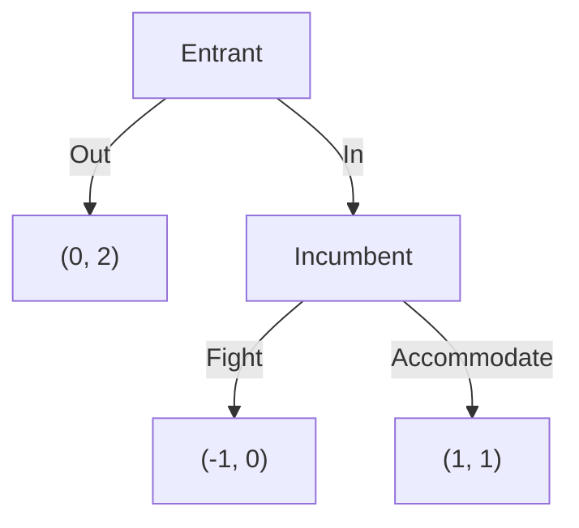
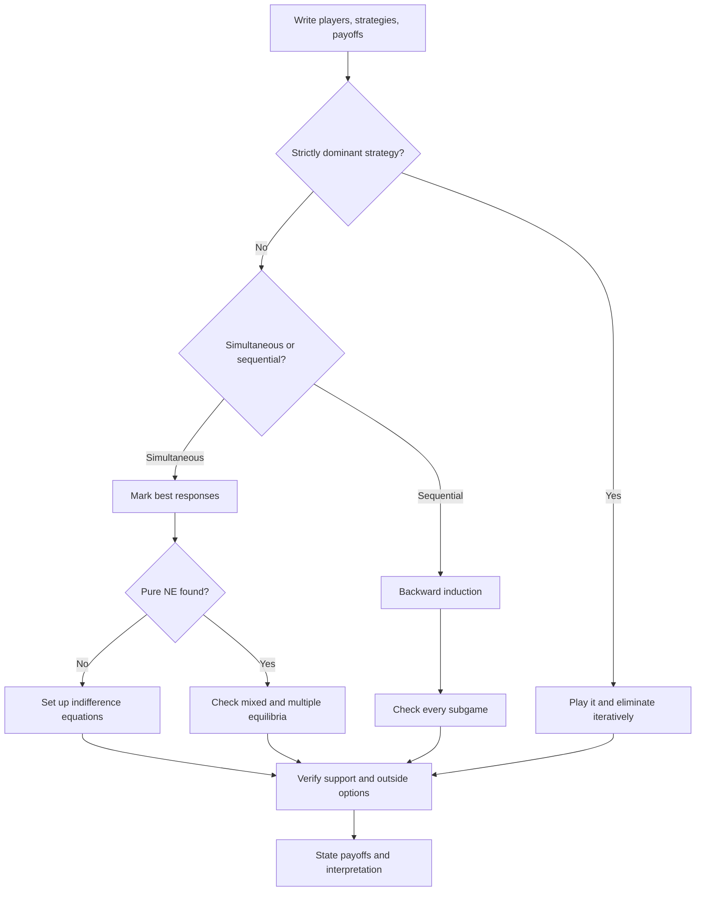

# Game Theory

> [Applied Mathematics](../README.md) · Level: Intermediate · Prerequisites: [Probability Foundations](../../10-probability/01-probability-foundations/README.md), [Expectation and Variance](../../10-probability/05-expectation-and-variance/README.md), [Systems of Linear Equations](../../08-linear-algebra/03-systems-of-linear-equations/README.md), [Derivatives](../../07-calculus/03-derivatives/README.md), [Proof Techniques](../../00-foundations/04-proof-techniques/README.md) · Estimated time: 480 min

## 1. Introduction

Most interesting decisions are interdependent. A firm sets a price a rival may undercut; a bidder
chooses a bid without knowing the others' valuations; an animal chooses whether to fight or display; two
countries decide whether to cooperate on emissions. In each case my best action depends on what you do,
and your best action depends on what I do. **Game theory** is the mathematical language for that
circularity: players, strategies, payoffs, and the analysis of which profiles are stable when everyone
reasons about everyone else.

The subject has two branches. **Non-cooperative game theory** treats each player as an individual
optimiser and asks which behaviour is self-enforcing; its central concept is **Nash equilibrium**.
**Cooperative game theory** starts from the coalitions players can form and asks how the value they
create should be divided; its central concept is the **Shapley value**.

Three results give the subject its character. The **prisoner's dilemma** shows that individually
rational behaviour can make everyone worse off. The **minimax theorem** shows that a zero-sum conflict
has a well-defined value once players randomise. The **folk theorem** shows that repetition can sustain
cooperation when the future matters enough. None is obvious, and each has changed economics, biology and
computer science.

Historically, Borel studied symmetric zero-sum games around 1921; von Neumann proved the minimax theorem
in 1928 and, with Morgenstern, founded the modern subject in 1944. Nash proved equilibrium existence in
1950; Shapley introduced his value in 1953; Vickrey analysed auctions in 1961; Maynard Smith and Price
brought games into biology in 1973. Nobel prizes in 1994, 2005, 2007, 2012, 2014 and 2020 marked the
subject's growing reach.

The theory is not a crystal ball. A Nash equilibrium is a consistency condition on beliefs and actions,
not a guarantee that people will play it. Games can have many equilibria, equilibria can be inefficient,
and common knowledge of rationality is a strong assumption. §11 and §12 return to these limits.

## 2. Prerequisites

* **Probability and expectation** — independence, expected value, variance and conditional
  expectation: [Probability Foundations](../../10-probability/01-probability-foundations/README.md),
  [Expectation and Variance](../../10-probability/05-expectation-and-variance/README.md).
* **Linear equations** — solving indifference systems: [Systems of Linear
  Equations](../../08-linear-algebra/03-systems-of-linear-equations/README.md).
* **Derivatives** — first-order conditions and concavity for continuous games:
  [Derivatives](../../07-calculus/03-derivatives/README.md).
* **Proof technique** — contradiction, induction and quantifiers:
  [Proof Techniques](../../00-foundations/04-proof-techniques/README.md).

No measure theory is assumed. Brouwer's fixed-point theorem is stated and used as a black box; the
fixed-point argument itself is carried out in Exercise 32.

## 3. Learning Objectives

After working through this tutorial you will be able to:

1. Write a strategic situation as a normal-form game and identify players, strategies and payoffs.
2. Define strict and weak dominance and apply iterated elimination.
3. Compute best responses and find all pure Nash equilibria of $2\times2$ and $3\times3$ games.
4. Derive mixed equilibria from the indifference principle.
5. State and use the minimax theorem, including the $2\times2$ value formula.
6. Recognise the prisoner's dilemma, coordination games and anti-coordination games.
7. Solve extensive-form games by backward induction and distinguish NE from subgame perfection.
8. Derive the grim-trigger threshold and state the folk theorem with its hypotheses.
9. Compute the Shapley value from the axioms and from the permutation formula.
10. Prove that the second-price auction is truthful and explain the revelation principle.
11. Apply game theory to oligopoly, biology, auctions, routing and security.
12. Recognise the standard errors: confusing Nash with efficiency, ignoring credibility, and treating an
    equilibrium as a prediction.

## 4. Intuition

The central idea is **best response**. Fix what everyone else is doing; your problem becomes an ordinary
optimisation. A Nash equilibrium is a profile in which everyone is simultaneously solving that problem:
a fixed point of the best-response map.

**Dominance** is the special case in which one action is best no matter what the others do. Defecting in
the prisoner's dilemma is like that. When a dominant strategy exists, no belief about the opponent is
needed; most games have none, which is why equilibrium reasoning is needed.

**Mixing** protects against exploitation. In matching pennies any predictable choice loses, so each
player randomises equally. The same logic explains tennis serves, poker bluffs and randomised security
patrols. A mixed strategy is not indecision; it makes the opponent's information worthless.

**Backward induction** is looking ahead and reasoning back. The last mover's decision is determined by
the terminal payoffs; the player before her anticipates it; and so on. This eliminates threats that
would not actually be carried out, such as an incumbent who promises a price war even when fighting
loses money.

**The shadow of the future** sustains cooperation. In a one-shot prisoner's dilemma defection dominates;
in a repeated game a defection today can trigger punishment tomorrow. The more patient the players, the
easier cooperation is.

**Marginal contribution** answers fair division. Imagine players arriving in a random order, each
receiving the value she adds when she arrives; averaging over all orders gives the Shapley value. A
player essential to every profitable coalition receives more than a replaceable one.

**Paying the competitor's bid** is the counter-intuitive rule of the second-price auction: the winner
pays the highest losing bid, so bidding one's true value is weakly dominant.

Finally, an equilibrium is a statement about mutual consistency, not about justice, efficiency or
empirical accuracy. Game theory clarifies strategic logic; it does not replace evidence about behaviour.

## 5. Formal Definition

### 5.1 Normal-form games

**Definition 5.1 (Finite normal-form game).** A finite normal-form game is a triple
$G=(N,\{S_i\}_{i\in N},\{u_i\}_{i\in N})$, where $N=\{1,\dots,n\}$ is a finite set of **players**, each
$S_i$ is a finite set of **pure strategies**, and $u_i:S_1\times\cdots\times S_n\to\mathbb{R}$ is player
$i$'s **payoff function**. A **pure profile** is $s=(s_1,\dots,s_n)\in S=\prod_iS_i$; the notation
$s_{-i}$ collects everyone else's actions, so $s=(s_i,s_{-i})$.

For two players the payoffs form a matrix: rows are player 1's actions, columns player 2's, and cell
$(s_1,s_2)$ contains $(u_1(s_1,s_2),u_2(s_1,s_2))$. Payoffs are **von Neumann–Morgenstern utilities**,
so expected payoff is the right criterion under uncertainty; they are not interpersonally comparable.

### 5.2 Mixed strategies

**Definition 5.2 (Mixed strategy).** A mixed strategy for player $i$ is a probability distribution over
$S_i$:
$$\Delta(S_i)=\Bigl\{\sigma_i:S_i\to[0,1]\ \Bigm|\ \sum_{s_i\in S_i}\sigma_i(s_i)=1\Bigr\}.$$
Its **support** is $\operatorname{supp}\sigma_i=\{s_i:\sigma_i(s_i)>0\}$. A pure strategy is a degenerate
mixed strategy. For a mixed profile $\sigma=(\sigma_1,\dots,\sigma_n)$,
$$u_i(\sigma)=\sum_{s\in S}\Bigl(\prod_{j\in N}\sigma_j(s_j)\Bigr)u_i(s).$$

### 5.3 Dominance

**Definition 5.3 (Dominance).** Let $s_i,s_i'\in S_i$. The strategy $s_i$ **strictly dominates** $s_i'$
if $u_i(s_i,s_{-i})>u_i(s_i',s_{-i})$ for every $s_{-i}\in S_{-i}$. It **weakly dominates** $s_i'$ if the
inequality is weak for every $s_{-i}$ and strict for at least one. A strategy is **strictly dominated**
if some other strategy strictly dominates it; **weakly dominated** is analogous. A strategy is
**dominant** if it dominates every other strategy.

The definitions extend to mixed strategies by replacing $u_i(s_i,s_{-i})$ with $u_i(\sigma_i,s_{-i})$.
Dominance is a statement about all opponent actions, so it requires no beliefs.

### 5.4 Best responses and Nash equilibrium

**Definition 5.4 (Best response).** Given $\sigma_{-i}$,
$$\operatorname{BR}_i(\sigma_{-i})=\arg\max_{\sigma_i\in\Delta(S_i)}u_i(\sigma_i,\sigma_{-i}).$$

**Definition 5.5 (Nash equilibrium).** A profile $\sigma^*$ is a **Nash equilibrium** (NE) if
$\sigma_i^*\in\operatorname{BR}_i(\sigma_{-i}^*)$ for every $i$, equivalently
$u_i(\sigma_i^*,\sigma_{-i}^*)\ge u_i(\sigma_i,\sigma_{-i}^*)$ for every $i$ and every $\sigma_i$. A
**pure NE** is a NE in which every $\sigma_i^*$ is degenerate.

The definition requires no altruism, fairness or coordination on a good outcome: only that no one wants
to deviate unilaterally.

### 5.5 Zero-sum games and value

**Definition 5.6 (Two-player zero-sum game).** A two-player game is **zero-sum** if
$u_1(s)+u_2(s)=0$ for every profile. It is described by player 1's payoff matrix $A=(a_{ij})$, with
$u_2=-u_1$.

For mixed strategies $p,q$, player 1's expected payoff is $p^{\mathsf T}Aq$. She can guarantee
$\underline{v}=\max_p\min_q p^{\mathsf T}Aq$, and player 2 can hold her to
$\overline{v}=\min_q\max_p p^{\mathsf T}Aq$. The **minimax theorem** says
$\underline{v}=\overline{v}=v$, the **value** of the game.

### 5.6 Extensive-form games

**Definition 5.7 (Finite extensive-form game).** A finite extensive-form game with perfect information
consists of a finite rooted tree of **histories**, terminal histories $Z$ with payoff vectors $u(z)$, a
**player function** $P$ assigning each non-terminal history to a player, and a finite set of **actions**
$A(h)$ at each non-terminal history $h$. A pure strategy specifies an action at every history with
$P(h)=i$, including histories not reached under the strategy. A **subgame** is the tree rooted at a
history together with all its successors; with perfect information every history starts a subgame.

**Definition 5.8 (Subgame-perfect equilibrium).** A profile is **subgame perfect** (SPE) if its
restriction to every subgame is a Nash equilibrium of that subgame.

### 5.7 Repeated games

**Definition 5.9 (Repeated game).** Let $G$ be a **stage game**. The $T$-fold repeated game plays $G$ in
periods $t=0,\dots,T-1$, with all past actions observed. With an infinite horizon and discount factor
$\delta\in[0,1)$, player $i$'s payoff is the discounted sum
$$U_i=(1-\delta)\sum_{t=0}^{\infty}\delta^t u_i(s^t).$$
The factor $1-\delta$ normalises a constant stage payoff $c$ to $c$. Unnormalised sums
$\sum_t\delta^tu_i(s^t)$ differ by the factor $1-\delta$ and give the same comparisons.

### 5.8 Cooperative games

**Definition 5.10 (Transferable-utility game).** A **TU game** is $(N,v)$ with $v:2^N\to\mathbb{R}$ and
$v(\varnothing)=0$. For a coalition $S\subseteq N$, $v(S)$ is the total payoff its members can guarantee
and divide.

### 5.9 Auctions and mechanisms

**Definition 5.11 (Single-object auction).** In a sealed-bid auction each bidder submits a bid $b_i$. A
bidder with private value $v_i$ has quasi-linear utility
$$u_i=\begin{cases}v_i-p_i,&\text{if she wins},\\-p_i,&\text{if she loses}.\end{cases}$$

**Definition 5.12 (Incentive compatibility).** A direct mechanism asks each bidder to report a type and
then chooses an allocation and payments. It is **dominant-strategy incentive compatible** (DSIC) if
truthful reporting is weakly dominant, and **individually rational** (IR) if a truthful bidder's utility
is never negative.

## 6. Mathematical Notation

| Symbol | Read as | Meaning |
|---|---|---|
| $N$, $n$ | player set, its size | $N=\{1,\dots,n\}$ |
| $S_i$, $S$ | strategy set of $i$, product | pure actions |
| $s_i$, $s=(s_i,s_{-i})$ | strategy, profile | $s_{-i}$ is everyone except $i$ |
| $u_i(s)$ | payoff of $i$ | von Neumann–Morgenstern utility |
| $\Delta(S_i)$ | simplex over $S_i$ | mixed strategies |
| $\sigma_i$, $\sigma$ | mixed strategy, profile | distributions over actions |
| $\operatorname{supp}\sigma_i$ | support | actions used with positive probability |
| $\operatorname{BR}_i(\sigma_{-i})$ | best response | maximisers of $u_i(\cdot,\sigma_{-i})$ |
| $\sigma^*$ | equilibrium profile | fixed point of the best-response map |
| $A=(a_{ij})$ | payoff matrix | row player's zero-sum payoffs |
| $p$, $q$ | mixtures | row and column distributions |
| $v$ | value | guaranteed zero-sum payoff |
| $T,R,P,S$ | temptation, reward, punishment, sucker | repeated prisoner's dilemma |
| $\delta$ | discount factor | weight on the future |
| $v(S)$ | worth of coalition $S$ | TU game |
| $\varphi_i$ | Shapley value | average marginal contribution |
| $b_i$, $v_i$ | bid, private value | auction variables |
| $\mathrm{PoA}$ | price of anarchy | welfare ratio |

Read $u_i(s_i,s_{-i})$ as "the payoff to player $i$ when she plays $s_i$ and everyone else plays
$s_{-i}$".

## 7. Core Concepts

### 7.1 Dominance and iterated elimination

Strict dominance is checked cell by cell against every opponent action. In the prisoner's dilemma of
§7.5, defection strictly dominates cooperation, so the game is solved without beliefs.

**Iterated elimination of strictly dominated strategies (IESDS).** Delete a strictly dominated strategy,
recompute, and repeat. A strictly dominated strategy is never a best response (Exercise 27), so no Nash
equilibrium is ever deleted. For strict dominance the surviving set is independent of the order of
elimination; for weak dominance it is not. Strategies that survive the iterated deletion of
never-best-responses are **rationalizable**, a weaker concept than Nash equilibrium.

### 7.2 Best responses and Nash equilibrium

For a $2\times2$ game, underline the highest payoff in each column (player 1's best response) and circle
the highest payoff in each row (player 2's). A cell with both marks is a pure NE.

**Example 7.1.** In

| | $L$ | $R$ |
|---|---|---|
| $T$ | $(4,3)$ | $(1,1)$ |
| $B$ | $(2,2)$ | $(3,4)$ |

player 1's best responses are $T$ against $L$ and $B$ against $R$; player 2's are $L$ against $T$ and
$R$ against $B$. Both $(T,L)$ and $(B,R)$ are pure NE.

**Theorem 7.1 (Nash, 1950).** Every finite normal-form game has at least one mixed-strategy NE.

*Proof idea.* The product of simplices $\Delta=\prod_i\Delta(S_i)$ is compact and convex. With
$g_i(s_i;\sigma)=\max\{0,u_i(s_i,\sigma_{-i})-u_i(\sigma)\}$, the map
$$\sigma_i'(s_i)=\frac{\sigma_i(s_i)+g_i(s_i;\sigma)}{1+\sum_{t_i}g_i(t_i;\sigma)}$$
is a continuous self-map of $\Delta$, so Brouwer gives a fixed point. At a fixed point
$g_i(s_i)=\sigma_i(s_i)G_i$ with $G_i=\sum_tg_i(t)$. If $G_i>0$, every action in the support would have
above-average payoff, impossible for a weighted average; hence $G_i=0$ and no pure action beats
$\sigma_i^*$, so $\sigma^*$ is a NE. The full verification is Exercise 32. $\blacksquare$

The theorem is existential: it does not promise uniqueness, efficiency, stability or learnability.

### 7.3 Finding equilibria

**The $2\times2$ recipe.** For row matrix $A$ and column matrix $B$, if player 1 puts probability $p$ on
the first row and player 2 puts $q$ on the first column, indifference gives
$$p=\frac{B_{22}-B_{21}}{B_{11}-B_{21}-B_{12}+B_{22}},\qquad
q=\frac{A_{22}-A_{12}}{A_{11}-A_{12}-A_{21}+A_{22}}.$$
If $0<p<1$ and $0<q<1$, the mixed profile is a NE; otherwise the pure analysis is complete.

For Example 7.1, $p=(4-2)/(3-2-1+4)=\tfrac12$ and $q=(3-1)/(4-1-2+3)=\tfrac12$, giving the mixed NE
$\left(\left(\tfrac12,\tfrac12\right),\left(\tfrac12,\tfrac12\right)\right)$ with payoff $2.5$ to each.

**The $3\times3$ recipe: support enumeration.** For each candidate support pair $(I,J)$, solve the linear
system saying that every action in $J$ gives player 1 the same payoff and every action in $I$ gives
player 2 the same payoff; check probabilities and check that no outside action does better. There are
$2^{|S_1|}-1$ choices of $I$ and $2^{|S_2|}-1$ choices of $J$, so the method is practical for small
games and exponential in general.

**Example 7.2 (rock–paper–scissors).**

| | $R$ | $P$ | $S$ |
|---|---|---|---|
| $R$ | $(0,0)$ | $(-1,1)$ | $(1,-1)$ |
| $P$ | $(1,-1)$ | $(0,0)$ | $(-1,1)$ |
| $S$ | $(-1,1)$ | $(1,-1)$ | $(0,0)$ |

No pure profile is a NE. Let the opponent mix $(p,q,1-p-q)$. The row payoffs are
$$u_R=1-p-2q,\qquad u_P=2p+q-1,\qquad u_S=q-p.$$
Indifference $u_R=u_P$ gives $p+q=\tfrac23$; indifference $u_R=u_S$ gives $q=\tfrac13$; hence
$p=\tfrac13$. The unique NE is the uniform mixture, with value $0$. The full derivation is §9.3.

A $3\times3$ coordination game in which both players receive $2$ for matching has the three pure NE
$(A,A),(B,B),(C,C)$ and the uniform mixed NE with payoff $\tfrac23$; it also has a continuum of
equilibria supported on any two actions with weights $\left(\tfrac12,\tfrac12\right)$. Multiple
equilibria are the norm, not the exception.

### 7.4 Mixed strategies and the minimax theorem

A mixed strategy protects against exploitation in a zero-sum game and makes the opponent indifferent in a
general-sum game. By making the opponent indifferent, you remove her incentive to switch, which is
exactly the equilibrium condition.

**Theorem 7.2 (Minimax, von Neumann 1928).** For every finite two-player zero-sum game with payoff matrix
$A$,
$$\max_{p\in\Delta(S_1)}\min_{q\in\Delta(S_2)}p^{\mathsf T}Aq
=\min_{q\in\Delta(S_2)}\max_{p\in\Delta(S_1)}p^{\mathsf T}Aq.$$
Both players have optimal mixed strategies, and the common value $v$ is the value.

*Proof via linear programming.* Player 1 solves
$\max v$ subject to $\sum_i p_ia_{ij}\ge v$ for all $j$, $\sum_ip_i=1$, $p\ge0$. Player 2 solves
$\min w$ subject to $\sum_ja_{ij}q_j\le w$ for all $i$, $\sum_jq_j=1$, $q\ge0$. The second is the dual
of the first; strong duality gives equality. $\blacksquare$

**The $2\times2$ value formula.** For $A=\begin{pmatrix}a&b\\c&d\end{pmatrix}$ and $D=a-b-c+d\ne0$, if
$$p=\frac{d-c}{D},\qquad q=\frac{d-b}{D},\qquad v=\frac{ad-bc}{D},$$
and $0<p,q<1$, then $p,q$ are optimal and $v$ is the value. To derive it, write $P=(p,1-p)$ and
$Q=(q,1-q)$. Column indifference gives $pa+(1-p)c=pb+(1-p)d$, hence $p=(d-c)/D$; row indifference gives
$qa+(1-q)b=qc+(1-q)d$, hence $q=(d-b)/D$. Substituting into $v=pa+(1-p)c$ gives
$v=(ad-bc)/D$. If $D=0$ or a probability leaves $(0,1)$, there is a pure saddle point and the formula
does not describe an interior equilibrium.

**Example 7.3 (matching pennies).** For $A=\begin{pmatrix}1&-1\\-1&1\end{pmatrix}$, $D=4$, so
$p=q=\tfrac12$ and $v=0$: equal randomisation makes the game fair. If either player were predictable,
the other would exploit her.

In a zero-sum game the row player maximises the minimum and the column player minimises the maximum; in
a general-sum game there is no single value to maximise or minimise. Do not apply the zero-sum formulas
to a general-sum matrix.

### 7.5 Prisoner's dilemma, coordination and anti-coordination

**The prisoner's dilemma.** With $T>R>P>S$:

| | $C$ | $D$ |
|---|---|---|
| $C$ | $(R,R)$ | $(S,T)$ |
| $D$ | $(T,S)$ | $(P,P)$ |

$D$ strictly dominates $C$ ($T>R$ against $C$, $P>S$ against $D$), so $(D,D)$ is the unique NE. Yet
$(C,C)$ is Pareto superior whenever $R>P$. The price of anarchy, using total payoffs, is $R/P$. The
dilemma models price competition, arms races, overfishing, climate agreements and public goods.

**Coordination games.** In the Battle of the Sexes

| | Opera | Football |
|---|---|---|
| Opera | $(3,2)$ | $(0,0)$ |
| Football | $(0,0)$ | $(2,3)$ |

the pure NE are $(Opera,Opera)$ and $(Football,Football)$. The mixed NE has the row player choosing Opera
with probability $\tfrac35$ and the column player with probability $\tfrac25$; it gives each
$\tfrac65$, less than either pure equilibrium. **Payoff dominance** favours a different equilibrium for
each player; **risk dominance** compares deviation losses and here also fails to separate them.

The **Stag Hunt**

| | Stag | Hare |
|---|---|---|
| Stag | $(4,4)$ | $(0,3)$ |
| Hare | $(3,0)$ | $(3,3)$ |

also has two pure NE. $(Stag,Stag)$ is payoff dominant; $(Hare,Hare)$ is risk dominant because deviating
from mutual Stag loses $1$ while deviating from mutual Hare loses $3$. Trust determines which is played.

**Anti-coordination.** Matching pennies, Chicken and Hawk–Dove reward opposite choices. Hawk–Dove has
payoffs $((V-C)/2,(V-C)/2)$, $(V,0)$, $(0,V)$ and $(V/2,V/2)$. For $V<C$ there is no symmetric pure NE;
the asymmetric profiles (Hawk, Dove) and (Dove, Hawk) are pure NE, and the symmetric mixed NE has each
player choose Hawk with probability $V/C$ and payoff $V(C-V)/(2C)$.

**Equilibrium selection.** When several equilibria exist, theory alone does not choose. Focal points,
communication, culture, history and learning matter. The mixed equilibrium of a coordination game is
typically unstable under naive best-response dynamics: a small increase in the probability of Opera
makes Opera more attractive, moving the adjustment toward a pure equilibrium.

### 7.6 Extensive form, backward induction and subgame perfection

**Backward induction** assigns payoffs to terminal nodes, then at each predecessor chooses the action
with the best continuation payoff, and continues to the root.

**Example 7.4 (entry deterrence).** An entrant chooses Out (payoffs $(0,2)$) or In; after In the
incumbent chooses Fight $(-1,0)$ or Accommodate $(1,1)$, with payoffs $(E,I)$. At the incumbent's node,
Accommodate gives $1>0$, so she accommodates. Anticipating this, the entrant enters: the SPE is
(In, Accommodate).

The normal form also has the NE (Out, Fight): given Fight the entrant stays out, and given Out the
incumbent's payoff is $2$ whatever she would do after In. But Fight is not optimal in the subgame after
In, so the threat is **non-credible** and the profile is not subgame perfect. This is exactly what the
refinement is for.

**Theorem 7.3 (Zermelo–von Neumann).** Every finite extensive-form game with perfect information has a
pure SPE, obtained by backward induction. The proof is induction on the height of the tree: each action
leads to a smaller subgame with a pure SPE, and the player at the node chooses the best continuation.

**Stackelberg competition.** With $P=120-Q$, cost $30$, and firm 1 choosing first, the follower's best
response is $q_2=(90-q_1)/2$. Substituting,
$\pi_1=\left(90-q_1-(90-q_1)/2\right)q_1=\frac{90-q_1}{2}q_1$, so $q_1=45$, $q_2=22.5$, $P=52.5$,
profits $1012.5$ and $506.25$. The leader produces more than the Cournot quantity $30$ and gains by
committing; the follower produces less.

With imperfect information the tree has information sets, and backward induction must be replaced by
perfect Bayesian or sequential equilibrium. The centipede game shows that backward induction can pre-
dict early exit even when mutual cooperation would make both players better off.

### 7.7 Repeated games and the folk theorem

**Finitely repeated prisoner's dilemma.** In the last period the stage game has a unique NE, so both
defect. In the previous period the continuation is fixed, so both defect; by induction both defect in
every period. The unique SPE is defection throughout. Finite repetition with a unique stage equilibrium
does not create cooperation.

**Infinitely repeated prisoner's dilemma.** Grim trigger cooperates until the first defection, then
defects forever. Cooperation gives $R/(1-\delta)$; a one-shot deviation gives
$T+\delta P/(1-\delta)$. Cooperation is sustained iff
$$\frac{R}{1-\delta}\ge T+\frac{\delta P}{1-\delta}
\quad\Longleftrightarrow\quad \delta\ge\frac{T-R}{T-P}.$$
The threshold lies in $(0,1)$ because $T>R>P$. With $T=4,R=3,P=1$ it is $\tfrac13$; with
$T=5,R=3,P=1$ it is $\tfrac12$. Tit-for-tat, which copies the opponent's previous action, produces an
alternating punishment path and, against a one-shot deviation, requires the stricter
$$\delta\ge\frac{T-R}{R-S}.$$

**Theorem 7.4 (Folk theorem).** Let $G$ be a finite stage game,
$V=\operatorname{conv}\{u(\sigma):\sigma\in\prod_i\Delta(S_i)\}$ the feasible payoff set, and
$\underline{v}_i=\min_{\sigma_{-i}}\max_{\sigma_i}u_i(\sigma_i,\sigma_{-i})$ the minmax value. Suppose
$V$ has full dimension and $v\in\operatorname{int}V$ satisfies $v_i>\underline{v}_i$ for every $i$. Then
for every $\varepsilon>0$ there is $\bar\delta<1$ such that for every $\delta>\bar\delta$ the
$\delta$-discounted repeated game has an SPE with payoff within $\varepsilon$ of $v$.

This is the Nash-threat folk theorem for discounted games with observed actions. It says that any
feasible, individually rational payoff can be sustained when players are patient enough. It is silent
about which payoff is selected and can fail under imperfect monitoring, private information or bounds on
patience. Applications include tacit collusion, long-lived partnerships, trust and international
agreements.

### 7.8 Cooperative games and the Shapley value

The **core** of a TU game is
$$C(v)=\Bigl\{x\in\mathbb{R}^n:\sum_{i\in N}x_i=v(N),\ \sum_{i\in S}x_i\ge v(S)\ \text{for all }S\Bigr\}.$$
No coalition can profit by breaking away. The core can be empty: in the three-player majority game,
$x_i+x_j\ge1$ for all pairs implies $\sum_ix_i\ge1.5>1=v(N)$.

**The Shapley axioms.**

* **Efficiency:** $\sum_i\varphi_i(v)=v(N)$.
* **Symmetry:** interchangeable players receive equal values.
* **Dummy:** a player who adds nothing to every coalition receives $0$.
* **Additivity:** $\varphi(v+w)=\varphi(v)+\varphi(w)$.

**Theorem 7.5 (Shapley, 1953).** Exactly one value satisfies the four axioms:
$$\varphi_i(v)=\sum_{S\subseteq N\setminus\{i\}}
\frac{|S|!(n-|S|-1)!}{n!}\bigl[v(S\cup\{i\})-v(S)\bigr].$$

*Interpretation.* Players arrive in a uniformly random order; player $i$ receives the marginal value she
adds on arrival. The coefficient is the probability that the earlier arrivals are exactly $S$. The proof
of uniqueness is Exercise 29.

For the three-player majority game, each player is pivotal in two of six orderings, so
$\varphi=(1/3,1/3,1/3)$. The Shapley value need not lie in the core, but it does for convex games, where
$v(S\cup T)+v(S\cap T)\ge v(S)+v(T)$. It is used for cost sharing (airport game) and voting power
(Shapley–Shubik index). It is a fairness axiom system, not a prediction of bargaining.

### 7.9 Auctions and mechanism design

The standard single-object formats are English (ascending), Dutch (descending), first-price sealed bid,
and second-price sealed bid (Vickrey). With private values, English is strategically equivalent to
second-price and Dutch to first-price.

**Theorem 7.6 (Vickrey 1961).** In a second-price auction with private values, truthful bidding is weakly
dominant.

*Proof.* Let $m=\max_{j\ne i}b_j$. A bid above $m$ wins and pays $m$; a bid below $m$ loses and pays $0$.
If $v_i>m$, truthful bidding wins and yields $v_i-m>0$; any bid above $m$ yields the same, any bid below
$m$ yields $0$. If $v_i<m$, truthful bidding loses and yields $0$; any bid above $m$ wins and yields
$v_i-m<0$. If $v_i=m$, truthful bidding yields $0$ either way, and any other bid yields at most $0$.
Truthful bidding is therefore at least as good as any alternative for every $m$. $\blacksquare$

**First-price equilibrium.** With $n$ symmetric risk-neutral bidders and independent $U[0,1]$ values,
the symmetric equilibrium is $b(v)=\frac{n-1}{n}v$. A bidder with value $v$ who bids $b(x)$ wins with
probability $x^{n-1}$ and has expected payoff $(v-b(x))x^{n-1}$; the first-order condition at $x=v$ gives
$vb'(v)+(n-1)b(v)=(n-1)v$, whose solution with $b(0)=0$ is the formula. Expected revenue is
$\frac{n-1}{n}\cdot\frac{n}{n+1}=\frac{n-1}{n+1}$, the same as the expected second-highest value in a
second-price auction. This is **revenue equivalence**.

**Mechanism design.** A direct mechanism is DSIC if truthful reporting is weakly dominant and IR if
truthful bidders get non-negative utility. The **revelation principle** says any dominant-strategy
mechanism can be replaced by a direct DSIC one: ask for types and simulate the original mechanism. The
**VCG mechanism** allocates to the highest-value bidder and charges the winner the highest value among
the others (the externality); it is DSIC and efficient but can run a deficit and is vulnerable to
collusion.

**Myerson–Satterthwaite** shows that with two-sided private information no mechanism is simultaneously
efficient, DSIC, IR and budget-balanced. **Gibbard–Satterthwaite** shows that with three or more
alternatives every strategy-proof social choice rule is dictatorial. Mechanism design is a theory of
trade-offs, not a recipe for a perfect market. Under common values, naive bidding at one's estimate
suffers the **winner's curse**: winning reveals that one's estimate was probably the highest, so
equilibrium bids shade downward.

### 7.10 Computational and behavioural notes

A NE of a two-player zero-sum game is computable in polynomial time by linear programming. For general
finite games, finding a NE is PPAD-complete (Daskalakis–Goldberg–Papadimitriou 2006; Chen–Deng 2006 for
two players), and no polynomial algorithm is known. Support enumeration is fine for small games;
Lemke–Howson and homotopy methods are used for larger ones.

Fictitious play converges in zero-sum games and some other classes but can cycle. No-regret dynamics
converge to **correlated equilibria**, a relaxation in which players may condition on a public signal.
Evolutionary dynamics converge to stable rest points corresponding to evolutionarily stable strategies,
not necessarily to every NE.

Experiments frequently deviate from Nash predictions. In the ultimatum game, proposers offer
substantial shares and responders reject low offers, contrary to the subgame-perfect minimal offer. In
public-goods games contributions are positive and decay with repetition. **Quantal response equilibrium**
and **level-$k$** models replace exact best responses and common knowledge with probabilistic choice and
hierarchies of reasoning; they enrich rather than refute the theory.

## 8. Formulas and Properties

| Quantity | Formula | Section |
|---|---|---|
| Expected payoff | $u_i(\sigma)=\sum_s\bigl(\prod_j\sigma_j(s_j)\bigr)u_i(s)$ | §5.2 |
| NE condition | $\sigma_i^*\in\operatorname{BR}_i(\sigma_{-i}^*)$ for all $i$ | §5.4 |
| $2\times2$ row mixture | $p=\dfrac{B_{22}-B_{21}}{B_{11}-B_{21}-B_{12}+B_{22}}$ | §7.3 |
| $2\times2$ column mixture | $q=\dfrac{A_{22}-A_{12}}{A_{11}-A_{12}-A_{21}+A_{22}}$ | §7.3 |
| Zero-sum value | $v=\dfrac{ad-bc}{a-b-c+d}$ | §7.4 |
| Grim trigger | $\delta\ge\dfrac{T-R}{T-P}$ | §7.7 |
| Tit-for-tat | $\delta\ge\dfrac{T-R}{R-S}$ | §7.7 |
| Shapley value | $\varphi_i(v)=\sum_{S\subseteq N\setminus\{i\}}\dfrac{\lvert S\rvert!\,(n-\lvert S\rvert-1)!}{n!}[v(S\cup i)-v(S)]$ | §7.8 |
| First-price bid (uniform) | $b(v)=\dfrac{n-1}{n}v$ | §7.9 |
| Expected auction revenue | $\dfrac{n-1}{n+1}$ | §7.9 |
| Price of anarchy | best feasible welfare / worst equilibrium welfare | §7.5 |

| Game | Payoff pattern | Equilibria | Lesson |
|---|---|---|---|
| Prisoner's dilemma | $T>R>P>S$ | $(D,D)$ unique | individual rationality can be collectively bad |
| Battle of the Sexes | $(3,2),(0,0),(0,0),(2,3)$ | two pure, one mixed | coordination with conflict |
| Stag Hunt | $(4,4),(0,3),(3,0),(3,3)$ | two pure, one mixed | trust versus safety |
| Hawk–Dove | $((V-C)/2,(V-C)/2),(V,0),(0,V),(V/2,V/2)$ | two asymmetric pure, one mixed, $V<C$ | limited conflict |
| Matching pennies | $(1,-1),(-1,1),(-1,1),(1,-1)$ | mixed only | unpredictability |
| Rock–paper–scissors | cyclic | uniform mixed | no pure equilibrium |
| Cournot | linear demand, constant cost | unique pure | quantity competition |
| Bertrand | homogeneous goods | $p=c$ | price competition is fierce |
| Second-price auction | private values | truthful dominant | pay the competitor's bid |

## 9. Step-by-Step Examples

### 9.1 A $2\times2$ game with two pure and one mixed equilibrium

| | $L$ | $R$ |
|---|---|---|
| $T$ | $(4,3)$ | $(1,1)$ |
| $B$ | $(2,2)$ | $(3,4)$ |

**Step 1: pure best responses.** Player 1 prefers $T$ against $L$ and $B$ against $R$; player 2 prefers
$L$ against $T$ and $R$ against $B$. Hence $(T,L)$ and $(B,R)$ are pure NE.

**Step 2: mixed candidate.** Let player 1 play $T$ with probability $p$ and player 2 play $L$ with
probability $q$. Player 2's payoffs are $2+p$ from $L$ and $4-3p$ from $R$; indifference gives
$2+p=4-3p$, so $p=\tfrac12$. Player 1's payoffs are $1+3q$ from $T$ and $3-q$ from $B$; indifference
gives $1+3q=3-q$, so $q=\tfrac12$.

**Step 3: verification.** At $p=q=\tfrac12$, each player gets $2.5$ from either action, so neither can
gain by switching. The mixed NE is
$\left(\left(\tfrac12,\tfrac12\right),\left(\tfrac12,\tfrac12\right)\right)$ with payoff $2.5$ each.

**Step 4: completeness.** A $2\times2$ game has at most one interior equilibrium; the two pure
equilibria above are the only pure ones. The list is complete. The mixed payoff $2.5$ lies between the
pure payoffs, as mixing smooths conflict at a cost to both. ✓

### 9.2 A zero-sum game: value and optimal strategies

$$A=\begin{pmatrix}3&0\\0&1\end{pmatrix}.$$

**Step 1: no pure saddle point.** Against $T$ the column player chooses $R$; against $B$ she chooses $L$.
Player 1's pure guarantee is $0$, player 2's pure ceiling is $1$; they differ.

**Step 2: formulas.** Here $a=3$, $b=0$, $c=0$, $d=1$, so $D=4$,
$$p=\frac{1-0}{4}=\frac14,\qquad q=\frac{1-0}{4}=\frac14,\qquad v=\frac{3\cdot1-0}{4}=\frac34.$$

**Step 3: verification.** With $p=\tfrac14$, player 2 gets
$3\cdot\tfrac14=\tfrac34$ from $L$ and $1\cdot\tfrac34=\tfrac34$ from $R$; player 1 guarantees
$\tfrac34$. With $q=\tfrac14$, player 1 gets $\tfrac34$ from each row; player 2 holds her to
$\tfrac34$. The value is $\tfrac34$.

**Step 4: interpretation.** Randomising $\tfrac14$ on $T$ makes player 2 indifferent and removes the
exploitability of a predictable pattern. The value is far below player 1's best cell ($3$) because the
column player avoids it most of the time. ✓

### 9.3 A $3\times3$ game: rock–paper–scissors

| | $R$ | $P$ | $S$ |
|---|---|---|---|
| $R$ | $(0,0)$ | $(-1,1)$ | $(1,-1)$ |
| $P$ | $(1,-1)$ | $(0,0)$ | $(-1,1)$ |
| $S$ | $(-1,1)$ | $(1,-1)$ | $(0,0)$ |

**Step 1: no pure NE.** At any pure profile the loser switches to the action that beats the winner.

**Step 2: symmetric mixture.** Let the opponent play $(p,q,1-p-q)$. The row payoffs are
$$u_R=1-p-2q,\qquad u_P=2p+q-1,\qquad u_S=q-p.$$
From $u_R=u_P$: $1-p-2q=2p+q-1$, so $p+q=\tfrac23$. From $u_R=u_S$: $1-p-2q=q-p$, so $q=\tfrac13$.
Hence $p=\tfrac13$ and the remaining probability is $\tfrac13$.

**Step 3: verification.** At the uniform mixture each pure action yields
$1-\tfrac13-\tfrac23=0$; all are best responses, so the uniform mixture is a NE and the value is $0$.

**Step 4: uniqueness.** A support of size $3$ forces all three payoffs equal, which gives the uniform
mixture. Supports of size $1$ or $2$ fail because the missing action is a profitable deviation. The
uniform mixture is the unique NE. ✓

### 9.4 Entry deterrence: backward induction and credibility

**Step 1: the tree.**

**Step 2: last node.** Fight gives $0$, Accommodate gives $1$, so the incumbent accommodates.

**Step 3: first node.** Anticipating accommodation, the entrant compares Out ($0$) with In ($1$) and
enters. The SPE is (In, Accommodate) with payoffs $(1,1)$.

**Step 4: normal form.** The pure NE are (Out, Fight) and (In, Accommodate). The first is a NE because
given Fight the entrant stays out, and given Out the incumbent's payoff is $2$ whatever she would do
after In. But Fight is not optimal in the subgame after In, so (Out, Fight) is not subgame perfect; the
threat is non-credible.

**Step 5: changing payoffs.** If Fight gave the incumbent $2$, the node payoffs would be $(-1,2)$ and
$(1,1)$; she would fight, the entrant would stay out, and (Out, Fight) would be the SPE. Credibility is a
property of payoffs, not words. ✓

### 9.5 Stackelberg competition: commitment has value

Inverse demand is $P=120-Q$, cost is $30$, and firm 1 chooses $q_1$ before firm 2 chooses $q_2$.

**Step 1: follower.** Firm 2 maximises $(90-q_1-q_2)q_2$, so $q_2=(90-q_1)/2$.

**Step 2: leader.** Substitute:
$$\pi_1=\left(90-q_1-\frac{90-q_1}{2}\right)q_1=\frac{90-q_1}{2}q_1.$$
Differentiating gives $45-q_1=0$, so $q_1=45$, $q_2=22.5$, $Q=67.5$, $P=52.5$.

**Step 3: profits.** $\pi_1=(52.5-30)\cdot45=1012.5$ and
$\pi_2=22.5\cdot22.5=506.25$.

**Step 4: comparison.** In Cournot each produces $30$, the price is $60$, and each earns $900$. The
leader gains $112.5$; the follower loses $393.75$; consumers gain from the lower price. The leader's
advantage comes from committing to a larger quantity, which shifts the follower's best response down. ✓

### 9.6 Second-price versus first-price: truthfulness and revenue

**Step 1: second-price.** Three bidders have values $50$, $30$ and $20$. Truthful bidding gives bids
$50,30,20$; bidder 1 wins and pays $30$, so her utility is $20$ and the seller receives $30$.

**Step 2: deviations.** If bidder 1 bids $45$, she still wins and pays $30$, utility $20$. If she bids
$25$, she loses and gets $0$. Overbidding above $50$ risks a loss; underbidding below $30$ forgoes a
profitable win. Truthful bidding is optimal.

**Step 3: first-price.** With $n=3$ and i.i.d. $U[0,1]$ values, the symmetric equilibrium is
$b(v)=\tfrac23v$. Expected revenue is
$$\mathbb{E}[b(V_{(3)})]=\frac23\cdot\frac34=\frac12.$$
The second-price expected revenue is the expected second-highest value
$\mathbb{E}[V_{(2)}]=\tfrac24=\tfrac12$. Revenue equivalence holds.

**Step 4: realised comparison.** With values $10,7,4$, first-price bids are $6.667,4.667,2.667$. The
winner pays $6.667$ and keeps $3.333$, while in the second-price auction she pays $7$ and keeps $3$. The
realised revenues differ, but the expected revenues agree. ✓

### 9.7 The Shapley value of a glove game

Player 1 owns two left gloves; players 2 and 3 each own one right glove. A pair sells for €10, so
$v(S)=10\min\{L(S),R(S)\}$.

**Step 1: coalition values.** $v(\{1\})=v(\{2\})=v(\{3\})=0$, $v(\{1,2\})=v(\{1,3\})=10$,
$v(\{2,3\})=0$, $v(\{1,2,3\})=20$.

**Step 2: marginal contributions in every order.**

| Order | Player 1 | Player 2 | Player 3 |
|---|---|---|---|
| $1,2,3$ | $0$ | $10$ | $10$ |
| $1,3,2$ | $0$ | $10$ | $10$ |
| $2,1,3$ | $10$ | $0$ | $10$ |
| $2,3,1$ | $20$ | $0$ | $0$ |
| $3,1,2$ | $10$ | $10$ | $0$ |
| $3,2,1$ | $20$ | $0$ | $0$ |

**Step 3: average.** Player 1's contributions sum to $60$, so $\varphi_1=10$; players 2 and 3 each sum
to $30$, so $\varphi_2=\varphi_3=5$. Hence $\varphi=(10,5,5)$.

**Step 4: checks.** $10+5+5=20=v(\{1,2,3\})$, and the two right-glove owners are symmetric. Player 1
captures the residual because she is essential to every profitable coalition; each right-glove owner
receives the value of the marginal pair she completes. The Shapley value is a fairness axiom system, not
a bargaining prediction. ✓

## 10. Visual Explanations

The decision flow below summarises the solution strategy for a finite game.

| Structure | Solution concept | Main tool |
|---|---|---|
| Simultaneous, one shot | Nash equilibrium | best responses, indifference |
| Simultaneous, zero sum | Minimax / value | linear programming, $2\times2$ formula |
| Sequential, perfect information | Subgame-perfect equilibrium | backward induction |
| Sequential, imperfect information | Perfect Bayesian equilibrium | beliefs, sequential rationality |
| Repeated, infinite horizon | SPE of the repeated game | discounting, trigger strategies |
| Coalitional, transferable utility | Shapley value / core | marginal contributions |
| Incomplete information | Bayesian NE / DSIC | revelation principle |

## 11. Common Mistakes

**Confusing Nash with Pareto efficiency.** A NE is stable, not necessarily good. The prisoner's dilemma
equilibrium is Pareto dominated; the stag hunt equilibrium $(Hare,Hare)$ is stable but inefficient.

**Assuming uniqueness.** Coordination games and repeated games often have many equilibria. A model that
predicts a set has not made a point prediction; selection needs extra theory or evidence.

**Checking only one player's best response.** A cell is a NE only if both players are best-responding.

**Swapping row and column payoffs.** In $(x,y)$, $x$ belongs to the row player and $y$ to the column
player. Many wrong answers come from maximising the wrong coordinate.

**Treating mixed strategies as gratuitous randomness.** A mixed strategy is a best response that makes
the opponent indifferent; it is not a claim that the player enjoys flipping coins.

**Ignoring off-path credibility.** A NE of an extensive-form game can prescribe a non-optimal action at
an unreached node. Subgame perfection is the minimal fix; the entry game of §9.4 is the canonical case.

**Applying zero-sum formulas to general-sum games.** The formula $v=(ad-bc)/(a-b-c+d)$ assumes the
column player's payoffs are the negative of the row player's. General-sum games have no single value.

**Believing a dominant strategy must exist.** Dominance is sufficient for equilibrium, not necessary.

**Adding payoffs across players.** Utilities are not interpersonally comparable unless the game has
transferable utility. "Total welfare" is a modelling choice.

**Forgetting to discount.** In an infinite repeated game, undiscounted sums are meaningless. Use the
discounted sum or normalised average and keep the convention consistent.

**Assuming grim trigger is the only punishment.** The threshold $\delta\ge(T-R)/(T-P)$ is specific to
grim trigger; tit-for-tat has a different threshold. State the strategy before quoting the condition.

**Treating the Shapley value as a bargaining prediction.** It is the unique allocation satisfying four
axioms, not the outcome of every bargain, and it need not lie in the core.

**Assuming truthful bidding in a first-price auction.** Truthfulness is dominant in the second-price
auction, not the first-price. First-price equilibrium bids shade below value.

**Quoting the folk theorem without its hypotheses.** It requires feasibility, individual rationality and
enough patience; it does not apply unchanged under imperfect monitoring.

**Believing existence implies computability.** Nash's theorem guarantees a mixed NE in every finite game,
but computing one is PPAD-complete in general.

## 12. Applications

**Economics.** Cournot, Bertrand and Stackelberg games are the workhorses of industrial organisation.
Auctions allocate spectrum, electricity, treasury securities and online advertising. Mechanism design
underlies matching markets (medical residencies, school choice, kidney exchange) and incentive contracts.
Repeated games explain tacit collusion and the fragility of cartels.

**Biology.** Evolutionary game theory replaces rational choice with differential reproduction: payoffs
are fitnesses, and the replicator equation describes how strategy frequencies change. Hawk–Dove explains
why animal conflicts are often ritualised rather than lethal; the **evolutionarily stable strategy** of
Maynard Smith and Price is a population concept coinciding with a mixed NE in symmetric games. Sex
ratios, cooperation among unrelated individuals and signalling are analysed game-theoretically.

**Computer science.** Algorithmic game theory studies the price of anarchy in routing, congestion and
resource allocation. Auction design is central to search advertising and spectrum allocation. Security
games randomise patrols and checkpoints. Blockchain protocols are games among miners and validators, and
multi-agent learning uses equilibrium concepts in generative adversarial networks and reinforcement
learning.

**Political science and law.** Voting rules, coalition formation, war and peace, and international
agreements are analysed as games. The median voter theorem, the instability of majority rule and the
credibility of threats are game-theoretic results.

**Operations and management.** Supply-chain contracting, pricing, queueing and platform design use
game-theoretic models; the key insight is often that decentralised equilibrium differs from the
centralised optimum, and the design problem is to align them.

## 13. Exercises

The problem set contains **36 problems** grouped as Beginner, Intermediate, Advanced and Challenge, with
full solutions. It covers dominance, pure and mixed equilibria, zero-sum games, extensive-form games,
repeated games, cooperative games, auctions and evolutionary dynamics.

→ [Game Theory — Exercises](exercises.md)

## 14. Solutions

Complete worked solutions, with strategies, every significant step and a check, are in

→ [Game Theory — Solutions](solutions.md)

## 15. Summary

* A game is players, strategies and payoffs; a mixed strategy is a distribution over pure strategies.
* A strictly dominant strategy is best against every opponent action; a strictly dominated strategy is
  never a best response and is eliminated by IESDS.
* A Nash equilibrium is a profile in which every strategy is a best response. Every finite game has at
  least one mixed NE (Nash).
* Pure equilibria are found by best-response marking; mixed equilibria by solving indifference equations.
* In a zero-sum game the minimax theorem gives a value and optimal mixtures; the $2\times2$ value is
  $(ad-bc)/(a-b-c+d)$.
* The prisoner's dilemma has a dominant-strategy equilibrium that is Pareto inefficient; coordination
  games have multiple equilibria; anti-coordination games often have only mixed equilibria.
* Backward induction yields subgame-perfect equilibria and eliminates non-credible threats.
* Cooperation in repeated games is sustainable when $\delta$ exceeds a threshold; grim trigger requires
  $\delta\ge(T-R)/(T-P)$, and the folk theorem characterises sustainable payoffs.
* The Shapley value is the unique allocation satisfying efficiency, symmetry, dummy and additivity; it
  is the average marginal contribution over random arrival orders.
* Second-price auctions are truthful; first-price auctions with uniform values have
  $b(v)=\frac{n-1}{n}v$ and the same expected revenue.
* Mechanism design studies incentive-compatible, individually rational rules; the revelation principle
  justifies direct truthful mechanisms.
* Game theory clarifies strategic logic but does not guarantee efficiency, uniqueness or empirical
  accuracy.

## 16. Further Learning

**Within this repository.**

* [Probability Foundations](../../10-probability/01-probability-foundations/README.md) and
  [Expectation and Variance](../../10-probability/05-expectation-and-variance/README.md) — mixed
  strategies and expected utility.
* [Systems of Linear Equations](../../08-linear-algebra/03-systems-of-linear-equations/README.md) —
  indifference systems and support enumeration.
* [Derivatives](../../07-calculus/03-derivatives/README.md) — first-order conditions for Cournot,
  Stackelberg and auctions.
* [Optimization](../../18-optimization/README.md) — constrained optimisation and duality.
* [Mathematical Modeling](../../22-mathematical-modeling/README.md) — turning stories into models and
  criticising them.
* [Applied Mathematics](../README.md) — the discipline index.

**Standard texts.**

* J. von Neumann and O. Morgenstern, *Theory of Games and Economic Behavior*, Princeton University
  Press, 1944.
* M. J. Osborne, *An Introduction to Game Theory*, Oxford University Press, 2003.
* D. Fudenberg and J. Tirole, *Game Theory*, MIT Press, 1991.
* R. B. Myerson, *Game Theory: Analysis of Conflict*, Harvard University Press, 1991.
* Y. Shoham and K. Leyton-Brown, *Multiagent Systems*, Cambridge University Press, 2009.
* J. Maynard Smith, *Evolution and the Theory of Games*, Cambridge University Press, 1982.

**Classic papers.**

* J. Nash, "Equilibrium points in $n$-person games", *Proceedings of the National Academy of Sciences*
  36 (1950), 48–49.
* L. S. Shapley, "A value for $n$-person games", in *Contributions to the Theory of Games II* (1953),
  307–317.
* W. Vickrey, "Counterspeculation, auctions, and competitive sealed tenders", *Journal of Finance* 16
  (1961), 8–37.
* J. Maynard Smith and G. R. Price, "The logic of animal conflict", *Nature* 246 (1973), 15–18.
* C. Daskalakis, P. W. Goldberg and C. H. Papadimitriou, "The complexity of computing a Nash
  equilibrium", *SIAM Journal on Computing* 39 (2009), 195–259.

