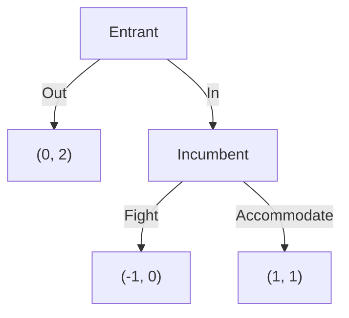

# Game Theory — Solutions

> [Game Theory](README.md) · Solutions to the 36 problems in [exercises.md](exercises.md)

Each solution states the strategy, carries out every significant step, and ends with a check. Proofs
are complete. Pitfalls are flagged where a problem is designed to expose one.

## Beginner

**1.** *(Strategy: compare each row and each column cell by cell; then impose indifference.)*

(a) Player 1 compares $T$ and $B$: against $L$, $4>2$, but against $R$, $1<3$. So neither row
dominates. Player 2 compares $L$ and $R$: against $T$, $3>1$, but against $B$, $2<4$. So neither
column dominates. There is no strictly dominant strategy.

(b) Best responses are read cell by cell. Player 1's best response to $L$ is $T$ (because $4>2$), and
to $R$ is $B$ (because $3>1$). Player 2's best response to $T$ is $L$ (because $3>1$), and to $B$ is
$R$ (because $4>2$). A pure NE is a cell that is a best response for both:

* $(T,L)$: player 1 prefers $T$ to $B$ at $L$, and player 2 prefers $L$ to $R$ at $T$. NE.
* $(B,R)$: player 1 prefers $B$ to $T$ at $R$, and player 2 prefers $R$ to $L$ at $B$. NE.

The other two cells fail: at $(T,R)$ player 2 would switch to $L$; at $(B,L)$ player 1 would switch to
$T$.

(c) Let player 1 play $T$ with probability $p$ and player 2 play $L$ with probability $q$. For player 2
to be indifferent between $L$ and $R$ against the mixture,
$$3p+2(1-p)=1p+4(1-p).$$
The left side is $2+p$, the right side is $4-3p$, so $2+p=4-3p$, hence $4p=2$ and $p=\tfrac12$. For
player 1 to be indifferent between $T$ and $B$,
$$4q+1(1-q)=2q+3(1-q).$$
The left side is $1+3q$, the right side is $3-q$, so $1+3q=3-q$, hence $4q=2$ and $q=\tfrac12$.
The mixed NE is $\left(\left(\tfrac12,\tfrac12\right),\left(\tfrac12,\tfrac12\right)\right)$.

Payoffs: player 1 gets $1+3\cdot\tfrac12=\tfrac52$; player 2 gets $2+\tfrac12=\tfrac52$.

*Check.* At the mixed profile, each pure action of player 1 yields
$4\cdot\tfrac12+1\cdot\tfrac12=\tfrac52$ for $T$ and
$2\cdot\tfrac12+3\cdot\tfrac12=\tfrac52$ for $B$, so mixing is optimal. The same computation gives
$\tfrac52$ for both columns of player 2. Because the game is symmetric in payoffs, equal payoffs are
expected. ✓

**2.** *(Strategy: dominance is a cell-by-cell comparison; then compare the equilibrium with the
cooperative outcome.)*

(a) For player 1, $D$ gives $3$ against $C$ and $1$ against $D$, while $C$ gives $2$ and $0$. Since
$3>2$ and $1>0$, $D$ strictly dominates $C$. The game is symmetric, so $D$ strictly dominates $C$ for
player 2 as well. The unique NE is $(D,D)$: each player gets $1$, and no unilateral switch changes the
other's action, so neither can gain.

(b) The best symmetric feasible total payoff is at $(C,C)$: $2+2=4$. The NE total is $1+1=2$. Hence
$$\text{price of anarchy}=\frac{4}{2}=2.$$
(The name is standard; the ratio measures how much welfare is lost to strategic behaviour.)

(c) The NE is not Pareto efficient. $(C,C)$ gives each player $2>1$, so both are strictly better off.
No player is harmed by the move from $(D,D)$ to $(C,C)$. This is the defining inefficiency of the
prisoner's dilemma.

*Check.* $(C,C)$ is feasible and gives $(2,2)$, which Pareto dominates $(1,1)$. The unique NE is still
$(D,D)$ because $D$ is dominant, not because $(C,C)$ is unavailable. ✓

**3.** *(Strategy: strict dominance is checked against every column; eliminate one strategy at a time
and recompute.)*

(a) Compare $M$ and $B$: against $L$, $3>2$; against $C$, $1>0$; against $R$, $1>0$. Thus $M$ strictly
dominates $B$, and $B$ is eliminated.

(b) The reduced game is

| | $L$ | $C$ | $R$ |
|---|---|---|---|
| $T$ | $(4,1)$ | $(1,3)$ | $(2,0)$ |
| $M$ | $(3,2)$ | $(1,4)$ | $(1,1)$ |

For player 2, compare $C$ and $L$: against $T$, $3>1$; against $M$, $4>2$. So $C$ strictly dominates
$L$, and $L$ is eliminated.

(c) The game is now

| | $C$ | $R$ |
|---|---|---|
| $T$ | $(1,3)$ | $(2,0)$ |
| $M$ | $(1,4)$ | $(1,1)$ |

For player 2, $C$ strictly dominates $R$: against $T$, $3>0$; against $M$, $4>1$. Eliminate $R$. What
remains is

| | $C$ |
|---|---|
| $T$ | $(1,3)$ |
| $M$ | $(1,4)$ |

Player 1 is indifferent between $T$ and $M$ at $C$ (both give $1$). Hence both $(T,C)$ and $(M,C)$ are
pure NE of the reduced game.

(d) Check in the original matrix. At $(T,C)$, player 1 gets $1$; switching to $M$ gives $1$ and to $B$
gives $0$, so no strict gain. Player 2 gets $3$; switching to $L$ gives $1$ and to $R$ gives $0$. NE.
At $(M,C)$, player 1 gets $1$; $T$ gives $1$ and $B$ gives $0$. Player 2 gets $4$; $L$ gives $2$ and
$R$ gives $1$. NE.

*Check.* IESDS never removes a NE: a strictly dominated strategy is never a best response, so every NE
survives every elimination round. Both surviving profiles are indeed NE. ✓

**4.** *(Strategy: look for a saddle point first; if none, use the $2\times2$ indifference formulas.)*

(a) Against $T$, player 2 chooses $R$ (payoff $-0$ rather than $-3$, i.e. $0>-3$ for player 2); against
$B$, player 2 chooses $L$ ($-0>-1$). So player 1's pure maximin payoffs are: $T$ gives $\min(3,0)=0$;
$B$ gives $\min(0,1)=0$. Player 2's pure minimax payoffs are: $L$ gives $\max(3,0)=3$; $R$ gives
$\max(0,1)=1$. The best pure guarantee for player 1 is $0$, the best pure ceiling for player 2 is $1$;
they differ, so there is no pure saddle point. Equivalently, no cell is a mutual best response.

(b) Write the matrix as $\begin{pmatrix}a&b\\c&d\end{pmatrix}$ with $a=3$, $b=0$, $c=0$, $d=1$. Then
$$D=a-b-c+d=3-0-0+1=4.$$
Player 1 mixes $T$ with probability
$$p=\frac{d-c}{D}=\frac{1-0}{4}=\frac14,$$
and player 2 mixes $L$ with probability
$$q=\frac{d-b}{D}=\frac{1-0}{4}=\frac14.$$
The value is
$$v=\frac{ad-bc}{D}=\frac{3\cdot1-0\cdot0}{4}=\frac34.$$

(c) If player 1 uses $p=\tfrac14$, player 2's payoff from $L$ is
$3\cdot\tfrac14+0\cdot\tfrac34=\tfrac34$, and from $R$ is
$0\cdot\tfrac14+1\cdot\tfrac34=\tfrac34$. So every column mixture gives player 2 exactly $\tfrac34$;
player 1 guarantees at least $\tfrac34$ (and, against a column mixture, exactly $\tfrac34$). If player 2
uses $q=\tfrac14$, player 1's payoff from $T$ is
$3\cdot\tfrac14+0\cdot\tfrac34=\tfrac34$, and from $B$ is
$0\cdot\tfrac14+1\cdot\tfrac34=\tfrac34$. Thus player 2 holds player 1 to exactly $\tfrac34$.
The value is $\tfrac34$.

*Check.* Both players' optimal mixtures make the opponent indifferent, and the guaranteed payoff
$\tfrac34$ is between the pure guarantee $0$ and the pure ceiling $1$. ✓

**5.** *(Strategy: the same formulas, with attention to signs.)*

(a) Here $a=2$, $b=-1$, $c=-1$, $d=1$, so
$$D=2-(-1)-(-1)+1=5.$$
Player 1 plays the first row with probability
$$p=\frac{d-c}{D}=\frac{1-(-1)}{5}=\frac25,$$
and player 2 plays the first column with probability
$$q=\frac{d-b}{D}=\frac{1-(-1)}{5}=\frac25.$$
The value is
$$v=\frac{ad-bc}{D}=\frac{2\cdot1-(-1)(-1)}{5}=\frac{2-1}{5}=\frac15.$$
Thus the value is $\tfrac15$ to player 1.

(b) $p=\tfrac25<\tfrac12$. The asymmetry comes from the sizes of the gains. Against $L$, moving from $B$
to $T$ gains $3$; against $R$, moving from $T$ to $B$ gains only $2$. To keep player 2 indifferent, the
row mixture must put the larger weight on the row that is less attractive to player 2 against the
column it likes; solving the indifference equation gives the weights in the ratio $2:3$.

*Check.* With $p=\tfrac25$, player 2's payoff from $L$ is
$-\left(2\cdot\tfrac25+(-1)\cdot\tfrac35\right)=-\tfrac15$, and from $R$ is
$-\left(-1\cdot\tfrac25+1\cdot\tfrac35\right)=-\tfrac15$. With $q=\tfrac25$, player 1's payoff from
$T$ is $2\cdot\tfrac25+(-1)\cdot\tfrac35=\tfrac15$, and from $B$ is
$(-1)\cdot\tfrac25+1\cdot\tfrac35=\tfrac15$. ✓

**6.** *(Strategy: separate the three claims; counterexamples are enough for the false ones.)*

(a) **Yes.** Suppose $s_i$ strictly dominates every other pure strategy. For any $\sigma_{-i}$ and any
other $s_i'$, $u_i(s_i,\sigma_{-i})>u_i(s_i',\sigma_{-i})$. If a NE put positive probability on some
$s_i'\ne s_i$, replacing that mass by $s_i$ would strictly increase player $i$'s payoff, contradicting
the best-response condition. Hence every NE plays $s_i$ with probability $1$.

(b) **No.** In Exercise 1, $(T,L)$ and $(B,R)$ are NE, yet neither player has a dominant strategy. A NE
only requires each strategy to be a best response to the other's *equilibrium* strategy, not to every
possible strategy.

(c) **Yes.** In the game of Exercise 12,

| | $L$ | $R$ |
|---|---|---|
| $T$ | $(1,1)$ | $(1,0)$ |
| $B$ | $(0,0)$ | $(1,1)$ |

$T$ weakly dominates $B$, but $(B,R)$ is a NE: against $R$, $B$ gives $1$, the same as $T$; and against
$B$, player 2 prefers $R$ ($1>0$). So the weakly dominated strategy $B$ is played in a NE.

*Check.* Strict dominance is a statement about *all* opponent actions; weak dominance allows ties, and
a tie is exactly what lets a weakly dominated action remain a best response at some profile. ✓

**7.** *(Strategy: multiply independent probabilities; then average the four cell payoffs.)*

(a) The profile probabilities are
$$0.3\cdot0.6=0.18,\quad 0.3\cdot0.4=0.12,\quad 0.7\cdot0.6=0.42,\quad 0.7\cdot0.4=0.28,$$
for $(T,L)$, $(T,R)$, $(B,L)$, $(B,R)$ respectively. They sum to $1$.

(b) Player 1's expected payoff is
$$0.18\cdot4+0.12\cdot1+0.42\cdot2+0.28\cdot3=0.72+0.12+0.84+0.84=2.52.$$
Player 2's expected payoff is
$$0.18\cdot3+0.12\cdot1+0.42\cdot2+0.28\cdot4=0.54+0.12+0.84+1.12=2.62.$$

(c) The expectation is a convex combination of player 1's four payoffs, with non-negative weights summing
to $1$. A convex combination always lies between the minimum and the maximum of the numbers, here
between $1$ and $4$. Indeed $2.52\in[1,4]$.

*Check.* Recomputing by conditioning on player 1's action: if $T$, player 1 gets
$0.6\cdot4+0.4\cdot1=2.8$; if $B$, gets $0.6\cdot2+0.4\cdot3=2.4$; the average is
$0.3\cdot2.8+0.7\cdot2.4=0.84+1.68=2.52$. ✓

**8.** *(Strategy: in a second-price auction the price is the highest *losing* bid; compare deviations.)*

(a) Truthful bidding is weakly dominant, so bids are $50$, $30$, $20$. The bidder with value $50$ wins
and pays the highest competing bid, $30$. Her utility is $50-30=20$. The other bidders get $0$.

(b) If she bids $45$, she still wins because $45>30$, and still pays $30$; her utility is still $20$. If
she bids $25$, she loses because $25<30$; her utility is $0$ instead of $20$. Overbidding did not help;
underbidding destroyed a profitable win.

(c) Bidding above one's value can only create the possibility of winning at a price above value, which
yields negative utility; it never lowers the price paid when the bidder would have won anyway.

*Check.* The price is set by the second-highest bid, not by the winner's bid; hence changing the
winner's bid over a range that does not change the winner cannot change the payment. ✓

**9.** *(Strategy: average marginal contributions over the two arrival orders.)*

(a) The two orderings are $(1,2)$ and $(2,1)$.

* Order $(1,2)$: player 1 arrives first and contributes $v(\{1\})-v(\varnothing)=2-0=2$. Player 2 then
  contributes $v(\{1,2\})-v(\{1\})=5-2=3$.
* Order $(2,1)$: player 2 arrives first and contributes $v(\{2\})-v(\varnothing)=1-0=1$. Player 1 then
  contributes $v(\{1,2\})-v(\{2\})=5-1=4$.

Averaging,
$$\varphi_1=\frac{2+4}{2}=3,\qquad \varphi_2=\frac{3+1}{2}=2.$$

(b) $\varphi_1+\varphi_2=3+2=5=v(\{1,2\})$, so efficiency holds.

(c) The core conditions are $x_1\ge v(\{1\})=2$, $x_2\ge v(\{2\})=1$ and $x_1+x_2=5$. Thus
$x_1\in[2,4]$. The Shapley value $(3,2)$ satisfies $3\in[2,4]$, so it is in the core. (The core is
nonempty here; this is not true of every cooperative game.)

*Check.* Player 1's advantage is that she is worth $2$ alone, while player 2 is worth only $1$; the
Shapley value splits the surplus $5-3=2$ equally at $1$ each above the stand-alone values, giving
$(3,2)$. ✓

**10.** *(Strategy: compare the cooperative stream with the best one-shot deviation followed by
permanent punishment.)*

(a) Under grim trigger both cooperate in every period, so player 1's total discounted payoff is
$$R+\delta R+\delta^2R+\cdots=\frac{R}{1-\delta}.$$
A deviation at period $0$ yields $T$ immediately. Thereafter the opponent defects forever, so the
deviator's best continuation is to defect too and receive $P$ in every period:
$$T+\delta P+\delta^2P+\cdots=T+\frac{\delta P}{1-\delta}.$$
Cooperation is sustained iff
$$\frac{R}{1-\delta}\ge T+\frac{\delta P}{1-\delta}.$$
Multiplying by $1-\delta>0$ gives $R\ge(1-\delta)T+\delta P$, i.e.
$R-P\ge(1-\delta)(T-P)$, which is
$$\delta\ge\frac{T-R}{T-P}.$$

(b) Here $(T-R)/(T-P)=(4-3)/(4-1)=\tfrac13$. Since $\delta=0.5\ge\tfrac13$, cooperation is sustained.
Numerically, cooperation gives $3/(1-0.5)=6$; deviation gives $4+0.5\cdot1/(1-0.5)=4+1=5$. So
$6\ge5$.

(c) As $\delta\to1$, the future matters more and the threshold $\tfrac13$ is easier to satisfy. The
normalised comparison is between $R$ and $T$: patient players weight the long cooperative stream enough
to outweigh the one-period temptation. At $\delta=1$ the undiscounted sums diverge and the comparison
must be made in average terms; the threshold formula is the correct limiting statement for
$\delta<1$.

*Check.* For $\delta=\tfrac13$ both sides equal: $3/(2/3)=4.5$ and $4+\tfrac13\cdot1/(2/3)=4.5$. ✓

**11.** *(Strategy: solve the last decision node first; then compare the entrant's two choices.)*

(a) The tree is

(b) The normal form is

| | Fight | Accommodate |
|---|---|---|
| Out | $(0,2)$ | $(0,2)$ |
| In | $(-1,0)$ | $(1,1)$ |

Pure NE: $(Out,Fight)$ and $(In,Accommodate)$.

* $(Out,Fight)$: given Fight, the entrant prefers Out ($0>-1$); given Out, the incumbent's payoff is
  $2$ whichever action is prescribed at the unreached node, so no deviation changes the outcome.
* $(In,Accommodate)$: given Accommodate, the entrant prefers In ($1>0$); given In, the incumbent prefers
  Accommodate ($1>0$).

The profiles $(Out,Accommodate)$ and $(In,Fight)$ fail: in the first the entrant would enter, and in
the second the incumbent would accommodate.

(c) Only $(In,Accommodate)$ is subgame perfect. The subgame beginning after *In* is a one-player
decision: Fight gives $0$, Accommodate gives $1$, so the incumbent must accommodate. In
$(Out,Fight)$ the prescribed action Fight lies in that subgame and is not optimal there, so the threat
is non-credible. The profile survives as a NE only because the subgame is never reached on the
equilibrium path.

*Check.* Backward induction gives Accommodate at the last node, then In at the initial node, exactly
$(In,Accommodate)$. ✓

**12.** *(Strategy: distinguish "no worse" from "strictly better" cell by cell.)*

(a) Compare player 1's payoffs:
against $L$, $T$ gives $1$ and $B$ gives $0$; against $R$, both give $1$. Thus $T$ is at least as good
as $B$ in every column and strictly better in column $L$. So $T$ weakly dominates $B$. It does not
strictly dominate $B$, because the payoffs are equal at $R$.

(b) Best responses: against $L$, player 1 prefers $T$ ($1>0$); against $R$, player 1 is indifferent
($1=1$). Against $T$, player 2 prefers $L$ ($1>0$); against $B$, player 2 prefers $R$ ($1>0$). Pure
NE: $(T,L)$ and $(B,R)$.

(c) $(B,R)$ plays the weakly dominated strategy $B$. This does not contradict the theorem about strict
dominance: weak dominance permits ties, and at column $R$ the tie $u_1(T,R)=u_1(B,R)=1$ lets $B$ remain
a best response. A *strictly* dominated strategy is worse in every column and therefore can never be a
best response, so it is played with probability zero in every NE.

*Check.* $(B,R)$: player 1 gets $1$, and switching to $T$ also gives $1$, so no strict gain; player 2
gets $1$ and switching to $L$ gives $0$. NE. ✓

## Intermediate

**13.** *(Strategy: differentiate each firm's profit in its own quantity, then impose symmetry.)*

(a) Firm $i$'s profit is
$$\pi_i=(P-c)q_i=(120-q_1-q_2-30)q_i=(90-q_1-q_2)q_i.$$
Differentiating with respect to $q_i$ (the other quantity fixed):
$$\frac{\partial\pi_i}{\partial q_i}=90-2q_i-q_j.$$
The second derivative is $-2<0$, so the stationary point is a maximum. Setting the derivative to zero,
$$q_i=\frac{90-q_j}{2}.$$
This is firm $i$'s best-response function.

(b) In a symmetric equilibrium $q_1=q_2=q$. Then
$$q=\frac{90-q}{2}\quad\Longrightarrow\quad 2q=90-q\quad\Longrightarrow\quad 3q=90\quad\Longrightarrow\quad q=30.$$
Total output is $Q=60$, price is $P=120-60=60$, and each profit is
$(60-30)\cdot30=900$.

(c) Cournot total surplus: consumer surplus is the triangle
$\tfrac12(120-60)\cdot60=1800$; producer surplus is $2\cdot900=1800$; total $3600$.
A monopolist with the same cost maximises $(120-Q-30)Q=(90-Q)Q$. The first-order condition
$90-2Q=0$ gives $Q=45$, $P=75$, profit $(75-30)\cdot45=2025$, consumer surplus
$\tfrac12(120-75)\cdot45=1012.5$, total $3037.5$. Cournot produces more output, a lower price and a
larger total surplus. The competitive benchmark is $P=30$, $Q=90$, total surplus $4050$; Cournot's
deadweight loss is $\tfrac12(60-30)(90-60)=450$, monopoly's is
$\tfrac12(75-30)(90-45)=1012.5$.

*Check.* Each best response at $(30,30)$ is $(90-30)/2=30$. Profit $900$ is positive but below the
joint-profit-maximising half of the monopoly profit, $1012.5$, which is the gain from collusion. ✓

**14.** *(Strategy: the follower's action is a function of the leader's; substitute it into the leader's
profit.)*

(a) The follower observes $q_1$ and maximises $(90-q_1-q_2)q_2$. The first-order condition is
$90-q_1-2q_2=0$, so
$$q_2^{\mathrm{BR}}(q_1)=\frac{90-q_1}{2}.$$

(b) The leader anticipates this and maximises
$$\pi_1=\left(90-q_1-\frac{90-q_1}{2}\right)q_1=\frac{90-q_1}{2}q_1=45q_1-\frac12q_1^2.$$
The first-order condition is $45-q_1=0$, so $q_1=45$. Then
$q_2=(90-45)/2=22.5$. Total output is $67.5$, price $P=120-67.5=52.5$. Profits are
$$\pi_1=(52.5-30)\cdot45=22.5\cdot45=1012.5,\qquad
\pi_2=(52.5-30)\cdot22.5=22.5\cdot22.5=506.25.$$

(c) In Cournot both earned $900$. The leader gains $112.5$; the follower loses $393.75$. Consumers gain
because price falls from $60$ to $52.5$ and output rises from $60$ to $67.5$. The leader benefits from
committing to a large quantity: by producing more than the Cournot quantity, she shifts the follower's
best response downward. Commitment is valuable even though the leader moves first and has no
information advantage.

*Check.* The follower's best response to $45$ is $22.5$; the leader's profit at $q_1=45$ is
$(90-45-22.5)\cdot45=22.5\cdot45=1012.5$. Total profit $1518.75$ is below Cournot's $1800$, but the
leader's share is larger. ✓

**15.** *(Strategy: two pure equilibria are visible; the mixed one follows from indifference.)*

(a) $(Opera,Opera)$ gives $(3,2)$ and $(Football,Football)$ gives $(2,3)$. These are NE: at
$(Opera,Opera)$, either player switching alone gets $0$, so neither gains.

(b) Let player 1 play Opera with probability $p$ and player 2 play Opera with probability $q$. Player 2
is indifferent between Opera and Football when
$$2p+0(1-p)=0p+3(1-p)\quad\Longrightarrow\quad 2p=3-3p\quad\Longrightarrow\quad p=\frac35.$$
Player 1 is indifferent when
$$3q+0(1-q)=0q+2(1-q)\quad\Longrightarrow\quad 3q=2-2q\quad\Longrightarrow\quad q=\frac25.$$
The mixed NE is $\left(\left(\tfrac35,\tfrac25\right),\left(\tfrac25,\tfrac35\right)\right)$.

(c) Player 1's mixed payoff is $3q=3\cdot\tfrac25=\tfrac65=1.2$; player 2's is
$2p=2\cdot\tfrac35=\tfrac65=1.2$. Both are below the payoffs from either pure equilibrium (at least $2$
for each player). The mixed equilibrium is inefficient for both.

(d) There is no unique prediction. The pure equilibria are strict, so small mistakes do not destroy
them, but each favours a different player. Selection depends on focal points, communication, cultural
conventions, history and the players' beliefs. Neither pure equilibrium payoff-dominates the other;
nor does either risk-dominate the other: at $(Opera,Opera)$ the deviation losses are $3$ and $2$
(product $6$), and at $(Football,Football)$ they are $2$ and $3$ (product $6$). So the standard
refinements do not separate them.

*Check.* At $\left(\tfrac35,\tfrac25\right)$, player 2's Opera payoff is
$2\cdot\tfrac35=\tfrac65$ and Football payoff is $3\cdot\tfrac25=\tfrac65$; at
$\left(\tfrac25,\tfrac35\right)$, player 1's Opera payoff is $3\cdot\tfrac25=\tfrac65$ and Football
payoff is $2\cdot\tfrac35=\tfrac65$. ✓

**16.** *(Strategy: find the mixed equilibrium by indifference; then compare deviation losses.)*

(a) The pure NE are $(Stag,Stag)$ with $(4,4)$ and $(Hare,Hare)$ with $(3,3)$. Let player 1 play Stag
with probability $p$ and player 2 play Stag with probability $q$. Player 2 is indifferent when
$$4p+0(1-p)=0p+3(1-p)\quad\Longrightarrow\quad 4p=3-3p\quad\Longrightarrow\quad p=\frac34.$$
Player 1 is indifferent when
$$4q+0(1-q)=0q+3(1-q)\quad\Longrightarrow\quad 4q=3-3q\quad\Longrightarrow\quad q=\frac34.$$
The mixed NE is $\left(\left(\tfrac34,\tfrac14\right),\left(\tfrac34,\tfrac14\right)\right)$, with
payoff $3$ to each.

(b) **Payoff dominance:** an equilibrium $E$ payoff-dominates $E'$ if every player's payoff is weakly
higher at $E$ and at least one is strictly higher. $(Stag,Stag)$ payoff-dominates $(Hare,Hare)$ because
$(4,4)>(3,3)$ coordinatewise.
**Risk dominance:** compare the products of the players' losses from unilateral deviation. At
$(Stag,Stag)$ each player loses $4-3=1$ by deviating, product $1$. At $(Hare,Hare)$ each player loses
$3-0=3$ by deviating to Stag, product $9$. The larger product is at $(Hare,Hare)$, so $(Hare,Hare)$ is
risk dominant. Thus the efficient equilibrium is not the safe one.

(c) Stag hunting pays $4$ only if both hunt Stag. If one player suspects the other will play Hare, the
best response is Hare, which guarantees $3$. The game models trust: the good outcome requires mutual
confidence, and the safe outcome is a self-fulfilling lack of trust.

*Check.* At the mixed profile, Stag payoff $4\cdot\tfrac34=3$ and Hare payoff $3$; similarly for the
other player. The mixed equilibrium payoff equals the Hare equilibrium payoff, which is why the mixed
profile is not a strict equilibrium. ✓

**17.** *(Strategy: the payoff of a pure action is $2$ times the probability the opponent matches it.)*

(a) The pure NE are $(A,A)$, $(B,B)$ and $(C,C)$, each with payoff $2$ to both players. At any other
pure profile both get $0$ and either player can switch to the opponent's action to get $2$.

(b) Let the opponent play the uniform mixture. Then each pure action yields
$2\cdot\tfrac13=\tfrac23$, because only the matching outcome gives a positive payoff. The uniform
mixture itself therefore yields $\tfrac23$. Since no pure action yields more than $\tfrac23$, the
uniform mixture is a best response, and by symmetry both players using it is a NE. Payoff
$\tfrac23$.

(c) Suppose player 1 mixes uniformly on $\{A,B\}$ and player 2 does the same. Against player 1's
mixture, player 2's payoffs are $2\cdot\tfrac12=1$ for $A$, $1$ for $B$ and $0$ for $C$. Thus $A$ and
$B$ are both best responses, and any mixture on them is optimal, including the uniform one. Payoff
$1$. The same argument works for any pair of actions.

(d) Payoffs depend only on whether the actions match. Any equal-weight mixture on a set $T$ of actions
makes the opponent indifferent among the actions in $T$ (each yields $2/|T|$) and gives $0$ to actions
outside $T$. Hence every such pair is an equilibrium, a continuum. The pure equilibria are the natural
predictions because they are strict: at $(A,A)$ a unilateral switch gives $0<2$, so small errors are
punished. The mixed equilibria are not strict and are dynamically unstable under naive best-response
adjustment.

*Check.* At the uniform mixture, each player's payoff is
$\tfrac13\cdot 2+\tfrac13\cdot2+\tfrac13\cdot2$ conditional on matching? More directly, the
probability of matching is $\tfrac13$ and the payoff is $2$, so $\tfrac23$. ✓

**18.** *(Strategy: a unilateral price cut captures the whole market; compare the gain from undercutting
with the loss from a lower margin.)*

(a) At $p_1=p_2=10$, each firm's margin is zero, so each earns $0$. If a firm raises its price, its
demand is zero (the rival is cheaper) and its profit stays $0$. If it lowers its price below $10$, it
captures the whole market but sells at a price below marginal cost, so its profit is negative. No
profitable deviation exists; $(10,10)$ is a NE.

(b) If $p_1=p_2=p>10$, each earns $\tfrac12(p-10)(100-p)>0$. A firm can cut its price to $p-\varepsilon$
with $0<\varepsilon<p-10$. It then captures the entire demand and earns
$(p-\varepsilon-10)(100-p+\varepsilon)$. For small $\varepsilon>0$ this is approximately
$(p-10)(100-p)$, which exceeds the previous half-share $\tfrac12(p-10)(100-p)$. So the profile is not a
NE.

(c) Suppose $p_1<p_2$. We show that the profile is not a NE in every case.

* If $p_1>10$, firm 2 earns $0$. It can undercut to $p_1-\varepsilon$ with
  $0<\varepsilon<p_1-10$, capture the whole market and earn a positive profit. Not a NE.
* If $p_1<10$, firm 1 is selling below marginal cost and earns a negative profit. It can raise its
  price to $\min(p_2,10)$ (or just above $p_2$ if $p_2<10$) and earn $0$ instead, which is better.
  Not a NE.
* If $p_1=10$, firm 1 earns $0$. Since $p_2>10$, firm 1 can raise its price slightly above $10$ but
  still below $p_2$, capture the whole market and earn a positive margin. Not a NE.

Hence no asymmetric profile is a NE.

(d) In Cournot, firms choose quantities and the price clears the market; each firm's output affects the
price only through total output, so positive profits survive. In Bertrand, price competition is a
"winner-take-all" contest: undercutting by an arbitrarily small amount captures the entire market, so
competition drives price to marginal cost. The difference is the strategic variable, not the
technology.

*Check.* At $(10,10)$, profit is zero for both; any price above $10$ is undercut, any price below $10$
is loss-making. The unique NE is $(10,10)$ with zero profits. ✓

**19.** *(Strategy: trace the alternating punishment path after a single deviation; then compare
discounted streams.)*

(a) If both cooperate forever, each gets
$$R+\delta R+\delta^2R+\cdots=\frac{R}{1-\delta}.$$
Suppose player 1 defects once at period $0$, then returns to tit-for-tat. The path is:
period $0$: $(D,C)$, payoff $T$; period $1$: player 1 copies $C$ while player 2 copies $D$, so
$(C,D)$, payoff $S$; period $2$: player 1 copies $D$ while player 2 copies $C$, so $(D,C)$, payoff
$T$; and so on. The payoffs alternate $T,S,T,S,\dots$, so the deviation payoff is
$$T+\delta S+\delta^2T+\delta^3S+\cdots=\frac{T+\delta S}{1-\delta^2}.$$
Cooperation is sustained iff
$$\frac{R}{1-\delta}\ge\frac{T+\delta S}{1-\delta^2}.$$
Since $1-\delta^2=(1-\delta)(1+\delta)$, multiply by $(1-\delta)(1+\delta)>0$:
$$R(1+\delta)\ge T+\delta S\quad\Longrightarrow\quad \delta(R-S)\ge T-R
\quad\Longrightarrow\quad \delta\ge\frac{T-R}{R-S}.$$

(b) With $T=5$, $R=3$, $S=0$,
$$\delta\ge\frac{5-3}{3-0}=\frac23.$$
At $\delta=\tfrac23$ cooperation gives $3/(1/3)=9$; the deviation gives
$(5+\tfrac23\cdot0)/(1-\tfrac49)=5/(\tfrac59)=9$. At $\delta=0.5$, cooperation gives $6$ but deviation
gives $5/(1-\tfrac14)=\tfrac{20}{3}\approx6.667$, so deviation is profitable.

(c) The grim-trigger threshold is $(T-R)/(T-P)=(5-3)/(5-1)=\tfrac12$, lower than $\tfrac23$. Grim
trigger punishes forever, while tit-for-tat punishes only through an alternating phase. A harsher
punishment deters deviation for a wider range of discount factors, so tit-for-tat requires more
patience.

*Check.* At $\delta=\tfrac23$ the two sides of the inequality coincide; for $\delta>\tfrac23$ the
cooperative stream is strictly larger. ✓

**20.** *(Strategy: list all orderings; a player's marginal contribution is $1$ exactly when she is the
second member of the coalition.)*

(a) $v(\varnothing)=0$; $v(\{i\})=0$ for each $i$; $v(\{i,j\})=1$ for each pair; $v(\{1,2,3\})=1$.

(b) The six orderings and marginal contributions $(1,2,3)$ are:

| Order | Player 1 | Player 2 | Player 3 |
|---|---|---|---|
| $1,2,3$ | $0$ | $1$ | $0$ |
| $1,3,2$ | $0$ | $0$ | $1$ |
| $2,1,3$ | $1$ | $0$ | $0$ |
| $2,3,1$ | $0$ | $0$ | $1$ |
| $3,1,2$ | $1$ | $0$ | $0$ |
| $3,2,1$ | $0$ | $1$ | $0$ |

Each player receives marginal contribution $1$ in exactly two of the six orderings, so
$$\varphi_1=\varphi_2=\varphi_3=\frac{2}{6}=\frac13.$$

(c) The game is symmetric, so symmetry forces equal values; efficiency then forces each to be
$\tfrac13$. The player who arrives second completes a winning coalition and captures the unit, which is
why each is pivotal in one third of the orderings.

*Check.* $\varphi_1+\varphi_2+\varphi_3=1=v(\{1,2,3\})$. ✓

**21.** *(Strategy: list the winning coalitions; use the Shapley formula or count pivotal orderings.)*

(a) With weights $(2,1,1)$ and quota $3$, the winning coalitions are $\{1,2\}$, $\{1,3\}$ and
$\{1,2,3\}$. The coalition $\{2,3\}$ has weight $2<3$ and is losing. Thus
$$v(\{1,2\})=v(\{1,3\})=v(\{1,2,3\})=1,$$
and $v(S)=0$ for all other $S$, including all singletons.

(b) Using
$$\varphi_i=\sum_{S\subseteq N\setminus\{i\}}\frac{|S|!(n-|S|-1)!}{n!}\bigl[v(S\cup\{i\})-v(S)\bigr],$$
compute player 1 first. The subsets $S\subseteq\{2,3\}$ are $\varnothing$, $\{2\}$, $\{3\}$ and
$\{2,3\}$, with weights $\tfrac13,\tfrac16,\tfrac16,\tfrac13$:
$$\varphi_1=\frac13\bigl(v(\{1\})-v(\varnothing)\bigr)
+\frac16\bigl(v(\{1,2\})-v(\{2\})\bigr)
+\frac16\bigl(v(\{1,3\})-v(\{3\})\bigr)
+\frac13\bigl(v(\{1,2,3\})-v(\{2,3\})\bigr).$$
Each difference is $0,1,1,1$ respectively, so
$$\varphi_1=0+\frac16+\frac16+\frac13=\frac23.$$
For player 2, the subsets of $\{1,3\}$ give differences
$v(\{2\})-v(\varnothing)=0$, $v(\{1,2\})-v(\{1\})=1$,
$v(\{2,3\})-v(\{3\})=0$ and $v(\{1,2,3\})-v(\{1,3\})=0$. Hence
$$\varphi_2=0+\frac16+0+0=\frac16.$$
By symmetry $\varphi_3=\tfrac16$. So
$(\varphi_1,\varphi_2,\varphi_3)=\left(\tfrac23,\tfrac16,\tfrac16\right)$.

(c) Player 1 is a **veto player**: every winning coalition contains her. She is therefore pivotal in
more orderings than either small player. The two small players are symmetric, so they split the
remaining third. The large player's value is four times a small player's, more than twice.

*Check.* $\tfrac23+\tfrac16+\tfrac16=1=v(\{1,2,3\})$. ✓

**22.** *(Strategy: order statistics for the second-price auction; the bid function for the first-price
auction.)*

(a) With three independent uniform values, the second-price winner pays the second-highest value. The
second order statistic of three uniforms has expectation
$$\mathbb{E}[V_{(2)}]=\frac{n-1}{n+1}=\frac{2}{4}=\frac12.$$
So expected revenue is $\tfrac12$.

(b) The highest value has expectation $\mathbb{E}[V_{(3)}]=\tfrac34$. The winner bids
$b(v)=\tfrac23v$, so the expected winning bid is $\tfrac23\cdot\tfrac34=\tfrac12$.

(c) Both auctions yield expected revenue $\tfrac12$, in agreement with revenue equivalence.

(d) A risk-averse bidder prefers the second-price auction. Truthful bidding is weakly dominant there
for any increasing utility of money, so the bidder need not trade off winning probability against
surplus. In a first-price auction, a risk-averse bidder typically bids more aggressively than a
risk-neutral one to raise the win probability, which lowers her expected utility; revenue equivalence
is a risk-neutral result and fails under risk aversion.

*Check.* The two revenue calculations agree; for $n=3$ the formula $(n-1)/(n+1)=1/2$ applies to both.
✓

**23.** *(Strategy: exhibit one bidder who gains by deviating from truthful bidding.)*

Suppose both bidders bid their values: bidder 1 bids $10$, bidder 2 bids $8$. Bidder 1 wins and pays
her own bid, $10$, so her utility is $10-10=0$. If she deviates to a bid of $9$, she still wins
(because $9>8$) but now pays $9$, so her utility is $10-9=1>0$. The deviation is profitable, so
truthful bidding is not an equilibrium.

*Check.* Bidder 2 cannot profitably deviate: bidding above $10$ would win but pay more than her value;
bidding between $8$ and $10$ still loses to $10$. Only bidder 1's deviation is needed to disprove the
profile. ✓

**24.** *(Strategy: write the $2\times2$ matrix, impose indifference, then read off the population
interpretation.)*

(a) With $V=4$ and $C=6$, $(V-C)/2=-1$, $V=4$, $V/2=2$:

| | Hawk | Dove |
|---|---|---|
| Hawk | $(-1,-1)$ | $(4,0)$ |
| Dove | $(0,4)$ | $(2,2)$ |

(b) Let $p$ be the probability that the opponent plays Hawk. A Hawk's payoff is
$$p(-1)+(1-p)4=4-5p;$$
a Dove's payoff is
$$p\cdot0+(1-p)2=2-2p.$$
Indifference requires $4-5p=2-2p$, so $2=3p$ and $p=\tfrac23$. The symmetric mixed NE has each player
playing Hawk with probability $\tfrac23$. The asymmetric profiles (Hawk, Dove) and (Dove, Hawk) are also
pure NE, with payoffs $(4,0)$ and $(0,4)$; the mixed equilibrium is the symmetric one.

(c) At $p=\tfrac23$, either action yields
$$4-5\cdot\frac23=\frac23,\qquad 2-2\cdot\frac23=\frac23.$$
So the equilibrium payoff is $\tfrac23$.

(d) As $C\downarrow V$ (injury cost just above the resource value), $V/C\to1$: almost all interactions
are Hawks, and the payoff tends to $(V-C)/2\to0$. As $C\to\infty$, $V/C\to0$: almost all are Doves and
the payoff tends to $V/2=2$. Fighting is common only when the cost of injury is low relative to the
prize.

*Check.* At $p=\tfrac23$, Hawk payoff $4-\tfrac{10}{3}=\tfrac23$; Dove payoff
$2-\tfrac43=\tfrac23$. ✓

## Advanced

**25.** *(Strategy: write the payoff of a mixture as a weighted average and compare it with the maximum
pure payoff.)*

Let $M=\max_{s_i\in S_i}u_i(s_i,\sigma_{-i})$ be the best pure payoff against $\sigma_{-i}$, and let
$\sigma_i$ be a mixed strategy.

*($\Rightarrow$)* Suppose $\sigma_i$ is a best response. Its payoff is
$$u_i(\sigma_i,\sigma_{-i})=\sum_{s_i\in S_i}\sigma_i(s_i)\,u_i(s_i,\sigma_{-i}),$$
a convex combination of the pure payoffs with weights $\sigma_i(s_i)$. If some $s_i$ in the support had
$u_i(s_i,\sigma_{-i})<M$, then the weighted average would be strictly less than $M$ (because the
support has positive total weight and all weights are non-negative), so a pure strategy attaining $M$
would yield more. That contradicts the best-response property. Hence every support action attains $M$.

*($\Leftarrow$)* If every $s_i$ in the support attains $M$, then
$$u_i(\sigma_i,\sigma_{-i})=\sum_{s_i\in\operatorname{supp}\sigma_i}\sigma_i(s_i)M=M,$$
and no strategy can yield more than $M$ by definition. Thus $\sigma_i$ is a best response.

This is the **indifference principle**: in a mixed equilibrium, a player is indifferent among all
actions she uses with positive probability. It converts the search for a mixed NE into a system of
linear equations. ✓

**26.** *(Strategy: weak duality is two inequalities; then verify the explicit $2\times2$ formulas.)*

(a) Fix any $p$ and $q$. By definition of a minimum,
$$\min_{q'\in\Delta(S_2)}u(p,q')\le u(p,q).$$
The right-hand side is at most $\max_{p'\in\Delta(S_1)}u(p',q)$ by definition of a maximum. Hence
$$\min_{q'}u(p,q')\le\max_{p'}u(p',q)\qquad\text{for all }p,q.$$
Taking the maximum over $p$ on the left and then the minimum over $q$ on the right preserves the
inequality:
$$\max_p\min_q u(p,q)\le\min_q\max_p u(p,q).$$

(b) Write $P=(p,1-p)$ and $Q=(q,1-q)$, so $p$ is the probability of the first row and $q$ the
probability of the first column. The row player's payoff matrix is
$\begin{pmatrix}a&b\\c&d\end{pmatrix}$.

For the column player to be indifferent, the expected payoff of the first column must equal that of the
second:
$$pa+(1-p)c=pb+(1-p)d.$$
Rearranging,
$$p(a-c)+c=p(b-d)+d\quad\Longrightarrow\quad p\bigl[(a-c)-(b-d)\bigr]=d-c,$$
so, with $D=a-b-c+d$,
$$p=\frac{d-c}{D}.$$
For the row player to be indifferent,
$$qa+(1-q)b=qc+(1-q)d\quad\Longrightarrow\quad q\bigl[(a-b)-(c-d)\bigr]=d-b,$$
so
$$q=\frac{d-b}{D}.$$
The value is the common expected payoff of the row player:
$$v=pa+(1-p)c=c+p(a-c)=c+\frac{(d-c)(a-c)}{D}.$$
Putting the right-hand side over $D$,
$$v=\frac{cD+(d-c)(a-c)}{D}
=\frac{ca-cb-c^2+cd+da-dc-ca+c^2}{D}
=\frac{ad-bc}{D}.$$

(c) With $P$ as in (b), both columns give the row player exactly $v$, so every column mixture gives
$v$; hence the row player guarantees at least $v$, i.e. $\max_p\min_q u\ge v$. With $Q$ as in (b), both
rows give exactly $v$, so every row mixture gives $v$; hence the column player can hold the row player
to at most $v$, i.e. $\min_q\max_p u\le v$. Weak duality gives the reverse inequality, so both sides
equal $v$. This is the $2\times2$ case of the minimax theorem.

*Check.* If $a=3$, $b=0$, $c=0$, $d=1$, then $D=4$, $p=q=\tfrac14$, $v=\tfrac34$, matching Exercise 4.
✓

**27.** *(Strategy: replace the dominated action in the mixture and show the payoff strictly rises.)*

Let $s_i$ be strictly dominated by $s_i'$: for every pure profile $s_{-i}$,
$$u_i(s_i',s_{-i})>u_i(s_i,s_{-i}).$$
Taking expectations over any mixed $\sigma_{-i}$ preserves the strict inequality:
$$u_i(s_i',\sigma_{-i})>u_i(s_i,\sigma_{-i}).$$

Suppose, for contradiction, that a NE $\sigma$ has $\sigma_i(s_i)>0$. Define a new strategy
$\hat\sigma_i$ by moving all probability mass of $s_i$ to $s_i'$:
$$\hat\sigma_i(s_i')=\sigma_i(s_i')+\sigma_i(s_i),\qquad \hat\sigma_i(s_i)=0,$$
and $\hat\sigma_i(t_i)=\sigma_i(t_i)$ for all other $t_i$. Then
$$u_i(\hat\sigma_i,\sigma_{-i})-u_i(\sigma_i,\sigma_{-i})
=\sigma_i(s_i)\bigl[u_i(s_i',\sigma_{-i})-u_i(s_i,\sigma_{-i})\bigr]>0,$$
because only the mass on $s_i$ changes and the bracketed difference is strictly positive. Thus player
$i$ has a profitable deviation, contradicting that $\sigma$ is a NE. Hence $\sigma_i(s_i)=0$.

In particular, IESDS never eliminates a NE: every NE survives every round of elimination. ✓

**28.** *(Strategy: condition on the highest competing bid $m$ and compare the three possible positions
of the bidder's value.)*

Assume ties are broken in favour of the other bidder (any fixed tie-breaking rule gives the same weak
dominance conclusion). Let bidder $i$ have value $v_i$ and let
$$m=\max_{j\ne i}b_j$$
be the highest competing bid. In a second-price auction, if $b_i>m$ bidder $i$ wins and pays $m$; if
$b_i<m$ she loses and pays nothing. (If $b_i=m$, the tie-breaking rule decides; the payoff is $0$ either
way when $v_i=m$.)

Compare the truthful bid $b_i=v_i$ with an arbitrary bid $b$.

* **Case $v_i>m$.** Truthful bidding wins and yields $v_i-m>0$. If $b>m$, the bidder also wins and
  pays $m$, the same utility. If $b<m$, she loses and gets $0<v_i-m$. If $b=m$, tie-breaking may make
  her lose, giving $0\le v_i-m$. So no bid beats truthful.
* **Case $v_i<m$.** Truthful bidding loses and yields $0$. If $b>m$, she wins and pays $m>v_i$, so her
  utility is $v_i-m<0$. If $b<m$, she loses and gets $0$. If $b=m$, she may win and get $v_i-m<0$ or
  lose and get $0$. So truthful is at least as good as any bid.
* **Case $v_i=m$.** Truthful bidding yields $0$ whether she wins or loses (if she wins she pays $m=v_i$).
  Any bid $b>m$ wins and yields $v_i-m=0$; any bid $b<m$ loses and yields $0$. Again truthful is weakly
  optimal.

In every case, truthful bidding yields at least as much as any other bid, for every possible $m$.
Hence truthful bidding is a weakly dominant strategy. ✓

**29.** *(Strategy: decompose every game into unanimity games; the axioms pin down the value on each
one.)*

For $T\subseteq N$, $T\ne\varnothing$, define the **unanimity game**
$$u_T(S)=\begin{cases}1,&T\subseteq S,\\0,&T\nsubseteq S.\end{cases}$$
Every TU game $v$ with $v(\varnothing)=0$ has a unique decomposition
$$v=\sum_{\varnothing\ne T\subseteq N}c_T\,u_T,\qquad
c_T=\sum_{S\subseteq T}(-1)^{|T|-|S|}v(S).$$
(This is Möbius inversion on the Boolean lattice: evaluating the right side at $S$ gives
$\sum_{T\subseteq S}c_T=v(S)$.)

Fix $T$ and consider $u_T$. A player $i\notin T$ is a dummy: for every $S$,
$u_T(S\cup\{i\})=u_T(S)$, so the dummy axiom forces $\varphi_i(u_T)=0$. The players in $T$ are
symmetric: permuting them leaves $u_T$ unchanged, so the symmetry axiom forces their values to be
equal. Efficiency gives $\sum_{i\in T}\varphi_i(u_T)=u_T(N)=1$. Hence
$$\varphi_i(u_T)=\begin{cases}\dfrac1{|T|},&i\in T,\\0,&i\notin T.\end{cases}$$

By additivity, for $v=\sum_T c_Tu_T$,
$$\varphi_i(v)=\sum_{T\ni i}\frac{c_T}{|T|}.$$
The right-hand side is determined by $v$ alone, so at most one value satisfies the axioms.

It remains to see that this value exists and satisfies the axioms. Efficiency:
$$\sum_i\varphi_i(v)=\sum_i\sum_{T\ni i}\frac{c_T}{|T|}
=\sum_T c_T\sum_{i\in T}\frac1{|T|}=\sum_T c_T=v(N).$$
Symmetry: if $i,j$ are exchanged by a permutation of $N$, the Möbius coefficients are permuted
accordingly, so the sums agree. Dummy: if $i$ is a dummy, then for every $T\ni i$ the coefficients
$c_T$ vanish (pair the subsets $S$ and $S\cup\{i\}$ in the Möbius sum; the values are equal and the
signs opposite), so $\varphi_i(v)=0$. Additivity is immediate because $c_T$ is linear in $v$.
Thus the formula is the unique value satisfying the four axioms.

The standard **Shapley formula**
$$\varphi_i(v)=\sum_{S\subseteq N\setminus\{i\}}\frac{|S|!(n-|S|-1)!}{n!}
\bigl[v(S\cup\{i\})-v(S)\bigr]$$
is the same value after substituting the Möbius coefficients and using the binomial identity; it also
has the random-order interpretation used in the examples. ✓

**30.** *(Strategy: compare the cooperative stream with the deviation stream, then rearrange.)*

Under grim trigger, cooperation in every period gives
$$V_C=R+\delta R+\delta^2R+\cdots=\frac{R}{1-\delta}.$$
A deviation at period $0$ gives $T$ immediately, after which the opponent defects forever; the
deviator's best response is then to defect forever and receive $P$ in every later period:
$$V_D=T+\delta P+\delta^2P+\cdots=T+\frac{\delta P}{1-\delta}.$$
Cooperation is an equilibrium outcome iff $V_C\ge V_D$:
$$\frac{R}{1-\delta}\ge T+\frac{\delta P}{1-\delta}.$$
Multiplying by $1-\delta>0$,
$$R\ge(1-\delta)T+\delta P=T-\delta(T-P).$$
Rearranging,
$$\delta(T-P)\ge T-R\quad\Longrightarrow\quad \delta\ge\frac{T-R}{T-P}.$$
If $\delta<(T-R)/(T-P)$, the same algebra run backwards gives $V_D>V_C$: the one-shot deviation is
strictly profitable, so cooperation cannot be sustained by grim trigger.

*Check.* For $T=4$, $R=3$, $P=1$, the threshold is $\tfrac13$; at $\delta=\tfrac13$ both streams equal
$4.5$. ✓

**31.** *(Strategy: a VCG auction is a second-price auction for the winner, so reuse the case analysis.)*

(a) Let $m=\max_{j\ne i}b_j$ be the highest competing bid (with the same tie-breaking convention as
Exercise 28). If bidder $i$ wins, she pays $m$; if she loses, she pays $0$. Her utility is
$v_i-m$ when she wins and $0$ when she loses. This is exactly the payoff structure of a second-price
auction. The three cases $v_i>m$, $v_i<m$ and $v_i=m$ in the solution to Exercise 28 apply verbatim, so
truthful bidding is weakly dominant.

(b) If bidder $i$ bids truthfully and wins, then $v_i\ge m$ (she is the highest-value bidder, so the
highest competing value is at most $v_i$), hence her utility $v_i-m\ge0$. If she loses, her utility is
$0$. Therefore truthful participation yields non-negative utility; the mechanism is individually
rational.

(c) With $v=(12,9,4)$, bidder 1 wins. She pays the highest value among the others, $9$. Her utility is
$12-9=3$. Bidders 2 and 3 lose and pay $0$. Seller revenue is $9$.

*Check.* The allocation maximises total value: $12>9>4$. The payment is the externality imposed on the
others: without bidder 1, bidder 2 would win and obtain $9$; with bidder 1, bidder 2 obtains $0$, so
the externality is $9$, exactly the payment. ✓

## Challenge

**32.** *(Strategy: build a continuous self-map of the product of simplices whose fixed points are
exactly the NE.)*

Let $S_i$ be player $i$'s finite pure-strategy set and let $\Delta_i$ be the simplex of mixed
strategies, $\Delta_i=\{\sigma_i\in\mathbb{R}^{|S_i|}:\sigma_i(s)\ge0,\ \sum_s\sigma_i(s)=1\}$. The
product $\Delta=\prod_i\Delta_i$ is compact, convex and non-empty. For $\sigma\in\Delta$ define the
**excess payoff**
$$g_i(s_i;\sigma)=\max\bigl\{0,\;u_i(s_i,\sigma_{-i})-u_i(\sigma)\bigr\}\ge0.$$
For each $i$, define
$$\sigma_i'(s_i)=\frac{\sigma_i(s_i)+g_i(s_i;\sigma)}{1+\sum_{t_i\in S_i}g_i(t_i;\sigma)}.$$

*Step 1: $\sigma'\in\Delta$.* Each numerator is non-negative, and
$$\sum_{s_i}\sigma_i'(s_i)
=\frac{\sum_{s_i}\sigma_i(s_i)+\sum_{s_i}g_i(s_i;\sigma)}
{1+\sum_{t_i}g_i(t_i;\sigma)}=1.$$

*Step 2: continuity.* The functions $u_i(s_i,\sigma_{-i})$, $u_i(\sigma)$ and $g_i$ are polynomials in
the components of $\sigma$, hence continuous; the denominator is at least $1$, so $\sigma'$ is
continuous on the compact convex set $\Delta$.

*Step 3: Brouwer.* By Brouwer's fixed-point theorem, every continuous map from a compact convex subset
of $\mathbb{R}^m$ to itself has a fixed point. Hence there is $\sigma^*$ with
$\sigma^*=\sigma'(\sigma^*)$.

*Step 4: every fixed point is a NE.* Write $G_i=\sum_{t_i}g_i(t_i;\sigma^*)$. The fixed-point
equations are
$$\sigma_i^*(s_i)=\frac{\sigma_i^*(s_i)+g_i(s_i;\sigma^*)}{1+G_i},$$
so
$$g_i(s_i;\sigma^*)=\sigma_i^*(s_i)\,G_i\qquad\text{for every }s_i.$$
Suppose $G_i>0$. Then $g_i(s_i)>0$ whenever $\sigma_i^*(s_i)>0$, so every action in the support of
$\sigma_i^*$ has $u_i(s_i,\sigma_{-i}^*)>u_i(\sigma^*)$. But $u_i(\sigma^*)$ is the weighted average of
those same numbers with weights $\sigma_i^*(s_i)$, so it would be strictly greater than itself, a
contradiction. Hence $G_i=0$. Therefore $g_i(s_i;\sigma^*)=0$ for all $s_i$, i.e.
$$u_i(s_i,\sigma_{-i}^*)\le u_i(\sigma^*)\qquad\text{for every pure }s_i.$$
Every mixed strategy is a convex combination of pure strategies, so no mixed strategy yields more than
$u_i(\sigma^*)$ either. Thus $\sigma^*$ is a NE.

This proves existence. The theorem does not assert uniqueness: Exercise 17 has a continuum of
equilibria. ✓

**33.** *(Strategy: support enumeration. For each candidate support, impose indifference inside the
support and check that no outside action does better.)*

Let $p=(p_T,p_M,p_B)$ and $q=(q_L,q_R)$.

*Pure profiles.* Evaluate the six cells.

| Profile | Row's best response? | Column's best response? | NE? |
|---|---|---|---|
| $(T,L)$ | $T$: $3>2,1$ | $L$: $1>0$ | yes |
| $(T,R)$ | $B$: $5>0$ | $R$: $0<1$ | no |
| $(M,L)$ | $T$: $3>2$ | $R$: $3>2$ | no |
| $(M,R)$ | $B$: $5>2$ | $R$: $3>2$ | no |
| $(B,L)$ | $T$: $3>1$ | $R$: $1>0$ | no |
| $(B,R)$ | $B$: $5>2,0$ | $R$: $1>0$ | yes |

So the pure NE are $(T,L)$ with payoff $(3,1)$ and $(B,R)$ with payoff $(5,1)$.

*Row support of size $2$, column pure.* If the column plays only $L$, the two row actions in the
support must give the same payoff at $L$. The payoffs at $L$ are $(3,2,1)$ for $(T,M,B)$; no two are
equal. If the column plays only $R$, the payoffs are $(0,2,5)$; no two are equal. So no such
equilibrium.

*Column support of size $2$, row pure.* If the row plays only $T$, column payoffs are $(1,0)$; not
equal. For $M$: $(2,3)$; not equal. For $B$: $(0,1)$; not equal. No equilibrium of this form.

*Row support $\{T,M\}$, column support $\{L,R\}$.* Let the row mix $T$ with probability $p$. Column
indifference:
$$p\cdot1+(1-p)\cdot2=p\cdot0+(1-p)\cdot3
\quad\Longrightarrow\quad 2-p=3-3p\quad\Longrightarrow\quad p=\frac12.$$
Let the column mix $L$ with probability $q$. Row indifference between $T$ and $M$:
$$3q+0(1-q)=2q+2(1-q)=2\quad\Longrightarrow\quad 3q=2\quad\Longrightarrow\quad q=\frac23.$$
But then $B$'s payoff against $q$ is
$$1\cdot\frac23+5\cdot\frac13=\frac73>2,$$
so $B$ is strictly better than both $T$ and $M$. The candidate fails: an action outside the support
does better.

*Row support $\{T,B\}$, column support $\{L,R\}$.* Column indifference with $p$ on $T$:
$$p\cdot1+(1-p)\cdot0=p\cdot0+(1-p)\cdot1
\quad\Longrightarrow\quad p=1-p\quad\Longrightarrow\quad p=\frac12.$$
Row indifference between $T$ and $B$ with $q$ on $L$:
$$3q+0(1-q)=1q+5(1-q)
\quad\Longrightarrow\quad 3q=5-4q\quad\Longrightarrow\quad q=\frac57.$$
Check $M$: against $q=\tfrac57$, its payoff is $2$ in either column, so
$$u_M=2<\frac{15}{7}=u_T=u_B.$$
Thus $M$ is not profitable, and the profile is a NE. Values:
$$u_1=\frac{15}{7},\qquad
u_2=\frac12\cdot1+\frac12\cdot0=\frac12.$$
So
$$\left(\left(\frac12,0,\frac12\right),\left(\frac57,\frac27\right)\right)$$
is a NE.

*Row support $\{M,B\}$, column support $\{L,R\}$.* Column indifference with $p$ on $M$:
$$p\cdot2+(1-p)\cdot1=p\cdot3+(1-p)\cdot1
\quad\Longrightarrow\quad 1+p=1+2p\quad\Longrightarrow\quad p=0,$$
which is not an interior support; it reduces to the pure-$B$ case already checked.

*Row support of size $3$.* If the column plays only $L$, only $T$ is a best response, so a mixture of
all three cannot be optimal. If the column plays only $R$, only $B$ is best. If the column mixes
$L,R$ with probability $q$ on $L$, the three row payoffs are
$$u_T=3q,\qquad u_M=2,\qquad u_B=5-4q.$$
For all three to be equal we need $3q=2$, hence $q=\tfrac23$, and then
$u_B=5-\tfrac83=\tfrac73\ne2$. Impossible. So no equilibrium has full row support.

Exhausting the supports gives exactly three NE:
$$(T,L),\qquad (B,R),\qquad
\left(\left(\frac12,0,\frac12\right),\left(\frac57,\frac27\right)\right).$$

*Check.* In the mixed equilibrium, column payoffs are $0.5$ from either column; row payoffs are
$15/7$ for $T$, $2$ for $M$, $15/7$ for $B$, so the support is exactly $\{T,B\}$ with equal weights.
✓

**34.** *(Strategy: average the stage payoffs over the public signal, then compare cooperation with a
one-shot deviation.)*

(a) In the cooperative phase the device recommends $C$ with probability $\tfrac34$ and $D$ with
probability $\tfrac14$. Both players follow, so the stage payoff is $3$ with probability $\tfrac34$
and $1$ with probability $\tfrac14$:
$$\mathbb{E}[\text{stage payoff}]=\frac34\cdot3+\frac14\cdot1=\frac94+\frac14=\frac52=2.5.$$
The long-run average is therefore $2.5$ for each player.

(b) A player who deviates only when the device says $C$ gets $5$ in that period instead of $3$; when
the device says $D$, defecting gives $1$, the same as following. So the expected deviation payoff in
the first period is
$$\frac34\cdot5+\frac14\cdot1=\frac{15}{4}+\frac14=4.$$
Thereafter both players play $D$ forever under the punishment prescription, giving $1$ per period. The
discounted deviation payoff is
$$4+\frac{\delta}{1-\delta}.$$

(c) Cooperation gives $2.5/(1-\delta)$. The grim-trigger condition is
$$\frac{2.5}{1-\delta}\ge4+\frac{\delta}{1-\delta}.$$
Multiplying by $1-\delta$,
$$2.5\ge4(1-\delta)+\delta=4-3\delta\quad\Longrightarrow\quad 3\delta\ge1.5
\quad\Longrightarrow\quad \delta\ge\frac12.$$
So $\delta\ge\tfrac12$ sustains the arrangement as an SPE (with grim-trigger punishment after any
deviation).

(d) No. The folk theorem says that any feasible, strictly individually rational payoff vector can be
sustained for discount factors close enough to $1$. Here $(2.5,2.5)$ is feasible: it is the convex
combination $\tfrac34(3,3)+\tfrac14(1,1)$ of the pure profiles $(C,C)$ and $(D,D)$. It is strictly
above the minmax value $1$ for each player, because a player can always guarantee $1$ by defecting.
The public randomisation device is what makes the convex combination observable and enforceable; the
threshold $\delta=\tfrac12$ is the required patience in this particular construction.

*Check.* At $\delta=\tfrac12$, cooperation gives $2.5/(0.5)=5$; deviation gives $4+0.5/0.5=5$. ✓

**35.** *(Strategy: write the win probability as $x^{n-1}$, differentiate, and solve the differential
equation.)*

(a) Suppose all rivals bid according to a strictly increasing differentiable function $b$ with
$b(0)=0$. If a bidder with value $v$ bids $b(x)$, she wins exactly when all $n-1$ rivals have values
below $x$, which has probability $x^{n-1}$ (independence and the uniform distribution). Her expected
payoff is
$$U(v,x)=\bigl(v-b(x)\bigr)x^{n-1}.$$

(b) Differentiate with respect to $x$:
$$\frac{\partial U}{\partial x}=-b'(x)x^{n-1}+(n-1)\bigl(v-b(x)\bigr)x^{n-2}.$$
At a symmetric equilibrium the optimal bid is the one prescribed for one's own value, $x=v$, so
$$-b'(v)v^{n-1}+(n-1)\bigl(v-b(v)\bigr)v^{n-2}=0.$$
For $v>0$, divide by $v^{n-2}$:
$$v\,b'(v)+(n-1)b(v)=(n-1)v.$$
This linear differential equation has integrating factor $v^{n-1}$:
$$\frac{d}{dv}\bigl[v^{n-1}b(v)\bigr]=(n-1)v^{n-1}.$$
Integrating,
$$v^{n-1}b(v)=\frac{n-1}{n}v^n+C.$$
The boundary condition $b(0)=0$ gives $C=0$, so
$$b(v)=\frac{n-1}{n}v.$$
(The second-order condition holds: $U$ is concave in $x$ at $x=v$ for this bid function, and the
global check is that $U(v,x)=(v-\tfrac{n-1}{n}x)x^{n-1}$ is maximised at $x=v$.)

(c) The winner is the bidder with the highest value $V_{(n)}$. Her bid is $\tfrac{n-1}{n}V_{(n)}$, so
the expected revenue is
$$\mathbb{E}[R]=\frac{n-1}{n}\,\mathbb{E}[V_{(n)}]
=\frac{n-1}{n}\cdot\frac{n}{n+1}=\frac{n-1}{n+1}.$$
In a second-price auction the winner pays the second-highest value, whose expectation is
$\mathbb{E}[V_{(n-1)}]=\tfrac{n-1}{n+1}$. The revenues agree, as revenue equivalence predicts.

(d) $\partial b/\partial n=\tfrac{1}{n^2}v>0$: the equilibrium bid rises with the number of bidders.
With more competitors, the probability of winning with a given bid falls, so a bidder must bid more
aggressively to have the same chance; in the limit $b(v)\to v$ and the seller captures the full value.

*Check.* For $n=2$, $b(v)=v/2$ and revenue $\mathbb{E}[V_{(2)}]/2=\tfrac12\cdot\tfrac23=\tfrac13$;
the second-price revenue is $\mathbb{E}[V_{(1)}]=\tfrac13$. ✓

**36.** *(Strategy: compute the two pure payoffs as functions of the population share, then substitute
into the replicator equation.)*

(a) Let $x$ be the fraction of Hawks. A Hawk meets a Hawk with probability $x$ and gets
$(V-C)/2$; it meets a Dove with probability $1-x$ and gets $V$. Thus
$$\bar u_H=x\frac{V-C}{2}+(1-x)V.$$
A Dove meets a Hawk with probability $x$ and gets $0$; it meets a Dove with probability $1-x$ and gets
$V/2$. Thus
$$\bar u_D=(1-x)\frac{V}{2}.$$
The average payoff is $\bar u=x\bar u_H+(1-x)\bar u_D$, and the replicator equation is
$$\dot x=x\bigl(\bar u_H-\bar u\bigr)=x(1-x)\bigl(\bar u_H-\bar u_D\bigr).$$
Now
$$\bar u_H-\bar u_D
=x\frac{V-C}{2}+(1-x)V-(1-x)\frac{V}{2}
=x\frac{V-C}{2}+(1-x)\frac{V}{2}
=\frac{V-Cx}{2}.$$
Therefore
$$\dot x=\frac12x(1-x)(V-Cx).$$

(b) The rest points in $[0,1]$ are $x=0$, $x=1$ and, when $V<C$, $x=V/C\in(0,1)$. Write
$f(x)=\tfrac12x(1-x)(V-Cx)$. Then
$$f'(x)=\frac12\Bigl[(1-2x)(V-Cx)-Cx(1-x)\Bigr].$$
At $x=0$: $f'(0)=\tfrac12V>0$, so the rest point is unstable (small positive $x$ grows).
At $x=1$: $f'(1)=\tfrac12(C-V)>0$; since $f$ is increasing through $0$ at $x=1$, a small decrease from
$x=1$ gives $f(x)<0$, so $x$ moves further away. Unstable.
At $x=V/C$: the first term vanishes, and
$$f'(V/C)=-\frac{C}{2}\cdot\frac{V}{C}\left(1-\frac{V}{C}\right)
=-\frac{V}{2}\left(1-\frac{V}{C}\right)<0,$$
so the rest point is stable.

(c) The mixed NE of Exercise 24 has each player playing Hawk with probability $p=V/C$. The interior
rest point of the replicator equation is exactly $x=V/C$, the same number. The correspondence is not
an accident: in a symmetric random-matching game, a mixed NE makes the opponent indifferent, which is
precisely the condition for the population growth rates of the two types to balance.

(d) Biologically, the population settles at a stable polymorphism: a fraction $V/C$ of Hawks and
$1-V/C$ of Doves. If Hawks are rarer than $V/C$, they have the higher payoff and increase; if they are
commoner, Doves have the higher payoff and increase. The endpoints are unstable: an all-Dove
population can be invaded by a Hawk (who gets $V$ against Doves), and an all-Hawk population can be
invaded by a Dove when $C>V$ (because Hawk–Hawk fights are costly). The interior state is an
evolutionarily stable strategy in the sense that a rare mutant cannot invade; it is a mixed ESS
rather than a pure one.

*Check.* At $x=V/C$, $\bar u_H=\bar u_D$:
$$\bar u_H=\frac{V}{C}\cdot\frac{V-C}{2}+\left(1-\frac{V}{C}\right)V
=\frac{V(V-C)}{2C}+\frac{V(C-V)}{C}
=\frac{V(C-V)}{2C}=\bar u_D.$$
For $V=4$, $C=6$, $x=\tfrac23$ and the common payoff is $\tfrac23$, matching Exercise 24. ✓
