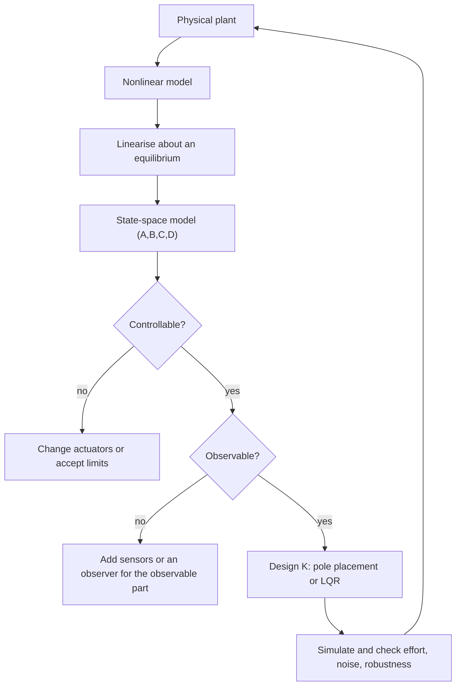

# Control Theory

> [Applied Mathematics](../README.md) · Level: Advanced · Prerequisites: [Derivatives](../../07-calculus/03-derivatives/README.md), [Integrals](../../07-calculus/06-integrals/README.md), [Matrices](../../08-linear-algebra/02-matrices/README.md), [Systems of Linear Equations](../../08-linear-algebra/03-systems-of-linear-equations/README.md), [Eigenvalues and Eigenvectors](../../08-linear-algebra/07-eigenvalues-and-eigenvectors/README.md), [Complex Numbers and Geometry](../../15-complex-analysis/01-complex-numbers-and-geometry/README.md), [Second-Order Linear ODEs](../../16-differential-equations/02-second-order-linear-odes/README.md), [Systems of ODEs](../../16-differential-equations/03-systems-of-odes/README.md), [Laplace Transforms](../../16-differential-equations/04-laplace-transforms/README.md) · Estimated time: 600 min

## 1. Introduction

Control theory is the mathematics of making a system behave as desired. A thermostat keeps a room at a set temperature,
a pilot keeps an aircraft on a glide path, a motor keeps a shaft at a commanded speed, a chemical plant keeps a reactor
at a set pressure. In each case a physical system is acted on by an input that we choose, and the choice is based on
measurements of the output. The mathematical question is how to choose that input so that the closed loop is stable,
accurate and reasonably fast.

The subject has two classical languages, and this tutorial teaches both. **Transfer functions** describe a system by the
ratio of the Laplace transforms of output and input. They reduce the analysis of interconnections to algebra, they make
frequency response and stability margins visual, and they are the language of the PID controller that runs most of
industrial process control. **State-space models** describe a system by a first-order vector ODE, $\dot x = Ax + Bu$, $y = Cx + Du$. They
expose the internal state, they handle multiple inputs and outputs uniformly, and they make the structural questions —
controllability, observability, optimality — precise. Kalman's work in 1960 unified these ideas and turned control into
a branch of applied linear algebra and optimisation.

The historical thread is instructive. James Watt's centrifugal governor (1788) was the first widely used feedback
device, and it worked before anyone could explain why it sometimes oscillated. James Clerk Maxwell's *On Governors*
(1868) gave the first mathematical stability analysis of feedback. Edward Routh (1877) and Adolf Hurwitz (1895) produced
algebraic stability criteria that are still used. Harry Nyquist (1932) turned stability into a graphical test on the
frequency response, and Hendrik Bode (1940s) developed the logarithmic plots that bear his name. Lyapunov's direct
method (1892) provided the energy-based approach to stability that generalises far beyond linear systems. The 1960s
added the state-space view, the linear quadratic regulator and the Kalman filter. The 1970s and 1980s added robustness
(how much uncertainty the loop tolerates) and $H_\infty$ methods.

This tutorial develops the core with proofs. Section 7 derives the state-space solution with the matrix exponential,
proves the eigenvalue stability criterion, proves that a positive definite solution of the Lyapunov equation implies
stability, proves the necessity of the Kalman rank conditions for controllability and observability, derives pole
placement, states and interprets the Riccati equation of the linear quadratic regulator, and analyses PID control with
the Routh–Hurwitz criterion and the final-value theorem. The worked examples include a cruise controller, an inverted
pendulum, a DC motor, a double integrator and a second-order process controlled by a PID loop.

A warning that belongs at the start: control design is always a compromise. High gain gives small steady-state error and
fast response but amplifies noise and pushes the loop toward instability. A derivative term adds damping but
differentiates sensor noise. An integral term removes offset but adds phase lag that can destabilise. Every method below
is a way of making the compromise explicit and quantitative, not a way of avoiding it.

## 2. Prerequisites

* **Differentiation and integration** — the chain rule for linearisation, integration by parts for the
  variation of constants:
  [Derivatives](../../07-calculus/03-derivatives/README.md),
  [Integrals](../../07-calculus/06-integrals/README.md).
* **Matrices and linear systems** — matrix multiplication, inverses, rank, null spaces:
  [Matrices](../../08-linear-algebra/02-matrices/README.md),
  [Systems of Linear Equations](../../08-linear-algebra/03-systems-of-linear-equations/README.md).
* **Eigenvalues and eigenvectors** — characteristic polynomials, diagonalisation, Jordan form (used only
  qualitatively):
  [Eigenvalues and Eigenvectors](../../08-linear-algebra/07-eigenvalues-and-eigenvectors/README.md).
* **Complex numbers** — modulus, argument, the complex exponential, used for frequency response:
  [Complex Numbers and Geometry](../../15-complex-analysis/01-complex-numbers-and-geometry/README.md).
* **Second-order linear ODEs** — the damped oscillator, natural frequency and damping ratio:
  [Second-Order Linear ODEs](../../16-differential-equations/02-second-order-linear-odes/README.md).
* **Systems of ODEs** — first-order systems, the matrix exponential, stability of linear systems:
  [Systems of ODEs](../../16-differential-equations/03-systems-of-odes/README.md).
* **Laplace transforms** — the transform, its linearity, the derivative rule and the final-value theorem:
  [Laplace Transforms](../../16-differential-equations/04-laplace-transforms/README.md).

No prior control course is assumed. The few facts from linear algebra that go beyond a first course — the
Cayley–Hamilton theorem and the notion of a controllable canonical form — are stated and used explicitly where they
occur.

## 3. Learning Objectives

After working through this tutorial you will be able to:

1. Distinguish open-loop and closed-loop control, and compute the closed-loop transfer function
   $L/(1+L)$ and the sensitivity $1/(1+L)$.
2. Write a mechanical or electrical system as $\dot x = Ax+Bu$, $y = Cx+Du$, and linearise a nonlinear
   model about an equilibrium.
3. Solve the linear state equation with the matrix exponential and compute a response to a step input.
4. Decide stability from the eigenvalues of $A$, and prove stability from a positive definite solution
   of the Lyapunov equation.
5. Test controllability and observability with the Kalman rank criteria and the PBH test, and explain
   why the rank conditions are necessary.
6. Design a state-feedback gain by pole placement, including a precompensator for zero steady-state
   error.
7. State the linear quadratic regulator problem, write its Riccati equation, solve it in simple cases,
   and interpret the weighting matrices.
8. Analyse a PID-controlled loop: compute steady-state errors with the final-value theorem and test
   stability with the Routh–Hurwitz criterion.
9. Compute gain crossover frequency, phase margin and gain margin, and relate them to closed-loop
   damping.
10. Recognise the limitations of each method and the trade-offs between speed, accuracy, effort and
    robustness.

## 4. Intuition

**Open loop versus closed loop.** An open-loop controller decides the input in advance, from a model:
"set the heater to 60% and hope". A closed-loop controller measures the output, compares it with the reference, and acts
on the difference. Feedback converts an inaccurate model into a small error signal: if the plant gain is wrong by $20\%$,
a high-gain loop barely notices, because the error is amplified and corrected. The price is that the loop can oscillate
if the correction arrives too late or too strongly.

**Why feedback can destabilise.** Imagine steering a car by looking only in the rear-view mirror: the
correction is delayed, so you overcorrect, then overcorrect the other way. Every physical loop has delay or inertia, and
feedback around a delayed system can turn a stable plant into an oscillator. Stability is therefore not automatic; it
must be proved.

**The state is the smallest summary of the past.** For a mass on a spring, knowing the position is not
enough: you need the velocity too. The state collects exactly the variables whose present values, together with future
inputs, determine the future. The matrix $A$ says how the state evolves on its own, $B$ how the input pushes it,
$C$ what we measure, $D$ what we measure instantaneously from the input.

**Controllability and observability.** Controllability asks: can the input steer the state anywhere?
Observability asks: can the output reveal the state? They are dual questions, and both are answered by a rank condition.
A system can be stable, controllable and observable, or any combination; the design methods differ accordingly.

**The controller as an optimisation.** Instead of choosing poles by hand, the linear quadratic regulator
chooses the input that minimises a quadratic cost trading state deviation against control effort. The solution is a
state feedback whose gain comes from a matrix Riccati equation. The weighting matrices are the design knobs, and the
resulting loop is guaranteed stable under mild hypotheses.

**Frequency response.** A linear system responds to a sinusoid with a sinusoid of the same frequency,
scaled and shifted. Plotting the scale and shift against frequency shows how the loop behaves at every speed: which
frequencies are amplified, which are attenuated, and how close the loop is to the phase reversal that causes
oscillation. Gain and phase margins measure that distance.

## 5. Formal Definition

**Definition 5.1 (control system).** A *control system* consists of a plant with input $u(t)\in\mathbb{R}^m$,
output $y(t)\in\mathbb{R}^p$ and state $x(t)\in\mathbb{R}^n$, together with a control law that specifies $u$ as a function of the reference $r$,
the measured output and time. The system is *open loop* if $u$ does not depend on $y$, and *closed loop* if it
does.

**Definition 5.2 (linear time-invariant state-space model).** A *continuous-time LTI state-space model* is

$$\dot x(t) = Ax(t) + Bu(t), \qquad y(t) = Cx(t) + Du(t),$$
with constant matrices $A\in\mathbb{R}^{n\times n}$, $B\in\mathbb{R}^{n\times m}$, $C\in\mathbb{R}^{p\times n}$, $D\in\mathbb{R}^{p\times m}$. The *state* $x$ has the property that $x(t_0)$ and $u(\cdot)$ on
$[t_0,t]$ determine $x(t)$ and $y(t)$.

**Definition 5.3 (equilibrium and linearisation).** A pair $(x_e,u_e)$ is an *equilibrium* of
$\dot x = f(x,u)$ if $f(x_e,u_e)=0$. The *linearisation* about it is the LTI model with $A = \partial f/\partial x(x_e,u_e)$, $B = \partial f/\partial u(x_e,u_e)$, and $C,D$ from the output map, in
the deviation variables $\delta x = x-x_e$, $\delta u = u-u_e$.

**Definition 5.4 (Lyapunov stability).** The equilibrium $x=0$ of $\dot x = f(x)$ is
*Lyapunov stable* if for every $\varepsilon>0$ there is $\delta>0$ such that
$\lVert x(0)\rVert<\delta \Rightarrow \lVert x(t)\rVert<\varepsilon$ for all $t\ge0$;
*asymptotically stable* if it is Lyapunov stable and $x(t)\to0$ as $t\to\infty$;
*exponentially stable* if there are $M\ge1$ and $\mu>0$ with
$\lVert x(t)\rVert\le M e^{-\mu t}\lVert x(0)\rVert$.

**Definition 5.5 (Hurwitz matrix).** A matrix $A\in\mathbb{R}^{n\times n}$ is *Hurwitz* (or *stable*) if
every eigenvalue has strictly negative real part.

**Definition 5.6 (controllability and reachability).** The pair $(A,B)$ is *controllable* if for every
$x_0,x_1\in\mathbb{R}^n$ and every $T>0$ there exists a piecewise continuous $u:[0,T]\to\mathbb{R}^m$ with $x(0)=x_0$ and $x(T)=x_1$. It is *reachable* from the
origin if every $x_1$ can be reached from $x_0=0$. For LTI systems the two notions coincide.

**Definition 5.7 (observability).** The pair $(C,A)$ is *observable* if for every $T>0$ the output
$y$ on $[0,T]$, together with the known input, determines $x(0)$ uniquely. It is *detectable* if every unobservable
mode is asymptotically stable.

**Definition 5.8 (transfer function).** For the LTI model above, the *transfer function matrix* is

$$G(s) = C(sI-A)^{-1}B + D,$$
defined for complex $s$ that are not eigenvalues of $A$. For $m=p=1$ it is a rational function $G(s) = b(s)/a(s)$ whose *poles*
are the eigenvalues of $A$ (for a minimal realisation) and whose *zeros* are the roots of $b$.

**Definition 5.9 (state feedback and pole placement).** A *state feedback* is $u = -Kx + Nr$ with
$K\in\mathbb{R}^{m\times n}$ and a reference gain $N$. The closed loop is $\dot x = (A-BK)x + BNr$. *Pole placement* is the choice of $K$ so that the
eigenvalues of $A-BK$ are a prescribed set.

**Definition 5.10 (LQR).** The *linear quadratic regulator* for $(A,B)$ with weights $Q=Q^{\mathsf T}\succeq0$,
$R=R^{\mathsf T}\succ0$ is the problem of minimising
$$J = \int_0^\infty \bigl(x^{\mathsf T}Qx + u^{\mathsf T}Ru\bigr)\,dt$$
over inputs that drive $x(0)$ to $0$ as $t\to\infty$.

**Definition 5.11 (PID controller).** With error $e = r-y$, a *PID controller* is

$$u(t) = K_p\,e(t) + K_i\int_0^t e(\tau)\,d\tau + K_d\,\frac{de}{dt},$$
with transfer function $C(s) = K_p + K_i/s + K_d s$.

**Definition 5.12 (frequency-response quantities).** For the loop transfer function $L(s)=C(s)G(s)$, the
*gain crossover frequency* $\omega_c$ solves $\lvert L(j\omega_c)\rvert=1$. The *phase margin* is
$\mathrm{PM} = 180^\circ + \angle L(j\omega_c)$. The *phase crossover frequency* $\omega_{pc}$ solves $\angle L(j\omega_{pc}) = -180^\circ$, and the *gain margin* is $\mathrm{GM} = 1/\lvert L(j\omega_{pc})\rvert$ (in dB, $-20\log_{10}\lvert L(j\omega_{pc})\rvert$).

## 6. Mathematical Notation

| Symbol | Read as | Meaning |
|---|---|---|
| $x$, $u$, $y$ | state, input, output | vectors in $\mathbb{R}^n,\mathbb{R}^m,\mathbb{R}^p$ |
| $\dot x$ | x dot | time derivative of the state |
| $A$, $B$, $C$, $D$ | system matrices | dynamics, input, output, feedthrough |
| $n,m,p$ | state, input, output dimension | sizes of the vectors |
| $e^{At}$ | matrix exponential | $\sum_{k\ge0}A^kt^k/k!$ |
| $\Phi(t)$ | state transition matrix | $e^{At}$ |
| $\lambda_i(A)$ | eigenvalues of $A$ | roots of $\det(\lambda I-A)$ |
| $\operatorname{Re}\lambda$ | real part of lambda | growth or decay rate |
| $K$ | state-feedback gain | $u=-Kx+Nr$ |
| $L(s)$ | loop transfer function | $C(s)G(s)$ |
| $G(s)$ | plant transfer function | $C(sI-A)^{-1}B+D$ |
| $s$ | Laplace variable | complex frequency |
| $P$, $Q$, $R$ | Lyapunov / LQR matrices | $P\succ0$; $Q\succeq0$; $R\succ0$ |
| $\mathcal{C}$, $\mathcal{O}$ | controllability, observability matrices | block matrices of $A^kB$, $CA^k$ |
| $W_c$, $W_o$ | Gramians | reachability and observability Gramians |
| $K_p,K_i,K_d$ | PID gains | proportional, integral, derivative |
| $\omega_0$, $\zeta$ | natural frequency, damping ratio | second-order parameters |
| $\omega_c$, $\omega_{pc}$ | gain, phase crossover | frequency-response landmarks |
| PM, GM | phase margin, gain margin | stability margins |
| $S(s)$ | sensitivity | $1/(1+L(s))$ |
| $T(s)$ | complementary sensitivity | $L(s)/(1+L(s))$ |
| $\operatorname{rank}$ | rank | dimension of the column space |
| $\succeq$, $\succ$ | positive semidefinite, definite | symmetric matrix order |
| $\sigma(A)$ | spectrum of $A$ | set of eigenvalues |
| $\lVert x\rVert$ | norm of $x$ | Euclidean norm unless stated |

## 7. Core Concepts

### 7.1 Open-loop and closed-loop control

Consider a plant with input $u$, output $y$ and transfer function $G(s)$. An open-loop controller is a feedforward
map $u = C_{ol}(s)r$; the output is $y = G C_{ol} r$. Its accuracy depends entirely on knowing $G$: if the true plant is $G(1+\Delta)$ with
unknown $\Delta$, the output is wrong by the same relative amount, and an unknown disturbance $d$ adds $G d$ to the
output with nothing to correct it.

A closed-loop controller measures the error $e = r-y$ and sets $u = C(s)e$. With negative feedback,
$$y = G C (r-y) \quad\Longrightarrow\quad y = \frac{GC}{1+GC}\,r = T(s)\,r,$$
and the error satisfies
$$E(s) = \frac{1}{1+GC}\,R(s) = S(s)R(s).$$
The functions $T = L/(1+L)$ and $S = 1/(1+L)$ are the *complementary sensitivity* and the *sensitivity*, with $L = GC$ the loop transfer
function. They satisfy $S+T=1$ identically. For a disturbance $d$ entering at the plant input, the output is $y = T r + G S d$:
the same sensitivity function that makes the tracking accurate also suppresses the disturbance.

Three consequences are immediate and important.

* *High loop gain helps accuracy.* If $\lvert L(j\omega)\rvert\gg1$ at a frequency, then
  $S\approx1/L$ is small and $T\approx1$: the output follows the reference and rejects disturbances.
* *High loop gain is not free.* $T\approx1$ also means sensor noise passes to the actuator, and the phase
  of $L$ at the crossover frequency decides stability. A loop with large gain and large phase lag
  oscillates.
* *Feedback can stabilise an unstable plant.* If $G$ has a pole in the right half-plane (an inverted
  pendulum, a magnetic levitation system), no open-loop input can stabilise it, because the eigenvalues of
  the plant are unaffected by the input. A feedback loop, by contrast, changes the closed-loop eigenvalues
  and can move the pole to the left half-plane — provided the plant is controllable.

### 7.2 State-space models

The state-space form is
$$\dot x = Ax + Bu, \qquad y = Cx + Du.$$
The dimensions are $x\in\mathbb{R}^n$, $u\in\mathbb{R}^m$, $y\in\mathbb{R}^p$. The matrix $D$ is often zero; it represents a direct feedthrough from
input to output, which a strictly proper physical system does not have.

**Example 7.1 (mass–spring–damper).** $m\ddot q + c\dot q + kq = F$. With $x_1=q$, $x_2=\dot q$,

$$A = \begin{bmatrix}0&1\\-k/m&-c/m\end{bmatrix}, \qquad B = \begin{bmatrix}0\\1/m\end{bmatrix}, \qquad C = \begin{bmatrix}1&0\end{bmatrix}, \qquad D=0.$$

**Example 7.2 (cruise control).** For a car of mass $m$ with drag coefficient $b$ and force input $u$,
$m\dot v = u - bv$, so $A = -b/m$, $B=1/m$, $C=1$, $D=0$.

**Example 7.3 (DC motor).** With angular speed $\omega$, armature current $i$, torque constant $K_t$,
back-emf constant $K_e$, resistance $R$, inductance $L$, inertia $J$ and viscous friction $b$,
$$J\dot\omega = K_t i - b\omega, \qquad L\dot i = -Ri - K_e\omega + v.$$
Hence, with $x=(\omega,i)$,
$$A = \begin{bmatrix}-b/J & K_t/J\\ -K_e/L & -R/L\end{bmatrix}, \qquad B = \begin{bmatrix}0\\1/L\end{bmatrix}, \qquad C = \begin{bmatrix}1&0\end{bmatrix}.$$

**Non-uniqueness of the state.** If $T$ is invertible and $z = Tx$, then
$\dot z = TAT^{-1}z + TBu$, $y = CT^{-1}z + Du$: the same input–output behaviour in different coordinates. Eigenvalues, transfer functions,
controllability and observability are invariant under this change of coordinates; the state itself is not.

**Linearisation.** For a nonlinear model $\dot x = f(x,u)$, $y = h(x,u)$ with equilibrium $(x_e,u_e)$,
set $\delta x = x-x_e$, $\delta u = u-u_e$, $\delta y = y-h(x_e,u_e)$. Then
$$\delta\dot x = A\,\delta x + B\,\delta u + O(\lVert(\delta x,\delta u)\rVert^2), \qquad A = \left.\frac{\partial f}{\partial x}\right|_{(x_e,u_e)}, \quad B = \left.\frac{\partial f}{\partial u}\right|_{(x_e,u_e)}.$$
Linearisation is the workhorse of control: a nonlinear plant is controlled about an operating point by a linear design,
and the error is bounded as long as the state stays in the region where the linear terms dominate.

### 7.3 The matrix exponential and the solution

**Definition and properties.** For a square matrix $A$,

$$e^{At} = \sum_{k=0}^{\infty}\frac{A^k t^k}{k!}.$$
The series converges for every $A$ and $t$ (compare with the scalar exponential using any submultiplicative
norm). It satisfies
$$e^{A\cdot0}=I, \qquad \frac{d}{dt}e^{At} = A e^{At} = e^{At}A, \qquad e^{A(t+s)} = e^{At}e^{As}, \qquad (e^{At})^{-1} = e^{-At}.$$
The derivative identity follows by differentiating the power series term by term: $\frac{d}{dt}\sum A^kt^k/k! = \sum_{k\ge1}A^kt^{k-1}/(k-1)! = A\sum_{j\ge0}A^jt^j/j!$.

**Solution of the state equation.** The unique solution of $\dot x = Ax+Bu$ with $x(0)=x_0$ is

$$x(t) = e^{At}x_0 + \int_0^t e^{A(t-\tau)}Bu(\tau)\,d\tau.$$

*Proof.* Differentiate:

$$\frac{d}{dt}\Bigl[e^{At}x_0 + \int_0^t e^{A(t-\tau)}Bu(\tau)d\tau\Bigr] = Ae^{At}x_0 + e^{A(t-t)}Bu(t) + \int_0^t A e^{A(t-\tau)}Bu(\tau)d\tau = A x(t) + Bu(t).$$
The initial condition is $x(0) = x_0$. Uniqueness follows from the Lipschitz property of the linear vector field. $\blacksquare$

**Computing $e^{At}$.** Three practical methods:

1. *Diagonalisation.* If $A = T\Lambda T^{-1}$ with $\Lambda = \operatorname{diag}(\lambda_1,\dots,\lambda_n)$,
   then $e^{At} = T\operatorname{diag}(e^{\lambda_1 t},\dots,e^{\lambda_n t})T^{-1}$.
2. *Jordan form.* For a defective eigenvalue, $e^{Jt} = e^{\lambda t}(I + J_0t + J_0^2t^2/2!+\cdots)$
   where $J_0 = J-\lambda I$ is nilpotent, so the series terminates.
3. *Laplace transform.* $\mathcal{L}\{e^{At}\} = (sI-A)^{-1}$, so $e^{At}$ is the inverse transform of
   $(sI-A)^{-1}$. This is also the link to transfer functions.

**Transfer function from the state-space model.** Take Laplace transforms with $x(0)=0$:
$sX = AX+BU$, so $X = (sI-A)^{-1}BU$ and
$$Y(s) = \bigl[C(sI-A)^{-1}B + D\bigr]U(s) = G(s)U(s).$$
For a SISO system, $G(s) = \dfrac{b(s)}{a(s)}$ with $a(s) = \det(sI-A)$ and $b(s)$ obtained from Cramer's rule. The poles of $G$ are eigenvalues of
$A$; if a pole is uncontrollable or unobservable it cancels in $G$ and does not appear in the input–output
behaviour.

**Step response of a first-order system.** For $\dot x = -x/\tau + u/\tau$, $y=x$,
$G(s) = 1/(\tau s+1)$ and $y(t) = 1-e^{-t/\tau}$ for a unit step. The time constant $\tau$ is the time to reach $63.2\%$ of the final value; the
settling time to $2\%$ is about $4\tau$.

### 7.4 Stability and the Lyapunov equation

**Theorem 7.1 (eigenvalue criterion).** The equilibrium $x=0$ of $\dot x = Ax$ is

* asymptotically stable (indeed exponentially stable) if and only if every eigenvalue of $A$ satisfies
  $\operatorname{Re}\lambda<0$;
* Lyapunov stable but not asymptotically stable exactly when all eigenvalues satisfy
  $\operatorname{Re}\lambda\le0$, at least one has $\operatorname{Re}\lambda=0$, and every eigenvalue with
  $\operatorname{Re}\lambda=0$ is semisimple (its Jordan blocks are $1\times1$);
* unstable otherwise.

*Proof sketch.* In Jordan form $A = TJT^{-1}$, $e^{At} = Te^{Jt}T^{-1}$, and each Jordan block contributes
$e^{\lambda t}$ times a polynomial in $t$ of degree one less than the block size. If $\operatorname{Re}\lambda<0$, the exponential dominates the
polynomial and the block decays; if $\operatorname{Re}\lambda>0$ it grows; if $\operatorname{Re}\lambda=0$, a $1\times1$ block stays bounded while a larger block
grows like a polynomial. Since $T$ and $T^{-1}$ are fixed, the same conclusions hold for $x(t) = e^{At}x_0$. $\blacksquare$

The equivalence of "all eigenvalues in the open left half-plane" and exponential stability is the reason control
theorists draw the imaginary axis as the stability boundary.

**The Lyapunov equation.** For a given $Q=Q^{\mathsf T}$, the *Lyapunov equation* is

$$A^{\mathsf T}P + PA = -Q.$$
It is a linear system of $n(n+1)/2$ scalar equations for the symmetric entries of $P$.

**Theorem 7.2 (Lyapunov, sufficiency).** If there exist symmetric matrices $P\succ0$ and $Q\succ0$ with
$A^{\mathsf T}P+PA=-Q$, then $A$ is Hurwitz and the origin is exponentially stable.

*Proof.* Define $V(x) = x^{\mathsf T}Px$. Since $P\succ0$, there are constants
$0<\lambda_{\min}(P)\le\lambda_{\max}(P)$ with
$$\lambda_{\min}(P)\lVert x\rVert^2 \le V(x)\le \lambda_{\max}(P)\lVert x\rVert^2.$$
Along solutions,
$$\dot V = \dot x^{\mathsf T}Px + x^{\mathsf T}P\dot x = x^{\mathsf T}(A^{\mathsf T}P+PA)x = -x^{\mathsf T}Qx \le -\lambda_{\min}(Q)\lVert x\rVert^2.$$
Therefore $\dot V \le -\dfrac{\lambda_{\min}(Q)}{\lambda_{\max}(P)}V$, and Gronwall's inequality gives $V(x(t))\le V(x(0))e^{-ct}$ with $c = \lambda_{\min}(Q)/\lambda_{\max}(P)>0$. Using the bounds on $V$,
$$\lVert x(t)\rVert^2 \le \frac{\lambda_{\max}(P)}{\lambda_{\min}(P)}\lVert x(0)\rVert^2 e^{-ct}.$$
Hence $x(t)\to0$ exponentially, and in particular every eigenvalue of $A$ has negative real part (by Theorem 7.1).
$\blacksquare$

**Theorem 7.3 (converse).** If $A$ is Hurwitz and $Q\succ0$, then

$$P = \int_0^\infty e^{A^{\mathsf T}t}Qe^{At}\,dt$$
is well defined, symmetric and positive definite, and it is the unique solution of $A^{\mathsf T}P+PA=-Q$.

*Proof.* Since $A$ is Hurwitz, $\lVert e^{At}\rVert\le Me^{-\mu t}$ for some $M,\mu>0$, so the integral
converges. It is symmetric because the integrand is symmetric. It is positive definite because for $x\ne0$, $x^{\mathsf T}e^{A^{\mathsf T}t}Qe^{At}x = (e^{At}x)^{\mathsf T}Q(e^{At}x)>0$ for
all $t$, and the integral of a positive continuous function is positive. Finally,
$$A^{\mathsf T}P+PA = \int_0^\infty \frac{d}{dt}\bigl[e^{A^{\mathsf T}t}Qe^{At}\bigr]dt = \bigl[e^{A^{\mathsf T}t}Qe^{At}\bigr]_0^\infty = -Q.$$
For uniqueness, suppose $P_1,P_2$ are two solutions. Their difference $\Delta P$ satisfies $A^{\mathsf T}\Delta P+\Delta P A=0$. Then $\frac{d}{dt}\bigl[e^{A^{\mathsf T}t}\Delta P e^{At}\bigr]=0$, so $e^{A^{\mathsf T}t}\Delta P e^{At}$
is constant; at $t=0$ it is $\Delta P$, and as $t\to\infty$ it tends to $0$ because $A$ is Hurwitz. Hence $\Delta P=0$.
$\blacksquare$

**Why this matters.** Theorem 7.2 turns stability into a linear algebra problem: solve a linear system for
$P$ and test positive definiteness (Sylvester's criterion). It also generalises: for nonlinear systems one looks for
a scalar function $V$ with $V>0$ and $\dot V<0$ along trajectories, which is Lyapunov's direct method. The quadratic
$V=x^{\mathsf T}Px$ is the prototype.

### 7.5 Controllability

**Theorem 7.4 (Kalman rank criterion).** The pair $(A,B)$ with $A\in\mathbb{R}^{n\times n}$,
$B\in\mathbb{R}^{n\times m}$ is controllable if and only if
$$\operatorname{rank}\mathcal{C} = \operatorname{rank}\begin{bmatrix}B & AB & A^2B & \cdots & A^{n-1}B\end{bmatrix} = n.$$

**Theorem 7.5 (PBH test).** $(A,B)$ is controllable if and only if
$\operatorname{rank}\begin{bmatrix}\lambda I-A & B\end{bmatrix}=n$ for every eigenvalue $\lambda$ of $A$.

**Necessity of the rank condition.** Suppose $\operatorname{rank}\mathcal{C}<n$. Then there is a nonzero
vector $v\in\mathbb{R}^n$ with $v^{\mathsf T}\mathcal{C}=0$, that is
$$v^{\mathsf T}A^kB = 0 \qquad \text{for } k=0,1,\dots,n-1.$$
By the Cayley–Hamilton theorem, $A^n$ is a linear combination of $I,A,\dots,A^{n-1}$, so $v^{\mathsf T}A^kB=0$ for every $k\ge0$. Hence
$$v^{\mathsf T}e^{At}B = \sum_{k=0}^{\infty}\frac{t^k}{k!}v^{\mathsf T}A^kB = 0 \qquad \text{for all } t.$$
Now start from $x(0)=0$ and apply any input. The solution is $x(T) = \int_0^T e^{A(T-\tau)}Bu(\tau)\,d\tau$, so
$$v^{\mathsf T}x(T) = \int_0^T v^{\mathsf T}e^{A(T-\tau)}Bu(\tau)\,d\tau = 0.$$
Thus every reachable state lies in the hyperplane $v^{\mathsf T}x=0$, and the state $x_1=v$ (which has $v^{\mathsf T}x_1=\lVert v\rVert^2\ne0$) cannot be reached.
So the system is not controllable. $\blacksquare$

**Sufficiency: the reachability Gramian.** Define

$$W(T) = \int_0^T e^{A\tau}BB^{\mathsf T}e^{A^{\mathsf T}\tau}\,d\tau.$$
If $\operatorname{rank}\mathcal{C}=n$, then $W(T)\succ0$ for every $T>0$. Indeed, if $z^{\mathsf T}W(T)z=0$, then
$$0 = \int_0^T \lVert B^{\mathsf T}e^{A^{\mathsf T}\tau}z\rVert^2\,d\tau,$$
so $B^{\mathsf T}e^{A^{\mathsf T}\tau}z=0$ for all $\tau\in[0,T]$. Differentiating $k$ times at $\tau=0$ gives $B^{\mathsf T}(A^{\mathsf T})^kz=0$, that is $z^{\mathsf T}A^kB=0$ for all $k$, so
$z$ is orthogonal to the columns of $\mathcal{C}$; since they span $\mathbb{R}^n$, $z=0$.

Given $x_0$ and a target $x_1$ at time $T$, define
$$u(t) = B^{\mathsf T}e^{A^{\mathsf T}(T-t)}W(T)^{-1}\bigl(x_1-e^{AT}x_0\bigr).$$
Then
$$\int_0^T e^{A(T-t)}Bu(t)\,dt = \Bigl(\int_0^T e^{A(T-t)}BB^{\mathsf T}e^{A^{\mathsf T}(T-t)}dt\Bigr)W(T)^{-1}(x_1-e^{AT}x_0) = W(T)W(T)^{-1}(x_1-e^{AT}x_0),$$
using the change of variable $\tau = T-t$ in the integral. Hence $x(T) = e^{AT}x_0 + (x_1-e^{AT}x_0) = x_1$. $\blacksquare$

**Remarks.** Controllability is invariant under state feedback: $(A-BK,B)$ is controllable whenever
$(A,B)$ is. It is also invariant under similarity. A single-input system with $B$ an eigenvector of $A$ is never
controllable when $n>1$, because all $A^kB$ are parallel. In practice, a system can be controllable but *numerically*
hard to control if $\mathcal{C}$ is nearly singular; the singular values of $\mathcal{C}$ measure that difficulty.

### 7.6 Observability

**Theorem 7.6 (Kalman rank criterion).** The pair $(C,A)$ with $C\in\mathbb{R}^{p\times n}$ is observable
if and only if
$$\operatorname{rank}\mathcal{O} = \operatorname{rank}\begin{bmatrix}C\\CA\\\vdots\\CA^{n-1}\end{bmatrix} = n.$$

**Theorem 7.7 (PBH test).** $(C,A)$ is observable if and only if
$\operatorname{rank}\begin{bmatrix}\lambda I-A\\ C\end{bmatrix}=n$ for every eigenvalue $\lambda$ of $A$.

**Necessity.** Suppose $\operatorname{rank}\mathcal{O}<n$. Then there is a nonzero $v$ with
$\mathcal{O}v=0$, that is $CA^kv=0$ for $k=0,\dots,n-1$. By Cayley–Hamilton, $CA^kv=0$ for all $k\ge0$, so $Ce^{At}v=0$ for all $t\ge0$. Consider
the two initial states $x(0)=0$ and $x(0)=v$ with $u=0$. Their outputs are $0$ and $Ce^{At}v=0$: identical for all time.
No measurement can distinguish them, so the initial state is not determined and the system is not observable. $\blacksquare$

**Sufficiency.** If $\operatorname{rank}\mathcal{O}=n$, the observability Gramian

$$W_o(T) = \int_0^T e^{A^{\mathsf T}t}C^{\mathsf T}Ce^{At}\,dt$$
is positive definite (the same argument as for $W_c$). With $u=0$, $y(t)=Ce^{At}x_0$, so
$$\int_0^T e^{A^{\mathsf T}t}C^{\mathsf T}y(t)\,dt = W_o(T)x_0, \qquad x_0 = W_o(T)^{-1}\int_0^T e^{A^{\mathsf T}t}C^{\mathsf T}y(t)\,dt.$$
This is an explicit reconstruction formula: the state is recovered by a weighted integral of the output. $\blacksquare$

**Duality.** $(C,A)$ is observable if and only if $(A^{\mathsf T},C^{\mathsf T})$ is controllable. The rank
criteria are transposes of each other, and every theorem about controllability has an observability dual. This is why
observers and state feedback are designed by the same algorithms.

**Detectability.** If an unobservable mode is stable, the state cannot be reconstructed exactly but the
error in reconstruction decays; such a pair is *detectable*, and it is enough for stabilisation with an observer.

**Observers.** When the state is not measured, a *Luenberger observer* reconstructs it from the input and
the output:
$$\dot{\hat x} = A\hat x + Bu + L(y-\hat y), \qquad \hat y = C\hat x.$$
The estimation error $e=x-\hat x$ satisfies $\dot e = (A-LC)e$, so the observer converges exactly when $A-LC$ is Hurwitz. Designing
$L$ is the dual of pole placement: if $(C,A)$ is observable, then $(A^{\mathsf T},C^{\mathsf T})$ is controllable and the eigenvalues of
$A-LC$ can be placed arbitrarily by choosing $L$. The *separation principle* says that the state-feedback gain
$K$ and the observer gain $L$ can be designed independently: with $u=-K\hat x$, the closed-loop eigenvalues are
$\sigma(A-BK)\cup\sigma(A-LC)$. In coordinates $(x,e)$ the system matrix is block triangular,
$$\begin{bmatrix}A-BK&BK\\0&A-LC\end{bmatrix},$$
whose eigenvalues are the union of the diagonal blocks. In practice the observer is made faster than the controller, so
that the estimation error decays before it can disturb the state response.

### 7.7 Pole placement by state feedback

Assume $m=1$ (single input) and $(A,B)$ controllable. Let the desired closed-loop characteristic polynomial be
$$\phi(s) = s^n + \alpha_{n-1}s^{n-1} + \cdots + \alpha_1s + \alpha_0.$$

**Theorem 7.8 (pole placement).** If $(A,B)$ is controllable, there is a unique $K\in\mathbb{R}^{1\times n}$
such that $\det(sI-A+BK)=\phi(s)$. Every symmetric set of $n$ complex numbers (closed under conjugation) can be achieved.

*Proof for single input.* Change coordinates to the controllable canonical form, in which

$$A_c = \begin{bmatrix}0&1&0&\cdots&0\\ \vdots&&\ddots&&\vdots\\0&0&\cdots&0&1\\ -a_0&-a_1&\cdots&-a_{n-2}&-a_{n-1}\end{bmatrix}, \qquad B_c = \begin{bmatrix}0\\0\\\vdots\\0\\1\end{bmatrix}.$$
With $K_c = \begin{bmatrix}k_1&k_2&\cdots&k_n\end{bmatrix}$,
$$A_c-B_cK_c = \begin{bmatrix}0&1&\cdots&0\\ \vdots&&\ddots&\vdots\\0&0&\cdots&1\\ -(a_0+k_1)&-(a_1+k_2)&\cdots&-(a_{n-1}+k_n)\end{bmatrix},$$
whose characteristic polynomial is $s^n+(a_{n-1}+k_n)s^{n-1}+\cdots+(a_1+k_2)s+(a_0+k_1)$. Matching coefficients with $\phi$ gives $k_1 = \alpha_0-a_0$, $k_2 = \alpha_1-a_1$, …, $k_n = \alpha_{n-1}-a_{n-1}$. In
the original coordinates, $K = K_cT^{-1}$ where $T$ is the transformation to canonical form. Controllability is exactly what
guarantees that $T$ exists and is invertible. $\blacksquare$

**Ackermann's formula.** In the original coordinates,

$$K = \begin{bmatrix}0&0&\cdots&0&1\end{bmatrix}\mathcal{C}^{-1}\phi(A),$$
where $\mathcal{C} = [B\ AB\ \cdots\ A^{n-1}B]$ and $\phi(A)$ is the matrix polynomial obtained by substituting $A$ into $\phi$. This is a compact way
to compute the gain, but it is numerically delicate because it inverts $\mathcal{C}$; in practice one uses state-space
pole-placement algorithms.

**Reference tracking.** State feedback $u=-Kx$ regulates the state to zero. To track a constant reference
$r$, use $u = -Kx + Nr$ and choose $N$ so that the closed-loop DC gain is one:
$$N = -\frac{1}{C(A-BK)^{-1}B}$$
for a SISO system with $D=0$ and $C(A-BK)^{-1}B\ne0$. Derivation: at steady state with constant $r$, $0 = (A-BK)x + BNr$, so $x = -(A-BK)^{-1}BNr$ and
$y = Cx = -C(A-BK)^{-1}BNr$. Setting $y=r$ gives the formula. This precompensator does not change the poles; it only scales the reference.

**Limitations.** Pole placement says nothing about the size of the input. Placing poles very far left
requires large gains, which amplify noise and may saturate actuators. Placing them near the imaginary axis gives slow,
oscillatory responses. The choice of poles is a design decision, and the LQR of §7.8 is one way to make it systematic.

### 7.8 The linear quadratic regulator

The LQR problem is to minimise
$$J = \int_0^\infty\bigl(x^{\mathsf T}Qx + u^{\mathsf T}Ru\bigr)dt, \qquad Q\succeq0,\ R\succ0,$$
subject to $\dot x = Ax+Bu$ and $x(\infty)=0$. The matrix $Q$ penalises state deviations (which states matter, and how much) and
$R$ penalises control effort (how expensive the actuator is).

**The Riccati equation.** The optimal control is a linear state feedback

$$u = -Kx, \qquad K = R^{-1}B^{\mathsf T}P,$$
where $P=P^{\mathsf T}\succ0$ is the unique positive definite solution of the *continuous-time algebraic Riccati equation* (CARE)
$$A^{\mathsf T}P + PA - PBR^{-1}B^{\mathsf T}P + Q = 0.$$
The minimal cost is $J_{\min} = x(0)^{\mathsf T}Px(0)$: $P$ is the matrix of the cost-to-go.

**Derivation sketch (dynamic programming).** Seek a value function $V(x)=x^{\mathsf T}Px$. The
Hamilton–Jacobi–Bellman equation for the infinite-horizon problem is
$$0 = \min_u\Bigl[x^{\mathsf T}Qx + u^{\mathsf T}Ru + \nabla V^{\mathsf T}(Ax+Bu)\Bigr].$$
With $\nabla V = 2Px$, the bracket is $x^{\mathsf T}Qx + u^{\mathsf T}Ru + 2x^{\mathsf T}P(Ax+Bu)$. It is a convex quadratic in $u$ (because $R\succ0$), so the minimiser solves
$2Ru + 2B^{\mathsf T}Px = 0$, giving $u=-R^{-1}B^{\mathsf T}Px$. Substituting back and requiring the result to vanish for every $x$ gives the CARE. The
closed loop is $A-BK = A-BR^{-1}B^{\mathsf T}P$, and
$$\frac{d}{dt}(x^{\mathsf T}Px) = x^{\mathsf T}\bigl[(A-BK)^{\mathsf T}P+P(A-BK)\bigr]x = -x^{\mathsf T}(Q+PBR^{-1}B^{\mathsf T}P)x < 0$$
for $x\ne0$, so the closed loop is stable whenever $Q\succ0$. The same conclusion holds for $Q\succeq0$ provided $(Q^{1/2},A)$ is
observable. $\blacksquare$ (sketch)

**Interpretation of the weights.** Increasing $Q$ relative to $R$ makes the state error expensive, so the
optimal gain is larger and the closed loop faster; increasing $R$ makes control expensive, so the gain is smaller
and the response slower but gentler. For a scalar plant $\dot x = ax+bu$ with $q,r>0$, the CARE is $2aP - b^2P^2/r + q = 0$, whose positive
solution is
$$P = \frac{ar+\sqrt{a^2r^2+qb^2r}}{b^2}, \qquad K = \frac{bP}{r},$$
and the closed-loop pole is $a-bK = -\sqrt{a^2+qb^2/r}$. This explicit formula is a useful sanity check and shows that the optimal
closed-loop pole is always to the left of $-a$ when $a>0$.

**Stabilisability and detectability.** The CARE has a unique stabilising positive semidefinite solution
if $(A,B)$ is stabilisable (every unstable mode is controllable) and $(Q^{1/2},A)$ is detectable (every unobservable mode is
stable). Controllability is sufficient but not necessary.

### 7.9 PID control, steady-state error and Routh–Hurwitz

**The three terms.** A PID controller acts on the error $e=r-y$:

$$u(t) = K_p e(t) + K_i\int_0^t e(\tau)d\tau + K_d\frac{de}{dt}, \qquad C(s) = K_p + \frac{K_i}{s} + K_d s.$$

* The proportional term reacts to the present error. It reduces the error but, for a type-0 plant, never
  eliminates it: a nonzero error is needed to produce a nonzero input.
* The integral term reacts to accumulated past error. It eliminates steady-state error for a step, at the
  cost of adding a pole at the origin (phase lag) and the risk of wind-up and oscillation.
* The derivative term reacts to the predicted future error. It adds damping and speeds up the response,
  but it differentiates sensor noise; in practice it is implemented with a low-pass filter, and it is
  often omitted when the measurement is noisy.

**Steady-state error and system type.** For unity feedback, $E(s) = R(s)/(1+L(s))$ with $L=CG$. If the
closed loop is stable, the final-value theorem gives $e_{ss} = \lim_{s\to0}sE(s)$. The *type* of the loop is the number of poles of $L$
at $s=0$.

| Type | Step $R=1/s$ | Ramp $R=1/s^2$ | Parabola $R=1/s^3$ |
|---|---|---|---|
| 0 | $\dfrac{1}{1+L(0)}$ | $\infty$ | $\infty$ |
| 1 | $0$ | $\dfrac{1}{K_v}$, $K_v=\lim_{s\to0}sL(s)$ | $\infty$ |
| 2 | $0$ | $0$ | $\dfrac{1}{K_a}$, $K_a=\lim_{s\to0}s^2L(s)$ |

For a type-0 plant $G(0)=K$ with proportional control $K_p$, $e_{ss} = 1/(1+K_pK)$. Adding integral action makes the loop type 1 and
removes the step error; adding a second integrator removes the ramp error as well, but two integrators are much harder
to stabilise.

**Routh–Hurwitz criterion.** Given the characteristic polynomial

$$a_n s^n + a_{n-1}s^{n-1} + \cdots + a_1s + a_0, \qquad a_n>0,$$
form the Routh array. The first two rows are
$$s^n:\ a_n,\ a_{n-2},\ a_{n-4},\dots; \qquad s^{n-1}:\ a_{n-1},\ a_{n-3},\ a_{n-5},\dots.$$
Each subsequent row is computed from the two above it, for example $b_1 = \dfrac{a_{n-1}a_{n-2}-a_na_{n-3}}{a_{n-1}}$, $b_2 = \dfrac{a_{n-1}a_{n-4}-a_na_{n-5}}{a_{n-1}}$, and so on. **The number of roots in
the open right half-plane equals the number of sign changes in the first column.** Hence the polynomial is Hurwitz if
and only if the first column has no sign changes.

For a **cubic** $a_3s^3+a_2s^2+a_1s+a_0$ with $a_3>0$, the array is
$$s^3:\ a_3,\ a_1; \qquad s^2:\ a_2,\ a_0; \qquad s^1:\ \frac{a_2a_1-a_3a_0}{a_2},\ 0; \qquad s^0:\ a_0.$$
So the cubic is Hurwitz iff
$$a_2>0, \quad a_1>0, \quad a_0>0, \quad a_2a_1>a_3a_0.$$
This single inequality is the most-used stability test in classical control, because a second-order plant with a PID
controller produces exactly a cubic characteristic polynomial.

**Design procedure with PID.** Write the characteristic polynomial $1+C(s)G(s)=0$, clear denominators,
collect coefficients, and apply Routh–Hurwitz. The result is a region in $(K_p,K_i,K_d)$-space in which the loop is stable.
Within that region, choose gains to meet a settling-time or overshoot specification, then verify by simulation. Tuning
rules (Ziegler–Nichols and its relatives) are starting points, not substitutes for the stability test.

### 7.10 Transfer functions and frequency response

For a stable LTI system with transfer function $G(s)$, the response to $u(t)=\sin\omega t$ in steady state is
$$y(t) = \lvert G(j\omega)\rvert\sin\bigl(\omega t + \angle G(j\omega)\bigr).$$
The *frequency response* is the complex function $\omega\mapsto G(j\omega)$. Its magnitude is the gain at that frequency and its argument
is the phase shift. A *Bode plot* shows $20\log_{10}\lvert G\rvert$ and $\angle G$ against $\log_{10}\omega$.

**Building blocks.** A pole at $-p$ contributes a factor $1/(1+s/p)$: the magnitude is flat below $p$ and
falls at $-20\ \mathrm{dB/decade}$ above it, and the phase falls from $0^\circ$ to $-90^\circ$, passing through $-45^\circ$ at $\omega=p$. A zero
contributes the mirror image. An integrator $1/s$ contributes $-20\ \mathrm{dB/decade}$ and a constant $-90^\circ$; a differentiator does
the opposite. The Bode plot of a rational function is the sum of these contributions.

**Stability margins.** For the loop $L=C G$ with negative feedback, define the gain crossover $\omega_c$
by $\lvert L(j\omega_c)\rvert=1$ and the phase crossover $\omega_{pc}$ by $\angle L(j\omega_{pc})=-180^\circ$ (if it exists). The *phase margin* $\mathrm{PM}=180^\circ+\angle L(j\omega_c)$ is the additional phase
lag that would bring the loop to the verge of instability at the crossover frequency; the *gain margin* is the factor by
which the gain could be increased before the phase crossover reaches $-1$. For open-loop stable loops, the Nyquist
criterion states that the closed loop is stable if and only if the Nyquist plot of $L$ does not encircle $-1$;
the margins measure the distance from that point.

**Rules of thumb (not theorems).** A phase margin of $45^\circ$–$60^\circ$ usually gives a well-damped
response; $\mathrm{PM}\approx100^\circ\zeta$ is a rough correspondence for second-order-dominated loops; a gain margin above $6\ \mathrm{dB}$ is usually
acceptable. These are starting points. The actual closed-loop poles must be checked.

**Example.** For $L(s) = \dfrac{10}{s(s+1)}$, $\lvert L(j\omega)\rvert = \dfrac{10}{\omega\sqrt{1+\omega^2}}$
and $\angle L = -90^\circ-\arctan\omega$. The gain crossover solves $\omega\sqrt{1+\omega^2}=10$, that is $\omega^4+\omega^2-100=0$, so $\omega_c = 3.084\ \mathrm{rad/s}$. The phase there is $-90^\circ-\arctan(3.084) = -162.0^\circ$, so $\mathrm{PM}=18.0^\circ$: a
lightly damped loop. Indeed the closed-loop characteristic polynomial is $s^2+s+10$, with $\zeta = 1/(2\sqrt{10}) = 0.158$. The phase never reaches
$-180^\circ$ at finite frequency, so the gain margin is infinite; the danger is the small phase margin, not the gain.

## 8. Formulas and Properties

| Name | Statement | Hypotheses and why it holds |
|---|---|---|
| State solution | $x(t)=e^{At}x_0+\int_0^te^{A(t-\tau)}Bu\,d\tau$ | LTI, $x(0)=x_0$; differentiate and use $d e^{At}/dt=Ae^{At}$ |
| Transfer function | $G(s)=C(sI-A)^{-1}B+D$ | LTI, zero initial state; Laplace transform |
| Closed loop | $T=L/(1+L)$, $S=1/(1+L)$ | negative feedback, $L=CG$; algebra |
| Eigenvalue stability | Hurwitz $\iff$ asymptotic stability | LTI; Jordan form |
| Lyapunov equation | $A^{\mathsf T}P+PA=-Q$ | $P\succ0$, $Q\succ0$ $\Rightarrow$ Hurwitz; §7.4 |
| Converse Lyapunov | $P=\int_0^\infty e^{A^{\mathsf T}t}Qe^{At}dt$ | $A$ Hurwitz, $Q\succ0$ |
| Controllability | $\operatorname{rank}[B\ AB\ \cdots\ A^{n-1}B]=n$ | LTI; Cayley–Hamilton |
| PBH (control) | $\operatorname{rank}[\lambda I-A\ \ B]=n$ for all $\lambda\in\sigma(A)$ | LTI |
| Reachability Gramian | $W_c=\int_0^Te^{A\tau}BB^{\mathsf T}e^{A^{\mathsf T}\tau}d\tau\succ0$ | controllable, $T>0$ |
| Observability | $\operatorname{rank}[C;CA;\cdots;CA^{n-1}]=n$ | LTI |
| Observability Gramian | $W_o=\int_0^Te^{A^{\mathsf T}t}C^{\mathsf T}Ce^{At}dt\succ0$ | observable |
| Pole placement | $\det(sI-A+BK)=\phi(s)$ | $(A,B)$ controllable, SISO |
| Ackermann | $K=[0\ \cdots\ 0\ 1]\mathcal{C}^{-1}\phi(A)$ | SISO, controllable |
| Reference gain | $N=-1/[C(A-BK)^{-1}B]$ | SISO, $D=0$, invertible DC gain |
| LQR gain | $K=R^{-1}B^{\mathsf T}P$ | $P$ solves the CARE |
| CARE | $A^{\mathsf T}P+PA-PBR^{-1}B^{\mathsf T}P+Q=0$ | $Q\succeq0$, $R\succ0$ |
| PID | $C(s)=K_p+K_i/s+K_ds$ | ideal form; derivative usually filtered |
| Final value | $e_{ss}=\lim_{s\to0}sE(s)$ | closed loop stable; $sE(s)$ analytic in $\Re s\ge0$ |
| Type-0 step error | $1/(1+L(0))$ | unity feedback, stable |
| Type-1 ramp error | $1/K_v$, $K_v=\lim sL(s)$ | unity feedback, stable |
| Routh | number of sign changes = number of RHP roots | real polynomial, $a_n>0$ |
| Cubic test | Hurwitz iff $a_2,a_1,a_0>0$ and $a_2a_1>a_3a_0$ | $a_3>0$ |
| Phase margin | $180^\circ+\angle L(j\omega_c)$ | $\lvert L(j\omega_c)\rvert=1$ |
| Gain margin | $1/\lvert L(j\omega_{pc})\rvert$ | $\angle L(j\omega_{pc})=-180^\circ$ |

## 9. Step-by-Step Examples

### 9.1 Cruise control: open loop, proportional feedback, integral action

A car of mass $m=1200\ \mathrm{kg}$ has drag force $-bv$ with $b=90\ \mathrm{N\,s/m}$ and a driving force $u$. Its speed obeys
$$m\dot v = u - bv \quad\Longrightarrow\quad \dot v = -0.075\,v + \frac{1}{1200}u.$$
The input needed for a steady $30\ \mathrm{m/s}$ is $u = bv = 2700\ \mathrm{N}$, and the open-loop time constant is $m/b = 13.33\ \mathrm{s}$. Open loop, any error in
$b$ or any hill (an unmodelled disturbance) produces a permanent speed error.

**Proportional feedback.** Measure $v$ and set $u = K(r-v)$ with $K=900$. Then

$$\dot v = -0.075v + \frac{900}{1200}(r-v) = -0.825\,v + 0.75\,r.$$
The closed-loop pole is $-0.825$, so the time constant falls to $1.21\ \mathrm{s}$: the car responds about eleven times faster. The
steady state for $r=30$ is $v_\infty = 0.75(30)/0.825 = 27.27\ \mathrm{m/s}$, a $9.1\%$ error. In general $v_\infty = Kr/(b+K)$, so the error is $br/(b+K)$: it shrinks as $K$
grows but never vanishes.

**Integral action.** Add $u = K_p(r-v) + K_i\int(r-v)dt$ with $K_p=900$, $K_i=2700$. Writing
$z=\int(r-v)dt$, the closed loop is
$$\dot v = -0.075v + \frac{1}{1200}(900(r-v)+2700z), \qquad \dot z = r-v.$$
Eliminating $z$ gives the characteristic polynomial
$$s^2 + \left(0.075+\frac{900}{1200}\right)s + \frac{2700}{1200} = s^2 + 0.825s + 2.25 = 0,$$
with $\omega_n = 1.5\ \mathrm{rad/s}$ and $\zeta = 0.825/(2\cdot1.5) = 0.275$. The integral term makes the loop type 1, so the steady-state error to a step is zero: at
equilibrium $z$ adjusts until $u = b r$ exactly. The cost is a lightly damped response (about $40\%$ overshoot) and a
slower settling time of roughly $4/(\zeta\omega_n) = 9.7\ \mathrm{s}$.

**Check.** With $r=30$ and $v=30$, $\dot v = -2.25 + 0.75(30) = 0$ and $\dot z = 0$: an equilibrium, as
required.

### 9.2 The matrix exponential and a step response

Take
$$A = \begin{bmatrix}0&1\\-2&-3\end{bmatrix}, \qquad B=\begin{bmatrix}0\\1\end{bmatrix}, \qquad C=\begin{bmatrix}1&0\end{bmatrix}, \qquad D=0.$$
The eigenvalues are $-1$ and $-2$ (roots of $s^2+3s+2$), so the system is stable.

**Step 1: $e^{At}$.** Using $e^{At} = c_0(t)I+c_1(t)A$ with $c_0 = 2e^{-t}-e^{-2t}$ and
$c_1 = e^{-t}-e^{-2t}$,
$$e^{At} = \begin{bmatrix}2e^{-t}-e^{-2t} & e^{-t}-e^{-2t}\\ -2e^{-t}+2e^{-2t} & -e^{-t}+2e^{-2t}\end{bmatrix}.$$
At $t=0$ this is $I$; as $t\to\infty$ it tends to $0$, confirming stability.

**Step 2: step response.** With $u=1$ and $x(0)=0$,

$$x(t) = \int_0^t e^{A(t-\tau)}B\,d\tau, \qquad y(t) = x_1(t).$$
In the Laplace domain, $G(s) = C(sI-A)^{-1}B = \dfrac{1}{s^2+3s+2} = \dfrac{1}{(s+1)(s+2)}$, so
$$Y(s) = \frac{1}{s(s+1)(s+2)} = \frac{1/2}{s} - \frac{1}{s+1} + \frac{1/2}{s+2},$$
and therefore
$$y(t) = \tfrac12 - e^{-t} + \tfrac12 e^{-2t}.$$

**Step 3: numbers.** $y(1) = 0.5-0.3679+0.0677 = 0.1998$, $y(2)=0.3738$, $y(5)=0.4933$. The final value
is $0.5$, which is $G(0) = 1/2$. There is no overshoot: both poles are real and negative. The slow pole at $-1$
dominates after about $2\ \mathrm{s}$.

**Check.** $y(0)=0.5-1+0.5=0$ ✓ and $y'(0) = 1-1 = 0$ for a strictly proper system ✓.

### 9.3 Inverted pendulum: linearisation, controllability and pole placement

A pendulum of mass $m=1\ \mathrm{kg}$ and length $l=0.5\ \mathrm{m}$ is driven by a torque $u$ about its pivot. With $J=ml^2=0.25\ \mathrm{kg\,m^2}$ and $\theta$
measured from the upright position,
$$J\ddot\theta = mgl\sin\theta + u.$$

**Step 1: linearise about the upright equilibrium.** At $\theta=0$, $u=0$, the state $(\theta,\dot\theta)=(0,0)$
is an equilibrium because $\sin0=0$. With $\sin\theta\approx\theta$,
$$\ddot\theta = \frac{g}{l}\theta + \frac{1}{ml^2}u = 19.62\,\theta + 4u.$$
So
$$A = \begin{bmatrix}0&1\\19.62&0\end{bmatrix}, \qquad B = \begin{bmatrix}0\\4\end{bmatrix}, \qquad C=\begin{bmatrix}1&0\end{bmatrix}.$$
The eigenvalues are $\pm\sqrt{19.62} = \pm4.429$: the open-loop pendulum falls, as expected.

**Step 2: controllability.** $\mathcal{C} = [B\ AB] = \begin{bmatrix}0&4\\4&0\end{bmatrix}$, of rank $2$.
The system is controllable, so feedback can stabilise it.

**Step 3: pole placement.** Choose closed-loop poles $-3$ and $-4$, so
$\phi(s) = (s+3)(s+4) = s^2+7s+12$. With $K=[k_1\ k_2]$,
$$A-BK = \begin{bmatrix}0&1\\19.62-4k_1&-4k_2\end{bmatrix}, \qquad \det(sI-A+BK) = s^2+4k_2s+(4k_1-19.62).$$
Matching gives $k_2 = 7/4 = 1.75$ and $4k_1-19.62 = 12$, so $k_1 = 7.905$. Thus $K = [7.905\ \ 1.75]$, and indeed $A-BK = \begin{bmatrix}0&1\\-12&-7\end{bmatrix}$ has characteristic polynomial $s^2+7s+12$.

**Step 4: reference gain.** For $u=-Kx+Nr$, the closed-loop DC gain from $r$ to $\theta$ is
$-C(A-BK)^{-1}BN$. Now $(A-BK)^{-1} = \frac{1}{12}\begin{bmatrix}-7&-1\\12&0\end{bmatrix}$, so $(A-BK)^{-1}B = \frac{1}{12}\begin{bmatrix}-4\\0\end{bmatrix}$ and $C(A-BK)^{-1}B = -1/3$. Hence $N = -1/(-1/3) = 3$, and the closed-loop DC gain is one.

**Check.** At steady state with $r=1$, $0=(A-BK)x+3B$, so $x = -3(A-BK)^{-1}B = (1,0)$: $\theta=1$ rad,
$\dot\theta=0$ ✓.

### 9.4 A DC motor in state-space form

A motor has $J=0.01\ \mathrm{kg\,m^2}$, $b=0.001\ \mathrm{N\,m\,s}$, $K_t=K_e=0.05$, $R=1\ \Omega$ and $L=0.005\ \mathrm{H}$. With $x=(\omega,i)$ and input $v$,
$$A = \begin{bmatrix}-0.1&5\\-10&-200\end{bmatrix}, \qquad B=\begin{bmatrix}0\\200\end{bmatrix}, \qquad C=\begin{bmatrix}1&0\end{bmatrix}.$$

**Step 1: eigenvalues.** $\operatorname{tr}A = -200.1$ and $\det A = (-0.1)(-200) - (5)(-10) = 70$, so the
characteristic polynomial is $s^2+200.1s+70$ and
$$\lambda = \frac{-200.1\pm\sqrt{200.1^2-4(70)}}{2} = \frac{-200.1\pm199.40}{2},$$
that is $\lambda_1 = -0.3504$ and $\lambda_2 = -199.75$. The motor is stable, with one slow electrical– mechanical mode (time constant $2.85\ \mathrm{s}$) and
one fast electrical mode (time constant $5\ \mathrm{ms}$).

**Step 2: transfer function.**

$$G(s) = C(sI-A)^{-1}B = \dfrac{0.05}{5\times10^{-5}s^2+0.010005s+0.0035} = \dfrac{1000}{s^2+200.1s+70}.$$

**Step 3: steady state.** $G(0) = 1000/70 = 14.29\ \mathrm{rad/s}$ per volt. At $12\ \mathrm{V}$ the motor
settles at $171.4\ \mathrm{rad/s} \approx 1637\ \mathrm{rpm}$.

**Step 4: structural properties.** $\mathcal{C} = [B\ AB] = \begin{bmatrix}0&1000\\200&-40000\end{bmatrix}$
has rank $2$, and $\mathcal{O} = [C;CA] = \begin{bmatrix}1&0\\-0.1&5\end{bmatrix}$ has rank $2$: the motor is both controllable and observable.

**Check.** The characteristic polynomial from $\det(sI-A)$ is $s^2+200.1s+70$, and the denominator of
$G$ is the same, as it must be when there is no pole-zero cancellation.

### 9.5 LQR for a double integrator

Take $\ddot q = u$, that is $A=\begin{bmatrix}0&1\\0&0\end{bmatrix}$, $B=\begin{bmatrix}0\\1\end{bmatrix}$, and choose $Q=\operatorname{diag}(4,1)$, $R=1$. The CARE is
$$\begin{bmatrix}0&0\\1&0\end{bmatrix}P + P\begin{bmatrix}0&1\\0&0\end{bmatrix} - P\begin{bmatrix}0\\1\end{bmatrix}\begin{bmatrix}0&1\end{bmatrix}P + \begin{bmatrix}4&0\\0&1\end{bmatrix} = 0.$$

**Step 1: write $P=\begin{bmatrix}p_{11}&p_{12}\\p_{12}&p_{22}\end{bmatrix}$.** The three independent
equations are
$$(1,1):\ -p_{12}^2+4=0, \qquad (1,2):\ p_{11}-p_{12}p_{22}=0, \qquad (2,2):\ 2p_{12}-p_{22}^2+1=0.$$

**Step 2: solve.** From the first, $p_{12}=2$ (positive root for $P\succ0$). Then
$p_{22} = \sqrt{2p_{12}+1} = \sqrt5 = 2.2361$ and $p_{11} = p_{12}p_{22} = 4.4721$. Thus
$$P = \begin{bmatrix}4.4721&2\\2&2.2361\end{bmatrix} \succ 0, \qquad K = R^{-1}B^{\mathsf T}P = \begin{bmatrix}2&2.2361\end{bmatrix}.$$

**Step 3: closed loop.** $A-BK = \begin{bmatrix}0&1\\-2&-2.2361\end{bmatrix}$, with characteristic
polynomial $s^2+2.2361s+2$. Hence $\omega_n = \sqrt2 = 1.414$ and $\zeta = 2.2361/(2\sqrt2) = 0.7906$: a fast, well-damped response with about $2\%$ overshoot.

**Step 4: interpretation.** Doubling $Q$ (say $Q=\operatorname{diag}(8,2)$ with $R=1$) scales $P$ by
$\sqrt2$ and $K$ by $\sqrt2$: more state penalty means a more aggressive controller. Increasing $R$ has the
opposite effect. The optimal gain is not arbitrary: it is the unique gain that balances the two quadratic costs.

**Check.** Substituting $P$ into the CARE gives the zero matrix, and $P\succ0$ since $p_{11}>0$ and
$\det P = 4.4721(2.2361)-4 = 6.0>0$ ✓.

### 9.6 PID control and Routh–Hurwitz

A plant $G(s) = \dfrac{1}{(s+1)(s+2)}$ is controlled by $C(s) = K_p + \dfrac{K_i}{s} + K_d s$ in unity feedback.

**Step 1: characteristic polynomial.** $1+C(s)G(s)=0$ gives

$$s(s+1)(s+2) + (K_d s^2+K_p s+K_i) = 0,$$

$$s^3 + (3+K_d)s^2 + (2+K_p)s + K_i = 0.$$

**Step 2: Routh conditions.** With $a_3=1$, the cubic is Hurwitz iff
$a_2 = 3+K_d>0$, $a_1 = 2+K_p>0$, $a_0 = K_i>0$ and $(3+K_d)(2+K_p)>K_i$. Take $K_p=2$, $K_d=1$: the condition is $4\cdot4>K_i$, that is $0<K_i<16$.

**Step 3: a stable choice.** $K_i=4$ gives $s^3+4s^2+4s+4$, whose roots are $-3.1304$ and
$-0.4348\pm1.0434j$: all in the left half-plane, but lightly damped.

**Step 4: an unstable choice.** $K_i=20$ gives $s^3+4s^2+4s+20$. The Routh array is

$$s^3:\ 1,\ 4; \qquad s^2:\ 4,\ 20; \qquad s^1:\ \frac{16-20}{4} = -1,\ 0; \qquad s^0:\ 20.$$
The first column $1,4,-1,20$ has two sign changes, so there are two right-half-plane roots. Indeed the roots are $-4.1859$ and
$0.0929\pm2.1839j$: a growing oscillation.

**Step 5: steady-state error.** The plant is type 0 with $G(0)=1/2$. With proportional control only, the
step error is $1/(1+K_pG(0)) = 1/(1+1) = 1/2$ for $K_p=2$. The integral term raises the type to 1, so the step error becomes zero, while the
ramp error becomes finite. The same integrator adds $K_i$ to the constant term of the characteristic polynomial, which
is exactly what limits the stable range.

**Check.** At $K_i=16$ the Routh row $s^1$ vanishes, and indeed the roots are $-4$ and $\pm2j$: marginal
stability. The boundary of the stable interval is a Hopf bifurcation.

### 9.7 Frequency response of a type-1 loop

Take $L(s) = \dfrac{10}{s(s+1)}$ with unity feedback.

**Step 1: magnitude and phase.** On $s=j\omega$,

$$\lvert L(j\omega)\rvert = \frac{10}{\omega\sqrt{1+\omega^2}}, \qquad \angle L(j\omega) = -90^\circ-\arctan\omega.$$

**Step 2: gain crossover.** Set $\omega\sqrt{1+\omega^2}=10$. Squaring gives $\omega^4+\omega^2-100=0$, so
$\omega^2 = \frac{-1+\sqrt{401}}{2} = 9.5125$ and $\omega_c = 3.084\ \mathrm{rad/s}$.

**Step 3: phase margin.** $\angle L(j\omega_c) = -90^\circ-\arctan(3.084) = -90^\circ-72.04^\circ = -162.04^\circ$,
so $\mathrm{PM} = 17.96^\circ$.

**Step 4: gain margin.** The phase $-180^\circ$ would require $\arctan\omega = 90^\circ$, which holds only
as $\omega\to\infty$; the gain there tends to $0$. Hence the gain margin is infinite. The loop is not in danger of instability
from too much gain, but it is close to instability from too much phase lag: the phase margin is small.

**Step 5: closed-loop check.** The closed-loop characteristic polynomial is $s^2+s+10$, so
$\omega_n = \sqrt{10} = 3.162$ and $\zeta = 1/(2\sqrt{10}) = 0.158$. A phase margin of $18^\circ$ corresponds to a lightly damped closed loop, consistent with the rule of
thumb $\zeta\approx\mathrm{PM}/100$.

**Step 6: steady-state error.** $K_v = \lim_{s\to0}sL(s) = 10$, so the ramp error is $1/10 = 0.1$. Doubling
the gain would halve the ramp error but would move $\omega_c$ up and reduce the phase margin further — the classic
accuracy-versus-stability trade-off.

## 10. Visual Explanations

The design loop for a state-space controller is a cycle, not a straight line:

The classical frequency-domain loop is parallel:

The following table summarises what each stability test actually decides.

| Test | Input | Conclusion | Cost |
|---|---|---|---|
| Eigenvalues of $A$ | state matrix | asymptotic stability of an LTI equilibrium | requires all eigenvalues |
| Lyapunov equation | $A$, $Q\succ0$ | exponential stability if $P\succ0$ solves it | one linear solve, no eigen-decomposition |
| Routh–Hurwitz | characteristic polynomial | number of right-half-plane roots | arithmetic on coefficients, no root finding |
| Nyquist | $L(j\omega)$ | closed-loop stability from open-loop response | graphical, handles delays |
| Margins | $L(j\omega)$ | distance to instability | quantitative but not a proof of stability |

## 11. Common Mistakes

1. **Getting the feedback sign wrong.** Negative feedback is $u = C(r-y)$, giving $1+L$ in the denominator.
   With positive feedback the denominator is $1-L$ and the stability condition reverses. Always draw the
   summing junction with its signs.
2. **Confusing plant poles with closed-loop poles.** The plant poles are eigenvalues of $A$; the closed-loop
   poles are eigenvalues of $A-BK$ (or roots of $1+L$). Feedback moves them; the plant's eigenvalues alone
   say nothing about the controlled system.
3. **Assuming controllability is generic.** A single-input system whose $B$ is an eigenvector of $A$ is
   uncontrollable, however large $n$ is. Check the rank; do not assume it.
4. **Applying the final-value theorem without stability.** $\lim_{t\to\infty}e(t)=\lim_{s\to0}sE(s)$ requires
   all poles of $sE(s)$ in the open left half-plane. If the loop is unstable, the limit does not exist and
   the formula returns a meaningless number.
5. **Forgetting to clear denominators in Routh.** The test applies to a polynomial, not to a ratio. Multiply
   through by the denominator of $1+C(s)G(s)$ and check that the leading coefficient is positive before
   reading signs.
6. **Treating a zero coefficient as a stable case.** A missing coefficient already implies a right-half-plane
   or imaginary-axis root. The Routh array must be computed with care when a first-column entry vanishes;
   replace it by $\varepsilon>0$ and take the limit, or use the auxiliary polynomial.
7. **Believing that high gain is always better.** Large $K_p$ reduces steady-state error but decreases phase
   margin, amplifies noise and increases control effort. There is a stability limit, and it is often closer
   than the steady-state formula suggests.
8. **Using a pure derivative.** An ideal $K_d s$ has infinite high-frequency gain and differentiates sensor
   noise. Real controllers filter the derivative, $K_d s/(1+s/\omega_f)$, and the filter changes the phase.
9. **Confusing controllability with observability.** They are dual but independent. A system can be
   controllable and unobservable (you can steer it but not see it), or observable and uncontrollable.
10. **Thinking the Lyapunov equation is only sufficient.** With $Q\succ0$ it is also necessary: a Hurwitz
    $A$ always admits a positive definite solution. The direction that needs care is that a solution with
    $Q\succeq0$ but not $Q\succ0$ may fail to be positive definite when an unobservable unstable mode
    exists.
11. **Ignoring actuator saturation.** Every linear design assumes unbounded $u$. A large gain that asks for
    $10^4\ \mathrm{N}$ from a $100\ \mathrm{N}$ actuator will saturate, and the closed-loop dynamics change
    completely (integrator wind-up is the classic failure).
12. **Comparing gains across different scalings.** LQR weights depend on the units of the states and inputs.
    Doubling a weight is not a unit-free statement; normalise the variables or interpret the weights through
    the resulting closed-loop poles.

## 12. Applications

**Aerospace.** Autopilots, attitude control and guidance are state-space designs with strong robustness
requirements; the Apollo lunar module's digital autopilot was one of the first fly-by-wire control systems. The
inverted-pendulum model of §9.3 is the linearised model of a rocket balancing on its thrust vector.

**Process control.** Temperature, pressure, level and flow loops in chemical plants are overwhelmingly
controlled by PID. The Routh–Hurwitz analysis of §9.6 is the standard way to check a loop before commissioning.

**Robotics.** Joint servos use cascaded position/velocity loops; walking robots use state feedback and
trajectory optimisation; drones use LQR or model predictive control for attitude. Observers estimate quantities that
cannot be measured directly, such as the tip position of a flexible arm.

**Electrical power.** Voltage and frequency regulation, excitation control of generators and grid
stabilisers are feedback problems where the plant is high-order and the delays are significant. The swing equation of a
generator is a damped pendulum, mathematically identical to §9.3.

**Automotive.** Cruise control, anti-lock brakes, electronic stability control and engine management are
all closed-loop systems with tight real-time constraints. The cruise-control example of §9.1 is the textbook entry
point.

**Biology and economics.** Homeostasis, population regulation and neuronal firing are feedback systems;
the same stability and sensitivity language applies. In economics, policy rules such as the Taylor rule for interest
rates are feedback laws, and the stability of the resulting closed loop is analysed with the same tools.

**Computing.** Congestion control in networks (TCP), autoscaling in cloud systems and power management in
processors are feedback loops designed with the same vocabulary of gain, delay, stability margin and steady-state error.

## 13. Exercises

The problem set contains 36 problems, graded from direct computation to proofs and design: [exercises.md](exercises.md).
It covers state-space modelling, the matrix exponential, stability and Lyapunov equations, controllability and
observability, pole placement, LQR, PID with Routh–Hurwitz, and frequency response. Every problem is solvable from this
tutorial.

## 14. Solutions

Complete solutions with strategy notes, every algebraic step and checks are in [solutions.md](solutions.md). Attempt
each problem before reading the solution.

## 15. Summary

* Open-loop control relies on a model; closed-loop control uses the error. With loop transfer $L=CG$, the
  closed loop is $T=L/(1+L)$ and the sensitivity is $S=1/(1+L)$, with $S+T=1$.
* A linear system is written $\dot x=Ax+Bu$, $y=Cx+Du$. The state is the minimal summary of the past;
  the representation is unique only up to a change of coordinates.
* The state equation is solved by $x(t)=e^{At}x_0+\int_0^te^{A(t-\tau)}Bu(\tau)d\tau$, and the transfer
  function is $G(s)=C(sI-A)^{-1}B+D$.
* An LTI equilibrium is asymptotically stable exactly when every eigenvalue of $A$ has negative real part.
* A positive definite solution $P$ of $A^{\mathsf T}P+PA=-Q$ with $Q\succ0$ proves exponential stability;
  conversely, a Hurwitz $A$ always admits such a $P$, given by an integral of $e^{A^{\mathsf T}t}Qe^{At}$.
* $(A,B)$ is controllable iff $\operatorname{rank}[B\ AB\ \cdots\ A^{n-1}B]=n$; necessity follows from the
  existence of a left null vector that makes $v^{\mathsf T}e^{At}B\equiv0$.
* $(C,A)$ is observable iff $\operatorname{rank}[C;CA;\cdots;CA^{n-1}]=n$; observability is the dual of
  controllability, and the observability Gramian reconstructs the initial state.
* If $(A,B)$ is controllable, state feedback $u=-Kx$ places the eigenvalues of $A-BK$ arbitrarily; a
  precompensator $N$ then sets the steady-state gain.
* The LQR minimises $\int(x^{\mathsf T}Qx+u^{\mathsf T}Ru)dt$ with $u=-R^{-1}B^{\mathsf T}Px$, where $P$
  solves the Riccati equation $A^{\mathsf T}P+PA-PBR^{-1}B^{\mathsf T}P+Q=0$.
* PID control combines present, accumulated and predicted error. Steady-state error is computed with the
  final-value theorem and the system type; stability is decided by Routh–Hurwitz or by the eigenvalues of
  the closed loop.
* Frequency response gives gain crossover, phase margin and gain margin, the practical measures of how far
  a loop is from instability.
* Every design is a compromise between speed, accuracy, control effort, noise amplification and robustness.

## 16. Further Learning

* [Systems of ODEs](../../16-differential-equations/03-systems-of-odes/README.md) — the matrix
  exponential and linear stability in more depth.
* [Laplace Transforms](../../16-differential-equations/04-laplace-transforms/README.md) — the bridge
  between the time domain and transfer functions.
* [Eigenvalues and Eigenvectors](../../08-linear-algebra/07-eigenvalues-and-eigenvectors/README.md) —
  diagonalisation, Jordan form and the spectral picture behind stability.
* [Convex Optimization](../../18-optimization/02-convex-optimization/README.md) — the Riccati equation
  is a convex problem in disguise, and modern robust control is built on convex optimisation.
* [Numerical Integration](../../19-numerical-analysis/04-numerical-integration/README.md) — simulating a
  controlled system requires stable numerical integrators.
* [Mathematical Physics](../01-mathematical-physics/README.md) — phase space, Hamilton's equations and the
  stability of equilibria, the physical background of state-space control.
* [Principles of Modeling](../../22-mathematical-modeling/01-principles-of-modeling/README.md) — how to
  obtain the models that control theory consumes.

Standard texts for deeper study: Åström and Murray, *Feedback Systems* (free online, broad and readable); Franklin,
Powell and Emami-Naeini, *Feedback Control of Dynamic Systems* (the classical frequency-domain view); Kwakernaak and
Sivan, *Linear Optimal Control Systems* (state space and LQR); Zhou, Doyle and Glover, *Robust and Optimal Control* (the
modern robust view); Khalil, *Nonlinear Systems* (Lyapunov methods beyond the linear case).

