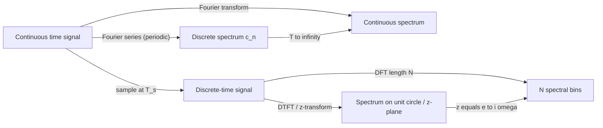

# Signal Processing

> [Applied Mathematics](../README.md) · Level: Advanced · Prerequisites: [Sequences and Series in Calculus](../../07-calculus/11-sequences-and-series-in-calculus/README.md), [Techniques of Integration](../../07-calculus/08-techniques-of-integration/README.md), [Improper Integrals](../../07-calculus/10-improper-integrals/README.md), [Eigenvalues and Eigenvectors](../../08-linear-algebra/07-eigenvalues-and-eigenvectors/README.md), [Inner Product Spaces](../../08-linear-algebra/08-inner-product-spaces/README.md), [Complex Numbers and Geometry](../../15-complex-analysis/01-complex-numbers-and-geometry/README.md), [Laplace Transforms](../../16-differential-equations/04-laplace-transforms/README.md) · Estimated time: 600 min

## 1. Introduction

A **signal** is a function that carries information: the air pressure at a microphone, the
brightness across a photograph, the voltage on an antenna, the position of a ship. **Signal
processing** is the mathematics of extracting, transforming, transmitting and reconstructing such
functions. Its central idea is deceptively simple: *every reasonable signal is a sum of sinusoids*,
and sinusoids are the only functions that pass through a linear time-invariant system without
changing shape — only amplitude and phase change. Once a signal is decomposed into sinusoids,
filtering becomes multiplication by one number per frequency, convolution becomes multiplication,
differentiation becomes multiplication by $i\omega$, and the analysis of a whole system collapses onto the
study of a single function, its **frequency response**.

Three historical threads run through the subject.

*Fourier.* Joseph Fourier, studying heat conduction in 1807–1822, claimed that any function could be
expanded in sines and cosines. The claim was controversial — Lagrange objected that a sum of smooth
waves cannot represent a function with corners — and making it precise took a century, culminating
in the Lebesgue integral and the Riesz–Fischer theorem. The resolution has two parts: Fourier series
converge in the mean-square sense for every square-integrable function, and they converge pointwise
(to the average of the one-sided limits) for piecewise smooth functions.

*Sampling.* Harry Nyquist (1928) and Claude Shannon (1949) asked how often a signal must be measured
to be recoverable. The answer — more than twice the highest frequency present — is the **sampling
theorem**, and its converse explains **aliasing**: the wagon wheel that appears to turn backwards in
a film, the moiré pattern in a photograph, the wrong pitch from a badly sampled synthesiser.

*Computation.* The **fast Fourier transform** of Cooley and Tukey (1965) reduced the cost of
computing $N$ Fourier coefficients from $N^2$ to $N\log N$ operations. Real-time spectral analysis, image
compression, OFDM radio and much of numerical computing rest on that improvement.

This tutorial develops the theory with proofs: the Fourier series and its convergence, the Fourier
transform and its properties, the convolution theorem, the sampling theorem and aliasing, the
discrete Fourier transform and the FFT, the $z$-transform and discrete linear systems, filters,
windows and spectral leakage, and the uncertainty principle. Continuous and discrete time are
treated on an equal footing, because physical systems are continuous while computation is discrete,
and the bridge between them — sampling — is where most practical errors are made.

## 2. Prerequisites

* **Series and convergence** — geometric series, absolute convergence, Fourier coefficients are series
  of numbers: [Sequences and Series in Calculus](../../07-calculus/11-sequences-and-series-in-calculus/README.md).
* **Integration techniques** — integration by parts, substitution, trigonometric integrals:
  [Techniques of Integration](../../07-calculus/08-techniques-of-integration/README.md).
* **Improper integrals** — the Fourier transform is an integral over the whole line:
  [Improper Integrals](../../07-calculus/10-improper-integrals/README.md).
* **Complex numbers and Euler's formula** — $e^{i\theta} = \cos\theta + i\sin\theta$ is used
  everywhere: [Complex Numbers and Geometry](../../15-complex-analysis/01-complex-numbers-and-geometry/README.md).
* **Eigenvalues and eigenvectors** — poles, stability and modes of a linear system:
  [Eigenvalues and Eigenvectors](../../08-linear-algebra/07-eigenvalues-and-eigenvectors/README.md).
* **Inner product spaces** — orthogonality is what makes Fourier coefficients computable:
  [Inner Product Spaces](../../08-linear-algebra/08-inner-product-spaces/README.md).
* **Laplace transforms** — the $z$-transform is the discrete analogue; the dictionary
  $z \leftrightarrow e^{sT}$ is used in §7.9:
  [Laplace Transforms](../../16-differential-equations/04-laplace-transforms/README.md).

Measure theory is *not* assumed; where the honest statement is a Lebesgue one (for example that
Fourier series converge in $L^2$) this is said explicitly. Readers who want the full $L^2$ theory should
read [Measure Theory](../../24-advanced-topics/01-measure-theory/README.md) afterwards.

## 3. Learning Objectives

After working through this tutorial you will be able to:

1. Decide whether a given signal is periodic, and compute its period and fundamental frequency.
2. Classify signals as finite-energy or finite-power and compute the corresponding quantity.
3. Compute Fourier coefficients of simple periodic signals and state in which sense the series
   converges.
4. State the convergence theorem for piecewise smooth signals and explain the Gibbs phenomenon.
5. Compute Fourier transforms from the definition and by using the operational properties.
6. Prove the convolution theorem and use it to evaluate transforms and convolutions.
7. State the sampling theorem with its hypotheses, prove it, and compute the Nyquist rate.
8. Predict the alias frequencies produced when a signal is undersampled.
9. Compute small discrete Fourier transforms, verify Parseval's identity, and explain the FFT
   recursion and its cost.
10. Compute $z$-transforms with their regions of convergence and solve linear difference equations.
11. Decide stability and causality of a discrete linear system from the pole locations.
12. Explain why an ideal low-pass filter cannot be realised, and design a simple realisable filter.
13. Explain spectral leakage and choose a window for a given measurement problem.
14. Prove the uncertainty principle for signals and identify its extremal signal.

## 4. Intuition

**A prism for functions.** White light entering a prism leaves as a rainbow. The prism does not
create the colours; it separates components that were already there. A Fourier transform is a
mathematical prism: it takes a signal and reports how much of each frequency it contains. The
Fourier series does this for a signal that repeats, the Fourier transform for a signal that does
not.

**A choir of tuning forks.** Imagine a row of tuning forks, each resonating at one frequency. Play a
sound and each fork vibrates with an amplitude proportional to how much of its frequency the sound
contains. The collection of amplitudes is the spectrum. A filter is then nothing more than a hand
that covers some of the forks: it leaves the low ones free (low-pass), or the high ones (high-pass),
or a band in the middle (band-pass).

**Why sinusoids?** Because a linear system obeys superposition and time-invariance, and a sinusoid
is the only bounded waveform that a linear time-invariant system reproduces exactly, delayed and
rescaled. Push $\cos\omega t$ into such a system and out comes $A\cos(\omega t + \varphi)$: one number $A$ for the gain and one number
$\varphi$ for the delay, both depending on $\omega$. That pair of numbers, as a function of $\omega$, *is* the
system.

**Sampling and the wagon wheel.** A film camera records 24 still frames per second. A wheel with 25
spokes turning at one revolution per second appears to turn slowly backwards, because between frames
the spokes advance almost exactly one position, so the eye sees the nearest match, which is one step
backwards. Nothing is wrong with the wheel; the measurement is too coarse to distinguish the true
motion from a slower apparent one. That is aliasing, and it is the reason a signal must be sampled
faster than twice its highest frequency.

**Convolution as smearing.** A photograph taken with a shaky hand is the sharp image smeared by the
motion. Mathematically, the recorded image is the convolution of the true image with a blur kernel.
In the frequency domain the same statement reads: the spectrum of the sharp image multiplied by the
spectrum of the kernel. Blurring removes high frequencies; deblurring divides by small numbers and
is therefore unstable — the first hint that inverse problems are hard.

## 5. Formal Definition

**Definition 5.1** (Signal, continuous and discrete time). A *continuous-time signal* is a function
$x : \mathbb{R} \to \mathbb{C}$. A *discrete-time signal* is a function $x : \mathbb{Z} \to \mathbb{C}$, written $(x_n)_{n \in \mathbb{Z}}$ or simply $x_n$. The value $x(t)$ or $x_n$ is
the *amplitude* at time $t$ or at index $n$. A signal is *real* if its values lie in $\mathbb{R}$.

Discrete-time signals usually arise from sampling: given a continuous-time $x$ and a *sampling
interval* $T_s > 0$, the sampled signal is $x_n := x(nT_s)$. The *sampling rate* (or frequency) is $f_s := 1/T_s$.

**Definition 5.2** (Periodicity). A continuous-time signal is *periodic* with period $T > 0$ if $x(t+T) = x(t)$ for
all $t \in \mathbb{R}$. The *fundamental period* is the smallest such $T$, and the *fundamental frequency* is $f_0 = 1/T$,
with *angular frequency* $\omega_0 = 2\pi f_0 = 2\pi/T$. A discrete-time signal is periodic with period $N \in \mathbb{N}$ if $x_{n+N} = x_n$ for all $n$;
the smallest such $N$ is its fundamental period.

A discrete-time sinusoid $\cos(\omega n)$ is periodic if and only if $\omega/(2\pi) \in \mathbb{Q}$;
this is the first genuinely discrete phenomenon, and it is proved in Exercise 1.

**Definition 5.3** (Energy and power). For a continuous-time signal the *energy* and *average power*
are

$$E := \int_{-\infty}^{\infty} \lvert x(t)\rvert^2\,dt, \qquad
P := \lim_{T \to \infty} \frac{1}{2T}\int_{-T}^{T}\lvert x(t)\rvert^2\,dt,$$

whenever the limits exist. For a discrete-time signal replace the integral by a sum and $1/(2T)$ by $1/(2N+1)$.
A signal is an *energy signal* if $0 < E < \infty$ (then $P = 0$), a *power signal* if $0 < P < \infty$ (then $E = \infty$), and *neither*
if both are $0$ or both are infinite.

**Definition 5.4** (Fourier series). Let $x : \mathbb{R} \to \mathbb{C}$ be $T$-periodic and integrable
on one period. Its *complex Fourier coefficients* are

$$c_n := \frac{1}{T}\int_{-T/2}^{T/2} x(t)\,e^{-in\omega_0 t}\,dt,
\qquad n \in \mathbb{Z}, \quad \omega_0 = \frac{2\pi}{T},$$

and the *Fourier series* of $x$ is the formal series $\sum_{n \in \mathbb{Z}} c_n e^{in\omega_0 t}$.
The *partial sums* are $S_N(t) := \sum_{\lvert n\rvert \le N} c_n e^{in\omega_0 t}$.

**Definition 5.5** (Fourier transform). For $x \in L^1(\mathbb{R})$, that is
$\int_{\mathbb{R}}\lvert x(t)\rvert\,dt < \infty$, the *Fourier transform* is

$$\hat{x}(\omega) := \int_{-\infty}^{\infty} x(t)\,e^{-i\omega t}\,dt, \qquad \omega \in \mathbb{R}.$$

The *inversion formula* recovers $x$ from $\hat{x}$ at every point where $x$ is continuous and of
bounded variation, and the transform is extended to $L^2$ by continuity (Plancherel's theorem, §7.6).

**Definition 5.6** (Convolution). For functions on $\mathbb{R}$, $(x * y)(t) := \int_{\mathbb{R}} x(\tau)y(t-\tau)\,d\tau$ whenever the integral converges
absolutely for almost every $t$. For sequences, $(x * y)_n := \sum_{k \in \mathbb{Z}} x_k\,y_{n-k}$. For sequences of length $N$ the *circular
convolution* is $(x \circledast y)_n := \sum_{k=0}^{N-1}x_k\,y_{(n-k) \bmod N}$.

**Definition 5.7** (Bandlimited signal; Nyquist rate). A signal $x \in L^2(\mathbb{R})$ is *bandlimited to bandwidth
$\Omega$* (angular frequency, rad/s) if $\hat{x}(\omega) = 0$ for almost every $\lvert\omega\rvert > \Omega$. Its *Nyquist rate* is $\Omega/\pi$ samples per
second, that is, twice its highest frequency in hertz.

**Definition 5.8** (Discrete Fourier transform). For a finite sequence
$x_0, \dots, x_{N-1} \in \mathbb{C}$, the *DFT* is

$$X_k := \sum_{n=0}^{N-1} x_n\,e^{-2\pi i kn/N}, \qquad k = 0, 1, \dots, N-1,$$

and the *inverse DFT* is $x_n = \frac{1}{N}\sum_{k=0}^{N-1} X_k\,e^{2\pi i kn/N}$.

**Definition 5.9** ($z$-transform). For a two-sided sequence $(x_n)_{n\in\mathbb{Z}}$, the *$z$-transform* is $X(z) := \sum_{n=-\infty}^{\infty} x_n z^{-n}$,
defined for those $z \in \mathbb{C}$ for which the series converges absolutely. That set is the *region of
convergence* (ROC); on it $X$ is a holomorphic function of $z$.

**Definition 5.10** (Discrete linear time-invariant system). A system $\mathcal{T}$ mapping sequences to
sequences is *linear* if $\mathcal{T}(ax + by) = a\mathcal{T}(x) + b\mathcal{T}(y)$ and *time-invariant* if $\mathcal{T}$ commutes with every shift: if $y = \mathcal{T}(x)$ then the
shifted input produces the shifted output. It is *causal* if $y_n$ depends only on $x_k$ with $k \le n$, and
*bounded-input bounded-output (BIBO) stable* if every bounded input produces a bounded output. A
causal, linear, time-invariant system is determined by its *impulse response* $h := \mathcal{T}(\delta)$ where $\delta_0 = 1$ and $\delta_n = 0$
otherwise; then $y = h * x$, and its *transfer function* is $H(z)$, the $z$-transform of $h$.

**Definition 5.11** (Ideal filter). An *ideal low-pass filter* with cutoff $\omega_c \in (0,\pi)$ is the system whose
frequency response is $H(\omega) = 1$ for $\lvert\omega\rvert < \omega_c$ and $H(\omega) = 0$ for $\omega_c < \lvert\omega\rvert \le \pi$ (extended periodically with period $2\pi$).
*High-pass*, *band-pass* and *band-stop* filters are defined by exchanging the roles of the two
values.

## 6. Mathematical Notation

| Symbol | Read as | Meaning |
|---|---|---|
| $t$ | time | continuous-time variable, measured in seconds |
| $n$ | index | discrete-time variable, dimensionless |
| $T$, $f_0$, $\omega_0$ | period, fundamental frequency, angular frequency | $T = 1/f_0$, $\omega_0 = 2\pi/T$ |
| $T_s$, $f_s$, $\omega_s$ | sampling interval, rate, angular rate | $f_s = 1/T_s$, $\omega_s = 2\pi f_s$ |
| $\Omega$ | bandwidth | largest angular frequency present in a bandlimited signal |
| $c_n$ | Fourier coefficient | coefficient of $e^{in\omega_0t}$ |
| $\hat{x}(\omega)$ | Fourier transform of $x$ | $\int x(t)e^{-i\omega t}dt$ |
| $X_k$ | DFT coefficient | value of the DFT at bin $k$ |
| $x * y$ | $x$ convolved with $y$ | continuous or discrete convolution |
| $x \circledast y$ | circular convolution | length-$N$ periodic convolution |
| $h_n$, $H(\omega)$, $H(z)$ | impulse response, frequency response, transfer function | $H$ is the transform of $h$ |
| $\lvert H(\omega)\rvert$, $\arg H(\omega)$ | magnitude and phase response | gain and phase shift at frequency $\omega$ |
| $\operatorname{sinc} x$ | sinc of $x$ | $\sin x / x$ for $x \ne 0$, and $\operatorname{sinc} 0 := 1$ |
| $\operatorname{rect}(t)$ | rectangle | $1$ for $\lvert t\rvert \le 1/2$, $0$ otherwise |
| $u(t)$, $u_n$ | unit step | $1$ for $t \ge 0$ (or $n \ge 0$), $0$ otherwise |
| $\delta(t)$, $\delta_n$ | Dirac delta, Kronecker delta | unit impulse |
| $\sigma_t$, $\sigma_\omega$ | time and frequency spread | standard deviations of $\lvert x\rvert^2$ and $\lvert\hat x\rvert^2$ |
| $L^2(\mathbb{R})$, $\ell^2(\mathbb{Z})$ | square-integrable functions, square-summable sequences | finite energy |
| $\operatorname{Re}$, $\operatorname{Im}$, $\bar{z}$ | real part, imaginary part, conjugate | as in [MATHEMATICAL_NOTATION.md](../../MATHEMATICAL_NOTATION.md) |

Two conventions must be fixed once and used consistently:

1. The Fourier transform uses $e^{-i\omega t}$ with $\omega$ in radians per second, and the inverse
   carries the factor $1/(2\pi)$. With a frequency variable $f$ in hertz the factor moves to the forward
   transform. Both conventions appear in the literature; mixing them silently is a classic source of
   factor-of-$2\pi$ errors.
2. The normalised sinc used in some engineering texts is $\sin(\pi x)/(\pi x)$, which equals
   $\operatorname{sinc}(\pi x)$ in the notation above. This tutorial always writes the argument
   explicitly so that no ambiguity arises.

## 7. Core Concepts

### 7.1 Signals as functions

A signal is a mathematical model of a physical quantity, and the first modelling decision is always
which features of the physical object to keep. A microphone signal keeps air pressure and discards
position; an image keeps brightness and discards polarisation; a financial time series keeps a price
and discards the order book. Everything that follows applies to any signal that is a function of one
variable (time) — for images the same theory runs in two dimensions.

Three families of elementary signals generate almost everything:

* the **complex exponential** $e^{i\omega t} = \cos\omega t + i\sin\omega t$, the building block of
  spectral analysis;
* the **unit step** $u(t) = 1$ for $t \ge 0$ and $0$ for $t < 0$, which switches a signal on;
* the **unit impulse** $\delta$, characterised by the *sifting property*
  $\int_{\mathbb{R}} x(t)\delta(t - t_0)\,dt = x(t_0)$ for every $x$ continuous at $t_0$.

The impulse is not a function in the ordinary sense: no function can be zero everywhere except at
one point and still have integral $1$. It is a *distribution* (a continuous linear functional on
test functions), and every statement involving it must be read in that sense. In discrete time the
difficulty disappears: $\delta_0 = 1$, $\delta_n = 0$ for $n \ne 0$, and $\sum_n x_n \delta_{n-k} = x_k$ is an ordinary sum.

The impulse matters because a linear time-invariant system is completely determined by its response
to it. If the input is a sum of shifted impulses, $x = \sum_k x_k \delta_{\cdot - k}$, then linearity and time-invariance force the
output to be $\sum_k x_k h_{\cdot - k}$, where $h$ is the response to a single impulse. That is convolution, derived from
two axioms with no analysis at all.

### 7.2 Continuous and discrete time; energy and power

Sampling replaces $t$ by $nT_s$. The information lost in that replacement is the whole subject of §7.7,
but one consequence is immediate and worth stating at the outset: **discrete frequencies are only
defined modulo $2\pi$**. For any integer $k$,

$$\cos\bigl((\omega + 2\pi k)n\bigr) = \cos(\omega n + 2\pi k n) = \cos(\omega n),$$

because $kn$ is an integer. Two continuous-time sinusoids with different frequencies are different
functions; two discrete-time sinusoids whose frequencies differ by a multiple of $2\pi$ are the *same
sequence*. The useful range of discrete frequencies is therefore an interval of length $2\pi$, usually
$[-\pi, \pi]$ or $[0, 2\pi)$. The frequency $\omega = \pi$ is the fastest oscillation a discrete-time signal can carry: it
alternates sign at every step, $(-1)^n$.

Energy and power separate two kinds of signal that behave very differently under the Fourier
transform. A finite-energy signal has a genuine Fourier transform in $L^2$ and a spectrum with finite
total energy. A finite-power signal, such as a sinusoid, has infinite energy; its transform exists
only as a sum of impulses (a spectral line), which is why periodic signals are analysed with Fourier
*series* rather than transforms.

| Signal | Energy $E$ | Power $P$ | Class |
|---|---|---|---|
| $x(t) = e^{-at}u(t)$, $a > 0$ | $\dfrac{1}{2a}$ | $0$ | energy |
| $x(t) = \operatorname{rect}(t/\tau)$ | $\tau$ | $0$ | energy |
| $x(t) = \cos\omega_0 t$, $\omega_0 \ne 0$ | $\infty$ | $\dfrac{1}{2}$ | power |
| $x(t) = t^{-1/2}u(t-1)$ | $\infty$ | $0$ | neither |
| $x_n = (1/2)^n u_n$ | $\dfrac{4}{3}$ | $0$ | energy |
| $x_n = (-1)^n$ | $\infty$ | $1$ | power |

The entries are computed in Exercise 2; the third row uses
$\cos^2\theta = (1 + \cos 2\theta)/2$, whose average is $1/2$.

### 7.3 The Fourier series

Let $x$ be $T$-periodic and integrable on one period, and put $\omega_0 = 2\pi/T$. The functions
$e_n(t) := e^{in\omega_0 t}$, $n \in \mathbb{Z}$, are orthonormal with respect to the inner product

$$\langle f, g\rangle := \frac{1}{T}\int_{-T/2}^{T/2} f(t)\,\overline{g(t)}\,dt.$$

Indeed, for integers $m, n$,

$$\langle e_n, e_m\rangle = \frac{1}{T}\int_{-T/2}^{T/2} e^{i(n-m)\omega_0 t}\,dt
= \begin{cases} 1, & n = m,\\[2pt] \dfrac{e^{i(n-m)\pi} - e^{-i(n-m)\pi}}{2\pi i (n-m)} = 0, & n \ne m,\end{cases}$$

because $e^{\pm i(n-m)\pi} = (-1)^{n-m}$ and the two terms cancel. (For $n = m$ the integrand is $1$.)

**Why the coefficient formula is forced.** Suppose $x = \sum_n c_n e_n$ and suppose the series converges
uniformly, so that it may be integrated term by term against $\overline{e_m}$. Then

$$\langle x, e_m\rangle = \sum_n c_n \langle e_n, e_m\rangle = c_m,$$

because all inner products vanish except one. So the coefficients $c_m = \langle x, e_m\rangle$ are the only possible ones;
Definition 5.4 is not a choice. The same computation without assuming convergence gives the
*least-squares optimality*: among all trigonometric polynomials $p_N = \sum_{\lvert n\rvert\le N} a_n e_n$, the choice $a_n = \langle x, e_n\rangle$ minimises $\lVert x - p_N\rVert^2$.
To see it, expand

$$\lVert x - p_N\rVert^2 = \lVert x\rVert^2 - \sum_{\lvert n\rvert \le N}\bigl(\bar a_n \langle x, e_n\rangle + a_n \overline{\langle x, e_n\rangle}\bigr) + \sum_{\lvert n\rvert\le N}\lvert a_n\rvert^2$$

and complete the square: $\lVert x - p_N\rVert^2 = \lVert x\rVert^2 - \sum_{\lvert n\rvert\le N}\lvert c_n\rvert^2 + \sum_{\lvert n\rvert\le N}\lvert a_n - c_n\rvert^2$. This is minimal exactly when $a_n = c_n$, and the minimum value is $\lVert x\rVert^2 - \sum_{\lvert n\rvert \le N}\lvert c_n\rvert^2 \ge 0$. Hence

$$\sum_{\lvert n\rvert \le N}\lvert c_n\rvert^2 \le \frac{1}{T}\int_{-T/2}^{T/2}\lvert x(t)\rvert^2\,dt
\qquad\text{for every } N,$$

which is **Bessel's inequality**. It has two consequences used repeatedly below: the coefficients
are square-summable, $\sum_n \lvert c_n\rvert^2 < \infty$, and in particular $c_n \to 0$ as $\lvert n\rvert \to \infty$.

**Real form.** For real $x$, the coefficients satisfy $c_{-n} = \overline{c_n}$, and pairing the terms
$n$ and $-n$ gives

$$x(t) = \frac{a_0}{2} + \sum_{n=1}^{\infty}\bigl(a_n\cos n\omega_0 t + b_n \sin n\omega_0 t\bigr),
\qquad
a_n = \frac{2}{T}\int_{-T/2}^{T/2} x(t)\cos n\omega_0 t\,dt, \quad
b_n = \frac{2}{T}\int_{-T/2}^{T/2} x(t)\sin n\omega_0 t\,dt.$$

The dictionary is $c_0 = a_0/2$ and $c_n = (a_n - i b_n)/2$ for $n \ge 1$. The real form is convenient
for sketching; the complex form is far easier to manipulate, and is used throughout this tutorial.

**The square wave.** Let $x(t) = 1$ on $(0, T/2)$ and $x(t) = -1$ on $(-T/2, 0)$, extended periodically.
For $n \ne 0$,

$$c_n = \frac{1}{T}\left[\int_{-T/2}^{0}(-1)e^{-in\omega_0 t}dt + \int_0^{T/2}e^{-in\omega_0 t}dt\right]
= \frac{1}{T}\cdot\frac{2\bigl(1 - (-1)^n\bigr)}{i n \omega_0}
= \frac{1 - (-1)^n}{i\pi n},$$

using $\int_0^{T/2}e^{-in\omega_0t}dt = \dfrac{1 - e^{-in\pi}}{in\omega_0} = \dfrac{1-(-1)^n}{in\omega_0}$ and $\int_{-T/2}^{0}(-1)e^{-in\omega_0t}dt = \dfrac{1-(-1)^n}{in\omega_0}$. The coefficient vanishes for even $n$ and equals $-2i/(\pi n)$ for odd $n$. Pairing
opposites produces the familiar real series

$$x(t) = \frac{4}{\pi}\sum_{k=0}^{\infty}\frac{\sin\bigl((2k+1)\omega_0t\bigr)}{2k+1}.$$

At $t = T/4$ with $T = 2\pi$ the left side is $1$ and the right side is $\frac{4}{\pi}(1 - \frac13 + \frac15 - \cdots) = \frac{4}{\pi}\cdot\frac{\pi}{4} = 1$, as Leibniz's series requires. At $t = 0$
the left side is $-1$, the right side is $0$: the series does not converge to the function at a jump,
and §7.4 explains the systematic rule.

### 7.4 Convergence of the Fourier series

There are three distinct questions, and conflating them causes much confusion:

* **Pointwise:** does $S_N(t)$ converge for each fixed $t$, and to what?
* **Uniform:** does $\sup_t \lvert S_N(t) - x(t)\rvert \to 0$?
* **Mean square:** does $\lVert S_N - x\rVert_2 \to 0$?

The answers differ. A square wave has a mean-square convergent, pointwise (away from jumps)
convergent series that is *not* uniformly convergent, because the limit of a uniformly convergent
sequence of continuous functions is continuous and the square wave is not.

**Theorem 7.1** (smoothness gives decay, and decay gives uniform convergence). Let $x$ be
$T$-periodic, continuous and piecewise $C^1$, with $x' \in L^2$ over one period. Then $\sum_n \lvert c_n\rvert < \infty$ and the Fourier
series converges absolutely and uniformly to $x$.

*Proof.* Integration by parts on one period is legitimate on each $C^1$ piece; the boundary terms cancel
because $x$ is continuous and periodic at the endpoints, so

$$c_n = \frac{1}{T}\int_{-T/2}^{T/2}x(t)e^{-in\omega_0t}dt
= \frac{1}{T}\left[\underbrace{\frac{x(t)e^{-in\omega_0t}}{-in\omega_0}\Big|_{-T/2}^{T/2}}_{=\,0} +
\frac{1}{in\omega_0}\int_{-T/2}^{T/2}x'(t)e^{-in\omega_0t}dt\right] = \frac{d_n}{in\omega_0},$$

where $d_n$ is the $n$-th Fourier coefficient of $x'$. Bessel's inequality applied to $x'$ gives $\sum_n \lvert d_n\rvert^2 \le \frac1T\int\lvert x'\rvert^2 < \infty$, so
by the Cauchy–Schwarz inequality,

$$\sum_{n\ne0}\lvert c_n\rvert = \frac{1}{\omega_0}\sum_{n\ne0}\frac{\lvert d_n\rvert}{n}
\le \frac{1}{\omega_0}\Bigl(\sum_{n\ne0}\lvert d_n\rvert^2\Bigr)^{1/2}
\Bigl(\sum_{n\ne0}\frac{1}{n^2}\Bigr)^{1/2} < \infty .$$

The Weierstrass $M$-test with $M_n = \lvert c_n\rvert$ therefore gives absolute and uniform convergence of $\sum c_n e_n$ to a
continuous function $g$. Multiplying by $e^{-im\omega_0t}$ and integrating term by term (allowed by uniform
convergence) shows that every Fourier coefficient of $g$ equals $c_m$, hence every coefficient of $x - g$
vanishes. Since $x - g$ is continuous with all coefficients zero, it is zero: otherwise a point where
$\lvert x-g\rvert$ attains its positive maximum would, by continuity, contribute a nonzero coefficient (a standard
completeness argument: the trigonometric polynomials are uniformly dense in the continuous periodic
functions, by Weierstrass' approximation theorem). Hence $g = x$. $\blacksquare$

Iterating the integration by parts gives the **decay rule**: if $x$ is $k$ times continuously
differentiable (with $x^{(k)}$ piecewise $C^1$), then $c_n = O(n^{-k-1})$. Smoothness of the signal is exactly fast decay of
its spectrum. A jump discontinuity forces $\lvert c_n\rvert \sim C/\lvert n\rvert$; a corner (discontinuous first derivative, as in a
triangle wave) forces $\lvert c_n\rvert \sim C/n^2$.

**Theorem 7.2** (Dirichlet). Let $x$ be $T$-periodic and piecewise $C^1$ on $[-T/2, T/2]$, with
one-sided limits $x(t^+), x(t^-)$ at every point. Then for every $t$,

$$\lim_{N\to\infty} S_N(t) = \frac{x(t^+) + x(t^-)}{2}.$$

In particular the series converges to $x(t)$ at every point of continuity and to the midpoint of the
jump at a discontinuity. The proof writes $S_N(t) - \frac12(x(t^+)+x(t^-))$ as an integral against the **Dirichlet kernel** $D_N(u) = \frac{\sin\left((N+\tfrac12)u\right)}{\sin(u/2)}$
and uses the Riemann lemma; the kernel has integral $2\pi$ but is not absolutely integrable uniformly
in $N$, which is precisely why uniform convergence fails at jumps. $\square$

**The Gibbs phenomenon.** Near a jump, the partial sums overshoot the value of the function by a
*constant fraction of the jump*, no matter how large $N$ is. For the square wave the maximal partial
sum is

$$\max_t S_N(t) = \frac{2}{\pi}\int_0^{\pi}\frac{\sin u}{u}\,du - 1 \approx 0.08949,$$

that is, an overshoot of about $9\%$ of the jump height on each side, with oscillations that become
narrower but not smaller as $N$ grows. Pointwise convergence away from the jump is not contradicted:
for each fixed $t \ne 0$ the overshoot region shrinks away from $t$ eventually.

### 7.5 The Fourier transform

A non-periodic signal can be regarded as the limit of periodic signals whose period tends to
infinity. Make the substitution explicit. Let $x$ vanish outside $[-T/2, T/2]$ and let $x_T$ be its $T$-periodic
extension, with coefficients $c_n^{(T)}$. Then

$$c_n^{(T)} = \frac{1}{T}\int_{-T/2}^{T/2}x(t)e^{-in\omega_0t}dt = \frac1T\hat{x}(n\omega_0),$$

so $T c_n^{(T)} = \hat{x}(n\omega_0)$: the rescaled coefficients *sample* the Fourier transform at the frequencies $n\omega_0$. Writing the
reconstruction with frequency spacing $\Delta\omega = \omega_0 = 2\pi/T$,

$$x_T(t) = \sum_n c_n^{(T)}e^{in\omega_0t} = \frac{1}{2\pi}\sum_n \hat{x}(n\omega_0)e^{in\omega_0t}\,\Delta\omega
\;\xrightarrow[T\to\infty]{}\;\frac{1}{2\pi}\int_{-\infty}^{\infty}\hat{x}(\omega)e^{i\omega t}d\omega.$$

The sum becomes a Riemann integral. This is the derivation of the inversion formula; it is a heuristic
because the interchange of limit and sum needs hypotheses, but the conclusion is a theorem.

**Theorem 7.3** (inversion). Let $x \in L^1(\mathbb{R})$ be piecewise $C^1$ with one-sided limits at
every point. Then

$$x(t) = \frac{1}{2\pi}\int_{-\infty}^{\infty}\hat{x}(\omega)e^{i\omega t}\,d\omega$$

at every point $t$ where $x$ is continuous, and the right side equals $\frac12(x(t^+)+x(t^-))$ at a jump.

The factor $1/(2\pi)$ belongs to the inverse transform when $\omega$ is measured in rad/s. If instead one uses
$f = \omega/(2\pi)$ in hertz, the pair is $\hat x(f) = \int x(t)e^{-2\pi ift}dt$ and $x(t) = \int \hat x(f)e^{2\pi ift}df$, with the factor disappearing from both.

**Table of elementary transforms** (all verified from the definition in Exercises 5 and 6):

| $x(t)$ | $\hat{x}(\omega)$ | conditions |
|---|---|---|
| $\operatorname{rect}(t/\tau)$ | $\tau\operatorname{sinc}(\omega\tau/2)$ | $\tau > 0$ |
| $e^{-a\lvert t\rvert}$ | $\dfrac{2a}{a^2+\omega^2}$ | $a > 0$ |
| $e^{-t^2/(2\sigma^2)}$ | $\sigma\sqrt{2\pi}\,e^{-\sigma^2\omega^2/2}$ | $\sigma > 0$ |
| $e^{-at}u(t)$ | $\dfrac{1}{a+i\omega}$ | $a > 0$ |
| $\delta(t)$ | $1$ | distribution |
| $1$ | $2\pi\delta(\omega)$ | distribution |

The Gaussian is the striking entry: its transform is again a Gaussian. This self-duality is the reason
the Gaussian minimises the time–frequency product in §7.12.

**Plancherel's theorem.** For $x \in L^1 \cap L^2$,

$$\int_{-\infty}^{\infty}\lvert x(t)\rvert^2dt = \frac{1}{2\pi}\int_{-\infty}^{\infty}\lvert\hat{x}(\omega)\rvert^2d\omega .$$

Because the map $x \mapsto \hat x/\sqrt{2\pi}$ preserves the norm, it extends uniquely to an isometry of $L^2(\mathbb{R})$ onto itself; this
extension is *the* Fourier transform on $L^2$. Plancherel is proved from the convolution theorem in
§7.6. Its physical reading is conservation of energy: the energy computed by integrating over time
equals the energy computed by integrating the spectral energy density $\lvert\hat x(\omega)\rvert^2/(2\pi)$ over frequency.

Two cautions. First, $\hat x$ is in general a complex function even for real $x$; its modulus is the
amplitude spectrum and its argument the phase spectrum. Second, the transform of a function in $L^2$
but not in $L^1$ (for example $\operatorname{sinc}$) cannot be written as an ordinary integral; it exists as an $L^2$
limit, which is why Plancherel's extension matters.

### 7.6 Properties of the Fourier transform and the convolution theorem

Write $\mathcal{F}{x} = \hat x$. All identities below hold for functions in $L^1$ (and extend by continuity to $L^2$ where
both sides make sense); the hypotheses needed for each are stated with its proof.

1. **Linearity.** $\mathcal{F}{ax + by} = a\hat{x} + b\hat{y}$ for constants $a, b$. Immediate from the
   linearity of the integral.
2. **Time shift.** $\mathcal{F}(x(\cdot - t_0))(\omega) = e^{-i\omega t_0}\hat{x}(\omega)$.
   *Proof.* Substitute $u = t - t_0$:
   $\int x(t-t_0)e^{-i\omega t}dt = \int x(u)e^{-i\omega(u+t_0)}du = e^{-i\omega t_0}\hat x(\omega)$. $\blacksquare$
   A delay does not change the amplitude spectrum; it adds a linear phase $-i\omega t_0$. This is the
   mathematical content of "phase encodes position in time".
3. **Frequency shift (modulation).** $\mathcal{F}{e^{i\omega_0t}x(t)}(\omega) = \hat{x}(\omega - \omega_0)$.
   *Proof.* Insert the factor into the exponent: $e^{-i(\omega-\omega_0)t}$. $\blacksquare$
   Multiplying by a sinusoid moves the spectrum; this is how radio modulation places a baseband signal
   in a frequency band.
4. **Scaling.** For $a \ne 0$, $\mathcal{F}(x(at))(\omega) = \dfrac{1}{\lvert a\rvert}\hat{x}\!\left(\dfrac{\omega}{a}\right)$.
   *Proof.* With $u = at$, $dt = du/a$. If $a > 0$ the limits stay in order and the result is
   $\frac1a\int x(u)e^{-i(\omega/a)u}du$; if $a < 0$ the limits reverse, producing an extra minus sign
   and hence the factor $1/\lvert a\rvert$. $\blacksquare$
   Compressing in time stretches in frequency: a short pulse has a broad spectrum. This is already the
   uncertainty principle in qualitative form.
5. **Conjugation and reversal.** $\mathcal{F}(\bar x)(\omega) = \overline{\hat{x}(-\omega)}$; in
   particular, $x$ real $\iff$ $\hat{x}(-\omega) = \overline{\hat{x}(\omega)}$ (conjugate symmetry), so
   the amplitude spectrum of a real signal is even.
6. **Differentiation.** If $x$ is absolutely continuous, $x, x' \in L^1$, then
   $\mathcal{F}(x')(\omega) = i\omega\hat{x}(\omega)$.
   *Proof.* Integrate by parts on $[-R, R]$: $\int_{-R}^{R}x'(t)e^{-i\omega t}dt =
   x(R)e^{-i\omega R} - x(-R)e^{i\omega R} + i\omega\int_{-R}^{R}x(t)e^{-i\omega t}dt$. Since
   $x' \in L^1$ and $x$ is absolutely continuous, $x$ has finite limits at $\pm\infty$; since
   $x \in L^1$ those limits are zero. Let $R \to \infty$. $\blacksquare$
   Differentiation becomes multiplication, which is why differential equations become algebraic in the
   frequency domain.
7. **Multiplication ↔ convolution.** $\mathcal{F}{x w} = \frac{1}{2\pi}\hat x * \hat w$.
   *Proof.* Insert the inversion formula for $x$, interchange integrals:
   $x(t)w(t) = \frac{1}{2\pi}\int\hat x(\sigma)e^{i\sigma t}w(t)d\sigma$, and transform in $t$ to obtain
   $\frac{1}{2\pi}\int \hat x(\sigma)\hat w(\omega - \sigma)d\sigma$. $\blacksquare$
   This is the identity behind spectral leakage (§7.11): multiplying a signal by a window convolves its
   spectrum with the window's spectrum.
8. **The convolution theorem.** If $f, g \in L^1(\mathbb{R})$ then $f * g \in L^1$ and

   $$\widehat{(f*g)}(\omega) = \hat{f}(\omega)\,\hat{g}(\omega)\qquad\text{for all }\omega.$$

   *Proof.* By Tonelli's theorem,
   $\int\int\lvert f(\tau)\rvert\lvert g(t-\tau)\rvert d\tau\,dt = \lVert f\rVert_1\lVert g\rVert_1 < \infty$,
   so Fubini applies and the following interchange is legitimate:

   $$\widehat{(f*g)}(\omega) = \int_{\mathbb{R}}\Bigl(\int_{\mathbb{R}}f(\tau)g(t-\tau)\,d\tau\Bigr)e^{-i\omega t}dt
   = \int_{\mathbb{R}}f(\tau)\Bigl(\int_{\mathbb{R}}g(t-\tau)e^{-i\omega t}dt\Bigr)d\tau
   = \int_{\mathbb{R}}f(\tau)e^{-i\omega\tau}\hat{g}(\omega)\,d\tau = \hat{f}(\omega)\hat{g}(\omega).$$

   $\blacksquare$

   The theorem turns a hard operation (convolution, cost quadratic in the number of samples) into an easy
   one (pointwise multiplication). It is the reason the FFT is the workhorse of computational signal
   processing.
9. **Parseval/Plancherel.** For $f, g \in L^2$,
   $\int f\bar g\,dt = \frac{1}{2\pi}\int\hat f\overline{\hat g}\,d\omega$.
   *Proof.* Put $\tilde{g}(t) := \overline{g(-t)}$, whose transform is $\overline{\hat g(\omega)}$. Then
   $(f * \tilde g)(0) = \int f(\tau)\overline{g(\tau)}d\tau$, and by inversion at $t = 0$,
   $(f*\tilde g)(0) = \frac{1}{2\pi}\int\hat f(\omega)\overline{\hat g(\omega)}d\omega$. $\blacksquare$
### 7.7 Sampling, the sampling theorem, and aliasing

**The sampling operation.** A sampler converts $x$ into the sequence $x(nT_s)$. It is *not* a filter;
it discards everything between the sample points, and the theorem says when that loss is harmless.

**Theorem 7.4** (Nyquist–Shannon). Let $x \in L^2(\mathbb{R})$ be bandlimited to $\Omega$, that is, $\hat x(\omega) = 0$ for $\lvert\omega\rvert > \Omega$. If $T_s \le \pi/\Omega$
(equivalently $f_s \ge \Omega/\pi$), then $x$ is determined by its samples and

$$x(t) = \sum_{n=-\infty}^{\infty} x(nT_s)\,\operatorname{sinc}\!\left(\frac{t - nT_s}{T_s}\right),$$

with convergence in $L^2(\mathbb{R})$ and, if $\hat x \in L^1$, uniform convergence on $\mathbb{R}$.

*Proof.* Since $\hat x$ is supported in $[-\Omega,\Omega]$ and is square-integrable there, it can be expanded in a
Fourier series in the variable $\omega$ on that interval. With coefficients $a_n = \frac{1}{2\Omega}\int_{-\Omega}^{\Omega}\hat x(\omega)e^{in\pi\omega/\Omega}d\omega$,

$$\hat x(\omega) = \sum_{n \in \mathbb{Z}} a_n e^{-in\pi\omega/\Omega}, \qquad \lvert\omega\rvert \le \Omega,$$

where the sign choice and the factor $\pi/\Omega$ make the exponentials orthonormal on $[-\Omega,\Omega]$.
Now use the inversion formula at the sample points: with $t_n = n\pi/\Omega$,

$$x(t_n) = \frac{1}{2\pi}\int_{-\Omega}^{\Omega}\hat x(\omega)e^{i\omega n\pi/\Omega}d\omega
= \frac{2\Omega}{2\pi}\,a_n = \frac{a_n}{T_s},$$

because $T_s = \pi/\Omega$ (sampling exactly at the Nyquist rate). Hence $a_n = T_s x(nT_s)$, and

$$\hat x(\omega) = T_s\sum_n x(nT_s)e^{-inT_s\omega}, \qquad \lvert\omega\rvert\le\Omega.$$

Apply the inversion formula once more, this time to the series:

$$x(t) = \frac{1}{2\pi}\int_{-\Omega}^{\Omega}T_s\sum_n x(nT_s)e^{i\omega(t - nT_s)}d\omega
= \sum_n x(nT_s)\,\frac{T_s}{\pi}\cdot\frac{\sin\bigl(\Omega(t-nT_s)\bigr)}{t - nT_s}
= \sum_n x(nT_s)\operatorname{sinc}\bigl(\Omega(t-nT_s)\bigr),$$

using $\Omega T_s = \pi$. Since $\operatorname{sinc}(\Omega(t-nT_s)) = \operatorname{sinc}\bigl((t-nT_s)/T_s\bigr)$, this is the stated formula. If $T_s < \pi/\Omega$ the same computation applies with $\Omega$
replaced by the smaller Nyquist frequency $\pi/T_s$: sampling faster than necessary only wastes samples.
The interchange of summation and integration is justified by the $\ell^2$ summability of the samples and
the $L^2$ convergence of the Fourier series; uniform convergence follows when $\hat x \in L^1$, by the Weierstrass
$M$-test. $\blacksquare$

The reconstruction kernel $\operatorname{sinc}((t-nT_s)/T_s)$ is the impulse response of the ideal low-pass filter with cutoff $\pi/T_s$,
which is exactly the statement that reconstruction is low-pass filtering. It is also the reason
ideal reconstruction is not realisable (§7.10): the sinc kernel is two-sided and decays only like
$1/t$.

**Aliasing.** If $f_s < \Omega/\pi$ the argument fails, and something explicit happens. A continuous sinusoid $\cos(\omega t)$
sampled at rate $\omega_s = 2\pi/T_s$ gives the sequence $\cos(\omega n T_s) = \cos\bigl((\omega T_s) n\bigr)$, which depends only on the *product* $\omega T_s$ modulo $2\pi$. So
the frequency $\omega$ and the frequency $\omega + k\omega_s$, $k \in \mathbb{Z}$, produce *identical samples*. All these frequencies are
aliases of one another, and only the one lying in the band $\lvert\omega\rvert \le \omega_s/2$ can be reconstructed. The folding
formula for a real frequency $f_0 \ge 0$ sampled at $f_s$ is

$$f_{\text{alias}} = \left\lvert \left(\left(f_0 + \tfrac{f_s}{2}\right) \bmod f_s\right) - \tfrac{f_s}{2}\right\rvert .$$

For example $f_0 = 22$ kHz sampled at $f_s = 40$ kHz: $(22 + 20) \bmod 40 = 2$, and $\lvert 2 - 20\rvert = 18$ kHz. The 22 kHz tone is heard as an 18 kHz
tone, and no post-processing can tell the two apart. The cure is a physical one: filter the signal
to below $f_s/2$ *before* sampling (an *anti-aliasing filter*).

**Theorem 7.5** (aliasing formula). Let $x \in L^2$ and let $x_s$ denote the sampled-then-ideally-
reconstructed signal, obtained by filtering the samples with cutoff $\omega_s/2$. Then

$$\hat{x}_s(\omega) = \sum_{k \in \mathbb{Z}}\hat x(\omega + k\omega_s)\quad\text{for }\lvert\omega\rvert \le \omega_s/2,$$

a sum of shifted copies of the spectrum; the copies overlap exactly when $x$ is not bandlimited to
$\omega_s/2$, and the overlap is the aliasing error. $\square$

The identity is the frequency-domain form of the sampling theorem: sampling in time is periodisation
in frequency. It also shows why $f_s > 2f_{\max}$ and not merely $f_s = 2f_{\max}$ is the practical rule — at equality, any
energy exactly at the edge is counted twice.

### 7.8 The discrete Fourier transform and the FFT

The DFT is what a computer can actually compute: finitely many numbers in, finitely many out.

**Orthogonality and inversion.** Let $\omega_N := e^{-2\pi i/N}$, a primitive $N$-th root of unity. Then $\sum_{n=0}^{N-1}\omega_N^{kn} = N$ if $N \mid k$, and $= (1 - \omega_N^{kN})/(1-\omega_N^{k}) = 0$
otherwise, because $\omega_N^k \ne 1$ and $\omega_N^{kN} = 1$. Hence

$$\frac{1}{N}\sum_{n=0}^{N-1}e^{-2\pi i kn/N}e^{2\pi i jn/N} = \delta_{kj},$$

and multiplying the definition $X_k = \sum_n x_n e^{-2\pi ikn/N}$ by $e^{2\pi i jk/N}$ and summing over $k$
gives the inverse formula of Definition 5.8.

**What the DFT computes.** $X_k$ is the value at $\omega = 2\pi k/N$ of the DTFT $X(\omega) = \sum_{n=0}^{N-1}x_ne^{-i\omega n}$, which is a trigonometric
polynomial. The DFT is therefore a *sampled* version of the DTFT, at $N$ equally spaced frequencies
(bins) of width $2\pi/N$. This has a practical consequence: the DFT cannot resolve two frequencies closer
than one bin — a resolution limit set by the observation length, not by the algorithm.

**Parseval for the DFT.** $\sum_{n=0}^{N-1}\lvert x_n\rvert^2 = \frac1N\sum_{k=0}^{N-1}\lvert X_k\rvert^2$. *Proof.* Expand $\sum_n x_n\overline{x_n}$ with $x_n$ replaced by the inverse DFT and use the
orthogonality relation. $\blacksquare$

**Circular convolution theorem.** With $H_k, X_k$ the DFTs of length-$N$ sequences $h, x$, the circular
convolution $y_n = \sum_{m=0}^{N-1}h_m x_{(n-m)\bmod N}$ has DFT $Y_k = H_kX_k$. The proof is the same computation as in continuous time, with the
substitution $j = (n-m) \bmod N$; the modulus is what makes the sum finite. Linear convolution of two length-$N$
sequences has length $2N-1$ and is recovered from circular convolution of length $\ge 2N-1$ by zero-padding
both sequences.

**The FFT idea.** A direct DFT costs $N^2$ complex multiplications. The Cooley–Tukey algorithm uses the
factorisation of the index set. For even $N$, split the sum into even and odd indices:

$$X_k = \sum_{r=0}^{N/2-1}x_{2r}e^{-2\pi ikr/(N/2)} + e^{-2\pi ik/N}\sum_{r=0}^{N/2-1}x_{2r+1}e^{-2\pi ikr/(N/2)}
= E_k + \omega_N^{k}O_k,$$

where $E_k$ and $O_k$ are the length-$N/2$ DFTs of the even and odd subsequences, both periodic in $k$
with period $N/2$. Hence

$$X_{k} = E_k + \omega_N^k O_k, \qquad X_{k + N/2} = E_k - \omega_N^k O_k, \qquad 0 \le k < N/2.$$

One length-$N$ transform is computed from two length-$N/2$ transforms plus $N/2$ "butterfly" operations.
With $N = 2^m$ the recursion terminates after $m$ levels, so the operation count $T(N)$ satisfies $T(N) = 2T(N/2) + \Theta(N)$, whose
solution is $T(N) = \Theta(N\log_2 N)$: for $N = 2^{20}$ about twenty million operations instead of about a trillion. The same
recursion with a different splitting base (radix 3, 4, 5, split-radix) is used in practice;
non-power-of-two lengths are handled by zero-padding, Bluestein's algorithm or mixed radix.

Two properties of the DFT are worth memorising because they cause endless practical confusion:

* $X_k$ is periodic in $k$ with period $N$, so bins $k$ and $k - N$ are the same; negative frequencies
  appear in the upper half of the array.
* for real $x_n$ one has $X_{N-k} = \overline{X_k}$, so only $N/2+1$ values are independent.

### 7.9 The z-transform and discrete linear time-invariant systems

The $z$-transform is to discrete time what the Laplace transform is to continuous time. Writing $z = e^{sT_s}$
turns the Laplace transform of a sampled signal into the $z$-transform, which is why the stability
regions correspond: the left half-plane $\operatorname{Re}s < 0$ becomes the interior of the unit disc $\lvert z\rvert < 1$.

**Region of convergence.** Because $\sum_n x_nz^{-n} = \sum_n x_nr^{-n}e^{-i\theta n}$ with $z = re^{i\theta}$, absolute convergence depends only on $r = \lvert z\rvert$. The ROC
is therefore an annulus $r_- < \lvert z\rvert < r_+$ (possibly empty, possibly unbounded) and $X$ is holomorphic on it. Two
different signals can share the same algebraic expression for $X$ and differ only in ROC; the ROC is
part of the transform, not a decoration.

*Example.* For $x_n = a^nu_n$, $\sum_{n\ge0}(a/z)^n = \dfrac{1}{1 - a/z} = \dfrac{z}{z-a}$ for $\lvert z\rvert > \lvert a\rvert$. For $x_n = -a^nu_{-n-1}$, $\sum_{n\le-1}-a^nz^{-n} = \dfrac{z}{z-a}$ for $\lvert z\rvert < \lvert a\rvert$: same formula, different ROC, different
signal.

**Convolution becomes multiplication.** If $y = h * x$ and both transforms converge on a common annulus,
then

$$Y(z) = \sum_n\Bigl(\sum_k h_kx_{n-k}\Bigr)z^{-n} = \Bigl(\sum_k h_kz^{-k}\Bigr)\Bigl(\sum_m x_mz^{-m}\Bigr) = H(z)X(z),$$

the interchange being justified by absolute convergence of the double sum on the intersection of the
two ROCs (Tonelli). Consequently a difference equation becomes an algebraic equation. For $y_n - a y_{n-1} = x_n$, $Y(z)(1 - az^{-1}) = X(z)$,
so

$$H(z) = \frac{1}{1 - az^{-1}} = \frac{z}{z-a}, \qquad \lvert z\rvert > \lvert a\rvert \text{ for the causal system}.$$

The impulse response is $h_n = a^nu_n$; the single **pole** at $z = a$ controls everything.

**Eigenfunctions.** For any $z$ in the ROC, the sequence $x_n = z^n$ satisfies $(h*x)_n = \sum_k h_kz^{n-k} = z^nH(z)$. Complex exponentials are
eigenfunctions of every LTI system, with eigenvalue $H(z)$. Restricting to $\lvert z\rvert = 1$, that is $z = e^{i\omega}$, gives the
**frequency response** $H(e^{i\omega}) = \sum_n h_ne^{-i\omega n}$, and the response to a real sinusoid $\cos\omega n$ is $\lvert H(e^{i\omega})\rvert\cos\bigl(\omega n + \arg H(e^{i\omega})\bigr)$.

**Stability and causality.** For a causal LTI system with rational transfer function:

> the system is BIBO stable $\iff$ the ROC contains the unit circle $\iff$ every pole lies strictly inside
> the unit circle.

*Proof of the second equivalence for causal systems.* Causality plus $\sum_n\lvert h_n\rvert < \infty$ implies absolute
convergence at $\lvert z\rvert = 1$, so the ROC contains the unit circle. Conversely if the ROC contains $\lvert z\rvert = 1$ then
$\sum_n\lvert h_n\rvert < \infty$, which is exactly BIBO stability, since $\lvert y_n\rvert \le \sup_k\lvert x_k\rvert\sum_k\lvert h_k\rvert$. For a causal rational $H$, the ROC is $\lvert z\rvert > \rho$ where $\rho$
is the largest pole modulus, so the unit circle lies in the ROC exactly when $\rho < 1$. $\blacksquare$

### 7.10 Filters

A filter is an LTI system used to alter a spectrum. Its two descriptions are the **impulse
response** $h$ (time domain) and the **frequency response** $H(\omega)$ (frequency domain); they are a
transform pair, and the convolution theorem says filtering is multiplication: $Y(\omega) = H(\omega)X(\omega)$.

**Ideal low-pass.** With $H(\omega) = 1$ on $\lvert\omega\rvert < \omega_c$ and $0$ on
$\omega_c < \lvert\omega\rvert \le \pi$, the impulse response is

$$h_n = \frac{1}{2\pi}\int_{-\omega_c}^{\omega_c}e^{i\omega n}d\omega =
\begin{cases}\dfrac{\sin(\omega_c n)}{\pi n}, & n \ne 0,\\[6pt] \dfrac{\omega_c}{\pi}, & n = 0.\end{cases}$$

Three defects are visible immediately: $h_n \ne 0$ for $n < 0$ (non-causal), $h_n$ decays only like $1/n$ (so $\sum\lvert h_n\rvert = \infty$
and the filter is not BIBO stable), and truncating $h_n$ to make it finite produces ripples — the
Gibbs phenomenon of §7.4 appearing again. These are not accidents of this example.

**Ideal high-pass.** Subtracting an ideal low-pass from the all-pass response gives an ideal high-pass,
$H_{hp}(\omega) = 1 - H_{lp}(\omega)$, hence $h^{hp}_n = \delta_n - h^{lp}_n$: the same sinc, sign-reversed,
plus a unit impulse at $n=0$. It inherits both defects of the ideal low-pass, and the impulse at $n=0$ does
not cure them.

**Theorem 7.6** (Paley–Wiener). Let $H$ be the frequency response of a causal LTI system with
$h \in L^2$. Then

$$\int_{-\pi}^{\pi}\bigl\lvert \ln\lvert H(\omega)\rvert\bigr\rvert\,d\omega < \infty .$$

Consequently a causal, square-integrable filter cannot have $H(\omega) = 0$ on any interval of positive
length, and an ideal filter — low-pass, high-pass or band-stop — is unrealisable. $\square$

So every realisable filter is a compromise: its stopband is never exactly zero, and its passband is never
exactly flat. Design consists of choosing which imperfection to accept.

**Realisable prototypes.** Standard designs, all causal and stable:

| Filter | $\lvert H(\omega)\rvert^2$ (continuous time) | Behaviour |
|---|---|---|
| RC low-pass | $\dfrac{1}{1 + (\omega RC)^2}$ | cutoff $\omega_c = 1/(RC)$, $-20$ dB/decade, $-45°$ at $\omega_c$ |
| Butterworth order $n$ | $\dfrac{1}{1 + (\omega/\omega_c)^{2n}}$ | maximally flat at $\omega = 0$, $-20n$ dB/decade |

The Butterworth response is monotone and satisfies $\lvert H(\omega_c)\rvert^2 = 1/2$ for every order, i.e. $-3$ dB at the cutoff;
its first $2n-1$ derivatives vanish at $\omega = 0$ ("maximally flat"). In discrete time, the elementary
first-order low-pass is the exponential moving average $y_n = (1-\alpha)y_{n-1} + \alpha x_n$, with

$$H(z) = \frac{\alpha}{1 - (1-\alpha)z^{-1}}, \qquad
H(e^{i\omega}) = \frac{\alpha}{1 - (1-\alpha)e^{-i\omega}},$$

a single pole at $z = 1-\alpha$ inside the unit disc for $0 < \alpha < 2$, hence always stable and
causal. Small $\alpha$ means heavy smoothing (narrow band); $\alpha = 1$ means no filtering at all.

**FIR versus IIR.** A *finite impulse response* (FIR) filter vanishes outside a finite window, hence is always
stable and can be made exactly linear-phase (symmetric $h$), at the cost of a long window for a sharp
transition. An *IIR* filter uses feedback, gets a sharp transition from few coefficients, but has poles,
may be unstable and generally has nonlinear phase.

### 7.11 Windows and spectral leakage

Every real measurement is finite. Truncating a signal to $N$ samples is multiplication by a
rectangular window $w_n = 1$ for $0 \le n \le N-1$ and $0$ elsewhere. By property 7 of §7.6, the measured spectrum is
the true spectrum convolved with the window's spectrum:

$$\widehat{xw}(\omega) = \frac{1}{2\pi}(\hat x * \hat w)(\omega).$$

For the rectangular window, $\hat w(\omega) = e^{-i\omega(N-1)/2}\dfrac{\sin(N\omega/2)}{\sin(\omega/2)}$: a main lobe of width $4\pi/N$ (null to null) and sidelobes whose first
level is only about $-13$ dB and which decay slowly, like $1/\lvert k\rvert$ in the sidelobe index. A sinusoid whose
frequency falls exactly on a DFT bin produces one clean spike; a sinusoid between bins has its
energy spread over the whole spectrum through those sidelobes. That spreading is **spectral
leakage**, and its cause is the discontinuity that truncation introduces at the window edges.

Windows trade main-lobe width for sidelobe level. Standard choices, with $M = N-1$:

| Window | $w_n$ | First sidelobe | Main lobe | Coherent gain | ENBW (bins) |
|---|---|---|---|---|---|
| Rectangular | $1$ | $-13$ dB | $4\pi/N$ | $1$ | $1.00$ |
| Hann | $0.5 - 0.5\cos(2\pi n/M)$ | $-31$ dB | $8\pi/N$ | $0.50$ | $1.50$ |
| Hamming | $0.54 - 0.46\cos(2\pi n/M)$ | $-43$ dB | $8\pi/N$ | $0.54$ | $1.36$ |
| Blackman | $0.42 - 0.5\cos(2\pi n/M) + 0.08\cos(4\pi n/M)$ | $-58$ dB | $12\pi/N$ | $0.42$ | $1.73$ |

*Coherent gain* is the mean of the window, the factor by which a sinusoid's amplitude is scaled; the
*equivalent noise bandwidth* is the width of the ideal rectangle passing the same white-noise power.
Dividing amplitudes needs the coherent gain, measuring broadband noise needs the ENBW — using one where
the other belongs is a common error.

### 7.12 The uncertainty principle

A signal cannot be simultaneously short in time and narrow in bandwidth. To make this quantitative,
take $x \in L^2$ with $\lVert x\rVert_2 = 1$ and assume $\int t^2\lvert x\rvert^2dt < \infty$ and $\int\omega^2\lvert\hat x\rvert^2d\omega < \infty$ (otherwise the statement is vacuous). Define

$$\sigma_t^2 := \int_{\mathbb{R}}t^2\lvert x(t)\rvert^2dt, \qquad
\sigma_\omega^2 := \frac{1}{2\pi}\int_{\mathbb{R}}\omega^2\lvert\hat x(\omega)\rvert^2d\omega,$$

the variances of the energy distributions in time and in frequency (after removing the means by a shift
and a modulation, which do not change the product).

**Theorem 7.7** (uncertainty). Under these hypotheses,

$$\sigma_t\,\sigma_\omega \ge \frac{1}{2},$$

with equality if and only if $x$ is a Gaussian $x(t) = Ce^{-at^2}$ with $a > 0$ (up to shift and
modulation).

*Proof.* By Plancherel applied to $x'$, together with property 6 of §7.6,

$$\sigma_\omega^2 = \frac{1}{2\pi}\int\omega^2\lvert\hat x(\omega)\rvert^2d\omega = \int_{\mathbb{R}}\lvert x'(t)\rvert^2dt .$$

The Cauchy–Schwarz inequality in $L^2$ gives

$$\sigma_t^2\sigma_\omega^2 = \Bigl(\int t^2\lvert x\rvert^2dt\Bigr)\Bigl(\int\lvert x'\rvert^2dt\Bigr)
\ge \Bigl\lvert\int t\,\bar x(t)x'(t)\,dt\Bigr\rvert^{2}.$$

Now integrate by parts, using that $t\lvert x(t)\rvert^2 \to 0$ as $\lvert t\rvert\to\infty$ (which follows
from $\int t^2\lvert x\rvert^2 < \infty$), to obtain

$$2\operatorname{Re}\int t\,\bar x x' = \int t\,\frac{d}{dt}\lvert x\rvert^2dt = -\int\lvert x\rvert^2dt = -1,$$

so $\bigl\lvert\int t\bar x x'\bigr\rvert \ge \tfrac12$ and $\sigma_t^2\sigma_\omega^2 \ge \tfrac14$. Equality in Cauchy–Schwarz requires $x' = ct\,x$ for a real constant $c < 0$, whose solutions are
exactly the Gaussians $x(t) = Ce^{-a t^2}$ with $a = \lvert c\rvert/2 > 0$. $\blacksquare$

For a Gaussian of the form $e^{-t^2/(4\sigma^2)}$ one computes $\sigma_t = \sigma$ and $\sigma_\omega = 1/(2\sigma)$, so the product is exactly $1/2$; Example 7
verifies this directly for the form $e^{-t^2/(2\sigma^2)}$. The inequality is the mathematical form of the observation in §4: a click
contains all frequencies, and a pure tone lasts forever.

The same computation, with $t$ replaced by position and $\omega$ by momentum, is Heisenberg's relation
$\Delta x\,\Delta p \ge \hbar/2$; the mathematics is identical.

## 8. Formulas and Properties

Hypotheses are stated because every one of these statements fails without them.

| Result | Statement | Hypotheses | Why |
|---|---|---|---|
| Fourier coefficients | $c_n = \frac1T\int_{-T/2}^{T/2}xe^{-in\omega_0t}dt$ | $x$ $T$-periodic, integrable on a period | orthogonality of $e^{in\omega_0t}$ (§7.3) |
| Bessel | $\sum_n\lvert c_n\rvert^2 \le \frac1T\int\lvert x\rvert^2$ | $x \in L^2$ on a period | least-squares projection (§7.3) |
| Parseval (series) | $\frac1T\int\lvert x\rvert^2 = \sum_n\lvert c_n\rvert^2$ | piecewise $C^1$ | term-by-term integration of a uniformly convergent series |
| Decay rule | $x \in C^k \Rightarrow c_n = O(n^{-k-1})$ | $k$ derivatives, $x^{(k)}$ piecewise $C^1$ | integrate by parts $k+1$ times |
| Inversion | $x(t) = \frac{1}{2\pi}\int\hat xe^{i\omega t}d\omega$ | $x\in L^1$ piecewise $C^1$ | Theorem 7.3 |
| Convolution | $\widehat{f*g} = \hat f\hat g$ | $f,g \in L^1$ | Fubini (§7.6) |
| Plancherel | $\int\lvert f\rvert^2 = \frac{1}{2\pi}\int\lvert\hat f\rvert^2$ | $f \in L^2$ | convolution theorem at $t=0$ |
| Sampling | $x(t) = \sum_n x(nT_s)\operatorname{sinc}\frac{t-nT_s}{T_s}$ | $\hat x$ supported in $\lvert\omega\rvert\le\Omega$, $T_s\le\pi/\Omega$ | Theorem 7.4 |
| Aliasing | $\hat x_s(\omega) = \sum_k\hat x(\omega + k\omega_s)$ | $x \in L^2$, $\lvert\omega\rvert\le\omega_s/2$ | Theorem 7.5 |
| DFT Parseval | $\sum_n\lvert x_n\rvert^2 = \frac1N\sum_k\lvert X_k\rvert^2$ | finite sequences | orthogonality of $\omega_N^{kn}$ |
| Circular convolution | $\operatorname{DFT}(h\circledast x)_k = H_kX_k$ | length-$N$ sequences | index substitution mod $N$ |
| $z$-convolution | $Y(z) = H(z)X(z)$ | common ROC, absolute convergence | Tonelli (§7.9) |
| Stability | causal + rational $H$ stable $\iff$ all poles inside $\lvert z\rvert = 1$ | causality, rational $H$ | §7.9 |
| Uncertainty | $\sigma_t\sigma_\omega \ge 1/2$ | $x\in L^2$, $\lVert x\rVert_2=1$, finite second moments | Cauchy–Schwarz (§7.12) |
| Ideal LP impulse response | $h_n = \sin(\omega_c n)/(\pi n)$ | ideal cutoff $\omega_c$ | direct integration |
| Butterworth | $\lvert H\rvert^2 = 1/(1+(\omega/\omega_c)^{2n})$ | order $n \ge 1$ | standard maximally flat design |
| Rectangular window | $W(\omega) = e^{-i\omega(N-1)/2}\frac{\sin(N\omega/2)}{\sin(\omega/2)}$ | finite length $N$ | geometric sum |

## 9. Step-by-Step Examples

**Example 1** (Fourier coefficients by inspection; easy). Let $x(t) = 1 + \cos\frac{2\pi t}{3} + \tfrac12\sin(\pi t)$. Find the fundamental period, the
coefficients $c_n$, and the average power.

The periods of the three terms are $T$ (any), $3$, and $2$; the least common multiple is $T = 6$, so
$\omega_0 = 2\pi/6 = \pi/3$. Write each term in the basis $e^{in\omega_0t}$: $\cos\frac{2\pi t}{3} = \cos(2\omega_0t) = \frac12(e^{2i\omega_0t} + e^{-2i\omega_0t})$ and $\sin(\pi t) = \sin(3\omega_0 t) = \frac{1}{2i}(e^{3i\omega_0t} - e^{-3i\omega_0t})$. Hence

$$c_0 = 1,\quad c_{\pm2} = \tfrac12,\quad c_{3} = \tfrac{1}{2}\cdot\tfrac{1}{2i} = -\tfrac{i}{4},\quad
c_{-3} = \tfrac{i}{4},$$

and all other coefficients vanish. Parseval gives $P = \sum\lvert c_n\rvert^2 = 1 + 2\cdot\tfrac14 + 2\cdot\tfrac1{16} = 1.625$, in agreement with the direct computation $1^2 + \tfrac12(1)^2 + \tfrac12(\tfrac12)^2 = 1.625$.

**Example 2** (Transform of a pulse; easy). Find $\hat x$ for $x(t) = \operatorname{rect}\bigl((t-3)/4\bigr)$
and check the value at $\omega = 0$.

The pulse has height $1$, width $4$ and centre $3$. First transform the centred pulse: with $u = t/4$,
$\int_{-2}^{2}e^{-i\omega t}dt = \frac{2\sin 2\omega}{\omega} = 4\operatorname{sinc}(2\omega)$. By the shift property, $\hat x(\omega) = 4\operatorname{sinc}(2\omega)e^{-3i\omega}$. At $\omega = 0$ this equals $4$, which is the area of the pulse. ✓ The phase
$-3\omega$ is linear in $\omega$, so the pulse is delayed by exactly $3$ units without distortion of its
magnitude spectrum.

**Example 3** (Convolution and the triangular pulse; medium). Compute $f*f$ for
$f = \operatorname{rect}(t)$ and verify the convolution theorem.

Directly, $(f*f)(t) = \int_{-1/2}^{1/2}f(t-\tau)d\tau$ is the length of the overlap of $[-1/2,1/2]$ with $[t-1/2,t+1/2]$, which is $1-\lvert t\rvert$ for $\lvert t\rvert\le1$ and $0$ otherwise:
a triangle of height $1$ and base $2$, of area $1$. Its transform must therefore be $\hat f(\omega)^2 = \operatorname{sinc}^2(\omega/2)$. As a check,
evaluate at $\omega=0$: the area of the triangle is $1$, and $\operatorname{sinc}^2(0) = 1$. ✓ This example is the prototype of
every smoothing argument: convolving with a rectangle is averaging over a window, and squaring the
sinc is exactly the spectral attenuation that averaging produces.

**Example 4** (Aliasing; medium). The signal $x(t) = 3\cos(2\pi\cdot1000t) + 2\cos(2\pi\cdot4500t)$ is
sampled at $f_s = 6$ kHz. What is heard after ideal reconstruction, and what rate would be safe?

The highest frequency is $4500$ Hz, so the Nyquist rate is $9000$ Hz and $6000$ Hz is too low. Apply the
folding formula to $4500$ Hz: $(4500 + 3000) \bmod 6000 = 1500$, and $\lvert 1500 - 3000\rvert = 1500$ Hz. The $1000$ Hz component lies in $\lvert f\rvert \le 3000$ Hz and survives. The
reconstruction is $3\cos(2\pi\cdot1000t) + 2\cos(2\pi\cdot1500t)$: a tone appears at a *lower* frequency than the original. Check directly: $\cos(2\pi\cdot4500\,n/6000) = \cos(2\pi\cdot0.75n) = \cos(2\pi\cdot0.25n)$,
because subtracting $2\pi n$ from the phase changes nothing. A safe rate is any $f_s > 9000$ Hz.

**Example 5** (A length-four DFT and circular convolution; medium-hard). Compute the DFT of
$x = (1, 2, 0, -1)$, verify Parseval, and compute its circular convolution with $h = (1, 1, 0, 0)$.

Since $\omega_4 = -i$, $X_k = \sum_n x_n(-i)^{kn}$. Term by term: $X_0 = 1+2+0-1 = 2$; $X_1 = 1 - 2i + 0 - (-1)(i) = 1 - 3i$ (using $(-i)^3 = i$); $X_2 = 1 - 2 + 0 + 1 = 0$; $X_3 = 1 + 2i + 0 + i = 1 + 3i$. Parseval: $\sum\lvert x_n\rvert^2 = 1+4+0+1 = 6$ and $\frac14\sum\lvert X_k\rvert^2 = \frac14(4+10+0+10) = 6$ ✓. Also $X_3 = \overline{X_1}$, as
required for real data. The circular convolution is $y_n = x_n + x_{n-1\bmod 4} = (0, 3, 2, -1)$. Multiplying spectra confirms it: $H_k = 1 + (-i)^k = (2, 1-i, 0, 1+i)$, so
$Y = (4, -2-4i, 0, -2+4i)$, whose inverse DFT is $y$.

**Example 6** (Exponential moving average; hard). For $y_n = 0.9y_{n-1} + 0.1x_n$, find the transfer
function, the impulse response, the DC and Nyquist gains, and the half-power cutoff.

Take $z$-transforms: $Y(z)(1 - 0.9z^{-1}) = 0.1X(z)$, so $H(z) = \dfrac{0.1}{1-0.9z^{-1}}$ with ROC $\lvert z\rvert > 0.9$ for the causal system. The single pole at $z = 0.9$ lies
inside the unit disc, so the system is causal and stable. Expanding in powers of $z^{-1}$ gives $h_n = 0.1(0.9)^nu_n$, and
$\sum_n h_n = 0.1/(1-0.9) = 1$: a constant input passes unchanged. At $\omega = \pi$, $\lvert H\rvert = 0.1/1.9 = 0.0526$, i.e. $-25.6$ dB, so high frequencies are strongly
attenuated and the filter is low-pass. For the cutoff, $\lvert H(e^{i\omega})\rvert^2 = \dfrac{0.01}{1.81 - 1.8\cos\omega}$; setting this equal to $\tfrac12$ gives $\cos\omega_c = 1.79/1.8 = 0.99444$,
so $\omega_c \approx 0.105$ rad per sample, about $0.0168$ cycles per sample.

**Example 7** (The Gaussian attains the uncertainty bound; hard). For $x(t) = e^{-t^2/(2\sigma^2)}$ compute
$\sigma_t$, $\sigma_\omega$, and the product.

From the table, $\hat x(\omega) = \sigma\sqrt{2\pi}e^{-\sigma^2\omega^2/2}$. Normalise the energy density in time: $\lvert x\rvert^2 = e^{-t^2/\sigma^2}$, a Gaussian with variance $\sigma^2/2$, so
$\sigma_t = \sigma/\sqrt2$. In frequency, $\lvert\hat x\rvert^2/(2\pi) = \sigma^2e^{-\sigma^2\omega^2}$, a Gaussian in $\omega$ with variance $1/(2\sigma^2)$, so $\sigma_\omega = 1/(\sigma\sqrt2)$. The product is

$$\sigma_t\sigma_\omega = \frac{\sigma}{\sqrt2}\cdot\frac{1}{\sigma\sqrt2} = \frac12,$$

so the Gaussian attains the bound of Theorem 7.7 for every $\sigma$: the family of Gaussians is exactly
the set of equality cases, and $\sigma$ only chooses where on the trade-off curve the signal sits.

## 10. Visual Explanations

The four transforms form a map between two domains and two kinds of time; every practical problem is an
arrow in this diagram.

## 11. Common Mistakes

1. **Mixing transform conventions.** Using $e^{-2\pi ift}$ in the forward transform but then applying a
   formula derived for $e^{-i\omega t}$ produces factors of $2\pi$ in every result. Fix the convention at
   the start of a calculation, as §6 does.
2. **Forgetting the $1/(2\pi)$.** It belongs to the inverse transform when $\omega$ is angular. Energy
   computations then differ by $2\pi$; the physical statement "energy is conserved" is only true with the
   convention actually in use.
3. **Applying the sampling theorem without checking bandlimitation.** Sampling a signal with a
   discontinuous derivative, or with noise above $f_s/2$, aliases, and the theorem says nothing about it.
4. **Confusing the Nyquist rate with the Nyquist frequency.** The rate is $2f_{\max}$ samples per second;
   the frequency $f_s/2$ is the highest frequency that can be represented.
5. **Thinking the DFT resolves any two frequencies if $N$ is large enough in memory.** Resolution is set
   by the observation time $NT_s$, not by the number of bins created by zero-padding. Zero-padding
   interpolates the spectrum; it does not add information.
6. **Forgetting the coherent gain.** Dividing a measured peak by $N$ instead of by the window sum
   understates amplitudes by the factor $1/\mathrm{CG}$: a factor of $2$ for Hann.
7. **Assuming an ideal filter can be built.** Every ideal filter is non-causal and not BIBO stable
   (Theorem 7.6). Real designs approximate, and the approximation costs either transition width or
   ripple.
## 12. Applications

* **Audio.** Compression (MP3, AAC) uses a windowed DFT or MDCT, quantises coefficients according to a
  psychoacoustic masking model, and discards what the ear cannot hear. Sample rates of 44.1 kHz exist to
  cover the 20 kHz limit of hearing with an anti-aliasing margin.
* **Images.** JPEG splits an image into $8\times8$ blocks, applies a two-dimensional DCT, and quantises.
  Convolution is used for blurring, sharpening and edge detection; the two-dimensional FFT does the same
  work in $O(N\log N)$.
* **Communications.** OFDM — used in Wi-Fi, LTE and digital television — modulates thousands of
  orthogonal subcarriers with an inverse FFT and demodulates with an FFT, so that a dispersive channel
  becomes, per subcarrier, a single complex multiplication that can be equalised.
* **Radar, sonar and medical imaging.** Matched filtering (correlation with a known pulse), the
  ambiguity function, synthetic-aperture imaging and CT reconstruction are all convolution or transform
  arguments; the filtered back-projection of CT is a convolution with a ramp filter.
* **Seismology and vibration monitoring.** Spectral ratios identify resonances of buildings and of the
  ground; windowing and averaging are essential because the signals are non-stationary and noisy.
## 13. Exercises

The problem set is in [exercises.md](exercises.md): 36 problems graded from beginner to challenge, with
section references and a mix of computations, proofs and applied modelling.

## 14. Solutions

Complete worked solutions, with strategy and checks, are in [solutions.md](solutions.md).

## 15. Summary

* A signal is a function of time; sampling converts it into a sequence, and discrete frequencies are
  defined only modulo $2\pi$.
* Fourier coefficients are inner products with $e^{in\omega_0t}$; they are the least-squares optimal
  choice, which gives Bessel's inequality and, for piecewise $C^1$ signals, Parseval.
* Fourier series converge pointwise to the midpoint of a jump (Dirichlet), uniformly for smooth signals,
  and overshoot by about 9% near discontinuities (Gibbs).
* Smoothness controls spectral decay: $C^k$ gives $O(n^{-k-1})$ coefficients.
* The Fourier transform turns shift into phase, scaling into inverse scaling, differentiation into
  multiplication by $i\omega$, and convolution into multiplication (proved by Fubini).
* Sampling at more than twice the bandwidth determines the signal completely, and reconstruction is
  sinc interpolation, i.e. ideal low-pass filtering.
* Undersampling aliases: frequencies $\omega$ and $\omega + k\omega_s$ are indistinguishable.
* The DFT is a sampled DTFT; the FFT computes it in $O(N\log N)$ by recursion on even and odd indices.
* The $z$-transform turns difference equations into algebra; causal and stable means every pole inside
  the unit circle.
* Ideal filters are unrealisable (Paley–Wiener); realisable filters trade transition width for ripple.
* Windows trade main-lobe width for sidelobe level; leakage is the convolution of the true spectrum with
  the window's.
* Time and frequency spreads satisfy $\sigma_t\sigma_\omega \ge 1/2$, with equality exactly for
  Gaussians.

## 16. Further Learning

* The classical engineering treatment, with much more on filter design and the bilateral Laplace
  transform, is Oppenheim & Willsky, *Signals and Systems*; the encyclopaedic reference is Oppenheim &
  Schafer, *Discrete-Time Signal Processing*.
* A mathematically careful account of the Fourier transform and its asymptotics is Bracewell, *The
  Fourier Transform and its Applications*.
* For the $L^2$ theory behind §7.4 and §7.6, continue with
  [Measure Theory](../../24-advanced-topics/01-measure-theory/README.md), where the Riesz–Fischer theorem
  and the completeness of the trigonometric system are proved.
* The probabilistic side — stationary processes, power spectral density, Wiener filtering — grows out of
  [Expectation and Variance](../../10-probability/05-expectation-and-variance/README.md) and
  [Information Theory](../02-information-theory/README.md), which explains why Gaussian noise is the
  worst case for a given power.
* For the differential-equation side of filters and feedback, see
  [Systems of ODEs](../../16-differential-equations/03-systems-of-odes/README.md) and
  [Laplace Transforms](../../16-differential-equations/04-laplace-transforms/README.md).
