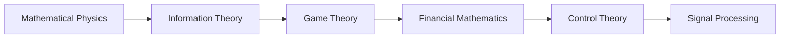

<!-- Generated by tools/build_indexes.py from tools/curriculum.json. Do not edit by hand. -->

# Applied Mathematics

*Mathematics in the physical and social world*

[Mathematics](../README.md) › Applied Mathematics

Mathematical physics, information theory, game theory, finance, control and signal processing: the payoff of everything above.

## At a glance

| | |
|---|---|
| Topics | 6 (0 complete, 0 draft, 6 planned) |
| Estimated study time | ~56 hours |
| Prerequisites | [16-differential-equations](../16-differential-equations/README.md), [10-probability](../10-probability/README.md) |

## Study order

The numbers are the recommended order. Study a topic only after the ones before it —
the dependency chain below is the shortest safe route through the discipline.

## Topic inventory

| # | Topic | Level | Est. time | Status | Materials |
|---|---|---|---|---|---|
| 1 | Mathematical Physics | Advanced | 12 h | Planned | — |
| 2 | Information Theory | Advanced | 9 h | Planned | — |
| 3 | Game Theory | Intermediate | 8 h | Planned | — |
| 4 | Financial Mathematics | Advanced | 9 h | Planned | — |
| 5 | Control Theory | Advanced | 9 h | Planned | — |
| 6 | Signal Processing | Advanced | 9 h | Planned | — |

### What each topic covers

- **Mathematical Physics** — Classical mechanics in Lagrangian form, waves, and energy methods.
- **Information Theory** — Entropy, mutual information, source coding and channel capacity.
- **Game Theory** — Nash equilibria, mixed strategies, cooperative games and mechanism design.
- **Financial Mathematics** — Interest, present value, portfolio theory, options and risk-neutral pricing.
- **Control Theory** — State space models, stability, feedback, controllability and observability.
- **Signal Processing** — Fourier series and transforms, sampling, filters and convolution.

## Related disciplines

- [22-mathematical-modeling](../22-mathematical-modeling/README.md)
- [18-optimization](../18-optimization/README.md)

## Status key

- **Complete** — tutorial, exercises and full solutions exist and the tutorial meets the
  [authoring standard](../CONTRIBUTING.md).
- **Draft** — some material exists but the topic is not finished.
- **Planned** — identified in the curriculum, not written yet.

Overall progress and the full topic inventory live in [ROADMAP.md](../ROADMAP.md).
