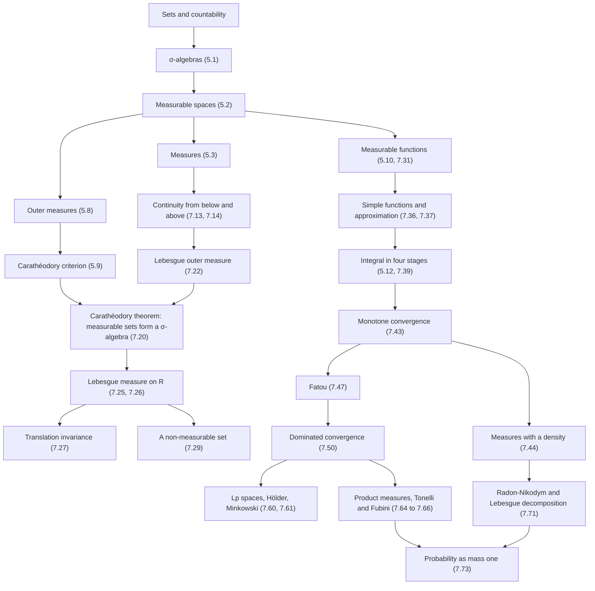
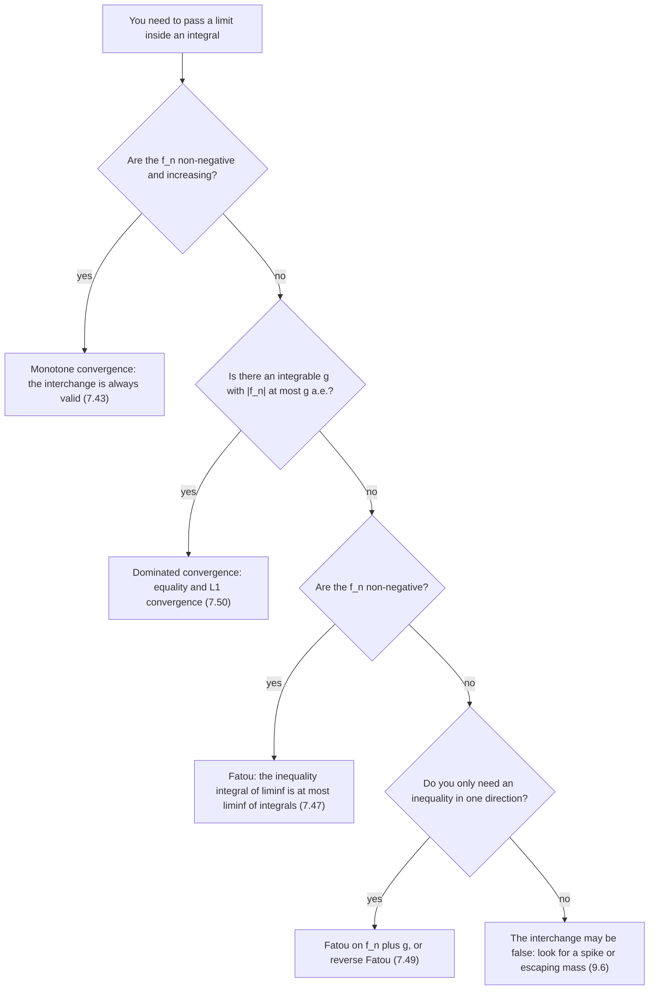

# Measure Theory

> [Mathematics](../../README.md) › [Advanced Topics](../README.md) · Level: Advanced · Prerequisites: [Logic](../../00-foundations/02-logic/README.md), [Set Theory](../../00-foundations/03-set-theory/README.md), [Proof Techniques](../../00-foundations/04-proof-techniques/README.md), [The Real Numbers and Completeness](../../14-real-analysis/01-real-numbers-and-completeness/README.md), [Sequences and Series](../../14-real-analysis/02-sequences-and-series/README.md), [Continuity and Limits](../../14-real-analysis/03-continuity-and-limits/README.md), [Riemann Integration](../../14-real-analysis/05-riemann-integration/README.md), [Metric Spaces](../../14-real-analysis/06-metric-spaces/README.md) · Estimated time: 840 min

## 1. Introduction

The Riemann integral is defined by chopping the **domain** $[a,b]$ into finitely many short intervals and adding up rectangles. It works whenever the function does not oscillate too much on short intervals, and it fails for functions that a reasonable theory of area ought to handle. Dirichlet's function $D = \mathbf{1}_{\mathbb{Q}\cap[0,1]}$ — one on the rationals, zero on the irrationals — is the standard witness: it is bounded, defined everywhere, and has no Riemann integral, because every interval contains both rationals and irrationals.

One counterexample would be an irritation. What made the failure of Riemann's integral *intolerable* is that three of the most useful theorems of analysis become false:

* a pointwise limit of Riemann integrable functions need not be Riemann integrable;
* even when every $f_n$ and the limit $f$ are Riemann integrable, $\lim_{n}\int f_n = \int f$ can fail;
* an increasing sequence of Riemann integrable functions with $\int f_n$ bounded can converge pointwise to a function that is not Riemann integrable at all.

All three are demonstrated with one-line examples in §7.1. In each case the pathology comes from the same place: Riemann's construction chops the **domain**, so it cannot distinguish a set that fills half of every interval (the rationals) from a set that is genuinely negligible. Any repair has to answer a prior question — *which sets have a size, and what does "size" mean?* — and that question is the subject of this chapter.

Lebesgue's answer (1902) is a two-stage construction. Stage one assigns to a large family of subsets of $\mathbb{R}$ a number $\lambda(A) \in [0,\infty]$, the **measure** of $A$, which extends length on intervals and is *countably additive* over disjoint unions. Stage two integrates a function by chopping its **range**: the integral of $f \ge 0$ is built by summing the sizes of the level sets $\{f > t\}$, weighted by $t$. The definition is engineered so that the resulting integral is automatically continuous under increasing limits — this is the monotone convergence theorem, Theorem 7.37, and it has no hypothesis beyond measurability and non-negativity. Two more limit theorems, Fatou's lemma and the dominated convergence theorem, follow from it, and almost everything else in analysis that involves passing a limit through an integral is one of those three theorems in disguise.

The price is a layer of set theory. We must say exactly which families of sets may be measured (σ-algebras), which functions respect them (measurable functions), and which exceptional sets may be ignored ("almost everywhere"). The reward is a theory that is *complete* — the spaces $L^p$ are Banach spaces, so Cauchy sequences converge — and that generalises far beyond intervals: counting measure on a finite set gives finite sums, normalised counting measure gives finite probability, Hausdorff measure gives area and volume on curves and surfaces, and counting measure on $\mathbb{N}$ recovers the theory of series.

Four layers organise the chapter.

1. **Measurable spaces** (§7.2): a set $X$ together with a σ-algebra $\mathcal{A}$ of subsets declared measurable. Measurability is a closure property, designed so that the operations of analysis (countable unions, complements, limits) never leave the family.
2. **Measures** (§7.3): a countably additive function $\mu : \mathcal{A} \to [0,\infty]$ with $\mu(\varnothing) = 0$. Countable additivity is what makes limits of sets behave (continuity from below and above), and it is exactly the hypothesis under which a theory of integration can have limit theorems.
3. **The Lebesgue integral** (§7.4–§7.12): outer measure and Carathéodory's criterion give a measure on $\mathbb{R}$ that extends length; measurable functions and simple functions give the integral in four stages; the monotone convergence theorem then unlocks everything.
4. **Consequences** (§7.13–§7.16): $L^p$ spaces and their inequalities, product measures with Tonelli and Fubini, the Radon–Nikodym theorem, and probability as the special case of total mass one.

A remark on honesty. The construction of Lebesgue measure cannot avoid the Axiom of Choice: Vitali's argument (§7.5) builds, using a choice function for the cosets of $\mathbb{Q}$ in $\mathbb{R}$, a set with no Lebesgue measure, so no countably additive extension of length to *all* subsets of $\mathbb{R}$ exists. This is a theorem about the limits of the theory, not a defect of the presentation, and it is the reason measurable sets are defined by a criterion rather than declared to be all sets.

## 2. Prerequisites

**Sets, countability and cardinality.** The whole chapter is about *which* subsets are measurable and how large they are, so the algebra of sets must be completely automatic: unions, intersections, complements, differences, De Morgan's laws, indexed families. Countability is used at every turn — countable additivity, countable dense sets, the countability of $\mathbb{Q}^n$, the fact that a countable union of countable sets is countable. See [Set Theory](../../00-foundations/03-set-theory/README.md), and for functions and images/preimages [Relations and Functions](../../00-foundations/05-relations-and-functions/README.md).

**Quantifiers and proof structure.** Definitions here are quantified over *all* measurable sets or *all* test sets; theorems are of the form "for every $\varepsilon > 0$ there is $\delta > 0$". Recognising and negating such statements is half of every proof below. See [Logic](../../00-foundations/02-logic/README.md) and [Proof Techniques](../../00-foundations/04-proof-techniques/README.md).

**Supremum, infimum, and completeness.** The integral of a non-negative function is defined as the supremum of the integrals of the simple functions below it, so its very definition needs the least-upper-bound property of $\overline{\mathbb{R}} = [-\infty,\infty]$. The extended real line, with its convention $\sup \varnothing = -\infty$ and arithmetic rules involving $\pm\infty$, is used throughout. See [The Real Numbers and Completeness](../../14-real-analysis/01-real-numbers-and-completeness/README.md).

**Sequences, series and their limits.** Monotone convergence is a statement about $\lim_n \int f_n$; Fatou's lemma is a statement about $\liminf$; the whole of §7.14 is a statement about interchanging two limits. Also needed: absolute convergence and rearrangement of series of non-negative terms (any rearrangement gives the same sum in $[0,\infty]$), and the comparison test. See [Sequences and Series](../../14-real-analysis/02-sequences-and-series/README.md) and [Sequences and Series in Calculus](../../07-calculus/11-sequences-and-series-in-calculus/README.md).

**Continuity, uniform continuity, compactness.** The proof that the Lebesgue measure of $[a,b]$ is $b-a$ uses compactness (Heine–Borel): every open cover has a finite subcover. The proof that a continuous function is Borel measurable uses only the $\varepsilon$–$\delta$ definition. See [Continuity and Limits](../../14-real-analysis/03-continuity-and-limits/README.md) and [Metric Spaces](../../14-real-analysis/06-metric-spaces/README.md).

**The Riemann integral, including its failures.** §7.1 is a sustained comparison with [Riemann Integration](../../14-real-analysis/05-riemann-integration/README.md); the Darboux criterion, the Dirichlet function and the failure of the limit theorems there are the starting point here.

**Inequalities and convexity.** Hölder's and Minkowski's inequalities rest on Young's inequality, which is concavity of the logarithm; the estimate $\lvert f + g\rvert^p \le 2^{p-1}(\lvert f\rvert^p + \lvert g\rvert^p)$ is convexity of $t \mapsto t^p$. See [Inequalities](../../03-algebra/03-inequalities/README.md) and [Applications of Derivatives](../../07-calculus/05-applications-of-derivatives/README.md) for convexity.

**Integration techniques and improper integrals.** §7.12 compares the Lebesgue integral with improper Riemann integrals, and several examples evaluate $\int_0^\infty$ by substitution. See [Techniques of Integration](../../07-calculus/08-techniques-of-integration/README.md) and [Improper Integrals](../../07-calculus/10-improper-integrals/README.md).

## 3. Learning Objectives

By the end of this tutorial you will be able to

1. explain, with explicit examples, why the Riemann integral has no adequate limit theorems, and why the remedy is to chop the range rather than the domain;
2. state the axioms of a σ-algebra and of a measure, verify them in examples (power set, trivial, co-countable, Borel, Lebesgue), and construct the σ-algebra generated by an arbitrary family;
3. prove the elementary properties of a measure — finite additivity, monotonicity, the difference formula, countable subadditivity, continuity from below, and continuity from above with its finiteness hypothesis;
4. define an outer measure, state and prove Carathéodory's theorem that the measurable sets form a σ-algebra on which the outer measure is a complete measure;
5. outline the construction of Lebesgue measure, prove $\lambda([a,b]) = b-a$ and translation invariance, and reproduce Vitali's construction of a non-measurable set;
6. prove that $f$ is measurable if and only if $\{f > a\}$ is measurable for every $a$, explain why Borel preimages are the right test family, and show that sums, products, suprema and limits of measurable functions are measurable;
7. approximate any non-negative measurable function from below by an increasing sequence of simple functions, and use the approximation to define the integral in four stages;
8. state and prove the monotone convergence theorem, derive Fatou's lemma and the dominated convergence theorem, and choose the correct one for a given problem;
9. prove that a Riemann integrable function is Lebesgue integrable with the same integral, and identify functions that are Lebesgue but not Riemann integrable;
10. define $L^p$, prove Young's inequality, Hölder's inequality and Minkowski's inequality, and compare $L^p$ spaces on finite and infinite measure spaces;
11. state Tonelli's and Fubini's theorems with their exact hypotheses, use them to interchange integrals, and produce counterexamples when the hypotheses fail;
12. state the Radon–Nikodym theorem, interpret probability as a measure of total mass one, and explain how conditional expectation and densities are instances of Radon–Nikodym.

## 4. Intuition

### 4.1 A scale for sets, not a ruler for intervals

Length is a function of *intervals*: a segment $[a,b]$ has length $b-a$, and the lengths of pieces add up when the pieces are placed end to end. A **measure** is the same idea applied to a much larger collection of sets. Think of a scale that can weigh any of a specified list of portions of a cake, however scattered: a single crumb, a slice, the union of a slice and a crumb, the part left over after removing a slice. The list must be closed under the operations you actually perform — "take the rest of the cake", "take the union of countably many portions" — and the scale must be **additive**: the weight of disjoint portions adds.

The two requirements pull against each other. If the list contains *every* subset, additivity must fail somewhere (Vitali, §7.5); if additivity is to hold, the list must be restricted. A σ-algebra is precisely a list that is closed under the operations of analysis; a measure is precisely an additive scale on such a list. Everything in §7.2–§7.3 is the working out of that bargain.

### 4.2 Why "countably" additive and not just finitely additive

Finitely additive scales are easy to build and useless for limits. The decisive example is a countable set: if a scale is only finitely additive, the weight of $\{q_1,q_2,\dots\}$ is not determined by the weights of the individual points, because "infinitely many singletons" is not a finite disjoint union. Countable additivity says exactly that the weight of a countable union of disjoint pieces is the sum of the weights, and it is the property that converts the set-theoretic limits $A_n \uparrow A$ and $A_n \downarrow A$ into numerical limits $\mu(A_n) \to \mu(A)$. Those numerical limits are what a limit theorem needs.

The cost is that countable additivity cannot coexist with measurability of all sets. That is the content of §7.5, and it is the single most important structural fact in the subject.

### 4.3 Chop the range, not the domain

Riemann's integral groups points by *where they are*: the interval $[x_{i-1},x_i]$ contributes $f(t_i)(x_i - x_{i-1})$. Lebesgue's integral groups points by *how large the function is there*: the set $\{x : f(x) \approx y\}$ contributes approximately $y \cdot \text{size}\bigl(\{f \approx y\}\bigr)$. For a continuous function on an interval, both groupings lead to the same number, because $\{f \approx y\}$ is a union of intervals.

For Dirichlet's function the groupings behave completely differently. Riemann's grouping sees, inside every interval, values $0$ and $1$, and can never decide; Lebesgue's grouping sees the level set $\{D = 1\} = \mathbb{Q}$, whose size is $0$, and the level set $\{D = 0\}$, whose size is $1$. The answer $\int D = 1 \cdot 0 + 0 \cdot 1 = 0$ is immediate. This is the whole content of "chopping the range": the domain is partitioned into *measurable* pieces according to the *value* of $f$, and only the sizes of those pieces matter.

### 4.4 Negligible sets and the phrase "almost everywhere"

In physics and in probability one constantly ignores events of probability zero. Measure theory makes this a precise and universally applicable habit: a set of measure zero is **negligible**, and a property that holds outside a negligible set holds **almost everywhere** (a.e.). Changing a function on a negligible set changes neither its measurability nor its integral. This is why "$f \ge 0$ and $\int f = 0$" implies "$f = 0$ almost everywhere" rather than "$f = 0$" — the sharp statement, and the one that is actually true.

The habit pays off in the limit theorems: monotone convergence, Fatou's lemma and dominated convergence all hold with "pointwise" weakened to "almost everywhere", because the exceptional set contributes nothing to any integral.

### 4.5 Where the mass can go

One picture organises all three limit theorems. Think of $\int f_n$ as the total mass of a distribution with density $f_n$.

* In the **monotone** case, mass is only added as $n$ grows, so the total mass increases to the mass of the limit. Nothing can be lost. That is the monotone convergence theorem.
* In **Fatou's** case, mass may disappear in the limit (a bump that slides off to infinity, or narrows to a spike), so $\int \liminf f_n \le \liminf \int f_n$: the limiting mass can be smaller, never larger.
* In the **dominated** case, all the mass is trapped inside a fixed integrable envelope $g$, so it cannot escape, and no mass can be created either. Hence equality.

Seen this way, the dominated convergence theorem is not a technical condition on $g$; it is the statement "the mass cannot escape to infinity or concentrate into a spike", made quantitative.

## 5. Formal Definition

Throughout, $X$ is a set and $\mathcal{P}(X)$ is its power set. The extended real line is $\overline{\mathbb{R}} = \mathbb{R} \cup \{-\infty,+\infty\}$, and $[0,\infty]$ denotes $\{x \in \overline{\mathbb{R}} : x \ge 0\}$.

**Definition 5.1 (σ-algebra).** A family $\mathcal{A} \subseteq \mathcal{P}(X)$ is a **σ-algebra** on $X$ if

1. $X \in \mathcal{A}$;
2. $A \in \mathcal{A} \Rightarrow X \setminus A \in \mathcal{A}$ (closed under complements);
3. $A_1, A_2, \dots \in \mathcal{A} \Rightarrow \bigcup_{n=1}^{\infty} A_n \in \mathcal{A}$ (closed under countable unions).

The pair $(X,\mathcal{A})$ is a **measurable space**, and the members of $\mathcal{A}$ are the **measurable sets**. A family satisfying only 1–3 with "countable" replaced by "finite" is an *algebra*; a σ-algebra is an algebra that is also closed under countable unions.

**Definition 5.2 (measure).** Let $(X,\mathcal{A})$ be a measurable space. A function $\mu : \mathcal{A} \to [0,\infty]$ is a **measure** if

1. $\mu(\varnothing) = 0$;
2. **countable additivity:** for every sequence $A_1, A_2, \dots \in \mathcal{A}$ of pairwise disjoint sets,
$$
\mu\left(\bigcup_{n=1}^{\infty} A_n\right) = \sum_{n=1}^{\infty} \mu(A_n).
$$

The triple $(X,\mathcal{A},\mu)$ is a **measure space**.

**Definition 5.3 (classes of measures).** Let $(X,\mathcal{A},\mu)$ be a measure space.

* $\mu$ is **finite** if $\mu(X) < \infty$.
* $\mu$ is **σ-finite** if $X = \bigcup_{n=1}^{\infty} X_n$ with $X_n \in \mathcal{A}$ and $\mu(X_n) < \infty$ for every $n$.
* $\mu$ is a **probability measure** if $\mu(X) = 1$; then $(X,\mathcal{A},\mu)$ is a **probability space**.
* For $x_0 \in X$, the **Dirac measure** at $x_0$ is $\delta_{x_0}(A) = 1$ if $x_0 \in A$ and $0$ otherwise.
* On $X = \mathbb{N}$ with $\mathcal{A} = \mathcal{P}(\mathbb{N})$, **counting measure** is $\mu(A) = \lvert A\rvert$ if $A$ is finite and $\mu(A) = \infty$ otherwise.

σ-finiteness looks technical; it is the hypothesis that lets one reduce statements about infinite measure spaces to statements about finite ones by chopping the space into countably many finite pieces. It is needed for the uniqueness of product measures and for Fubini's theorem in full generality (§7.14), and it holds for Lebesgue measure (the intervals $[-n,n]$ have finite measure).

**Definition 5.4 (null sets; almost everywhere).** Let $(X,\mathcal{A},\mu)$ be a measure space. A set $N \subseteq X$ is **μ-null** (or a **null set**) if there is $M \in \mathcal{A}$ with $N \subseteq M$ and $\mu(M) = 0$. A statement $P(x)$ holds **μ-almost everywhere** (μ-a.e.) if the set of $x$ where it fails is contained in a null set. When the measure is understood we write simply "a.e.".

Here is a first place where a measure space can be imperfect: a subset of a measurable null set need not itself be measurable. When it is — for every null set — the measure space is called **complete** (Definition 5.6).

**Definition 5.5 (Borel σ-algebra).** Let $(X,d)$ be a metric space (in this chapter usually $X = \mathbb{R}$ or $\mathbb{R}^n$). The **Borel σ-algebra** $\mathcal{B}(X)$ is the smallest σ-algebra containing every open subset of $X$. Its members are the **Borel sets**. For $X = \mathbb{R}$ we write $\mathcal{B}(\mathbb{R})$.

The phrase "smallest" is justified by Theorem 7.9: an intersection of σ-algebras is again a σ-algebra, so a smallest σ-algebra containing the open sets exists.

**Definition 5.6 (complete measure space).** A measure space $(X,\mathcal{A},\mu)$ is **complete** if every subset of every μ-null set belongs to $\mathcal{A}$. Equivalently: if $N \in \mathcal{A}$ with $\mu(N) = 0$ and $N' \subseteq N$, then $N' \in \mathcal{A}$.

**Definition 5.7 (Lebesgue measurable sets).** The **Lebesgue σ-algebra** $\mathcal{L}$ on $\mathbb{R}$ is the σ-algebra of sets that are measurable in the sense of Carathéodory with respect to Lebesgue outer measure (Definition 5.9 and §7.5). The restriction of Lebesgue outer measure to $\mathcal{L}$ is **Lebesgue measure** $\lambda$. It is a complete measure, and $\mathcal{B}(\mathbb{R}) \subsetneq \mathcal{L}$.

**Definition 5.8 (outer measure).** A function $\mu^* : \mathcal{P}(X) \to [0,\infty]$ is an **outer measure** on $X$ if

1. $\mu^*(\varnothing) = 0$;
2. $\mu^*(A) \le \mu^*(B)$ whenever $A \subseteq B$ (**monotonicity**);
3. $\mu^*\bigl(\bigcup_{n=1}^{\infty} A_n\bigr) \le \sum_{n=1}^{\infty} \mu^*(A_n)$ for every sequence (**countable subadditivity**).

An outer measure is defined on *all* subsets and is only subadditive, not additive. Additivity will be recovered on a subfamily.

**Definition 5.9 (Carathéodory measurability).** Let $\mu^*$ be an outer measure on $X$. A set $E \subseteq X$ is **μ\*-measurable** if for every **test set** $A \subseteq X$,
$$
\mu^*(A) = \mu^*(A \cap E) + \mu^*(A \setminus E).
$$
Write $\mathcal{M}(\mu^*)$ for the family of such sets.

Since $A = (A \cap E) \cup (A \setminus E)$ is a disjoint union, subadditivity always gives "$\le$". The content of the definition is therefore the inequality "$\ge$": $E$ splits *every* test set without losing mass. Note that $A \cap E^\complement = A\setminus E$, so the definition is symmetric in $E$ and $E^\complement$.

**Definition 5.10 (measurable function).** Let $(X,\mathcal{A})$ and $(Y,\mathcal{B})$ be measurable spaces. A function $f : X \to Y$ is **measurable** (more precisely $\mathcal{A}/\mathcal{B}$-measurable) if
$$
f^{-1}(B) \in \mathcal{A} \qquad \text{for every } B \in \mathcal{B}.
$$
For real-valued functions we always use $\mathcal{B} = \mathcal{B}(\mathbb{R})$, and for $[0,\infty]$-valued functions the Borel σ-algebra of $\overline{\mathbb{R}}$, which is generated by the sets $(a,\infty]$ for $a \in \mathbb{R}$.

**Definition 5.11 (simple function).** A function $\varphi : X \to \mathbb{R}$ is **simple** if it is measurable and takes only finitely many values. Every simple function can be written in **canonical form**
$$
\varphi = \sum_{j=1}^{m} a_j \mathbf{1}_{A_j},
$$
where $a_1,\dots,a_m$ are the distinct non-zero values of $\varphi$ and $A_j = \{\varphi = a_j\}$; the sets $A_j$ are measurable, pairwise disjoint, and $\varphi$ vanishes off $\bigcup_j A_j$. A function of the form $\sum_j a_j\mathbf{1}_{A_j}$ with measurable $A_j$ that are *not* disjoint still equals a simple function, and its integral is defined by refining to a disjoint representation (Proposition 7.39).

**Definition 5.12 (the Lebesgue integral).** Let $(X,\mathcal{A},\mu)$ be a measure space. With the convention $0 \cdot \infty = 0$, the integral is defined in four stages.

1. **Indicators:** for $A \in \mathcal{A}$, $\displaystyle\int \mathbf{1}_A \, d\mu := \mu(A)$.
2. **Non-negative simple functions:** for $\varphi = \sum_{j=1}^m a_j \mathbf{1}_{A_j}$ in canonical form with $a_j \ge 0$, $\displaystyle\int \varphi\,d\mu := \sum_{j=1}^m a_j\,\mu(A_j)$.
3. **Non-negative measurable functions:** for measurable $f : X \to [0,\infty]$,
$$
\int f\,d\mu := \sup\left\{\int \varphi\,d\mu \;:\; \varphi \text{ simple},\ 0 \le \varphi \le f\right\}.
$$
4. **Integrable functions:** for measurable $f : X \to \overline{\mathbb{R}}$, write $f^+ = \max(f,0)$ and $f^- = \max(-f,0)$, so that $f = f^+ - f^-$ and $\lvert f\rvert = f^+ + f^-$. If $\int f^+\,d\mu$ and $\int f^-\,d\mu$ are not both $+\infty$, set
$$
\int f\,d\mu := \int f^+\,d\mu - \int f^-\,d\mu .
$$
If $\int \lvert f\rvert\,d\mu < \infty$, then $f$ is **integrable** (or $f \in L^1(\mu)$), and the difference is a finite real number. For $A \in \mathcal{A}$ one writes $\int_A f\,d\mu := \int f\,\mathbf{1}_A\,d\mu$.

**Definition 5.13 ($L^p$ spaces).** Let $1 \le p < \infty$. For measurable $f : X \to \overline{\mathbb{R}}$,
$$
\lVert f\rVert_p := \left(\int \lvert f\rvert^p\,d\mu\right)^{1/p} \in [0,\infty],
\qquad
L^p(\mu) := \{f : \lVert f\rVert_p < \infty\}.
$$
For $p = \infty$, $\lVert f\rVert_\infty := \inf\{c \ge 0 : \lvert f\rvert \le c \text{ a.e.}\}$ is the **essential supremum**, and $L^\infty(\mu) := \{f : \lVert f\rVert_\infty < \infty\}$. Strictly, $L^p$ consists of **equivalence classes** of functions under the relation "$f = g$ a.e."; on classes $\lVert\cdot\rVert_p$ is a norm, while on functions it is only a seminorm (it vanishes on functions that are zero a.e.).

**Definition 5.14 (product measurable space and measure).** Let $(X,\mathcal{A},\mu)$ and $(Y,\mathcal{B},\nu)$ be measure spaces. A **measurable rectangle** is a set $A \times B$ with $A \in \mathcal{A}$ and $B \in \mathcal{B}$. The **product σ-algebra** $\mathcal{A} \otimes \mathcal{B}$ is the smallest σ-algebra on $X\times Y$ containing all measurable rectangles. For $E \subseteq X \times Y$ and $x \in X$, the **$x$-section** is $E_x = \{y \in Y : (x,y) \in E\}$, and for $y \in Y$ the **$y$-section** is $E^y = \{x \in X : (x,y) \in E\}$. For a function $f$ on $X\times Y$, $f_x(y) := f(x,y)$ and $f^y(x) := f(x,y)$. A measure $\pi$ on $\mathcal{A}\otimes\mathcal{B}$ with $\pi(A\times B) = \mu(A)\nu(B)$ for all rectangles is denoted $\mu \times \nu$.

**Definition 5.15 (absolute continuity and singularity).** Let $\mu, \nu$ be measures on a measurable space $(X,\mathcal{A})$. Then $\nu$ is **absolutely continuous** with respect to $\mu$, written $\nu \ll \mu$, if $\mu(A) = 0 \Rightarrow \nu(A) = 0$ for all $A \in \mathcal{A}$. The measures are **mutually singular**, written $\nu \perp \mu$, if there is $S \in \mathcal{A}$ with $\nu(S) = 0$ and $\mu(X\setminus S) = 0$.

## 6. Mathematical Notation

| Symbol | Read as | Meaning |
|---|---|---|
| $(X,\mathcal{A},\mu)$ | the measure space $X$ with σ-algebra $\mathcal{A}$ and measure $\mu$ | the basic object of the theory |
| $\mathcal{A}$, $\mathcal{B}$, $\mathcal{L}$ | script A, B, L | a σ-algebra; $\mathcal{B}$ usually the Borel σ-algebra; $\mathcal{L}$ the Lebesgue σ-algebra |
| $A^\complement$ | the complement of $A$ | $X\setminus A$ |
| $\mathbf{1}_A$ | the indicator of $A$ | $1$ on $A$, $0$ off $A$ |
| $\mu(A)$ | the measure of $A$ | a number in $[0,\infty]$ |
| $\mu^*$ | mu star | an outer measure, defined on all subsets |
| $\lambda$ | lambda | Lebesgue measure on $\mathbb{R}$ |
| $\delta_{x_0}$ | Dirac measure at $x_0$ | mass $1$ at the point $x_0$ |
| $\overline{\mathbb{R}}$ | the extended real line | $\mathbb{R}\cup\{-\infty,+\infty\}$ |
| $[0,\infty]$ | the non-negative extended reals | the codomain of a measure |
| $\int f\,d\mu$, $\int_X f$ | the integral of $f$ against $\mu$ | a number in $\overline{\mathbb{R}}$ |
| $\int_A f\,d\mu$ | integral over $A$ | $\int f\mathbf{1}_A\,d\mu$ |
| $f^+$, $f^-$ | positive and negative parts | $\max(f,0)$ and $\max(-f,0)$ |
| $f^{-1}(B)$ | preimage of $B$ | $\{x : f(x) \in B\}$ |
| $\sigma(\mathcal{E})$ | the σ-algebra generated by $\mathcal{E}$ | smallest σ-algebra containing $\mathcal{E}$ |
| $\mu$-a.e. | $\mu$-almost everywhere | outside a set of $\mu$-measure zero |
| $A_n \uparrow A$ | $A_n$ increases to $A$ | $A_1\subseteq A_2\subseteq\cdots$ and $\bigcup_n A_n = A$ |
| $A_n \downarrow A$ | $A_n$ decreases to $A$ | $A_1\supseteq A_2\supseteq\cdots$ and $\bigcap_n A_n = A$ |
| $\limsup_n A_n$ | limit superior of sets | $\bigcap_n\bigcup_{k\ge n}A_k = \{x : x \in A_n \text{ infinitely often}\}$ |
| $\liminf_n A_n$ | limit inferior of sets | $\bigcup_n\bigcap_{k\ge n}A_k = \{x : x \in A_n \text{ eventually}\}$ |
| $f \wedge g$, $f \vee g$ | min and max | $\min(f,g)$ and $\max(f,g)$ |
| $\nu \ll \mu$ | $\nu$ is absolutely continuous w.r.t. $\mu$ | $\mu(A)=0 \Rightarrow \nu(A)=0$ |
| $\nu \perp \mu$ | $\nu$ and $\mu$ are mutually singular | each lives on a set the other ignores |
| $\dfrac{d\nu}{d\mu}$ | the Radon–Nikodym derivative | the density of $\nu$ with respect to $\mu$ |
| $\mu\times\nu$ | product measure | the measure on $X\times Y$ with $\mu\times\nu(A\times B)=\mu(A)\nu(B)$ |
| $\lVert f\rVert_p$ | the $L^p$ norm of $f$ | $\left(\int\lvert f\rvert^p d\mu\right)^{1/p}$ |
| $p'$ or $q$ | conjugate exponent | $\frac1p+\frac1q=1$ |
| $f_n \to f$ a.e. | converges almost everywhere | pointwise convergence off a null set |
| $\operatorname{dist}(x,E)$ | distance from $x$ to $E$ | $\inf\{\lvert x-y\rvert : y \in E\}$ |
| $\lvert I\rvert$ | length of an interval | $b-a$ for $I$ with endpoints $a<b$ |

Read $\mu^*(A \cap E) + \mu^*(A\setminus E) = \mu^*(A)$ aloud as "E splits A additively". The convention $0\cdot\infty = 0$ makes $\int \varphi$ well defined even when $\varphi$ is zero on a set of infinite measure, and it is used constantly; §11 lists its misuse as a common mistake.

## 7. Core Concepts

### 7.1 Why the Riemann integral is not enough

Three failures, each with the simplest possible example, motivate everything that follows. Recall from [Riemann Integration](../../14-real-analysis/05-riemann-integration/README.md) that a bounded $f$ on $[a,b]$ is Riemann integrable if and only if for every $\varepsilon > 0$ there is a partition $P$ with $U(f,P) - L(f,P) < \varepsilon$, and that $\mathbf{1}_{\mathbb{Q}\cap[0,1]}$ fails this test because every subinterval contains both rationals and irrationals, so that $L(f,P) = 0$ and $U(f,P) = 1$ for **every** partition.

**Example 7.1 (Dirichlet's function: a bounded function with no integral).** Let $D = \mathbf{1}_{\mathbb{Q}\cap[0,1]}$. For every partition $P = \{x_0,\dots,x_n\}$, each interval $[x_{i-1},x_i]$ contains a rational and an irrational, hence $m_i = 0$ and $M_i = 1$. Therefore $L(D,P) = \sum_{i=1}^n 0\cdot\Delta x_i = 0, \qquad U(D,P) = \sum_{i=1}^n 1\cdot\Delta x_i = 1,$
and the lower and upper integrals are $0$ and $1$. There is no Riemann integral. Nothing here is a difficulty of technique: the oscillation on each interval is $1$, however fine the partition.

**Example 7.2 (a pointwise limit of Riemann integrable functions that is not Riemann integrable).** Enumerate $\mathbb{Q}\cap[0,1] = \{q_1,q_2,\dots\}$ and put $f_n = \mathbf{1}_{\{q_1,\dots,q_n\}}$. Each $f_n$ is a step function modified at finitely many points, so it is Riemann integrable with $\int_0^1 f_n = 0$. But $f_n(x) \to D(x)$ for every $x$, and the limit is not Riemann integrable by Example 7.1. The class $\mathcal{R}[0,1]$ is therefore not closed under pointwise limits.

Notice that the sequence is **increasing** and that $\int f_n = 0$ stays bounded. So this single example destroys the monotone convergence theorem in the Riemann setting as well: an increasing sequence of Riemann integrable functions with bounded integrals can have a limit with no integral at all.

**Example 7.3 (interchanging a limit and an integral fails).** Let $g_n = n\mathbf{1}_{(0,1/n)}$ on $[0,1]$. Each $g_n$ is Riemann integrable with $\int_0^1 g_n = n \cdot \frac{1}{n} = 1 .$
For $x > 0$, $g_n(x) = 0$ once $n > 1/x$; and $g_n(0) = 0$. So $g_n \to 0$ pointwise, yet $1 = \lim_{n\to\infty}\int_0^1 g_n \ne \int_0^1 \Bigl(\lim_{n\to\infty} g_n\Bigr) = 0 .$
The mass does not vanish; it concentrates into a spike whose width shrinks and whose height grows. In the same way $h_n = \mathbf{1}_{[n,n+1]}$ on $[0,\infty)$ moves its unit mass to infinity, and $\int_0^\infty h_n = 1$ while $h_n \to 0$.

**Example 7.4 (the $L^1$ seminorm does not complete $\mathcal{R}[a,b]$).** With $f_n$ as in Example 7.2, the difference $f_n - f_m$ vanishes except at finitely many points, so $\int_0^1 \lvert f_n - f_m\rvert = 0$: the sequence is Cauchy for $\lVert f\rVert_1 = \int_0^1\lvert f\rvert$. Once the Lebesgue integral is available (§7.12), the same computation gives $\lVert f_n - D\rVert_1 = \int_0^1 (D - f_n) = 0$ for every $n$, because $D - f_n$ is the indicator of a countable set, which has Lebesgue measure $0$. The only possible limit is therefore $D$, which is not in the space. A space in which Cauchy sequences need not converge is useless for existence theorems, and this is the defect that functional analysis (and the completeness of $L^p$, §7.13) repairs.

**The diagnosis.** In every case the difficulty is that Riemann's construction partitions the *domain* into intervals. A set such as $\mathbb{Q}\cap[0,1]$, which meets every interval in a "half-full" way but is negligible for the purposes of area, cannot be seen. The repair has two steps, and they are the subject of the rest of the chapter:

1. Give a meaning to "the size of a set" that (a) extends length on intervals, (b) is countably additive on disjoint unions, and (c) makes $\mathbb{Q}$ negligible;
2. Define the integral by grouping points according to the **value** of $f$ rather than their location, so that the sizes produced in step 1 can be used.

Step 1 forces a choice of which sets are measurable, because (a), (b) and "all sets" are mutually inconsistent (§7.5). That is why the chapter begins with σ-algebras.

### 7.2 σ-algebras

**Proposition 7.6 (closure properties).** Let $\mathcal{A}$ be a σ-algebra on $X$. Then

1. $\varnothing \in \mathcal{A}$;
2. $\mathcal{A}$ is closed under countable intersections;
3. $\mathcal{A}$ is closed under finite unions, finite intersections, and set differences: if $A, B \in \mathcal{A}$ then $A\cup B$, $A\cap B$, $A\setminus B$, $A\triangle B$ all belong to $\mathcal{A}$;
4. if $A_1,A_2,\dots \in \mathcal{A}$ then $\limsup_n A_n = \bigcap_n\bigcup_{k\ge n}A_k$ and $\liminf_n A_n = \bigcup_n\bigcap_{k\ge n}A_k$ belong to $\mathcal{A}$.

*Proof.*

1. $X \in \mathcal{A}$ and $X^\complement = \varnothing$.
2. $\bigcap_n A_n = \bigl(\bigcup_n A_n^\complement\bigr)^\complement$, a complement of a countable union of measurable sets.
3. $A \cup B$ is the countable union $A\cup B\cup\varnothing\cup\varnothing\cup\cdots$; then $A\cap B = (A^\complement\cup B^\complement)^\complement$ and $A\setminus B = A\cap B^\complement$, and $A\triangle B = (A\setminus B)\cup(B\setminus A)$.
4. Both are countable combinations of the operations already covered. $\blacksquare$

The moral of (2) and (3) is that a σ-algebra is closed under every set-theoretic operation that occurs in analysis, including the operations "eventually" and "infinitely often" that appear in the study of limits.

**Proposition 7.7 (the countable / co-countable σ-algebra).** Let $X$ be an uncountable set and let $\mathcal{C} = \{A \subseteq X : A \text{ is countable, or } A^\complement \text{ is countable}\}.$
Then $\mathcal{C}$ is a σ-algebra on $X$, strictly between the trivial σ-algebra and $\mathcal{P}(X)$.

*Proof.* $X \in \mathcal{C}$ because $X^\complement = \varnothing$ is countable. If $A \in \mathcal{C}$ then $(A^\complement)^\complement = A$ is countable in the first case and $A^\complement$ is countable in the second, so $A^\complement \in \mathcal{C}$ in either case. For countable unions, let $A_1,A_2,\dots \in \mathcal{C}$. If every $A_n$ is countable then $\bigcup_n A_n$ is a countable union of countable sets, hence countable. Otherwise some $A_k$ has countable complement, and then $\Bigl(\bigcup_n A_n\Bigr)^\complement = \bigcap_n A_n^\complement \subseteq A_k^\complement$
is countable, so the union is co-countable. Hence $\mathcal{C}$ is a σ-algebra. It contains $\{x\}$ for every $x$ (countable) and does not contain a set that is neither countable nor co-countable, which exists because $X$ is uncountable: split $X$ into two uncountable pieces. $\blacksquare$

**Example 7.8 (three σ-algebras that are easy to see).**

* The **trivial** σ-algebra $\{\varnothing, X\}$: only the empty set and $X$ are measurable. The only measures are $\mu(\varnothing) = 0$, $\mu(X) = c \in [0,\infty]$.
* The **power set** $\mathcal{P}(X)$: every set is measurable. Counting measure and Dirac measures live here.
* If $X = \bigsqcup_{j=1}^{m} P_j$ is a finite or countable partition, the family of all unions of parts, $\mathcal{A} = \{\bigcup_{j \in J}P_j : J \subseteq \{1,\dots,m\}\}$, is a σ-algebra. A measure on it is specified by the numbers $\mu(P_j)$, and $\mu(A) = \sum_{j\in J}\mu(P_j)$.

**Theorem 7.9 (the generated σ-algebra).** Let $\mathcal{E} \subseteq \mathcal{P}(X)$ be any family of sets. Then

1. the intersection of any non-empty collection of σ-algebras on $X$ is a σ-algebra on $X$;
2. there is a smallest σ-algebra $\sigma(\mathcal{E})$ containing $\mathcal{E}$, namely the intersection of all σ-algebras containing $\mathcal{E}$;
3. $\mathcal{E} \subseteq \mathcal{F}$ implies $\sigma(\mathcal{E}) \subseteq \sigma(\mathcal{F})$;
4. if $\mathcal{A}$ is a σ-algebra with $\mathcal{E} \subseteq \mathcal{A}$ then $\sigma(\mathcal{E}) \subseteq \mathcal{A}$.

*Proof.* (1) Let $\{\mathcal{A}_i\}_{i\in I}$ be σ-algebras and $\mathcal{A} = \bigcap_i\mathcal{A}_i$. Then $X \in \mathcal{A}_i$ for all $i$, so $X \in \mathcal{A}$. If $A \in \mathcal{A}$ then $A \in \mathcal{A}_i$ for all $i$, hence $A^\complement \in \mathcal{A}_i$ for all $i$, hence $A^\complement \in \mathcal{A}$. If $A_1,A_2,\dots \in \mathcal{A}$ then each $A_n$ lies in every $\mathcal{A}_i$, so $\bigcup_n A_n$ lies in every $\mathcal{A}_i$. 

(2) The family of σ-algebras containing $\mathcal{E}$ is non-empty because $\mathcal{P}(X)$ is one; its intersection $\sigma(\mathcal{E})$ is a σ-algebra by (1), contains $\mathcal{E}$, and is contained in every σ-algebra that contains $\mathcal{E}$. (3) and (4) are immediate from (2). $\blacksquare$

The description of $\sigma(\mathcal{E})$ as an intersection is an existence theorem, not a construction: it says nothing about which sets are in $\sigma(\mathcal{E})$. In practice one identifies $\sigma(\mathcal{E})$ by finding a σ-algebra $\mathcal{A}$ with $\mathcal{E}\subseteq\mathcal{A}$ and then showing every $A \in \mathcal{A}$ can be obtained from $\mathcal{E}$ by countably many operations. Proposition 7.10 is the standard instance.

**Proposition 7.10 (generators of the Borel σ-algebra).** On $\mathbb{R}$, the following families all generate the same σ-algebra $\mathcal{B}(\mathbb{R})$:

1. the open sets;
2. the open intervals $(a,b)$ with $a<b$;
3. the open intervals with **rational** endpoints;
4. the half-lines $(a,\infty)$ with $a \in \mathbb{R}$ (equally $(-\infty,a]$, $[a,\infty)$, $(-\infty,a)$);
5. the closed sets;
6. the compact sets.

*Proof.* Write $\mathcal{B}$ for the Borel σ-algebra, generated by the open sets. Each open set is a countable union of open intervals with rational endpoints: for $U$ open and $x \in U$ choose rationals $p<q$ with $x \in (p,q)\subseteq U$, and note that the family of all intervals with rational endpoints is countable and covers $U$. Hence (3) generates a σ-algebra containing all open sets, so $\mathcal{B} \subseteq \sigma(\text{(3)}) \subseteq \sigma(\text{(2)}) \subseteq \mathcal{B}$, and (1)–(3) agree. For (4): $(a,\infty)$ is open, so $\sigma((a,\infty)) \subseteq \mathcal{B}$; conversely $(-\infty,b) = \bigcup_n (b - 1/n,\infty)^\complement$ and $(a,b) = (a,\infty)\cap(-\infty,b)$ both lie in $\sigma((a,\infty))$, so (2) gives $\mathcal{B} \subseteq \sigma((a,\infty))$. Complements give (5), and (6) follows because compact sets are closed and every closed set is a countable union of compact sets, $F = \bigcup_n (F\cap[-n,n])$. $\blacksquare$

The practical value of Proposition 7.10 is that a measurability check never has to be performed on all Borel sets. By Proposition 7.32 below it is enough to check the preimages of a *generating* family, and item (4) makes that check a one-line computation with half-lines.

**Example 7.11 (what else is Borel).** Every countable set is Borel (a countable union of singletons, and $\{x\} = \bigcap_n (x - 1/n, x+1/n)$ is Borel). Every set that can be written with countably many applications of $\cup, \cap, \setminus$ starting from open or closed sets is Borel; these are the *Borel hierarchy* $\Sigma^0_1$ (open), $\Pi^0_1$ (closed), $\Sigma^0_2$ ($F_\sigma$), $\Pi^0_2$ ($G_\delta$), and so on. The rationals form an $F_\sigma$ set, the irrationals a $G_\delta$ set. The Borel hierarchy does not exhaust $\mathcal{L}$: there are Lebesgue measurable sets that are not Borel, and Proposition 7.28 supplies the standard example.

### 7.3 Measures and their elementary properties

Countable additivity is a strong hypothesis, and everything else about measures is extracted from it. The first five consequences are used so often that they should be automatic.

**Proposition 7.12 (elementary properties of a measure).** Let $(X,\mathcal{A},\mu)$ be a measure space.

1. **Finite additivity.** If $A_1,\dots,A_m \in \mathcal{A}$ are pairwise disjoint, then $\mu\bigl(\bigcup_{i=1}^m A_i\bigr) = \sum_{i=1}^m\mu(A_i)$.
2. **Monotonicity.** If $A \subseteq B$ with $A,B\in\mathcal{A}$, then $\mu(A) \le \mu(B)$.
3. **Difference formula.** If $A \subseteq B$ and $\mu(A) < \infty$, then $\mu(B\setminus A) = \mu(B) - \mu(A)$.
4. **Countable subadditivity.** For any $A_1,A_2,\dots \in \mathcal{A}$, $\mu\bigl(\bigcup_n A_n\bigr) \le \sum_n \mu(A_n)$.
5. **Finite subadditivity.** $\mu(A\cup B) \le \mu(A) + \mu(B)$, with equality if $A\cap B = \varnothing$.

*Proof.*

1. Extend the finite list by $A_n = \varnothing$ for $n > m$. The sets $A_1,A_2,\dots$ are still pairwise disjoint and measurable, and $\bigcup_{n\ge1}A_n = \bigcup_{i\le m}A_i$, so countable additivity and $\mu(\varnothing) = 0$ give $\mu\Bigl(\bigcup_{i=1}^m A_i\Bigr) = \sum_{n=1}^{\infty}\mu(A_n) = \sum_{i=1}^m \mu(A_i) + 0 + 0 + \cdots .$
Since all terms are non-negative, the series converges in $[0,\infty]$ to the finite sum.

2. Write $B = A \sqcup (B\setminus A)$, a disjoint union of measurable sets. By (1) (with $m=2$), $\mu(B) = \mu(A) + \mu(B\setminus A) \ge \mu(A)$, since $\mu \ge 0$.

3. In the same decomposition, (1) gives $\mu(B) = \mu(A) + \mu(B\setminus A)$. Both sides are in $[0,\infty]$ and $\mu(A) < \infty$, so subtraction is legitimate and $\mu(B\setminus A) = \mu(B)-\mu(A)$. Without finiteness the formula can read $\infty - \infty$; see Example 7.15.

4. Define $B_1 = A_1$ and $B_n = A_n \setminus \bigcup_{k<n}A_k$ for $n \ge 2$. Each $B_n$ is measurable, the $B_n$ are pairwise disjoint, $\bigcup_n B_n = \bigcup_n A_n$, and $B_n \subseteq A_n$. Hence, by countable additivity and (2), $\mu\Bigl(\bigcup_n A_n\Bigr) = \mu\Bigl(\bigcup_n B_n\Bigr) = \sum_n \mu(B_n) \le \sum_n \mu(A_n).$
5. This is (4) with $A_n = \varnothing$ for $n \ge 3$. $\blacksquare$

**Theorem 7.13 (continuity from below).** Let $(X,\mathcal{A},\mu)$ be a measure space and let $A_1 \subseteq A_2 \subseteq \cdots$ be measurable with $A = \bigcup_n A_n$. Then $\mu(A) = \lim_{n\to\infty}\mu(A_n) = \sup_{n}\mu(A_n).$

*Proof.* Put $B_1 = A_1$ and $B_n = A_n\setminus A_{n-1}$ for $n \ge 2$; the $B_n$ are measurable and pairwise disjoint. For each $n$, the union $B_1\cup\cdots\cup B_n = A_n$, and $\bigcup_n B_n = A$. Countable additivity gives $\mu(A) = \sum_{n=1}^{\infty}\mu(B_n) = \lim_{N\to\infty}\sum_{n=1}^{N}\mu(B_n) = \lim_{N\to\infty}\mu(A_N),$
where the last equality is finite additivity applied to $A_N = B_1\sqcup\cdots\sqcup B_N$. Since the partial sums of a series of non-negative terms increase to their sum in $[0,\infty]$, no convergence hypothesis is needed. $\blacksquare$

**Theorem 7.14 (continuity from above).** Let $A_1 \supseteq A_2 \supseteq \cdots$ be measurable with $A = \bigcap_n A_n$, and suppose $\mu(A_N) < \infty$ for some $N$. Then $\mu(A) = \lim_{n\to\infty}\mu(A_n).$

*Proof.* Discarding finitely many terms does not change $\bigcap_n A_n$ or the limit of the measures, so we may assume $\mu(A_1) < \infty$. Define $C_n = A_1\setminus A_n$; then $C_1 \subseteq C_2 \subseteq \cdots$ and $\bigcup_n C_n = A_1 \setminus A$. By Theorem 7.13, $\mu(A_1\setminus A) = \lim_n \mu(A_1\setminus A_n)$. Since $A \subseteq A_n \subseteq A_1$ and $\mu(A_1)<\infty$, the difference formula (Proposition 7.12.3) gives $\mu(A_1\setminus A) = \mu(A_1)-\mu(A)$ and $\mu(A_1\setminus A_n) = \mu(A_1)-\mu(A_n)$; all these numbers are finite. Therefore $\mu(A_1)-\mu(A) = \lim_{n\to\infty}\bigl(\mu(A_1)-\mu(A_n)\bigr) = \mu(A_1) - \lim_{n\to\infty}\mu(A_n),$
and subtracting $\mu(A_1)$ (finite) yields the claim. $\blacksquare$

**Example 7.15 (continuity from above fails without finiteness).** On $(\mathbb{R},\mathcal{L},\lambda)$ let $A_n = [n,\infty)$. Then $A_1 \supseteq A_2 \supseteq \cdots$, $\bigcap_n A_n = \varnothing$, and $\lambda(A_n) = \infty$ for every $n$. Hence $\lambda\Bigl(\bigcap_n A_n\Bigr) = 0 \ne \infty = \lim_{n\to\infty}\lambda(A_n).$
The hypothesis $\mu(A_N) < \infty$ fails, and it cannot be dropped: the proof needs to subtract $\mu(A_1)$. The correct general statement is $\mu(A) \le \lim_n\mu(A_n)$ in the decreasing case (take $A_N$ finite and apply the theorem to the tail from $N$ onwards).

**Lemma 7.16 (first Borel–Cantelli lemma, set form).** Let $A_1,A_2,\dots$ be measurable with $\sum_n\mu(A_n) < \infty$. Then $\mu\Bigl(\limsup_n A_n\Bigr) = \mu\Bigl(\bigcap_n\bigcup_{k\ge n}A_k\Bigr) = 0,$
that is, almost every $x$ belongs to only finitely many of the $A_n$.

*Proof.* For every $n$, monotonicity and countable subadditivity give $\mu\Bigl(\limsup_k A_k\Bigr) \le \mu\Bigl(\bigcup_{k\ge n}A_k\Bigr) \le \sum_{k=n}^{\infty}\mu(A_k).$
The right-hand side is the tail of a convergent series of non-negative terms, so it tends to $0$ as $n\to\infty$. A fixed non-negative number bounded by every tail is $0$. $\blacksquare$

The event-theoretic content is: "infinitely many of these events happen" is a null set when the probabilities are summable. In a probability space this reads $\Pr(A_n \text{ infinitely often}) = 0$, and it is the standard tool for almost-sure convergence (§7.16).

**Example 7.17 (measures to keep in mind).**

* **Counting measure.** On $(\mathbb{N},\mathcal{P}(\mathbb{N}))$ let $\mu(A) = \lvert A\rvert$ if $A$ is finite, $\infty$ otherwise. Countable additivity is the statement that the size of a disjoint countable union is the sum of the sizes. It is σ-finite ($\mathbb{N} = \bigcup_n\{n\}$) but not finite. With this measure $\int f\,d\mu = \sum_{n\ge1}f(n)$, so the theory of series is a special case of the theory of integrals (§7.9).
* **Dirac measure.** $\delta_{x_0}(A) = \mathbf{1}_A(x_0)$ is a probability measure, and $\int f\,d\delta_{x_0} = f(x_0)$ for every measurable $f$.
* **The 0–1 measure.** On an uncountable set $X$ with the co-countable σ-algebra $\mathcal{C}$ of Proposition 7.7, put $\mu(A) = 0$ for countable $A$ and $\mu(A) = 1$ for co-countable $A$. This is well defined because no set is both countable and co-countable when $X$ is uncountable. For pairwise disjoint $A_n$: either all are countable, and then the union is countable and both sides are $0$; or exactly one, say $A_k$, is co-countable — two disjoint co-countable sets cannot exist since their intersection is the complement of a countable set — and then all the others are countable, so both sides are $1$. Every singleton is null and yet $\mu(X) = 1$: an uncountable union of null sets can have positive measure, because additivity is asserted only for *countable* unions.
* **Lebesgue measure.** $\lambda$ on $(\mathbb{R},\mathcal{L})$ extends length; it is σ-finite but not finite, and every countable set is null (§7.5).
* **Measures with a density.** If $f : X\to[0,\infty]$ is measurable, then $\nu(A) := \int_A f\,d\mu$ is a measure with $\nu \ll \mu$ (Corollary 7.44). Probability densities are the case $\mu = \lambda$, $\int f\,d\lambda = 1$.

### 7.4 Outer measure and Carathéodory's construction

An outer measure is defined on every subset but is only subadditive. Carathéodory's idea is to keep the sets that, when used to split any test set, split it *additively*. The miracle is that these sets form a σ-algebra, and it is a theorem rather than a definition.

**Proposition 7.19 (elementary properties of an outer measure).** Let $\mu^*$ be an outer measure on $X$. Then

1. $\mu^*(A) \ge 0$ and $\mu^*(\varnothing) = 0$;
2. $\mu^*$ is finitely subadditive: $\mu^*\bigl(\bigcup_{i=1}^m A_i\bigr) \le \sum_{i=1}^m\mu^*(A_i)$;
3. if $\mu^*(B) = 0$ and $A \subseteq B$ then $\mu^*(A) = 0$.

*Proof.* (1) is part of the definition. (2) extends the finite list by $A_n = \varnothing$ and uses countable subadditivity together with $\mu^*(\varnothing) = 0$. (3) is monotonicity together with $\mu^*(A) \le \mu^*(B) = 0$. $\blacksquare$

**Theorem 7.20 (Carathéodory).** Let $\mu^*$ be an outer measure on $X$ and let
$$
\mathcal{M} = \{E \subseteq X : \mu^*(A) = \mu^*(A\cap E) + \mu^*(A\setminus E) \ \text{ for every } A \subseteq X\}.
$$
Then $\mathcal{M}$ is a σ-algebra on $X$, and $\mu := \mu^*\rvert_{\mathcal{M}}$ is a complete measure on $(X,\mathcal{M})$.

*Proof.* Write $E^\complement = X\setminus E$. For every $E$ and every $A$, subadditivity applied to the disjoint union $A = (A\cap E)\cup(A\setminus E)$ gives $\mu^*(A) \le \mu^*(A\cap E) + \mu^*(A\setminus E),$
so $E \in \mathcal{M}$ if and only if the reverse inequality holds for all $A$.

**Step 1: $\varnothing$ and complements.** For $E = \varnothing$ both terms on the right are $\mu^*(A)$ and $0$. The condition is symmetric in $E$ and $E^\complement$ because $A\cap E^\complement = A\setminus E$; hence $E \in \mathcal{M} \Leftrightarrow E^\complement \in \mathcal{M}$.

**Step 2: finite unions.** Let $E, F \in \mathcal{M}$ and let $A \subseteq X$ be arbitrary. Since $E \in \mathcal{M}$, applied to the test set $A\cap E^\complement$, $\mu^*(A\cap E^\complement) = \mu^*(A\cap E^\complement\cap F) + \mu^*(A\cap E^\complement\cap F^\complement).$
Subadditivity applied to $A\cap(E\cup F) = (A\cap E)\cup(A\cap E^\complement\cap F)$ gives $\mu^*(A\cap(E\cup F)) \le \mu^*(A\cap E) + \mu^*(A\cap E^\complement\cap F).$
Adding $\mu^*(A\cap (E\cup F)^\complement) = \mu^*(A\cap E^\complement\cap F^\complement)$ and using the previous display, $\mu^*(A\cap(E\cup F)) + \mu^*(A\setminus(E\cup F)) \le \mu^*(A\cap E) + \mu^*(A\cap E^\complement) = \mu^*(A),$
where the last equality is $E \in \mathcal{M}$. Hence $E\cup F \in \mathcal{M}$.

**Step 3: additivity for disjoint measurable sets.** If $E,F \in \mathcal{M}$ are disjoint and $A$ is any test set, then $A\cap(E\cup F)\cap E = A\cap E$ and $A\cap(E\cup F)\cap E^\complement = A\cap F$, so the measurability of $E$ applied to the test set $A\cap(E\cup F)$ gives $\mu^*(A\cap(E\cup F)) = \mu^*(A\cap E) + \mu^*(A\cap F).$
By induction, for pairwise disjoint $E_1,\dots,E_N \in \mathcal{M}$ and any $A$, $\mu^*\Bigl(A\cap\bigcup_{n=1}^{N}E_n\Bigr) = \sum_{n=1}^{N}\mu^*(A\cap E_n).$

**Step 4: countable unions.** Let $E_1,E_2,\dots \in \mathcal{M}$ and $E = \bigcup_n E_n$. Replacing $E_n$ by $E_n\setminus\bigcup_{k<n}E_k$ (measurable by Steps 1–2) makes the sets pairwise disjoint without changing $E$, so assume them disjoint. For any $A$ and any $N$, Step 3 and monotonicity give
$$
\mu^*(A) = \mu^*\Bigl(A\cap\bigcup_{n\le N}E_n\Bigr) + \mu^*\Bigl(A\setminus\bigcup_{n\le N}E_n\Bigr)
\;\ge\; \sum_{n=1}^{N}\mu^*(A\cap E_n) + \mu^*(A\setminus E),
$$
because $A\setminus E \subseteq A\setminus\bigcup_{n\le N}E_n$. Letting $N\to\infty$ and then using subadditivity,
$$
\mu^*(A) \;\ge\; \sum_{n=1}^{\infty}\mu^*(A\cap E_n) + \mu^*(A\setminus E)
\;\ge\; \mu^*(A\cap E) + \mu^*(A\setminus E) \;\ge\; \mu^*(A).
$$
Hence equality holds throughout, $E \in \mathcal{M}$, and taking $A = E$ shows $\mu^*(E) = \sum_n\mu^*(E_n)$: $\mu^*$ is countably additive on $\mathcal{M}$.

**Step 5: completeness.** If $N \subseteq X$ has $\mu^*(N) = 0$ and $E \subseteq N$, then for every $A$, $\mu^*(A\cap E) \le \mu^*(N) = 0$ and $\mu^*(A\setminus E) \le \mu^*(A)$, hence $\mu^*(A\cap E)+\mu^*(A\setminus E) \le \mu^*(A)$; with subadditivity, $E \in \mathcal{M}$. In particular every subset of a set of measure zero is measurable. $\blacksquare$

Two observations make the criterion usable.

**Remark 7.21 (how to check Carathéodory's criterion).**

1. The inequality $\mu^*(A) \le \mu^*(A\cap E)+\mu^*(A\setminus E)$ is free, so only the reverse inequality needs proof. Moreover it suffices to check test sets $A$ with $\mu^*(A) < \infty$: if $\mu^*(A) = \infty$ and both $\mu^*(A\cap E)$ and $\mu^*(A\setminus E)$ were finite, then subadditivity would give $\mu^*(A) < \infty$, a contradiction, so at least one of the two terms is infinite and the inequality holds.
2. If $\mu^*(E) = 0$ then $E \in \mathcal{M}$: a null set cannot be split badly, because one of the two pieces is itself null. This is the mechanism behind completeness.

The criterion should be pictured as follows. A set $E$ is measurable when it never *straddles* a test set in a way that lets mass disappear: whatever $A$ is, the part of $A$ inside $E$ and the part outside add up to the whole of $A$, with nothing lost in the boundary. Lebesgue's theorem (§7.5) is that intervals satisfy this for the specific outer measure built from covers by open intervals.

### 7.5 Lebesgue measure on ℝ

**Definition 7.22 (Lebesgue outer measure).** For $A \subseteq \mathbb{R}$ put $\lambda^*(A) := \inf\left\{\sum_{n=1}^{\infty}\lvert I_n\rvert \;:\; A \subseteq \bigcup_{n=1}^{\infty}I_n,\ I_n \text{ open intervals}\right\},$
where $\lvert I\rvert = b-a$ for an interval with endpoints $a<b$, and $\lvert I\rvert = \infty$ for an unbounded interval. The infimum of the empty set is taken to be $+\infty$; here the set of covers is never empty since $A \subseteq \mathbb{R} = (-\infty,\infty)$.

**Proposition 7.23.** $\lambda^*$ is an outer measure on $\mathbb{R}$.

*Proof.* $\lambda^*(\varnothing) = 0$ because $\varnothing \subseteq (0,\varepsilon)$ for every $\varepsilon>0$. Monotonicity: a cover of $B$ also covers $A$ when $A\subseteq B$, so the infimum for $A$ is over a larger family of admissible numbers and is therefore no larger. Subadditivity: let $A_1,A_2,\dots \subseteq \mathbb{R}$ and $\varepsilon>0$. If some $\lambda^*(A_n) = \infty$ there is nothing to prove; otherwise choose, for each $n$, a cover $A_n \subseteq \bigcup_k I_{n,k}$ with $\sum_k\lvert I_{n,k}\rvert < \lambda^*(A_n) + \varepsilon 2^{-n}$. The doubly indexed family $\{I_{n,k}\}$ is countable and covers $\bigcup_n A_n$, so $\lambda^*\Bigl(\bigcup_n A_n\Bigr) \le \sum_{n}\sum_{k}\lvert I_{n,k}\rvert \le \sum_n \lambda^*(A_n) + \varepsilon .$
Let $\varepsilon \downarrow 0$. $\blacksquare$

**Lemma 7.24 (an interval splits every set without loss).** Let $J \subseteq \mathbb{R}$ be an interval and let $A \subseteq \mathbb{R}$ with $\lambda^*(A) < \infty$. Then $\lambda^*(A) \ge \lambda^*(A\cap J) + \lambda^*(A\setminus J).$

*Proof.* Fix $\varepsilon>0$ and let $\{I_n\}$ be open intervals covering $A$ with $\sum_n\lvert I_n\rvert \le \lambda^*(A)+\varepsilon$. For each $n$, the endpoints of $J$ cut $I_n$ into at most three pieces: $I_n\cap J$ (an interval, possibly empty) and $I_n\setminus J$ (empty, an interval, or two disjoint intervals). In every case the lengths add: $\lvert I_n\rvert = \lvert I_n\cap J\rvert + \lvert I_n\setminus J\rvert .$
The intervals $I_n\cap J$ cover $A\cap J$, and the intervals making up $I_n\setminus J$ cover $A\setminus J$; the total length of the second family is $\sum_n\lvert I_n\setminus J\rvert$. Hence $\lambda^*(A\cap J) + \lambda^*(A\setminus J) \le \sum_n\lvert I_n\cap J\rvert + \sum_n\lvert I_n\setminus J\rvert = \sum_n\lvert I_n\rvert \le \lambda^*(A)+\varepsilon . \qquad \blacksquare$

**Theorem 7.25 (the Borel sets are Lebesgue measurable).** Every interval is $\lambda^*$-measurable. Consequently $\mathcal{B}(\mathbb{R}) \subseteq \mathcal{L} := \mathcal{M}(\lambda^*)$, and $\lambda := \lambda^*\rvert_{\mathcal{L}}$ is a complete measure on $(\mathbb{R},\mathcal{L})$ that extends length on intervals.

*Proof.* By Lemma 7.24, an interval $J$ satisfies the Carathéodory inequality for every test set of finite outer measure; by Remark 7.21.1 those are the only test sets that need checking. Hence every interval lies in $\mathcal{L}$. By Theorem 7.20, $\mathcal{L}$ is a σ-algebra and $\lambda$ is a complete measure. Since $\mathcal{L}$ is a σ-algebra containing all open intervals, it contains $\sigma(\{(a,b)\}) = \mathcal{B}(\mathbb{R})$ by Proposition 7.10. $\blacksquare$

**Theorem 7.26 (Lebesgue measure of an interval is its length).** For every interval $I \subseteq \mathbb{R}$, $\lambda(I) = \lvert I\rvert$.

*Proof.* Let $I = [a,b]$ with $a<b$. For the upper bound, $[a,b] \subseteq (a-\varepsilon,b+\varepsilon)$ for every $\varepsilon>0$, so $\lambda^*([a,b]) \le b-a+2\varepsilon$, hence $\lambda^*([a,b])\le b-a$. For the lower bound, let $\{J_n\}$ be any cover of $[a,b]$ by open intervals. By compactness of $[a,b]$ (Heine–Borel) finitely many of them, $J_1,\dots,J_m$, already cover $[a,b]$. A finite union of intervals has total length at most the sum of the lengths of the intervals — merging two overlapping intervals never increases the total length — so $b-a \le \Bigl\lvert\bigcup_{i=1}^m J_i\Bigr\rvert \le \sum_{i=1}^m \lvert J_i\rvert \le \sum_{n=1}^{\infty}\lvert J_n\rvert .$
Taking the infimum over covers gives $b-a \le \lambda^*([a,b])$. Half-open and open intervals follow by monotonicity: $[a+\varepsilon,b-\varepsilon]\subseteq (a,b) \subseteq [a,b]$ gives $\lambda((a,b)) = b-a$ after letting $\varepsilon\downarrow0$, and similarly for $[a,b)$ and $(a,b]$. Unbounded intervals have infinite length and infinite measure, since $\lambda^*([-n,n]) = 2n\to\infty$. $\blacksquare$

**Theorem 7.27 (translation invariance).** For $t\in\mathbb{R}$ and $A\subseteq\mathbb{R}$ put $A+t = \{a+t : a\in A\}$. Then $\lambda^*(A+t) = \lambda^*(A)$. Consequently $A \in \mathcal{L}$ if and only if $A + t \in \mathcal{L}$, and then $\lambda(A+t) = \lambda(A)$.

*Proof.* Translation $I\mapsto I+t$ is a bijection of the family of open intervals onto itself and preserves lengths, so covers of $A$ correspond bijectively to covers of $A+t$ with the same total length; hence the two infima coincide. For measurability, apply the criterion to the test set $A - t$: for every $A$, $\lambda^*(A\cap(E+t)) + \lambda^*(A\setminus(E+t)) = \lambda^*\bigl((A-t)\cap E\bigr) + \lambda^*\bigl((A-t)\setminus E\bigr) = \lambda^*(A-t) = \lambda^*(A),$
where the middle equality is $E \in \mathcal{L}$. $\blacksquare$

**Proposition 7.28 (null sets).** Every countable subset of $\mathbb{R}$ is Lebesgue null. So is the Cantor set $C = \Bigl\{\sum_{k\ge1} d_k3^{-k} : d_k \in \{0,2\}\Bigr\},$
even though $C$ has the cardinality of the continuum.

*Proof.* For a point, $\{x\}\subseteq(x-\varepsilon,x+\varepsilon)$ gives $\lambda^*(\{x\})\le 2\varepsilon$ for all $\varepsilon>0$, so $\lambda^*(\{x\}) = 0$. A countable set is a countable union of points, so countable subadditivity gives measure $0$. For the Cantor set, let $C_n$ be the union of the $2^n$ closed intervals of length $3^{-n}$ remaining at stage $n$ of the construction. Then $C_1\supseteq C_2\supseteq\cdots$, $C = \bigcap_n C_n$, $\lambda(C_1) = 2/3 < \infty$ and $\lambda(C_n) = (2/3)^n$. Continuity from above (Theorem 7.14) gives $\lambda(C) = \lim_{n\to\infty}\Bigl(\frac{2}{3}\Bigr)^n = 0 .$
The ternary expansion in the definition shows that $C$ is in bijection with $\{0,2\}^{\mathbb{N}}$, hence uncountable. $\blacksquare$

A striking consequence of completeness: *every* subset of $C$ is Lebesgue measurable, since it is contained in a null set. There are $2^{\mathfrak{c}}$ such subsets but only $\mathfrak{c}$ Borel subsets of $\mathbb{R}$ (the Borel σ-algebra is generated by a countable base of intervals), so most Lebesgue measurable sets are not Borel.

**Theorem 7.29 (Vitali: a non-measurable set exists).** There is a set $V \subseteq [0,1)$ that is not Lebesgue measurable.

*Proof.* Define $x \sim y$ on $\mathbb{R}$ by $x - y \in \mathbb{Q}$. This is an equivalence relation: reflexive ($0\in\mathbb{Q}$), symmetric ($-\mathbb{Q}=\mathbb{Q}$), transitive (a sum of rationals is rational). Every class meets $[0,1)$: given $x$, choose $n\in\mathbb{Z}$ with $x \in [n,n+1)$, so $x - n \in [0,1)$ and $x - n \sim x$. By the Axiom of Choice choose one representative from each class inside $[0,1)$, and let $V$ be the set of chosen representatives.

Let $Q = \mathbb{Q}\cap(-1,1) = \{q_1,q_2,\dots\}$ and $V_n = V + q_n$.

*The $V_n$ are pairwise disjoint.* If $v + q = v' + q'$ with $v,v'\in V$ and $q,q'\in Q$, then $v - v' = q' - q \in \mathbb{Q}$, so $v\sim v'$; two representatives of the same class coincide, $v = v'$, hence $q = q'$.

*Their union contains $[0,1)$.* For $x\in[0,1)$ let $v\in V$ be the representative of the class of $x$; then $q := x - v$ satisfies $\lvert q\rvert<1$ and $q \in \mathbb{Q}$, so $q \in Q$ and $x = v+q \in V + Q$. Also $V + Q \subseteq (-1,2)$, so $[0,1) \subseteq V + Q \subseteq (-1,2).$

*Contradiction.* Suppose $V$ were measurable. Then every $V_n$ is measurable and $\lambda(V_n) = \lambda(V)$ by translation invariance, and the $V_n$ are pairwise disjoint. Countable additivity and monotonicity give $1 = \lambda([0,1)) \le \lambda\Bigl(\bigcup_n V_n\Bigr) = \sum_{n=1}^{\infty}\lambda(V_n) = \sum_{n=1}^{\infty}\lambda(V) \le \lambda((-1,2)) = 3 .$
If $\lambda(V) = 0$ the middle sum is $0 < 1$; if $\lambda(V) > 0$ the sum is $+\infty > 3$. Both are impossible, so $V$ is not measurable. $\blacksquare$

**Remark 7.30 (what Vitali's theorem means).** Theorem 7.29 is not a defect of the construction but a limit on what any theory can do. It shows that there is no measure $\mu$ on *all* subsets of $\mathbb{R}$ that is countably additive, translation invariant, and satisfies $\mu([0,1)) = 1$. The three requirements cannot be simultaneously met, and Lebesgue's theory gives up the first: some sets are not measurable. The proof uses the Axiom of Choice; in Zermelo–Fraenkel set theory without choice it is consistent (Solovay, 1970) that every subset of $\mathbb{R}$ is Lebesgue measurable, so no explicit formula can ever define a non-measurable set. Related is the Banach–Tarski paradox: a solid ball can be cut into finitely many pieces and reassembled into two balls of the same size — the pieces are non-measurable, which is exactly why the paradox does not contradict additivity of volume.

### 7.6 Measurable functions

Measurability is a *pullback* condition: $f$ is measurable when every Borel set has a measurable preimage. The reason for phrasing it this way, rather than "the image of a measurable set is measurable", is that preimages commute with every set operation (Proposition 7.32), while images do not: $f(A^\complement) \ne (f(A))^\complement$ in general. A condition built on preimages is therefore a condition on a σ-algebra, and can be tested on a generating family.

**Proposition 7.31 (equivalent formulations for real-valued functions).** Let $(X,\mathcal{A})$ be a measurable space and $f : X \to \overline{\mathbb{R}}$. The following are equivalent:

1. $f$ is $\mathcal{A}/\mathcal{B}(\overline{\mathbb{R}})$-measurable;
2. $\{f > a\} := f^{-1}((a,\infty]) \in \mathcal{A}$ for every $a\in\mathbb{R}$;
3. $\{f \ge a\} \in \mathcal{A}$ for every $a\in\mathbb{R}$;
4. $\{f < a\} \in \mathcal{A}$ for every $a\in\mathbb{R}$;
5. $\{f \le a\} \in \mathcal{A}$ for every $a\in\mathbb{R}$.

In 2–5 it suffices to test $a \in \mathbb{Q}$.

*Proof.* Let $\mathcal{G} = \{B \subseteq \overline{\mathbb{R}} : f^{-1}(B)\in\mathcal{A}\}$. By Proposition 7.32 below, $\mathcal{G}$ is a σ-algebra: it contains $\overline{\mathbb{R}} = f^{-1}(\overline{\mathbb{R}})$, and is closed under complements and countable unions because preimages are. Hence $\mathcal{G}$ is a σ-algebra and $f$ is measurable exactly when $\mathcal{B}(\overline{\mathbb{R}})\subseteq\mathcal{G}$, i.e. when $\mathcal{G}$ contains a generating family.

(1) ⇒ (2): $(a,\infty]$ is Borel. (2) ⇒ (3): $\{f\ge a\} = \bigcap_{n\ge1}\{f > a - 1/n\}$. (3) ⇒ (4): $\{f<a\} = \{f\ge a\}^\complement$. (4) ⇒ (5): $\{f\le a\} = \bigcap_n\{f < a + 1/n\}$. (5) ⇒ (2): $\{f > a\} = \{f \le a\}^\complement$. Finally, (2) for all real $a$ follows from (2) for rational $a$, because $\{f>a\} = \bigcup_{q\in\mathbb{Q},\,q>a}\{f>q\}$: if $f(x)>a$ choose a rational $q$ with $a<q<f(x)$; the converse inclusion is clear. Similarly (3) for rationals suffices. And (2) for all rational $a$ implies (1): the sets $(q,\infty]$ with $q\in\mathbb{Q}$ generate $\mathcal{B}(\overline{\mathbb{R}})$, since $(a,b] = (a,\infty]\setminus(b,\infty]$ and intervals generate; hence $\mathcal{G}\supseteq\mathcal{B}(\overline{\mathbb{R}})$. $\blacksquare$

**Proposition 7.32 (preimages, and testing on a generator).** Let $f : X\to Y$, let $B, B' \subseteq Y$ and let $\{B_i\}_{i\in I}$ be a family of subsets of $Y$. Then
$$
f^{-1}\Bigl(\bigcup_{i}B_i\Bigr) = \bigcup_{i}f^{-1}(B_i), \qquad
f^{-1}\Bigl(\bigcap_{i}B_i\Bigr) = \bigcap_{i}f^{-1}(B_i),
$$
$$
f^{-1}(B^\complement) = \bigl(f^{-1}(B)\bigr)^\complement, \qquad
f^{-1}(B\setminus B') = f^{-1}(B)\setminus f^{-1}(B').
$$
Moreover, if $\mathcal{E}\subseteq\mathcal{P}(Y)$ and $\mathcal{A}$ is a σ-algebra on $X$, then $f$ is $\mathcal{A}/\sigma(\mathcal{E})$-measurable if and only if $f^{-1}(E)\in\mathcal{A}$ for every $E\in\mathcal{E}$.

*Proof.* Each identity is a pointwise tautology: $x \in f^{-1}(\bigcup_i B_i) \iff f(x)\in\bigcup_i B_i \iff \exists i: f(x)\in B_i \iff x \in \bigcup_i f^{-1}(B_i)$, and similarly for the others. For the last claim, $\mathcal{G} = \{B : f^{-1}(B)\in\mathcal{A}\}$ is a σ-algebra (as in the proof of Proposition 7.31) containing $\mathcal{E}$, hence containing $\sigma(\mathcal{E})$; the converse is trivial. $\blacksquare$

The last sentence is the working form of the definition and is used constantly: **to prove that a function into $\mathbb{R}$ is measurable, check the single family $\{f > a\}$, $a\in\mathbb{Q}$.**

**Proposition 7.33 (the measurable functions form an algebra closed under lattice and limit operations).** Let $f,g : X\to\mathbb{R}$ be measurable and $c\in\mathbb{R}$. Then $f+g,\quad fg,\quad cf,\quad \lvert f\rvert,\quad f\vee g,\quad f\wedge g,\quad f^+,\quad f^-$
are measurable. If $f_1,f_2,\dots$ are measurable, then so are $\sup_n f_n$, $\inf_n f_n$, $\limsup_n f_n$ and $\liminf_n f_n$; in particular, if $f_n\to f$ pointwise then $f$ is measurable.

*Proof.* For $f+g$ and $a\in\mathbb{R}$: $f(x)+g(x) > a$ if and only if there is a rational $q$ with $f(x)>q$ and $g(x) > a-q$ (choose $q$ rational in the interval $(a - g(x), f(x))$, which is non-empty). Hence $\{f+g>a\} = \bigcup_{q\in\mathbb{Q}}\bigl(\{f>q\}\cap\{g>a-q\}\bigr) \in \mathcal{A}.$
By Proposition 7.31, $f+g$ is measurable. This argument uses that $f$ and $g$ are finite-valued; for $\overline{\mathbb{R}}$-valued functions the sum is not defined where both terms are infinite, which is why the definition of the integral works with $f^+$ and $f^-$ separately.

For $fg$, use $fg = \tfrac14\bigl[(f+g)^2-(f-g)^2\bigr]$, that $t\mapsto t^2$ is continuous, and Proposition 7.34. For $\lvert f\rvert$ and $a\ge0$, $\{\lvert f\rvert>a\} = \{f>a\}\cup\{f<-a\}$. For $f\vee g$: $\{f\vee g>a\} = \{f>a\}\cup\{g>a\}$, and $f\wedge g = -((-f)\vee(-g))$. Then $f^+ = f\vee0$ and $f^- = (-f)\vee0$.

For the limit operations, $\{\sup_n f_n > a\} = \bigcup_n\{f_n>a\}$ and $\inf_n f_n = -\sup_n(-f_n)$, so $\limsup_n f_n = \inf_{N}\sup_{n\ge N}f_n, \qquad \liminf_n f_n = \sup_{N}\inf_{n\ge N}f_n$
are measurable. If $f_n\to f$ pointwise then $f = \limsup_n f_n$. $\blacksquare$

**Proposition 7.34 (composition with Borel maps).** Let $f : X\to\mathbb{R}$ be $\mathcal{A}$-measurable and let $\varphi:\mathbb{R}\to\mathbb{R}$ be Borel measurable. Then $\varphi\circ f$ is measurable. In particular every continuous $\varphi$ qualifies, and every continuous $f:\mathbb{R}\to\mathbb{R}$ is Borel measurable.

*Proof.* For $B\in\mathcal{B}(\mathbb{R})$, $(\varphi\circ f)^{-1}(B) = f^{-1}\bigl(\varphi^{-1}(B)\bigr)$, and $\varphi^{-1}(B)$ is Borel by hypothesis, so the preimage lies in $\mathcal{A}$. If $f$ is continuous then $\{f>a\}$ is open, hence Borel, so $f$ is $\mathcal{B}(\mathbb{R})/\mathcal{B}(\mathbb{R})$-measurable. $\blacksquare$

Every monotone function $f:\mathbb{R}\to\mathbb{R}$ is also Borel measurable, since $\{f>a\}$ is then an interval (possibly empty or all of $\mathbb{R}$).

**Remark 7.35 (why Borel preimages, and where measurability of the outer function matters).** Two points deserve emphasis.

*Preimages of Borel sets, not of measurable sets, are what the definition demands.* The reason is structural: the family $\{B : f^{-1}(B)\in\mathcal{A}\}$ is always a σ-algebra, so it is determined by a generating family. Borel sets are generated by half-lines, hence testable; the Lebesgue σ-algebra $\mathcal{L}$ is not generated in any usable way by a countable family, and testing preimages of arbitrary $\mathcal{L}$-sets would be hopeless.

*Composition of measurable functions can fail if the outer function is only Lebesgue measurable.* If $f$ is Lebesgue measurable and $\varphi$ is Borel, then $\varphi\circ f$ is Lebesgue measurable by Proposition 7.34. But if $\varphi$ is merely Lebesgue measurable and $f$ is continuous, $\varphi\circ f$ can fail to be Lebesgue measurable; a standard construction uses a homeomorphism of $[0,1]$ that carries the Cantor set (a null set) onto a set of positive measure, together with a non-measurable subset of that image. The moral is that "Lebesgue measurable" is not a good notion for the *outer* function of a composition; $\mathcal{B}$-measurability is. This is also the reason probability theory always asks that a random variable be measurable with respect to a σ-algebra of events.

Measurability is a much weaker requirement than continuity: $\mathbf{1}_{\mathbb{Q}}$ is measurable and discontinuous everywhere, and the pointwise limit of measurable functions is measurable while the pointwise limit of continuous functions need not be continuous. What measurability does guarantee is that the level sets $\{f>a\}$ are measurable, which is exactly what the integral needs.

### 7.7 Simple functions and approximation

**Proposition 7.36 (simple functions form an algebra).** Let $\varphi,\psi$ be simple functions on $(X,\mathcal{A})$ and $c\in\mathbb{R}$. Then $\varphi+\psi$, $c\varphi$, $\varphi\psi$, $\varphi\vee\psi$, $\lvert\varphi\rvert$ are simple. Every simple function has a unique canonical representation $\varphi = \sum_{j=1}^{m}a_j\mathbf{1}_{A_j}, \qquad a_j \in \mathbb{R}\setminus\{0\}\ \text{distinct},\quad A_j = \{\varphi = a_j\}\ \text{pairwise disjoint}.$

*Proof.* The value set of $\varphi+\psi$ is contained in $\{a_j + b_k\}$, finitely many values; measurability of the sum is Proposition 7.33. The canonical form is obtained by grouping the finitely many level sets $\{\varphi = a\}$; the $a_j$ are the distinct non-zero values and the $A_j$ are their level sets. $\blacksquare$

**Theorem 7.37 (approximation by simple functions).** Let $f : X\to[0,\infty]$ be measurable. For $n\in\mathbb{N}$ and $k = 1,\dots,n2^n$ define
$$
A_{n,k} = \Bigl\{\tfrac{k-1}{2^n} \le f < \tfrac{k}{2^n}\Bigr\}, \qquad A_{n} = \{f \ge n\}, \qquad
\varphi_n = \sum_{k=1}^{n2^n}\frac{k-1}{2^n}\,\mathbf{1}_{A_{n,k}} + n\,\mathbf{1}_{A_n}.
$$
Then each $\varphi_n$ is a non-negative simple function, and
$$
0 \le \varphi_1 \le \varphi_2 \le \cdots \le f, \qquad \varphi_n(x)\to f(x)\ \text{ for every } x, \qquad
0 \le f(x)-\varphi_n(x) \le 2^{-n}\ \text{ whenever } f(x)<n .
$$

*Proof.* Each $A_{n,k} = f^{-1}\bigl([\tfrac{k-1}{2^n},\tfrac{k}{2^n})\bigr)$ and $A_n = f^{-1}([n,\infty])$ is measurable, by Proposition 7.31 (the half-open intervals are Borel). The sets $A_n, A_{n,1},\dots,A_{n,n2^n}$ are pairwise disjoint and their union is $X$; on each, $\varphi_n$ is constant. So $\varphi_n$ is simple and $0\le\varphi_n\le f$.

*Monotonicity.* Let $x \in X$ and put $m := \varphi_n(x)$. Then either $m = n$, or $m = j2^{-n}$ for some integer $j$ with $0 \le j \le n2^n - 1$; in both cases $m \le f(x)$. If $f(x)\ge n+1$ then $\varphi_{n+1}(x) = n+1 \ge n \ge \varphi_n(x)$. If $n \le f(x) < n+1$, then $\varphi_n(x) = n$ and $\varphi_{n+1}(x)\ge n$ because $n = 2n\cdot2^{-(n+1)}$ is a grid point of level $n+1$ not exceeding $f(x)$. If $f(x) < n$, then $\varphi_n(x) = j2^{-n}$ with $j2^{-n}\le f(x)$, and $j2^{-n} = 2j\cdot 2^{-(n+1)}$ is a grid point of level $n+1$ not exceeding $f(x)$, so $\varphi_{n+1}(x)\ge j2^{-n} = \varphi_n(x)$.

*Convergence.* If $f(x)<\infty$ and $n > f(x)$, then $f(x)\in[\tfrac{k-1}{2^n},\tfrac{k}{2^n})$ for some $k$ and $0 \le f(x)-\varphi_n(x) < 2^{-n}$. Hence $\varphi_n(x)\to f(x)$. If $f(x) = \infty$ then $\varphi_n(x) = n \to \infty$. The stated bound follows from the same computation. $\blacksquare$

**Corollary 7.38 (consequences).** A function $f:X\to[0,\infty]$ is measurable if and only if it is the pointwise limit of an increasing sequence of non-negative simple functions. If $f$ is bounded and measurable, the sequence $\varphi_n$ of Theorem 7.37 converges to $f$ **uniformly**, with $\lVert f-\varphi_n\rVert_\infty \le 2^{-n}$ for $n > \lVert f\rVert_\infty$; for a general measurable $f:X\to\mathbb{R}$ one applies the theorem to $f^+$ and $f^-$ and subtracts.

*Proof.* Theorem 7.37 gives one direction; the other holds because pointwise limits of measurable functions are measurable (Proposition 7.33) and simple functions are measurable. The uniform bound is the last display of Theorem 7.37. $\blacksquare$

This is the theorem that makes the four-stage definition of the integral possible: simple functions have an obvious integral, and every non-negative measurable function is a monotone limit of them. Note carefully that the approximation is *from below* — $\varphi_n \le f$ — which matters for the definition of $\int f$ as a supremum, and that it is monotone, which matters for the monotone convergence theorem.

### 7.8 The Lebesgue integral in four stages

Definition 5.12 defines the integral in four stages. The first two are elementary, the third is a supremum over a huge family, and the fourth is a difference. Two design decisions deserve comment.

*The convention $0\cdot\infty = 0$.* The integral of $\varphi = \sum_j a_j\mathbf{1}_{A_j}$ is $\sum_j a_j\mu(A_j)$. If $a_j = 0$ and $\mu(A_j) = \infty$ the term must contribute nothing, since $\varphi$ vanishes there. Any other convention would make the integral of the zero function depend on how the domain was split.

*A supremum, not a limit.* Stage 3 defines $\int f$ as the supremum of $\int\varphi$ over all simple $0\le\varphi\le f$. Theorem 7.37 shows that the supremum is achieved along the particular sequence $\varphi_n\nearrow f$, so the two possible definitions agree. The supremum version has the advantage of making monotonicity in $f$ immediate: if $f\le g$ then every simple function below $f$ is below $g$.

**Proposition 7.39 (the integral of a simple function is well defined).** Let $a_j, b_k \ge 0$ and let $A_1,\dots,A_m$ and $B_1,\dots,B_r$ be measurable, each family pairwise disjoint, with $\sum_{j=1}^{m}a_j\mathbf{1}_{A_j} = \sum_{k=1}^{r}b_k\mathbf{1}_{B_k}.$
Then $\sum_{j=1}^{m}a_j\mu(A_j) = \sum_{k=1}^{r}b_k\mu(B_k)$.

*Proof.* The sets $C_{jk} = A_j\cap B_k$ are measurable, pairwise disjoint, $A_j = \bigsqcup_k C_{jk}$ and $B_k = \bigsqcup_j C_{jk}$. On a non-empty $C_{jk}$ the two representations of $\varphi$ agree, so $a_j = b_k$ (unless $C_{jk} = \varnothing$, in which case the contribution is $0$ because $\mu(\varnothing)=0$). Using finite additivity and splitting sums, $\sum_{j=1}^{m}a_j\mu(A_j) = \sum_{j=1}^{m}a_j\sum_{k=1}^{r}\mu(C_{jk}) = \sum_{j,k}a_j\,\mu(C_{jk}) = \sum_{j,k}b_k\,\mu(C_{jk}) = \sum_{k=1}^{r}b_k\mu(B_k). \qquad \blacksquare$

**Proposition 7.40 (linearity and monotonicity on simple functions).** Let $\varphi,\psi\ge0$ be simple and $c\ge0$. Then $\int c\varphi\,d\mu = c\int\varphi\,d\mu, \qquad \int(\varphi+\psi)\,d\mu = \int\varphi\,d\mu+\int\psi\,d\mu, \qquad \varphi\le\psi \Rightarrow \int\varphi\le\int\psi .$

*Proof.* Put $\varphi$ and $\psi$ on a common disjoint partition: take the sets $C_{jk}$ as in the proof of Proposition 7.39 for the canonical representations, and write $\varphi = \sum_{j,k}a_j\mathbf{1}_{C_{jk}}$, $\psi = \sum_{j,k}b_k\mathbf{1}_{C_{jk}}$. Then $\varphi + \psi = \sum_{j,k}(a_j+b_k)\mathbf{1}_{C_{jk}}$ and $c\varphi = \sum_{j,k}ca_j\mathbf{1}_{C_{jk}}$, and the claims reduce to finite sums of non-negative numbers. For monotonicity, if $\varphi\le\psi$ then $b_k\ge a_j$ on each non-empty $C_{jk}$, so each term of the sum is at least the corresponding term for $\varphi$. $\blacksquare$

**Proposition 7.41 (elementary properties of the integral).** Let $f,g:X\to[0,\infty]$ be measurable and let $c\ge0$.

1. **Monotonicity:** $f\le g$ implies $\int f\,d\mu\le\int g\,d\mu$.
2. **Scaling:** $\int cf\,d\mu = c\int f\,d\mu$.
3. **Null sets:** if $f = 0$ μ-a.e. then $\int f\,d\mu = 0$; if $f = g$ μ-a.e. then $\int f\,d\mu = \int g\,d\mu$.
4. **Markov's inequality:** for $a>0$, $\mu(\{f\ge a\}) \le \frac{1}{a}\int f\,d\mu$. Consequently $\int f\,d\mu = 0$ if and only if $f = 0$ a.e., and $\int f\,d\mu<\infty$ implies $f<\infty$ a.e.
5. **Restriction to a set:** for $A\in\mathcal{A}$, $\int \mathbf{1}_A\,d\mu = \mu(A)$ and $\int_A f\,d\mu = \int f\mathbf{1}_A\,d\mu$.

*Proof.*

1. Every simple $\varphi$ with $0\le\varphi\le f$ also satisfies $\varphi\le g$, so the set whose supremum defines $\int f$ is contained in the corresponding set for $\int g$.
2. For $c>0$, the map $\varphi\mapsto c\varphi$ is a bijection between simple functions below $f$ and simple functions below $cf$, and $\int c\varphi = c\int\varphi$ by Proposition 7.40; taking suprema multiplies by $c$. For $c = 0$ both sides are $0$ (using $0\cdot\infty = 0$).
3. Suppose $f = 0$ a.e., and let $N$ be measurable and null with $f = 0$ off $N$. Let $\varphi = \sum_j a_j\mathbf{1}_{A_j}\le f$ be simple with $a_j>0$; then $A_j\subseteq\{f>0\}\subseteq N$, so $\mu(A_j) = 0$ and $\int\varphi = \sum_j a_j\cdot 0 = 0$. Hence $\int f = 0$. If $f = g$ a.e. and $0\le\varphi\le f$ is simple, then $\varphi\mathbf{1}_{N^\complement}\le g$ where $N = \{f\ne g\}$, and $\int\varphi = \int\varphi\mathbf{1}_{N^\complement}+\int\varphi\mathbf{1}_{N} = \int\varphi\mathbf{1}_{N^\complement} \le \int g$
by (1) and (3) applied to $\varphi\mathbf{1}_N$, which vanishes a.e. Hence $\int f\le\int g$, and by symmetry equality holds.
4. Since $a\mathbf{1}_{\{f\ge a\}}\le f$ pointwise, (1) and (2) give $a\mu(\{f\ge a\}) = \int a\mathbf{1}_{\{f\ge a\}}\le \int f$. For the equivalence, $\{f>0\} = \bigcup_{n\ge1}\{f\ge 1/n\}$; if all the inner sets are null then so is the union (subadditivity), so $f = 0$ a.e.; if $\mu(\{f\ge1/n\})>0$ for some $n$, Markov gives $\int f\ge \frac1n\mu(\{f\ge1/n\})>0$. For finiteness: $\{f = \infty\} = \bigcap_n\{f\ge n\}$, and Markov gives $\mu(\{f\ge n\})\le\frac1n\int f\to0$; since $\mu(\{f\ge1\})\le\int f<\infty$, continuity from above (Theorem 7.14) gives $\mu(\{f = \infty\}) = \lim_n\mu(\{f\ge n\}) = 0$.
5. The first identity is stage 1 of Definition 5.12; the second is the definition of $\int_A$. $\blacksquare$

**Remark 7.42 (what is still missing).** Proposition 7.41 does *not* yet give additivity, $\int(f+g) = \int f+\int g$. The reason is structural: the supremum over simple functions below $f+g$ does not obviously decompose. Additivity is proved in Corollary 7.44, and its proof uses the monotone convergence theorem. This is the first place where the architecture matters: the integral is defined so that monotone limits are easy, and everything else is derived from them.

### 7.9 The monotone convergence theorem

**Theorem 7.43 (monotone convergence).** Let $f_1\le f_2\le\cdots$ be measurable with $f_n\ge 0$, and let $f(x) := \lim_{n\to\infty}f_n(x) = \sup_n f_n(x) \in [0,\infty]$. Then
$$
\int f\,d\mu = \lim_{n\to\infty}\int f_n\,d\mu = \sup_n\int f_n\,d\mu .
$$

*Proof.* Since $f_n \le f_{n+1}\le f$, monotonicity (Proposition 7.41.1) gives $\int f_n \le \int f_{n+1}\le\int f$, so the limit $L := \lim_n\int f_n = \sup_n\int f_n$ exists in $[0,\infty]$ and $L\le\int f$. It remains to prove $\int f\le L$.

Let $\varphi\ge0$ be simple with $\varphi\le f$, and let $c\in(0,1)$. Put $E_n = \{f_n \ge c\varphi\}$. Each $E_n$ is measurable, $E_1\subseteq E_2\subseteq\cdots$, and $\bigcup_n E_n = X$: at a point $x$ with $\varphi(x) = 0$ we have $f_n(x)\ge0 = c\varphi(x)$ always, and at a point with $\varphi(x)>0$ we have $f(x)\ge\varphi(x)>c\varphi(x)$ and $f_n(x)\to f(x)$, so $f_n(x)\ge c\varphi(x)$ for all large $n$. On $E_n$ we have $c\varphi\le f_n$, hence $\int f_n \ge \int_{E_n}f_n \ge \int_{E_n}c\varphi = c\int \mathbf{1}_{E_n}\varphi .$
Because $\varphi$ is simple, $A\mapsto\int_A\varphi\,d\mu$ is a finite or infinite measure (it is a finite sum $\sum_j a_j\mu(A\cap A_j)$ of measures, using Proposition 7.41.5 and additivity of $\mu$), so continuity from below (Theorem 7.13) gives $\int_{E_n}\varphi \to \int_X\varphi$. Therefore $L = \lim_n\int f_n \ge c\int\varphi .$
Letting $c\uparrow1$ gives $L\ge\int\varphi$ for every simple $0\le\varphi\le f$, and taking the supremum over such $\varphi$ gives $L\ge\int f$. $\blacksquare$

Three corollaries follow immediately, and they are used more often than the theorem itself.

**Corollary 7.44 (additivity, and measures with a density).** Let $f,g:X\to[0,\infty]$ be measurable and $c\ge0$. Then $\int(f+g)\,d\mu = \int f\,d\mu + \int g\,d\mu, \qquad \int cf\,d\mu = c\int f\,d\mu .$
Moreover, for measurable $f\ge0$ the set function $\nu(A) := \int_A f\,d\mu, \qquad A\in\mathcal{A},$
is a measure on $(X,\mathcal{A})$ with $\nu\ll\mu$.

*Proof.* By Theorem 7.37 choose simple $0\le\varphi_n\nearrow f$ and $0\le\psi_n\nearrow g$. Then $\varphi_n+\psi_n$ is simple, non-negative and increases to $f+g$, so two applications of monotone convergence and Proposition 7.40 give $\int(f+g) = \lim_n\int(\varphi_n+\psi_n) = \lim_n\Bigl(\int\varphi_n+\int\psi_n\Bigr) = \int f+\int g .$
The scaling statement is Proposition 7.41.2. For $\nu$: $\nu(\varnothing) = 0$; if $A = \bigsqcup_{n\ge1}A_n$ then $s_N = \sum_{n\le N}f\mathbf{1}_{A_n}\nearrow f\mathbf{1}_A$, so monotone convergence and finite additivity give $\nu(A) = \lim_{N\to\infty}\int s_N = \lim_{N\to\infty}\sum_{n=1}^{N}\nu(A_n) = \sum_{n=1}^{\infty}\nu(A_n).$
Finally $\nu\ll\mu$: if $\mu(A) = 0$ then $f\mathbf{1}_A = 0$ a.e., so $\nu(A) = 0$ by Proposition 7.41.3. $\blacksquare$

**Corollary 7.45 (series and countable partitions).**

1. If $f_1,f_2,\dots\ge0$ are measurable (not necessarily monotone), then $\int\Bigl(\sum_{n=1}^{\infty}f_n\Bigr)d\mu = \sum_{n=1}^{\infty}\int f_n\,d\mu .$
2. If $f\ge0$ is measurable and $A = \bigsqcup_{n\ge1}A_n$ with $A_n\in\mathcal{A}$, then $\int_A f\,d\mu = \sum_{n=1}^{\infty}\int_{A_n}f\,d\mu$.

*Proof.* (1) The partial sums $s_N = f_1+\cdots+f_N$ increase to $\sum_n f_n$ and, by induction from Corollary 7.44, $\int s_N = \sum_{n\le N}\int f_n$. Monotone convergence gives the result. (2) Apply (1) to $f_n = f\mathbf{1}_{A_n}$, which is the content of Corollary 7.44 for the measure $\nu(A) = \int_A f\,d\mu$. $\blacksquare$

**Theorem 7.46 (the integral on $L^1$ is linear).** Let $f,g\in L^1(\mu)$ and $c\in\mathbb{R}$. Then $f+g\in L^1(\mu)$, $cf\in L^1(\mu)$, and $\int(f+g)\,d\mu = \int f\,d\mu+\int g\,d\mu, \qquad \int cf\,d\mu = c\int f\,d\mu, \qquad \Bigl\lvert\int f\,d\mu\Bigr\rvert \le \int\lvert f\rvert\,d\mu .$
Thus $L^1(\mu)$ is a real vector space and $f\mapsto\int f\,d\mu$ is a linear functional on it.

*Proof.* Since $\lvert f+g\rvert\le\lvert f\rvert+\lvert g\rvert$, Corollary 7.45 gives $\int\lvert f+g\rvert\le\int\lvert f\rvert+\int\lvert g\rvert<\infty$, so $f+g\in L^1$; similarly $\lvert cf\rvert = \lvert c\rvert\lvert f\rvert$ gives $cf\in L^1$. For linearity, the pointwise identity $(f+g)^+ + f^- + g^- = (f+g)^- + f^+ + g^+$
holds wherever all terms are finite, that is, off a null set (Proposition 7.41.4 applied to $f$, $g$ and $f+g$). Integrating both sides with Corollary 7.45 and cancelling the finite quantities $\int f^\pm$, $\int g^\pm$ gives $\int(f+g)^+ - \int(f+g)^- = \Bigl(\int f^+ - \int f^-\Bigr) + \Bigl(\int g^+ - \int g^-\Bigr),$
which is the additivity statement. Scaling: for $c\ge0$, $(cf)^\pm = cf^\pm$ and Proposition 7.41.2 applies; for $c<0$, $(cf)^+ = \lvert c\rvert f^-$ and $(cf)^- = \lvert c\rvert f^+$, so $\int cf = \lvert c\rvert\int f^- - \lvert c\rvert\int f^+ = c\int f$. Finally $\Bigl\lvert\int f\Bigr\rvert = \Bigl\lvert\int f^+ - \int f^-\Bigr\rvert \le \int f^+ + \int f^- = \int\lvert f\rvert. \qquad \blacksquare$

### 7.10 Fatou's lemma

**Theorem 7.47 (Fatou).** Let $f_1,f_2,\dots : X\to[0,\infty]$ be measurable. Then $\int \liminf_{n\to\infty} f_n \,d\mu \;\le\; \liminf_{n\to\infty}\int f_n\,d\mu .$

*Proof.* Put $g_n = \inf_{k\ge n}f_k$. Each $g_n$ is measurable and non-negative, $g_1\le g_2\le\cdots$, and $g_n\to\sup_n g_n = \liminf_n f_n$. Also $g_n\le f_n$ for every $n$, so $\int g_n\le\int f_n$. Monotone convergence (Theorem 7.43) applied to $(g_n)$ gives $\int\liminf_n f_n = \int\sup_n g_n = \lim_n\int g_n = \liminf_n\int g_n \le \liminf_n\int f_n . \qquad \blacksquare$
The middle equality $\lim_n\int g_n = \liminf_n\int g_n$ holds because the sequence $(\int g_n)$ is increasing.

**Example 7.48 (the inequality can be strict).** On $(\mathbb{R},\mathcal{L},\lambda)$ let $f_n = \mathbf{1}_{[n,n+1]}$. Then $\int f_n = 1$ for every $n$, so $\liminf_n\int f_n = 1$, while $f_n(x)\to0$ for every $x$ and hence $\int\liminf_n f_n = 0$. The same happens for $f_n = n\mathbf{1}_{(0,1/n)}$ on $[0,1]$, where the mass concentrates instead of escaping. In both cases no integrable dominating function exists, which is exactly what the dominated convergence theorem will require.

**Corollary 7.49 (reverse Fatou).** Let $0\le f_n\le g$ with $g$ integrable. Then $\limsup_{n\to\infty}\int f_n\,d\mu \;\le\; \int\limsup_{n\to\infty} f_n\,d\mu .$

*Proof.* Apply Fatou to the non-negative measurable functions $g - f_n$: $\int\bigl(g-\limsup_n f_n\bigr) = \int\liminf_n (g-f_n) \le \liminf_n\int(g-f_n) = \int g - \limsup_n\int f_n .$
Each $\int(g-f_n) = \int g-\int f_n$ is legitimate by Theorem 7.46, and $\int g<\infty$ allows the cancellation. $\blacksquare$

### 7.11 The dominated convergence theorem

**Theorem 7.50 (dominated convergence).** Let $f_1,f_2,\dots$ be measurable, suppose $f_n\to f$ μ-a.e., and suppose there is an integrable $g$ with $\lvert f_n\rvert\le g$ μ-a.e. for every $n$. Then $f$ is integrable, $\lim_{n\to\infty}\int f_n\,d\mu = \int f\,d\mu, \qquad\text{and in fact}\qquad \lim_{n\to\infty}\int\lvert f_n-f\rvert\,d\mu = 0 .$

*Proof.* Let $N$ be a null set off which $f_n\to f$ and $\lvert f_n\rvert\le g$ for all $n$; changing the functions on $N$ changes no integral (Proposition 7.41.3), so assume the hypotheses hold everywhere. Then $\lvert f\rvert\le g$, so $f$ is integrable, and $\lvert f_n - f\rvert\le 2g$ with $2g$ integrable. Apply Fatou (Theorem 7.47) to the non-negative measurable functions $2g-\lvert f_n-f\rvert$: $\int 2g\,d\mu = \int\liminf_n\bigl(2g-\lvert f_n-f\rvert\bigr)d\mu \le \liminf_n\int\bigl(2g-\lvert f_n-f\rvert\bigr)d\mu .$
By Theorem 7.46 each integral on the right equals $\int 2g - \int\lvert f_n-f\rvert$, so $\int 2g \le \int 2g - \limsup_n\int\lvert f_n-f\rvert ,$
and since $\int 2g<\infty$ we may subtract: $\limsup_n\int\lvert f_n-f\rvert\le0$. As the sequence is non-negative, $\int\lvert f_n-f\rvert\to0$. Finally $\bigl\lvert\int f_n-\int f\bigr\rvert = \bigl\lvert\int(f_n-f)\bigr\rvert\le\int\lvert f_n-f\rvert\to0$ by Theorem 7.46. $\blacksquare$

**Corollary 7.51 (bounded convergence).** If $\mu(X)<\infty$, the $f_n$ are measurable, $f_n\to f$ a.e., and $\lvert f_n\rvert\le M$ for a constant $M$, then $\int f_n\to\int f$.

*Proof.* The constant $g = M$ is integrable on a finite measure space, since $\int M\,d\mu = M\mu(X)<\infty$. Apply Theorem 7.50. $\blacksquare$

**Example 7.52 (what fails without a dominating function).** On $([0,1],\mathcal{L},\lambda)$ let $f_n(x) = nx^{n-1}$. For $0\le x<1$, $f_n(x)\to0$; at $x=1$, $f_n(1) = n\to\infty$. So $f_n\to0$ a.e., yet $\int_0^1 nx^{n-1}\,dx = \Bigl[x^n\Bigr]_0^1 = 1 \quad\text{for every } n,$
so $\lim_n\int f_n = 1\ne0 = \int\lim_n f_n$. No integrable $g$ can dominate the family: for $x\in(0,1)$ and $n = \lfloor1/(1-x)\rfloor$ we have $n\ge\frac{x}{1-x}$ and $x^{n-1}\ge x^{1/(1-x)}\to e^{-1}$ as $x\uparrow1$, so $g(x)\ge\frac{c}{1-x}$ on $[\frac12,1)$ for a constant $c>0$, and $\int_{1/2}^1\frac{dx}{1-x} = \infty$. The same phenomenon appears in Example 7.3 with $n\mathbf{1}_{(0,1/n)}$.

**Remark 7.53 (Vitali's convergence theorem).** Domination by an integrable function is sufficient but not necessary. The sharp condition is *uniform integrability*: the family $\{f_n\}$ is uniformly integrable if for every $\varepsilon>0$ there is $\delta>0$ with $\sup_n\int_A\lvert f_n\rvert<\varepsilon$ whenever $\mu(A)<\delta$, and $\sup_n\int_{\{\lvert f_n\rvert>M\}}\lvert f_n\rvert\to0$ as $M\to\infty$; then $f_n\to f$ in measure implies $\int f_n\to\int f$ (see [Metric Spaces](../../14-real-analysis/06-metric-spaces/README.md) for the general theory of complete spaces and [Probability Foundations](../../10-probability/01-probability-foundations/README.md) for the probabilistic form). On a finite measure space, boundedness suffices; on an infinite one, domination is the simplest usable substitute.

### 7.12 Comparison with the Riemann integral

The Lebesgue integral is an extension of the Riemann integral, not a rival: every Riemann integrable function is Lebesgue integrable, with the same value, and the Lebesgue integral is defined for many functions that Riemann's theory cannot touch.

**Theorem 7.55 (Riemann integrable implies Lebesgue integrable, with the same integral).** Let $-\infty<a<b<\infty$ and let $f:[a,b]\to\mathbb{R}$ be Riemann integrable. Then $f$ is Lebesgue measurable, $f\in L^1([a,b],\lambda)$ and $\int_{[a,b]} f\,d\lambda = \int_a^b f(x)\,dx .$

*Proof.* Let $\lvert f\rvert\le M$ and $I := \int_a^b f$ (Riemann). By the Riemann criterion choose, for each $n$, a partition $P_n$ of $[a,b]$ with $U(f,P_n)-L(f,P_n) < 1/n$. For a partition $P = \{x_0<\cdots<x_m\}$ let $u_P := \sum_{i=1}^{m}M_i\mathbf{1}_{[x_{i-1},x_i)}, \qquad \ell_P := \sum_{i=1}^{m}m_i\mathbf{1}_{[x_{i-1},x_i)},$
where $M_i = \sup_{[x_{i-1},x_i]}f$ and $m_i = \inf_{[x_{i-1},x_i]}f$; these are step functions, hence Borel measurable and bounded, with $\ell_P\le f\le u_P$ on $[a,b]$ (the endpoint $b$ is irrelevant) and, by Theorem 7.26 and additivity of $\lambda$, $\int_{[a,b]}u_{P}\,d\lambda = \sum_i M_i(x_i - x_{i-1}) = U(f,P), \qquad \int_{[a,b]}\ell_{P}\,d\lambda = L(f,P).$
Put $u := \inf_n u_{P_n}$ and $\ell := \sup_n \ell_{P_n}$. These are measurable by Proposition 7.33, and $\ell\le f\le u$ on $[a,b]$. Since $\int u\le\int u_{P_n} = U(f,P_n)$ for every $n$ and $U(f,P_n)\to I$ (because $L(f,P_n)\le I\le U(f,P_n)$ and $U-L\to0$), we get $\int u\le I$; symmetrically $\int\ell\ge I$. As $\ell\le u$ and $\int(u-\ell)\le I - I = 0$, Proposition 7.41.4 gives $u = \ell$ a.e. Hence $f = u$ a.e., so $f$ is Lebesgue measurable (Lebesgue measure is complete) and $\int_{[a,b]}f\,d\lambda = \int_{[a,b]}u\,d\lambda \le I \le \int_{[a,b]}\ell\,d\lambda = \int_{[a,b]}u\,d\lambda,$
so all three numbers coincide and equal $I$. $\blacksquare$

**Theorem 7.56 (Lebesgue's criterion for Riemann integrability).** A bounded function $f:[a,b]\to\mathbb{R}$ is Riemann integrable if and only if the set $D_f$ of its points of discontinuity has Lebesgue measure zero.

*Proof sketch.* For $\varepsilon>0$ let $D_\varepsilon = \{x\in[a,b] : \operatorname{osc}(f,x)\ge\varepsilon\}$, where $\operatorname{osc}(f,x) = \inf_{\delta>0}\sup_{y,z\in(x-\delta,x+\delta)\cap[a,b]}\lvert f(y)-f(z)\rvert$; each $D_\varepsilon$ is closed and $D_f = \bigcup_n D_{1/n}$.

If $f$ is Riemann integrable and $\delta>0$, take a partition with $U-L<\varepsilon\delta$. Every interval of the partition on which the oscillation is at least $\varepsilon/2$ must have total length $<\delta$, and $D_\varepsilon$ is covered by those intervals together with the finitely many partition points; hence $\lambda(D_\varepsilon)\le\delta$, and $\lambda(D_\varepsilon) = 0$.

Conversely, if $\lambda(D_f) = 0$, then $D_{\varepsilon}$ is compact and null, so it is covered by finitely many open intervals of total length $<\delta$; on the complement of their union (a finite union of closed intervals) $f$ is uniformly continuous, and a partition adapted to these intervals gives $U-L<\varepsilon$. $\blacksquare$

Theorem 7.56 explains both Examples 7.1 and 7.2 and shows that the Riemann integral is a theory for functions that are "continuous almost everywhere". The Lebesgue integral has no such requirement.

**Example 7.57 (improper integrals versus the Lebesgue integral).** Three situations must be distinguished.

* *Unbounded but absolutely integrable.* The improper Riemann integral $\int_0^1 x^{-1/2}\,dx = 2$ exists although $x^{-1/2}$ is unbounded. The function is Lebesgue integrable with the same integral: the truncated functions $f_N = \min(x^{-1/2},N)$ increase to $x^{-1/2}$ and $\int_0^1 f_N \to 2$, so monotone convergence gives $\int_{(0,1]}x^{-1/2}d\lambda = 2$.
* *Conditionally convergent, not Lebesgue integrable.* The improper Riemann integral $\int_0^\infty\frac{\sin x}{x}\,dx$ converges (to $\pi/2$), but $\int_0^\infty\bigl\lvert\frac{\sin x}{x}\bigr\rvert\,dx = \infty$. The function is therefore **not** Lebesgue integrable: the Lebesgue integral of a measurable function exists only when $\int\lvert f\rvert<\infty$. Conditional convergence is an artefact of cancellation along a particular exhaustion of the domain and is invisible to an absolute theory. See [Improper Integrals](../../07-calculus/10-improper-integrals/README.md).
* *Absolutely convergent improper integral.* If $\int_a^b\lvert f\rvert$ converges as an improper Riemann integral, then $f\in L^1([a,b])$ with the same integral: apply monotone convergence to $\lvert f\rvert\mathbf{1}_{[a+1/n,b]}$, each of which is Riemann integrable, and then dominate $f$ by $\lvert f\rvert$.

**Example 7.58 (two functions that separate the theories).**

* Dirichlet's function $D = \mathbf{1}_{\mathbb{Q}\cap[0,1]}$ is not Riemann integrable (Example 7.1) but is Lebesgue integrable with $\int D\,d\lambda = 0$: it is a simple function, $D = 1\cdot\mathbf{1}_{\mathbb{Q}\cap[0,1]} + 0\cdot\mathbf{1}_{\mathbb{R}\setminus\mathbb{Q}}$, and $\lambda(\mathbb{Q}\cap[0,1]) = 0$ by Proposition 7.28.
* Thomae's function $T$ (equal to $1/q$ at $p/q$ in lowest terms and $0$ at irrationals) is Riemann integrable with $\int_0^1 T = 0$, and by Theorem 7.55 its Lebesgue integral is also $0$. Its discontinuity set is $\mathbb{Q}\cap[0,1]$, which is null — a direct check of Theorem 7.56.

The following table summarises the comparison.

| Property | Riemann integral | Lebesgue integral |
|---|---|---|
| Domain of definition | bounded $f$ on $[a,b]$, a.e. continuous | any measurable $f$ with $\int\lvert f\rvert<\infty$ |
| Dirichlet $\mathbf{1}_{\mathbb{Q}}$ | does not exist | $0$ |
| $x^{-1/2}$ on $(0,1]$ | improper integral $2$ | $2$ |
| $\sin x/x$ on $(0,\infty)$ | improper integral $\pi/2$ | not integrable ($\int\lvert f\rvert = \infty$) |
| Monotone limits | fail (Example 7.2) | monotone convergence theorem |
| Interchange of limit and integral | needs uniform convergence | dominated convergence theorem |
| Completeness of the space | false (Example 7.4) | $L^1$ is complete |
| Countable additivity over the domain | limited (intervals) | intrinsic (measure) |

### 7.13 L^p spaces, Hölder and Minkowski

**The spaces $L^p$.** For $1\le p<\infty$ and measurable $f$, $\lVert f\rVert_p = \bigl(\int\lvert f\rvert^p\,d\mu\bigr)^{1/p}$ and $L^p(\mu) = \{f : \lVert f\rVert_p<\infty\}$, with functions identified when they agree a.e. For $p = \infty$, $\lVert f\rVert_\infty = \inf\{c\ge0 : \lvert f\rvert\le c \text{ a.e.}\}$ is the essential supremum.

**Lemma 7.59 (Young's inequality).** Let $1<p<\infty$ and $q := \frac{p}{p-1}$, so that $\frac1p+\frac1q = 1$. For all $a,b\ge0$, $ab \le \frac{a^p}{p} + \frac{b^q}{q},$
with equality if and only if $a^p = b^q$.

*Proof.* If $a = 0$ or $b = 0$ the inequality is clear. Otherwise $a^p, b^q>0$ and, by concavity of the logarithm (Jensen's inequality with weights $1/p$ and $1/q$ summing to $1$), $\log(ab) = \frac1p\log(a^p) + \frac1q\log(b^q) \le \log\Bigl(\frac{a^p}{p}+\frac{b^q}{q}\Bigr).$
Exponentiating gives the inequality; strict concavity gives equality only when $a^p = b^q$. $\blacksquare$

**Theorem 7.60 (Hölder's inequality).** Let $1\le p\le\infty$ and let $q$ be the conjugate exponent, $\frac1p+\frac1q = 1$ (with $q = \infty$ when $p=1$, and $p = \infty$ when $q=1$). For measurable $f,g$,
$$
\int\lvert fg\rvert\,d\mu \le \lVert f\rVert_p\,\lVert g\rVert_q .
$$

*Proof.* The cases $p = 1$ and $p = \infty$ are immediate: $\lvert fg\rvert\le\lVert g\rVert_\infty\lvert f\rvert$ a.e., and symmetrically. Let $1<p<\infty$. If $\lVert f\rVert_p = 0$ then $f = 0$ a.e. (Proposition 7.41.4) and both sides vanish; if $\lVert f\rVert_p = \infty$ or $\lVert g\rVert_q = \infty$ there is nothing to prove. So assume $0<\lVert f\rVert_p,\lVert g\rVert_q<\infty$ and put $F = f/\lVert f\rVert_p$, $G = g/\lVert g\rVert_q$; then $\lVert F\rVert_p = \lVert G\rVert_q = 1$. Young's inequality applied pointwise to $a = \lvert F(x)\rvert$, $b = \lvert G(x)\rvert$ and integrated gives $\int\lvert FG\rvert\,d\mu \le \frac1p\int\lvert F\rvert^p\,d\mu + \frac1q\int\lvert G\rvert^q\,d\mu = \frac1p+\frac1q = 1 .$
Multiplying by $\lVert f\rVert_p\lVert g\rVert_q$ gives the claim. $\blacksquare$

**Theorem 7.61 (Minkowski's inequality).** For $1\le p\le\infty$ and measurable $f,g$,
$$
\lVert f+g\rVert_p \le \lVert f\rVert_p + \lVert g\rVert_p .
$$
Consequently $L^p(\mu)$ is a vector space and $\lVert\cdot\rVert_p$ is a norm on it (after identifying functions that agree a.e.).

*Proof.* For $p = \infty$ the inequality is pointwise a.e. For $p = 1$ it is the triangle inequality for integrals (Theorem 7.46). Let $1<p<\infty$. Convexity of $t\mapsto t^p$ gives $\lvert f+g\rvert^p\le(\lvert f\rvert+\lvert g\rvert)^p\le2^{p-1}(\lvert f\rvert^p+\lvert g\rvert^p)$, so $\lVert f+g\rVert_p<\infty$ whenever $\lVert f\rVert_p,\lVert g\rVert_p<\infty$; if one of these is infinite the inequality is trivial. Assume both finite. Then $\lvert f+g\rvert^p \le \lvert f\rvert\,\lvert f+g\rvert^{p-1} + \lvert g\rvert\,\lvert f+g\rvert^{p-1}.$
Hölder's inequality with exponents $p$ and $q = p/(p-1)$, applied to each term, gives $\int\lvert f+g\rvert^p \le \lVert f\rVert_p\Bigl(\int\lvert f+g\rvert^{(p-1)q}\Bigr)^{1/q} + \lVert g\rVert_p\Bigl(\int\lvert f+g\rvert^{(p-1)q}\Bigr)^{1/q}.$
Since $(p-1)q = p$ and $1/q = 1-1/p$, the bracket equals $\lVert f+g\rVert_p^{p/q} = \lVert f+g\rVert_p^{p-1}$. Hence $\lVert f+g\rVert_p^p \le \bigl(\lVert f\rVert_p+\lVert g\rVert_p\bigr)\lVert f+g\rVert_p^{p-1}.$
If $\lVert f+g\rVert_p = 0$ the inequality holds; otherwise divide by $\lVert f+g\rVert_p^{p-1}$. $\blacksquare$

**Theorem 7.62 (on a finite measure space the $L^p$ spaces are nested).** Let $\mu(X)<\infty$ and $1\le p<q\le\infty$. Then $L^q(\mu)\subseteq L^p(\mu)$ and $\lVert f\rVert_p \le \mu(X)^{\frac1p-\frac1q}\,\lVert f\rVert_q .$

*Proof.* For $q = \infty$: $\lvert f\rvert\le\lVert f\rVert_\infty$ a.e., so $\int\lvert f\rvert^p\le\lVert f\rVert_\infty^p\mu(X)$. For $q<\infty$, apply Hölder's inequality to $\lvert f\rvert^p$ and the constant function $1$ with exponents $q/p$ and $\frac{q}{q-p}$: $\int\lvert f\rvert^p \le \Bigl(\int\lvert f\rvert^q\Bigr)^{p/q}\Bigl(\int 1^{\frac{q}{q-p}}\Bigr)^{\frac{q-p}{q}} = \lVert f\rVert_q^p\,\mu(X)^{1-\frac pq}.$
Taking $p$-th roots gives the bound. $\blacksquare$

**Remark 7.63 (what changes on infinite measure spaces; completeness; duality).**

* *No inclusion.* On $\mathbb{R}$ with Lebesgue measure there is no inclusion between $L^p$ and $L^q$ for $p\ne q$. The function $x^{-1/2}\mathbf{1}_{(0,1)}$ lies in $L^p$ exactly for $p<2$, and $(1+x)^{-1}\mathbf{1}_{(1,\infty)}$ lies in $L^q$ exactly for $q>1$. The bounded function $\mathbf{1}_{(0,1)}$ lies in every $L^p$.
* *Completeness (Riesz–Fischer).* For every $1\le p\le\infty$, $L^p(\mu)$ is a Banach space: every Cauchy sequence converges. The proof for $p<\infty$ extracts an a.e. convergent subsequence and applies Fatou's lemma to $\lvert f_n - f_m\rvert^p$. This is the property that the Riemann integrable functions lack (Example 7.4), and it is the reason functional analysis is conducted in $L^p$ rather than in $\mathcal{R}[a,b]$.
* *Duality.* For $1<p<\infty$ and σ-finite $\mu$, the continuous linear functionals on $L^p(\mu)$ are exactly $f\mapsto\int fg\,d\mu$ with $g\in L^q(\mu)$, and $\lVert g\rVert_q$ is the operator norm. Hölder's inequality gives "$\le$" and a construction using equality cases in Young's inequality gives "$\ge$". The case $p = 2$ is Cauchy–Schwarz, $\lvert\langle f,g\rangle\rvert\le\lVert f\rVert_2\lVert g\rVert_2$, and makes $L^2$ a Hilbert space; see [Inner Product Spaces](../../08-linear-algebra/08-inner-product-spaces/README.md).

### 7.14 Product measures, Tonelli and Fubini

Integration over a product is the tool that converts a double integral into two iterated single integrals, and it is the main computational device of the subject. The two theorems have sharply different hypotheses, and confusing them is the most common serious error in the area.

**Theorem 7.64 (existence and uniqueness of the product measure).** Let $(X,\mathcal{A},\mu)$ and $(Y,\mathcal{B},\nu)$ be **σ-finite** measure spaces. Then there is a unique measure $\pi$ on $(X\times Y,\mathcal{A}\otimes\mathcal{B})$ with $\pi(A\times B) = \mu(A)\,\nu(B) \qquad \text{for all } A\in\mathcal{A},\ B\in\mathcal{B},$
namely $\pi = \mu\times\nu$. For every $E\in\mathcal{A}\otimes\mathcal{B}$ the sections satisfy $E_x\in\mathcal{B}$, $E^y\in\mathcal{A}$, the functions $x\mapsto\nu(E_x)$ and $y\mapsto\mu(E^y)$ are measurable, and
$$
\pi(E) = \int_X \nu(E_x)\,d\mu(x) = \int_Y \mu(E^y)\,d\nu(y).
$$

*Proof sketch.* One defines $\pi(E) := \int_X\nu(E_x)\,d\mu(x)$
and shows that the class $\mathcal{D}$ of sets $E$ for which all sections are measurable, $x\mapsto\nu(E_x)$ is measurable, and the two iterated integrals agree, contains all measurable rectangles and is closed under complements and countable increasing unions (a *λ-system*). Dynkin's π–λ theorem — a λ-system containing a π-system contains the σ-algebra it generates — then gives $\mathcal{D} = \mathcal{A}\otimes\mathcal{B}$, and monotone convergence upgrades finite additivity to countable additivity, so that $\pi$ is a measure. For uniqueness, the sets on which two candidate measures agree form a λ-system containing the rectangles; σ-finiteness lets the space be exhausted by countably many rectangles $A_n\times B_n$ of finite measure, on each of which the π–λ theorem applies. $\blacksquare$

**Theorem 7.65 (Tonelli).** Let $\mu,\nu$ be σ-finite and let $f:X\times Y\to[0,\infty]$ be $\mathcal{A}\otimes\mathcal{B}$-measurable. Then
$$
\int_{X\times Y} f\,d(\mu\times\nu)
= \int_X\Bigl(\int_Y f(x,y)\,d\nu(y)\Bigr)d\mu(x)
= \int_Y\Bigl(\int_X f(x,y)\,d\mu(x)\Bigr)d\nu(y),
$$
and all three quantities are equal in $[0,\infty]$; in particular the inner integrals are measurable functions of the remaining variable.

*Proof sketch.* For $f = \mathbf{1}_E$ this is Theorem 7.64. For simple $f$ it follows from linearity. For general $f\ge0$, use the increasing simple approximation $\varphi_n\nearrow f$ of Theorem 7.37 and apply monotone convergence three times: once in the inner integral (as a function of $x$), once in the outer integral, and once on the product space. $\blacksquare$

**Theorem 7.66 (Fubini).** Let $\mu,\nu$ be σ-finite and let $f\in L^1(\mu\times\nu)$. Then $f_x\in L^1(\nu)$ for μ-a.e. $x$, $f^y\in L^1(\mu)$ for ν-a.e. $y$, the a.e. defined functions $x\mapsto\int_Y f(x,y)d\nu(y)$ and $y\mapsto\int_X f(x,y)d\mu(x)$ are integrable, and $\int_{X\times Y}f\,d(\mu\times\nu) = \int_X\Bigl(\int_Y f\,d\nu\Bigr)d\mu = \int_Y\Bigl(\int_X f\,d\mu\Bigr)d\nu .$

*Proof sketch.* Apply Tonelli to $f^+$ and to $f^-$; both have finite integrals because $\int f^\pm\le\int\lvert f\rvert<\infty$. The difference of the two identities is the assertion, and the finiteness justifies subtracting. $\blacksquare$

The hypotheses are not decorative:

* Tonelli needs **non-negativity** and nothing else (beyond measurability and σ-finiteness). Fubini needs **integrability of $\lvert f\rvert$**, which by Tonelli is equivalent to the finiteness of either iterated integral of $\lvert f\rvert$.
* Both need **σ-finiteness**. Example 7.69 shows what goes wrong otherwise.

**Corollary 7.67 (the layer-cake formula).** For a measurable $f:X\to[0,\infty]$ on a σ-finite measure space,
$$
\int_X f\,d\mu = \int_0^{\infty}\mu\bigl(\{x : f(x)>t\}\bigr)\,dt,
$$
where the outer integral is Lebesgue measure on $[0,\infty)$.

*Proof.* Apply Tonelli to $h(x,t) = \mathbf{1}_{\{t<f(x)\}}$ on $X\times[0,\infty)$, which is measurable because $\{(x,t) : t<f(x)\}$ is the preimage of $(0,\infty)$ under $(x,t)\mapsto f(x)-t$. For fixed $x$, $\int_0^\infty h(x,t)dt = f(x)$; for fixed $t$, $\int_X h(x,t)d\mu(x) = \mu(\{f>t\})$. Tonelli gives the identity. $\blacksquare$

The layer-cake formula is the precise version of the intuition in §4.3: the integral is the total of the sizes of the level sets, each counted with the thickness $dt$ of the slice.

**Example 7.68 (Fubini fails without integrability).** Let $f(x,y) = \frac{x^2-y^2}{(x^2+y^2)^2}, \qquad (x,y)\in(0,1)^2 .$
Since $\dfrac{\partial}{\partial x}\Bigl(\dfrac{-x}{x^2+y^2}\Bigr) = \dfrac{x^2-y^2}{(x^2+y^2)^2}$,
$$
\int_0^1 f(x,y)\,dx = \Bigl[\frac{-x}{x^2+y^2}\Bigr]_{x=0}^{x=1} = \frac{-1}{1+y^2},
\qquad\text{so}\qquad
\int_0^1\!\!\int_0^1 f\,dx\,dy = -\frac{\pi}{4}.
$$
Because $f(y,x) = -f(x,y)$, the other order gives $+\dfrac{\pi}{4}$. The two iterated integrals differ, so $f\notin L^1((0,1)^2)$ by Theorem 7.66. Directly: in polar coordinates $x = r\cos\theta$, $y = r\sin\theta$,
$$
\lvert f\rvert = \frac{\lvert\cos2\theta\rvert}{r^2},
\qquad dx\,dy = r\,dr\,d\theta,
$$
so on the sector $\lvert\theta\rvert\le\pi/8$ (where $\lvert\cos2\theta\rvert\ge 1/\sqrt2$) the integral of $\lvert f\rvert$ is at least a constant times $\int_0^{r_0}\frac{dr}{r} = \infty$. No theorem is contradicted: the hypothesis $\int\lvert f\rvert<\infty$ of Fubini fails.

**Example 7.69 (Tonelli fails without σ-finiteness).** Let $X = Y = \mathbb{R}$, let $\mu$ be counting measure and $\nu$ be Lebesgue measure, and let $D = \{(x,x) : x\in\mathbb{R}\}$ be the diagonal, a closed hence Borel subset of $\mathbb{R}^2$. For each $x$, the section $D_x = \{x\}$ has $\nu(D_x) = 0$, so
$$
\int_Y\Bigl(\int_X \mathbf{1}_D\,d\mu\Bigr)d\nu = \int_{\mathbb{R}} 1\,d\nu = \infty,
\qquad
\int_X\Bigl(\int_Y \mathbf{1}_D\,d\nu\Bigr)d\mu = \int_{\mathbb{R}}0\,d\mu = 0 .
$$
The two iterated integrals differ, and the product measure $\mu\times\nu$ does not exist as a σ-finite measure (the rectangle $A\times B$ with $\mu(A)\nu(B)<\infty$ forces $A$ finite or $B$ null, so no countable family of such rectangles can cover $\mathbb{R}^2$). Counting measure on an uncountable set is the standard example of a non-σ-finite measure.

### 7.15 The Radon–Nikodym theorem

**Definition 7.70 (absolute continuity and singularity, recalled).** $\nu\ll\mu$ if $\mu(A) = 0\Rightarrow\nu(A) = 0$; $\nu\perp\mu$ if some $S$ carries all of $\nu$ and none of $\mu$.

**Theorem 7.71 (Lebesgue decomposition and Radon–Nikodym).** Let $\mu,\nu$ be **σ-finite** measures on a measurable space $(X,\mathcal{A})$. Then

1. **(Lebesgue decomposition)** there are σ-finite measures $\nu_{ac}$ and $\nu_s$ on $(X,\mathcal{A})$, unique, with
$$
\nu = \nu_{ac}+\nu_s, \qquad \nu_{ac}\ll\mu, \qquad \nu_s\perp\mu ;
$$
2. **(Radon–Nikodym)** there is a measurable $h:X\to[0,\infty)$ such that
$$
\nu_{ac}(A) = \int_A h\,d\mu \qquad \text{for all } A\in\mathcal{A},
$$
and $h$ is unique up to equality μ-a.e. The function $h$ is written $\dfrac{d\nu_{ac}}{d\mu}$; when $\nu_s = 0$ (that is, $\nu\ll\mu$) it is written $\dfrac{d\nu}{d\mu}$ and called the **Radon–Nikodym derivative** of $\nu$ with respect to $\mu$.

**Remark 7.72 (how to think of Radon–Nikodym).**

*Densities.* Corollary 7.44 gives one direction: a measurable $h\ge0$ produces a measure $\nu(A) = \int_A h\,d\mu$ with $\nu\ll\mu$. Radon–Nikodym is the converse, and it is far from trivial: it asserts the existence of a *function* from a condition on *null sets*, with no construction available in general.

*Proof idea.* For finite $\mu,\nu$ put $\rho = \mu+\nu$ and consider the map $T: g\mapsto\int g\,d\nu$ on $L^2(\rho)$. Since $\Bigl\lvert\int g\,d\nu\Bigr\rvert \le \Bigl(\int\lvert g\rvert^2\,d\nu\Bigr)^{1/2}\nu(X)^{1/2} \le \lVert g\rVert_{L^2(\rho)}\,\nu(X)^{1/2},$
$T$ is a bounded linear functional, so by the Riesz representation theorem for Hilbert spaces there is $k\in L^2(\rho)$ with $\int g\,d\nu = \int gk\,d\rho$ for all $g$. One shows $0\le k<1$ $\rho$-a.e., that $\nu$ is concentrated on $\{k>0\}$, and that $h = k/(1-k)$ satisfies $\nu(A) = \int_A h\,d\mu$ for all $A$. The general σ-finite case is reduced to the finite one by exhausting $X$ with sets of finite $\mu$- and $\nu$-measure. The singular part comes from the set where $k = 1$ in the finite case, or from a Hahn-type decomposition in general.

*Uniqueness and the chain rule.* If $\nu\ll\mu$ with density $h$ and $\rho\ll\nu$ with density $g$, then $\rho\ll\mu$ with density $gh$: the derivative is multiplicative. If $h>0$ μ-a.e. then $\mu\ll\nu$ as well and $\frac{d\mu}{d\nu} = 1/h$. These are the analogues of the chain rule for derivatives, and one reason for the notation.

*Where σ-finiteness is needed.* The theorem is false in this generality without the hypothesis: on non-σ-finite spaces there are pairs $(\mu,\nu)$ for which no density exists and the Lebesgue decomposition fails to be unique. In every application below the hypothesis holds — Lebesgue measure is σ-finite and every probability measure is finite — so the stated form is the one that is used.

### 7.16 Probability as a measure of total mass one

A probability space is a measure space with $\mu(X) = 1$, and almost every concept of elementary probability is a special case of a measure-theoretic one.

**Proposition 7.73 (the dictionary).** Let $(\Omega,\mathcal{F},\Pr)$ be a probability space.

1. A **random variable** is a measurable function $X:\Omega\to\mathbb{R}$; the requirement is exactly Definition 5.10 with $(\mathbb{R},\mathcal{B}(\mathbb{R}))$ as target.
2. The **distribution** of $X$ is the pushforward measure $\Pr_X$ on $(\mathbb{R},\mathcal{B}(\mathbb{R}))$ defined by $\Pr_X(B) := \Pr(X^{-1}(B))$; it is a probability measure. An **event** is a set in $\mathcal{F}$, and $\Pr(A) = \int\mathbf{1}_A\,d\Pr$.
3. The **expectation** is the integral: $\mathbb{E}[X] = \int_\Omega X\,d\Pr$, defined when $\int\lvert X\rvert\,d\Pr<\infty$, and computed on the distribution by the change-of-variables formula $\mathbb{E}[X] = \int_{\mathbb{R}}x\,d\Pr_X(x)$.
4. $X$ has a **density** $f_X$ precisely when $\Pr_X\ll\lambda$; then $f_X = \dfrac{d\Pr_X}{d\lambda}$ is the Radon–Nikodym derivative, and $\Pr(X\in B) = \int_B f_X\,d\lambda$.
5. **Independence** of $X$ and $Y$ means that the joint distribution on $\mathbb{R}^2$ is the product measure $\Pr_X\times\Pr_Y$ (Theorem 7.64); by Tonelli, expectation factorises: $\mathbb{E}[XY] = \mathbb{E}[X]\mathbb{E}[Y]$ for independent $X,Y\in L^2$.
6. **Markov's inequality** $\Pr(\lvert X\rvert\ge a)\le\frac{1}{a}\mathbb{E}\lvert X\rvert$ is Proposition 7.41.4; the **first Borel–Cantelli lemma** $\sum_n\Pr(A_n)<\infty\Rightarrow\Pr(A_n\text{ i.o.}) = 0$ is Lemma 7.16. Together they give the standard proof that $X_n\to X$ a.s. whenever $\sum_n\Pr(\lvert X_n-X\rvert>\varepsilon)<\infty$ for every $\varepsilon>0$.

**Remark 7.74 (where the theory goes next).**

* **Conditional expectation.** For $X\in L^1(\Pr)$ and a sub-σ-algebra $\mathcal{G}\subseteq\mathcal{F}$, the set function $\nu(A) := \int_A X\,d\Pr$, $A\in\mathcal{G}$, is a finite signed measure on $(\Omega,\mathcal{G})$ which is absolutely continuous with respect to $\Pr\rvert_{\mathcal{G}}$. Its Radon–Nikodym derivative is the conditional expectation $\mathbb{E}[X\mid\mathcal{G}]$. This is the exact sense in which "conditional expectation is a density", and it is where the Radon–Nikodym theorem is used most.
* **Kolmogorov's extension theorem.** A consistent family of finite-dimensional distributions determines a probability measure on the product space $\mathbb{R}^T$. The proof is an application of Carathéodory's construction to a suitably defined outer measure, so the machinery of §7.4 reappears at the foundations of stochastic processes.
* **Limit theorems.** The law of large numbers and the central limit theorem are theorems about convergence of integrals and of distributions; their proofs use Chebyshev's inequality, Borel–Cantelli, and the dominated convergence theorem. See [Law of Large Numbers and Central Limit Theorem](../../10-probability/06-law-of-large-numbers-and-central-limit-theorem/README.md).
* **Statistics.** A statistical model is a family of measures $\{P_\theta\}$ on a common space; a density exists when $P_\theta\ll\mu$ for a dominating measure $\mu$, and the likelihood ratio $dP_{\theta_1}/dP_{\theta_0}$ is a Radon–Nikodym derivative. Sufficiency, the Neyman–Pearson lemma and Bayes' formula are all statements about such densities. See [Sampling and Estimation](../../11-statistics/02-sampling-and-estimation/README.md).

## 8. Formulas and Properties

This section collects the working results in reference form. Each row states the hypotheses and the reason the statement is true, so that the table can be used both as a checklist and as a reminder of the proof.

### 8.1 The structural facts about a measure

| # | Statement | Hypotheses | Reason |
|---|---|---|---|
| 1 | $\mu\bigl(\bigcup_{i\le m}A_i\bigr) = \sum_{i\le m}\mu(A_i)$ | $A_i$ measurable, pairwise disjoint | pad the list with $\varnothing$; countable additivity |
| 2 | $A\subseteq B \Rightarrow \mu(A)\le\mu(B)$ | both measurable | $B = A\sqcup(B\setminus A)$ and non-negativity |
| 3 | $\mu(B\setminus A) = \mu(B)-\mu(A)$ | $A\subseteq B$, $\mu(A)<\infty$ | 1 applied to the same split; finite numbers may be subtracted |
| 4 | $\mu\bigl(\bigcup_n A_n\bigr)\le\sum_n\mu(A_n)$ | any measurable $A_n$ | replace by disjoint $B_n\subseteq A_n$ |
| 5 | $\mu(A) = \lim_n\mu(A_n)$ | $A_n\uparrow A$ | disjointify: $B_n = A_n\setminus A_{n-1}$; partial sums |
| 6 | $\mu(A) = \lim_n\mu(A_n)$ | $A_n\downarrow A$, $\mu(A_N)<\infty$ some $N$ | apply 5 to $A_N\setminus A_n$ and subtract |
| 7 | $\mu(\limsup_n A_n) = 0$ | $\sum_n\mu(A_n)<\infty$ | $\mu(\limsup A_n)\le\sum_{k\ge n}\mu(A_k)\to0$ |

The only place where a finiteness hypothesis is indispensable is row 6; without it the conclusion can be false (Example 7.15). Row 7 is the first Borel–Cantelli lemma and is the standard route from summable probabilities to almost-sure statements.

### 8.2 The three convergence theorems

| Theorem | Hypotheses | Conclusion | What goes wrong without the hypothesis |
|---|---|---|---|
| Monotone convergence (7.43) | $0\le f_1\le f_2\le\cdots$ measurable, $f_n\to f$ pointwise | $\int f_n\uparrow\int f$ | decreasing sequences (e.g. $f_n = \mathbf{1}_{[n,\infty)}$) or sign-changing sequences |
| Fatou (7.47) | $f_n\ge0$ measurable | $\int\liminf f_n\le\liminf\int f_n$ | the inequality can be strict; mass escapes or concentrates |
| Reverse Fatou (7.49) | $0\le f_n\le g$, $g$ integrable | $\limsup\int f_n\le\int\limsup f_n$ | needs the upper bound $g$ |
| Dominated convergence (7.50) | $f_n\to f$ a.e., $\lvert f_n\rvert\le g$ a.e., $g$ integrable | $\int f_n\to\int f$ and $\int\lvert f_n-f\rvert\to0$ | $f_n = n x^{n-1}$ on $[0,1]$: integrals stay $1$, limit $0$ |
| Bounded convergence (7.51) | $\mu(X)<\infty$, $f_n\to f$ a.e., $\lvert f_n\rvert\le M$ | $\int f_n\to\int f$ | on an infinite measure space constant domination is not integrable |

The logical order is: monotone convergence is proved first, Fatou follows from it, and dominated convergence follows from Fatou. Nothing else is used.

### 8.3 The inequalities

| Name | Statement | Hypotheses |
|---|---|---|
| Markov / Chebyshev | $\mu(\{\lvert f\rvert\ge a\})\le\frac1a\int\lvert f\rvert$ | $f$ measurable, $a>0$ |
| Young | $ab\le\frac{a^p}{p}+\frac{b^q}{q}$ | $a,b\ge0$, $\frac1p+\frac1q = 1$, $1<p<\infty$ |
| Hölder | $\int\lvert fg\rvert\le\lVert f\rVert_p\lVert g\rVert_q$ | $\frac1p+\frac1q = 1$ |
| Cauchy–Schwarz | $\lvert\int fg\rvert\le\lVert f\rVert_2\lVert g\rVert_2$ | $p = q = 2$ |
| Minkowski | $\lVert f+g\rVert_p\le\lVert f\rVert_p+\lVert g\rVert_p$ | $1\le p\le\infty$ |
| Interpolation | $\lVert f\rVert_p\le\mu(X)^{\frac1p-\frac1q}\lVert f\rVert_q$ | $\mu(X)<\infty$, $p<q$ |
| Jensen | $\varphi\bigl(\int f\,d\mu\bigr)\le\int\varphi\circ f\,d\mu$ | $\mu$ a probability measure, $\varphi$ convex, $f\in L^1$ |
| Contractivity of integration | $\bigl\lvert\int f\bigr\rvert\le\int\lvert f\rvert$ | $f\in L^1$ |

Jensen's inequality follows from the existence of a supporting line at the point $m = \int f\,d\mu$: for convex $\varphi$ there is an affine $\ell$ with $\ell(m) = \varphi(m)$ and $\ell\le\varphi$, so $\varphi(m) = \int\ell\circ f\le\int\varphi\circ f$ after integrating and using $\int\ell\circ f = \ell\bigl(\int f\bigr)$.

### 8.4 The computational formulas

| Formula | Name | Hypotheses |
|---|---|---|
| $\int\mathbf{1}_A\,d\mu = \mu(A)$ | integral of an indicator | $A$ measurable |
| $\int\sum_j a_j\mathbf{1}_{A_j} = \sum_j a_j\mu(A_j)$ | integral of a simple function | $a_j\ge0$, $A_j$ measurable |
| $\int f\,d\mu = \int_0^\infty\mu(\{f>t\})\,dt$ | layer cake | $f\ge0$ measurable, $\mu$ σ-finite |
| $\int_Y g\,d(f_*\mu) = \int_X (g\circ f)\,d\mu$ | change of variables / pushforward | $f$ measurable, $g\ge0$ or $g\in L^1(f_*\mu)$ |
| $\int_{X\times Y}f = \int_X\int_Y f = \int_Y\int_X f$ | Tonelli / Fubini | $f\ge0$ (Tonelli) or $f\in L^1$ (Fubini), σ-finite |
| $\nu(A) = \int_A h\,d\mu$ | density | $h\ge0$ measurable; conversely Radon–Nikodym |

The change-of-variables formula is proved the standard way: for $g = \mathbf{1}_B$ it is the definition of $f_*\mu$, for simple $g$ it is linearity, and for general $g$ it is monotone convergence (or the decomposition $g = g^+-g^-$). It is the measure-theoretic version of substitution and reduces to the usual change of variables when $f$ is a $C^1$ diffeomorphism.

## 9. Step-by-Step Examples

### Example 9.1 (easy): a σ-algebra generated by a partition, and every measure on it

Let $X = \{1,2,3,4\}$ and let $\{P_1,P_2,P_3\}$ be the partition with $P_1 = \{1,2\}$, $P_2 = \{3\}$, $P_3 = \{4\}$. Let $\mathcal{A}$ be the family of all unions of parts: $\mathcal{A} = \bigl\{\varnothing,\ P_1,\ P_2,\ P_3,\ P_1\cup P_2,\ P_1\cup P_3,\ P_2\cup P_3,\ X\bigr\}.$

*(a) $\mathcal{A}$ is a σ-algebra with $2^3 = 8$ elements.* It contains $X$. Each listed set has its complement in the list ($P_1^\complement = P_2\cup P_3$, and so on). A union of listed sets is a union of parts, hence listed; since there are only eight sets, countable unions reduce to finite ones. There are exactly $2^3$ unions because each part is either included or not.

*(b) Every measure on $\mathcal{A}$ is determined by three numbers.* Let $a = \mu(P_1)$, $b = \mu(P_2)$, $c = \mu(P_3)$, each in $[0,\infty]$. Additivity forces $\mu(\varnothing) = 0,\quad \mu(P_1\cup P_2) = a+b,\quad \mu(P_1\cup P_3) = a+c,\quad \mu(P_2\cup P_3) = b+c,\quad \mu(X) = a+b+c,$
and conversely these formulas define a measure: countable additivity reduces to finite additivity because every subset of the finite set is a finite disjoint union of parts. So the set of measures is parametrised by $[0,\infty]^3$, and the probability measures by the simplex $a+b+c = 1$.

*(c) The σ-algebra generated by a single set is smaller.* The σ-algebra generated by $\{1\}$ is $\{\varnothing,\{1\},\{2,3,4\},X\}$, which does not contain $P_2 = \{3\}$. Generating a σ-algebra from a family is genuinely a closure operation: the σ-algebra generated by $\{P_1\}$ alone has $4$ elements, and adjoining $P_2$ produces all $8$.

### Example 9.2 (easy–medium): four Lebesgue measure computations

Throughout, $\lambda$ is Lebesgue measure on $(\mathbb{R},\mathcal{L})$ and $[0,1]$ is the ambient set where relevant.

*(a) $\lambda(\mathbb{Q}\cap[0,1]) = 0$.* Enumerate $\mathbb{Q}\cap[0,1] = \{q_1,q_2,\dots\}$. Each $\{q_n\}$ is null (Proposition 7.28), so by countable subadditivity $\lambda(\mathbb{Q}\cap[0,1]) \le \sum_{n\ge1}\lambda(\{q_n\}) = \sum_{n\ge1}0 = 0 .$

*(b) $\lambda\bigl(\bigcup_{n\ge1}(n,n+2^{-n})\bigr) = 1$.* The intervals are pairwise disjoint, so countable additivity applies directly: $\lambda\Bigl(\bigcup_{n\ge1}(n,n+2^{-n})\Bigr) = \sum_{n\ge1}2^{-n} = 1 .$
This is a set of infinite diameter, contained in $[1,2]$, with total length $1$. Note that it is a disjoint union of *countably* many pieces; an uncountable union of null sets need not be null (Example 7.17).

*(c) The Cantor set is null.* With $C_n$ the union of the $2^n$ closed intervals of length $3^{-n}$ remaining at stage $n$, $\lambda(C_1) = 2/3<\infty$ and $C_n\downarrow C$, so continuity from above gives $\lambda(C) = \lim_{n\to\infty}\lambda(C_n) = \lim_{n\to\infty}\Bigl(\frac23\Bigr)^n = 0 .$
The finiteness hypothesis is satisfied because $\lambda(C_1) = 2/3<\infty$; without it the argument would be invalid, and Example 7.15 shows how.

*(d) $\lambda([0,1]\setminus\mathbb{Q}) = 1$.* By Proposition 7.12.3 with $A = \mathbb{Q}\cap[0,1]\subseteq B = [0,1]$ and $\lambda(A) = 0<\infty$, $\lambda([0,1]\setminus\mathbb{Q}) = \lambda([0,1]) - \lambda(\mathbb{Q}\cap[0,1]) = 1 - 0 = 1 .$
The irrationals are "almost all" of $[0,1]$ in the sense of measure, even though both sets are dense and uncountable.

### Example 9.3 (medium): changing a function on a null set does not change its integral

Define $f:[0,1]\to\mathbb{R}$ by
$$
f(x) = \begin{cases} x^2, & x\in\mathbb{Q},\\ x, & x\notin\mathbb{Q}.\end{cases}
$$
Then $f$ is Lebesgue integrable and $\int_{[0,1]}f\,d\lambda = \tfrac12$.

*Why $f$ is measurable.* Write $f = x + (x^2 - x)\mathbf{1}_{\mathbb{Q}}$. The function $x\mapsto x$ is continuous, hence Borel; the function $(x^2-x)\mathbf{1}_{\mathbb{Q}}$ is a product of a continuous function and the measurable indicator $\mathbf{1}_\mathbb{Q}$ (Dirichlet's function is a simple function and therefore measurable); products and sums of measurable functions are measurable by Proposition 7.33.

*Why the integral is $\tfrac12$.* The set $N = \mathbb{Q}\cap[0,1]$ is null, and $f = x$ off $N$. Write $g(x) = x$. By Proposition 7.41.3 (applied to $f$ and $g$ after noting that $f = g$ a.e.), $\int f = \int g$. Then by Theorem 7.55, $\int_{[0,1]}x\,d\lambda$ equals the Riemann integral $\int_0^1x\,dx = \tfrac12$.

*Cross-check with the layer-cake formula.* For $t\ge1$, $\{f>t\} = \varnothing$; for $0\le t<1$, $\{f>t\}$ contains $(t,1]$ and is contained in $[t,1]$, so its measure is $1-t$. Hence $\int f = \int_0^\infty\lambda(\{f>t\})\,dt = \int_0^1(1-t)\,dt = \tfrac12 .$
This also shows that the exact value of $f$ on the rationals is invisible to the integral: had we set $f(q) = 10^6$ at every rational, the level sets would change only for $t\ge10^6$ on a null set, and the answer would be unchanged.

### Example 9.4 (medium): monotone convergence and the series for $\ln 2$

Claim: $\int_0^1\frac{dx}{1+x} = \ln 2, \qquad\text{proved by summing the series}\qquad \sum_{n=0}^{\infty}\Bigl(\frac{1}{2n+1}-\frac{1}{2n+2}\Bigr).$

*Setting up.* For $\lvert x\rvert<1$ the geometric series gives $\sum_{n\ge0}x^{2n} = \frac{1}{1-x^2}$, hence $\sum_{n=0}^{\infty}x^{2n}(1-x) = \frac{1-x}{1-x^2} = \frac{1}{1+x}, \qquad 0\le x<1 .$
At $x = 1$ the left side is $0$ while $\frac{1}{1+x} = \frac12$; a single point is null, so the two functions agree a.e.

*Applying monotone convergence.* Each term $f_n(x) = x^{2n}(1-x)$ is non-negative and measurable on $[0,1]$, so the partial sums $s_N = \sum_{n=0}^{N}f_n$ increase to $\frac{1}{1+x}$ a.e. By Theorem 7.43 and Corollary 7.44, $\int_0^1\frac{dx}{1+x} = \lim_{N}\int_0^1 s_N\,dx = \sum_{n=0}^{\infty}\int_0^1 x^{2n}(1-x)\,dx .$
(Here the integrals are Lebesgue integrals of bounded functions; by Theorem 7.55 they equal the elementary Riemann integrals.)

*Evaluating the terms.* For $n\ge0$, $\int_0^1x^{2n}(1-x)\,dx = \frac{1}{2n+1}-\frac{1}{2n+2} = \frac{1}{(2n+1)(2n+2)} .$

*Summing.* The partial sums telescope in pairs: $\sum_{n=0}^{N}\Bigl(\frac{1}{2n+1}-\frac{1}{2n+2}\Bigr) = 1-\frac12+\frac13-\frac14+\cdots+\frac{1}{2N+1}-\frac{1}{2N+2},$
which is the alternating harmonic series truncated at $2N+2$, and its sum is $\ln 2$. Hence $\int_0^1\frac{dx}{1+x} = \ln 2$, as claimed.

Monotone convergence is what licenses the interchange of $\int$ and $\sum$ for non-negative terms. Without non-negativity the interchange can fail outright. On $[0,1]$ let $f_n = n\mathbf{1}_{(0,1/n)}-(n+1)\mathbf{1}_{(0,1/(n+1))}.$
Then $\int_0^1f_n = n\cdot\frac1n-(n+1)\cdot\frac{1}{n+1} = 0$ for every $n$, so $\sum_n\int f_n = 0$. But the partial sums telescope, $\sum_{n=1}^{N}f_n = \mathbf{1}_{(0,1)}-(N+1)\mathbf{1}_{(0,1/(N+1))},$
and converge pointwise to $\mathbf{1}_{(0,1)}$, whose integral is $1$. Hence $\int\sum_n f_n = 1\ne0 = \sum_n\int f_n$. The extra hypothesis $\sum_n\int\lvert f_n\rvert<\infty$ would prevent this: then $g := \sum_n\lvert f_n\rvert$ is integrable by monotone convergence, the partial sums are dominated by $g$, and Theorem 7.50 restores the interchange.

### Example 9.5 (medium): dominated convergence in action

Compute $L := \lim_{n\to\infty}\int_0^\infty \frac{n\sin(x/n)}{x\,(1+x^2)}\,dx .$

*Pointwise limit.* For $x>0$, $\sin(x/n)\sim x/n$, so $\frac{n\sin(x/n)}{x}\to1$; hence the integrand tends to $\frac{1}{1+x^2}$. At $x = 0$ define the integrand to be $1$ (its limit), which changes nothing.

*Domination.* Since $\lvert\sin t\rvert\le\lvert t\rvert$ for all real $t$, $\Bigl\lvert\frac{n\sin(x/n)}{x}\Bigr\rvert = \frac{n\lvert\sin(x/n)\rvert}{x}\le\frac{n\cdot x/n}{x} = 1, \qquad x>0,$
so the whole integrand is bounded in modulus by $g(x) = \frac{1}{1+x^2}$, which is integrable: $\int_0^\infty\frac{dx}{1+x^2} = \lim_{R\to\infty}\arctan R - \arctan 0 = \frac{\pi}{2}<\infty .$

*Conclusion.* Theorem 7.50 applies, so $L = \int_0^\infty\frac{dx}{1+x^2} = \frac{\pi}{2}.$
Note what the theorem buys: the limit of the integrals is the integral of the pointwise limit, with no uniformity anywhere in sight, and the bound $\lvert f_n\rvert\le g$ is checked once and for all $n$.

### Example 9.6 (medium–hard): three sequences, three verdicts

On $([0,1],\mathcal{L},\lambda)$ consider three families and decide, for each, whether $\lim_n\int f_n = \int\lim_n f_n$.

*(a) $f_n = n\mathbf{1}_{(0,1/n)}$.* For $x>0$, $f_n(x) = 0$ once $n>1/x$, and $f_n(0) = 0$; so $f_n\to0$ everywhere. But $\int f_n = 1$ for all $n$, so the limit of the integrals is $1$, while the integral of the limit is $0$. Because $f_n\to0$ and $\int f_n\not\to0$, no integrable dominating function can exist: for $x\in(0,\frac12]$ and $n = \lfloor 1/(2x)\rfloor$ we have $n\le 1/(2x)<1/x$, so $f_n(x) = n\ge\frac{1}{2x}-1$, and $\sup_n f_n$ is not integrable near $0$. Fatou's inequality is strict: $\int\liminf_nf_n = 0<1 = \liminf_n\int f_n$.

*(b) $f_n = \mathbf{1}_{\{q_1,\dots,q_n\}}$ with the rationals enumerated.* For every $x$ the sequence is eventually constant: $f_n(x) = 1$ if $x$ is rational (from the index of $x$ onwards) and $0$ otherwise. So $f_n\to\mathbf{1}_{\mathbb{Q}\cap[0,1]}$ pointwise. Each $\int f_n = 0$, so $\lim_n\int f_n = 0$, and $\int\mathbf{1}_{\mathbb{Q}\cap[0,1]} = 0$ as well. Here the interchange *is* valid, because $\lvert f_n\rvert\le1$ and $\mu([0,1])<\infty$: the bounded convergence theorem (Corollary 7.51) applies. This is the Lebesgue-theoretic repair of Example 7.2, where the same sequence had no Riemann integral.

*(c) $f_n(x) = nx^{n-1}$.* For $x\in[0,1)$, $f_n(x)\to0$, and $f_n(1) = n$. So $f_n\to0$ a.e., but $\int_0^1f_n = 1$ for every $n$, so the interchange fails. No integrable domination is possible: taking $n = \lfloor 1/(1-x)\rfloor$ for $x\in(0,1)$ gives $f_n(x)\ge\frac{c}{1-x}$ with $c = 1/(2e)$ for all $x$ close to $1$, and $\int^1\frac{dx}{1-x} = \infty$. The lesson is that in (b) the domination was supplied by the *finite measure of the space* together with a uniform bound, while in (a) and (c) the mass concentrates near a single point, where no bound by a fixed integrable function can hold.

The three verdicts, in one line each: (a) Fatou strict, no domination; (b) bounded convergence, equality; (c) domination fails because the supremum is unbounded near $x=1$.

### Example 9.7 (hard): which functions are in $L^p$ — with a numerical check of Hölder

*(a) A classification.* For $\alpha>0$ let $f(x) = x^{-\alpha}$. On $(0,1)$ and for $\alpha p\ne1$, $\int_\varepsilon^1 x^{-\alpha p}\,dx = \frac{1-\varepsilon^{1-\alpha p}}{1-\alpha p},$
which tends to $\frac{1}{1-\alpha p}<\infty$ when $\alpha p<1$ and to $+\infty$ when $\alpha p>1$; for $\alpha p = 1$ the integral is $-\ln\varepsilon\to\infty$. Hence $f\in L^p(0,1)$ if and only if $p<\frac1\alpha$. On $(1,\infty)$ and for $\alpha p\ne1$, $\int_1^R x^{-\alpha p}\,dx = \frac{R^{1-\alpha p}-1}{1-\alpha p},$
which tends to $\frac{1}{\alpha p-1}<\infty$ when $\alpha p>1$ and to $+\infty$ when $\alpha p<1$; for $\alpha p = 1$ the integral is $\ln R\to\infty$. Hence $f\in L^p(1,\infty)$ if and only if $p>\frac1\alpha$. For $\alpha = \frac12$: $x^{-1/2}\in L^p(0,1)$ exactly for $p<2$, and $x^{-1/2}\in L^p(1,\infty)$ exactly for $p>2$. In particular $x^{-1/2}$ lies in $L^p$ for many $p$ but in neither $L^2(0,1)$ nor $L^2(1,\infty)$: membership in $L^p$ is not implied by membership in $L^q$ on an infinite measure space (Remark 7.63).

*(b) Hölder, with numbers.* Take $p = 3$, $q = \frac32$, $f(x) = x^{-1/4}$ and $g(x) = x^{-1/2}$ on $(0,1)$. Then $\lVert f\rVert_3^3 = \int_0^1x^{-3/4}dx = \frac{1}{1-3/4} = 4, \qquad \lVert g\rVert_{3/2}^{3/2} = \int_0^1x^{-3/4}dx = 4,$
so $\lVert f\rVert_3 = 4^{1/3}\approx1.5874$ and $\lVert g\rVert_{3/2} = 4^{2/3}\approx2.5198$. Also $\int_0^1 fg\,dx = \int_0^1 x^{-3/4}\,dx = 4 .$
Hölder's inequality predicts $\int fg\le 4^{1/3}\cdot4^{2/3} = 4$, and equality holds. Equality is expected: equality in Young's inequality requires $\lvert f\rvert^p = \lvert g\rvert^q$ up to a constant, and here $\lvert f\rvert^3 = x^{-3/4} = \lvert g\rvert^{3/2}$ exactly.

*(c) Minkowski, with numbers.* Take $p = 2$, $f(x) = x^{-1/4}$, $g(x) = x^{-1/3}$ on $(0,1)$. Then $\lVert f\rVert_2^2 = \int_0^1x^{-1/2}dx = 2,\qquad \lVert g\rVert_2^2 = \int_0^1x^{-2/3}dx = 3,$
so $\lVert f\rVert_2 = \sqrt2$ and $\lVert g\rVert_2 = \sqrt3$. Moreover $\int_0^1(f+g)^2dx = \int_0^1x^{-1/2}dx + 2\int_0^1x^{-7/12}dx + \int_0^1x^{-2/3}dx = 2 + 2\cdot\frac{12}{5} + 3 = 9.8,$
so $\lVert f+g\rVert_2 = \sqrt{9.8}\approx3.1305$, while $\lVert f\rVert_2+\lVert g\rVert_2 = \sqrt2+\sqrt3\approx3.1463$. Minkowski's inequality holds, with a strict gap.

*(d) Why the exponent $p=1$ is special.* Minkowski's inequality fails for $0<p<1$. On $(0,1)$ take $f = \mathbf{1}_{(0,1/2)}$ and $g = \mathbf{1}_{(1/2,1)}$. Then $\lVert f\rVert_p^p = \lVert g\rVert_p^p = \frac12$, so $\lVert f\rVert_p+\lVert g\rVert_p = 2^{1-1/p}$, while $f+g = \mathbf{1}_{(0,1)}$ gives $\lVert f+g\rVert_p = 1$. For $0<p<1$ the exponent $1-\frac1p$ is negative, so $2^{1-1/p}<1 = \lVert f+g\rVert_p$: the triangle inequality is reversed, and $\lVert\cdot\rVert_p$ is not a norm. This is why $L^p$ is a Banach space only for $p\ge1$.

### Example 9.8 (hard): Tonelli, and a double integral computed as a series

Claim: $\int_0^1\!\!\int_0^1\frac{dx\,dy}{1-xy} = \sum_{n=1}^{\infty}\frac{1}{n^2} = \frac{\pi^2}{6}.$

*Why the integrand is non-negative and measurable.* On $(0,1)^2$ we have $0<1-xy\le1$, so the integrand is continuous and positive.

*Expanding and applying Tonelli.* For $0\le x,y<1$, $\frac{1}{1-xy} = \sum_{n\ge0}(xy)^n$, a series of non-negative continuous terms. Every term is measurable on $(0,1)^2$, so Tonelli's theorem (7.65) applied to the sum — or monotone convergence applied to the partial sums, which are increasing — gives $\int_0^1\!\!\int_0^1\frac{dx\,dy}{1-xy} = \sum_{n=0}^{\infty}\int_0^1\!\!\int_0^1 x^ny^n\,dx\,dy .$

*Evaluating each term.* By Tonelli for the continuous function $x^ny^n$ (or by iterated Riemann integration, Theorem 7.55), $\int_0^1\!\!\int_0^1x^ny^n\,dx\,dy = \Bigl(\int_0^1x^n dx\Bigr)\Bigl(\int_0^1y^n dy\Bigr) = \frac{1}{(n+1)^2}.$

*Conclusion.* $\int_0^1\!\!\int_0^1\frac{dx\,dy}{1-xy} = \sum_{n=0}^{\infty}\frac{1}{(n+1)^2} = \sum_{m=1}^{\infty}\frac{1}{m^2} = \frac{\pi^2}{6}\approx1.6449 .$
Two remarks. First, the computation also proves that $\frac{1}{1-xy}\in L^1((0,1)^2)$, with norm $\pi^2/6$; hence Fubini's theorem applies to it *after the fact*, and the two iterated integrals are equal — which is not obvious from the formula. Second, the roles of Tonelli and Fubini are complementary: Tonelli justifies the interchange for the non-negative series, and the finiteness of the result upgrades the conclusion to Fubini's theorem for the signed (here positive) function. Substituting $x = e^{-s}$, $y = e^{-t}$ turns the same integral into $\int_0^\infty\int_0^\infty\frac{e^{-s-t}}{1-e^{-s-t}}ds\,dt$, the classical route to the same sum.

## 10. Visual Explanations

### 10.1 The architecture of the theory

Every arrow is a definition or a theorem proved in §7; nothing enters from outside except sets, the real numbers, and compactness of $[a,b]$.

### 10.2 Which convergence theorem applies

The decision procedure below is the one to run whenever a limit has to be moved inside an integral. The first question is about monotonicity; only if that fails does one look for domination.

### 10.3 The four stages of the integral, and what moves between them

| Stage | Objects | Integral | Tool that passes to the next stage |
|---|---|---|---|
| 1 | indicators $\mathbf{1}_A$ | $\mu(A)$ | linearity of finite sums |
| 2 | non-negative simple $\varphi = \sum_ja_j\mathbf{1}_{A_j}$ | $\sum_ja_j\mu(A_j)$ | Theorem 7.37 (monotone simple approximation) |
| 3 | measurable $f\ge0$ | $\sup\{\int\varphi : \varphi\le f \text{ simple}\}$ | monotone convergence |
| 4 | measurable $f$ | $\int f^+-\int f^-$ | Corollary 7.44 and Theorem 7.46 (additivity) |

Stage 3 is where the whole theory is decided: the definition as a supremum makes monotonicity free, and Theorem 7.37 makes the supremum computable.

### 10.4 Measure versus cardinality versus category

The three classical notions of "small" disagree, and the table records the disagreements on the standard examples. It is a useful antidote to the habit of thinking of null sets as "few points".

| Set | Cardinality | Lebesgue measure | Topological size |
|---|---|---|---|
| $\mathbb{Q}\cap[0,1]$ | countable | $0$ | dense, meagre |
| $[0,1]\setminus\mathbb{Q}$ | continuum | $1$ | dense, comeagre |
| Cantor set $C$ | continuum | $0$ | closed, nowhere dense, uncountable |
| $[0,1]$ | continuum | $1$ | compact, with dense interior |

The Cantor set is the crucial row: it is uncountable, so it cannot be ignored on cardinality grounds, and it is null, so it can be ignored by the integral. The complement of the Cantor set has measure $1$ and is a countable union of open intervals.

## 11. Common Mistakes

1. **"A null set is a small set."** Cardinality and measure are unrelated beyond the countable case: the Cantor set is uncountable and null, and a fat Cantor set (removing shorter middle intervals) can be nowhere dense with positive measure. The correct intuition is that a null set can be covered by open sets of arbitrarily small total length, and that is all.

2. **Applying continuity from above without finiteness.** For $A_n = [n,\infty)$ the measures are all $+\infty$ while the intersection is empty (Example 7.15). The theorem needs $\mu(A_N)<\infty$ for some $N$, and the proof needs it because it subtracts $\mu(A_1)$. Always check the hypothesis before writing $\lim_n\mu(A_n) = \mu(\bigcap_n A_n)$.

3. **Assuming additivity for uncountable unions.** A measure is additive over *countable* disjoint unions only. The 0–1 measure of Example 7.17 has $\mu(\{x\}) = 0$ for every $x$ and $\mu(X) = 1$: an uncountable union of null sets with positive measure. Writing $\mu(\bigcup_{x\in X}\{x\}) = \sum_{x\in X}0$ is meaningless.

4. **Believing that every set is measurable, or that the issue is technical.** Vitali's theorem (7.29) is a theorem, not a gap in the proofs: countably additive, translation invariant extension of length to all subsets of $\mathbb{R}$ does not exist. Any argument that treats an arbitrary subset of $\mathbb{R}$ as measurable is therefore suspect unless it uses completeness of $\lambda$ (subsets of null sets) or a specific structure.

5. **Forgetting "almost everywhere".** The sharp statements are $f = 0$ a.e., $f_n\to f$ a.e., $u = \ell$ a.e. Writing "$f=0$" or "$f_n\to f$ everywhere" produces false theorems. Conversely, one must not *add* "a.e." where it does not belong: a Riemann integrable function is Riemann integrable, not "a.e. Riemann integrable".

6. **Applying the dominated convergence theorem without a dominating function.** The two standard counterexamples are $n\mathbf{1}_{(0,1/n)}$ and $nx^{n-1}$ (Examples 7.3 and 7.52); in both cases all integrals equal $1$ and the pointwise limit is $0$. A uniform bound is not enough on an infinite measure space, and a uniform bound plus finite measure is exactly the bounded convergence theorem.

7. **Applying Fubini without integrability.** The function $\frac{x^2-y^2}{(x^2+y^2)^2}$ on $(0,1)^2$ has iterated integrals $-\pi/4$ and $+\pi/4$ (Example 7.68). The hypothesis to check is $\int\lvert f\rvert<\infty$; equivalently, by Tonelli, one iterated integral of $\lvert f\rvert$ is finite. If that fails, Fubini says nothing, and the two iterated integrals need not agree.

8. **Ignoring σ-finiteness.** Tonelli and Fubini fail for counting measure against Lebesgue measure on $\mathbb{R}$ (Example 7.69), and the product measure may not exist as a σ-finite measure. The hypothesis is easy to verify in practice (exhaust by sets of finite measure), and it should be verified.

9. **Confusing measurability with continuity, and Borel with Lebesgue.** Measurable functions can be discontinuous everywhere ($\mathbf{1}_\mathbb{Q}$), and $\mathcal{B}(\mathbb{R})\subsetneq\mathcal{L}$. Composition behaves asymmetrically: Borel after Lebesgue is measurable, Lebesgue after continuous need not be (Remark 7.35). Moreover a Lebesgue measurable $f$ and a Lebesgue measurable $g$ can have non-measurable composition.

10. **Treating $L^p$ as a space of functions.** The triangle inequality does hold for the function-level $\lVert\cdot\rVert_p$ (Theorem 7.61), but $\lVert f\rVert_p = 0$ does not force $f = 0$: it only forces $f = 0$ a.e. So $\lVert\cdot\rVert_p$ is a seminorm on functions and a norm only on equivalence classes modulo a.e. equality. Relatedly, elements of $L^p$ are equivalence classes, so "the value $f(x)$" is meaningless without choosing a representative.

11. **Reversing Fatou's inequality.** Fatou gives $\int\liminf\le\liminf\int$, not $\ge$. The reverse inequality is false in general (escaping mass), and the correct reverse statement (Corollary 7.49) requires an integrable upper bound.

12. **Using the layer-cake formula for signed functions.** $\int f = \int_0^\infty\mu(\{f>t\})dt$ requires $f\ge0$; otherwise the correct statements are $\int f^+ = \int_0^\infty\mu(\{f>t\})dt$ and $\int f^- = \int_0^\infty\mu(\{f<-t\})dt$, and the integral is their difference.

## 12. Applications

**Probability.** A probability space is a measure space of total mass one, and §7.16 spells out the dictionary: random variables are measurable functions, expectations are integrals, densities are Radon–Nikodym derivatives, and independence is a product measure. The limit theorems of §7.9–§7.11 become the standard tools of asymptotic statistics: the strong law of large numbers is proved by combining Chebyshev's inequality with Borel–Cantelli, and the central limit theorem is a statement about convergence of pushforward measures. See [Probability Foundations](../../10-probability/01-probability-foundations/README.md) and [Law of Large Numbers and Central Limit Theorem](../../10-probability/06-law-of-large-numbers-and-central-limit-theorem/README.md).

**Fourier analysis.** The Fourier coefficients of $f\in L^1(\mathbb{T})$ are $\hat f(n) = \frac{1}{2\pi}\int_{-\pi}^{\pi}f(x)e^{-inx}dx$, and the central question of the subject is in which sense the partial sums reconstruct $f$. The answers are measure-theoretic: the Riemann–Lebesgue lemma says $\hat f(n)\to0$ for $f\in L^1$; the $L^2$ theory says that the exponentials form an orthonormal basis of $L^2(\mathbb{T})$ and that Parseval's identity $\lVert f\rVert_2^2 = \sum_n\lvert\hat f(n)\rvert^2$ holds; and Carleson's theorem (pointwise a.e. convergence of the partial sums for $f\in L^2$) is a statement that requires the full machinery of this chapter even to formulate. Interchanging differentiation and Fourier summation is an application of dominated convergence, with the dominating function supplied by decay of the coefficients. See [Complex Analysis](../../15-complex-analysis/README.md) for the contour-integral side of the same subject.

**Functional analysis.** The spaces $L^p(\mu)$ are the model Banach spaces: Hölder's inequality identifies the dual of $L^p$ with $L^q$ (Remark 7.63), Minkowski's inequality is the triangle inequality, and Riesz–Fischer is completeness. The Riesz representation theorem for Hilbert spaces is used in the proof of Radon–Nikodym sketched in Remark 7.72, and the spectral theorem for self-adjoint operators is a statement about projection-valued measures — measures whose values are orthogonal projections. The Lebesgue spaces are also the natural home of weak compactness arguments (Banach–Alaoglu), which is why partial differential equations are solved in $L^p$ and Sobolev spaces rather than in spaces of smooth functions.

**Statistics and machine learning.** A statistical model is a family of measures $\{P_\theta\}$ dominated by a common measure; the likelihood ratio is a Radon–Nikodym derivative, the Fisher information is an $L^2$ norm of a score function, and the Kullback–Leibler divergence is $\mathrm{KL}(P\|Q) = \int\log\frac{dP}{dQ}\,dP$, defined exactly when $P\ll Q$. Variational inference minimising a KL divergence is an optimisation over densities, and its well-posedness is a Radon–Nikodym statement. See [Sampling and Estimation](../../11-statistics/02-sampling-and-estimation/README.md).

**Quantum mechanics.** A state of a quantum system is a unit vector $\psi$ in $L^2(\mathbb{R}^3)$, and $\lvert\psi(x)\rvert^2$ is a probability density: $\int_B\lvert\psi\rvert^2dx$ is the probability of finding the particle in $B$. Observables are self-adjoint operators, their spectral measures give the distribution of measured values, and the time evolution is a one-parameter unitary group. All of this is measure theory with the total mass equal to one.

**Ergodic theory and dynamical systems.** Birkhoff's ergodic theorem says that for a measure-preserving transformation $T$ of a probability space and $f\in L^1$, the averages $\frac1n\sum_{k<n}f(T^kx)$ converge a.e. to the conditional expectation $\mathbb{E}[f\mid\mathcal{I}]$ with respect to the invariant σ-algebra $\mathcal{I}$ — again a Radon–Nikodym derivative. This is the rigorous form of "time averages equal space averages" and it is the foundation of statistical mechanics.

**Numerical analysis.** Quadrature is the approximation of $\int f\,d\mu$ by finite sums; the error analysis of Monte Carlo integration is a statement about variances, and the convergence of quasi-Monte Carlo methods is a statement about equidistribution of sequences with respect to a measure. The measure-theoretic formulation is what allows the same error bounds to be stated for integrals over arbitrary domains. See [Numerical Analysis](../../19-numerical-analysis/README.md).

## 13. Exercises

The problem set is in [exercises.md](exercises.md): **38 problems** in four levels.

* **Beginner (1–12)** — verifying the σ-algebra axioms, constructing generated σ-algebras, computing with counting, Dirac and Lebesgue measures, using the elementary properties of measures, and testing measurability of simple functions.
* **Intermediate (13–24)** — approximation by simple functions in detail, the algebra of measurable functions, Markov's inequality and its consequences, monotone convergence for series, Fatou and dominated convergence computations, Riemann versus Lebesgue, and the first properties of $L^p$.
* **Advanced (25–32)** — the Carathéodory construction, the length of an interval, translation invariance, Vitali's theorem variants, complete proofs of Fatou and dominated convergence, Hölder and Minkowski, and the Riemann-to-Lebesgue comparison.
* **Challenge (33–38)** — continuity from above in general form, Borel–Cantelli and almost-sure convergence, measures defined by densities, the limit $\lVert f\rVert_p\to\lVert f\rVert_\infty$, a Fubini counterexample carried out completely, and completion of a measure space.

Numbering runs continuously from 1 to 38, and [solutions.md](solutions.md) mirrors it exactly. Every problem is solvable from §5–§9 and the prerequisite material; the starred section references point to the part of the tutorial that is most relevant.

## 14. Solutions

Full worked solutions are in [solutions.md](solutions.md), with the same numbering.

Each solution begins with the strategy — which definition or theorem is being applied, and why its hypotheses hold — and then carries out every step. Proof problems receive complete proofs; computations are checked against an independent estimate (sign, size, or a limiting case). Where a second route exists, it is given as a remark, and the traps built into the problems are flagged in place.

## 15. Summary

* **Why Riemann fails.** Bounded functions can fail to be Riemann integrable (Dirichlet), pointwise limits of integrable functions need not be integrable, limits and integrals need not commute, and the space is incomplete. All four failures come from partitioning the domain rather than the range.
* **σ-algebras.** A σ-algebra is a family of sets closed under complements and countable unions; it is closed under every countable set operation. The σ-algebra generated by a family is the intersection of all σ-algebras containing it. The Borel σ-algebra $\mathcal{B}(\mathbb{R})$ is generated by the open sets, equivalently by the half-lines $(a,\infty)$.
* **Measures.** A measure is countably additive with $\mu(\varnothing)=0$. It is finitely additive, monotone, subadditive, continuous from below always, and continuous from above when some set in the decreasing sequence has finite measure. Null sets and "almost everywhere" are the language in which the sharp statements are made.
* **Outer measures and Carathéodory.** An outer measure is monotone and countably subadditive on all subsets; the sets that split every test set additively form a σ-algebra on which the outer measure is a complete measure.
* **Lebesgue measure.** Defined by covers with open intervals. Intervals, and therefore all Borel sets, are measurable; $\lambda(I) = \lvert I\rvert$; $\lambda$ is translation invariant and complete; countable sets and the Cantor set are null. Vitali's construction (using choice) gives a non-measurable set, so no countably additive translation invariant extension of length to all subsets exists.
* **Measurable functions.** $f$ is measurable when preimages of Borel sets are measurable, equivalently when $\{f>a\}$ is measurable for every rational $a$. Sums, products, suprema, limits, and compositions with Borel maps are measurable. Every non-negative measurable function is a monotone limit of simple functions.
* **The integral.** Defined in four stages: indicators, non-negative simple functions, non-negative measurable functions (supremum over simple functions below), and signed functions as $f^+-f^-$. Linearity, monotonicity, the layer-cake formula, and the measure $\nu(A) = \int_Af\,d\mu$ all follow.
* **The three limit theorems.** Monotone convergence (no hypotheses beyond measurability and non-negativity) implies Fatou's lemma (non-negative, inequality) which implies dominated convergence (integrable domination, equality). These are the engine of the subject.
* **Riemann versus Lebesgue.** Riemann integrable implies Lebesgue integrable with the same integral; the converse fails (Dirichlet). Improper integrability without absolute convergence does not give Lebesgue integrability ($\sin x/x$).
* **$L^p$.** Young gives Hölder, Hölder gives Minkowski, and Minkowski makes $L^p$ a normed space; it is complete (Riesz–Fischer). On finite measure spaces the $L^p$ spaces are nested with $\lVert f\rVert_p\le\mu(X)^{1/p-1/q}\lVert f\rVert_q$; on infinite ones there is no inclusion.
* **Products.** Tonelli needs non-negativity and σ-finiteness; Fubini needs integrability and σ-finiteness. Both fail without their hypotheses, with explicit counterexamples.
* **Radon–Nikodym.** For σ-finite $\mu,\nu$, one has $\nu = \nu_{ac}+\nu_s$ with $\nu_{ac}\ll\mu$ and $\nu_s\perp\mu$, and $\nu_{ac}$ has a density $d\nu_{ac}/d\mu$. Probability is the case of total mass one, and conditional expectation is a Radon–Nikodym derivative.

## 16. Further Learning

* [Metric Spaces](../../14-real-analysis/06-metric-spaces/README.md) — open and closed sets, compactness, completeness and the Baire category theorem, the topological background used silently in §7.5 and §7.6.
* [Riemann Integration](../../14-real-analysis/05-riemann-integration/README.md) — the theory this chapter replaces, with the Dirichlet and Thomae examples, the Darboux criterion, and the failure of the limit theorems recounted in §7.1.
* [Sequences and Series](../../14-real-analysis/02-sequences-and-series/README.md) — absolute convergence, rearrangement, and the tail estimates used in Borel–Cantelli.
* [Topology](../../17-topology/README.md) — σ-algebras on general spaces, the Borel hierarchy, and the Baire category theorem; the natural generalisation of §7.2 and §7.5.
* [Probability Foundations](../../10-probability/01-probability-foundations/README.md) and [Law of Large Numbers and Central Limit Theorem](../../10-probability/06-law-of-large-numbers-and-central-limit-theorem/README.md) — the probabilistic reading of §7.16, with the classical limit theorems.
* [Inner Product Spaces](../../08-linear-algebra/08-inner-product-spaces/README.md) — Hilbert space geometry, orthonormal bases and the projection theorem, which is the setting for $L^2$ and for the Riesz representation theorem used in Remark 7.72.
* [Advanced Topics](../README.md) — the discipline index. Functional analysis (Banach and Hilbert spaces, duality, spectral theory) is the natural successor, and it is built entirely on §7.13 and §7.15.
* [Complex Analysis](../../15-complex-analysis/README.md) — analytic functions, contour integration, and the Fourier and harmonic-analysis applications of §12.
* Standard texts. Walter Rudin, *Real and Complex Analysis*, is the compact reference; Gerald Folland, *Real Analysis: Modern Techniques and Their Applications*, is the most complete single treatment of §7.1–§7.15; Terence Tao, *An Introduction to Measure Theory*, builds Lebesgue measure from outer measure with many exercises; Elias Stein and Rami Shakarchi, *Real Analysis: Measure Theory, Integration, and Hilbert Spaces*, emphasises the Fourier-analytic applications; Paul Halmos, *Measure Theory*, is the classical source for the Carathéodory construction; Patrick Billingsley, *Probability and Measure*, is the standard bridge to §7.16.

