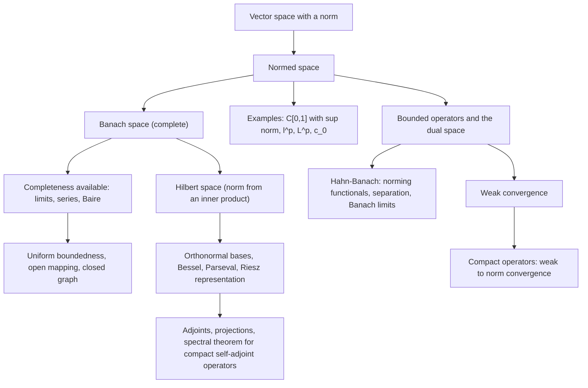

# Functional Analysis

> [Mathematics](../../README.md) › [Advanced Topics](../README.md) · Level: Advanced · Prerequisites: [Vector Spaces](../../08-linear-algebra/04-vector-spaces/README.md), [Linear Transformations](../../08-linear-algebra/05-linear-transformations/README.md), [Inner Product Spaces](../../08-linear-algebra/08-inner-product-spaces/README.md), [The Real Numbers and Completeness](../../14-real-analysis/01-real-numbers-and-completeness/README.md), [Sequences and Series](../../14-real-analysis/02-sequences-and-series/README.md), [Continuity and Limits](../../14-real-analysis/03-continuity-and-limits/README.md), [Metric Spaces](../../14-real-analysis/06-metric-spaces/README.md), [Compactness](../../17-topology/03-compactness/README.md), [Measure Theory](../01-measure-theory/README.md) · Estimated time: 840 min

## 1. Introduction

Linear algebra studies finite-dimensional vector spaces and the linear maps between them. Almost everything there is decidable by matrix computation: a linear map is continuous, a norm is irrelevant, every subspace is closed, the closed unit ball is compact, and every operator has an adjoint represented by the conjugate transpose. Functional analysis is what happens when the same questions are asked about spaces whose elements are *functions* or *sequences* — spaces that are infinite-dimensional and carry a notion of size.

The change of setting destroys four habits at once.

1. **Norms are no longer interchangeable.** On $\mathbb{R}^n$ any two norms define the same convergent sequences (Theorem 7.10 below). On $C[0,1]$ the supremum norm and the $L^1$ norm disagree violently: a sequence can converge in one and not the other, and one of the two norms is complete while the other is not.
2. **Bounded sets need not be compact.** In $\ell^2$ the closed unit ball is bounded and closed but contains the orthonormal sequence $e_1,e_2,\dots$, whose pairwise distances are $\sqrt2$; no subsequence converges. Compactness must be *earned* by extra hypotheses, and this is precisely what compact operators supply.
3. **Linear maps need not be continuous.** Differentiation $C^1[0,1]\to C[0,1]$ is linear and everywhere defined but unbounded (Example 7.15(8)). The space of *bounded* operators is therefore a genuine restriction, and the three "big theorems" of §7.8 describe when boundedness is automatic.
4. **Bases are useless.** A Hamel basis of an infinite-dimensional Banach space is uncountable, and expanding a vector in it requires finite — not limiting — linear combinations. Hilbert spaces instead use *orthonormal bases*, whose expansions are infinite series that converge because of completeness.

The subject was created in the first three decades of the twentieth century to make exactly these difficulties manageable. Hilbert and Schmidt studied integral equations and discovered that symmetric kernels have orthogonal eigenfunction expansions; Riesz proved in 1907 that every continuous linear functional on $L^2$ is given by an inner product; Banach's book of 1932 unified the complete normed spaces that now carry his name; Hahn (1927) and Banach isolated the extension theorem; and Banach, Steinhaus, Schauder and others proved the three theorems — open mapping, closed graph, uniform boundedness — that make completeness a working tool rather than a technical hypothesis. Von Neumann's formulation of quantum mechanics in 1932 gave the theory its most famous customer: states are unit vectors in a Hilbert space, observables are self-adjoint operators, and the possible measured values are their spectra.

The chapter is organised as a single ascent.

* **§7.1–§7.3**: norms, examples, completeness, and the finite-dimensional exception where everything behaves.
* **§7.4–§7.6**: bounded operators, the operator norm, dual spaces, and the Hahn–Banach theorem, which manufactures the continuous linear functionals that the rest of the theory needs.
* **§7.7–§7.8**: Baire category and its three consequences — the uniform boundedness principle, the open mapping theorem, and the closed graph theorem.
* **§7.9–§7.12**: Hilbert spaces: Cauchy–Schwarz, orthonormal bases, Bessel's and Parseval's identities, the Riesz representation theorem, and adjoints.
* **§7.13–§7.15**: compact operators, the spectral theorem for compact self-adjoint operators, the Fredholm alternative, and weak convergence.
* **§12**: differential equations, integral equations, and quantum mechanics.

A word on honesty. Several results are quoted from other parts of the repository or from standard texts rather than proved here: the completeness of $L^p(\mu)$ (Riesz–Fischer), the identification of $(C(K))^*$ with regular Borel measures (Riesz–Markov–Kakutani), the Banach–Alaoglu theorem, Arzelà–Ascoli's compactness criterion, the spectral radius formula, and the index-zero half of the Fredholm–Riesz–Schauder theorem. Each is flagged at the point of use. Everything else is proved, including Cauchy–Schwarz, Bessel, Parseval, Riesz representation, the equivalence of norms in finite dimensions, the equivalence of continuity and boundedness, the uniform boundedness principle, the open mapping theorem, the closed graph theorem, and the self-adjoint case of the Fredholm alternative. Hahn–Banach is proved in full in §7.6 up to the use of Zorn's lemma, which is the one genuinely set-theoretic step and cannot be removed.

## 2. Prerequisites

**Vector spaces, linear maps, kernels and images.** A norm is a function on a vector space, and every theorem below is about linear maps. You must be comfortable with subspaces, spans, linear independence, bases, dimension, quotients and direct sums. In particular the statement "$X = M \oplus N$" means that every $x$ is uniquely $m+n$ with $m\in M$, $n\in N$. See [Vector Spaces](../../08-linear-algebra/04-vector-spaces/README.md) and [Linear Transformations](../../08-linear-algebra/05-linear-transformations/README.md).

**Inner products and orthogonality.** The finite-dimensional theory of orthonormal bases, orthogonal projection, the Gram–Schmidt process and the spectral theorem for real symmetric matrices is the model that §7.9–§7.14 generalise. The only genuinely new ingredient is completeness, which turns finite sums into convergent series. See [Inner Product Spaces](../../08-linear-algebra/08-inner-product-spaces/README.md) and [Eigenvalues and Eigenvectors](../../08-linear-algebra/07-eigenvalues-and-eigenvectors/README.md).

**Completeness and the least-upper-bound property.** Every existence proof in the chapter ends by extracting a limit. The completeness of $\mathbb{R}$ and $\mathbb{C}$, the fact that Cauchy sequences converge there, and the equivalence of "Cauchy" and "convergent" in complete spaces are used constantly. See [The Real Numbers and Completeness](../../14-real-analysis/01-real-numbers-and-completeness/README.md).

**Sequences, series, sup and limsup.** The completeness of $\ell^p$ and $C[0,1]$ is proved by handling coordinates and uniform Cauchy conditions; the completeness of $L^p$ is a limit theorem about series of functions. The norm $\|x\|_p$ is defined by a series, and Bessel's inequality is a statement about all finite partial sums. See [Sequences and Series](../../14-real-analysis/02-sequences-and-series/README.md).

**Continuity, uniform continuity and uniform convergence.** The equivalence "continuous linear map = bounded linear map" is proved with an $\varepsilon$–$\delta$ argument, and the completeness of $C[0,1]$ rests on the theorem that a uniform limit of continuous functions is continuous. See [Continuity and Limits](../../14-real-analysis/03-continuity-and-limits/README.md).

**Metric spaces: open and closed sets, closure, compactness, Cauchy sequences, completions.** Functional analysis is metric-space topology with a linear structure. The Baire category theorem is a theorem about complete metric spaces; Arzelà–Ascoli is a compactness criterion in $C(K)$; and the projection theorem is a minimisation argument in a metric space. See [Metric Spaces](../../14-real-analysis/06-metric-spaces/README.md) and [Compactness](../../17-topology/03-compactness/README.md).

**Measure and integration, and $L^p$ spaces.** The spaces $L^p(\mu)$ are the central examples of Banach spaces and $L^2(\mu)$ is the central example of a Hilbert space. You need Hölder's and Minkowski's inequalities, the dominated convergence theorem, and the fact that elements of $L^p$ are equivalence classes of functions equal almost everywhere. See [Measure Theory](../01-measure-theory/README.md).

**Complex numbers.** Complex scalars are used throughout because quantum mechanics needs them. The only extra rule is conjugation in the second slot of an inner product, and the identity $\langle x,y\rangle = \overline{\langle y,x\rangle}$. See [Complex Numbers and Geometry](../../15-complex-analysis/01-complex-numbers-and-geometry/README.md).

## 3. Learning Objectives

By the end of this chapter you will be able to:

* decide whether a given function on a vector space is a norm, and compute the induced metric;
* verify completeness of $\ell^p$, $c_0$ and $C[0,1]$ from the definitions, and explain why $(C[0,1],\|\cdot\|_1)$ is not complete;
* state and use the equivalence of norms on a finite-dimensional space, including the exact constants for the standard norms on $\mathbb{R}^n$;
* compute operator norms of functionals, matrices, diagonal operators, shifts, multiplication and integral operators;
* prove that a linear map between normed spaces is continuous if and only if it is bounded, and explain where linearity is used;
* identify the duals of $\ell^1$, $c_0$, $\ell^p$ and a Hilbert space, and give an element of $(\ell^\infty)^*$ that is not in $\ell^1$;
* state the Hahn–Banach theorem in analytic and geometric form, prove the one-step extension lemma, and derive norming functionals and the distance formula;
* state the Baire category theorem, prove the uniform boundedness principle, and outline the open mapping and closed graph theorems together with one use of each;
* prove Cauchy–Schwarz, the parallelogram law and the polarization identity, and use them to decide whether a norm comes from an inner product;
* prove Bessel's inequality and Parseval's identity, construct orthonormal bases, and explain why an orthonormal basis is not a Hamel basis;
* prove the Riesz representation theorem and use it to construct adjoints;
* compute adjoints, decide self-adjointness and positivity, and verify $\|T^*T\|=\|T\|^2$;
* state the spectral theorem for compact self-adjoint operators, outline its proof, and explain how it reduces to the finite-dimensional spectral theorem;
* apply the Fredholm alternative to a second-kind integral equation and to a diagonal operator on $\ell^2$;
* distinguish norm, weak and weak-* convergence, prove that weakly convergent sequences are bounded, and explain why weak compactness produces solutions of variational problems.

## 4. Intuition

**A norm is a ruler, not a shape.** A vector space by itself has no geometry: it knows how to add and to scale, nothing else. A norm assigns a length to every vector and hence a distance $d(x,y)=\|x-y\|$ between any two. Different rulers on the same space can disagree about which sequences converge — but only when the space is infinite-dimensional, because there a ball of one norm can contain infinitely many independent directions.

**Completeness means no holes.** A Cauchy sequence is one whose terms eventually crowd together; a space is complete when every such crowd has a point to crowd around. $\mathbb{Q}$ fails, $\mathbb{R}$ succeeds. Among spaces of functions, completeness is what converts "the partial sums look convergent" into "there is a limit function, and it belongs to the space". It is the licence to take limits — and almost every proof in the chapter takes a limit.

**A bounded operator stretches by a bounded factor.** Linearity means that a map is determined by what it does to a ball around zero. If it moves that ball into a bounded set, it is continuous everywhere; if not, it has a direction of arbitrarily large stretch. The operator norm is the smallest stretch factor that works. It is a number, not a vector, and it measures the operator, not the space.

**The dual space is a catalogue of measurements.** A continuous linear functional is a scalar-valued measuring device. The dual $X^*$ collects all of them. Two facts make it powerful: Hahn–Banach guarantees enough measurements to distinguish points and to compute norms and distances, and weak convergence says a sequence converges if every measurement settles. In finite dimensions measurements determine a vector; in infinite dimensions there are enough measurements to separate points but weak convergence is genuinely weaker than norm convergence.

**A Hilbert space is Euclidean space with infinitely many axes.** Orthogonality, projection, Pythagoras and coordinates all survive, provided sums over infinitely many axes are interpreted as limits. An orthonormal basis is a coordinate system with the property that the coordinates of $x$ are the measurements $\langle x,e_\alpha\rangle$. Bessel says the coordinate vector always lies in $\ell^2$; Parseval says no information is lost.

**Compact operators are almost finite-dimensional.** A compact operator squashes the unit ball into a set that can be covered by finitely many small balls. It cannot have an infinite orthonormal set of eigenvectors with eigenvalues bounded away from zero, its spectrum is a sequence tending to zero, and on each eigenspace it behaves like a finite matrix. This is why the spectral theorem for compact self-adjoint operators looks exactly like the finite-dimensional one, with "finite sum" replaced by "norm-convergent sum".

**The three big theorems are completeness in action.** Baire category says a complete space cannot be exhausted by countably many thin sets. The uniform boundedness principle uses it to upgrade pointwise control to uniform control; the open mapping theorem uses it to upgrade "surjective" to "open"; the closed graph theorem converts a continuity check into a closedness check. All three fail without completeness, and counterexamples on incomplete spaces are easy to construct.

## 5. Formal Definition

Throughout, $\mathbb{F}$ denotes $\mathbb{R}$ or $\mathbb{C}$, and all vector spaces are over $\mathbb{F}$.

**Definition 5.1 (norm).** Let $X$ be a vector space over $\mathbb{F}$. A function $\lVert\cdot\rVert : X \to [0,\infty)$ is a **norm** if for all $x,y \in X$ and $\alpha \in \mathbb{F}$:

1. $\lVert x\rVert = 0$ implies $x = 0$ (definiteness);
2. $\lVert \alpha x\rVert = \lvert\alpha\rvert\,\lVert x\rVert$ (positive homogeneity);
3. $\lVert x+y\rVert \le \lVert x\rVert + \lVert y\rVert$ (triangle inequality).

**Definition 5.2 (normed space).** A **normed space** is a pair $(X,\lVert\cdot\rVert)$. It becomes a metric space under $d(x,y) := \lVert x-y\rVert$, the **induced metric**. Consequently notions such as open ball, closure, compactness, Cauchy sequence, continuity and completeness are those of this metric.

**Definition 5.3 (Banach space).** A normed space that is complete with respect to its induced metric is a **Banach space**.

**Definition 5.4 (inner product).** Let $H$ be a vector space over $\mathbb{C}$. A **Hermitian inner product** is a map $\langle\cdot,\cdot\rangle : H \times H \to \mathbb{C}$ such that for all $x,y,z \in H$ and $\alpha \in \mathbb{C}$:

1. $\langle \alpha x + z, y\rangle = \alpha\langle x,y\rangle + \langle z,y\rangle$ (linear in the first argument);
2. $\langle x,y\rangle = \overline{\langle y,x\rangle}$ (Hermitian symmetry);
3. $\langle x,x\rangle \ge 0$, with equality only for $x = 0$ (positive definiteness).

Over $\mathbb{R}$ the same axioms hold with conjugation absent, and the form is symmetric bilinear. In this chapter the convention is **linear in the first argument and conjugate-linear in the second**; many physics texts use the opposite convention, which changes nothing except where conjugates appear.

**Definition 5.5 (Hilbert space).** An inner product space is given the norm $\lVert x\rVert := \langle x,x\rangle^{1/2}$, and is a **Hilbert space** if it is complete in that norm.

**Definition 5.6 (bounded operator and operator norm).** Let $X,Y$ be normed spaces and $T : X \to Y$ linear. $T$ is **bounded** if there is $C \ge 0$ with $\lVert Tx\rVert \le C\lVert x\rVert$ for all $x \in X$. For a bounded $T$ the **operator norm** is

$$\lVert T\rVert := \sup_{\lVert x\rVert \le 1}\lVert Tx\rVert = \sup_{\lVert x\rVert = 1}\lVert Tx\rVert = \sup_{x \ne 0}\frac{\lVert Tx\rVert}{\lVert x\rVert} \in [0,\infty),$$

and $\lVert T\rVert$ is the smallest admissible constant $C$. The space of bounded linear maps $X \to Y$ is denoted $\mathcal{B}(X,Y)$, and $\mathcal{B}(X) := \mathcal{B}(X,X)$.

**Definition 5.7 (dual space).** The **dual space** of a normed space $X$ is $X^* := \mathcal{B}(X,\mathbb{F})$, equipped with the operator norm. Its elements are called **bounded** or **continuous** **linear functionals**. The **duality pairing** is $\langle x,f\rangle := f(x)$ for $x \in X$, $f \in X^*$.

**Definition 5.8 (spectrum and resolvent set).** Let $T \in \mathcal{B}(X)$ with $X$ a Banach space. The **resolvent set** is $\rho(T) := \{\lambda \in \mathbb{F} : T - \lambda I \text{ is bijective with bounded inverse}\}$, and the **spectrum** is $\sigma(T) := \mathbb{F} \setminus \rho(T)$. Its elements are **spectral values**.

**Definition 5.9 (adjoint).** Let $H,K$ be Hilbert spaces and $T \in \mathcal{B}(H,K)$. The **adjoint** $T^* \in \mathcal{B}(K,H)$ is defined by the identity

$$\langle Tx, y\rangle_K = \langle x, T^*y\rangle_H \qquad \text{for all } x \in H,\ y \in K.$$

**Definition 5.10 (compact operator).** A linear map $T : X \to Y$ between normed spaces is **compact** if the image of the closed unit ball, $T(\{x : \lVert x\rVert \le 1\})$, is relatively compact in $Y$, that is, its closure is compact. If $\dim X < \infty$ or $\dim Y < \infty$, every bounded $T$ is compact.

**Definition 5.11 (weak convergence).** Let $X$ be a normed space. A sequence $(x_n)$ **converges weakly** to $x \in X$, written $x_n \rightharpoonup x$, if $f(x_n) \to f(x)$ for every $f \in X^*$. A sequence $(f_n)\subseteq X^*$ **converges weakly-$\ast$** to $f\in X^*$, written $f_n \xrightarrow{\ast} f$, if $f_n(x) \to f(x)$ for every $x \in X$.

**Definition 5.12 (orthonormal system and basis).** A subset $\{e_\alpha\}_{\alpha\in A}$ of a Hilbert space $H$ is **orthonormal** if $\langle e_\alpha,e_\beta\rangle = \delta_{\alpha\beta}$. It is an **orthonormal basis** (or **complete orthonormal system**, or **maximal orthonormal system**) if it is orthonormal and no unit vector is orthogonal to every $e_\alpha$; equivalently, if $\overline{\operatorname{span}}\{e_\alpha\} = H$.

## 6. Mathematical Notation

| Symbol | Read as | Meaning |
|---|---|---|
| $\mathbb{F}$ | F | $\mathbb{R}$ or $\mathbb{C}$, the scalar field |
| $\lVert x\rVert$ | norm of $x$ | the length of $x$; $\lVert x\rVert_p$ is the $p$-norm |
| $d(x,y)$ | distance from $x$ to $y$ | $\lVert x-y\rVert$ in a normed space |
| $B_r(x)$, $\overline{B_r(x)}$ | open / closed ball | $\{y : \lVert y-x\rVert < r\}$ and its closure |
| $\ell^p$, $\ell^\infty$ | little ell p | spaces of $p$-summable / bounded scalar sequences |
| $c_0$, $c$ | c zero, c | null sequences; convergent sequences |
| $C(K)$, $C[0,1]$ | C of K | continuous scalar functions with sup norm |
| $L^p(\mu)$, $L^2[0,1]$ | ell p of mu | $\mu$-measurable $p$-integrable functions modulo a.e. equality |
| $C^k[0,1]$ | C k | $k$-times continuously differentiable functions |
| $\mathcal{B}(X,Y)$, $\mathcal{B}(X)$ | script B | bounded linear maps, with operator norm |
| $\mathcal{K}(X,Y)$ | script K | compact linear maps |
| $X^*$, $X^{**}$ | X star, X star star | dual and bidual; $J : X \to X^{**}$ is the canonical map |
| $\langle x,f\rangle$ | duality pairing | $f(x)$, deliberately written like an inner product |
| $\langle x,y\rangle$ | inner product | linear in $x$, conjugate-linear in $y$ |
| $x_n \to x$ | converges | norm convergence: $\lVert x_n - x\rVert \to 0$ |
| $x_n \rightharpoonup x$ | converges weakly | $f(x_n) \to f(x)$ for every $f \in X^*$ |
| $f_n \xrightarrow{\ast} f$ | converges weakly star | $f_n(x)\to f(x)$ for every $x \in X$, with $f_n,f\in X^*$ |
| $M^\perp$ | M perp | $\{x : \langle x,m\rangle = 0 \text{ for all } m \in M\}$ |
| $\ker T$, $\operatorname{im}T$ | kernel, image | $\{x : Tx=0\}$ and $T(X)$ |
| $\sigma(T)$, $\rho(T)$ | spectrum, resolvent set | Definition 5.8 |
| $T^*$ | T star | adjoint of $T$ (Definition 5.9) |
| $T \ge 0$ | T positive | $\langle Tx,x\rangle \ge 0$ for all $x$ (for self-adjoint $T$) |
| $\delta_{ij}$ | Kronecker delta | $1$ if $i=j$, $0$ otherwise |
| $\mathbf{1}_A$ | indicator of A | $1$ on $A$, $0$ outside |
| $\operatorname{sgn}z$ | sign of z | $z/\lvert z\rvert$ for $z \ne 0$, and $0$ for $z=0$ |

## 7. Core Concepts

### 7.1 Normed Spaces and the Standard Examples

A norm is an abstraction of length. Before any theorem, here is where the definition is used.

**Example 7.1 (the model spaces).**

1. **$\mathbb{F}^n$ with the $p$-norms.** For $1 \le p < \infty$,
$$\lVert x\rVert_p := \left(\sum_{k=1}^n \lvert x_k\rvert^p\right)^{1/p}, \qquad \lVert x\rVert_\infty := \max_{1\le k\le n}\lvert x_k\rvert.$$
The triangle inequality for $p=1$ and $p=\infty$ is immediate; for $1<p<\infty$ it is Minkowski's inequality (Theorem 7.2). The notation is consistent: $\lVert x\rVert_\infty = \lim_{p\to\infty}\lVert x\rVert_p$.
2. **$\ell^p$ for $1\le p<\infty$:** the set of scalar sequences $x=(x_1,x_2,\dots)$ with $\sum_{k\ge1}\lvert x_k\rvert^p<\infty$, with the same formula. **$\ell^\infty$:** bounded sequences with the supremum norm. Both are normed spaces; both are complete (Theorem 7.4).
3. **$c_0$:** the null sequences, a subspace of $\ell^\infty$ with the supremum norm. It is closed in $\ell^\infty$ (Proposition 7.7(2)), hence a Banach space.
4. **$C(K)$:** for a compact metric space $K$, the continuous scalar functions with $\lVert f\rVert_\infty := \sup_{t\in K}\lvert f(t)\rvert$. The maximum exists by compactness, but writing $\sup$ is harmless.
5. **$C^k[0,1]$:** $k$-times continuously differentiable functions with $\lVert f\rVert_{C^k} := \sum_{j=0}^{k}\sup_{t\in[0,1]}\lvert f^{(j)}(t)\rvert$. This norm makes the derivatives part of the data: two functions are close only if their values *and* their first $k$ derivatives are close.
6. **$L^p(\mu)$, $1\le p\le\infty$:** equivalence classes of measurable functions with $\int\lvert f\rvert^p\,d\mu<\infty$, norm $\lVert f\rVert_p := \left(\int\lvert f\rvert^p\,d\mu\right)^{1/p}$, and $\lVert f\rVert_\infty$ the essential supremum. Strictly, elements are classes modulo equality $\mu$-almost everywhere, because $\lVert f-g\rVert_p=0$ must force $f=g$. Completeness is the Riesz–Fischer theorem, quoted from [Measure Theory](../01-measure-theory/README.md).
7. **$\mathbb{F}^n$ with an arbitrary norm.** Any two norms are equivalent (Theorem 7.10), so for most purposes there is only one topology on $\mathbb{F}^n$; the constants, however, matter in estimates and are the subject of Exercise 2.

The only inequalities needed to verify the norm axioms for $\ell^p$ and $L^p$ are the following two.

**Theorem 7.2 (Hölder and Minkowski).** Let $1<p<\infty$ and $q$ be the **conjugate exponent**, $1/p+1/q=1$. For scalar sequences $x,y$ (finite or infinite),
$$\sum_k \lvert x_k y_k\rvert \le \lVert x\rVert_p\,\lVert y\rVert_q, \qquad \lVert x+y\rVert_p \le \lVert x\rVert_p+\lVert y\rVert_p.$$
The same statements hold for measurable functions on a measure space. For $p=1$, $q=\infty$, the first inequality is immediate from $\lvert y_k\rvert\le\lVert y\rVert_\infty$.

*Proof.* **Young's inequality.** For $a,b\ge0$ and conjugate $p,q$,
$$ab \le \frac{a^p}{p}+\frac{b^q}{q},$$
with equality exactly when $a^p=b^q$. If $a=0$ or $b=0$ this is clear; otherwise use concavity of $\log$:
$$\log(ab) = \frac1p\log(a^p)+\frac1q\log(b^q) \le \log\left(\frac{a^p}{p}+\frac{b^q}{q}\right).$$
The equality condition is the equality condition in concavity.

**Hölder.** If $\lVert x\rVert_p=0$ or $\lVert y\rVert_q=0$, then $xy=0$ (for $q=\infty$ use boundedness), and the claim is trivial. Otherwise apply Young to $a=\lvert x_k\rvert/\lVert x\rVert_p$ and $b=\lvert y_k\rvert/\lVert y\rVert_q$ and sum:
$$\sum_k \frac{\lvert x_k y_k\rvert}{\lVert x\rVert_p\lVert y\rVert_q} \le \frac1p\sum_k\frac{\lvert x_k\rvert^p}{\lVert x\rVert_p^p} + \frac1q\sum_k\frac{\lvert y_k\rvert^q}{\lVert y\rVert_q^q} = \frac1p+\frac1q=1.$$
For infinite sums apply the finite case to the first $N$ terms and let $N\to\infty$. The function case is identical with integrals. Equality holds exactly when $\lvert x_k\rvert^p$ and $\lvert y_k\rvert^q$ are proportional.

**Minkowski.** For $p=1$ it is the triangle inequality for scalars; for $p=\infty$ it is $\sup\lvert x_k+y_k\rvert\le\sup\lvert x_k\rvert+\sup\lvert y_k\rvert$. Let $1<p<\infty$ and assume $\lVert x+y\rVert_p>0$ (otherwise trivial). Then
$$\begin{aligned}
\lVert x+y\rVert_p^p &= \sum_k \lvert x_k+y_k\rvert^p \le \sum_k \lvert x_k\rvert\,\lvert x_k+y_k\rvert^{p-1} + \sum_k \lvert y_k\rvert\,\lvert x_k+y_k\rvert^{p-1}\\
&\le \left(\lVert x\rVert_p+\lVert y\rVert_p\right)\left(\sum_k\lvert x_k+y_k\rvert^{(p-1)q}\right)^{1/q},
\end{aligned}$$
where Hölder was applied to each sum, using $(p-1)q=p$. Since $1/q = 1-1/p$, the last factor is $\lVert x+y\rVert_p^{p-1}$, and dividing by it gives the claim. The function case is the same with integrals. $\blacksquare$

Note where each hypothesis is used: $p>1$ is needed for $(p-1)q=p$ and for $q$ to be finite; $q=\infty$ requires the separate argument. For $0<p<1$ the triangle inequality *fails* in general, which is why $\lVert\cdot\rVert_p$ is not a norm there.

**Example 7.3 (norms that are not equivalent).** On $C[0,1]$ the two formulas $\lVert f\rVert_\infty=\sup\lvert f\rvert$ and $\lVert f\rVert_1=\int_0^1\lvert f\rvert$ are both norms. They are not equivalent: the "tent" functions $f_n$ with $f_n(0)=1$, $f_n=0$ on $[1/n,1]$ and linear in between satisfy $\lVert f_n\rVert_\infty=1$ but $\lVert f_n\rVert_1=1/(2n)\to0$. So convergence in $\lVert\cdot\rVert_\infty$ implies convergence in $\lVert\cdot\rVert_1$, but not conversely, and a bound in one norm gives no bound in the other. §7.2 shows that the two norms even disagree about completeness.

### 7.2 Completeness: Banach Spaces

Completeness is the hypothesis that makes the chapter work. The examples below are the ones used everywhere later.

**Theorem 7.4 ($\ell^p$ is a Banach space).** For $1\le p\le\infty$, the space $\ell^p$ is complete.

*Proof.* Let $(x^{(n)})_{n\ge1}$ be a Cauchy sequence in $\ell^p$; write $x^{(n)}=(x^{(n)}_1,x^{(n)}_2,\dots)$. The case $p=\infty$ is the uniform case and is left as Exercise 13; assume $1\le p<\infty$.

*Step 1: the coordinate limit.* For each fixed $k$, $\lvert x^{(n)}_k-x^{(m)}_k\rvert\le\lVert x^{(n)}-x^{(m)}\rVert_p$, so $(x^{(n)}_k)_n$ is Cauchy in $\mathbb{F}$ and converges to some $x_k\in\mathbb{F}$. Put $x=(x_1,x_2,\dots)$.

*Step 2: $x\in\ell^p$ and $\sup_n\lVert x^{(n)}\rVert_p<\infty$.* A Cauchy sequence is bounded: choose $N$ with $\lVert x^{(n)}-x^{(N)}\rVert_p\le1$ for $n\ge N$ and set $M:=\max\{\lVert x^{(1)}\rVert_p,\dots,\lVert x^{(N-1)}\rVert_p,\lVert x^{(N)}\rVert_p+1\}$. For every finite $K$,
$$\sum_{k=1}^{K}\lvert x_k\rvert^p = \lim_{n\to\infty}\sum_{k=1}^{K}\lvert x^{(n)}_k\rvert^p \le M^p,$$
because finitely many limits may be interchanged. Letting $K\to\infty$ gives $\lVert x\rVert_p\le M<\infty$.

*Step 3: $x^{(n)}\to x$ in $\ell^p$.* Let $\varepsilon>0$ and choose $N$ with $\lVert x^{(n)}-x^{(m)}\rVert_p<\varepsilon$ for $n,m\ge N$. For every finite $K$ and $n,m\ge N$,
$$\sum_{k=1}^{K}\lvert x^{(n)}_k-x^{(m)}_k\rvert^p<\varepsilon^p.$$
Let $m\to\infty$: $\sum_{k\le K}\lvert x^{(n)}_k-x_k\rvert^p\le\varepsilon^p$. Then let $K\to\infty$: $\lVert x^{(n)}-x\rVert_p\le\varepsilon$ for all $n\ge N$. Hence $x^{(n)}\to x$. $\blacksquare$

The pattern — coordinates converge, the limit is bounded, then the norm convergence is recovered by letting the second index go to infinity *before* the dimension — is the standard tool for sequence spaces and recurs in the proof of Riesz–Fischer.

**Theorem 7.5 ($C[0,1]$ is a Banach space).** With the supremum norm, $C[0,1]$ is complete.

*Proof.* Let $(f_n)$ be Cauchy. For each $t$, $\lvert f_n(t)-f_m(t)\rvert\le\lVert f_n-f_m\rVert_\infty$, so $(f_n(t))$ converges to a number $f(t)$. Given $\varepsilon>0$ choose $N$ with $\lVert f_n-f_m\rVert_\infty<\varepsilon$ for $n,m\ge N$. Fixing $t$ and letting $m\to\infty$ gives $\lvert f_n(t)-f(t)\rvert\le\varepsilon$ for all $n\ge N$ and all $t$; the bound is uniform in $t$. Thus $f_n\to f$ uniformly. A uniform limit of continuous functions is continuous: if $\lvert f(t)-f(s)\rvert$ is to be estimated, use
$$\lvert f(t)-f(s)\rvert\le\lvert f(t)-f_N(t)\rvert+\lvert f_N(t)-f_N(s)\rvert+\lvert f_N(s)-f(s)\rvert \le 2\varepsilon+\lvert f_N(t)-f_N(s)\rvert,$$
and continuity of $f_N$ at $s$ makes the last term small. Hence $f\in C[0,1]$ and $\lVert f_n-f\rVert_\infty\le\varepsilon$ eventually. $\blacksquare$

**Theorem 7.6 ($(C[0,1],\lVert\cdot\rVert_1)$ is not complete).** Let $\lVert f\rVert_1=\int_0^1\lvert f\rvert$. Then $C[0,1]$ is not complete in this norm.

*Proof.* Define
$$f_n(t) := \begin{cases}0, & 0\le t\le \tfrac12-\tfrac1n,\\[2pt] \dfrac{n}{2}\left(t-\tfrac12+\tfrac1n\right), & \tfrac12-\tfrac1n<t<\tfrac12+\tfrac1n,\\[4pt] 1, & \tfrac12+\tfrac1n\le t\le 1,\end{cases}$$
with the formula interpreted as the linear interpolation for $n\ge2$ (for $n=1$ the left interval is empty). Each $f_n$ is continuous. For $m>n$,
$$\lVert f_n-f_m\rVert_1 \le \int_{\frac12-\frac1n}^{\frac12+\frac1n}1\,dt = \frac2n,$$
so $(f_n)$ is Cauchy in $\lVert\cdot\rVert_1$.

Suppose $g\in C[0,1]$ with $\lVert f_n-g\rVert_1\to0$. For $n\ge2$, $f_n=0$ on $[0,\frac12-\frac1n]$, hence
$$\int_0^{\frac12-\frac1n}\lvert g\rvert \le \lVert f_n-g\rVert_1 \to 0.$$
The sets increase to $[0,\frac12)$, so $\int_0^{\frac12}\lvert g\rvert=0$; by continuity of $g$ and of $\lvert g\rvert$ this forces $g=0$ on $[0,\frac12)$. Similarly $f_n=1$ on $[\frac12+\frac1n,1]$, so $\int_{\frac12+\frac1n}^1\lvert 1-g\rvert\to0$ and hence $g=1$ on $(\frac12,1]$. Continuity at $\frac12$ would require $g(\frac12)=0$ and $g(\frac12)=1$ simultaneously — impossible. Thus the Cauchy sequence has no limit in $C[0,1]$. $\blacksquare$

This example is not a pathology to be avoided; it is the reason the Lebesgue integral is needed. The completion of $(C[0,1],\lVert\cdot\rVert_1)$ is $L^1[0,1]$ (up to isometric isomorphism), and the missing limit is the indicator of $(\frac12,1]$.

**Proposition 7.7 (closed subspaces and inclusions).** Let $1\le p<q\le\infty$.

1. $\ell^p\subseteq\ell^q$ and $\lVert x\rVert_q\le\lVert x\rVert_p$ for $x\in\ell^p$.
2. $c_0$ is a closed subspace of $\ell^\infty$, hence a Banach space.
3. If $X$ is a Banach space and $M\subseteq X$ is a linear subspace, then $M$ is complete (with the restricted norm) if and only if $M$ is closed in $X$.

*Proof.* (1) For $q<\infty$, $\lvert x_k\rvert^q = \lvert x_k\rvert^p\lvert x_k\rvert^{q-p}\le\lvert x_k\rvert^p\lVert x\rVert_\infty^{q-p}$, so
$$\sum_k\lvert x_k\rvert^q \le \lVert x\rVert_\infty^{q-p}\sum_k\lvert x_k\rvert^p \le \lVert x\rVert_p^{q-p}\lVert x\rVert_p^p = \lVert x\rVert_p^q.$$
The case $q=\infty$ is $\lvert x_k\rvert\le\lVert x\rVert_p$ for every $k$. The inclusion is proper, for example $x_k=k^{-1/p}$ lies in $\ell^q$ but not in $\ell^p$ when $p<q$.

(2) If $x^{(n)}\to x$ in $\ell^\infty$ and $x^{(n)}\in c_0$, then for $\varepsilon>0$ choose $n$ with $\lVert x^{(n)}-x\rVert_\infty<\varepsilon/2$ and then $K$ with $\lvert x^{(n)}_k\rvert<\varepsilon/2$ for $k>K$; then $\lvert x_k\rvert<\varepsilon$ for $k>K$. So $x\in c_0$; $c_0$ is closed, and a closed subset of a complete metric space is complete.

(3) A complete subset of any metric space is closed: if $x\in\overline M$, choose $m_n\in M$ with $m_n\to x$; then $(m_n)$ is Cauchy, so it converges in $M$ to some $m$, and uniqueness of limits gives $x=m\in M$. Conversely a closed subset of a complete space is complete, since a Cauchy sequence in $M$ converges in $X$ and its limit lies in $\overline M=M$. $\blacksquare$

**Proposition 7.8 (absolute convergence criterion).** A normed space $X$ is a Banach space if and only if every series $\sum_{n=1}^\infty x_n$ with $\sum_{n=1}^\infty\lVert x_n\rVert<\infty$ converges in $X$.

*Proof.* If $X$ is complete and $\sum\lVert x_n\rVert<\infty$, then the partial sums are Cauchy:
$$\left\lVert\sum_{k=n}^{m}x_k\right\rVert\le\sum_{k=n}^{m}\lVert x_k\rVert\to0 \quad (n,m\to\infty),$$
so they converge.

Conversely, suppose every absolutely convergent series converges. Let $(y_n)$ be Cauchy. Choose indices $n_1<n_2<\cdots$ with $\lVert y_{n_{k+1}}-y_{n_k}\rVert<2^{-k}$ (possible because the sequence is Cauchy). Then $\sum_k(y_{n_{k+1}}-y_{n_k})$ converges absolutely, hence converges; its partial sums telescope to $y_{n_{K+1}}-y_{n_1}$. Thus the subsequence $(y_{n_k})$ converges. A Cauchy sequence with a convergent subsequence converges (to the same limit). $\blacksquare$

Proposition 7.8 is the cleanest way to test completeness in practice: it reduces completeness to the convergence of a single series, and that is exactly how the completeness of $L^p$ is proved.

### 7.3 Finite Dimensions: The Equivalence of Norms

**Definition 7.9 (equivalent norms).** Two norms $\lVert\cdot\rVert_a,\lVert\cdot\rVert_b$ on a vector space $X$ are **equivalent** if there are constants $0<c\le C$ with
$$c\lVert x\rVert_b \le \lVert x\rVert_a \le C\lVert x\rVert_b \qquad \text{for all } x\in X.$$
Equivalence is an equivalence relation on the set of norms. Equivalent norms have the same Cauchy sequences, the same convergent sequences with the same limits, the same open and closed sets, the same bounded sets, and the same continuous linear functionals.

**Theorem 7.10 (equivalence of norms in finite dimensions).** If $\dim X<\infty$, any two norms on $X$ are equivalent. Consequently:

1. every finite-dimensional normed space is a Banach space;
2. every finite-dimensional linear subspace of a normed space is closed;
3. every linear map from a finite-dimensional normed space into a normed space is bounded;
4. every closed and bounded subset of a finite-dimensional normed space is compact.

*Proof.* Let $n=\dim X$ and fix a basis $e_1,\dots,e_n$, so every $x$ has a unique expansion $x=\sum_{k=1}^n\alpha_k e_k$. Define the **coordinate norm** $\lVert x\rVert_1 := \sum_{k=1}^n\lvert\alpha_k\rvert$. It is enough to prove that an arbitrary norm $\lVert\cdot\rVert$ satisfies
$$m\lVert x\rVert_1 \le \lVert x\rVert \le M\lVert x\rVert_1$$
with constants $0<m\le M$ independent of $x$; this is the two-sided estimate referred to below. Equivalence of two arbitrary norms then follows by transitivity: if $\lVert\cdot\rVert_a$ and $\lVert\cdot\rVert_b$ are both pinched between multiples of $\lVert\cdot\rVert_1$, then each is bounded above and below by a multiple of the other.

*Upper bound.* By the triangle inequality and positive homogeneity,
$$\lVert x\rVert = \left\lVert\sum_{k=1}^n\alpha_k e_k\right\rVert \le \sum_{k=1}^n\lvert\alpha_k\rvert\,\lVert e_k\rVert \le M\lVert x\rVert_1, \qquad M:=\max_{1\le k\le n}\lVert e_k\rVert.$$

*Continuity of the norm in the coordinate norm.* From this upper bound and the reverse triangle inequality,
$$\left\lvert\lVert x\rVert-\lVert y\rVert\right\rvert \le \lVert x-y\rVert \le M\lVert x-y\rVert_1.$$
So $x\mapsto\lVert x\rVert$ is Lipschitz, hence continuous, with respect to $\lVert\cdot\rVert_1$.

*The minimum on the sphere.* Let $S:=\{x : \lVert x\rVert_1=1\}$. Under the linear identification $X\cong\mathbb{F}^n$ given by the basis, $S$ is the image of $\{\alpha\in\mathbb{F}^n : \sum\lvert\alpha_k\rvert=1\}$, which is closed and bounded, hence compact by the Heine–Borel theorem. The continuous function $x\mapsto\lVert x\rVert$ attains a minimum $m$ on $S$. Since $0\notin S$ and norms vanish only at $0$, $m>0$.

For $x\ne0$ we have $x/\lVert x\rVert_1\in S$, so
$$\lVert x\rVert = \lVert x\rVert_1\left\lVert\frac{x}{\lVert x\rVert_1}\right\rVert \ge m\lVert x\rVert_1.$$
For $x=0$ both sides are $0$. Combining the upper and lower bounds gives the two-sided estimate. $\blacksquare$

*Proof of the consequences.* (1) If $(x_j)$ is Cauchy in $\lVert\cdot\rVert$, then by the two-sided estimate it is Cauchy in $\lVert\cdot\rVert_1$, hence its coordinates are Cauchy in $\mathbb{F}$ and converge; so $x_j\to x$ in $\lVert\cdot\rVert_1$, and then $\lVert x_j-x\rVert\le M\lVert x_j-x\rVert_1\to0$. (2) A finite-dimensional subspace is complete by (1), and a complete subset of a metric space is closed. (3) If $T$ is linear on the finite-dimensional $X$, then $\lVert Tx\rVert\le\sum\lvert\alpha_k\rvert\lVert Te_k\rVert\le M'\lVert x\rVert_1\le (M'/m)\lVert x\rVert$, using the upper bound for the target norm and the lower bound for the domain norm. (4) By the two-sided estimate it suffices to treat the coordinate norm, where the claim is Heine–Borel. $\blacksquare$

**Theorem 7.11 (Riesz lemma; infinite dimensions are different).** Let $X$ be a normed space and $M\subsetneq X$ a closed subspace. For every $\theta\in(0,1)$ there is $x\in X$ with $\lVert x\rVert=1$ and $d(x,M)\ge\theta$. Consequently, if $\dim X=\infty$, the closed unit ball of $X$ is not compact.

*Proof.* Pick $y\in X\setminus M$; then $d:=d(y,M)>0$, because $M$ is closed and $y\notin M$. Choose $m\in M$ with $\lVert y-m\rVert<d/\theta$ and set $x:=(y-m)/\lVert y-m\rVert$. For $m'\in M$,
$$\lVert x-m'\rVert = \frac{\lVert y-m-\lVert y-m\rVert m'\rVert}{\lVert y-m\rVert} \ge \frac{d}{\lVert y-m\rVert} > \theta,$$
since $m+\lVert y-m\rVert m'\in M$. This proves the first claim.

For the second, construct recursively a sequence $(x_n)$ in the unit sphere with $\lVert x_n-x_m\rVert\ge\frac12$ for $n\ne m$: having chosen $x_1,\dots,x_{n-1}$, their span $M_{n-1}$ is a finite-dimensional, hence closed, proper subspace; apply the lemma with $\theta=\frac12$ to get $x_n$. The resulting set has no Cauchy subsequence, so the closed unit ball — which contains all $x_n$ — is not compact. $\blacksquare$

So in infinite dimensions boundedness and closedness do not imply compactness; the unit ball of $\ell^2$ contains the orthonormal basis, whose points are pairwise $\sqrt2$ apart. Compactness must be imposed as an extra hypothesis on maps (Definition 5.10), not on sets.

**Warning.** The equivalence of norms is a finite-dimensional phenomenon. On $C[0,1]$ the two norms of Example 7.3 are inequivalent. The inequality $\lVert f\rVert_1\le\lVert f\rVert_\infty$ does hold (the interval has length one), but the reverse inequality $\lVert f\rVert_\infty\le C\lVert f\rVert_1$ fails: the tent functions satisfy $\lVert f_n\rVert_\infty=1$ and $\lVert f_n\rVert_1=1/(2n)$, so such a $C$ would have to satisfy $1\le C/(2n)$ for every $n$, which is impossible. Equivalence needs *both* directions, and here one of them is false.

### 7.4 Bounded Linear Operators and the Operator Norm

**Theorem 7.12 (continuity equals boundedness).** Let $X,Y$ be normed spaces and $T:X\to Y$ linear. The following are equivalent:

1. $T$ is continuous on $X$;
2. $T$ is continuous at $0$;
3. $T$ is bounded: there is $C\ge0$ with $\lVert Tx\rVert\le C\lVert x\rVert$ for all $x$;
4. $T$ is Lipschitz: there is $L\ge0$ with $\lVert Tx-Ty\rVert\le L\lVert x-y\rVert$ for all $x,y$.

If these hold, the least admissible constant in (3) and in (4) equals $\lVert T\rVert$.

*Proof.* (1)⇒(2) is immediate. (2)⇒(3): continuity at $0$ gives $\delta>0$ such that $\lVert Tz\rVert\le1$ whenever $\lVert z\rVert\le\delta$. For $x\ne0$ put $z=\delta x/(2\lVert x\rVert)$; then $\lVert z\rVert=\delta/2<\delta$, so
$$\lVert Tx\rVert = \frac{2\lVert x\rVert}{\delta}\left\lVert T\left(\frac{\delta x}{2\lVert x\rVert}\right)\right\rVert \le \frac{2}{\delta}\lVert x\rVert.$$
Thus (3) holds with $C=2/\delta$. (3)⇒(4): $\lVert Tx-Ty\rVert=\lVert T(x-y)\rVert\le C\lVert x-y\rVert$. (4)⇒(1): Lipschitz maps are continuous. This proves equivalence. If $C$ is admissible in (3), then by definition $C\ge\sup_{\lVert x\rVert\le1}\lVert Tx\rVert=\lVert T\rVert$; conversely $\lVert Tx\rVert\le\lVert T\rVert\lVert x\rVert$ by homogeneity (for $x\ne0$, $x/\lVert x\rVert$ has norm $1$). So $\lVert T\rVert$ is the least constant. The same argument applies to (4). $\blacksquare$

Linearity is essential in (2)⇒(3): a nonlinear map can be continuous at $0$ without any linear growth bound, for example $f(t)=\sqrt{\lvert t\rvert}$ on $\mathbb{R}$, for which $\lvert f(t)\rvert/\lvert t\rvert\to\infty$. It is also essential in the step where continuity at a *single* point implies continuity everywhere: for a linear map, continuity at $0$ implies continuity at every point by translation, and for a nonlinear map it does not.

**Proposition 7.13 (the operator norm is a norm).** For $T,S\in\mathcal{B}(X,Y)$ and $\alpha\in\mathbb{F}$:

1. $\lVert T\rVert=0$ if and only if $T=0$;
2. $\lVert\alpha T\rVert=\lvert\alpha\rvert\lVert T\rVert$;
3. $\lVert T+S\rVert\le\lVert T\rVert+\lVert S\rVert$;
4. $\lVert Tx\rVert\le\lVert T\rVert\lVert x\rVert$ for all $x$, and $\lVert T\rVert$ is the least such constant;
5. if $Z$ is a normed space and $S\in\mathcal{B}(Y,Z)$, then $\lVert ST\rVert\le\lVert S\rVert\lVert T\rVert$ and $\lVert T^n\rVert\le\lVert T\rVert^n$.

*Proof.* (1)–(3) follow by taking suprema in the corresponding inequalities for vectors; for example $\lVert(T+S)x\rVert\le\lVert Tx\rVert+\lVert Sx\rVert\le(\lVert T\rVert+\lVert S\rVert)\lVert x\rVert$ for $\lVert x\rVert\le1$. (4) is the definition of the supremum: if $\lVert Tx\rVert\le C\lVert x\rVert$ for all $x$, then $C$ bounds the set whose supremum is $\lVert T\rVert$. (5) $\lVert STx\rVert\le\lVert S\rVert\lVert Tx\rVert\le\lVert S\rVert\lVert T\rVert\lVert x\rVert$; iterate for $T^n$. $\blacksquare$

**Theorem 7.14 ($\mathcal{B}(X,Y)$ is complete when $Y$ is).** Let $X$ be a normed space and $Y$ a Banach space. Then $\mathcal{B}(X,Y)$ with the operator norm is a Banach space. In particular $X^*$ is always a Banach space, whether or not $X$ is complete.

*Proof.* Let $(T_n)$ be Cauchy in $\mathcal{B}(X,Y)$. For each $x$, $\lVert T_nx-T_mx\rVert\le\lVert T_n-T_m\rVert\lVert x\rVert$, so $(T_nx)$ is Cauchy in $Y$ and converges to some $Tx\in Y$. The map $T$ is linear, being a pointwise limit of linear maps:
$$T(\alpha x+\beta y)=\lim_n(\alpha T_nx+\beta T_ny)=\alpha Tx+\beta Ty.$$
It is bounded: a Cauchy sequence is bounded (the same argument as in Theorem 7.4), so $M:=\sup_n\lVert T_n\rVert<\infty$, and
$$\lVert Tx\rVert=\lim_n\lVert T_nx\rVert\le M\lVert x\rVert.$$
Now let $\varepsilon>0$ and choose $N$ with $\lVert T_n-T_m\rVert\le\varepsilon$ for $n,m\ge N$. For $\lVert x\rVert\le1$,
$$\lVert T_nx-Tx\rVert=\lim_{m\to\infty}\lVert T_nx-T_mx\rVert\le\varepsilon,$$
so $\lVert T_n-T\rVert\le\varepsilon$ for $n\ge N$. Hence $T_n\to T$ in operator norm and $T\in\mathcal{B}(X,Y)$. $\blacksquare$

**Example 7.15 (operators and their norms).**

1. **Matrices.** On $\mathbb{F}^n$ with $\lVert\cdot\rVert_\infty$, a matrix $A=(a_{ij})$ acts by $(Ax)_i=\sum_j a_{ij}x_j$ and
$$\lVert A\rVert_\infty=\max_i\sum_j\lvert a_{ij}\rvert,$$
the maximum absolute row sum (Exercise 6). On $\lVert\cdot\rVert_1$ the norm is the maximum absolute column sum. On the Euclidean norm it is the largest singular value, $\sqrt{\lambda_{\max}(A^*A)}$.
2. **Functionals.** A linear functional $f(x)=\sum_{k=1}^n a_kx_k$ on $\mathbb{F}^n$ has norm $\lVert a\rVert_q$ when the domain carries $\lVert\cdot\rVert_p$, by Hölder and its equality case. This is the finite-dimensional case of §7.5.
3. **Diagonal operators.** If $(a_n)$ is bounded and $(Tx)_n=a_nx_n$ on $\ell^p$, then $T$ is bounded with $\lVert T\rVert=\sup_n\lvert a_n\rvert$. The supremum need not be attained: $a_n=1-1/n$ gives $\lVert T\rVert=1$, while $\lVert Tx\rVert< \lVert x\rVert$ for every $x\ne0$.
4. **Shift.** On $\ell^p$, the right shift $S(x_1,x_2,\dots)=(0,x_1,x_2,\dots)$ is an isometry: $\lVert Sx\rVert_p=\lVert x\rVert_p$, so $\lVert S\rVert=1$. The left shift $L(x_1,x_2,\dots)=(x_2,x_3,\dots)$ has norm $1$ and kernel $\{(x_1,0,0,\dots)\}$ of codimension one; it is surjective but not injective.
5. **Multiplication.** For $g\in C[0,1]$, $(M_gf)(t)=g(t)f(t)$ on $C[0,1]$ has $\lVert M_g\rVert=\lVert g\rVert_\infty$. The same formula holds on $L^2$; $M_g$ is self-adjoint exactly when $g$ is real-valued.
6. **Integral operators.** If $k\in C([0,1]^2)$, then $(Tf)(x)=\int_0^1k(x,t)f(t)\,dt$ is bounded on $C[0,1]$ with $\lVert T\rVert\le\sup_x\int_0^1\lvert k(x,t)\rvert\,dt$, and the bound is attained for a kernel of constant sign. On $L^2$ the analogous bound is $\lVert T\rVert\le\lVert k\rVert_{L^2([0,1]^2)}$ by Cauchy–Schwarz.
7. **Evaluation.** For $t_0\in[0,1]$, $f\mapsto f(t_0)$ is bounded on $C[0,1]$ with norm $1$ (attained by $f\equiv1$). On $L^2[0,1]$ evaluation is *not defined*: elements are equivalence classes, and changing $f$ at $t_0$ changes nothing in $L^2$. On the subspace $C[0,1]\subset L^2[0,1]$ it is unbounded, because a continuous function can have a tall narrow spike with arbitrarily small $L^2$ norm.
8. **Differentiation.** $D:C^1[0,1]\to C[0,1]$, $Df=f'$, is linear and everywhere defined, but $\lVert f_n\rVert_\infty=1$ and $\lVert f_n'\rVert_\infty=n$ for $f_n(t)=\sin(nt)$; so $D$ is unbounded. This is the standard illustration that completeness of the domain is indispensable (see the closed graph theorem, §7.8).

### 7.5 The Dual Space

The dual $X^*$ is the set of all scalar-valued measurements one can make on $X$. The identification of duals is a recurring theme, and the pattern in every computation below is the same: a functional is determined by its values on a spanning set, Hölder's inequality supplies the upper bound, and a cleverly chosen test vector supplies the matching lower bound.

**Theorem 7.16 ($(\ell^1)^*=\ell^\infty$).** The map $y\mapsto f_y$, $f_y(x):=\sum_{k\ge1}x_ky_k$, is an isometric isomorphism $\ell^\infty\to(\ell^1)^*$.

*Proof.* For $y\in\ell^\infty$ and $x\in\ell^1$, the series converges absolutely and
$$\lvert f_y(x)\rvert\le\sum_k\lvert x_k\rvert\lvert y_k\rvert\le\lVert y\rVert_\infty\lVert x\rVert_1,$$
so $f_y$ is bounded with $\lVert f_y\rVert\le\lVert y\rVert_\infty$; linearity is clear. Conversely, let $f\in(\ell^1)^*$ and put $y_k:=f(e_k)$, where $e_k$ is the $k$-th standard basis vector. Then $\lvert y_k\rvert\le\lVert f\rVert\lVert e_k\rVert_1=\lVert f\rVert$, so $y\in\ell^\infty$ with $\lVert y\rVert_\infty\le\lVert f\rVert$.

Every $x\in\ell^1$ is the norm limit of its finite partial sums $x^{(N)}=\sum_{k\le N}x_ke_k$, because $\lVert x-x^{(N)}\rVert_1=\sum_{k>N}\lvert x_k\rvert\to0$. Continuity of $f$ gives
$$f(x)=\lim_{N\to\infty}f(x^{(N)})=\lim_{N\to\infty}\sum_{k\le N}x_ky_k=\sum_{k\ge1}x_ky_k,$$
so $f=f_y$. Finally, to see that $\lVert f_y\rVert\ge\lVert y\rVert_\infty$: given $\varepsilon>0$ choose $k$ with $\lvert y_k\rvert>\lVert y\rVert_\infty-\varepsilon$ and set $x:=\overline{y_k}/\lvert y_k\rvert\,e_k$ (or $\operatorname{sgn}(y_k)e_k$ in the real case), so that $\lVert x\rVert_1=1$ and $\lvert f_y(x)\rvert=\lvert y_k\rvert>\lVert y\rVert_\infty-\varepsilon$. Hence $\lVert f_y\rVert=\lVert y\rVert_\infty$. $\blacksquare$

**Theorem 7.17 ($(c_0)^*=\ell^1$).** The map $y\mapsto f_y$ with $f_y(x)=\sum_kx_ky_k$ is an isometric isomorphism $\ell^1\to(c_0)^*$.

*Proof.* If $y\in\ell^1$ and $x\in c_0$, then $\lvert f_y(x)\rvert\le\lVert x\rVert_\infty\lVert y\rVert_1$ (the series converges absolutely), so $\lVert f_y\rVert\le\lVert y\rVert_1$. Conversely let $f\in(c_0)^*$ and $y_k=f(e_k)$. For each $N$, the vector $x^{(N)}$ with $x^{(N)}_k=\overline{y_k}/\lvert y_k\rvert$ for $k\le N$ with $y_k\ne0$, and $0$ otherwise, belongs to $c_0$ and has norm at most $1$; hence
$$\sum_{k=1}^{N}\lvert y_k\rvert=f(x^{(N)})\le\lVert f\rVert.$$
Letting $N\to\infty$ gives $y\in\ell^1$ and $\lVert y\rVert_1\le\lVert f\rVert$. The identification $f=f_y$ on finitely supported sequences extends to $c_0$ because finitely supported sequences are dense in $c_0$ (given $x\in c_0$ and $\varepsilon$, cut off after a large $K$). Equality of norms follows by testing with the same $x^{(N)}$, now normalized. $\blacksquare$

The duality pattern is not symmetric: $(\ell^1)^*=\ell^\infty$ but $(\ell^\infty)^*\supsetneq\ell^1$, and $(c_0)^*=\ell^1$ but $(\ell^1)^*\ne c_0$. None of $\ell^1$, $c_0$ and $\ell^\infty$ is reflexive.

**Theorem 7.18 ($(\ell^p)^*=\ell^q$ for $1<p<\infty$).** Let $1<p<\infty$ and $1/p+1/q=1$. The map $y\mapsto f_y$, $f_y(x)=\sum_kx_ky_k$, is an isometric isomorphism $\ell^q\to(\ell^p)^*$. Similarly $(L^p(\mu))^*=L^q(\mu)$ for $\sigma$-finite $\mu$ and $1<p<\infty$.

*Proof sketch.* Hölder gives $\lVert f_y\rVert\le\lVert y\rVert_q$. For the converse, let $f\in(\ell^p)^*$ and $y_k=f(e_k)$. For finite $N$ put $x^{(N)}_k=\lvert y_k\rvert^{q-1}\overline{\operatorname{sgn}(y_k)}$ for $k\le N$ and $0$ otherwise; then $\lVert x^{(N)}\rVert_p^p=\sum_{k\le N}\lvert y_k\rvert^q$ and
$$\sum_{k\le N}\lvert y_k\rvert^q=f(x^{(N)})\le\lVert f\rVert\left(\sum_{k\le N}\lvert y_k\rvert^q\right)^{1/p},$$
so $\left(\sum_{k\le N}\lvert y_k\rvert^q\right)^{1/q}\le\lVert f\rVert$. Let $N\to\infty$, and identify $f$ with $f_y$ on the dense set of finitely supported sequences. The $L^p$ statement is the Riesz representation theorem for $L^p$, proved in [Measure Theory](../01-measure-theory/README.md); the same Hölder/test-vector argument applies. $\blacksquare$

The endpoint cases are genuinely different. For $L^1$ the dual is $L^\infty$ only under additional hypotheses ($\sigma$-finiteness suffices), and $(L^\infty)^*$ is strictly larger than $L^1$. The dual of $C[0,1]$ is not a space of functions but a space of measures.

**Example 7.19 (duals of the classical spaces).**

1. $(\mathbb{F}^n)^*$ is isometrically $\mathbb{F}^n$ with the dual norm; its unit ball is the polar of the unit ball of $X$.
2. $(\ell^1)^*=\ell^\infty$, $(c_0)^*=\ell^1$, $(\ell^p)^*=\ell^q$ for $1<p<\infty$.
3. $(\ell^\infty)^*\supsetneq\ell^1$: Hahn–Banach produces a shift-invariant **Banach limit** $L$ with $L(\mathbf{1})=1$ and $L(x)\ge0$ for $x\ge0$ (Theorem 7.24 below); its restriction to $c$ is the ordinary limit, and $L(e_k)=L(e_1)$ for every $k$, so if $L$ were represented by $y\in\ell^1$ then $y$ would be a constant sequence in $\ell^1$, hence $y=0$, contradicting $L(\mathbf1)=1$.
4. $(C[0,1])^*$ is the space of regular complex Borel measures on $[0,1]$ (Riesz–Markov–Kakutani, quoted), with the total-variation norm. Examples are evaluations $\delta_t(f)=f(t)$, integration $\mu_g(f)=\int_0^1f g\,dt$ for $g\in L^1$, and combinations such as $f\mapsto f(0)-f(1)$.
5. If $H$ is a Hilbert space, $H^*$ is isometrically isomorphic to $H$, but the identification is conjugate-linear in the complex case (§7.11).

**Proposition 7.20 (the dual of a normed space is complete).** For every normed space $X$, $X^*$ is a Banach space.

*Proof.* $X^*=\mathcal{B}(X,\mathbb{F})$ and $\mathbb{F}$ is complete; apply Theorem 7.14. $\blacksquare$

This is why the bidual $X^{**}$ always exists and why the canonical map $J:X\to X^{**}$ can be studied even when $X$ is not complete.

### 7.6 The Hahn–Banach Theorem

Hahn–Banach is the existence theorem of the subject. It says that a linear functional defined on a subspace, and dominated by a sublinear function, can be extended to the whole space without losing the domination. The domination hypothesis looks technical; its content is that the extension can be controlled, and controlling it is what produces norming functionals, separation of convex sets and Banach limits.

**Definition 7.21 (sublinear functional).** A function $p:X\to\mathbb{R}$ on a real vector space is **sublinear** if $p(x+y)\le p(x)+p(y)$ for all $x,y$ and $p(tx)=tp(x)$ for all $t\ge0$. Every seminorm, in particular every norm, is sublinear.

**Theorem 7.22 (Hahn–Banach, analytic form).** Let $X$ be a real vector space, $p:X\to\mathbb{R}$ sublinear, $M\subseteq X$ a linear subspace, and $f:M\to\mathbb{R}$ linear with $f(x)\le p(x)$ for all $x\in M$. Then there is a linear $F:X\to\mathbb{R}$ with $F|_M=f$ and $F(x)\le p(x)$ for all $x\in X$.

*Proof.* **One-step extension.** Suppose $M\ne X$ and pick $x_0\in X\setminus M$. We seek $\alpha\in\mathbb{R}$ such that $g(m+tx_0):=f(m)+t\alpha$ satisfies $g\le p$ on $N:=M+\mathbb{R}x_0$. For $t>0$ the requirement is
$$\alpha\le p(y+x_0)-f(y)\quad\text{for all } y\in M,$$
after dividing by $t$ and writing $y=m/t$. For $t<0$, writing $t=-s$ with $s>0$ and $w=m/s$, the requirement is
$$\alpha\ge p(w-x_0)-f(w)\quad\text{for all } w\in M.$$
So we need
$$\sup_{w\in M}\left[p(w-x_0)-f(w)\right]\ \le\ \inf_{y\in M}\left[p(y+x_0)-f(y)\right].$$
For $w,y\in M$,
$$p(w-x_0)-f(w)\le p(y+x_0)-f(y) \iff f(w)+f(y)\le p(y+x_0)+p(w-x_0),$$
and this holds because $f(w)+f(y)=f(w+y)\le p(w+y)=p\bigl((y+x_0)+(w-x_0)\bigr)\le p(y+x_0)+p(w-x_0)$. Choose $\alpha$ between the two bounds. Then $g$ is linear on $N$, extends $f$, and satisfies $g\le p$: for $t>0$ the inequality $f(m)+t\alpha\le p(m+tx_0)$ follows from $\alpha\le p(m/t+x_0)-f(m/t)$ multiplied by $t$; for $t<0$ it follows from $\alpha\ge p(m/t-x_0)-f(m/t)$ multiplied by $t<0$ (which reverses the inequality), together with $0=p(0)\le p(-m+\lvert t\rvert x_0)+p(m-\lvert t\rvert x_0)$, which handles the sign change in the first term; $t=0$ is the hypothesis.

**Zorn's lemma.** Consider the set $\mathcal{P}$ of all pairs $(N,g)$ where $M\subseteq N\subseteq X$ is a subspace and $g:N\to\mathbb{R}$ is linear with $g|_M=f$ and $g\le p$ on $N$. Order $\mathcal{P}$ by $(N_1,g_1)\preceq(N_2,g_2)$ iff $N_1\subseteq N_2$ and $g_2|_{N_1}=g_1$. The pair $(M,f)$ belongs to $\mathcal{P}$, so $\mathcal{P}\ne\varnothing$. If $\{(N_i,g_i)\}_{i\in I}$ is a chain, then $N:=\bigcup_iN_i$ is a subspace — given two elements, each lies in some $N_i$, and the chain property puts both in the larger of the two — and $g(x):=g_i(x)$ for $x\in N_i$ is well defined because the $g_i$ agree on overlaps; $g$ is linear and $g\le p$. So every chain has an upper bound, and Zorn gives a maximal element $(N,g)$. If $N\ne X$, the one-step extension would produce a strictly larger element, contradiction. Hence $N=X$ and $F:=g$ is the required extension. $\blacksquare$

**Theorem 7.23 (Hahn–Banach for normed spaces).** Let $X$ be a normed space over $\mathbb{F}$, $M\subseteq X$ a subspace, and $f\in M^*$. Then there is $F\in X^*$ with $F|_M=f$ and $\lVert F\rVert_{X^*}=\lVert f\rVert_{M^*}$.

*Proof.* Apply Theorem 7.22 with $p(x):=\lVert f\rVert_{M^*}\lVert x\rVert$. Over $\mathbb{R}$ this is immediate: $f(x)\le\lvert f(x)\rvert\le p(x)$ on $M$, so $F$ exists with $F\le p$; replacing $x$ by $-x$ in this inequality gives $-F(x)=F(-x)\le p(-x)=p(x)$, since $p$ is a norm, hence $\lvert F(x)\rvert\le p(x)$ and $\lVert F\rVert\le\lVert f\rVert$. Since $F$ extends $f$, $\lVert F\rVert\ge\lVert f\rVert$, so equality.

Over $\mathbb{C}$, regard $X$ as a real vector space and write $f=g+ih$ with $g,h$ real-linear. Then $g(x)=\operatorname{Re}f(x)\le\lvert f(x)\rvert\le p(x)$ on $M$. By the real case extend $g$ to a real-linear $G:X\to\mathbb{R}$ with $G(x)\le p(x)$ (and hence $\lvert G\rvert\le p$). Define $F(x):=G(x)-iG(ix)$. Then $F$ is complex-linear: additivity is clear, and
$$F(ix)=G(ix)-iG(-x)=G(ix)+iG(x)=i\bigl(G(x)-iG(ix)\bigr)=iF(x).$$
On $M$, $F=f$ because for $x\in M$, $f(ix)=if(x)$ gives $g(ix)=-\operatorname{Im}f(x)$, so $G(x)-iG(ix)=g(x)+i\operatorname{Im}f(x)=f(x)$. Finally, for $x\in X$ choose $\theta$ with $e^{-i\theta}F(x)=\lvert F(x)\rvert$; then
$$\lvert F(x)\rvert=e^{-i\theta}F(x)=F(e^{-i\theta}x)=G(e^{-i\theta}x)\le p(e^{-i\theta}x)=p(x),$$
using that $G=\operatorname{Re}F$ on the rotated vector and that $p$ is positively homogeneous. Hence $\lVert F\rVert\le\lVert f\rVert$, and equality follows as before. $\blacksquare$

**Theorem 7.24 (consequences of Hahn–Banach).** Let $X$ be a normed space.

1. **Norming functionals.** For every $x\ne0$ there is $f\in X^*$ with $\lVert f\rVert=1$ and $f(x)=\lVert x\rVert$. Hence
$$\lVert x\rVert=\max_{\lVert f\rVert\le1}\lvert f(x)\rvert,$$
and the maximum is attained.
2. **Separation of points.** $X^*$ separates points: if $f(x)=0$ for all $f\in X^*$, then $x=0$.
3. **The canonical embedding.** $J:X\to X^{**}$, $(Jx)(f):=f(x)$, is a linear isometry. $X$ is **reflexive** if $J$ is surjective.
4. **Distance formula.** If $M\subseteq X$ is a closed subspace and $x\notin M$, then
$$d(x,M)=\max\{\lvert f(x)\rvert : f\in X^*,\ \lVert f\rVert\le1,\ f|_M=0\},$$
and the maximum is attained.
5. **Banach limits.** There is a linear $L\in(\ell^\infty)^*$ with $L(x)=\lim_nx_n$ for convergent $x$, $L(x)\ge0$ for $x\ge0$, $L(\mathbf{1})=1$, and $L(Sx)=L(x)$ for the shift $S(x_1,x_2,\dots)=(x_2,x_3,\dots)$.
6. **Non-uniqueness.** The extension in Theorem 7.23 need not be unique. On $\mathbb{R}^2$ with the supremum norm, let $M=\{(t,t) : t\in\mathbb{R}\}$ and $f(t,t)=t$. Then $\lVert f\rVert_{M^*}=1$, and for every $a\in[0,1]$ the functional $F_a(x_1,x_2)=ax_1+(1-a)x_2$ extends $f$ and has $\lVert F_a\rVert=\lvert a\rvert+\lvert1-a\rvert=1$. So there are infinitely many norm-preserving extensions.

*Proof.* (1) On $M:=\mathbb{F}x$ define $f_0(\alpha x):=\alpha\lVert x\rVert$. Then $\lVert f_0\rVert_{M^*}=1$ and $f_0(x)=\lVert x\rVert$; extend by Theorem 7.23. The displayed identity follows from $\lvert f(x)\rvert\le\lVert f\rVert\lVert x\rVert$ and the norming functional.

(2) is immediate from (1): if $x\ne0$, $f(x)=\lVert x\rVert\ne0$.

(3) $J$ is linear, and $\lVert Jx\rVert=\sup_{\lVert f\rVert\le1}\lvert f(x)\rvert=\lVert x\rVert$ by (1). An isometry is injective.

(4) If $f|_M=0$ and $\lVert f\rVert\le1$, then for every $m\in M$, $\lvert f(x)\rvert=\lvert f(x-m)\rvert\le\lVert x-m\rVert$; taking the infimum gives $\lvert f(x)\rvert\le d(x,M)$. For the reverse inequality, define $g$ on $N:=M+\mathbb{F}x$ by $g(m+\alpha x):=\alpha d(x,M)$. This is well defined: if $m+\alpha x=0$ with $\alpha\ne0$, then $x=-m/\alpha\in M$, contrary to hypothesis; so $\alpha=0$ and then $m=0$. It is linear and vanishes on $M$, and for $\alpha\ne0$,
$$\lvert g(m+\alpha x)\rvert=\lvert\alpha\rvert d(x,M)\le\lvert\alpha\rvert\left\lVert x+\frac{m}{\alpha}\right\rVert=\lVert m+\alpha x\rVert,$$
using the definition of $d(x,M)$ and $m/\alpha\in M$. So $\lVert g\rVert_{N^*}\le1$ and $g(x)=d(x,M)$; extend by Theorem 7.23.

(5) Let $p(x):=\limsup_{n\to\infty}\frac1n\sum_{k=1}^nx_k$. This is sublinear: additivity of the sums gives subadditivity of the limsup, and positive homogeneity is clear. Let
$$M:=\left\{x\in\ell^\infty : \lim_{n\to\infty}\frac1n\sum_{k=1}^nx_k \text{ exists}\right\}$$
and $f(x):=$ that limit. Then $f\le p$ on $M$. Extend to $L\in(\ell^\infty)^*$ with $L\le p$. Then $L(x)\le p(x)$ and $-L(x)=L(-x)\le p(-x)\le\lVert x\rVert_\infty$, so $\lvert L(x)\rvert\le\lVert x\rVert_\infty$ and $\lVert L\rVert\le1$. Also $L(\mathbf1)=1$. For $x\in c$, $p(x)=f(x)=\lim x$, so $L$ extends the ordinary limit. Positivity: if $x\ge0$, then $-x\le0$ and $L(-x)\le p(-x)=-\liminf_n\frac1n\sum_{k\le n}x_k\le0$, so $L(x)\ge0$. Shift invariance: for $w=x-Sx$, the Cesàro sums telescope,
$$\frac1n\sum_{k=1}^n(x_k-x_{k+1})=\frac{x_1-x_{n+1}}{n}\longrightarrow0,$$
so $p(w)\le0$ and $p(-w)\le0$; hence $L(w)\le0$ and $L(-w)\le0$, giving $L(w)=0$.

(6) On $M=\{(t,t)\}$, the functional $f(t,t)=t$ has $\lVert f\rVert_{M^*}=1$, because $\lvert t\rvert/\lVert(t,t)\rVert_\infty=1$ for $t\ne0$. Every linear extension has the form $F(x_1,x_2)=ax_1+bx_2$ with $a+b=1$, and $\lVert F\Vert=\lvert a\rvert+\lvert b\rvert$ (the dual norm on $(\mathbb{R}^2,\lVert\cdot\rVert_\infty)^*$ is the $1$-norm). Thus $\lVert F\Vert=1$ exactly when $a,b\ge0$, i.e. for every $a\in[0,1]$ with $b=1-a$. All these extensions are distinct.

$\blacksquare$

**Geometric form.** The analytic theorem is equivalent to a statement about separating convex sets: if $X$ is real and $A,B\subseteq X$ are nonempty disjoint convex sets with $A$ open, there is $f\in X^*$ and $c\in\mathbb{R}$ with $f(a)<c\le f(b)$ for all $a\in A$, $b\in B$. In the complex case the same holds for the real part of $f$. Taking $B=\{x_0\}$ and $A$ a convex open set not containing $x_0$ gives a supporting hyperplane. The proof derives the geometric form from Theorem 7.22 applied to the Minkowski functional of $A-x_0$; we state it without proof because the analytic form is what the rest of the chapter uses. The geometric form is the source of the **separation theorems** used in convex analysis and optimisation: a point outside a closed convex set can be strictly separated from it by a continuous linear functional.

**Honest limitation.** Hahn–Banach produces functionals by transfinite recursion over Zorn's lemma; it gives no formula, and Theorem 7.24(6) shows that it gives no uniqueness. The functionals it produces can be wild: a Banach limit cannot be computed from the sequence, and the strict inclusion $(\ell^\infty)^*\supsetneq\ell^1$ is a consequence. The theorem is about *functionals*, not operators: a bounded operator on a subspace need not extend to the whole space with the same norm. The identity map on a subspace $M$ extends to a bounded projection of $X$ onto $M$ exactly when $M$ is complemented, and not every closed subspace is complemented. The distinction between extending functionals and extending operators is one of the recurring themes of §7.9 and §7.12.

### 7.7 Baire Category

Baire category is a theorem about *size*. It says that a complete metric space is too large to be covered by countably many sets that are individually thin. Its power comes from the fact that "thin" is a topological notion, so the conclusion applies to spaces of functions, where it produces existence statements that no explicit construction can match.

**Definition 7.25 (meagre sets).** Let $X$ be a topological space (in this chapter, a metric space). A set $A\subseteq X$ is:

1. **nowhere dense** if its closure has empty interior, i.e. $\bigl(\overline A\bigr)^\circ=\varnothing$;
2. **meagre** (or **of first category**) if it is a countable union of nowhere dense sets;
3. **residual** (or **comeagre**) if its complement is meagre;
4. and $X$ is a **Baire space** if every countable intersection of dense open sets is dense; equivalently, if every countable union of closed nowhere dense sets has empty interior; equivalently, if no nonempty open subset of $X$ is meagre in $X$.

A single point in $\mathbb{R}$ is nowhere dense. A countable set such as $\mathbb{Q}$ is meagre, being a countable union of points. An interval is not meagre in $\mathbb{R}$, a fact equivalent to Baire's theorem. Note that "meagre" is not the same as "measure zero": a fat Cantor set has positive measure but is nowhere dense, hence meagre, and there are residual sets of measure zero (intersections of suitable dense open sets), which are not meagre. The two notions are independent.

**Theorem 7.26 (Baire category theorem).** Every complete metric space is a Baire space.

*Proof.* Let $(U_n)_{n\ge1}$ be dense open subsets of a complete metric space $(X,d)$; we prove $\bigcap_nU_n$ is dense. Let $V\subseteq X$ be nonempty and open. Since $U_1$ is dense and $V$ is nonempty open, $V\cap U_1$ contains a point $x_1$; choose $0<r_1<1$ with
$$\overline{B(x_1,r_1)}\subseteq V\cap U_1.$$
Recursively, having chosen $x_n$ and $r_n$, the set $B(x_n,r_n)\cap U_{n+1}$ is nonempty and open (both factors are open and the first is nonempty; density of $U_{n+1}$ gives a point in $B(x_n,r_n)$), so choose $x_{n+1}$ in it and $0<r_{n+1}<\min\{r_n/2,2^{-n}\}$ with
$$\overline{B(x_{n+1},r_{n+1})}\subseteq B(x_n,r_n)\cap U_{n+1}.$$
The balls are nested and $r_n\to0$. For $m>n$, $x_m\in B(x_n,r_n)$, so $d(x_n,x_m)<r_n$, and $\sum_n r_n<\infty$ (indeed $r_n<2^{-n}$ after the first step); hence $(x_n)$ is Cauchy. Completeness gives $x_n\to x$. For each $n$, all but finitely many $x_m$ lie in $\overline{B(x_{n+1},r_{n+1})}\subseteq B(x_n,r_n)$, and that set is closed, so $x\in\overline{B(x_{n+1},r_{n+1})}\subseteq U_{n+1}$ for every $n$; also $x\in\overline{B(x_1,r_1)}\subseteq V$. Hence $x\in V\cap\bigcap_nU_n$, and $V$ was arbitrary. $\blacksquare$

Two equivalent formulations are used below without comment: a countable union of closed nowhere dense sets has empty interior, and a countable union of meagre sets is meagre.

The hypothesis of completeness cannot be dropped: $\mathbb{Q}$ is countable, hence meagre in itself, and is not a Baire space. The conclusion also holds for locally compact Hausdorff spaces (Baire's theorem in its topological form), which is why $[0,1]$ and $\mathbb{R}$ are Baire spaces even before one uses their metrics.

**Corollary 7.27 (standard consequences).**

1. $\mathbb{R}$ is uncountable: if $\mathbb{R}=\{r_1,r_2,\dots\}$, then each $\{r_n\}$ is closed and nowhere dense, so $\mathbb{R}$ would be meagre, contradicting Theorem 7.26 for the complete space $\mathbb{R}$.
2. $\mathbb{Q}$ is not a $G_\delta$ subset of $\mathbb{R}$: if $\mathbb{Q}=\bigcap_nU_n$ with $U_n$ open, then each $U_n$ is dense (it contains $\mathbb{Q}$), so $\mathbb{R}\setminus\mathbb{Q}=\bigcup_n(\mathbb{R}\setminus U_n)$ is a countable union of closed sets with empty interior, hence meagre; $\mathbb{Q}$ is meagre, so $\mathbb{R}$ would be meagre, contradicting Baire.
3. **Nowhere differentiable functions are generic.** The set of $f\in C[0,1]$ that are differentiable at at least one point is meagre, so its complement — the functions differentiable nowhere — is residual and in particular dense. The proof writes the set as $\bigcup_nE_n$, where $E_n$ is the set of $f$ for which some $x$ satisfies $\lvert f(y)-f(x)\rvert\le n\lvert y-x\rvert$ for all $y$; each $E_n$ is closed, and has empty interior because a sufficiently fine piecewise linear zigzag perturbation of arbitrarily small supremum norm and slope larger than $n$ cannot lie in $E_n$. This is the Baire category proof that "most" continuous functions are nowhere differentiable, a statement that is invisible to any single explicit example.

### 7.8 The Three Big Theorems

All three theorems are consequences of Theorem 7.26 applied to a complete space. The pattern is always the same: write the space as a countable union of closed sets, find one with interior, then convert the interior of an abstract set into an estimate.

**Theorem 7.28 (uniform boundedness principle; Banach–Steinhaus).** Let $X$ be a Banach space, $Y$ a normed space, and $\mathcal{F}\subseteq\mathcal{B}(X,Y)$. If $\mathcal{F}$ is **pointwise bounded**, that is,
$$\sup_{T\in\mathcal{F}}\lVert Tx\rVert<\infty \qquad \text{for every } x\in X,$$
then $\mathcal{F}$ is **uniformly bounded**: $\sup_{T\in\mathcal{F}}\lVert T\rVert<\infty$.

*Proof.* For $n\in\mathbb{N}$ let
$$E_n:=\{x\in X : \lVert Tx\rVert\le n \text{ for all }T\in\mathcal{F}\}=\bigcap_{T\in\mathcal{F}}\{x : \lVert Tx\rVert\le n\}.$$
Each $E_n$ is closed (an intersection of preimages of $[0,n]$ under continuous maps), and the pointwise boundedness hypothesis says $X=\bigcup_nE_n$. By Theorem 7.26 some $E_N$ has nonempty interior: there are $x_0\in X$ and $r>0$ with $B(x_0,r)\subseteq E_N$. For $\lVert z\rVert\le r$ and $T\in\mathcal{F}$,
$$\lVert Tz\rVert=\lVert T(x_0+z)-T(x_0)\rVert\le N+N=2N.$$
For arbitrary $x\ne0$, apply this to $z=rx/\lVert x\rVert$:
$$\lVert Tx\rVert=\frac{\lVert x\rVert}{r}\lVert T(rx/\lVert x\rVert)\rVert\le\frac{2N}{r}\lVert x\rVert.$$
Hence $\sup_T\lVert T\rVert\le2N/r<\infty$. $\blacksquare$

**Corollary 7.29 (pointwise limits and resonance).** Let $X$ be Banach, $Y$ Banach, and $T_n\in\mathcal{B}(X,Y)$.

1. If $T_nx$ converges for every $x\in X$, then $\sup_n\lVert T_n\rVert<\infty$, the formula $Tx:=\lim_nT_nx$ defines a bounded operator, and $\lVert T\rVert\le\sup_n\lVert T_n\rVert$.
2. If $\sup_n\lVert T_n\rVert=\infty$, then the set of $x$ for which $\sup_n\lVert T_nx\rVert=\infty$ is residual. This is the **resonance principle**: unbounded norms produce divergence on a topologically large set, not merely on a few exceptional points.

*Proof.* (1) For each $x$, the convergent sequence $(T_nx)$ is bounded, so UBP gives $M:=\sup_n\lVert T_n\rVert<\infty$. Linearity of $T$ is pointwise. Then
$$\lVert Tx\rVert=\lim_n\lVert T_nx\rVert\le M\lVert x\rVert.$$
(2) Let $V_m:=\{x : \sup_n\lVert T_nx\rVert>m\}$, which is open, being a union of the open sets $\{\lVert T_nx\rVert>m\}$. It is dense: if a ball $B(x_0,r)$ were contained in $E_m=\{x:\sup_n\lVert T_nx\rVert\le m\}$, the argument of Theorem 7.28 would give $\lVert T_n\rVert\le2m/r$ for all $n$, contradicting unboundedness. By Theorem 7.26, $\bigcap_mV_m$ is dense, and on it the supremum is infinite. $\blacksquare$

**Use of UBP: divergence of Fourier series.** Let $C(\mathbb{T})$ be the continuous $2\pi$-periodic functions with the supremum norm, and let $S_nf(0)=\sum_{k=-n}^n\hat f(k)$ be the $n$-th symmetric partial sum of the Fourier series at $0$. The functional $f\mapsto S_nf(0)$ is bounded, and its norm is the $L^1$-norm of the Dirichlet kernel,
$$\lVert S_n\rVert=\frac1{2\pi}\int_{-\pi}^{\pi}\lvert D_n(t)\rvert\,dt, \qquad D_n(t)=\frac{\sin\bigl((n+\tfrac12)t\bigr)}{\sin(t/2)}.$$
A direct estimate, using $\lvert\sin(t/2)\rvert\le\lvert t\rvert/2$ and the substitution $u=(n+\frac12)t$, gives
$$\lVert S_n\rVert\ \ge\ \frac{4}{\pi^2}\sum_{k=1}^{n}\frac{1}{k+1}\ \longrightarrow\infty.$$
If the Fourier series of every continuous $f$ converged at $0$, the functionals $S_n$ would be pointwise bounded, so Corollary 7.29(1) would force $\sup_n\lVert S_n\rVert<\infty$, a contradiction. Therefore there exists a continuous function whose Fourier series diverges at $0$. This is du Bois-Reymond's theorem, and the proof is a pure application of the uniform boundedness principle. The moral is that *pointwise* convergence of a sequence of operators is a much stronger hypothesis than it looks.

**Theorem 7.30 (open mapping theorem).** Let $X,Y$ be Banach spaces and $T\in\mathcal{B}(X,Y)$ surjective. Then $T$ is an **open map**: for every open $U\subseteq X$, $T(U)$ is open in $Y$.

*Proof.* Write $B_X:=B(0,1)\subseteq X$ and $B_Y:=B(0,1)\subseteq Y$.

*Step 1: the closure of $T(B_X)$ contains a ball around $0$.* Since $T$ is surjective, $Y=T(X)=\bigcup_{n\ge1}T(nB_X)$, hence $Y=\bigcup_{n\ge1}\overline{T(nB_X)}$. By Theorem 7.26, one of the closed sets $\overline{T(nB_X)}$ has nonempty interior. Since $T(nB_X)=nT(B_X)$ and scaling commutes with closure, $\overline{T(B_X)}$ has nonempty interior: there are $y_0\in Y$ and $\rho>0$ with $B(y_0,\rho)\subseteq\overline{T(B_X)}$. The set $\overline{T(B_X)}$ is symmetric (because $T(B_X)$ is) and convex (closure of a convex set), so for $\lVert z\rVert<\rho$ the points $y_0+z$ and $-y_0+z$ both lie in it, and hence so does their midpoint $z$. Thus
$$B(0,\rho)\subseteq\overline{T(B_X)}.$$

*Step 2: remove the closure.* Let $y\in B(0,\rho)$ and $\varepsilon>0$. By this inclusion the ball $B(y,\varepsilon)$ meets $T(B_X)$; so there is $x\in B_X$ with $\lVert y-Tx\rVert<\varepsilon$. This is exactly the statement that for every $w$ with $\lVert w\rVert<\rho$ and every $\varepsilon>0$ there is $x$ with $\lVert x\rVert<1$ and $\lVert w-Tx\rVert<\varepsilon$.

*Step 3: solve by a convergent series.* Let $y\in B(0,\rho)$. Apply Step 2 with $w=y$ and $\varepsilon=\rho/2$: there is $x_1$ with $\lVert x_1\rVert<1$ and $\lVert y-Tx_1\rVert<\rho/2$. Suppose $x_1,\dots,x_k$ satisfy
$$\left\lVert y-\sum_{j=1}^{k}Tx_j\right\rVert<\frac{\rho}{2^{k}}.$$
Put $w:=2^{k}\bigl(y-\sum_{j\le k}Tx_j\bigr)$, so $\lVert w\rVert<\rho$; by Step 2 (scaled by $2^{-k}$) there is $x_{k+1}$ with $\lVert x_{k+1}\rVert<2^{-k}$ and
$$\left\lVert y-\sum_{j=1}^{k+1}Tx_j\right\rVert=\frac1{2^k}\lVert w-Tx_{k+1}\rVert<\frac{\rho}{2^{k+1}}.$$
The series $x:=\sum_{k\ge1}x_k$ converges absolutely, and $\lVert x\rVert\le\sum_k2^{-(k-1)}=2$; by completeness of $X$ the sum exists. Continuity of $T$ gives $Tx=\sum_kTx_k=y$, because the partial sums converge to $y$. Hence
$$T(2B_X)\supseteq B(0,\rho), \qquad\text{that is,}\qquad T(B_X)\supseteq B(0,\rho/2).$$

*Step 4: pass to arbitrary open sets.* Let $U\subseteq X$ be open and $x_0\in U$. Choose $r>0$ with $B(x_0,r)\subseteq U$. Then, using $T(B(0,r))=rT(B_X)\supseteq B(0,r\rho/2)$,
$$T(U)\supseteq T(x_0)+T(B(0,r))\supseteq T(x_0)+B(0,r\rho/2),$$
which is a ball around $Tx_0$ contained in $T(U)$. Hence $T(U)$ is open. $\blacksquare$

**Corollary 7.31 (bounded inverse theorem).** If $X,Y$ are Banach spaces and $T\in\mathcal{B}(X,Y)$ is bijective, then $T^{-1}$ is bounded.

*Proof.* By Theorem 7.30, $T(B_X)\supseteq B(0,\delta)$ for some $\delta>0$. If $\lVert y\rVert<\delta$, then $y=Tx$ with $\lVert x\rVert\le1$, so $\lVert T^{-1}y\rVert\le1$. For general $y\ne0$, apply this to $\delta y/(2\lVert y\rVert)$: $\lVert T^{-1}y\rVert\le2\lVert y\rVert/\delta$. $\blacksquare$

The bounded inverse theorem is the standard way to prove that a closed operator with a trivial kernel and a dense range is invertible, and it is the analytic content of well-posedness for many linear equations: a bijective bounded operator has a bounded inverse, so small changes in the data produce small changes in the solution.

**Corollary 7.32 (equivalence of complete norms).** Let $\lVert\cdot\rVert_1$ and $\lVert\cdot\rVert_2$ be norms on a vector space $X$, both making $X$ complete, and suppose $\lVert x\rVert_1\le C\lVert x\rVert_2$ for all $x$. Then the norms are equivalent.

*Proof.* The identity $I:(X,\lVert\cdot\rVert_2)\to(X,\lVert\cdot\rVert_1)$ is a bounded linear bijection between Banach spaces; by Corollary 7.31 its inverse is bounded, giving $\lVert x\rVert_2\le C'\lVert x\rVert_1$. $\blacksquare$

**Theorem 7.33 (closed graph theorem).** Let $X,Y$ be Banach spaces and $T:X\to Y$ linear. Then $T$ is bounded if and only if its **graph**
$$G(T):=\{(x,Tx) : x\in X\}\subseteq X\times Y$$
is closed in $X\times Y$ (with the product norm $\lVert(x,y)\rVert=\lVert x\rVert+\lVert y\rVert$).

*Proof.* If $T$ is bounded and $(x_n,Tx_n)\to(x,y)$, then $x_n\to x$ and $Tx_n\to y$; continuity gives $Tx_n\to Tx$, so $y=Tx$ and $(x,y)\in G(T)$.

Conversely, assume $G(T)$ closed. Then $G(T)$ is a closed linear subspace of the Banach space $X\times Y$, hence a Banach space. The projection $\pi_1:G(T)\to X$, $(x,Tx)\mapsto x$, is a bounded linear bijection: it is surjective because $T$ is defined on all of $X$, and injective because the first coordinate determines the point. By Corollary 7.31, $\pi_1^{-1}$ is bounded: there is $C$ with
$$\lVert x\rVert+\lVert Tx\rVert=\lVert\pi_1^{-1}x\rVert\le C\lVert x\rVert.$$
Hence $\lVert Tx\rVert\le C\lVert x\rVert$. $\blacksquare$

**Use of the closed graph theorem: the Hellinger–Toeplitz theorem.** Let $T:H\to H$ be linear and **symmetric**, meaning $\langle Tx,y\rangle=\langle x,Ty\rangle$ for all $x,y\in H$. Then $T$ is bounded. Indeed, if $x_n\to x$ and $Tx_n\to y$, then for every $z\in H$,
$$\langle y,z\rangle=\lim_n\langle Tx_n,z\rangle=\lim_n\langle x_n,Tz\rangle=\langle x,Tz\rangle=\langle Tx,z\rangle,$$
so $y=Tx$ (take $z=y-Tx$). Thus $G(T)$ is closed, and Theorem 7.33 applies. This is a genuine automatic-continuity theorem: it says that a symmetric operator defined everywhere on a Hilbert space cannot be unbounded, which is why unbounded self-adjoint operators in quantum mechanics are always defined on proper dense domains, never on all of $H$.

**Why completeness is essential.** The derivative $D:C^1[0,1]\to C[0,1]$, with both spaces carrying the supremum norm, has closed graph: if $f_n\to f$ uniformly and $f_n'\to g$ uniformly, then $f$ is differentiable with $f'=g$ (a standard theorem of real analysis). Yet $D$ is unbounded. The closed graph theorem does not apply because $C^1[0,1]$ with the supremum norm is *not complete*. The same operator becomes bounded if the domain is given the complete norm $\lVert f\rVert_{C^1}=\lVert f\rVert_\infty+\lVert f'\rVert_\infty$. This example is the standard warning that the choice of norm on the domain is part of the hypothesis, not an afterthought.

### 7.9 Hilbert Spaces: Inner Products and Cauchy–Schwarz

**Theorem 7.34 (Cauchy–Schwarz inequality).** Let $H$ be an inner product space. For all $x,y\in H$,
$$\lvert\langle x,y\rangle\rvert\le\lVert x\rVert\,\lVert y\rVert,$$
with equality if and only if $x,y$ are linearly dependent. Consequently $\lVert x\rVert=\langle x,x\rangle^{1/2}$ is a norm, and the inner product is jointly continuous.

*Proof.* If $y=0$ both sides vanish. Assume $y\ne0$ and, for $\lambda\in\mathbb{C}$, expand
$$0\le\lVert x-\lambda y\rVert^2=\lVert x\rVert^2-\overline{\lambda}\,\overline{\langle x,y\rangle}-\lambda\langle x,y\rangle+\lvert\lambda\rvert^2\lVert y\rVert^2,$$
using $\langle x,\lambda y\rangle=\overline{\lambda}\langle x,y\rangle$ and $\langle\lambda y,x\rangle=\lambda\overline{\langle x,y\rangle}$. Put $\lambda=\langle x,y\rangle/\lVert y\rVert^2$; the last two linear terms sum to $-2\lvert\langle x,y\rangle\rvert^2/\lVert y\rVert^2$ and the quadratic term equals $+\lvert\langle x,y\rangle\rvert^2/\lVert y\rVert^2$, so
$$0\le\lVert x\rVert^2-\frac{\lvert\langle x,y\rangle\rvert^2}{\lVert y\rVert^2},$$
which is the inequality. Equality in the expansion means $x=\lambda y$. The triangle inequality follows:
$$\lVert x+y\rVert^2=\lVert x\rVert^2+2\operatorname{Re}\langle x,y\rangle+\lVert y\rVert^2\le\lVert x\rVert^2+2\lVert x\rVert\lVert y\rVert+\lVert y\rVert^2=(\lVert x\rVert+\lVert y\rVert)^2.$$
Continuity of the inner product follows from the estimate $\lvert\langle x_n,y_n\rangle-\langle x,y\rangle\rvert\le\lVert x_n-x\rVert\lVert y_n\rVert+\lVert x\rVert\lVert y_n-y\rVert$. $\blacksquare$

For $p=q=2$, Hölder's inequality and Cauchy–Schwarz are the same statement. Cauchy–Schwarz is proved separately because it holds in every inner product space, whether or not it is complete, and because its equality case is used constantly in the spectral theory below.

**Proposition 7.35 (parallelogram law and polarization).** In an inner product space,
$$\lVert x+y\rVert^2+\lVert x-y\rVert^2=2\lVert x\rVert^2+2\lVert y\rVert^2 \qquad\text{(parallelogram law)},$$
and the inner product is recovered from the norm by
$$\langle x,y\rangle=\frac14\left(\lVert x+y\rVert^2-\lVert x-y\rVert^2\right)\quad(\mathbb{F}=\mathbb{R}),$$
$$\langle x,y\rangle=\frac14\sum_{k=0}^{3}i^k\lVert x+i^ky\rVert^2\quad(\mathbb{F}=\mathbb{C}).$$
Conversely, if a norm on a real or complex vector space satisfies the parallelogram law, then the formula above defines an inner product whose norm is the given one (Jordan–von Neumann theorem). The verification is a direct expansion, which we omit because only the *test* for inner-product norms is used below.

*Proof of the law.* Expanding both squares gives
$$\lVert x+y\rVert^2=\lVert x\rVert^2+\langle x,y\rangle+\langle y,x\rangle+\lVert y\rVert^2, \qquad \lVert x-y\rVert^2=\lVert x\rVert^2-\langle x,y\rangle-\langle y,x\rangle+\lVert y\rVert^2,$$
and adding cancels the cross terms. $\blacksquare$

The parallelogram law is a *test*: a norm that fails it cannot come from an inner product. For example, $\ell^1$ in two dimensions fails it with $x=(1,0)$, $y=(0,1)$: the left side is $2^2+2^2=8$ while the right side is $2\cdot1+2\cdot1=4$. So $\ell^1$ is not a Hilbert space, and neither is $\ell^p$ for $p\ne2$.

**Theorem 7.36 (projection theorem).** Let $M$ be a closed subspace of a Hilbert space $H$. For every $x\in H$ there is a unique $m_0\in M$ with
$$\lVert x-m_0\rVert=d(x,M)=\inf_{m\in M}\lVert x-m\rVert.$$
Moreover $x-m_0\perp M$, and $H=M\oplus M^\perp$.

*Proof.* Let $d:=d(x,M)$ and choose $m_n\in M$ with $\lVert x-m_n\rVert\to d$. The parallelogram law applied to $x-m_n$ and $x-m_k$ gives
$$\lVert m_n-m_k\rVert^2=2\lVert x-m_n\rVert^2+2\lVert x-m_k\rVert^2-4\left\lVert x-\frac{m_n+m_k}{2}\right\rVert^2\le2\lVert x-m_n\rVert^2+2\lVert x-m_k\rVert^2-4d^2,$$
because $(m_n+m_k)/2\in M$. The right side tends to $2d^2+2d^2-4d^2=0$, so $(m_n)$ is Cauchy. Since $M$ is closed and $H$ is complete, $m_n\to m_0\in M$, and $\lVert x-m_0\rVert=\lim\lVert x-m_n\rVert=d$.

For $m\in M$ and $t\in\mathbb{R}$, the point $m_0+tm$ lies in $M$, so
$$d^2\le\lVert x-m_0-tm\rVert^2=d^2-2t\operatorname{Re}\langle x-m_0,m\rangle+t^2\lVert m\rVert^2.$$
For small $t>0$ and small $t<0$ this forces $\operatorname{Re}\langle x-m_0,m\rangle=0$; replacing $m$ by $im$ in the complex case forces $\operatorname{Im}\langle x-m_0,m\rangle=0$. Hence $x-m_0\perp M$.

Uniqueness: if $m_0,m_1$ both minimise, the parallelogram law gives $\lVert m_0-m_1\rVert^2\le2d^2+2d^2-4d^2=0$. Finally, every $x$ is $m_0+(x-m_0)\in M+M^\perp$, and $M\cap M^\perp=\{0\}$, so the sum is direct. $\blacksquare$

The map $P_Mx:=m_0$ is the **orthogonal projection** onto $M$. It is linear, bounded with $\lVert P_M\rVert=1$ when $M\ne\{0\}$, idempotent ($P_M^2=P_M$), self-adjoint, and satisfies $\lVert x\rVert^2=\lVert P_Mx\rVert^2+\lVert x-P_Mx\rVert^2$ (Pythagoras). It is the Hilbert-space substitute for the quotient and complement constructions of linear algebra.

### 7.10 Orthonormal Bases, Bessel and Parseval

**Definition 7.37.** A subset $\{e_\alpha\}_{\alpha\in A}$ of $H$ is **orthonormal** if $\langle e_\alpha,e_\beta\rangle=\delta_{\alpha\beta}$. For a finite orthonormal family $e_1,\dots,e_n$, the map $x\mapsto\sum_{k=1}^n\langle x,e_k\rangle e_k$ is the orthogonal projection onto its span, by Theorem 7.36 applied to that finite-dimensional (hence closed) subspace.

**Theorem 7.38 (Bessel's inequality).** Let $\{e_\alpha\}_{\alpha\in A}$ be an orthonormal system in $H$. For every $x\in H$,
$$\sum_{\alpha\in A}\lvert\langle x,e_\alpha\rangle\rvert^2\le\lVert x\rVert^2,$$
where the sum is the supremum over finite subsets. In particular, at most countably many coefficients $\langle x,e_\alpha\rangle$ are nonzero.

*Proof.* For a finite $F\subseteq A$ put $s_F:=\sum_{\alpha\in F}\langle x,e_\alpha\rangle e_\alpha$. Since the $e_\alpha$ are orthonormal,
$$\lVert x-s_F\rVert^2=\lVert x\rVert^2-\sum_{\alpha\in F}\lvert\langle x,e_\alpha\rangle\rvert^2.$$
(Expand the square; the cross terms vanish and $\lVert s_F\rVert^2=\sum_F\lvert\langle x,e_\alpha\rangle\rvert^2$.) The left side is non-negative, so every finite partial sum is at most $\lVert x\rVert^2$; taking the supremum gives Bessel. If uncountably many coefficients were nonzero, then for some $n$ uncountably many would satisfy $\lvert\langle x,e_\alpha\rangle\rvert>1/n$, and a finite subset of those would already violate Bessel. $\blacksquare$

**Theorem 7.39 (Parseval and orthonormal bases).** Let $\{e_\alpha\}_{\alpha\in A}$ be an orthonormal system in a Hilbert space $H$. The following are equivalent:

1. $\{e_\alpha\}$ is maximal (no unit vector is orthogonal to every $e_\alpha$);
2. $\overline{\operatorname{span}}\{e_\alpha\}=H$;
3. $\lVert x\rVert^2=\sum_{\alpha}\lvert\langle x,e_\alpha\rangle\rvert^2$ for every $x\in H$;
4. $x=\sum_{\alpha}\langle x,e_\alpha\rangle e_\alpha$ for every $x\in H$, the sum converging in norm.

If these hold, $\{e_\alpha\}$ is an **orthonormal basis**, and the map $U:H\to\ell^2(A)$, $Ux:=(\langle x,e_\alpha\rangle)_{\alpha\in A}$, is an isometric isomorphism.

*Proof.* (1)⇔(2): if the span is not dense, its orthogonal complement contains a unit vector $y$ (Theorem 7.36 applied to the closed subspace $\overline{\operatorname{span}}$), and $y\perp e_\alpha$ for all $\alpha$, contradicting maximality. Conversely, if some unit $y$ is orthogonal to every $e_\alpha$, then $y\perp\overline{\operatorname{span}}$, so the span is not dense.

(2)⇒(4): let $x\in H$ and $\varepsilon>0$. Density gives a finite linear combination $u=\sum_{\alpha\in F}c_\alpha e_\alpha$ with $\lVert x-u\rVert<\varepsilon$. For any finite $F'\supseteq F$, the partial sum $s_{F'}$ is the orthogonal projection of $x$ onto $\operatorname{span}\{e_\alpha:\alpha\in F'\}$, and $u$ lies in that span, so Pythagoras gives
$$\lVert x-s_{F'}\rVert\le\lVert x-u\rVert<\varepsilon.$$
Thus the net $(s_F)$ of finite partial sums—the directed family of finite sums, ordered by inclusion of the finite sets $F$—converges to $x$, which is (4).

(4)⇒(3): since $s_F\to x$ and $\lVert s_F\rVert^2=\sum_{\alpha\in F}\lvert\langle x,e_\alpha\rangle\rvert^2$, continuity of the norm gives $\lVert x\rVert^2=\lim_F\lVert s_F\rVert^2=\sum_\alpha\lvert\langle x,e_\alpha\rangle\rvert^2$.

(3)⇒(1): if $y\perp e_\alpha$ for all $\alpha$, then (3) gives $\lVert y\rVert^2=\sum_\alpha0=0$, so $y=0$.

The final claim: $U$ is linear, and (3) says it is an isometry. It is surjective because for $c\in\ell^2(A)$, the series $\sum_\alpha c_\alpha e_\alpha$ converges (its finite partial sums are Cauchy, since $\sum\lvert c_\alpha\rvert^2<\infty$), and its inner products with $e_\beta$ are $c_\beta$ by continuity. $\blacksquare$

**Existence.** Every Hilbert space has a maximal orthonormal system, by Zorn's lemma applied to the set of orthonormal subsets ordered by inclusion (the union of a chain of orthonormal sets is orthonormal). If $H$ is separable, choose a countable dense set, discard the vectors lying in the span of the previous ones, and apply Gram–Schmidt; the result is a countable orthonormal basis. In that case $H$ is isometrically isomorphic to $\ell^2$ or to $\mathbb{C}^n$; this is the structure theorem for separable Hilbert spaces.

**Examples 7.40.**

1. In $\ell^2$, the standard vectors $e_n$ form an orthonormal basis, and Parseval is the identity $\sum_n\lvert x_n\rvert^2=\lVert x\rVert^2$.
2. In $L^2[0,2\pi]$, the functions $e^{int}/\sqrt{2\pi}$, $n\in\mathbb{Z}$, form an orthonormal basis; Parseval is the Plancherel identity for Fourier series, and (4) is the statement that the Fourier series of an $L^2$ function converges in $L^2$.
3. The Legendre polynomials, normalised in $L^2[-1,1]$, form an orthonormal basis of $L^2[-1,1]$; the Hermite functions form one for $L^2(\mathbb{R})$.
4. In a finite-dimensional Hilbert space an orthonormal basis is an ordinary orthonormal basis, and the expansion (4) is a finite sum. The infinite theory contains the finite theory as the case where only finitely many coefficients are nonzero.

**An orthonormal basis is not a Hamel basis.** A Hamel basis gives every vector as a *finite* linear combination, uniquely. An orthonormal basis gives every vector as an *infinite* series, and the coefficients are the inner products. In an infinite-dimensional Hilbert space a Hamel basis is uncountable and its existence relies on choice, while an orthonormal basis is countable when the space is separable and its coefficients are computable. Confusing the two is the most common conceptual error in the subject.

### 7.11 The Riesz Representation Theorem

**Theorem 7.41 (Riesz representation theorem).** Let $H$ be a Hilbert space and $f\in H^*$. There is a unique $y\in H$ with
$$f(x)=\langle x,y\rangle \qquad \text{for all } x\in H,$$
and $\lVert f\rVert_{H^*}=\lVert y\rVert_H$. The map $f\mapsto y$ is a conjugate-linear isometric isomorphism $H^*\to H$.

*Proof.* If $f=0$, take $y=0$. Otherwise $M:=\ker f$ is a closed proper subspace (closed because $f$ is continuous, proper because $f\ne0$). By Theorem 7.36, $M^\perp\ne\{0\}$: if $M^\perp=\{0\}$, then $H=M\oplus M^\perp=M$, contradiction. Choose $z\in M^\perp$ with $\lVert z\rVert=1$; then $f(z)\ne0$ (otherwise $z\in M\cap M^\perp$).

Define $y:=\overline{f(z)}\,z$. For $x\in H$, the vector
$$u:=x-\frac{f(x)}{f(z)}z$$
lies in $M$, because $f(u)=f(x)-\frac{f(x)}{f(z)}f(z)=0$. Hence $\langle u,z\rangle=0$, that is,
$$\langle x,z\rangle=\frac{f(x)}{f(z)}\lVert z\rVert^2=\frac{f(x)}{f(z)}.$$
Therefore
$$\langle x,y\rangle=\langle x,\overline{f(z)}z\rangle=f(z)\langle x,z\rangle=f(x).$$
So $y$ represents $f$.

Norm: Cauchy–Schwarz gives $\lvert f(x)\rvert=\lvert\langle x,y\rangle\rvert\le\lVert x\rVert\lVert y\rVert$, so $\lVert f\rVert\le\lVert y\rVert$. Taking $x=y$ gives $f(y)=\lVert y\rVert^2\le\lVert f\rVert\lVert y\rVert$, so $\lVert y\rVert\le\lVert f\rVert$. Hence equality (and $y=0$ if $f=0$).

Uniqueness: if $y,y'$ both represent $f$, then $\langle x,y-y'\rangle=0$ for all $x$; taking $x=y-y'$ gives $y=y'$. Conjugate-linearity: if $f$ is represented by $y$ and $g$ by $z$, then $\alpha f+\beta g$ is represented by $\overline{\alpha}y+\overline{\beta}z$, as one checks by evaluating both sides. $\blacksquare$

**Corollary 7.42.** Every Hilbert space is reflexive, and $H$ is isometrically isomorphic to $H^*$ (conjugate-linearly in the complex case).

*Proof.* The Riesz map $R:H^*\to H$ is an isometric isomorphism of normed spaces; hence $H^{**}$ is isometric to $H^*$, which is isometric to $H$, and the canonical map $J$ is the composition of these isometries, hence surjective. $\blacksquare$

The Riesz theorem is what makes Hilbert-space geometry computable: every continuous linear functional is an inner product with a vector, so dual problems become geometric problems about vectors. It is also the tool that constructs adjoints (§7.12) and solves elliptic equations (Lax–Milgram, §12).

### 7.12 Adjoint Operators

**Theorem 7.43 (existence and properties of the adjoint).** Let $H,K$ be Hilbert spaces and $T\in\mathcal{B}(H,K)$. There is a unique $T^*\in\mathcal{B}(K,H)$ with
$$\langle Tx,y\rangle_K=\langle x,T^*y\rangle_H \qquad\text{for all } x\in H,\ y\in K.$$
Moreover:

1. $T^*$ is linear and $\lVert T^*\rVert=\lVert T\rVert$;
2. $(T+S)^*=T^*+S^*$ and $(\alpha T)^*=\overline{\alpha}T^*$;
3. $(TS)^*=S^*T^*$ when the composition is defined;
4. $T^{**}=T$;
5. $\lVert T^*T\rVert=\lVert TT^*\rVert=\lVert T\rVert^2$;
6. $\ker T^*=(\operatorname{im}T)^\perp$ and $\overline{\operatorname{im}T}=(\ker T^*)^\perp$.

*Proof.* For fixed $y\in K$, the map $x\mapsto\langle Tx,y\rangle_K$ is linear and bounded, since $\lvert\langle Tx,y\rangle\rvert\le\lVert T\rVert\lVert x\rVert\lVert y\rVert$. By Theorem 7.41 there is a unique vector, call it $T^*y$, with $\langle Tx,y\rangle=\langle x,T^*y\rangle$ for all $x$. Uniqueness for each $y$ makes $T^*$ a well-defined map.

Linearity: for $y_1,y_2$ and scalars $\alpha,\beta$,
$$\langle x,T^*(\alpha y_1+\beta y_2)\rangle=\langle Tx,\alpha y_1+\beta y_2\rangle=\overline{\alpha}\langle x,T^*y_1\rangle+\overline{\beta}\langle x,T^*y_2\rangle=\langle x,\alpha T^*y_1+\beta T^*y_2\rangle$$
for all $x$, so the vectors agree. Boundedness and the norm identity:
$$\lVert T^*y\rVert=\sup_{\lVert x\rVert\le1}\lvert\langle x,T^*y\rangle\rvert=\sup_{\lVert x\rVert\le1}\lvert\langle Tx,y\rangle\rvert\le\lVert T\rVert\lVert y\rVert,$$
so $\lVert T^*\rVert\le\lVert T\rVert$; applying this to $T^*$ and using $T^{**}=T$ (proved next) gives equality.

(2) and (3) follow by evaluating both sides against arbitrary vectors and using uniqueness. (4) For all $x,y$, $\langle T^{**}x,y\rangle=\langle x,T^*y\rangle=\overline{\langle T^*y,x\rangle}=\overline{\langle y,Tx\rangle}=\langle Tx,y\rangle$, so $T^{**}=T$.

(5) $\lVert T^*T\rVert\le\lVert T^*\rVert\lVert T\rVert=\lVert T\rVert^2$. Conversely, for $\lVert x\rVert\le1$,
$$\lVert Tx\rVert^2=\langle Tx,Tx\rangle=\langle T^*Tx,x\rangle\le\lVert T^*Tx\rVert\le\lVert T^*T\rVert,$$
so $\lVert T\rVert^2\le\lVert T^*T\rVert$. The statement with $TT^*$ follows by replacing $T$ with $T^*$.

(6) $y\in\ker T^*$ iff $T^*y=0$ iff $\langle x,T^*y\rangle=0$ for all $x$ iff $\langle Tx,y\rangle=0$ for all $x$ iff $y\perp\operatorname{im}T$. Taking orthogonal complements and using $T^{**}=T$ gives $\overline{\operatorname{im}T}=(\ker T^*)^\perp$. $\blacksquare$

**Definition 7.44.** Let $T\in\mathcal{B}(H)$. Then $T$ is:

* **self-adjoint** if $T^*=T$;
* **positive** (written $T\ge0$) if $\langle Tx,x\rangle\ge0$ for all $x$;
* **unitary** if $T^*T=TT^*=I$;
* **normal** if $TT^*=T^*T$;
* a **projection** if $T^2=T=T^*$.

For complex Hilbert spaces, $T$ is self-adjoint if and only if $\langle Tx,x\rangle\in\mathbb{R}$ for all $x$: one direction is immediate from $\langle Tx,x\rangle=\overline{\langle x,Tx\rangle}$, and for the other the polarization identity applied to the operator $S=T-T^*$ gives $\langle Sx,x\rangle=0$ for all $x$, hence $S=0$. Self-adjoint operators have real eigenvalues: if $Tx=\lambda x$ with $x\ne0$, then
$$\lambda\lVert x\rVert^2=\langle Tx,x\rangle=\overline{\langle x,Tx\rangle}=\overline{\lambda}\lVert x\rVert^2.$$
Eigenvectors of a self-adjoint operator belonging to distinct eigenvalues are orthogonal:
$$(\lambda-\mu)\langle x,y\rangle=\langle Tx,y\rangle-\langle x,Ty\rangle=0.$$

**Examples 7.45.**

1. Matrices: with the standard inner product on $\mathbb{C}^n$, $T^*$ is the conjugate transpose. Self-adjoint matrices are Hermitian; positive operators are positive semidefinite; unitary operators are unitary matrices.
2. Multiplication: $(M_g)^*=M_{\overline g}$ on $L^2$; hence $M_g$ is self-adjoint iff $g$ is real-valued, positive iff $g\ge0$ a.e., and unitary iff $\lvert g\rvert=1$ a.e.
3. Integral operators: if $(Tf)(x)=\int_0^1k(x,t)f(t)\,dt$ on $L^2[0,1]$, then $(T^*f)(x)=\int_0^1\overline{k(t,x)}f(t)\,dt$; $T$ is self-adjoint iff $k(x,t)=\overline{k(t,x)}$ a.e.
4. Shift: the right shift $S$ on $\ell^2$ has adjoint the left shift $S^*$; $S^*S=I$ but $SS^*=I-P_1$, where $P_1$ is the projection onto $e_1$. So an isometry need not be unitary in infinite dimensions, which is impossible in finite dimensions.
5. Projections: if $M$ is a closed subspace, $P_M^*=P_M$ and $P_M^2=P_M$; conversely every self-adjoint idempotent is the orthogonal projection onto its range. For the converse, write $x=Px+(x-Px)$; for $y=Pz$ in the range, $\langle x-Px,Pz\rangle=\langle Px-P^2x,z\rangle=0$, so $x-Px\perp\operatorname{im}P$ and $P$ is the orthogonal projection onto its range.

Adjoints are the bridge between operator theory and the spectral theory of §7.14: the spectral theorem is a statement about self-adjoint operators, and self-adjointness is an adjoint condition. In quantum mechanics the adjoint condition is the mathematical expression of the requirement that an observable have real measured values.

### 7.13 Compact Operators

Compactness of an operator is the precise sense in which it can be "almost finite-dimensional". The definition was given in 5.10; the sequential formulation is the one used in practice.

**Proposition 7.46 (sequential characterisation).** Let $X,Y$ be normed spaces and $T:X\to Y$ linear. Then $T$ is compact if and only if every bounded sequence $(x_n)$ in $X$ has a subsequence $(x_{n_k})$ such that $(Tx_{n_k})$ converges in $Y$.

*Proof.* If $T$ is compact and $(x_n)$ is bounded, then $(Tx_n)$ lies in the relatively compact set $T(\{x:\lVert x\rVert\le R\})$ for suitable $R$; in a metric space relative compactness is equivalent to every sequence having a convergent subsequence.

Conversely, suppose every bounded sequence has a subsequence with convergent image. Let $B$ be the closed unit ball and let $(y_n)\subseteq T(B)$; write $y_n=Tx_n$ with $\lVert x_n\rVert\le1$. By hypothesis a subsequence $Tx_{n_k}$ converges, so every sequence in $T(B)$ has a convergent subsequence, and hence in the metric space $Y$ the set $T(B)$ is relatively compact. $\blacksquare$

**Proposition 7.47 (basic algebra of compact operators).** Let $X$ be a normed space and $Y$ a Banach space.

1. Every compact operator is bounded.
2. If $Z,W$ are normed spaces, $T\in\mathcal{K}(X,Y)$, $S\in\mathcal{B}(Y,Z)$ and $R\in\mathcal{B}(W,X)$, then $ST\in\mathcal{K}(X,Z)$ and $TR\in\mathcal{K}(W,Y)$.
3. If $T_n$ is compact for each $n$ and $\lVert T_n-T\rVert\to0$, then $T$ is compact.
4. $\mathcal{K}(X,Y)$ is a closed subspace of $\mathcal{B}(X,Y)$.
5. The identity $I:X\to X$ is compact if and only if $\dim X<\infty$.

*Proof.* (1) A compact image of the unit ball is bounded, so $\lVert Tx\rVert\le C$ on the ball.

(2) If $(x_n)$ is bounded, compactness of $T$ gives a subsequence with $Tx_{n_k}$ convergent, and continuity of $S$ makes $STx_{n_k}$ convergent. If instead $(w_n)$ is bounded in $W$, then $Rw_n$ is bounded and compactness of $T$ applies to it.

(3) Let $\varepsilon>0$ and choose $n$ with $\lVert T-T_n\rVert<\varepsilon/3$. The set $T_n(B_X)$ is relatively compact, so it has a finite $\varepsilon/3$-net $y_1,\dots,y_m$: every $T_nx$ with $\lVert x\rVert\le1$ is within $\varepsilon/3$ of some $y_j$. Then
$$\lVert Tx-y_j\rVert\le\lVert Tx-T_nx\rVert+\lVert T_nx-y_j\rVert<\tfrac{2\varepsilon}{3},$$
so $y_1,\dots,y_m$ is a finite $\varepsilon$-net for $T(B_X)$. Since $\varepsilon$ was arbitrary, $T(B_X)$ is totally bounded; a totally bounded subset of the complete space $Y$ has compact closure. Thus $T$ is compact.

(4) follows from (3) and the fact that a norm limit of elements of a subspace lies in its closure.

(5) If $\dim X<\infty$, the closed unit ball is compact (Theorem 7.10), so its image is compact. If $\dim X=\infty$, Theorem 7.11 produces a sequence $(x_n)$ in the unit sphere with $\lVert x_n-x_m\rVert\ge\frac12$; then $\lVert Ix_n-Ix_m\rVert\ge\frac12$, so no subsequence of $(Ix_n)$ converges and $I$ is not compact. $\blacksquare$

**Example 7.48 (the standard compact operators).**

1. **Finite rank.** If $\operatorname{rank}T<\infty$, then $T(B_X)$ is a bounded subset of a finite-dimensional space, hence relatively compact. So every finite-rank operator is compact.
2. **Diagonal operators.** On $\ell^p$, $(Tx)_n=a_nx_n$ is compact if and only if $a_n\to0$. If $a_n\to0$, the truncations $T_Nx=(a_1x_1,\dots,a_Nx_N,0,\dots)$ have finite rank and $\lVert T-T_N\rVert=\sup_{n>N}\lvert a_n\rvert\to0$, so Proposition 7.47(3) applies. Conversely, if $a_n\not\to0$, there are $\varepsilon>0$ and $n_k$ with $\lvert a_{n_k}\rvert\ge\varepsilon$; then $\lVert Te_{n_k}\rVert\ge\varepsilon$ while $e_{n_k}\rightharpoonup0$ (see §7.15), so $T$ cannot be compact—or argue directly that $\lVert Te_{n_k}-Te_{n_j}\rVert\ge\sqrt[p]{2}\varepsilon$ for $p<\infty$, so no subsequence converges.
3. **Integral operators with continuous kernel.** If $k\in C([0,1]^2)$ and $(Tf)(x)=\int_0^1k(x,t)f(t)\,dt$ on $C[0,1]$, then $T$ is compact. Indeed $\lVert Tf\rVert_\infty\le\lVert k\rVert_\infty\lVert f\rVert_\infty$, and for $x,x'\in[0,1]$,
$$\lvert(Tf)(x)-(Tf)(x')\rvert\le\lVert f\rVert_\infty\int_0^1\lvert k(x,t)-k(x',t)\rvert\,dt,$$
which tends to $0$ as $\lvert x-x'\rvert\to0$ uniformly in $f$ with $\lVert f\rVert_\infty\le1$, by uniform continuity of $k$ on the compact square. So $T$ maps the unit ball to a uniformly bounded, equicontinuous family; the Arzelà–Ascoli theorem (see [Compactness](../../17-topology/03-compactness/README.md)) makes it relatively compact in $C[0,1]$.
4. **Volterra operator.** $(Vf)(x)=\int_0^xf(t)\,dt$ is the special case $k(x,t)=\mathbf{1}_{t\le x}$, which is not continuous on the diagonal but is the uniform limit of continuous kernels, so $V$ is compact; it is analysed completely in Example 9.5.
5. **The identity is not compact in infinite dimensions** (Proposition 7.47(5)); neither is any operator with a bounded infinite orthonormal set of eigenvectors with eigenvalues bounded away from zero.

The phrase "compact operator" is therefore a genuine restriction. On a Hilbert space the compact operators are exactly the norm limits of finite-rank operators—this is a theorem (the approximation property holds for Hilbert spaces) and it follows from the spectral theorem for $T^*T$ in §7.14.

### 7.14 The Spectral Theorem and the Fredholm Alternative

The spectrum was defined in 5.8. For bounded operators it is a compact subset of the closed disc of radius $\lVert T\rVert$, and it is nonempty when $X$ is a complex Banach space (a theorem of Gelfand–Mazur, quoted). For compact self-adjoint operators it can be computed completely.

**Theorem 7.49 (the norm of a self-adjoint operator).** If $T\in\mathcal{B}(H)$ is self-adjoint, then
$$\lVert T\rVert=\sup_{\lVert x\rVert=1}\lvert\langle Tx,x\rangle\rvert.$$

*Proof.* One inequality is Cauchy–Schwarz: $\lvert\langle Tx,x\rangle\rvert\le\lVert Tx\rVert\lVert x\rVert\le\lVert T\rVert$. For the other, let $M$ be the supremum. For unit vectors $x,y$, self-adjointness gives
$$4\operatorname{Re}\langle Tx,y\rangle=\langle T(x+y),x+y\rangle-\langle T(x-y),x-y\rangle\le M\bigl(\lVert x+y\rVert^2+\lVert x-y\rVert^2\bigr)=4M,$$
by the parallelogram law. Given $x$ with $\lVert x\rVert=1$ and $Tx\ne0$, take $y=Tx/\lVert Tx\rVert$: then $\operatorname{Re}\langle Tx,y\rangle=\lVert Tx\rVert$, so $\lVert Tx\rVert\le M$. Hence $\lVert T\rVert\le M$. $\blacksquare$

**Lemma 7.50 (eigenvector of maximal modulus).** Let $T\ne0$ be compact and self-adjoint. Then there are $e\in H$ with $\lVert e\rVert=1$ and $\lambda\in\mathbb{R}$ with $\lvert\lambda\rvert=\lVert T\rVert$ and $Te=\lambda e$.

*Proof.* By Theorem 7.49, $\lVert T\rVert=\sup_{\lVert x\rVert=1}\lvert\langle Tx,x\rangle\rvert>0$. Choose unit vectors $x_n$ with $\lvert\langle Tx_n,x_n\rangle\rvert\to\lVert T\rVert$. Passing to a subsequence, $\langle Tx_n,x_n\rangle\to\lambda$ with $\lambda\in\mathbb{R}$ and $\lvert\lambda\rvert=\lVert T\rVert$. Since $T$ is self-adjoint,
$$\lVert Tx_n-\lambda x_n\rVert^2=\lVert Tx_n\rVert^2-2\lambda\langle Tx_n,x_n\rangle+\lambda^2\lVert x_n\rVert^2\le2\lVert T\rVert^2-2\lambda\langle Tx_n,x_n\rangle\longrightarrow0.$$
Compactness gives a subsequence with $Tx_{n_k}\to z$. Then $\lambda x_{n_k}=Tx_{n_k}-(Tx_{n_k}-\lambda x_{n_k})\to z$, so $x_{n_k}\to e:=z/\lambda$ (note $\lambda\ne0$), $\lVert e\rVert=1$, and $Te=\lim Tx_{n_k}=z=\lambda e$. $\blacksquare$

**Theorem 7.51 (spectral theorem for compact self-adjoint operators).** Let $H$ be a Hilbert space and $T\in\mathcal{K}(H)$ self-adjoint, $T\ne0$. Then there exist a finite or infinite orthonormal sequence $e_1,e_2,\dots$ in $H$ and real numbers $\lambda_1,\lambda_2,\dots$ with
$$\lvert\lambda_1\rvert\ge\lvert\lambda_2\rvert\ge\cdots>0, \qquad \lambda_n\to0\ \text{if the sequence is infinite},$$
such that $Te_n=\lambda_n e_n$ and
$$Tx=\sum_{n}\lambda_n\langle x,e_n\rangle e_n \qquad\text{for every }x\in H,$$
the series converging in norm, and the convergence being uniform on the unit ball (that is, in operator norm). Moreover
$$H=\ker T\oplus\overline{\operatorname{span}}\{e_n\}, \qquad \sigma(T)=\{0\}\cup\{\lambda_n\}$$
(with the convention that $0$ is omitted when $\dim H<\infty$ and $T$ is invertible), and each nonzero eigenspace is finite-dimensional.

*Proof outline.* **Construction.** Apply Lemma 7.50 to $T_0:=T$ on $H_0:=H$, obtaining $e_1$ and $\lambda_1$ with $\lvert\lambda_1\rvert=\lVert T\rVert$. Let $H_1:=\{e_1\}^\perp$. It is invariant under $T$: if $x\perp e_1$, then $\langle Tx,e_1\rangle=\langle x,Te_1\rangle=\lambda_1\langle x,e_1\rangle=0$. So $T_1:=T|_{H_1}$ is a compact self-adjoint operator on the Hilbert space $H_1$, and $\lVert T_1\rVert\le\lVert T\rVert$. If $T_1\ne0$, Lemma 7.50 gives a unit $e_2\in H_1$ and $\lambda_2$ with $\lvert\lambda_2\rvert=\lVert T_1\rVert$; note $\lvert\lambda_2\rvert\le\lvert\lambda_1\rvert$. Continue. If at some stage $T_N=0$, the construction terminates; otherwise it produces an infinite orthonormal sequence.

**Eigenvalues tend to zero.** If $\lvert\lambda_n\rvert\ge c>0$ for infinitely many $n$, then for $n\ne m$,
$$\lVert Te_n-Te_m\rVert^2=\lVert\lambda_ne_n-\lambda_me_m\rVert^2=\lambda_n^2+\lambda_m^2\ge2c^2,$$
so the bounded sequence $(e_n)$ has no subsequence with convergent image under $T$, contradicting compactness.

**Norm convergence and the kernel.** Let $P_N$ be the orthogonal projection onto $\operatorname{span}\{e_1,\dots,e_N\}$ and put $T_N:=T-\sum_{n\le N}\lambda_nP_n$. On $H_N:=(\operatorname{span}\{e_1,\dots,e_N\})^\perp$, the operator $T_N$ is $T|_{H_N}$ extended by zero, and by construction
$$\lVert T_N\rVert=\lVert T|_{H_N}\rVert=\lvert\lambda_{N+1}\rvert\longrightarrow0$$
(with $\lambda_{N+1}:=0$ if the construction terminated at stage $N$).
So $T=\sum_n\lambda_nP_n$ in operator norm. For $x\in H$, the series $\sum_n\lambda_n\langle x,e_n\rangle e_n$ converges because $\sum_n\lvert\lambda_n\langle x,e_n\rangle\rvert^2\le\lVert T\rVert^2\lVert x\rVert^2<\infty$ (Bessel), and its sum is $\lim_N\sum_{n\le N}\lambda_nP_nx=Tx$.

**The decomposition.** Every $x\in H$ splits as $x=Px+(x-Px)$ with $P$ the projection onto $\overline{\operatorname{span}}\{e_n\}$. The second summand is orthogonal to every $e_n$, so it lies in $H_N$ for every $N$; there $T$ has norm at most $\lvert\lambda_{N+1}\rvert$, hence $T(x-Px)=0$. Therefore $x-Px\in\ker T$, and $H=\ker T+\overline{\operatorname{span}}\{e_n\}$; the sum is direct because $\ker T\perp e_n$ for every $n$ (if $Tx=0$, then $\langle x,e_n\rangle=\lambda_n^{-1}\langle x,Te_n\rangle=\lambda_n^{-1}\langle Tx,e_n\rangle=0$).

**Spectrum and eigenspaces.** If $\lambda\ne0$ is not one of the $\lambda_n$, then $\inf_n\lvert\lambda-\lambda_n\rvert>0$ (only finitely many $\lambda_n$ have $\lvert\lambda_n\rvert\ge\lvert\lambda\rvert/2$, and none equals $\lambda$), and the formula
$$(T-\lambda I)^{-1}y=\sum_n\frac{1}{\lambda_n-\lambda}\langle y,e_n\rangle e_n-\frac1\lambda(I-P)y$$
defines a bounded inverse; so $\lambda\notin\sigma(T)$. Indeed, applying $T-\lambda I$ to the right side returns $y$ term by term, and the norm of the right side is at most $\max\{1,1/\lvert\lambda\rvert,1/\inf_n\lvert\lambda_n-\lambda\rvert\}\lVert y\rVert$. Each $\lambda_n$ is an eigenvalue. If $\dim H=\infty$, then $0\in\sigma(T)$: otherwise $T$ would have a bounded inverse and $I=T\,T^{-1}$ would be compact by Proposition 7.47(2), contradicting Proposition 7.47(5). For $\lambda_n\ne0$, the eigenspace is finite-dimensional: an orthonormal sequence in it would be mapped by $T$ to a sequence with pairwise distances $\lvert\lambda_n\rvert\sqrt2$, contradicting compactness as above. $\blacksquare$

This completes the proof outline: the construction produces the eigenvectors and eigenvalues, the norm convergence of the expansion follows from $\lvert\lambda_{N+1}\rvert\to0$, the decomposition is the orthogonal splitting into the kernel and the closed span, and the description of the spectrum follows because every $\lambda\notin\{0\}\cup\{\lambda_n\}$ has the bounded inverse displayed above, while every $\lambda_n$ is an eigenvalue and $0$ is a spectral value in infinite dimensions.

**Why this generalises the finite-dimensional spectral theorem.** Let $A$ be an $n\times n$ Hermitian matrix. Its eigenvalues $\lambda_1,\dots,\lambda_n$ are real, eigenvectors for distinct eigenvalues are orthogonal, and choosing an orthonormal eigenbasis gives
$$Ax=\sum_{k=1}^n\lambda_k\langle x,e_k\rangle e_k.$$
That is *exactly* Theorem 7.51 with a finite sum. In finite dimensions every operator is compact (the unit ball is compact), so the compactness hypothesis costs nothing; in infinite dimensions it is the hypothesis that makes the spectrum discrete. The genuinely new phenomena are: the eigenvalue $0$ may or may not be an eigenvalue; nonzero eigenvalues can accumulate only at $0$; the kernel can be infinite-dimensional while the closure of the range is its orthogonal complement; and there is no continuous or residual spectrum other than the point $0$. For a general bounded self-adjoint operator (not compact) the decomposition is into a projection-valued measure rather than a sequence of eigenvalues, and the spectrum can be a whole interval—the spectral theorem then requires measure theory. The compact case is the case where the measure is a sum of atoms.

**Theorem 7.52 (Fredholm alternative; self-adjoint compact case).** Let $T\in\mathcal{K}(H)$ be self-adjoint and consider the equation
$$u-Tu=f.$$
Exactly one of the following holds:

1. $\ker(I-T)=\{0\}$; then $I-T$ is bijective and $(I-T)^{-1}$ is bounded, so the equation has a unique solution $u$ for every $f\in H$, with $\lVert u\rVert\le C\lVert f\rVert$.
2. $\ker(I-T)\ne\{0\}$; then $\ker(I-T)$ is finite-dimensional, $\operatorname{im}(I-T)=\ker(I-T)^\perp$ is a proper closed subspace, and the equation is solvable exactly for those $f$ orthogonal to every solution of the homogeneous equation $u-Tu=0$.

*Proof.* By Theorem 7.51, $T=\sum_n\lambda_nP_n$ with $\lambda_n\to0$ and $H=\ker T\oplus\overline{\operatorname{span}}\{e_n\}$. On $\ker T$, $I-T=I$. On the eigenspace of $\lambda_n$, $I-T=(1-\lambda_n)I$.

If $1$ is not an eigenvalue, then $c:=\inf_n\lvert1-\lambda_n\rvert>0$: indeed $\lambda_n\to0$, so only finitely many $\lambda_n$ satisfy $\lvert\lambda_n\rvert>\frac12$, and none of those equals $1$; on the remaining tail $\lvert1-\lambda_n\rvert\ge\frac12$. Hence $I-T$ has the bounded inverse
$$(I-T)^{-1}f=\sum_n\frac{1}{1-\lambda_n}\langle f,e_n\rangle e_n+(I-P)f,$$
whose norm is at most $\max\{1,1/c\}$. This is case (1).

If $1=\lambda_N$ for some $N$, the eigenspace $E_1=\ker(I-T)$ is finite-dimensional and nonzero, and $\operatorname{im}(I-T)$ consists exactly of those vectors whose component in $E_1$ vanishes, i.e. $E_1^\perp$. The equation is solvable iff $f\perp E_1$. $\blacksquare$

**The general compact case.** For an arbitrary compact operator $T$ on a Banach space (or a non-self-adjoint compact operator on a Hilbert space), the Fredholm alternative still holds in the following form: $\ker(I-T)$ is finite-dimensional, $\operatorname{im}(I-T)$ is closed, the index $\dim\ker(I-T)-\operatorname{codim}\operatorname{im}(I-T)$ is $0$, and either $I-T$ is bijective or it has a nonzero kernel and is not surjective. On a Hilbert space the solvability criterion is
$$f\in\operatorname{im}(I-T)\iff f\perp\ker(I-T^*).$$
The proof uses the compactness of $T$ to show that the unit ball of $\ker(I-T)$ is compact (from $x=Tx$ on the kernel) and that the range is closed; the index-zero statement is the Fredholm–Riesz–Schauder theorem. We quote these two steps. The self-adjoint case above is the one needed in most applications to integral equations.

**Example 7.53 (integral equation of the second kind).** Let $k\in C([0,1]^2)$ be real and symmetric, $k(x,t)=k(t,x)$, and consider
$$u(x)-\lambda\int_0^1k(x,t)u(t)\,dt=f(x), \qquad \lambda\in\mathbb{R}.$$
The integral operator $K$ is compact on $L^2[0,1]$ (approximate $k$ uniformly by degenerate kernels $\sum_{j\le N}u_j(x)v_j(t)$; the corresponding finite-rank operators converge to $K$ in operator norm because $\lVert K-K_N\rVert\le\lVert k-k_N\rVert_\infty$) and self-adjoint (Example 7.45(3)). Theorem 7.52 with $T=\lambda K$ says: either the homogeneous equation has only the zero solution, in which case there is a unique solution for every $f$; or the homogeneous equation has a finite-dimensional space of solutions, in which case a solution exists exactly when $f$ is orthogonal to all of them. There is no third possibility—this is the content of the word "alternative".

### 7.15 Weak Convergence

Norm convergence is the topology of the norm. Weak convergence is the topology of all measurements: a sequence converges weakly when every continuous linear functional converges on it. It is weaker, it is often the only convergence available, and it is enough to pass to limits in convex problems.

**Definition 7.54.** Let $X$ be a normed space. A sequence $(x_n)\subseteq X$ converges weakly to $x$, written $x_n\rightharpoonup x$, if $f(x_n)\to f(x)$ for every $f\in X^*$. A sequence $(f_n)\subseteq X^*$ converges weakly-$\ast$ to $f$, written $f_n\xrightarrow{\ast}f$, if $f_n(x)\to f(x)$ for every $x\in X$.

**Theorem 7.55 (basic properties).**

1. Norm convergence implies weak convergence; the converse fails in infinite dimensions.
2. Weak limits are unique.
3. Every weakly convergent sequence is bounded.
4. If $x_n\rightharpoonup x$, then $\lVert x\rVert\le\liminf_n\lVert x_n\rVert$.
5. On a finite-dimensional space, weak and norm convergence coincide.
6. If $x_n\rightharpoonup x$ and $f_n\to f$ in $X^*$ (norm), then $f_n(x_n)\to f(x)$.

*Proof.* (1) $\lvert f(x_n)-f(x)\rvert\le\lVert f\rVert\lVert x_n-x\rVert$. The converse fails: in $\ell^2$ the standard basis satisfies $e_n\rightharpoonup0$ because $\langle e_n,y\rangle=\overline{y_n}\to0$ for $y\in\ell^2$, while $\lVert e_n\rVert=1$.

(2) If $x_n\rightharpoonup x$ and $x_n\rightharpoonup y$, then $f(x)=f(y)$ for all $f\in X^*$; Hahn–Banach (Theorem 7.24(2)) gives $x=y$.

(3) The functionals $\varphi_n\in X^{**}$ defined by $\varphi_n(f):=f(x_n)$ satisfy $\sup_n\lvert\varphi_n(f)\rvert<\infty$ for each $f$ (a convergent sequence is bounded), and $X^*$ is a Banach space (Proposition 7.20). The uniform boundedness principle gives $\sup_n\lVert\varphi_n\rVert<\infty$, and $\lVert\varphi_n\rVert=\lVert x_n\rVert$ by Theorem 7.24(3). So $(x_n)$ is bounded.

(4) Choose by Theorem 7.24(1) a norming functional $f\in X^*$ with $\lVert f\rVert=1$ and $f(x)=\lVert x\rVert$. Then
$$\lVert x\rVert=f(x)=\lim_nf(x_n)\le\liminf_n\lVert f\rVert\lVert x_n\rVert=\liminf_n\lVert x_n\rVert.$$
(5) Let $\dim X<\infty$ and let $f_1,\dots,f_d$ be the coordinate functionals with respect to a basis. If $x_n\rightharpoonup x$, then each coordinate converges, so $x_n\to x$ in the coordinate norm, hence in any norm by Theorem 7.10.

(6) $\lvert f_n(x_n)-f(x)\rvert\le\lVert f_n-f\rVert\lVert x_n\rVert+\lvert f(x_n)-f(x)\rvert$; the first term tends to $0$ because $(x_n)$ is bounded and $\lVert f_n-f\rVert\to0$, the second by weak convergence. $\blacksquare$

**Theorem 7.56 (compact operators upgrade weak convergence to norm convergence).** Let $X,Y$ be Banach spaces, $T\in\mathcal{K}(X,Y)$, and $x_n\rightharpoonup x$. Then $Tx_n\to Tx$ in norm.

*Proof.* Suppose not. Then there are $\varepsilon>0$ and a subsequence $(x_{n_k})$ with $\lVert Tx_{n_k}-Tx\rVert\ge\varepsilon$. The sequence $(x_{n_k}-x)$ is weakly convergent to $0$, hence bounded (Theorem 7.55(3)). Compactness of $T$ gives a further subsequence, which we relabel, with $T(x_{n_k}-x)\to z$. For every $g\in Y^*$, the functional $g\circ T$ belongs to $X^*$, so
$$g(z)=\lim_k g\bigl(T(x_{n_k}-x)\bigr)=\lim_k (g\circ T)(x_{n_k}-x)=0.$$
By Theorem 7.24(2), $z=0$, contradicting $\lVert T(x_{n_k}-x)\rVert\ge\varepsilon$. $\blacksquare$

This theorem is the precise sense in which compact operators "see only the norm topology at the limit": they convert the weakest useful convergence into the strongest.

**Example 7.57 (orthonormal bases converge weakly, not in norm).** In a Hilbert space, $e_n\rightharpoonup0$ for any orthonormal sequence, by Bessel's inequality: $\sum_n\lvert\langle x,e_n\rangle\rvert^2\le\lVert x\rVert^2$ forces $\langle x,e_n\rangle\to0$. The norm does not converge to zero. More generally, in $\ell^p$ for $1<p<\infty$, $e_n\rightharpoonup0$ because the dual is $\ell^q$ and the coefficients of any $y\in\ell^q$ tend to $0$. In $\ell^1$ this fails: the functional $f(x)=\sum_kx_k$, corresponding to $y=\mathbf{1}\in\ell^\infty=(\ell^1)^*$, satisfies $f(e_n)=1$ for every $n$. The explanation is that $\ell^1$ is not reflexive, so its unit ball is not weakly compact; bounded sequences in non-reflexive spaces need not have weakly convergent subsequences.

**Weak compactness.** The Banach–Alaoglu theorem (quoted; its proof uses Tychonoff's theorem) states that the closed unit ball of $X^*$ is compact in the weak-$\ast$ topology. Its consequence for reflexive spaces is the **Kakutani theorem**: if $X$ is reflexive, the closed unit ball of $X$ is weakly compact. Hilbert spaces and $\ell^p$ for $1<p<\infty$ are reflexive; $\ell^1$, $c_0$ and $\ell^\infty$ are not.

The **direct method of the calculus of variations** uses this as follows. Let $X$ be a reflexive Banach space, $C\subseteq X$ nonempty, closed, bounded and convex, and let $J:X\to\mathbb{R}$ be continuous and convex. A minimising sequence $x_n\in C$ is bounded; weak compactness gives a weakly convergent subsequence $x_{n_k}\rightharpoonup x$ with $x\in C$ (closed convex sets are weakly closed); a continuous convex functional is weakly lower semicontinuous, so
$$J(x)\le\liminf_kJ(x_{n_k})=\inf_CJ.$$
So the infimum is attained. This argument is the existence half of elliptic PDE theory, of optimal control, and of the finite-element method, and it is the main reason weak convergence matters. In a non-reflexive space the unit ball need not be weakly compact, minimising sequences can fail to have weakly convergent subsequences, and existence can genuinely fail.

**Weak-$\ast$ convergence in practice.** In $L^\infty$ and in spaces of measures, weak-$\ast$ compactness is often the available compactness: a bounded sequence of measures has a weak-$\ast$ convergent subnet (a generalized subsequence indexed by a directed set), whose limit is a measure that may lose mass (a phenomenon called *concentration*). In $L^p$ with $1<p<\infty$, weak compactness of bounded sets holds because the spaces are reflexive. Distinguishing weak from weak-$\ast$ convergence is therefore not pedantry: it is the difference between a compactness theorem that holds and one that does not.

## 8. Formulas and Properties

The table collects the inequalities and identities used most often, with the hypothesis that makes each one true and the result in §7 that proves it.

| Identity or inequality | Hypotheses | Why it holds; equality case |
|---|---|---|
| $\lvert\langle x,y\rangle\rvert\le\lVert x\rVert\lVert y\rVert$ | inner product space | Theorem 7.34; equality iff $x,y$ dependent |
| $\lVert x+y\rVert_p\le\lVert x\rVert_p+\lVert y\rVert_p$ | $1\le p\le\infty$ | Minkowski (Theorem 7.2); equality iff $x,y$ are non-negative multiples (for $1<p<\infty$) |
| $\sum_k\lvert x_ky_k\rvert\le\lVert x\rVert_p\lVert y\rVert_q$ | $1/p+1/q=1$ | Hölder (Theorem 7.2); equality iff $\lvert x\rvert^p\propto\lvert y\rvert^q$ |
| $\lVert x+y\rVert^2+\lVert x-y\rVert^2=2\lVert x\rVert^2+2\lVert y\rVert^2$ | inner product space | Proposition 7.35; expansion |
| $\langle x,y\rangle=\frac14\sum_{k=0}^3i^k\lVert x+i^ky\rVert^2$ | complex inner product | Proposition 7.35; polarization |
| $\sum_\alpha\lvert\langle x,e_\alpha\rangle\rvert^2\le\lVert x\rVert^2$ | orthonormal system | Bessel (Theorem 7.38); equality iff $x\in\overline{\operatorname{span}}\{e_\alpha\}$ |
| $\lVert x\rVert^2=\sum_\alpha\lvert\langle x,e_\alpha\rangle\rvert^2$ | orthonormal basis | Parseval (Theorem 7.39) |
| $\lVert Tx\rVert\le\lVert T\rVert\lVert x\rVert$ | $T\in\mathcal{B}(X,Y)$ | definition of the operator norm; equality need not be attained |
| $\lVert T^*T\rVert=\lVert T\rVert^2=\lVert TT^*\rVert$ | $T\in\mathcal{B}(H,K)$ | Theorem 7.43(5), the $C^*$-identity |
| $\lVert(I-T)^{-1}\rVert\le\frac{1}{1-\lVert T\rVert}$ | $\lVert T\rVert<1$, $X$ Banach | Neumann series $\sum_{n\ge0}T^n$, absolutely convergent |
| $d(x,M)=\max\{\lvert f(x)\rvert:\lVert f\rVert\le1,\ f|_M=0\}$ | $M$ closed subspace, $x\notin M$ | Hahn–Banach (Theorem 7.24(4)) |
| $\lVert x\rVert\le\liminf_n\lVert x_n\rVert$ | $x_n\rightharpoonup x$ | norming functional (Theorem 7.55(4)) |
| $Tx=\sum_n\lambda_n\langle x,e_n\rangle e_n$ | $T$ compact self-adjoint | spectral theorem (Theorem 7.51) |
| $\sigma(T)=\{0\}\cup\{\lambda_n\}$, $\lambda_n\to0$ | $T$ compact self-adjoint, $\dim H=\infty$ | Theorem 7.51 |
| $\langle Tx,y\rangle=\langle x,T^*y\rangle$ | $T\in\mathcal{B}(H,K)$ | definition of the adjoint |
| $H=M\oplus M^\perp$ | $M$ closed subspace of a Hilbert space | projection theorem (Theorem 7.36) |

## 9. Step-by-Step Examples

The eight examples are ordered by difficulty. Each one is a complete computation, not a sketch; the numbered steps show which theorem is being applied and why its hypotheses hold.

### Example 9.1 (easy): the norm of a functional under three norms

Let $f:\mathbb{R}^3\to\mathbb{R}$ be $f(x)=2x_1-x_2+2x_3$. Compute $\lVert f\rVert$ when $\mathbb{R}^3$ carries $\lVert\cdot\rVert_1$, $\lVert\cdot\rVert_2$ and $\lVert\cdot\rVert_\infty$.

*Step 1: identify the dual norm.* For $x$ in $\mathbb{R}^3$ with norm $\lVert\cdot\rVert_p$, Hölder gives
$$\lvert f(x)\rvert=\left\lvert\sum_k a_kx_k\right\rvert\le\lVert a\rVert_q\lVert x\rVert_p,\qquad a=(2,-1,2),$$
so $\lVert f\rVert\le\lVert a\rVert_q$, where $q$ is conjugate to $p$. The bound is attained by a vector that puts all the mass where $\lvert a_k\rvert$ is largest, in the direction that makes $a_kx_k=\lvert a_k\rvert\lvert x_k\rvert$.

*Step 2: compute for each $p$.*

* $p=1$, so $q=\infty$: $\lVert a\rVert_\infty=2$. Attained at $x=e_1$: $f(e_1)=2$ and $\lVert e_1\rVert_1=1$. Hence $\lVert f\rVert=2$.
* $p=2$, so $q=2$: $\lVert a\rVert_2=\sqrt{4+1+4}=3$. Attained at $x=a/3=(2/3,-1/3,2/3)$: $f(x)=9/3=3$ and $\lVert x\rVert_2=1$. Hence $\lVert f\rVert=3$.
* $p=\infty$, so $q=1$: $\lVert a\rVert_1=2+1+2=5$. Attained at $x=(1,-1,1)$: $f(x)=2+1+2=5$ and $\lVert x\rVert_\infty=1$. Hence $\lVert f\rVert=5$.

*Step 3: sanity check.* The three norms of the same functional differ because the unit balls differ: a functional is large when it can be aligned with a direction in which the unit ball extends far. The Euclidean unit ball is round, the $\ell^1$ ball is a diamond, and the $\ell^\infty$ ball is a cube; the same linear form has different maximal values on them.

### Example 9.2 (easy): operator norms of a matrix

Let $A=\begin{pmatrix}1&-2\\3&1\end{pmatrix}$ act on $\mathbb{R}^2$. Compute $\lVert A\rVert_\infty$, $\lVert A\rVert_1$ and $\lVert A\rVert_2$.

*Step 1: the $\ell^\infty$ norm is the maximal row sum.* For $\lVert x\rVert_\infty\le1$,
$$\lVert Ax\rVert_\infty=\max\{\lvert x_1-2x_2\rvert,\ \lvert3x_1+x_2\rvert\}\le\max\{1+2,\ 3+1\}=4.$$
Equality holds at $x=(1,1)$: $Ax=(-1,4)$, whose $\ell^\infty$ norm is $4$. So $\lVert A\rVert_\infty=4$.

*Step 2: the $\ell^1$ norm is the maximal column sum.* For $\lVert x\rVert_1\le1$,
$$\lVert Ax\rVert_1=\lvert x_1-2x_2\rvert+\lvert3x_1+x_2\rvert\le4\lvert x_1\rvert+3\lvert x_2\rvert\le4.$$
Equality holds at $x=(1,0)$: $Ax=(1,3)$, whose $\ell^1$ norm is $4$. So $\lVert A\rVert_1=4$.

*Step 3: the Euclidean norm is the largest singular value.*
$$A^{\mathsf T}A=\begin{pmatrix}10&1\\1&5\end{pmatrix},\qquad \chi(\lambda)=\lambda^2-15\lambda+49,$$
so the eigenvalues are $(15\pm\sqrt{225-196})/2=(15\pm\sqrt{29})/2$, and
$$\lVert A\rVert_2=\sqrt{\frac{15+\sqrt{29}}{2}}\approx3.1926.$$
This is smaller than $4$: the operator norm depends on the norm on the *domain and target*, not only on the matrix. A common mistake is to treat $\lVert A\rVert_\infty$ or $\lVert A\rVert_1$ as "the" norm of $A$.

### Example 9.3 (medium): a weighted sequence space

Let $X=\{x=(x_1,x_2,\dots):\sum_{n\ge1}n^2\lvert x_n\rvert^2<\infty\}$ with
$$\langle x,y\rangle_X:=\sum_{n\ge1}n^2x_n\overline{y_n}.$$
Show that $X$ is a Hilbert space, exhibit an orthonormal basis, and identify $X^*$.

*Step 1: $X$ is isometric to $\ell^2$.* Define $U:X\to\ell^2$ by $(Ux)_n:=nx_n$. Then
$$\lVert Ux\rVert_{\ell^2}^2=\sum_n n^2\lvert x_n\rvert^2=\langle x,x\rangle_X,$$
so $U$ preserves norms and inner products. It is surjective: if $y\in\ell^2$, then $x_n:=y_n/n$ satisfies $\sum n^2\lvert x_n\rvert^2=\sum\lvert y_n\rvert^2<\infty$. Hence $U$ is an isometric isomorphism, and $X$ is complete because $\ell^2$ is.

*Step 2: an orthonormal basis.* Since $U^{-1}e_n=e_n/n$, the vectors $u_n:=e_n/n$ form an orthonormal basis of $X$: they are orthonormal because $\langle e_n/n,e_m/m\rangle_X=n^2\cdot(1/n)(1/m)\delta_{nm}=\delta_{nm}$, and their closed span is all of $X$ because $U$ maps it onto the closed span of the standard basis in $\ell^2$, which is $\ell^2$.

*Step 3: the dual.* By Riesz (Theorem 7.41), $X^*\cong X$: every continuous functional is $x\mapsto\langle x,y\rangle_X=\sum n^2x_n\overline{y_n}$ for a unique $y\in X$, with equality of norms. Explicitly, the functional $x\mapsto x_k$ has representing vector $e_k/k^2$, since $\langle x,e_k/k^2\rangle_X=k^2x_k(1/k^2)=x_k$; its norm is $\lVert e_k/k^2\rVert_X=k^2(1/k^2)=1$. So coordinate functionals have norm one, even though the coordinate vectors $e_k$ have norm $k$.

### Example 9.4 (medium): a distance computed by Hahn–Banach

In $C[0,1]$, compute the distance from $f(t)=t$ to the subspace $M$ of constant functions, and exhibit a norming functional.

*Step 1: direct minimisation.* For $c\in\mathbb{R}$, $\lVert f-c\rVert_\infty=\max\{\lvert c\rvert,\lvert1-c\rvert\}$, since $\lvert t-c\rvert$ is convex in $t$ and its maximum on $[0,1]$ is at an endpoint. This maximum equals $1/2$ when $c=1/2$, and is larger otherwise; so $d(f,M)=1/2$.

*Step 2: a functional that certifies the distance.* Let $\mu:=\delta_0-\delta_1\in(C[0,1])^*$. Then $\lVert\mu\rVert=2$ (the total variation), $\mu(c)=c-c=0$ for constants, and $\mu(f)=0-1=-1$. Therefore, for every $c$,
$$1=\lvert\mu(f)\rvert=\lvert\mu(f-c)\rvert\le\lVert\mu\rVert\lVert f-c\rVert_\infty=2\lVert f-c\rVert_\infty,$$
so $\lVert f-c\rVert_\infty\ge1/2$ for every $c$, which recovers the lower bound. The normalized functional $F:=\mu/2$ has $\lVert F\rVert=1$, annihilates $M$, and $\lvert F(f)\rvert=1/2=d(f,M)$. This is exactly the distance formula of Theorem 7.24(4), with the maximum attained.

*Step 3: interpretation.* The distance formula says that the distance to a subspace can always be *measured* by a functional that vanishes on the subspace. In finite dimensions this is the statement that a point has a component in the annihilator; in infinite dimensions Hahn–Banach is what guarantees the measurement exists.

### Example 9.5 (medium-hard): the Volterra operator

Let $V:C[0,1]\to C[0,1]$ be $(Vf)(x)=\int_0^xf(t)\,dt$. Show that $V$ is bounded with $\lVert V\rVert=1$, that $V$ is compact, that $V$ has no eigenvalues, and that $\sigma(V)=\{0\}$.

*Step 1: boundedness and the norm.* $\lvert(Vf)(x)\rvert\le\int_0^x\lvert f\rvert\le\lVert f\rVert_\infty x\le\lVert f\rVert_\infty$, so $\lVert Vf\rVert_\infty\le\lVert f\rVert_\infty$ and $\lVert V\rVert\le1$. For $f\equiv1$, $Vf(x)=x$ and $\lVert Vf\rVert_\infty=1$, so $\lVert V\rVert=1$ (attained).

*Step 2: compactness.* The image of the unit ball consists of functions bounded by $1$ with
$$\lvert(Vf)(x)-(Vf)(y)\rvert=\left\lvert\int_y^xf(t)\,dt\right\rvert\le\lvert x-y\rvert.$$
So the family is uniformly bounded and equicontinuous; by Arzelà–Ascoli its closure is compact in $C[0,1]$. Hence $V$ is compact.

*Step 3: no eigenvalues.* Suppose $Vf=\lambda f$ with $f\ne0$. Evaluating at $0$ gives $\lambda f(0)=0$. If $\lambda\ne0$, then $f(0)=0$, and differentiating the identity $\lambda f(x)=\int_0^xf(t)\,dt$ gives $\lambda f'(x)=f(x)$, so $f(x)=Ce^{x/\lambda}$; $f(0)=0$ forces $C=0$, contradiction. If $\lambda=0$, then $\int_0^xf=0$ for all $x$, so $f=0$ by differentiating. Hence there are no eigenvalues at all.

*Step 4: the resolvent for $\lambda\ne0$.* For $g\in C[0,1]$ define
$$h(x):=g(x)+\lambda\int_0^xe^{\lambda(x-t)}g(t)\,dt.$$
Using the identity $\int_0^x\int_0^s\lambda e^{\lambda(s-t)}g(t)\,dt\,ds=\int_0^x\bigl(e^{\lambda(x-t)}-1\bigr)g(t)\,dt$ (Fubini, or differentiation), one computes $Vh(x)=\int_0^xe^{\lambda(x-t)}g(t)\,dt$, and therefore
$$h(x)-\lambda(Vh)(x)=g(x).$$
Moreover $\lVert h\rVert_\infty\le(1+\lvert\lambda\rvert e^{\lvert\lambda\rvert})\lVert g\rVert_\infty$, so $(I-\lambda V)^{-1}$ is bounded. Hence every $\lambda\ne0$ is in the resolvent set, and $\sigma(V)=\{0\}$.

*Step 5: the rate of decay.* Induction gives
$$(V^nf)(x)=\frac{1}{(n-1)!}\int_0^x(x-t)^{n-1}f(t)\,dt,\qquad \lVert V^n\rVert\le\frac{1}{n!}.$$
The norms decay factorially, which is far stronger than the decay needed for the Neumann series: $V$ is quasinilpotent, and its spectral radius is $0$. This is the simplest example of a compact operator with no eigenvalues other than the spectral value $0$.

### Example 9.6 (hard): spectral decomposition of a Green operator

On $H=L^2[0,1]$ let
$$(Tf)(x):=\int_0^1\min(x,t)f(t)\,dt.$$
Find the eigenvalues, eigenfunctions and the spectral expansion, and verify the expansion on $f\equiv1$.

*Step 1: $T$ is compact, self-adjoint and positive.* The kernel $k(x,t)=\min(x,t)$ is continuous and symmetric, so $T$ is compact on $L^2$ (approximate $k$ uniformly by degenerate kernels and use finite rank, as in Example 7.53) and self-adjoint (Example 7.45(3)). For $f\in L^2$, $u:=Tf$ satisfies $u(0)=0$, $u'(x)=\int_x^1f(t)\,dt$, $u'(1)=0$ and $u''=-f$ (differentiate; $u'$ is absolutely continuous). Integration by parts gives
$$\langle Tf,f\rangle=\int_0^1u\bar f=\int_0^1u(-\bar u'')=\Bigl[-u\bar u'\Bigr]_0^1+\int_0^1\lvert u'\rvert^2=\int_0^1\lvert u'\rvert^2\ge0,$$
using $u(0)=u'(1)=0$. Hence $T\ge0$.

*Step 2: the eigenvalue equation.* If $Tf=\lambda f$ with $f\ne0$, then $\lambda f=u$ is continuous, hence $f$ is continuous; and $-\lambda f''=f$, $f(0)=0$, $f'(1)=0$. For $\lambda>0$ write $k=1/\sqrt\lambda$; then $f=A\sin(kx)+B\cos(kx)$. The condition $f(0)=0$ gives $B=0$, and $f'(1)=Ak\cos k=0$ gives $\cos k=0$, so
$$k_n=\left(n-\tfrac12\right)\pi,\qquad \lambda_n=\frac{1}{k_n^2},\qquad \phi_n(x)=\sqrt2\sin(k_nx),\quad n=1,2,\dots$$
The normalization $\lVert\phi_n\rVert_{L^2}=1$ uses $\int_0^1\sin^2(k_nx)\,dx=1/2$. There are no negative eigenvalues because $T\ge0$, and $\lambda=0$ is not an eigenvalue because $Tf=0$ forces $u'\equiv0$, hence $f=-u''=0$.

*Step 3: the spectral theorem.* The $\phi_n$ form an orthonormal basis of $L^2[0,1]$: by Step 2 they are the eigenfunctions of the compact self-adjoint operator $T$, whose kernel is trivial, so Theorem 7.51 gives $L^2[0,1]=\ker T\oplus\overline{\operatorname{span}}\{\phi_n\}=\overline{\operatorname{span}}\{\phi_n\}$. Consequently
$$Tf=\sum_{n\ge1}\lambda_n\langle f,\phi_n\rangle\phi_n,\qquad f=\sum_{n\ge1}\langle f,\phi_n\rangle\phi_n.$$

*Step 4: check on $f\equiv1$.* First, directly,
$$(T\mathbf1)(x)=\int_0^x t\,dt+x\int_x^1dt=\frac{x^2}{2}+x(1-x)=x-\frac{x^2}{2}.$$
Second, $\langle\mathbf1,\phi_n\rangle=\sqrt2\int_0^1\sin(k_nx)\,dx=\sqrt2\,\frac{1-\cos k_n}{k_n}=\frac{\sqrt2}{k_n}$, because $\cos k_n=0$. Therefore the spectral expansion predicts
$$T\mathbf1=\sum_{n\ge1}\frac{1}{k_n^2}\cdot\frac{\sqrt2}{k_n}\cdot\sqrt2\sin(k_nx)=\sum_{n\ge1}\frac{2}{k_n^3}\sin(k_nx).$$
At $x=1/2$ the two sides are both $1/2-1/8=3/8$; a direct numerical summation of the series to $200{,}000$ terms gives $0.375000\ldots$, confirming the identity. This is a concrete instance of the spectral theorem: an integral operator has been diagonalised in an explicit orthonormal basis, exactly as a symmetric matrix is diagonalised by its eigenvectors.

### Example 9.7 (hard): Riesz representation with a Gram matrix

On $\mathbb{R}^2$ define $\langle x,y\rangle:=x_1y_1+x_1y_2+x_2y_1+3x_2y_2$. Verify that this is an inner product, and find the vector representing $f(x)=x_1-x_2$, together with $\lVert f\rVert$.

*Step 1: positive definiteness.* The Gram matrix is $G=\begin{pmatrix}1&1\\1&3\end{pmatrix}$. Its leading principal minors are $1>0$ and $\det G=3-1=2>0$, so $G$ is positive definite; hence $\langle x,x\rangle=x^{\mathsf T}Gx>0$ for $x\ne0$. Symmetry is visible from the formula, and bilinearity is clear.

*Step 2: solve the representation equation.* Writing $y=(y_1,y_2)$, the requirement is
$$\langle x,y\rangle=x_1(y_1+y_2)+x_2(y_1+3y_2)=x_1-x_2\qquad\text{for all }x,$$
so $y_1+y_2=1$ and $y_1+3y_2=-1$. Subtracting gives $2y_2=-2$, so $y_2=-1$ and $y_1=2$. In matrix form, $Gy=(1,-1)^{\mathsf T}$ and
$$y=G^{-1}\begin{pmatrix}1\\-1\end{pmatrix}=\frac12\begin{pmatrix}3&-1\\-1&1\end{pmatrix}\begin{pmatrix}1\\-1\end{pmatrix}=\begin{pmatrix}2\\-1\end{pmatrix}.$$

*Step 3: the norm of $f$.* By Theorem 7.41, $\lVert f\rVert=\lVert y\rVert$, and
$$\lVert y\rVert^2=\langle y,y\rangle=4+2(2)(-1)+3(1)=4-4+3=3.$$
So $\lVert f\rVert=\sqrt3$. As a check, Cauchy–Schwarz predicts $\lvert f(x)\rvert\le\sqrt3\lVert x\rVert$, with equality at $x=y/\sqrt3$: indeed $f(y/\sqrt3)=(2+1)/\sqrt3=\sqrt3$ and $\lVert y/\sqrt3\rVert=1$. The example shows that Riesz representation is a linear-algebra problem—solve $Gy=a$—and that the representing vector depends on the inner product, not just on the functional.

### Example 9.8 (hardest): the Fredholm alternative for a diagonal compact operator

On $\ell^2$ let $Tx:=\sum_{n\ge1}\frac1n\langle x,e_n\rangle e_n$. Describe $\sigma(T)$ and solve $u-\lambda Tu=f$ for every real $\lambda$.

*Step 1: compactness and spectrum.* The eigenvalues are $1/n\to0$, so $T$ is compact by Example 7.48(2); it is self-adjoint and positive. By Theorem 7.51, $\sigma(T)=\{0\}\cup\{1/n:n\ge1\}$.

*Step 2: coordinates.* Writing $u=\sum u_ne_n$ and $f=\sum f_ne_n$, the equation $u-\lambda Tu=f$ is equivalent to the scalar equations
$$\left(1-\frac{\lambda}{n}\right)u_n=f_n,\qquad n\ge1.$$

*Step 3: the case $\lambda\notin\{1,2,3,\dots\}$.* Then $1-\lambda/n\ne0$ for every $n$, and
$$u_n=\frac{f_n}{1-\lambda/n},\qquad \lVert u\rVert^2=\sum_{n\ge1}\frac{\lvert f_n\rvert^2}{\lvert1-\lambda/n\rvert^2}.$$
Because $\lambda$ is not a positive integer, $c:=\inf_n\lvert1-\lambda/n\rvert>0$: the terms tend to $1$, and the finitely many $n$ near $\lambda$ stay at a positive distance from $0$. Hence $\lVert u\rVert\le\lVert f\rVert/c$, and $u$ is the unique solution for every $f$; the inverse has norm $1/c$. So $\lambda$ is in the resolvent set.

*Step 4: the case $\lambda=N\in\{1,2,3,\dots\}$.* The $N$-th equation reads $0\cdot u_N=f_N$. So a solution exists if and only if $f_N=0$, and then $u_N$ is free while $u_n=f_n/(1-N/n)$ for $n\ne N$. The kernel of $I-NT$ is $\operatorname{span}\{e_N\}$, a one-dimensional space; the range is $\{f:f_N=0\}=\{e_N\}^\perp$, a closed subspace of codimension one. The Fredholm alternative (Theorem 7.52) holds exactly: either the homogeneous equation has only the zero solution and there is a unique solution for every $f$, or the homogeneous equation has a nontrivial finite-dimensional solution space and solvability is the orthogonality condition $f\perp\ker(I-NT)$.

*Step 5: what changes at an eigenvalue.* As $\lambda\to N$ from below or above, the inverse norm $1/\inf_n\lvert1-\lambda/n\rvert$ tends to infinity: the problem becomes ill-posed exactly at the eigenvalues. This is the operator-theoretic explanation of resonance, and it is the same phenomenon as the blow-up of $(I-\lambda K)^{-1}$ for an integral equation at an eigenvalue of the kernel.

## 10. Visual Explanations

The hierarchy of spaces is one diagram; the dual relationships are a second.

| Space | Dual | Reflexive? | Separable? |
|---|---|---|---|
| $\mathbb{F}^n$ with any norm | $\mathbb{F}^n$ | yes | yes |
| $\ell^1$ | $\ell^\infty$ | no | yes |
| $c_0$ | $\ell^1$ | no | yes |
| $\ell^p$, $1<p<\infty$ | $\ell^q$ | yes | yes |
| $\ell^\infty$ | strictly larger than $\ell^1$ | no | no |
| $C[0,1]$ | regular Borel measures | no | yes |
| $L^p(\mu)$, $1<p<\infty$, $\sigma$-finite | $L^q(\mu)$ | yes | yes if the measure algebra is separable |
| Hilbert space $H$ | $H$ (conjugate-linearly) | yes | iff $H$ has a countable orthonormal basis |

The table is not a list to memorise but a diagnostic: the dual tells you which functionals exist, reflexivity tells you whether bounded sets have weakly convergent subsequences, and separability tells you whether countable orthonormal bases or countable dense sets exist. The failures in the last column of the non-reflexive rows are the source of most of the technical hypotheses in PDE and optimisation.

## 11. Common Mistakes

1. **"Bounded operator" means bounded as a function.** It does not: $T(x)=x$ on an infinite-dimensional space is unbounded as a function but has operator norm $1$. Boundedness of a *linear* map means $\lVert Tx\rVert\le C\lVert x\rVert$, equivalently that it maps bounded sets to bounded sets.
2. **Using Cauchy–Schwarz in a norm that is not Euclidean.** The inequality $\lvert\langle x,y\rangle\rvert\le\lVert x\rVert\lVert y\rVert$ requires an inner product. In dimension at least two, the $p$-norms with $p\ne2$ do not satisfy the parallelogram law, so no inner product produces them (Proposition 7.35).
3. **Assuming all norms on an infinite-dimensional space are equivalent.** They are not. On $C[0,1]$, $\lVert\cdot\rVert_\infty$ and $\lVert\cdot\rVert_1$ give different convergent sequences and different completeness properties. Equivalence of norms is a finite-dimensional theorem (Theorem 7.10).
4. **Forgetting that completeness depends on the norm.** $C[0,1]$ is complete in $\lVert\cdot\rVert_\infty$ and incomplete in $\lVert\cdot\rVert_1$ (Theorems 7.5 and 7.6). The same underlying vector space can be a Banach space in one norm and not in another.
5. **Confusing Hamel bases and orthonormal bases.** A Hamel basis uses finite linear combinations and, in an infinite-dimensional Banach space, is uncountable; an orthonormal basis uses convergent infinite series and is countable in separable spaces. The coefficients of an orthonormal expansion are inner products; the coefficients of a Hamel expansion are not computable in general.
6. **Thinking an infinite orthonormal series converges because the coefficients tend to zero.** Bessel's inequality is what makes $\sum\lvert\langle x,e_\alpha\rangle\rvert^2$ finite; without it, coefficients tending to zero do not produce convergence. Conversely, Bessel does not assert that the series sums to $x$—that is Parseval, and it requires maximality.
7. **Assuming an isometry between Hilbert spaces is unitary.** The right shift $S$ on $\ell^2$ satisfies $S^*S=I$ but $SS^*\ne I$ (Example 7.45(4)). In infinite dimensions an isometry need not be surjective; a unitary is a surjective isometry.
8. **Treating the Riesz map as linear in the complex case.** The map $f\mapsto y$ with $f(x)=\langle x,y\rangle$ is conjugate-linear: if $f$ corresponds to $y$, then $\alpha f$ corresponds to $\overline{\alpha}y$. This is the single most common sign error in the complex theory.
9. **Applying the closed graph theorem with the wrong norm on the domain.** The derivative $D:C^1[0,1]\to C[0,1]$ has closed graph and is unbounded when the domain carries the sup norm; the theorem needs the domain to be complete in the norm in which the graph is taken. With the $C^1$ norm, $D$ is bounded.
10. **Believing that weak convergence implies norm convergence.** Orthonormal bases converge weakly to zero and have norm one. Weak convergence controls only measurements, not sizes; the norm can only be recovered by a liminf inequality (Theorem 7.55(4)).
11. **Believing that a bounded sequence has a convergent subsequence.** That is compactness of the unit ball, true exactly in finite dimensions (Theorem 7.11). In infinite dimensions one needs a compact operator, a reflexive space, or a weak-$\ast$ compactness theorem.
12. **Assuming every compact operator has eigenvalues.** The Volterra operator is compact and has none (Example 9.5); its spectrum is $\{0\}$. Compactness plus self-adjointness is what produces the orthonormal eigenbasis, and even then $0$ may fail to be an eigenvalue.
13. **Assuming the supremum in the operator norm is attained.** For $T=\operatorname{diag}(1-1/n)$ on $\ell^2$, $\lVert T\rVert=1$ but $\lVert Tx\rVert<\lVert x\rVert$ for every $x\ne0$. For a nonzero compact operator the supremum *is* attained on the unit sphere (apply Lemma 7.50 to $T^*T$), which is one reason compactness is so useful.
14. **Thinking Hahn–Banach extends operators.** It extends functionals, with the same norm, under a domination hypothesis. Norm-preserving extension of operators from a subspace to the whole space is false in general; it is possible exactly when the subspace is complemented.
15. **Dropping the surjectivity hypothesis in the open mapping theorem.** A bounded injective operator need not have closed range, and its inverse, defined on the range, need not be bounded. The theorem is about maps *onto* a Banach space.

## 12. Applications

### 12.1 Differential equations and weak solutions

The Dirichlet problem $-\Delta u=f$ in a bounded domain $\Omega\subseteq\mathbb{R}^n$, with $u=0$ on $\partial\Omega$, is not well posed as a classical problem for every $f\in L^2$. The modern formulation looks for $u$ in the Sobolev space $H_0^1(\Omega)$ (the completion of $C_c^\infty(\Omega)$ in the norm $\lVert u\rVert_{H^1}^2=\int\lvert\nabla u\rvert^2+\lvert u\rvert^2$) satisfying
$$\int_\Omega\nabla u\cdot\nabla v\,dx=\int_\Omega fv\,dx\qquad\text{for all }v\in H_0^1(\Omega).$$
This is a Hilbert-space problem, and the **Lax–Milgram theorem** solves it: if $B:H\times H\to\mathbb{F}$ is bounded and **coercive**, meaning $\lvert B(u,u)\rvert\ge c\lVert u\rVert^2$ for some $c>0$ and all $u$, then for every $f\in H^*$ there is a unique $u\in H$ with $B(u,v)=f(v)$ for all $v$, and $\lVert u\rVert\le\lVert f\rVert/c$. The proof is three lines from Riesz: represent $v\mapsto\overline{B(u,v)}$ by a vector $Au$, observe that $\|Au\|\ge c\|u\|$ makes $A$ injective with closed range, and note that the range is dense—if $w\perp\operatorname{im}A$, then $c\|w\|^2\le\lvert B(w,w)\rvert=\lvert\langle Aw,w\rangle\rvert=0$—so $A$ is surjective. For the Dirichlet problem $B(u,v)=\int\nabla u\cdot\nabla v$ is coercive by the Poincaré inequality, so a unique weak solution exists for every $f\in L^2$. Elliptic regularity then shows that the weak solution is classical when $f$ and $\partial\Omega$ are smooth. This is the standard route from functional analysis to PDE, and it explains why the subject is a prerequisite for the modern theory.

The same Hilbert-space framework handles the Sturm–Liouville problem
$$-(p u')'+qu=\lambda w u,\qquad u(a)=u(b)=0,$$
with $p>0$, $w>0$. The resolvent is a compact self-adjoint operator on the weighted space $L^2_w(a,b)$, so Theorem 7.51 gives a countable orthonormal basis of eigenfunctions and a discrete spectrum accumulating only at infinity. Fourier series, Legendre expansions and Bessel expansions are all special cases: the choice of interval and weight determines the eigenfunctions.

### 12.2 Integral equations

A Fredholm equation of the second kind,
$$u(x)-\lambda\int_a^bk(x,t)u(t)\,dt=f(x),$$
is the equation $(I-\lambda K)u=f$ with $K$ compact when $k$ is continuous (or square-integrable). The Fredholm alternative (Theorem 7.52 and the general form following it) gives the complete qualitative picture: either the equation is uniquely solvable for every $f$, or the homogeneous equation has a finite-dimensional space of solutions and solvability is characterized by orthogonality to the kernel of the adjoint. The Neumann series
$$u=\sum_{n\ge0}\lambda^nK^nf$$
converges in operator norm when $\lvert\lambda\rvert\lVert K\rVert<1$, and the spectral radius formula identifies the precise threshold as the reciprocal of the spectral radius; the exceptional values of $\lambda$ at which the alternative switches are the reciprocals of the nonzero eigenvalues of $K$. Volterra equations ($k(x,t)=0$ for $t>x$) are the case in which $K$ is quasinilpotent: every $\lambda\ne0$ is in the resolvent set, as Example 9.5 shows in the simplest case.

### 12.3 Quantum mechanics

In the von Neumann formulation, a quantum system is described by a complex Hilbert space $H$. A **state** is a unit vector $\psi$ (more precisely, a one-dimensional subspace, since $\psi$ and $e^{i\theta}\psi$ represent the same state). An **observable** is a self-adjoint operator $A$, possibly unbounded, with a dense domain. The possible measured values are the elements of $\sigma(A)$, and for a compact self-adjoint observable they are the eigenvalues $\lambda_n$ with eigenvectors $e_n$, together possibly with $0$: the spectral theorem gives the **spectral decomposition**
$$A=\sum_n\lambda_nP_n,$$
where $P_n$ is the orthogonal projection onto the eigenspace of $\lambda_n$. The probability of measuring $\lambda_n$ in the state $\psi$ is $\lVert P_n\psi\rVert^2=\lvert\langle\psi,e_n\rangle\rvert^2$, and the expectation is
$$\langle A\rangle_\psi=\langle A\psi,\psi\rangle=\sum_n\lambda_n\lvert\langle\psi,e_n\rangle\rvert^2.$$
The spectral theorem is therefore not abstract decoration: it is the mathematical statement that an observable has a complete set of possible values and that the state decomposes into corresponding components. The harmonic oscillator Hamiltonian has a compact resolvent and eigenvalues $n+\frac12$; the hydrogen atom has a non-compact resolvent but a discrete negative spectrum, and the continuous spectrum corresponds to scattering states.

The **uncertainty principle** is Cauchy–Schwarz applied to the vectors $(A-\langle A\rangle)\psi$ and $(B-\langle B\rangle)\psi$:
$$\lVert(A-a)\psi\rVert\,\lVert(B-b)\psi\rVert\ge\lvert\langle(A-a)\psi,(B-b)\psi\rangle\rvert\ge\frac12\lvert\langle[A,B]\rangle_\psi\rvert,$$
where $a=\langle A\rangle_\psi$, $b=\langle B\rangle_\psi$ and $[A,B]=AB-BA$. The second inequality holds because, after expanding and using self-adjointness, the inner product on the left has imaginary part of modulus $\frac12\lvert\langle[A,B]\rangle_\psi\rvert$, and the modulus of a complex number dominates the absolute value of its imaginary part. For position and momentum $[X,P]=i\hbar I$, so $\sigma_X\sigma_P\ge\hbar/2$. This is the same Cauchy–Schwarz inequality as Theorem 7.34, applied in an infinite-dimensional Hilbert space; the physics is in the choice of operators, not in the inequality.

### 12.4 Numerical analysis, optimisation and signal processing

The **Galerkin method** approximates the solution of $Bu=f$ on an infinite-dimensional space by solving it on a finite-dimensional subspace $V_n$. The error is controlled by the distance from the true solution to $V_n$ (Céa's lemma), and the convergence of the method is a consequence of the density of the subspaces and the coercivity of $B$. The finite-element method is the systematic choice of $V_n$ for elliptic problems; the functional-analytic content is Lax–Milgram plus the projection theorem.

In **optimisation**, weak compactness of the unit ball in a reflexive space is the standard existence mechanism for minimisers of convex functionals on closed convex sets (§7.15). In **signal processing**, orthonormal bases of $L^2$ (Fourier, wavelet) give the Parseval identity that makes energy computations exact, and frames generalise orthonormal bases to redundant systems, where the Riesz representation theorem and the bounded inverse theorem control reconstruction. In **statistics and machine learning**, reproducing kernel Hilbert spaces are Hilbert spaces of functions in which point evaluation is continuous; the Riesz representation theorem then produces the kernel $k(x,\cdot)$ representing evaluation at $x$, and this is the mathematical content of kernel methods.

## 13. Exercises

The problem set contains 38 problems, graded from direct applications to competition-style proofs. Every problem is solvable from the material of this chapter; results quoted in the text may be used but not reproved. Work through [exercises.md](exercises.md) before opening [solutions.md](solutions.md).

## 14. Solutions

Complete solutions to all 38 problems, with the strategy, every significant step and the likely pitfalls, are in [solutions.md](solutions.md). Each solution refers to the section of this tutorial where the relevant result is proved.

## 15. Summary

* A **norm** turns a vector space into a metric space; a **Banach space** is a complete normed space; a **Hilbert space** is a complete inner product space. The standard examples are $\mathbb{R}^n$, $\ell^p$, $c_0$, $C(K)$, $C^k[0,1]$ and $L^p(\mu)$.
* In finite dimensions all norms are equivalent, every subspace is closed, every linear map is bounded and closed bounded sets are compact (Theorem 7.10). In infinite dimensions all four statements fail.
* A linear map is continuous if and only if it is bounded, and the operator norm is the least constant in $\lVert Tx\rVert\le C\lVert x\rVert$ (Theorem 7.12). $\mathcal{B}(X,Y)$ is complete whenever $Y$ is.
* The dual space collects all continuous linear functionals. $(\ell^1)^*=\ell^\infty$, $(c_0)^*=\ell^1$, $(\ell^p)^*=\ell^q$, $(C[0,1])^*$ is the space of regular Borel measures, and $H^*\cong H$.
* **Hahn–Banach** extends functionals from subspaces without increasing the norm, and produces norming functionals, the distance formula, separation theorems and Banach limits. It is existence without construction.
* **Baire category** says complete spaces are not countable unions of thin sets. It yields the **uniform boundedness principle**, the **open mapping theorem** and the **closed graph theorem**, each of which converts a pointwise or algebraic hypothesis into a uniform estimate.
* **Cauchy–Schwarz**, the **parallelogram law** and the **polarization identity** are the algebra of inner products; the parallelogram law characterizes Hilbert norms.
* **Bessel** says the coordinates of $x$ in an orthonormal system are square-summable; **Parseval** says no information is lost when the system is maximal, and then $x=\sum_\alpha\langle x,e_\alpha\rangle e_\alpha$. An orthonormal basis is not a Hamel basis.
* **Riesz representation** identifies $H^*$ with $H$: every continuous functional is an inner product with a unique vector. It proves reflexivity and constructs **adjoints**, which satisfy $\lVert T^*T\rVert=\lVert T\rVert^2$.
* **Compact operators** are those whose image of the unit ball is relatively compact. The identity is compact only in finite dimensions; finite-rank operators, diagonal operators with eigenvalues tending to zero, and integral operators with continuous kernels are compact.
* The **spectral theorem for compact self-adjoint operators** gives $T=\sum_n\lambda_nP_n$ with $\lambda_n\to0$ and an orthonormal eigenbasis; it is literally the finite-dimensional spectral theorem with the sum made infinite, plus the accumulation of eigenvalues at $0$. Its spectrum is $\{0\}\cup\{\lambda_n\}$ (with $0$ omitted in the finite-dimensional invertible case).
* The **Fredholm alternative** says that $u-Tu=f$ has either a unique solution for every $f$, or a finite-dimensional obstruction and a solvability condition. It is the operator form of the Fredholm theory of integral equations.
* **Weak convergence** is convergence against every functional. It is weaker than norm convergence, it is what compact operators upgrade to norm convergence, and it supplies the compactness that proves existence of minimisers and weak solutions.
* Applications: weak solutions of elliptic PDE and Sturm–Liouville expansions; second-kind integral equations; the spectral decomposition of quantum observables and the uncertainty principle; Galerkin and finite-element methods; convex optimisation and kernel methods.

## 16. Further Learning

**Where to go next in this repository.**

* [Measure Theory](../01-measure-theory/README.md): the construction of $L^p$, the dominated convergence theorem, and the Riesz–Markov–Kakutani theorem quoted in §7.5.
* [Topology](../../17-topology/README.md), especially [Compactness](../../17-topology/03-compactness/README.md): nets, filters, Tychonoff's theorem and the topological form of Baire category, which underlie the Banach–Alaoglu theorem.
* [Differential Equations](../../16-differential-equations/README.md), especially [Second-Order Linear ODEs](../../16-differential-equations/02-second-order-linear-odes/README.md): Sturm–Liouville theory and eigenfunction expansions.
* [Numerical Analysis](../../19-numerical-analysis/README.md): Galerkin methods, condition numbers, and the practical meaning of the bounded inverse theorem.
* [Optimization](../../18-optimization/README.md): convex analysis, duality and the separation theorems that come from Hahn–Banach.
* [Complex Analysis](../../15-complex-analysis/README.md): the spectral radius formula and the holomorphic functional calculus for bounded operators.

**Standard texts.**

* W. Rudin, *Functional Analysis*, 2nd ed. — the standard reference for everything in this chapter, including the full Hahn–Banach and Banach–Alaoglu theorems.
* J. B. Conway, *A Course in Functional Analysis*, 2nd ed. — a careful graduate account with excellent exercises.
* H. Brezis, *Functional Analysis, Sobolev Spaces and Partial Differential Equations* — the best bridge from this material to PDE and the calculus of variations.
* M. Reed and B. Simon, *Methods of Modern Mathematical Physics I: Functional Analysis* — the quantum-mechanics applications, with unbounded operators treated properly.
* P. D. Lax, *Functional Analysis* — a broad and elegant survey, strong on applications.
* E. Kreyszig, *Introductory Functional Analysis with Applications* — a gentler first pass, with many worked examples.
