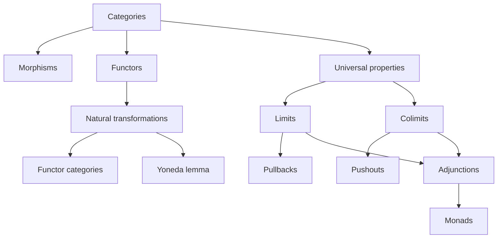
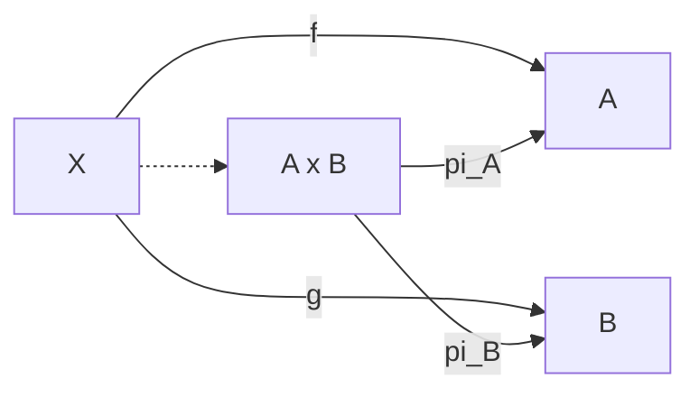
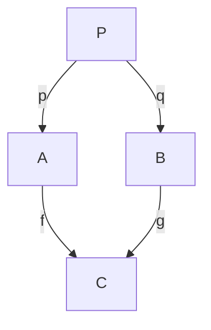
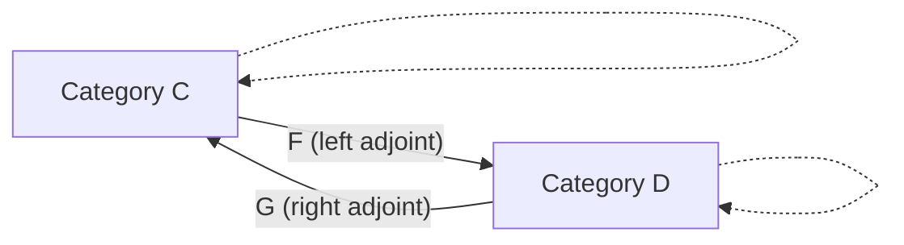

# Category Theory

> [Mathematics](../../README.md) › [Advanced Topics](../README.md) › Category Theory · Level: Advanced · Prerequisites: [Set Theory](../../00-foundations/03-set-theory/README.md), [Relations and Functions](../../00-foundations/05-relations-and-functions/README.md), [Proof Techniques](../../00-foundations/04-proof-techniques/README.md), [Groups](../../13-abstract-algebra/01-groups/README.md), [Rings](../../13-abstract-algebra/02-rings/README.md), [Vector Spaces](../../08-linear-algebra/04-vector-spaces/README.md), [Topological Spaces](../../17-topology/01-topological-spaces/README.md) · Estimated time: 12 h

## 1. Introduction

Category theory studies *structure-preserving maps and the way they compose*. It does not study one kind of object — sets, groups, spaces, types — but the
common grammar shared by all of them. A **category** records the objects, the allowed arrows between them, how arrows compose, and which arrow is the identity.
Constructions are then described by the way they relate to arrows, not by what their elements "look like".

This viewpoint has three payoffs. **Unification:** products of sets, direct products of groups, product topologies and Cartesian products of vector spaces are
one construction, defined by one universal property. **Transport of theorems:** a theorem proved from a universal property holds in every category with the
required structure, so one proof serves algebra, topology, logic and computer science. **Duality:** reversing every arrow turns products into coproducts,
initial objects into terminal objects, monomorphisms into epimorphisms, and limits into colimits; one proof yields two theorems.

The subject began in algebraic topology in the 1940s, when Eilenberg and Mac Lane needed a precise language for "natural" constructions. It now underpins
algebraic geometry, homological algebra, logic and type theory, and functional programming. This tutorial develops the core: categories, morphisms, universal
properties, functors, natural transformations, limits, adjunctions, the Yoneda lemma and monads. The guiding question is: **which facts depend only on
composition?**

## 2. Prerequisites

You should be comfortable with:

* **Sets, functions, subsets, Cartesian products, disjoint unions and power sets** — [Set Theory](../../00-foundations/03-set-theory/README.md). Categories are defined using classes and hom-sets.
* **Relations, equivalence relations and functions as sets of ordered pairs** — [Relations and Functions](../../00-foundations/05-relations-and-functions/README.md). Posets, used as categories, are special relations.
* **Quantifiers, implication, proof by contradiction and uniqueness proofs** — [Proof Techniques](../../00-foundations/04-proof-techniques/README.md) and [Logic](../../00-foundations/02-logic/README.md). Universal properties are quantified
  statements.
* **Groups, subgroups, homomorphisms and quotients** — [Groups](../../13-abstract-algebra/01-groups/README.md). $\mathbf{Grp}$ is a running example.
* **Rings, ideals and ring homomorphisms** — [Rings](../../13-abstract-algebra/02-rings/README.md). $\mathbf{Ring}$ supplies the epimorphism $\mathbb{Z}\to\mathbb{Q}$ that is not surjective.
* **Vector spaces, linear maps, bases, dual spaces and dimension** — [Vector Spaces](../../08-linear-algebra/04-vector-spaces/README.md) and [Linear Transformations](../../08-linear-algebra/05-linear-transformations/README.md).
* **Topological spaces, continuity, product and quotient topology** — [Topological Spaces](../../17-topology/01-topological-spaces/README.md).

No prior category theory is assumed. Homological algebra and algebraic topology are not prerequisites: the examples are defined far enough to make sense, and
standard facts are identified.

## 3. Learning Objectives

After this tutorial you will be able to:

1. Verify the axioms in $\mathbf{Set}$, $\mathbf{Grp}$, $\mathbf{Ring}$, $\mathbf{Top}$, $\mathbf{Vect}_k$, $\mathbf{Pos}$, $\mathbf{Mon}$, a
   poset and a one- object monoid category.
2. Distinguish monomorphisms, epimorphisms and isomorphisms, prove the standard implications, and explain why "monic" and "epic" generalise "injective" and
   "surjective" without coinciding with them in every category.
3. Reproduce the monoid epimorphism $\mathbb{N}_0\to\mathbb{Z}$ and the ring epimorphism $\mathbb{Z}\to\mathbb{Q}$, neither of which is surjective.
4. Define initial and terminal objects, products, coproducts, pullbacks, pushouts, equalizers and coequalizers by universal properties, and prove uniqueness up
   to unique isomorphism.
5. Verify functoriality, including the fundamental group and singular homology as functors.
6. Define natural transformations, verify naturality squares, and work in a functor category.
7. State and sketch the proof of the Yoneda lemma, derive the Yoneda embedding, and explain its reading as "an object is determined by its arrows".
8. Define adjunctions in hom-set and unit-counit form, verify the triangle identities in examples, and state which (co)limits adjoints preserve.
9. Define a monad, verify the monad laws for the list monad, and explain how adjunctions produce monads.
10. Dualise a definition or theorem, and explain how category theory transports theorems.

## 4. Intuition

Imagine a one-way road map. You care which routes compose, not what the cities contain. A category is such a map: objects are cities, morphisms are roads,
composition is "follow one road after another", and the identity is "stay put". Only composition matters.

A **universal property** is the best possible solution to a mapping problem. A product $A\times B$ is not merely a set of pairs; it is an object that maps
to $A$ and $B$ so that *every* pair of maps into $A$ and $B$ factors through it uniquely. Existence says
the object is big enough; uniqueness says it is exactly as big as necessary. This is why universal constructions are determined up to a *unique* isomorphism:
any two "best" solutions must agree.

A **functor** is a translation between road maps preserving roads and composition. A **natural transformation** compares two translations compatibly with all
roads. "Natural" means "no arbitrary choice": the determinant is natural because it commutes with every ring homomorphism; choosing a basis is not natural
because different bases give different coordinates. **Duality** is the observation that a road map can be traversed backwards; every definition and theorem has
a mirror image.

## 5. Formal Definition

### 5.1 Categories

**Definition 5.1.1 (Category).** A **category** $\mathcal{C}$ consists of:

1. a class $\operatorname{Ob}(\mathcal{C})$ of **objects**;
2. for each ordered pair $(A,B)$, a set $\mathcal{C}(A,B)$ or $\operatorname{Hom}_{\mathcal{C}}(A,B)$ of **morphisms** $A\to B$;
3. for each object $A$, an **identity** $\operatorname{id}_A\in\mathcal{C}(A,A)$;
4. for each triple $(A,B,C)$, a **composition** function $\mathcal{C}(B,C)\times\mathcal{C}(A,B)\to\mathcal{C}(A,C),\qquad (g,f)\mapsto g\circ f,$ where $f:A\to B$ and $g:B\to C$;

such that:

* **Associativity:** $h\circ(g\circ f)=(h\circ g)\circ f$ for composable $f,g,h$;
* **Identity:** $\operatorname{id}_B\circ f=f=f\circ\operatorname{id}_A$ for every $f:A\to B$.

We write $f:A\to B$. The **domain** of $f$ is $A$ and the **codomain** is $B$. Hom-sets for different pairs are
disjoint, so every morphism has a unique domain and codomain. The definition says nothing about elements of objects or about "structure-preserving" maps; those
are extra structure that some categories have.

**Definition 5.1.2 (Isomorphism).** A morphism $f:A\to B$ is an **isomorphism** if there is $g:B\to A$ with $g\circ f=\operatorname{id}_A$ and
$f\circ g=\operatorname{id}_B$. Such $g$ is unique: if $g'$ is another, then $g'=g'\circ\operatorname{id}_B=g'\circ(f\circ g)=(g'\circ f)\circ g=\operatorname{id}_A\circ g=g$. We write $A\cong B$ and $g=f^{-1}$.

**Definition 5.1.3 (Opposite category).** The **opposite category** $\mathcal{C}^{\mathrm{op}}$ has the same objects, hom-sets $\mathcal{C}^{\mathrm{op}}(A,B)=\mathcal{C}(B,A)$, the same identities, and
composition $g\circ_{\mathrm{op}}f=f\circ g$.

**Definition 5.1.4 (Subcategory).** A **subcategory** $\mathcal{D}$ of $\mathcal{C}$ has a subclass of objects and, for each pair, a subset of
morphisms, closed under identities and composition. It is **full** if it contains every morphism of $\mathcal{C}$ between its objects.

**Definition 5.1.5 (Size).** A category is **small** if its objects form a set; it is **locally small** if every hom-set is a set; it is **large** if it is not
small. A category that is not locally small is sometimes called *very large*. $\mathbf{Set}$, $\mathbf{Grp}$, $\mathbf{Ring}$, $\mathbf{Top}$ and
$\mathbf{Vect}_k$ are locally small but large; $\mathbf{Cat}$, the category of small categories, is locally small but not small.

**Definition 5.1.6 (Concrete category).** A category is **concrete** if it comes with a faithful functor to $\mathbf{Set}$ (faithful is defined in §7.5).
Most first examples are concrete, but $\mathbf{Rel}$, the homotopy category of spaces, and many diagram categories are not naturally concrete. Definitions in
category theory therefore never mention elements of objects.

### 5.2 The standard examples

| Category | Objects | Morphisms |
|---|---|---|
| $\mathbf{Set}$ | all sets | all functions |
| $\mathbf{Grp}$ | groups | group homomorphisms |
| $\mathbf{Ring}$ | rings with $1$ | unital ring homomorphisms |
| $\mathbf{Top}$ | topological spaces | continuous maps |
| $\mathbf{Vect}_k$ | vector spaces over a field $k$ | $k$-linear maps |
| $\mathbf{Pos}$ | partially ordered sets | monotone maps |
| $\mathbf{Mon}$ | monoids | monoid homomorphisms |
| $\mathbf{Rel}$ | sets | relations $A\to B$ |
| $\mathbf{Cat}$ | small categories | functors |

Composition is ordinary composition and identities are identity maps (or identity relations).

**Example 5.2.1 (A poset as a category).** Let $(P,\le)$ be a poset. Define a category with objects the elements of $P$, a unique morphism
$x\to y$ exactly when $x\le y$, and no morphism otherwise. The identity is the arrow $x\to x$ supplied by reflexivity; composition is
the arrow supplied by transitivity. Associativity is automatic because there is at most one arrow between two objects. A morphism $x\to y$ is an
isomorphism exactly when $x\le y$ and $y\le x$, hence exactly when $x=y$ by antisymmetry. Thus the only isomorphisms are
identities. A functor between poset categories is exactly a monotone map.

**Example 5.2.2 (A monoid as a one-object category).** Let $(M,\cdot,e)$ be a monoid. Define $\mathbf{B}M$ with one object $*$, morphisms
$*\to*$ the elements of $M$, identity $e$, and composition $m\circ n=m\cdot n$. The monoid laws are exactly the category
laws. Conversely, every one-object category is of this form: its endomorphism monoid is $\mathcal{C}(*,*)$. A monoid is a group exactly when every morphism of
$\mathbf{B}M$ is an isomorphism. A category in which every morphism is an isomorphism is a **groupoid**; thus groups are one-object groupoids. The
fundamental groupoid of a space, with points as objects and homotopy classes of paths as morphisms, is the standard many-object generalisation.

**Example 5.2.3 (Actions as functors).** A functor $\mathbf{B}G\to\mathbf{Set}$ for a group $G$ is a set with a left action of $G$: the functor
sends the unique object to a set $X$ and each $g$ to a bijection $X\to X$, preserving multiplication. A natural
transformation between two such functors is a $G$-equivariant map. This dictionary is used throughout representation theory.

**Example 5.2.4 (The empty category and $\mathbf{1}$).** The category $\mathbf{0}$ has no objects and no morphisms. The category $\mathbf{1}$ has
one object and only its identity. A functor $\mathbf{1}\to\mathcal{C}$ is an object of $\mathcal{C}$, and a functor $\mathbf{0}\to\mathcal{C}$ is empty data; these are the
shapes of the empty (co)limit.

### 5.3 Size issues and set-theoretic assumptions

This tutorial works in NBG, or in ZFC with a Grothendieck universe. A **set** is a small collection; a **class** may be proper. A category whose objects form a
proper class is allowed, but it is not an object of the category of small categories. The categories of sets, groups, spaces and so on are locally small: their
hom-collections are sets, but their object classes are proper.

The Yoneda lemma is stated for a locally small $\mathcal{C}$ and a functor $F:\mathcal{C}\to\mathbf{Set}$. Then $\operatorname{Nat}(\mathcal{C}(A,-),F)$ is a set: a natural transformation is
determined by $\alpha_A(\operatorname{id}_A)\in F(A)$, so the map in the lemma is injective into a set. For the functor category $[\mathcal{C},\mathcal{D}]$, if $\mathcal{C}$ is small and
$\mathcal{D}$ is locally small, then $[\mathcal{C},\mathcal{D}]$ is locally small; if $\mathcal{C}$ is large, it may not be. The phrase **small diagram** means a
diagram whose indexing category is small. A category is **complete** if it has all small limits and **cocomplete** if it has all small colimits. The standard
examples are complete and cocomplete; this is a theorem about them, not a general axiom.

Without a universe, "the set of all sets" and "the category of all categories" lead to paradoxes. Fixing a universe $\mathcal{U}$ and calling its members
"sets" removes these problems without changing the mathematics.

## 6. Mathematical Notation

| Symbol | Read aloud | Meaning |
|---|---|---|
| $\mathcal{C},\mathcal{D},\mathcal{J}$ | category C, D, J | categories; $\mathcal{J}$ is an indexing shape |
| $\operatorname{Ob}(\mathcal{C})$ | objects of C | the class of objects |
| $\mathcal{C}(A,B)$, $\operatorname{Hom}_{\mathcal{C}}(A,B)$ | hom-set from A to B | morphisms $A\to B$ |
| $f:A\to B$ | f from A to B | morphism with domain $A$, codomain $B$ |
| $\operatorname{id}_A$ | identity on A | identity morphism |
| $g\circ f$ | g after f | composition, first $f$ then $g$ |
| $f^{-1}$ | inverse of f | exists only for isomorphisms |
| $\mathcal{C}^{\mathrm{op}}$ | C opposite | all arrows reversed |
| $\mathbf{Set},\mathbf{Grp},\mathbf{Ring}$ | Set, Grp, Ring | categories of sets, groups, rings |
| $\mathbf{Top},\mathbf{Vect}_k,\mathbf{Pos},\mathbf{Mon}$ | Top, Vect k, Pos, Mon | spaces, vector spaces, posets, monoids |
| $\mathbf{1},\mathbf{0}$ | one, zero | one-object category; empty category |
| $A\times B$, $\prod_i A_i$ | A times B, product | categorical product |
| $A\sqcup B$, $\coprod_i A_i$ | A coproduct B | categorical coproduct |
| $!$ | the unique map | unique morphism into a terminal or out of an initial object |
| $\lim_{\leftarrow}D$, $\varprojlim D$ | limit of D | terminal cone over $D$ |
| $\operatorname{colim}_{\rightarrow}D$, $\varinjlim D$ | colimit of D | initial cocone under $D$ |
| $F:\mathcal{C}\to\mathcal{D}$ | functor F | covariant functor |
| $F:\mathcal{C}^{\mathrm{op}}\to\mathcal{D}$ | contravariant functor | functor reversing arrows |
| $F\dashv G$ | F left adjoint to G | adjunction, $G$ right adjoint to $F$ |
| $\eta:\operatorname{id}\Rightarrow GF$ | unit eta | unit of an adjunction |
| $\varepsilon:FG\Rightarrow\operatorname{id}$ | counit epsilon | counit of an adjunction |
| $[\mathcal{C},\mathcal{D}]$, $\mathcal{D}^{\mathcal{C}}$ | functor category | functors and natural transformations |
| $\operatorname{Nat}(F,G)$ | natural transformations | hom-set of the functor category |
| $\mathcal{C}(A,-)$ | covariant hom functor | $B\mapsto\mathcal{C}(A,B)$ |
| $\mathcal{C}(-,B)$ | contravariant hom functor | $A\mapsto\mathcal{C}(A,B)$ |
| $y$ | Yoneda embedding | $A\mapsto\mathcal{C}(-,A)$ |
| $T^2$ | T squared | $T\circ T$ |
| $\mu:T^2\Rightarrow T$ | multiplication mu | monad multiplication |
| $\int F$ | category of elements | objects $(A,x)$ with $x\in F(A)$ |

Composition is right to left: in $g\circ f$, $f$ is applied first. Functor application is written $F(f)$ or $Ff$.
The notation $f_*$ denotes the map induced by $f$ in algebraic topology, such as $\pi_1(f)$ or $H_n(f)$.

## 7. Core Concepts

### 7.1 Reading diagrams

A **diagram** is a graph of objects and morphisms. It **commutes** if every two paths with the same start and end have the same composite. The category axioms
ensure that inserting or deleting an identity, or regrouping a composite, does not change the composite. A square

$$
\begin{array}{ccc}
A & \xrightarrow{f} & B\\
{\scriptstyle p}\downarrow & & \downarrow{\scriptstyle q}\\
C & \xrightarrow{g} & D
\end{array}
$$

commutes exactly when $q\circ f=g\circ p$. Each path from $A$ to $D$ gives one side of the equation.

### 7.2 Monomorphisms, epimorphisms and isomorphisms

**Definition 7.2.1 (Monomorphism).** $f:A\to B$ is a **monomorphism** (monic) if for every $C$ and every $g,h:C\to A$,
$f\circ g=f\circ h\Longrightarrow g=h$. It is cancellable on the left: in $C\rightrightarrows A\xrightarrow{f}B$, the two composites with $f$ agree only when the two maps into
$A$ agree.

**Definition 7.2.2 (Epimorphism).** $f:A\to B$ is an **epimorphism** (epic) if for every $C$ and every $g,h:B\to C$, $g\circ f=h\circ f\Longrightarrow g=h$.
It is cancellable on the right: in $A\xrightarrow{f}B\rightrightarrows C$, the two composites with $f$ agree only when the two maps out of $B$ agree.

A morphism that is both monic and epic is a **bimorphism**. A category is **balanced** if every bimorphism is an isomorphism.

**Proposition 7.2.3.** Every isomorphism is monic and epic. If $f$ has a left inverse $r$ ($r\circ f=\operatorname{id}$), then
$f$ is monic; if $f$ has a right inverse $s$ ($f\circ s=\operatorname{id}$), then $f$ is epic; if $f$
is monic and has a right inverse, then $f$ is an isomorphism.

*Proof.* If $f$ is an isomorphism with inverse $g$ and $f\circ g=f\circ h$, then $g\circ f\circ g=g\circ f\circ h$, so $g=h$. The epic
statement is dual. If $r\circ f=\operatorname{id}$ and $f\circ g=f\circ h$, then $g=r\circ f\circ g=r\circ f\circ h=h$. If $f\circ s=\operatorname{id}$ and $g\circ f=h\circ f$, then $g=g\circ f\circ s=h\circ f\circ s=h$. If
$f$ is monic and $f\circ s=\operatorname{id}$, then $f\circ(s\circ f)=(f\circ s)\circ f=f=f\circ\operatorname{id}$, so $s\circ f=\operatorname{id}$ by monicity. $\square$

**Proposition 7.2.4 ($\mathbf{Set}$).** In $\mathbf{Set}$, a function is monic iff injective and epic iff surjective.

*Proof.* If $f(a)=f(b)$ with $a\ne b$, the two maps $1\to A$ with values $a$ and $b$ become equal after
$f$, so $f$ is not monic. If $f$ is injective and $f\circ g=f\circ h$, then $g=h$ pointwise. If
$b\notin f(A)$, define $g,h:B\to\{0,1\}$ by $g\equiv0$ and $h(y)=1$ for $y=b$, $h(y)=0$ otherwise; then
$g\circ f=h\circ f$ but $g\ne h$, so $f$ is not epic. If $f$ is surjective and $g\circ f=h\circ f$, then for every
$y$ choose $x$ with $f(x)=y$ and conclude $g(y)=g(f(x))=h(f(x))=h(y)$. $\square$

**Proposition 7.2.5 ($\mathbf{Mon}$: epic need not be surjective).** In $\mathbf{Mon}$, every monomorphism is injective and every injective homomorphism
is monic. The inclusion $i:\mathbb{N}_0\to\mathbb{Z}$ of the additive monoid of non-negative integers into the additive monoid of integers is epic but not surjective. Hence
$\mathbf{Mon}$ is not balanced.

*Proof.* If $f:M\to N$ and $f(a)=f(b)$ with $a\ne b$, the homomorphisms $g,h:\mathbb{N}_0\to M$ with $g(n)=a^n$ and $h(n)=b^n$
satisfy $f\circ g=f\circ h$ but $g\ne h$; so $f$ is not monic. Conversely, injective homomorphisms are obviously monic.

The inclusion is injective, hence monic, and not surjective because $-1\notin i(\mathbb{N}_0)$. To prove it epic, let $u,v:\mathbb{Z}\to M$ be monoid homomorphisms with
$u\circ i=v\circ i$. We write $\mathbb{Z}$ additively and $M$ multiplicatively. For $n\ge0$, $u(-n)\,u(n)=u((-n)+n)=u(0)=e_M,$ so $u(-n)$
is an inverse of $u(n)$ in $M$; similarly $v(-n)$ is an inverse of $v(n)=u(n)$. Inverses in a monoid are unique: if
$xa=e$ and $ay=e$, then $x=xe=x(ay)=(xa)y=ey=y$. Hence $u(-n)=v(-n)$. Every integer is non-negative or of the form $-n$,
so $u=v$. Therefore $i$ is epic. $\square$

The missing negative integers are forced by the inverse equations. In a group, the corresponding statement is still true but requires a different proof; we
state the standard theorem.

**Theorem 7.2.6 ($\mathbf{Grp}$).** In $\mathbf{Grp}$, a homomorphism is monic iff injective and epic iff surjective. Hence $\mathbf{Grp}$ is balanced.

*Proof sketch and reference.* The monic statement is as in $\mathbf{Set}$. For epic $\Rightarrow$ surjective, if $f:G\to H$ has image
$K\ne H$, the two inclusions $H\to H*_K H$ into the amalgamated free product (two copies of $H$ with the corresponding elements of $K$ identified) agree on $K$ but
are distinct by the normal-form theorem; this contradicts epicity. See Mac Lane, *Categories for the Working Mathematician*, §I.5, or Awodey, *Category Theory*, §2.7, for a full proof. The
abelian case is elementary and is Exercise 13. $\square$

**Proposition 7.2.7 ($\mathbf{Ring}$: another non-surjective epimorphism).** In $\mathbf{Ring}$ (rings with $1$, unital homomorphisms), the
inclusion $\mathbb{Z}\to\mathbb{Q}$ is monic and epic but not an isomorphism.

*Proof.* It is injective, hence monic. It is not surjective because $1/2\notin\mathbb{Z}$. Let $u,v:\mathbb{Q}\to R$ be unital ring homomorphisms agreeing on
$\mathbb{Z}$. For $n\ge1$, $u(1/n)u(n)=u(1)=1_R$, so $u(1/n)$ is an inverse of $u(n)$; similarly $v(1/n)$ is an inverse
of $v(n)=u(n)$. Inverses are unique, so $u(1/n)=v(1/n)$. Then for $m,n\in\mathbb{Z}$, $n\ne0$, $u(m/n)=u(m)u(1/n)=v(m)v(1/n)=v(m/n),$ so $u=v$. Thus
the inclusion is epic. $\square$

**Proposition 7.2.8 ($\mathbf{Top}$).** In $\mathbf{Top}$, a continuous map is monic iff injective and epic iff surjective. A continuous bijection need
not be a homeomorphism, so $\mathbf{Top}$ is not balanced.

*Proof.* The proofs are those for $\mathbf{Set}$, using the one-point space and the two-point indiscrete space (every function into an indiscrete space is
continuous). For the last claim, the identity map from $\mathbb{R}$ with the discrete topology to $\mathbb{R}$ with the usual topology is a continuous
bijection whose inverse is not continuous. $\square$

The table summarises the standard categories.

| Category | Monic | Epic | Balanced? |
|---|---|---|---|
| $\mathbf{Set}$ | injective | surjective | yes |
| $\mathbf{Grp}$, $\mathbf{Ab}$, $\mathbf{Vect}_k$ | injective | surjective | yes |
| $\mathbf{Mon}$ | injective | possibly non-surjective | no |
| $\mathbf{Ring}$ | injective | possibly non-surjective | no |
| $\mathbf{Top}$ | injective | surjective | no |
| a poset category | all arrows | all arrows | no (unless the poset is discrete) |

In a poset category with $x<y$, the unique arrow $x\to y$ is monic and epic but not an isomorphism: there is no arrow back. This is the
simplest bimorphism that is not an isomorphism.

### 7.3 Initial and terminal objects

**Definition 7.3.1.** An object $0$ is **initial** if for every $X$ there is exactly one morphism $0\to X$. An object
$1$ is **terminal** if for every $X$ there is exactly one morphism $X\to 1$. A **zero object** is both initial and
terminal.

The universal property of an initial object is a one-arrow diagram: for each $X$, the set $\mathcal{C}(0,X)$ has exactly one element. A terminal
object is the limit of the empty diagram: the empty cone has a unique apex map to $1$, and every empty cone factors through it uniquely.

**Proposition 7.3.2.** Any two initial objects are isomorphic by a unique isomorphism; any two terminal objects are isomorphic by a unique isomorphism.

*Proof.* If $0,0'$ are initial, there are unique $u:0\to0'$ and $v:0'\to0$. Then $v\circ u:0\to0$ and $\operatorname{id}_0$ are both
morphisms $0\to0$, so $v\circ u=\operatorname{id}_0$; similarly $u\circ v=\operatorname{id}_{0'}$. If $u'$ is any isomorphism $0\to0'$, it is a morphism
$0\to0'$, so $u'=u$. The terminal case is dual. $\square$

**Examples 7.3.3.** In $\mathbf{Set}$, $\varnothing$ is initial and any singleton is terminal; there is no zero object. In $\mathbf{Grp}$ and
$\mathbf{Vect}_k$, the trivial group and zero space are zero objects. In $\mathbf{Ring}$, allowing the zero ring, $\mathbb{Z}$ is initial and the zero ring is terminal; there is
no zero object. In $\mathbf{Top}$, $\varnothing$ is initial, a one-point space is terminal, and there is no zero object. In a poset category, an initial
object is a least element and a terminal object is a greatest element.

### 7.4 Products and coproducts

**Definition 7.4.1 (Product).** A product of a family $(A_i)_{i\in I}$ is an object $P$ with morphisms $\pi_i:P\to A_i$ such that for every
$X$ and every family $f_i:X\to A_i$ there is a unique $h:X\to P$ with $\pi_i\circ h=f_i\qquad\text{for all }i.$ Equivalently, the map $\mathcal{C}(X,P)\to\prod_i\mathcal{C}(X,A_i)$,
$h\mapsto(\pi_i\circ h)$, is a bijection for every $X$: a morphism into a product is exactly a tuple of morphisms into its factors.

**Definition 7.4.2 (Coproduct).** A coproduct of $(A_i)$ is an object $Q$ with morphisms $\iota_i:A_i\to Q$ such that for every
$X$ and every family $g_i:A_i\to X$ there is a unique $h:Q\to X$ with $h\circ\iota_i=g_i\qquad\text{for all }i.$ Equivalently, $\mathcal{C}(Q,X)\to\prod_i\mathcal{C}(A_i,X)$,
$h\mapsto(h\circ\iota_i)$, is a bijection.

The product of the empty family is a terminal object, and the coproduct of the empty family is an initial object. We write $\prod_i A_i$ and
$\coprod_i A_i$, or $A\times B$ and $A\sqcup B$.

**Proposition 7.4.3 (Uniqueness).** Any two products of the same family are isomorphic by a unique isomorphism compatible with the projections. The same holds
for coproducts and injections.

*Proof.* Let $(P,(\pi_i))$ and $(P',(\pi_i'))$ be products. The universal property of $P'$ gives a unique $h:P\to P'$ with
$\pi_i'\circ h=\pi_i$; that of $P$ gives a unique $k:P'\to P$ with $\pi_i\circ k=\pi_i'$. Then $\pi_i\circ(k\circ h)=\pi_i$ for all $i$, and the
identity also has this property, so $k\circ h=\operatorname{id}_P$; similarly $h\circ k=\operatorname{id}_{P'}$. If $h'$ is another compatible isomorphism, then
$h'$ and $h$ are two maps $P\to P'$ with the same composites with every $\pi_i'$, so $h'=h$. The
coproduct proof reverses all arrows. $\square$

**Examples 7.4.4.** In $\mathbf{Set}$, the product is the Cartesian product and the coproduct is the disjoint union. In $\mathbf{Grp}$, the product is the
direct product (coordinatewise) and the coproduct is the free product; for example $\mathbb{Z}/2*\mathbb{Z}/3$ is infinite while $\mathbb{Z}/2\times\mathbb{Z}/3\cong\mathbb{Z}/6$. In $\mathbf{Top}$,
the product carries the product topology and the coproduct is the disjoint union. In $\mathbf{Vect}_k$, finite products and finite coproducts both equal the
direct sum; for infinite families the product is the full direct product and the coproduct is the direct sum of tuples with finitely many nonzero entries. In
$\mathbf{Pos}$, the product has the coordinatewise order and the coproduct is the disjoint union with no cross-relations. In $\mathbf{Ring}$, the product
is coordinatewise; the commutative coproduct is the tensor product over $\mathbb{Z}$.

### 7.5 Functors

**Definition 7.5.1 (Covariant functor).** A **covariant functor** $F:\mathcal{C}\to\mathcal{D}$ assigns an object $F(A)$ to each object $A$ and a
morphism $F(f):F(A)\to F(B)$ to each $f:A\to B$, such that $F(\operatorname{id}_A)=\operatorname{id}_{F(A)}$ and $F(g\circ f)=F(g)\circ F(f)$.

**Definition 7.5.2 (Contravariant functor).** A **contravariant functor** assigns $F(f):F(B)\to F(A)$ to $f:A\to B$ and satisfies $F(g\circ f)=F(f)\circ F(g)$.
Equivalently, it is a covariant functor $\mathcal{C}^{\mathrm{op}}\to\mathcal{D}$.

**Definition 7.5.3 (Full, faithful, equivalence).** For each pair $A,B$, let $F_{A,B}:\mathcal{C}(A,B)\to\mathcal{D}(F(A),F(B))$. The functor $F$ is **faithful** if
every $F_{A,B}$ is injective, **full** if every $F_{A,B}$ is surjective, and **fully faithful** if every $F_{A,B}$ is bijective. It is
**essentially surjective** if every object of $\mathcal{D}$ is isomorphic to some $F(A)$. An **equivalence of categories** is a functor that is
fully faithful and essentially surjective; equivalently, it has an inverse up to natural isomorphism. A **concrete category** is a category equipped with a
faithful functor to $\mathbf{Set}$.

**Examples 7.5.4.** (1) The forgetful functors $\mathbf{Grp}\to\mathbf{Set}$, $\mathbf{Top}\to\mathbf{Set}$, $\mathbf{Vect}_k\to\mathbf{Set}$ and $\mathbf{Ring}\to\mathbf{Set}$ are faithful but not full. (2) The
free monoid functor $F:\mathbf{Set}\to\mathbf{Mon}$, $X\mapsto X^*$, the free group functor and the free vector-space functor are left adjoints to the corresponding
forgetful functors; they are faithful but not full. (3) The covariant power-set functor $\mathcal{P}:\mathbf{Set}\to\mathbf{Set}$ sends $A$ to its power set and
$f:A\to B$ to the direct image $S\mapsto f[S]$. The contravariant power-set functor sends $f$ to the preimage $T\mapsto f^{-1}[T]$; the
order reversal is exactly contravariance. (4) The dual-space functor $D:\mathbf{Vect}_k^{\mathrm{op}}\to\mathbf{Vect}_k$ sends $V$ to $V^*=\operatorname{Hom}_k(V,k)$ and $T:V\to W$ to
$T^*:W^*\to V^*$, $\varphi\mapsto\varphi\circ T$. The double dual is covariant.

(5) For an object $A$, the **hom functors** are $\mathcal{C}(A,-):\mathcal{C}\to\mathbf{Set}$, $B\mapsto\mathcal{C}(A,B)$, and $\mathcal{C}(-,B):\mathcal{C}^{\mathrm{op}}\to\mathbf{Set}$, $A\mapsto\mathcal{C}(A,B)$. (6) A functor
between poset categories is exactly a monotone map. (7) A monoid homomorphism is exactly a functor between the corresponding one-object categories.

**Example 7.5.5 (The fundamental group functor).** Let $\mathbf{Top}_*$ be the category of based spaces $(X,x_0)$ and based continuous maps. A **loop**
at $x_0$ is a continuous $\gamma:[0,1]\to X$ with $\gamma(0)=\gamma(1)=x_0$; two loops are homotopic rel basepoint if one can be deformed to the other through
loops at $x_0$. The fundamental group $\pi_1(X,x_0)$ is the group of homotopy classes of loops, with concatenation. A based map $f:(X,x_0)\to(Y,y_0)$
sends $[\gamma]$ to $[f\circ\gamma]$; this is well defined, is a group homomorphism, and satisfies $(g\circ f)_*=g_*\circ f_*$ and $(\operatorname{id})_*=\operatorname{id}$. Hence
$\pi_1:\mathbf{Top}_*\to\mathbf{Grp}$ is a functor. Homotopic based maps induce the same homomorphism, so $\pi_1$ descends to $\mathbf{hTop}_*$. The full construction
is standard algebraic topology; Example 9.6 checks functoriality and computes the degree map.

**Example 7.5.6 (Singular homology as a functor).** A singular $n$-simplex in $X$ is a continuous map $\sigma:\Delta^n\to X$, where
$\Delta^n$ is the standard $n$-simplex. The singular chains $C_n(X)$ form the free abelian group on singular
$n$-simplices; the boundary $\partial_n:C_n(X)\to C_{n-1}(X)$ satisfies $\partial^2=0$, so $H_n(X)=\ker\partial_n/\operatorname{im}\partial_{n+1}$ is defined. A continuous $f:X\to Y$ sends
$\sigma$ to $f\circ\sigma$, inducing $f_\#:C_n(X)\to C_n(Y)$ compatible with $\partial$, hence $H_n(f):H_n(X)\to H_n(Y)$. Functoriality follows from
$(g\circ f)\circ\sigma=g\circ(f\circ\sigma)$; homotopic maps induce the same map, so $H_n$ factors through $\mathbf{hTop}$. Thus $H_n:\mathbf{Top}\to\mathbf{Ab}$ is a functor, and
$H_*$ is a graded functor.

**Proposition 7.5.7.** Functors preserve isomorphisms: if $f:A\to B$ is an isomorphism, so is $F(f)$, with inverse $F(f^{-1})$. The
converse fails: the forgetful functor $\mathbf{Top}\to\mathbf{Set}$ sends a continuous bijection to a bijection even when it is not a homeomorphism.

### 7.6 Natural transformations and functor categories

**Definition 7.6.1.** Let $F,G:\mathcal{C}\to\mathcal{D}$ be functors. A **natural transformation** $\eta:F\Rightarrow G$ is a family $\eta_A:F(A)\to G(A)$ such that for every
$f:A\to B$ the square

$$
\begin{array}{ccc}
F(A) & \xrightarrow{\eta_A} & G(A)\\
{\scriptstyle F(f)}\downarrow & & \downarrow{\scriptstyle G(f)}\\
F(B) & \xrightarrow{\eta_B} & G(B)
\end{array}
$$

commutes: $G(f)\circ\eta_A=\eta_B\circ F(f)$. If every $\eta_A$ is an isomorphism, $\eta$ is a **natural isomorphism**. The components are the maps
$\eta_A$.

**Definition 7.6.2 (Functor category).** The functor category $[\mathcal{C},\mathcal{D}]$ has functors $\mathcal{C}\to\mathcal{D}$ as objects, natural transformations as morphisms,
componentwise identities and componentwise composition. Naturality of composites follows by pasting squares. If $\mathcal{C}$ is small and $\mathcal{D}$
is locally small, this category is locally small. If $\mathcal{D}$ is complete or cocomplete, so is $[\mathcal{C},\mathcal{D}]$, with (co)limits computed objectwise.
The category $[\mathcal{C}^{\mathrm{op}},\mathbf{Set}]$ is the category of **presheaves**.

**Examples 7.6.3.** (1) For commutative rings, $\mathrm{GL}_n(R)$ and the unit group $R^\times$ are functors $\mathbf{CRing}\to\mathbf{Grp}$, and the determinant is a
natural transformation $\det:\mathrm{GL}_n\Rightarrow(-)^\times$, because $\det(\varphi(A))=\varphi(\det A)$ for every ring homomorphism $\varphi$. This is the precise sense in which the
determinant is "natural". (2) For finite-dimensional vector spaces, evaluation $\operatorname{ev}_V:V\to V^{**}$, $v\mapsto(\varphi\mapsto\varphi(v))$, is a natural transformation
$\operatorname{id}\Rightarrow D^2$; it is an isomorphism in finite dimensions and only injective in general. (3) The length map $X^*\to\mathbb{N}_0$ is natural from the list
functor to the constant functor. (4) A natural transformation between $G$-sets is a $G$-equivariant map; the naturality square is
$f(g\cdot x)=g\cdot f(x)$.

**Remark 7.6.4.** "Natural" is not "obvious". A choice of basis is not natural because it cannot be made compatible with all linear maps; the double-dual
evaluation is natural because it is defined without a basis. Natural transformations can be composed vertically (compose components) and horizontally (whisker
with functors); the interchange law holds, making $\mathbf{Cat}$ a 2-category.

### 7.7 Diagrams, cones, limits and colimits

**Definition 7.7.1.** Let $\mathcal{J}$ be a small **indexing category**. A **diagram** of shape $\mathcal{J}$ in $\mathcal{C}$ is a functor
$D:\mathcal{J}\to\mathcal{C}$.

**Definition 7.7.2 (Limit).** A **cone** over $D$ is an object $X$ with morphisms $\pi_j:X\to D(j)$ such that $D(f)\circ\pi_j=\pi_k$ for
every $f:j\to k$ in $\mathcal{J}$. A **limit** is a cone $(L,(\pi_j))$ such that for every cone $(X,(x_j))$ there is a unique
$h:X\to L$ with $\pi_j\circ h=x_j$ for all $j$. In words: every cone factors uniquely through the limit cone; a limit is a terminal object
in the category of cones over $D$.

**Definition 7.7.3 (Colimit).** A **cocone** under $D$ is an object $X$ with morphisms $\iota_j:D(j)\to X$ such that $\iota_k\circ D(f)=\iota_j$
for every $f:j\to k$. A **colimit** is a cocone $(L,(\iota_j))$ such that every cocone $(X,(x_j))$ has a unique $h:L\to X$ with
$h\circ\iota_j=x_j$. A colimit is an initial object in the category of cocones.

Strictly, a limit is the whole cone, not just the object; the object is determined only up to unique isomorphism compatible with the cone.

**Examples 7.7.4.** The limit of the empty diagram is a terminal object; its colimit is an initial object. The limit of a discrete family is the product; its
colimit is the coproduct. The limit of a parallel pair $f,g:A\to B$ is the equalizer; the colimit is the coequalizer. The limit of a cospan
$A\to C\leftarrow B$ is the pullback; the colimit of a span $A\leftarrow C\to B$ is the pushout. A general limit is a cone over an arbitrary small shape; a general
colimit is a cocone.

**Definition 7.7.5 (Equalizer and coequalizer).** An **equalizer** of $f,g:A\to B$ is a morphism $e:E\to A$ with $f\circ e=g\circ e$ such that every
$h:X\to A$ with $f\circ h=g\circ h$ factors uniquely through $e$. A **coequalizer** is a morphism $q:B\to Q$ with $q\circ f=q\circ g$
such that every $h:B\to X$ with $h\circ f=h\circ g$ factors uniquely through $q$. In $\mathbf{Set}$, $E=\{a\in A:f(a)=g(a)\}$ with the
inclusion, and $Q$ is the quotient of $B$ by the equivalence relation generated by $f(a)\sim g(a)$.

**Definition 7.7.6 (Pullback and pushout).** A **pullback** of $A\xrightarrow{f}C\xleftarrow{g}B$ is an object $P$ with $p:P\to A$, $q:P\to B$ such
that $f\circ p=g\circ q$, and for every $X$ with $u:X\to A$, $v:X\to B$ and $f\circ u=g\circ v$ there is a unique $h:X\to P$ with
$p\circ h=u$ and $q\circ h=v$. The commuting square with vertices $P,A,B,C$ is the **pullback square**. In $\mathbf{Set}$,
$P=\{(a,b)\in A\times B:f(a)=g(b)\}$ with the coordinate projections; in $\mathbf{Top}$ it carries the subspace topology.

A **pushout** of $A\xleftarrow{f}C\xrightarrow{g}B$ is an object $Q$ with $i:A\to Q$, $j:B\to Q$ such that $i\circ f=j\circ g$, and for every
$X$ with $u:A\to X$, $v:B\to X$ and $u\circ f=v\circ g$ there is a unique $h:Q\to X$ with $h\circ i=u$ and
$h\circ j=v$. In $\mathbf{Set}$, $Q=(A\sqcup B)/\!\sim$ where $\sim$ is generated by $f(c)\sim g(c)$; in $\mathbf{Top}$ it carries the
quotient topology. In $\mathbf{Grp}$, the pushout is the amalgamated free product $A*_C B$.

**Theorem 7.7.7 (Limits in $\mathbf{Set}$).** Every small diagram $D:\mathcal{J}\to\mathbf{Set}$ has the limit $L=\Big\{(x_j)\in\prod_j D(j):D(f)(x_j)=x_k\text{ for every }f:j\to k\Big\},$ with coordinate projections, and the
colimit $\operatorname{colim}D=\Big(\coprod_j D(j)\Big)\Big/\!\sim,$ where $\sim$ is generated by $x_j\sim D(f)(x_j)$ for every $f:j\to k$. Consequently $\mathbf{Set}$ is complete and
cocomplete.

*Proof.* The compatibility condition is exactly the cone condition. A cone $(X,(x_j))$ gives the unique map $x\mapsto(x_j(x))$ into $L$. For
the colimit, the quotient identifies exactly the pairs a cocone must identify, and the universal property of the quotient gives the unique factorisation.
$\square$

A category is **complete** if every small diagram has a limit and **cocomplete** if every small diagram has a colimit. A functor **preserves limits** if it
sends every limit cone to a limit cone; it **reflects limits** if a cone is a limit whenever its image is. The dual notions for colimits reverse the arrows.

### 7.8 Adjunctions

**Definition 7.8.1 (Hom-set form).** An **adjunction** $F\dashv G$ between $F:\mathcal{C}\to\mathcal{D}$ and $G:\mathcal{D}\to\mathcal{C}$ is a bijection $\varphi_{A,B}:\mathcal{D}(F(A),B)\longrightarrow\mathcal{C}(A,G(B))$ for
all $A,B$, natural in $A$ and $B$. $F$ is the **left adjoint**, $G$ the **right adjoint**.

Naturality in $B$ says that for every $g:B\to B'$ the square

$$
\begin{array}{ccc}
\mathcal{D}(F(A),B) & \xrightarrow{\varphi_{A,B}} & \mathcal{C}(A,G(B))\\
{\scriptstyle g\circ -}\downarrow & & \downarrow{\scriptstyle G(g)\circ -}\\
\mathcal{D}(F(A),B') & \xrightarrow{\varphi_{A,B'}} & \mathcal{C}(A,G(B'))
\end{array}
$$

commutes; naturality in $A$ is the analogous statement for precomposition. In elements, the transpose of $k:F(A)\to B$ is $G(k)\circ\eta_A$,
and the transpose of $h:A\to G(B)$ is $\varepsilon_B\circ F(h)$.

**Definition 7.8.2 (Unit-counit form).** An adjunction consists of natural transformations $\eta:\operatorname{id}_{\mathcal{C}}\Rightarrow G F,\qquad \varepsilon:F G\Rightarrow\operatorname{id}_{\mathcal{D}},$ the **unit** and **counit**, satisfying the
**triangle identities** $(\varepsilon F)\circ(F\eta)=\operatorname{id}_F,\qquad (G\varepsilon)\circ(\eta G)=\operatorname{id}_G.$ In components: $\varepsilon_{F(A)}\circ F(\eta_A)=\operatorname{id}_{F(A)}$ and $G(\varepsilon_B)\circ\eta_{G(B)}=\operatorname{id}_{G(B)}$.

The first triangle is the commutative triangle with vertices $F(A)$, $FGF(A)$, $F(A)$: the unit maps $F(A)\to FGF(A)$ via
$F(\eta_A)$, the counit maps back via $\varepsilon_{F(A)}$, and the composite is the identity. The second triangle is the mirror image with
$G(B)$, $GFG(B)$, $G(B)$.

**Theorem 7.8.3 (The forms agree).** A hom-set adjunction determines a unit and counit satisfying the triangle identities, and conversely a unit-counit
adjunction determines natural bijections $\varphi_{A,B}$.

*Proof.* Given $\varphi$, set $\eta_A=\varphi_{A,F(A)}(\operatorname{id}_{F(A)})$ and $\varepsilon_B=\varphi^{-1}_{G(B),B}(\operatorname{id}_{G(B)})$. Naturality gives $\varphi_{A,B}(k)=G(k)\circ\eta_A$ and $\varphi^{-1}_{A,B}(h)=\varepsilon_B\circ F(h)$; the triangle identities
follow by substituting identities. Conversely, given $\eta,\varepsilon$, define $\varphi(k)=G(k)\circ\eta_A$ and $\psi(h)=\varepsilon_B\circ F(h)$. The triangle identities give
$\psi(\varphi(k))=k$ and $\varphi(\psi(h))=h$; naturality follows from functoriality. $\square$

**Examples 7.8.4.** (1) **Free-forgetful:** for $F:\mathbf{Set}\to\mathbf{Mon}$, $X\mapsto X^*$, and $U:\mathbf{Mon}\to\mathbf{Set}$, $\mathbf{Mon}(F(X),M)\cong\mathbf{Set}(X,U(M))$; a monoid homomorphism out of a
free monoid is determined by its values on generators. The unit is $\eta_X(x)=[x]$ and the counit is $\varepsilon_M([m_1,\dots,m_n])=m_1\cdots m_n$. The same pattern gives free groups,
free rings, free modules and free categories. (2) **Product-hom:** for a fixed set $B$, $F(A)=A\times B$ is left adjoint to $G(C)=C^B$:
$\mathbf{Set}(A\times B,C)\cong\mathbf{Set}(A,C^B)$. The bijection is currying $f\mapsto(a\mapsto(b\mapsto f(a,b)))$; the unit is $\eta_A(a)=(b\mapsto(a,b))$, and the counit is evaluation $\varepsilon_C(g,b)=g(b)$. (3)
**Discrete-forgetful:** the discrete-topology functor $\operatorname{Disc}:\mathbf{Set}\to\mathbf{Top}$ is left adjoint to the forgetful functor, because a continuous map from a discrete
space is just a function. (4) **Quantifiers as adjoints:** for $f:X\to Y$, the inverse image $f^{-1}:\mathcal{P}(Y)\to\mathcal{P}(X)$ has left adjoint $\exists_f(A)=\{y:\exists x\in A,\ f(x)=y\}$ and
right adjoint $\forall_f(A)=\{y:\forall x,\ f(x)=y\Rightarrow x\in A\}$. The adjunctions $\exists_f(A)\subseteq B\iff A\subseteq f^{-1}(B)$ and $f^{-1}(B)\subseteq A\iff B\subseteq\forall_f(A)$ are the set-theoretic meanings of "there exists" and "for all". (5)
**Galois connections:** monotone maps $L:P\to Q$, $R:Q\to P$ between posets form an adjunction $L\dashv R$ exactly when
$L(p)\le q\iff p\le R(q)$. The inclusion $\mathbb{Z}\hookrightarrow\mathbb{R}$ has left adjoint ceiling and right adjoint floor.

**Proposition 7.8.5 (Uniqueness of adjoints).** If $F\dashv G$ and $F'\dashv G$, then $F\cong F'$ naturally. Dually, left adjoints determine
right adjoints up to natural isomorphism.

*Proof.* For all $A,B$, $\mathcal{D}(F(A),B)\cong\mathcal{C}(A,G(B))\cong\mathcal{D}(F'(A),B)$ naturally in $B$. By the Yoneda lemma (or uniqueness of representing objects, Corollary
8.5.3), $F(A)\cong F'(A)$ naturally in $A$. $\square$

**Theorem 7.8.6 (Adjoints and (co)limits).** If $F\dashv G$, then $G$ preserves all limits that exist in its domain and $F$
preserves all colimits that exist in its domain. In particular, right adjoints preserve products, pullbacks and terminal objects; left adjoints preserve
coproducts, pushouts and initial objects.

The proof is in §8.7. The converse is false in general; the adjoint functor theorem gives sufficient conditions.

### 7.9 The Yoneda lemma

**Theorem 7.9.1 (Yoneda).** Let $\mathcal{C}$ be locally small, $F:\mathcal{C}\to\mathbf{Set}$ a functor, and $A\in\mathcal{C}$. Then $\operatorname{Nat}\big(\mathcal{C}(A,-),F\big)\longrightarrow F(A),\qquad \alpha\longmapsto\alpha_A(\operatorname{id}_A),$ is a bijection.
Its inverse sends $x\in F(A)$ to the natural transformation $\alpha^{(x)}_B:\mathcal{C}(A,B)\to F(B),\qquad f\longmapsto F(f)(x).$

*Proof sketch.* For $g:B\to C$ and $f:A\to B$, $F(g)(\alpha^{(x)}_B(f))=F(g)(F(f)(x))=F(g\circ f)(x)=\alpha^{(x)}_C(g\circ f),$ so $\alpha^{(x)}$ is natural. Also $\alpha^{(x)}_A(\operatorname{id}_A)=x$. Conversely, if
$\alpha:\mathcal{C}(A,-)\Rightarrow F$ is natural, naturality applied to $f:A\to B$ gives the commutative square

$$
\begin{array}{ccc}
\mathcal{C}(A,A) & \xrightarrow{\alpha_A} & F(A)\\
{\scriptstyle f\circ -}\downarrow & & \downarrow{\scriptstyle F(f)}\\
\mathcal{C}(A,B) & \xrightarrow{\alpha_B} & F(B).
\end{array}
$$

Chasing $\operatorname{id}_A$ gives $\alpha_B(f)=F(f)(\alpha_A(\operatorname{id}_A))$, so $\alpha$ is determined by $\alpha_A(\operatorname{id}_A)$. Hence the two constructions are inverse. Naturality
in $A$ and $F$ is a diagram chase; the full proof is in §8.5 and Exercise 26. $\square$

**Corollary 7.9.2 (Yoneda embedding).** The functor $y:\mathcal{C}\to[\mathcal{C}^{\mathrm{op}},\mathbf{Set}]$, $A\mapsto\mathcal{C}(-,A)$, is fully faithful. Indeed, the Yoneda lemma with $F=\mathcal{C}(-,B)$
gives $\operatorname{Nat}\big(\mathcal{C}(-,A),\mathcal{C}(-,B)\big)\cong\mathcal{C}(A,B).$

**Corollary 7.9.3 (Representing objects are unique).** If $\mathcal{C}(A,-)\cong\mathcal{C}(B,-)$, then $A\cong B$, and the isomorphism is unique. More generally, natural
isomorphisms $\mathcal{C}(A,-)\cong\mathcal{C}(B,-)$ correspond bijectively to isomorphisms $B\to A$.

**Remark 7.9.4 (Philosophical reading).** An object is determined by the morphisms into it: to know $A$ it suffices to know the functor
$B\mapsto\mathcal{C}(B,A)$, i.e., all ways other objects map to $A$ and how those ways pull back along maps between sources. This is a categorical version
of the idea that an object is characterised by its relationships rather than by an internal list of elements. It is also a categorical Cayley theorem: every
small category embeds fully faithfully into a category of presheaves, just as every group embeds into a permutation group. The slogan "all you need is Hom"
captures the practical consequence: universal properties and representability can be tested on hom functors.

**Remark 7.9.5 (One-object case).** For a monoid $M$, a functor $\mathbf{B}M\to\mathbf{Set}$ is a set with an $M$-action, and $\mathbf{B}M(*,-)$
is the regular action. Yoneda says natural transformations from the regular action to $F$ correspond to elements of $F(*)$: an element
$x$ gives the equivariant map $m\mapsto m\cdot x$, and every equivariant map is of this form.

### 7.10 Monads

**Definition 7.10.1 (Monad).** A **monad** on $\mathcal{C}$ is an endofunctor $T:\mathcal{C}\to\mathcal{C}$ with natural transformations $\eta:\operatorname{id}\Rightarrow T$ (unit) and
$\mu:T^2\Rightarrow T$ (multiplication) such that $\mu\circ T\mu=\mu\circ\mu T,\qquad \mu\circ T\eta=\operatorname{id}_T=\mu\circ\eta T.$ The first is associativity; the second says $\eta$ is a two-sided identity for
$\mu$. Here $T\mu$ and $\mu T$ are the whiskered transformations with components $T(\mu_A)$ and $\mu_{T(A)}$.

**Definition 7.10.2 (List monad).** Let $X^*$ be the set of finite lists in $X$, including the empty list $[]$. Define
$T(X)=X^*$, $T(f)([x_1,\dots,x_n])=[f(x_1),\dots,f(x_n)]$, $\eta_X(x)=[x]$, and let $\mu_X:(X^*)^*\to X^*$ be concatenation. Then $(T,\eta,\mu)$ is a monad: naturality follows
because mapping a function over a list commutes with concatenation; associativity of $\mu$ is associativity of concatenation; the unit laws say that
wrapping a list in a singleton and concatenating, or wrapping each element in a singleton and concatenating, returns the original list. This is the **free
monoid monad**, since $X^*$ is the underlying set of the free monoid on $X$.

**Theorem 7.10.3 (Monads from adjunctions).** Every adjunction $F\dashv G$ with $F:\mathcal{C}\to\mathcal{D}$, $G:\mathcal{D}\to\mathcal{C}$ gives a monad on $\mathcal{C}$
with $T=G\circ F,\qquad \eta:\operatorname{id}\Rightarrow G F,\qquad \mu=G\varepsilon F:G F G F\Rightarrow G F.$ The monad laws follow from the triangle identities and naturality; the verification is Exercise 30.

**Example 7.10.4.** The free-forgetful adjunction $F\dashv U$ for monoids has $T=U\circ F$, so $T(X)=X^*$; the unit is $\eta_X(x)=[x]$, and
$\mu=U\varepsilon F$ is concatenation. This recovers the list monad. Other standard monads are the maybe monad $T(X)=X\sqcup\{*\}$, the writer monad
$T(X)=X\times W$ for a monoid $W$, the state monad $T(X)=(X\times S)^S$, and the power-set monad $T(X)=\mathcal{P}(X)$ with singleton unit and union
multiplication.

**Definition 7.10.5 (Kleisli category).** For a monad $(T,\eta,\mu)$ on $\mathcal{C}$, the **Kleisli category** $\mathcal{C}_T$ has the same objects; a
morphism $A\to B$ is a morphism $A\to T(B)$ in $\mathcal{C}$. The identity is $\eta_A$, and the composite of $f:A\to T(B)$ and
$g:B\to T(C)$ is $g\circ_T f=\mu_C\circ T(g)\circ f:A\to T(C).$ The monad laws make this composition associative with the stated identities. For the list monad, a Kleisli morphism
$A\to B$ is a function $A\to B^*$, a nondeterministic function returning a finite list of outputs; composition concatenates the outputs. For
the power-set monad, Kleisli morphisms are relations, and the Kleisli category is $\mathbf{Rel}$ (Exercise 39).

**Remark 7.10.6 (Algebras).** A monad also has a category of **algebras**: objects are morphisms $a:T(X)\to X$ satisfying the unit and multiplication laws.
For the list monad, an algebra is a monoid: the map $X^*\to X$ assigns a product to every list, and the laws say the product is associative with unit.
This is the categorical explanation of why monoids are algebras for the free-monoid monad.

### 7.11 Why category theory is useful

**Transport of theorems.** A theorem proved from a universal property holds in every category with the required structure. For example, "right adjoints preserve
limits" proves at once that the forgetful functor $\mathbf{Grp}\to\mathbf{Set}$ preserves products and that global sections preserve finite limits in algebraic
geometry. The proof is written once, at the level of arrows, and then instantiated.

**Duality.** Applying a definition or theorem to $\mathcal{C}^{\mathrm{op}}$ reverses every arrow and yields a dual statement. Because the category axioms are self-dual,
the dual of a theorem is a theorem. Section 8.8 states the duality principle and lists the standard dual pairs.

**Unification and invariants.** Products, fibre products, pushouts, free constructions and quotients occur across algebra, topology, geometry and logic;
category theory isolates the pattern. Functors from geometry to algebra (homotopy groups, homology) turn geometric problems into algebraic ones, and natural
transformations express compatibility of induced maps.

## 8. Formulas and Properties

### 8.1 Cancellation and isomorphism

**Proposition 8.1.1.** In any category: (1) every isomorphism is monic and epic; (2) a morphism with a left inverse is monic, and one with a right inverse is
epic; (3) a monic morphism with a right inverse, or an epic morphism with a left inverse, is an isomorphism; (4) a composite of monics is monic, and a composite
of epics is epic; (5) if $g\circ f$ is monic then $f$ is monic, and if $g\circ f$ is epic then $g$ is epic.

*Proof.* Parts (1)–(3) are Proposition 7.2.3. For (4), suppose $f$ and $g$ are monic and $(g\circ f)\circ h=(g\circ f)\circ k$. Then
$g\circ(f\circ h)=g\circ(f\circ k)$; since $g$ is monic, $f\circ h=f\circ k$, and since $f$ is monic, $h=k$. The epic statement is dual. For (5), if $g\circ f$ is monic and
$f\circ h=f\circ k$, then $(g\circ f)\circ h=(g\circ f)\circ k$, so $h=k$; if $g\circ f$ is epic and $h\circ g=k\circ g$, then
$h\circ g\circ f=k\circ g\circ f$, so $h=k$. $\square$

### 8.2 Universal properties determine objects

**Theorem 8.2.1.** Let a universal property be described as a terminal (or initial) object in a category of candidate structures. Then any two solutions are
isomorphic, and the isomorphism is unique.

*Proof.* This is Proposition 7.3.2 applied to the category of candidates. Product, coproduct, pullback, pushout, equalizer, coequalizer, limit and colimit are
all terminal or initial objects in a suitable category of cones or cocones, so the theorem applies to each. $\square$

**Corollary 8.2.2.** Initial objects, terminal objects, products, coproducts, equalizers, coequalizers, pullbacks, pushouts, limits and colimits are unique up
to unique isomorphism compatible with the structural maps. Compatibility is essential: any two sets of the same cardinality are isomorphic, but not every
isomorphism is compatible with chosen projections.

### 8.3 Limits and colimits in $\mathbf{Set}$

**Theorem 8.3.1.** $\mathbf{Set}$ is complete and cocomplete. The limit of $D:\mathcal{J}\to\mathbf{Set}$ is the set of compatible tuples $\Big\{(x_j)\in\prod_j D(j):D(f)(x_j)=x_k\text{ for all }f:j\to k\Big\},$ and the
colimit is the quotient of $\coprod_j D(j)$ by the equivalence relation generated by $x_j\sim D(f)(x_j)$ for all $f:j\to k$.

*Proof.* This is Theorem 7.7.7. $\square$

**Corollary 8.3.2.** In $\mathbf{Set}$: the terminal object is a singleton and the initial object is $\varnothing$; the product is the Cartesian product
and the coproduct is the disjoint union; the equalizer of $f,g:A\to B$ is $\{a:f(a)=g(a)\}$ with the inclusion; the coequalizer is the quotient of
$B$ by $f(a)\sim g(a)$; the pullback of $A\to C\leftarrow B$ is $\{(a,b):f(a)=g(b)\}$; the pushout of $A\leftarrow C\to B$ is $(A\sqcup B)/\!\sim$ with
$f(c)\sim g(c)$.

### 8.4 Adjunction formulas

**Theorem 8.4.1.** For an adjunction $F\dashv G$, the following are equivalent: (1) a natural bijection $\varphi_{A,B}:\mathcal{D}(F(A),B)\cong\mathcal{C}(A,G(B))$; (2) natural transformations
$\eta:\operatorname{id}\Rightarrow G F$ and $\varepsilon:F G\Rightarrow\operatorname{id}$ satisfying the triangle identities. The passage is $\varphi_{A,B}(k)=G(k)\circ\eta_A,\qquad \varphi^{-1}_{A,B}(h)=\varepsilon_B\circ F(h),$ with $\eta_A=\varphi_{A,F(A)}(\operatorname{id}_{F(A)})$ and $\varepsilon_B=\varphi^{-1}_{G(B),B}(\operatorname{id}_{G(B)})$.

*Proof.* This is Theorem 7.8.3. $\square$

**Corollary 8.4.2.** The triangle identities are equivalent to $\varepsilon_{F(A)}\circ F(\eta_A)=\operatorname{id}_{F(A)}$ and $G(\varepsilon_B)\circ\eta_{G(B)}=\operatorname{id}_{G(B)}$ for all $A,B$.

### 8.5 The Yoneda lemma

**Theorem 8.5.1 (Yoneda, full statement).** Let $\mathcal{C}$ be locally small, $F:\mathcal{C}\to\mathbf{Set}$, and $A\in\mathcal{C}$. The map $\Phi_{A,F}:\operatorname{Nat}(\mathcal{C}(A,-),F)\to F(A),\qquad \Phi_{A,F}(\alpha)=\alpha_A(\operatorname{id}_A),$ is a
bijection with inverse $x\mapsto\alpha^{(x)}$, where $\alpha^{(x)}_B(f)=F(f)(x)$. The bijections are natural in $A$ and $F$: for $h:A'\to A$
the diagram

$$
\begin{array}{ccc}
\operatorname{Nat}(\mathcal{C}(A,-),F) & \xrightarrow{\Phi_{A,F}} & F(A)\\
{\scriptstyle -\circ\mathcal{C}(h,-)}\downarrow & & \downarrow{\scriptstyle F(h)}\\
\operatorname{Nat}(\mathcal{C}(A',-),F) & \xrightarrow{\Phi_{A',F}} & F(A')
\end{array}
$$

commutes, and for $\theta:F\Rightarrow G$ the diagram with $\theta\circ-$ and $\theta_A$ commutes.

*Proof.* The inverse property is Theorem 7.9.1. For naturality in $A$, the left-bottom composite sends $\alpha$ to $(\alpha\circ\mathcal{C}(h,-))_{A'}(\operatorname{id}_{A'})=\alpha_{A'}(h)$,
while the top-right composite sends it to $F(h)(\alpha_A(\operatorname{id}_A))=\alpha_{A'}(h)$ by naturality of $\alpha$. Naturality in $F$ is immediate: both sides send
$\alpha$ to $\theta_A(\alpha_A(\operatorname{id}_A))$. $\square$

**Corollary 8.5.2.** The Yoneda embedding $y:\mathcal{C}\to[\mathcal{C}^{\mathrm{op}},\mathbf{Set}]$ is fully faithful.

**Corollary 8.5.3.** If $\mathcal{C}(A,-)\cong\mathcal{C}(B,-)$ then $A\cong B$, and the isomorphism is unique.

### 8.6 Monad laws

**Proposition 8.6.1.** In a monad $(T,\eta,\mu)$: (1) $\mu\circ T\mu=\mu\circ\mu T$; (2) $\mu\circ T\eta=\operatorname{id}_T=\mu\circ\eta T$; (3) Kleisli composition is associative with identities
$\eta_A$.

*Proof.* (1)–(2) are the definition. For (3), let $f:A\to T(B)$, $g:B\to T(C)$, $h:C\to T(D)$. Using functoriality and naturality of
$\mu$, both $(h\circ_T g)\circ_T f$ and $h\circ_T(g\circ_T f)$ equal $\mu_D\circ T\mu_D\circ T^2(h)\circ T(g)\circ f,$ and the two agree by associativity of $\mu$. The identity
laws follow from $\mu\circ T\eta=\mu\circ\eta T=\operatorname{id}$. $\square$

### 8.7 Preservation of (co)limits by adjoints

**Theorem 8.7.1.** If $F:\mathcal{C}\to\mathcal{D}$ is left adjoint to $G:\mathcal{D}\to\mathcal{C}$, then $G$ preserves all limits that exist in $\mathcal{D}$ and
$F$ preserves all colimits that exist in $\mathcal{C}$.

*Proof.* Let $D:\mathcal{J}\to\mathcal{D}$ have limit cone $(L,(\pi_j))$. Let $(X,(x_j))$ be a cone over $G\circ D$ in $\mathcal{C}$. Transpose each
$x_j:X\to G(D(j))$ to $x_j^\#:F(X)\to D(j)$. For $f:j\to k$, $D(f)\circ x_j^\#=\varphi^{-1}\big(G(D(f))\circ x_j\big)=\varphi^{-1}(x_k)=x_k^\#,$ using naturality of $\varphi^{-1}$ and the cone condition. Thus
$(F(X),(x_j^\#))$ is a cone over $D$; the universal property of $L$ gives a unique $h:F(X)\to L$ with $\pi_j\circ h=x_j^\#$ for
all $j$. Let $k=\varphi(h):X\to G(L)$. Then for each $j$, $\varphi(G(\pi_j)\circ k)=\pi_j\circ h=x_j^\#,$ and $\varphi(x_j)=x_j^\#$, so $G(\pi_j)\circ k=x_j$. Hence
$k$ factors the cone through $(G(L),(G\pi_j))$. If $k'$ is another factorisation, then $\varphi(k')$ is a map
$F(X)\to L$ with $\pi_j\circ\varphi(k')=x_j^\#$ for all $j$, so $\varphi(k')=h$ and $k'=k$. Therefore $(G(L),(G\pi_j))$ is a limit
cone. The colimit statement is the dual argument. $\square$

**Corollary 8.7.2.** Right adjoints preserve terminal objects, products and pullbacks; left adjoints preserve initial objects, coproducts and pushouts.

**Warning 8.7.3.** The converse is false: preserving limits does not imply being a right adjoint in general. Also, right adjoints need not preserve colimits and
left adjoints need not preserve limits; the forgetful functor $\mathbf{Ring}\to\mathbf{Set}$ is a right adjoint but sends the epimorphism $\mathbb{Z}\to\mathbb{Q}$ to an injective
non-surjective function, which is not epic in $\mathbf{Set}$ (Exercise 37).

### 8.8 The duality principle

**Meta-theorem 8.8.1.** Let $\varphi$ be a statement in the language of categories, using only objects, morphisms, composition, identities and equality
of morphisms. If $\varphi$ is true in every category, then the dual statement $\varphi^{\mathrm{op}}$, obtained by reversing every arrow, is also true in
every category.

*Proof.* Apply $\varphi$ to $\mathcal{C}^{\mathrm{op}}$. A statement about $\mathcal{C}^{\mathrm{op}}$ is exactly the dual statement about $\mathcal{C}$, and
$\mathcal{C}^{\mathrm{op}}$ is a category whenever $\mathcal{C}$ is. $\square$

| Concept | Dual concept |
|---|---|
| initial object | terminal object |
| monomorphism | epimorphism |
| product | coproduct |
| pullback | pushout |
| equalizer | coequalizer |
| limit | colimit |
| left adjoint | right adjoint |
| monad | comonad |
| algebra for a monad | coalgebra for a comonad |

Duality does not apply to element-level statements such as "injective" or "surjective"; the dual of "monic" is "epic", and each may behave differently from its
set-theoretic counterpart. The dual of a true theorem is true; if a statement fails in a category $\mathcal{C}$, its dual fails in $\mathcal{C}^{\mathrm{op}}$.

## 9. Step-by-Step Examples

### 9.1 A monoid as a one-object category

**Example.** Describe $\mathbf{B}M$ for $M=(\mathbb{N}_0,+,0)$, decide whether it is a groupoid, and identify functors $\mathbf{B}M\to\mathbf{Set}$.

**Step 1.** There is one object $*$; morphisms $*\to*$ are the natural numbers; the identity is $0$; composition is
$m\circ n=m+n$.

**Step 2.** For $k,m,n\in\mathbb{N}_0$, $k\circ(m\circ n)=k+(m+n)=(k+m)+n=(k\circ m)\circ n$, and $0\circ n=n=n\circ 0$. So $\mathbf{B}M$ is a category.

**Step 3.** A morphism $n$ is an isomorphism iff there is $m$ with $m+n=0=n+m$. Since both are non-negative,
$m=n=0$. Thus only the identity is invertible, and $\mathbf{B}M$ is not a groupoid.

**Step 4.** A functor $F:\mathbf{B}M\to\mathbf{Set}$ is a set $X=F(*)$ with an endomorphism $s=F(1):X\to X$; functoriality forces $F(n)=s^n$. Such functors
are exactly sets with an action of the monoid $\mathbb{N}_0$, i.e., discrete dynamical systems. For $M=(\mathbb{Z},+,0)$, every morphism is invertible, so
$\mathbf{B}\mathbb{Z}$ is a groupoid and a functor to $\mathbf{Set}$ is a set with a bijection $s$.

### 9.2 Monomorphisms and epimorphisms in $\mathbf{Set}$ and $\mathbf{Mon}$

**Example.** Let $f:\{1,2,3\}\to\{a,b\}$ with $f(1)=a$, $f(2)=f(3)=b$. Decide monic and epic, with witnesses. Then analyse $i:\mathbb{N}_0\to\mathbb{Z}$ in
$\mathbf{Mon}$.

**Part 1.** $f$ is not injective ($f(2)=f(3)$), hence not monic. Explicitly, $g,h:\{*\}\to\{1,2,3\}$ with $g(*)=2$, $h(*)=3$
satisfy $f\circ g=f\circ h$ but $g\ne h$. It is surjective, hence epic; if $u\circ f=v\circ f$, then $u(a)=u(f(1))=v(f(1))=v(a)$ and $u(b)=u(f(2))=v(f(2))=v(b)$, so
$u=v$.

**Part 2.** The inclusion $i$ is injective, hence monic, and not surjective. To see it is epic, let $u,v:\mathbb{Z}\to M$ be monoid homomorphisms
agreeing on $\mathbb{N}_0$. Writing $\mathbb{Z}$ additively and $M$ multiplicatively, for $n\ge0$, $u(-n)u(n)=u((-n)+n)=u(0)=e_M,$ so
$u(-n)$ is an inverse of $u(n)$; similarly $v(-n)$ is an inverse of $v(n)=u(n)$. Inverses in a monoid are unique, so
$u(-n)=v(-n)$. Hence $u=v$ and $i$ is epic.

**Conclusion.** The inclusion is a bimorphism but not an isomorphism. This is the required monoid counterexample: epic does not imply surjective, and monic plus
epic does not imply isomorphism.

### 9.3 Products in $\mathbf{Set}$ and $\mathbf{Grp}$

**Example.** Compute the product of $A=\{1,2\}$ and $B=\{a,b,c\}$ in $\mathbf{Set}$, and of $\mathbb{Z}/2$ and $\mathbb{Z}/3$ in
$\mathbf{Grp}$.

**Part 1.** In $\mathbf{Set}$, $P=A\times B$ has six elements, with $\pi_A(x,y)=x$, $\pi_B(x,y)=y$. Given $f:X\to A$, $g:X\to B$,
define $h(x)=(f(x),g(x))$; then $\pi_A h=f$, $\pi_B h=g$. If $h'$ also satisfies these equations, then $h'(x)=(\pi_A h'(x),\pi_B h'(x))=(f(x),g(x))=h(x)$, so
$h'=h$.

**Part 2.** In $\mathbf{Grp}$, $G\times H$ has coordinatewise addition. It has order $6$; since $\gcd(2,3)=1$, the element
$(\bar1,\bar1)$ has order $6$, so $G\times H\cong\mathbb{Z}/6$. The projections are homomorphisms, and for any group $K$ with homomorphisms
$f:K\to G$, $g:K\to H$, the map $k\mapsto(f(k),g(k))$ is the unique homomorphism with the required projections.

**Contrast.** The coproduct in $\mathbf{Grp}$ is the free product $G*H$, which is infinite here, not $\mathbb{Z}/6$. Product has projections
out of it; coproduct has injections into it.

### 9.4 A pullback in $\mathbf{Set}$

**Example.** Let $A=\{1,2,3\}$, $B=\{u,v\}$, $C=\{0,1\}$, with $f:A\to C$ given by $f(1)=0$, $f(2)=1$,
$f(3)=0$, and $g:B\to C$ by $g(u)=1$, $g(v)=0$. Compute the pullback.

**Step 1.** $P=\{(a,b):f(a)=g(b)\}=\{(1,v),(2,u),(3,v)\}$.

**Step 2.** Let $p:P\to A$, $q:P\to B$ be the coordinate projections. For each element, $f(p(a,b))=f(a)=g(b)=g(q(a,b))$, so the square commutes.

**Step 3.** Given $u:X\to A$, $v:X\to B$ with $f\circ u=g\circ v$, define $h(x)=(u(x),v(x))$. The equation ensures $h(x)\in P$; then
$p\circ h=u$ and $q\circ h=v$. If $h'$ also satisfies these, then $h'(x)=(p(h'(x)),q(h'(x)))=(u(x),v(x))=h(x)$, so $h'=h$.

**Step 4.** For $c=0$, the fibre is $f^{-1}(0)\times g^{-1}(0)=\{1,3\}\times\{v\}$; for $c=1$, it is $\{2\}\times\{u\}$. Thus $P$ is the disjoint union
of the fibre products over $c\in C$.

### 9.5 A pushout in $\mathbf{Set}$ and $\mathbf{Top}$

**Example.** Let $A=\{0,1\}$, $B=[0,1]$, $C=\{*\}$, let $f:A\to B$ be the inclusion, and let $g:A\to C$ be constant. Compute
the pushout and explain its topological version.

**Step 1.** The pushout is $Q=(B\sqcup C)/\!\sim$ with $0\sim*$ and $1\sim*$, hence $0\sim1$. Thus $Q=[0,1]/\{0\sim1\}$, whose classes are
$\{0,1\}$ and $\{t\}$ for $0<t<1$.

**Step 2.** The quotient map $i:B\to Q$ and the map $j:C\to Q$ sending $*$ to $\{0,1\}$ satisfy $i\circ f=j\circ g$.

**Step 3.** Given $u:B\to X$, $v:C\to X$ with $u\circ f=v\circ g$, we have $u(0)=v(*)=u(1)$; define $h:Q\to X$ by $h(\{0,1\})=u(0)$ and
$h(\{t\})=u(t)$. This is well defined, $h\circ i=u$, $h\circ j=v$, and it is unique because every class is $i(t)$ for some
$t$.

**Step 4.** In $\mathbf{Top}$, give $Q$ the quotient topology. The map $q:[0,1]\to S^1$, $q(t)=e^{2\pi i t}$, identifies exactly
$0$ and $1$; the induced continuous bijection $Q\to S^1$ is a homeomorphism because $Q$ is compact (a quotient
of $[0,1]$) and $S^1$ is Hausdorff. Thus the pushout is the circle: gluing the endpoints of an interval.

### 9.6 The fundamental group and homology as functors

**Example.** Explain functoriality of $\pi_1$ and $H_n$, and compute the degree map.

**Part 1.** A based loop $\gamma$ at $x_0$ is a continuous $\gamma:[0,1]\to X$ with $\gamma(0)=\gamma(1)=x_0$; homotopy rel basepoint deforms through
such loops. $\pi_1(X,x_0)$ is the set of homotopy classes with concatenation. A based map $f:(X,x_0)\to(Y,y_0)$ sends $[\gamma]$ to $[f\circ\gamma]$. If
$H$ is a homotopy from $\gamma$ to $\gamma'$, then $f\circ H$ is a homotopy from $f\circ\gamma$ to
$f\circ\gamma'$, so $f_*$ is well defined. It is a homomorphism because $f\circ(\gamma*\delta)=(f\circ\gamma)*(f\circ\delta)$. Functoriality: $(g\circ f)_*([\gamma])=[(g\circ f)\circ\gamma]=[g\circ(f\circ\gamma)]=g_*(f_*([\gamma])),$ and
$(\operatorname{id}_X)_*=\operatorname{id}$. Hence $\pi_1:\mathbf{Top}_*\to\mathbf{Grp}$ is a functor; homotopic based maps induce the same map, so it descends to $\mathbf{hTop}_*$.

**Part 2.** Identify $S^1=\{z:|z|=1\}$ and let $p_n(z)=z^n$. Under $\pi_1(S^1,1)\cong\mathbb{Z}$ generated by $\gamma(t)=e^{2\pi i t}$, $(p_n)_*([\gamma])=[p_n\circ\gamma]=[\gamma]^n,$ so $p_n$
induces multiplication by $n$ on $\mathbb{Z}$. This is the first example of degree.

**Part 3.** A singular $n$-simplex is a continuous $\sigma:\Delta^n\to X$. The singular chains $C_n(X)$ are the free abelian group on such
simplices; the boundary $\partial$ satisfies $\partial^2=0$, and $H_n(X)=\ker\partial_n/\operatorname{im}\partial_{n+1}$. A continuous $f:X\to Y$ sends $\sigma$ to
$f\circ\sigma$, inducing $f_\#:C_n(X)\to C_n(Y)$ compatible with $\partial$, hence $H_n(f):H_n(X)\to H_n(Y)$. Functoriality is immediate from $(g\circ f)\circ\sigma=g\circ(f\circ\sigma)$;
homotopic maps induce the same map. Thus $H_n:\mathbf{Top}\to\mathbf{Ab}$ is a functor.

### 9.7 The free-forgetful adjunction for monoids

**Example.** Verify $F\dashv U$ for $F(X)=X^*$ and $U$ the forgetful functor, and identify unit, counit and triangles.

**Step 1.** Define $\Phi:\mathbf{Mon}(F(X),M)\to\mathbf{Set}(X,U(M))$ by $\Phi(\varphi)(x)=\varphi([x])$, and $\Psi(f)([x_1,\dots,x_n])=f(x_1)\cdots f(x_n)$, with $\Psi(f)([])=e_M$. $\Psi(f)$ is a homomorphism because
concatenation becomes multiplication: $\Psi(f)(uv)=\Psi(f)(u)\Psi(f)(v).$

**Step 2.** $\Phi(\Psi(f))(x)=\Psi(f)([x])=f(x)$, so $\Phi\circ\Psi=\operatorname{id}$. Conversely, $\Psi(\Phi(\varphi))([x_1,\dots,x_n]) =\varphi([x_1])\cdots\varphi([x_n]) =\varphi([x_1,\dots,x_n]),$ so $\Psi\circ\Phi=\operatorname{id}$.

**Step 3.** Naturality in $X$: for $g:X'\to X$, $\Phi(\varphi\circ F(g))(x')=\varphi([g(x')])=\Phi(\varphi)(g(x'))$. Naturality in $M$: for $h:M\to N$,
$\Phi(h\circ\varphi)(x)=h(\varphi([x]))=U(h)(\Phi(\varphi)(x))$. Hence $F\dashv U$.

**Step 4.** The unit is $\eta_X(x)=[x]$. The counit is $\varepsilon_M([m_1,\dots,m_n])=m_1\cdots m_n$. The triangle $U(\varepsilon_M)\circ\eta_{U(M)}=\operatorname{id}$ holds because $[m]\mapsto m$. The triangle
$\varepsilon_{F(X)}\circ F(\eta_X)=\operatorname{id}$ holds because $[x_1,\dots,x_n]\mapsto[[x_1],\dots,[x_n]]\mapsto[x_1,\dots,x_n]$.

### 9.8 The list monad

**Example.** Verify the list monad and compute a Kleisli composite.

**Step 1.** $T(X)=X^*$ and $T(f)([x_1,\dots,x_n])=[f(x_1),\dots,f(x_n)]$ is functorial. The unit $\eta_X(x)=[x]$ is natural: $T(f)(\eta_X(x))=[f(x)]=\eta_Y(f(x))$.

**Step 2.** $\mu_X$ concatenates a list of lists. It is natural because mapping $f$ over all entries commutes with concatenation.
Associativity: both $\mu\circ T\mu$ and $\mu\circ\mu T$ flatten a list of lists of lists completely, and concatenation is associative. Unit laws:
$\mu(T\eta([x_1,\dots,x_n]))=\mu([[x_1],\dots,[x_n]])=[x_1,\dots,x_n],$ and $\mu(\eta_{X^*}([x_1,\dots,x_n]))=\mu([[x_1,\dots,x_n]])=[x_1,\dots,x_n]$; both hold for $[]$ as well.

**Step 3.** Let $A=\{1,2\}$, $B=\{a,b\}$, $C=\{0,1\}$, with $f(1)=[a]$, $f(2)=[a,b]$, $g(a)=[0,1]$, $g(b)=[1]$. Then
$(g\circ_T f)(1)=\mu(T(g)([a]))=\mu([[0,1]])=[0,1],$ $(g\circ_T f)(2)=\mu(T(g)([a,b]))=\mu([[0,1],[1]])=[0,1,1].$ The Kleisli identity is $\eta_A$, and the unit laws give $g\circ_T\eta_B=g$ and $\eta_C\circ_T f=f$. This is
nondeterministic composition: lists record all possible outputs.

## 10. Visual Explanations

### 10.1 The shape of the subject

Categories supply morphisms; functors compare categories; natural transformations compare functors; universal properties give limits and colimits; adjunctions
tie them together; monads arise from adjunctions; the Yoneda lemma controls natural transformations out of hom functors. The arrows are dependencies, not
historical order.

### 10.2 Product, coproduct, pullback and pushout

The solid arrows are the given cone; the dashed arrow is the unique factorisation. Every $X$ with maps to $A$ and $B$
factors uniquely through $A\times B$. Reversing every arrow gives the coproduct diagram, with injections into the coproduct.

The square commutes: $f\circ p=g\circ q$. The pullback property says that every $X$ with $u:X\to A$, $v:X\to B$ and $f\circ u=g\circ v$
has a unique $h:X\to P$ with $p\circ h=u$, $q\circ h=v$. In $\mathbf{Set}$, $P=\{(a,b):f(a)=g(b)\}$. Reversing all arrows gives the pushout
square: glue $A$ and $B$ along $C$; in $\mathbf{Set}$ it is $(A\sqcup B)/\!\sim$ with $f(c)\sim g(c)$.

### 10.3 Adjunction and monad

The solid arrows are the functors; the dashed loops are unit and counit. The triangle identities say that going around each small triangle is the identity:
$\varepsilon F\circ F\eta=\operatorname{id}_F$ and $G\varepsilon\circ\eta G=\operatorname{id}_G$. Composing $T=G F$ with itself gives $T^2=G F G F$; the multiplication $\mu=G\varepsilon F$ collapses the
middle $F G$ pair. This is Theorem 7.10.3.

### 10.4 Table of universal properties

| Construction | Shape | Universal property | In $\mathbf{Set}$ | Dual |
|---|---|---|---|---|
| Initial object | empty | unique map out | $\varnothing$ | terminal |
| Terminal object | empty | unique map in | singleton | initial |
| Product | discrete family | unique map to all factors | Cartesian product | coproduct |
| Coproduct | discrete family | unique map from all summands | disjoint union | product |
| Equalizer | parallel pair | unique factor through $e$ | $\{a:f(a)=g(a)\}$ | coequalizer |
| Coequalizer | parallel pair | unique factor through $q$ | quotient by $f(a)\sim g(a)$ | equalizer |
| Pullback | cospan | unique map making the square commute | fibre product | pushout |
| Pushout | span | unique map out of the glued object | quotient of disjoint union | pullback |
| Limit | any small shape | terminal cone | compatible tuples | colimit |
| Colimit | any small shape | initial cocone | quotient of disjoint union | limit |

Each row is a definition; the theorem is that the object exists in the stated category and is unique up to unique isomorphism.

## 11. Common Mistakes

1. **Treating isomorphic objects as equal.** A product is unique only up to a unique isomorphism compatible with the projections. In an abstract category,
   $A\times B$ and $B\times A$ are canonically isomorphic, not equal. Never replace an isomorphism by an equality in a diagram chase.
2. **Assuming every category is concrete.** Morphisms need not be functions. In $\mathbf{Rel}$ a morphism is a relation; in the homotopy category it is a
   homotopy class; in a poset category it is a formal arrow. Element arguments must specify the concrete category.
3. **Assuming monic = injective and epic = surjective everywhere.** This holds in $\mathbf{Set}$, $\mathbf{Grp}$, $\mathbf{Ab}$ and $\mathbf{Vect}_k$,
   but fails in $\mathbf{Mon}$ (the inclusion $\mathbb{N}_0\to\mathbb{Z}$ is epic and not surjective) and in $\mathbf{Ring}$ (the inclusion $\mathbb{Z}\to\mathbb{Q}$ is epic
   and not surjective).
4. **Confusing "monic and epic" with "isomorphism".** A bimorphism need not be an isomorphism; the poset arrow $x\to y$ with $x<y$ and the
   monoid inclusion are standard counterexamples. A category where the converse holds is **balanced**.
5. **Forgetting the uniqueness clause.** "There exists a map" alone does not define a product, limit or adjunction. Without uniqueness the object is not
   determined up to isomorphism. Always verify existence and uniqueness.
6. **Reversing the arrows in a coproduct.** A product has projections *from* the product; a coproduct has injections *into* the coproduct. In $\mathbf{Set}$,
   the product is not the disjoint union.
7. **Confusing product and coproduct in $\mathbf{Grp}$.** The product is the direct product; the coproduct is the free product, usually infinite. The
   coproduct of two finite groups need not be finite.
8. **Composition order for contravariant functors.** For $f:A\to B$, $g:B\to C$, $F(g\circ f)=F(f)\circ F(g)$, not $F(g)\circ F(f)$.
9. **Naturality squares in the wrong direction.** A natural transformation $\eta:F\Rightarrow G$ has components $\eta_A:F(A)\to G(A)$ and satisfies $G(f)\circ\eta_A=\eta_B\circ F(f)$.
   Reversing the square gives a transformation in the opposite direction.
10. **Thinking "natural" means "obvious".** Naturality is a precise commutativity condition. A choice of basis is canonical-looking but not natural; the
    determinant is natural because it commutes with all ring homomorphisms.
11. **Confusing $[\mathcal{C},\mathcal{D}]$ with $\mathcal{C}\times\mathcal{D}$.** The functor category's objects are functors, not pairs of objects; its morphisms are natural
    transformations.
12. **Ignoring size issues.** $\mathbf{Set}$ is not small; its objects form a proper class. Yoneda is stated for locally small categories. "The category of
    all categories" without a universe leads to paradoxes.
13. **Assuming limits always exist.** A category may have some limits and not others. A poset category has limits exactly when the poset has the relevant meets.
    Completeness of $\mathbf{Set}$, $\mathbf{Grp}$ and $\mathbf{Top}$ is a theorem, not an axiom.
14. **Believing right adjoints preserve colimits.** Right adjoints preserve limits; left adjoints preserve colimits. The forgetful functor $\mathbf{Ring}\to\mathbf{Set}$ is
    a right adjoint but does not preserve the epimorphism $\mathbb{Z}\to\mathbb{Q}$.
15. **Confusing initial and terminal objects.** The initial object maps *out*; the terminal object receives a map *from* everything. In $\mathbf{Set}$,
    $\varnothing$ is initial and a singleton is terminal. A zero object is both, and not every category has one.
16. **Misreading monad multiplication.** $\mu:T^2\Rightarrow T$ is not composition of $T$ with itself; it flattens one layer. For the list monad,
    $\mu$ concatenates a list of lists.
17. **Assuming every epimorphism splits.** A split epimorphism has a section, but a general epimorphism need not. In $\mathbf{Set}$ choice makes every
    surjection split, but not in $\mathbf{Top}$ or $\mathbf{Grp}$ in general.
18. **Applying duality to element-level statements.** Duality reverses arrows, not elements. "Injective" and "surjective" are not dual in the language of
    categories; the dual of "monic" is "epic", and each may differ from its set-theoretic counterpart.
19. **Forgetting empty (co)products.** The empty product is the terminal object; the empty coproduct is the initial object. In $\mathbf{Set}$, the empty
    product is a singleton and the empty coproduct is $\varnothing$.
20. **Assuming equivalence is isomorphism.** An equivalence is fully faithful and essentially surjective; it need not be bijective on objects. A skeleton is
    equivalent to its category but usually not isomorphic to it.

## 12. Applications

### 12.1 Functional programming

In a typed functional language, types and functions form a category $\mathbf{Type}$: objects are types, morphisms are functions, composition is function
composition. Product types (tuples, records) are categorical products; sum types (`Either`, variants) are coproducts, and pattern matching is their universal
property. Function types `A -> B` are exponentials $B^A$, and currying is the product-hom adjunction. **Functors** are type constructors with a
`map` satisfying `map id = id` and `map (g . f) = map g . map f`; lists, maybe and reader are functors. **Natural transformations** are polymorphic functions
commuting with `map`; parametricity often guarantees naturality. **Monads** structure effects: the list monad models nondeterminism, the maybe monad failure,
the state monad mutable state, and the IO monad interaction; Kleisli composition is composition of effectful functions, and `return` is the unit. The monad laws
are exactly associativity and identity for this composition. Free monads and free monoids underlie interpreters and `foldMap`; the Yoneda lemma appears in
continuation- passing style and in the derivation of folds.

### 12.2 Algebraic topology

The fundamental group and homology are functors from spaces to groups or abelian groups. A continuous map induces homomorphisms compatible with composition, and
a homeomorphism induces isomorphisms because functors preserve isomorphisms. This is the standard method for proving spaces are not homeomorphic: compute an
invariant that differs. Homotopic maps induce the same homomorphism, so the functors factor through the homotopy category. The Seifert–van Kampen theorem
describes $\pi_1$ of a glued space as a pushout of groups; the long exact sequence of a pair is a sequence of natural transformations; the
Eilenberg–Steenrod axioms characterise homology functors. The fundamental groupoid, with points as objects and homotopy classes of paths as morphisms, is a
functor $\mathbf{Top}\to\mathbf{Groupoid}$, and covering-space theory is equivalently the study of actions of the fundamental groupoid. Chain complexes and derived functors live
in abelian categories, and homological algebra is the study of functors between them.

### 12.3 Logic

Categorical logic reads a logical theory as a category. In a poset of propositions, a proof of $P\Rightarrow Q$ is a morphism $P\to Q$; composition is
transitivity, and the identity is the tautology $P\Rightarrow P$. Conjunction is a product, disjunction a coproduct, truth a terminal object and falsity an
initial object. In a **Cartesian closed category**, the exponential $B^A$ models implication, and the bijection $\mathcal{C}(A\times B,C)\cong\mathcal{C}(A,C^B)$ is the
introduction/elimination rule for implication. A Cartesian closed category is a model of the simply typed lambda calculus under the Curry–Howard–Lambek
correspondence: types are objects, terms are morphisms, and $\beta$-reduction is a commutative-diagram equation. Quantifiers are adjoints: for
$f:X\to Y$, $f^{-1}$ has left adjoint $\exists_f$ and right adjoint $\forall_f$ (Example 7.8.4(4)), which explains why
$\exists$ preserves disjunction and $\forall$ preserves conjunction. A **topos** is a category with finite limits, exponentials and a
subobject classifier; it carries an internal higher-order logic. The category of sets is the prototypical topos, and sheaves on a space form another. Lawvere's
fixed-point theorem, a categorical form of Cantor's diagonal argument, yields Gödel-style incompleteness results in suitable topoi. The full theory is beyond
this tutorial.

### 12.4 Algebra, geometry and beyond

Groups, rings, modules and lattices are algebras for monads or algebraic theories; free algebras are left adjoints to forgetful functors. The category of
modules over a ring is abelian; $\operatorname{Hom}$ and tensor product are adjoint, and their derived functors $\operatorname{Ext}$ and $\operatorname{Tor}$ measure
failure of exactness. In algebraic geometry, a scheme can be defined as a functor of points, and Yoneda says a scheme is determined by that functor; fibre
products of schemes are categorical pullbacks. A representation of a group $G$ is a functor $\mathbf{B}G\to\mathbf{Vect}_k$, and a natural transformation is an
intertwining operator. A database schema can be modelled as a small category, an instance as a functor to $\mathbf{Set}$, and a migration as a natural
transformation; this is the basis of categorical databases and applied category theory.

## 13. Exercises

The problems are in [exercises.md](exercises.md): **40 problems**, numbered continuously and grouped by difficulty. **Beginner (1–12)** covers category axioms, initial and
terminal objects, poset categories, monos and epis in $\mathbf{Set}$, products and coproducts, powerset functors and the determinant. **Intermediate
(13–24)** covers abelian groups, the monoid bimorphism, equalizers and coequalizers, pullbacks, functor categories, the double dual, product-hom adjunction,
Yoneda for monoid actions, limits as cones, right adjoints and products, the power-set monad and duality. **Advanced (25–34)** covers balanced categories, the
full Yoneda lemma, preservation of limits, the Yoneda embedding, the free group adjunction, monads from adjunctions, the pullback pasting lemma, finite limits
from products and equalizers, $\mathbb{Z}\to\mathbb{Q}$, and uniqueness of adjoints. **Challenge (35–40)** covers the categorical Cayley theorem, representability and
the category of elements, preservation of monos by right adjoints, the list monad from free monoids, the Kleisli category of the power-set monad, and limits
preserved by the Yoneda embedding.

Attempt every problem in writing before consulting the solutions. Problems marked *(proof)* require a complete argument with all hypotheses stated.

## 14. Solutions

Full worked solutions to all 40 problems are in [solutions.md](solutions.md). Each solution states the strategy, carries out every step, and flags the pitfalls the problem
is designed to test. Do not read a solution until you have made a serious attempt: the value is in the attempt, not the answer.

## 15. Summary

* A **category** consists of objects, hom-sets, identities and associative composition. Standard examples are $\mathbf{Set}$, $\mathbf{Grp}$,
  $\mathbf{Ring}$, $\mathbf{Top}$, $\mathbf{Vect}_k$, $\mathbf{Pos}$ and $\mathbf{Mon}$; a poset is a category with at most one arrow between any two
  objects, and a monoid is a one-object category.
* A **monomorphism** is left-cancellable, an **epimorphism** is right-cancellable, and an **isomorphism** has a two-sided inverse. Every isomorphism is monic
  and epic, but the converse fails in $\mathbf{Mon}$ (the inclusion $\mathbb{N}_0\to\mathbb{Z}$), in $\mathbf{Ring}$ (the inclusion $\mathbb{Z}\to\mathbb{Q}$) and in
  $\mathbf{Top}$ (continuous bijections need not be homeomorphisms).
* **Initial** and **terminal** objects are defined by unique maps out of and into them; they are unique up to unique isomorphism. A **zero object** is both.
* **Products** and **coproducts** are defined by universal properties. In $\mathbf{Set}$ they are the Cartesian product and disjoint union; in
  $\mathbf{Grp}$ they are the direct product and free product.
* **Functors** preserve identities and composition. They may be covariant or contravariant; the fundamental group and homology are functors from topology to
  algebra.
* **Natural transformations** satisfy naturality squares and are the morphisms of the functor category $[\mathcal{C},\mathcal{D}]$.
* **Limits** and **colimits** are terminal cones and initial cocones. Products, equalizers, pullbacks and terminal objects are limits; coproducts, coequalizers,
  pushouts and initial objects are colimits. $\mathbf{Set}$ is complete and cocomplete.
* An **adjunction** $F\dashv G$ is a natural bijection $\mathcal{D}(F(A),B)\cong\mathcal{C}(A,G(B))$, equivalently a unit and counit satisfying the triangle identities.
  Free-forgetful and product-hom are the standard examples. Right adjoints preserve limits; left adjoints preserve colimits.
* The **Yoneda lemma** says natural transformations $\mathcal{C}(A,-)\Rightarrow F$ correspond to elements of $F(A)$. The Yoneda embedding is fully faithful, and
  an object is determined by its hom functor: an object is the sum of its relationships.
* A **monad** is an endofunctor with unit and multiplication satisfying the monad laws. The list monad has $T(X)=X^*$, singleton unit and concatenation
  multiplication. Every adjunction produces a monad, and the Kleisli category encodes effectful composition.
* **Duality** reverses all arrows: initial $\leftrightarrow$ terminal, mono $\leftrightarrow$ epi, product $\leftrightarrow$ coproduct, limit $\leftrightarrow$
  colimit, left adjoint $\leftrightarrow$ right adjoint.
* Category theory **transports theorems**, **unifies constructions**, **organises invariants**, and **clarifies computation and logic**.

## 16. Further Learning

Within this repository, the natural next steps are [Groups](../../13-abstract-algebra/01-groups/README.md) and [Rings](../../13-abstract-algebra/02-rings/README.md) for algebraic examples, [Vector Spaces](../../08-linear-algebra/04-vector-spaces/README.md) and [Linear Transformations](../../08-linear-algebra/05-linear-transformations/README.md) for
dual spaces, [Topological Spaces](../../17-topology/01-topological-spaces/README.md) for the topology examples, [Set Theory](../../00-foundations/03-set-theory/README.md) and [Logic](../../00-foundations/02-logic/README.md) for size issues and the logical reading of adjunctions, and
[Advanced Topics](../README.md) for the planned algebraic topology, homological algebra and algebraic geometry topics.

The standard references, in increasing order of difficulty, are:

* Tom Leinster, *Basic Category Theory*, Cambridge Studies in Advanced Mathematics 143.
* Steve Awodey, *Category Theory*, Oxford Logic Guides 52, second edition.
* Emily Riehl, *Category Theory in Context*, Dover.
* Saunders Mac Lane, *Categories for the Working Mathematician*, Graduate Texts in Mathematics 5, second edition.
* Francis Borceux, *Handbook of Categorical Algebra*, volumes 1–3.
* Saunders Mac Lane and Ieke Moerdijk, *Sheaves in Geometry and Logic*.
* Charles Weibel, *An Introduction to Homological Algebra*, Cambridge Studies in Advanced Mathematics 38.

A good route is to reread §7.7–§7.10 with the exercises, then study limits and adjunctions in Riehl or Leinster, then move to the planned algebraic topology and
homological algebra topics. Category theory rewards revisiting: the same definitions look different once you have seen them used in three or four subjects.
