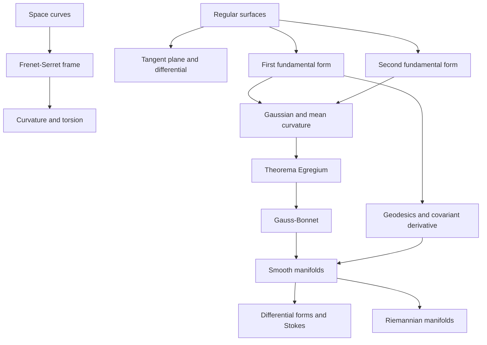

# Differential Geometry

> [Mathematics](../../README.md) › [Advanced Topics](../README.md) › Differential Geometry · Level: Advanced · Prerequisites: [Multivariable Calculus](../../07-calculus/12-multivariable-calculus/README.md), [Vector Calculus](../../07-calculus/13-vector-calculus/README.md), [Vector Spaces](../../08-linear-algebra/04-vector-spaces/README.md), [Linear Transformations](../../08-linear-algebra/05-linear-transformations/README.md), [Inner Product Spaces](../../08-linear-algebra/08-inner-product-spaces/README.md), [Differentiation](../../14-real-analysis/04-differentiation/README.md), [Metric Spaces](../../14-real-analysis/06-metric-spaces/README.md), [Topological Spaces](../../17-topology/01-topological-spaces/README.md) · Estimated time: 14 h
## 1. Introduction
Differential geometry studies smooth shapes with calculus. Locally it asks how a curve or surface bends in an arbitrarily small neighbourhood; globally it asks which local measurements are possible
and what they force the whole shape to be.

For a curve in space the local data are two numbers. **Curvature** measures how fast the direction of travel turns; **torsion** measures how fast the curve twists out of its instantaneous plane. Both come
from a moving orthonormal frame, the **Frenet–Serret frame**, whose motion is a linear ODE system. Curvature and torsion as functions of arc length determine a space curve up to rigid motion.

For a surface the local data are two quadratic forms. The **first fundamental form** measures lengths, angles and areas *on* the surface; the **second fundamental form** measures how the surface bends *in*
space. Their eigenvalues are the principal curvatures, from which come the **Gaussian curvature** $K$ and **mean curvature** $H$. Gauss's **Theorema Egregium** (1827) says that $K$, although defined via
the ambient space, is determined by the first fundamental form alone. This is the birth of *intrinsic* geometry: an ant on the surface can measure $K$ without leaving it.

The intrinsic viewpoint leads to geodesics, covariant differentiation and parallel transport, and to Riemann's generalisation: an $n$-manifold with a metric whose curvature is a tensor. In that language
the classical integral theorems become one statement, the **generalised Stokes theorem**, and the **Gauss–Bonnet theorem** links local curvature to global topology. The ideas are used in cartography,
general relativity, computer graphics, robotics and the mechanics of shells and membranes.
## 2. Prerequisites
* **Partial derivatives, chain rule, Jacobians, inverse and implicit function theorems, multiple
  integrals** — [Multivariable Calculus](../../07-calculus/12-multivariable-calculus/README.md). Charts are maps of two variables; regularity is a Jacobian condition.
* **Gradient, divergence, curl, line and surface integrals, Green, divergence and Stokes theorems** —
  [Vector Calculus](../../07-calculus/13-vector-calculus/README.md). These are cases of generalised Stokes.
* **Vector spaces, bases, linear maps, matrices, determinants and eigenvalues** — [Vector Spaces](../../08-linear-algebra/04-vector-spaces/README.md),
  [Linear Transformations](../../08-linear-algebra/05-linear-transformations/README.md), [Determinants](../../08-linear-algebra/06-determinants/README.md).
* **Inner products, norms and orthogonality** — [Inner Product Spaces](../../08-linear-algebra/08-inner-product-spaces/README.md). The fundamental forms are symmetric bilinear forms.
* **Limits, continuity, differentiability and $C^k$ functions** — [Differentiation](../../14-real-analysis/04-differentiation/README.md).
* **Metric spaces, compactness and connectedness** — [Metric Spaces](../../14-real-analysis/06-metric-spaces/README.md), [Topological Spaces](../../17-topology/01-topological-spaces/README.md).
* **Existence and uniqueness for ODE systems** — [Systems of ODEs](../../16-differential-equations/03-systems-of-odes/README.md). The Frenet and parallel-transport equations are linear ODE systems.
* **Euclidean geometry, circles, spheres and the cross product** — [Euclidean Geometry](../../04-geometry/01-euclidean-geometry/README.md), [Solid Geometry](../../04-geometry/05-solid-geometry/README.md).

No differential geometry, forms or manifold theory is assumed. The inverse and implicit function theorems and the ODE existence theorem are quoted; everything else is defined and derived.
## 3. Learning Objectives
After this tutorial you will be able to:

1. Decide whether a curve is regular, compute its arc length, and reparametrise by arc length.
2. Derive the Frenet–Serret equations and explain the geometric meaning of each term.
3. Compute curvature and torsion from any regular parametrisation, including the helix.
4. Verify that a set is a regular surface, produce charts and atlases, and check transition maps.
5. Compute tangent planes and differentials of maps between surfaces.
6. Compute $E,F,G$ and use them for lengths, angles and areas.
7. Compute $\ell,m,n$, the shape operator, principal curvatures, $K$ and $H$ for spheres, cylinders, graphs and tori.
8. Define geodesics variationally, derive the geodesic equations, and solve them in examples.
9. State and use the Theorema Egregium and explain why a sphere cannot be flattened without distortion.
10. State Gauss–Bonnet, interpret its terms, and apply it to spherical triangles, caps and tori.
11. Define covariant derivatives and parallel transport and compute a holonomy angle.
12. Define manifolds, tangent spaces, vector fields, differential forms and the exterior derivative,
    and recognise the classical integral theorems as cases of $\int_M d\omega=\int_{\partial M}\omega$.
13. Explain how a Riemannian metric yields geodesics and curvature tensors, and where this is used.
## 4. Intuition
**Steering and rolling.** Driving along a road, the steering wheel controls how fast the direction turns: curvature. On a circle of radius $R$ one full turn occurs in distance $2\pi R$, so the turning
rate per unit distance is $1/R$; a straight road has curvature $0$. A roller-coaster track also *rolls* about the direction of travel; that roll is torsion. A helix turns and rolls at constant rates, a
circle turns but does not roll, a line does neither.

**The ant and the mapmaker.** An ant on a surface can measure distances, angles and areas without looking up. These are *intrinsic* data, encoded by the first fundamental form. An outside observer
also sees how the surface bends in space; these are *extrinsic* data, encoded by the second fundamental form. A plane and a cylinder are indistinguishable to the ant — unroll the cylinder and nothing
stretches — but a sphere is not: no bending without stretching makes it flat. Gauss's theorem makes this precise: $K$ is intrinsic. The cylinder has $K=0$ and is flat; the sphere has $K=1/R^2$ and is not.

**Triangles and total curvature.** On a flat sheet the angles of a triangle sum to $\pi$. On the unit sphere they sum to more than $\pi$, the excess being the area of the triangle; on a saddle they sum to
less. Curvature is the local density of angle defect. Integrating it over a closed surface gives a number unchanged by deformation, only by topology: Gauss–Bonnet. Local bending can be redistributed,
but its total is fixed by the number of holes.

**Beyond surfaces.** Riemann's idea was to take the ant seriously: an $n$-manifold looks locally like $\mathbb{R}^n$, and a metric measures lengths and angles in it. Curvature becomes a tensor measuring
the failure of parallel transport to commute. Differential forms and Stokes' theorem are the coordinate-free language in which this is stated most cleanly.
## 5. Formal Definitions
### 5.1 Curves
**Definition 5.1.1.** A **parametrised curve** is a $C^\infty$ map $\gamma:I\to\mathbb{R}^3$ on an interval $I$. Its velocity is $\gamma'(t)$ and its speed is $|\gamma'(t)|$. It is **regular** if
$\gamma'(t)\ne\mathbf{0}$ for all $t$, and **unit-speed** if $|\gamma'(t)|=1$ for all $t$. A **reparametrisation** is $\gamma\circ\varphi$ with $\varphi:J\to I$ a $C^\infty$ diffeomorphism; it is
orientation-preserving if $\varphi'>0$.

**Definition 5.1.2.** The **arc length** of a $C^1$ curve $\gamma:[a,b]\to\mathbb{R}^3$ is

$$
L(\gamma)=\int_a^b|\gamma'(t)|\,dt.
$$

**Theorem 5.1.3.** Arc length is independent of the parametrisation.

*Proof.* If $\varphi:[\alpha,\beta]\to[a,b]$ is a $C^1$ diffeomorphism, then $(\gamma\circ\varphi)'(s)=\gamma'(\varphi(s))\varphi'(s)$, so

$$
L(\gamma\circ\varphi)=\int_\alpha^\beta|\gamma'(\varphi(s))|\,|\varphi'(s)|\,ds
=\int_a^b|\gamma'(t)|\,dt=L(\gamma).\qquad\square
$$

**Definition 5.1.4.** For a regular curve and a base point $t_0$, the **arc-length function** is $s(t)=\int_{t_0}^t|\gamma'(u)|\,du$. Since $s'(t)=|\gamma'(t)|>0$, $s$ is invertible and
$\tilde\gamma(s)=\gamma(t(s))$ satisfies $|\tilde\gamma'(s)|=1$.
### 5.2 Regular Surfaces, Charts and Atlases
**Definition 5.2.1.** A set $S\subseteq\mathbb{R}^3$ is a **regular surface** if for every $p\in S$ there are an open $U\subseteq\mathbb{R}^2$, an open neighbourhood $V$ of $p$ in $\mathbb{R}^3$ and a
map $X:U\to\mathbb{R}^3$ such that $X(U)=V\cap S$, $X$ is a homeomorphism onto $V\cap S$ in the subspace topology, $X$ is $C^\infty$, and $dX_q$ is injective for every $q\in U$. The last condition is
equivalent to $X_u(q)\times X_v(q)\ne\mathbf{0}$, where $X_u=\partial X/\partial u$ and $X_v=\partial X/\partial v$.

**Definition 5.2.2.** A **chart** is a pair $(U,X)$ as above. An **atlas** is a family of charts covering $S$. Two charts are **compatible** if the transition map $X_\beta^{-1}\circ X_\alpha$ is
$C^\infty$ with invertible Jacobian on the overlap. A maximal compatible atlas is a **smooth structure**.

**Example 5.2.3.** If $f:U\subseteq\mathbb{R}^2\to\mathbb{R}$ is $C^\infty$, then $X(u,v)=(u,v,f(u,v))$ is a regular chart, because $X_u=(1,0,f_u)$ and $X_v=(0,1,f_v)$ are independent.

**Example 5.2.4 (Sphere).** For $S^2_R=\{p:|p|=R\}$, stereographic projection from the north pole is

$$
\sigma_N(x,y,z)=\left(\frac{Rx}{R-z},\frac{Ry}{R-z}\right),\qquad
\sigma_N^{-1}(u,v)=\left(\frac{2R^2u}{R^2+u^2+v^2},\frac{2R^2v}{R^2+u^2+v^2},
\frac{R(u^2+v^2-R^2)}{R^2+u^2+v^2}\right).
$$

Projection from the south pole gives a second chart; on the overlap the transition is inversion in a circle, $(u,v)\mapsto R^2(u,v)/(u^2+v^2)$, which is smooth with invertible Jacobian.

**Example 5.2.5 (Torus).** For $0<r<R$, $X(u,v)=((R+r\cos v)\cos u,(R+r\cos v)\sin u,r\sin v)$ is regular because
$|X_u\times X_v|=r(R+r\cos v)>0$.

**Theorem 5.2.6 (Regular level sets).** If $f:U\subseteq\mathbb{R}^3\to\mathbb{R}$ is $C^\infty$ and $\nabla f(p)\ne\mathbf{0}$ for every $p\in f^{-1}(a)$, then $f^{-1}(a)$ is a regular surface.

*Proof sketch.* Some partial derivative of $f$ is nonzero at $p$, so the implicit function theorem expresses $f^{-1}(a)$ locally as a graph, which is regular by Example 5.2.3. $\square$
### 5.3 Tangent Plane, Differential and Fundamental Forms
**Definition 5.3.1.** A vector $v$ is **tangent** to $S$ at $p$ if $v=\alpha'(0)$ for a $C^\infty$ curve $\alpha:(-\varepsilon,\varepsilon)\to S$ with $\alpha(0)=p$. The tangent vectors form $T_pS$. For a
chart with $p=X(q)$, $T_pS=\operatorname{span}\{X_u(q),X_v(q)\}$, a two-dimensional space.

**Definition 5.3.2.** For a smooth map $\phi:S_1\to S_2$ and $v=\alpha'(0)\in T_pS_1$, the **differential** is

$$
d\phi_p(v)=\left.\frac{d}{dt}\right|_{t=0}\phi(\alpha(t))\in T_{\phi(p)}S_2.
$$

It is well defined and linear, and $d(\psi\circ\phi)_p=d\psi_{\phi(p)}\circ d\phi_p$. In charts its matrix is the Jacobian of the coordinate expression of $\phi$.

**Definition 5.3.3.** The **first fundamental form** is $I_p(v,w)=\langle v,w\rangle$ on $T_pS$. In a chart, with $E=\langle X_u,X_u\rangle$, $F=\langle X_u,X_v\rangle$ and $G=\langle X_v,X_v\rangle$,

$$
I_p(aX_u+bX_v,cX_u+dX_v)=Eac+F(ad+bc)+Gbd.
$$

The matrix $\begin{pmatrix}E&F\\F&G\end{pmatrix}$ is positive definite, so $EG-F^2>0$.

**Definition 5.3.4.** Fix a unit normal field $\nu$. The **second fundamental form** is $II_p(v,w)=\langle\nu,(\nabla_VW)(p)\rangle$, where $V,W$ extend $v,w$ and $\nabla$ is the Euclidean
directional derivative; equivalently $II_p(v,v)=\langle\nu,\alpha''(0)\rangle$ for a curve $\alpha$ on $S$ with $\alpha'(0)=v$. With $\ell=\langle X_{uu},\nu\rangle$,
$m=\langle X_{uv},\nu\rangle$ and $n=\langle X_{vv},\nu\rangle$,

$$
II_p(aX_u+bX_v,cX_u+dX_v)=\ell ac+m(ad+bc)+nbd.
$$

**Definition 5.3.5.** The **shape operator** is $S_p=-d\nu_p:T_pS\to T_pS$. Its eigenvalues $\kappa_1,\kappa_2$ are the **principal curvatures**, and

$$
K=\det S_p=\kappa_1\kappa_2,\qquad H=\tfrac12\operatorname{tr}S_p=\tfrac12(\kappa_1+\kappa_2)
$$

are the **Gaussian** and **mean** curvatures. For a unit vector $w$, the **normal curvature** is $\kappa_n(w)=II_p(w,w)=\langle S_pw,w\rangle$. For a unit-speed curve on an oriented surface with
tangent $T$, the **geodesic curvature** is $\kappa_g=\langle\gamma'',\nu\times T\rangle$, and $\gamma''=\kappa_n\nu+\kappa_g(\nu\times T)$.

The sign of $II,S,\kappa_1,\kappa_2,H$ changes if $\nu$ is replaced by $-\nu$; $K$ does not.
### 5.4 Geodesics, Manifolds and Forms
**Definition 5.4.1.** A regular curve $\gamma$ is a **geodesic** if its arc-length reparametrisation is a critical point of

$$
E(\gamma)=\tfrac12\int_a^b|\gamma'(t)|^2\,dt
\qquad\text{(equivalently of)}\qquad
L(\gamma)=\int_a^b|\gamma'(t)|\,dt
$$

among curves on $S$ with the same endpoints. Equivalently, when parametrised proportionally to arc length, $\gamma''{}^\top=0$, where $^\top$ denotes projection onto the tangent plane.

**Definition 5.4.2.** A **smooth manifold** of dimension $n$ is a second countable Hausdorff space with a maximal atlas of charts to $\mathbb{R}^n$ whose transition maps are $C^\infty$. A **derivation**
at $p$ is a linear $v:C^\infty(M)\to\mathbb{R}$ with $v(fg)=v(f)g(p)+f(p)v(g)$; the derivations form the tangent space $T_pM$, with basis $\partial/\partial x^i|_p$ in a chart.

**Definition 5.4.3.** A **$k$-form** on $U\subseteq\mathbb{R}^n$ is $\omega=\sum_{i_1<\cdots<i_k}\omega_{i_1\cdots i_k}dx^{i_1}\wedge\cdots\wedge dx^{i_k}$, with
$dx^i\wedge dx^j=-dx^j\wedge dx^i$ and $dx^i\wedge dx^i=0$. Its **exterior derivative** is $d\omega=\sum_I d\omega_I\wedge dx^I$ with $d\omega_I=\sum_j(\partial\omega_I/\partial x^j)dx^j$,
and $d^2=0$.
## 6. Mathematical Notation
| Symbol | Read as | Meaning |
|---|---|---|
| $\gamma$ | gamma | parametrised curve |
| $t$, $s$ | t, s | general parameter, arc length |
| $\dot\gamma$, $\gamma'$ | gamma dot, gamma prime | derivative in $t$, derivative in $s$ |
| $T,N,B$ | tangent, normal, binormal | Frenet frame |
| $\kappa,\tau$ | kappa, tau | curve curvature, torsion |
| $\kappa_1,\kappa_2$ | kappa one, kappa two | principal curvatures |
| $\kappa_n,\kappa_g$ | normal, geodesic curvature | curvature components of a surface curve |
| $X,X_u,X_v$ | X, X sub u, X sub v | chart and coordinate tangent vectors |
| $E,F,G$ | E, F, G | first fundamental form coefficients |
| $\ell,m,n$ | ell, m, n | second fundamental form coefficients |
| $\nu$ | nu | chosen unit normal |
| $S_p$ | S sub p | shape operator |
| $K,H$ | K, H | Gaussian, mean curvature |
| $\Gamma^k_{ij}$ | Gamma k sub i j | Christoffel symbols |
| $\nabla_XY$ | nabla X Y | covariant derivative |
| $R$ | R | Riemann tensor, or radius (context) |
| $\chi(S)$ | chi of S | Euler characteristic |
| $M$, $T_pM$ | M, tangent space at p | smooth manifold and tangent space |
| $g_{ij}$ | g sub i j | Riemannian metric components |
| $\omega$, $d\omega$ | omega, d omega | differential form, exterior derivative |
| $\wedge$ | wedge | wedge product |

**Conventions.** A prime means $d/ds$, a dot means $d/dt$. The Frenet frame exists only where $\kappa>0$; at $\kappa=0$ torsion is undefined. Curve curvature is non-negative. Replacing $\nu$ by
$-\nu$ changes the signs of $II,S,\kappa_1,\kappa_2,H$ but not $K$. The Riemann tensor uses $R(X,Y)Z=\nabla_X\nabla_YZ-\nabla_Y\nabla_XZ-\nabla_{[X,Y]}Z$; some books use the opposite sign.
## 7. Core Concepts
### 7.1 Parametrisation and Arc Length
A curve has an image and a parametrisation. The image is geometric; the parametrisation carries velocity, and derivatives see velocity. If $\gamma$ is regular with speed $v=|\gamma'|$, then
$ds/dt=v$ and

$$
\frac{d}{dt}=v\frac{d}{ds},\qquad T=\frac{\gamma'}{|\gamma'|},\qquad
\frac{dT}{ds}=\frac{1}{v}\frac{dT}{dt}.
$$

Thus curvature, defined as $|dT/ds|$, equals $|T'(t)|/v(t)$. The arc-length parameter is canonical because it removes the arbitrariness of speed: traversing a curve twice as fast multiplies $\gamma''$
by $4$ but leaves geometric quantities unchanged. For the circle $\gamma(t)=R(\cos t,\sin t,0)$ the speed is $R$ and

$$
T=(-\sin t,\cos t,0),\qquad \frac{dT}{ds}=\frac{(-\cos t,-\sin t,0)}{R},
$$

so $\kappa=1/R$.
### 7.2 Curvature and the Frenet–Serret Frame
Let $\gamma$ be unit-speed and $T=\gamma'$. Since $|T|=1$, $\langle T',T\rangle=0$.

**Definition 7.2.1.** The **curvature** is $\kappa=|T'|\ge0$. If $\kappa>0$, the **unit normal** is $N=T'/\kappa$, so $T'=\kappa N$. The **binormal** is $B=T\times N$; then $\{T,N,B\}$ is a positively
oriented orthonormal frame, the **Frenet–Serret frame**.

The osculating circle at a point has centre $\gamma+N/\kappa$ and radius $1/\kappa$; it agrees with the curve to second order. Curvature is the reciprocal of the radius of the best-fitting circle.

**Theorem 7.2.2 (Frenet–Serret).** There is a function $\tau$, the **torsion**, such that

$$
T'=\kappa N,\qquad N'=-\kappa T+\tau B,\qquad B'=-\tau N,
\qquad
\frac{d}{ds}\begin{pmatrix}T\\N\\B\end{pmatrix}
=\begin{pmatrix}0&\kappa&0\\-\kappa&0&\tau\\0&-\tau&0\end{pmatrix}
\begin{pmatrix}T\\N\\B\end{pmatrix}.
$$

*Derivation.* The first equation defines $N$. Differentiating $\langle B,T\rangle=0$, $\langle B,N\rangle=0$ and $|B|=1$ gives $\langle B',T\rangle=0$, $\langle B',B\rangle=0$ and
$\langle B',N\rangle=-\langle B,N'\rangle$; hence $B'$ is parallel to $N$. Write $B'=-\tau N$, which defines $\tau$. Since $N=B\times T$,

$$
N'=B'\times T+B\times T'=(-\tau N)\times T+B\times(\kappa N)=\tau B-\kappa T,
$$

because $N\times T=-B$ and $B\times N=-T$. $\square$

The coefficient matrix is skew-symmetric, which is exactly the statement that the frame stays orthonormal: $\frac{d}{ds}\langle F_i,F_j\rangle=0$ when $A^{\mathsf T}=-A$. The **Darboux vector**
$\omega=\tau T+\kappa B$ encodes the equations as $T'=\omega\times T$, $N'=\omega\times N$, $B'=\omega\times B$; the frame rotates about $\omega$ with angular speed $\sqrt{\kappa^2+\tau^2}$.

**Curvature from an arbitrary parametrisation.** Write $\gamma'=vT$ and differentiate, using $d/dt=v\,d/ds$: $\gamma''=\dot vT+v^2\kappa N$. Taking the cross product with $\gamma'=vT$ kills the
tangential term:

$$
\gamma'\times\gamma''=v^3\kappa B,
\qquad\text{hence}\qquad
\boxed{\ \kappa=\frac{|\gamma'\times\gamma''|}{|\gamma'|^3}\ }.
$$

For a plane curve $\gamma(t)=(x(t),y(t),0)$ this is $\kappa=|x'y''-y'x''|/(x'^2+y'^2)^{3/2}$.
### 7.3 Torsion and the Osculating Plane
The vectors $T,N$ span the **osculating plane**, the plane that best approximates the curve to second order. Its normal is $B$. Torsion measures how fast this plane turns.

**Definition 7.3.1.** With $B'=-\tau N$, the **torsion** is $\tau=-\langle B',N\rangle$.

If $\tau\equiv0$, then $B$ is constant and the curve lies in a fixed plane perpendicular to $B$. Conversely, a planar curve has constant binormal, so $\tau=0$. Thus torsion measures the failure of a
curve to be planar; its sign records the direction of rotation of the osculating plane. A right-handed helix has $\tau>0$ with the standard convention, a left-handed one has $\tau<0$.

**Torsion formula.** Differentiating $\gamma'=vT$ twice more gives

$$
\gamma'''=(\ddot v-v^3\kappa^2)T+(3v\dot v\kappa+v^2\kappa')N+v^3\kappa\tau B.
$$

Since $\gamma'\times\gamma''=v^3\kappa B$,

$$
\langle\gamma'\times\gamma'',\gamma'''\rangle=v^6\kappa^2\tau,
\qquad
|\gamma'\times\gamma''|^2=v^6\kappa^2,
\qquad
\boxed{\ \tau=\frac{\langle\gamma'\times\gamma'',\gamma'''\rangle}{|\gamma'\times\gamma''|^2}\ }.
$$

The formula needs $\kappa>0$. A plane curve has $\gamma'''$ in the plane, hence perpendicular to $\gamma'\times\gamma''$, so $\tau=0$.

**The fundamental theorem of curves.** Given continuous $\kappa(s)>0$ and $\tau(s)$ on an interval, choose an orthonormal right-handed frame at a base point and solve the linear system of Theorem 7.2.2;
then integrate $T$ to obtain a unit-speed curve with those curvature and torsion. Any two solutions differ by a rigid motion. Thus curvature and torsion determine a space curve up to position and
orientation; this is the prototype of Bonnet's theorem for surfaces (Section 16). At points where $\kappa=0$ the normal and binormal are undefined, so torsion is undefined there.
### 7.4 Regular Surfaces, Charts and Atlases
A surface need not be a graph over one plane: the sphere needs two hemispheres or two stereographic charts. An atlas glues local descriptions together and is the prototype of a manifold.

Regularity is a rank condition: $dX_q$ is injective exactly when $X_u(q),X_v(q)$ are independent, equivalently $X_u\times X_v\ne\mathbf{0}$. At the apex of a cone the partial derivatives degenerate
and the image is not locally a graph, so the cone is not a regular surface there.

If $(U_\alpha,X_\alpha)$ and $(U_\beta,X_\beta)$ are charts, the transition map $X_\beta^{-1}\circ X_\alpha$ is $C^\infty$ with invertible Jacobian on the overlap, by the inverse
function theorem applied to the immersion $X_\alpha$. Compatibility makes smoothness of functions on $S$ independent of the chart: $f:S\to\mathbb{R}$ is smooth if $f\circ X$ is smooth for every chart $X$.

**Graphs.** For $X(u,v)=(u,v,f(u,v))$,

$$
X_u=(1,0,f_u),\quad X_v=(0,1,f_v),\quad
X_u\times X_v=(-f_u,-f_v,1),\quad
\nu=\frac{(-f_u,-f_v,1)}{\sqrt{1+f_u^2+f_v^2}}.
$$

**Cylinder and torus.** For $X(u,v)=(R\cos u,R\sin u,v)$, $|X_u\times X_v|=R>0$; one chart covers the cylinder minus a vertical line, and two overlapping
angular charts cover it all. For the torus of Example 5.2.5, $|X_u\times X_v|=r(R+r\cos v)>0$, so it is regular, compact, orientable and of genus one.

**Orientation.** $S$ is orientable if it has a continuous unit normal field $\nu$. The sphere, torus, cylinder and every graph are orientable; the Möbius band is not. An orientation declares a basis
$v,w$ of $T_pS$ positive when $\langle v\times w,\nu\rangle>0$, which is needed to integrate $2$-forms.
### 7.5 Tangent Planes and Differentials
For a curve $\alpha(t)=X(u(t),v(t))$ on $S$, the chain rule gives $\alpha'(0)=X_u(q)u'(0)+X_v(q)v'(0)$, so $T_pS=\operatorname{span}\{X_u(q),X_v(q)\}$ and
$\{X_u,X_v\}$ is a basis. If $S$ is a level set $f^{-1}(a)$ with $\nabla f(p)\ne0$, then $T_pS=\ker df_p=\{v:\langle\nabla f(p),v\rangle=0\}$. For a graph $z=f(x,y)$, the tangent plane at
$(x_0,y_0,f(x_0,y_0))$ is

$$
z=f(x_0,y_0)+f_x(x_0,y_0)(x-x_0)+f_y(x_0,y_0)(y-y_0),
$$

the graph of the first-order Taylor approximation.

The differential $d\phi_p$ is the coordinate-free Jacobian. In charts $X$ and $\widetilde X$, if $\widetilde X^{-1}\circ\phi\circ X=(\bar u,\bar v)$, its matrix in the bases
$\{X_u,X_v\}$ and $\{\widetilde X_{\bar u},\widetilde X_{\bar v}\}$ is $\begin{pmatrix}\bar u_u&\bar u_v\\ \bar v_u&\bar v_v\end{pmatrix}$, and the chain rule becomes matrix
multiplication.

**Gauss map.** For an oriented surface, $\nu:S\to S^2$ sends $p$ to the point of the unit sphere with the same normal. Since $T_pS$ and $T_{\nu(p)}S^2$ are both the plane perpendicular to $\nu(p)$, the
differential $d\nu_p$ is an endomorphism of that plane, and $S_p=-d\nu_p$. For the sphere of radius $R$ with outward normal, $\nu(p)=p/R$, so $d\nu_p(v)=v/R$ and $S_p(v)=-v/R$; both principal curvatures
are $-1/R$, $K=1/R^2$ and $H=-1/R$.

**Regular values.** A value $a$ of $f$ is regular if $\nabla f\ne0$ on $f^{-1}(a)$; its preimage is a surface by Theorem 5.2.6. Critical values can produce singularities — a cone at its apex, a
self-intersection, a figure-eight — where no tangent plane exists.
### 7.6 The First Fundamental Form
The first fundamental form is the restriction of the Euclidean inner product to $T_pS$. In a chart,

$$
E=\langle X_u,X_u\rangle,\quad F=\langle X_u,X_v\rangle,\quad G=\langle X_v,X_v\rangle,
\qquad
I_p(aX_u+bX_v,cX_u+dX_v)=Eac+F(ad+bc)+Gbd.
$$

The matrix is positive definite, so $E>0$, $G>0$ and $EG-F^2>0$.

**Length.** For $\gamma(t)=X(u(t),v(t))$,

$$
|\gamma'|^2=E\dot u^2+2F\dot u\dot v+G\dot v^2,
\qquad
L(\gamma)=\int_a^b\sqrt{E\dot u^2+2F\dot u\dot v+G\dot v^2}\,dt.
$$

**Angle.** For $w_i=a_iX_u+b_iX_v$,

$$
\langle w_1,w_2\rangle=Ea_1a_2+F(a_1b_2+a_2b_1)+Gb_1b_2,
\qquad
\cos\theta=\frac{\langle w_1,w_2\rangle}{|w_1||w_2|}.
$$

The coordinate curves are orthogonal exactly when $F=0$.

**Area.** A coordinate rectangle maps approximately to the parallelogram spanned by $\Delta u\,X_u$ and $\Delta v\,X_v$, whose area is $\sqrt{EG-F^2}\,\Delta u\,\Delta v$. Therefore

$$
A(X(D))=\iint_D\sqrt{EG-F^2}\,du\,dv,
$$

using **Lagrange's identity** $|X_u\times X_v|^2=|X_u|^2|X_v|^2-\langle X_u,X_v\rangle^2=EG-F^2$.

All three formulas use only $E,F,G$; quantities computed from them are **intrinsic**. An **isometry** is a diffeomorphism preserving $I$; a **local isometry** preserves it near each point. For the plane in
polar coordinates $E=1$, $F=0$, $G=r^2$, so the area element is $r\,dr\,d\theta$. For the cylinder $E=R^2$, $F=0$, $G=1$, and the area element is $R\,du\,dv$; the map $(u,v)\mapsto(Ru,v)$ is a local
isometry from the plane. For the sphere, $E=R^2$, $F=0$, $G=R^2\sin^2\theta$, and the area element $R^2\sin\theta\,d\theta\,d\varphi$ integrates
to $4\pi R^2$.

Under a change of coordinates with Jacobian $J$, the matrix transforms by congruence $\bar G=J^{\mathsf T}GJ$. Lengths, angles, areas and $K$ are invariant; a calculation producing a
chart-dependent number is not yet a geometric statement.
### 7.7 The Second Fundamental Form and the Shape Operator
For a curve $\alpha(t)=X(u(t),v(t))$ on $S$,

$$
\alpha''=X_u\ddot u+X_v\ddot v+X_{uu}\dot u^2+2X_{uv}\dot u\dot v+X_{vv}\dot v^2.
$$

Taking the inner product with the unit normal $\nu$ kills the first two terms, because $\nu$ is orthogonal to $X_u$ and $X_v$:

$$
II_p(\alpha'(0),\alpha'(0))=\langle\nu,\alpha''(0)\rangle
=\ell\dot u^2+2m\dot u\dot v+n\dot v^2,
$$

where $\ell=\langle X_{uu},\nu\rangle$, $m=\langle X_{uv},\nu\rangle$ and $n=\langle X_{vv},\nu\rangle$. The right-hand side depends only on the velocity
$\alpha'(0)=\dot uX_u+\dot vX_v$: two curves on $S$ with the same point and velocity have accelerations differing by a tangent vector, which is orthogonal to $\nu$. Thus $II_p$ is a well-defined symmetric
bilinear form. The normal curvature in direction $w=aX_u+bX_v$ is

$$
\kappa_n(w)=\frac{II_p(w,w)}{I_p(w,w)}
=\frac{\ell a^2+2mab+nb^2}{Ea^2+2Fab+Gb^2}.
$$

**Shape operator.** The shape operator $S_p=-d\nu_p$ satisfies $II_p(v,w)=\langle S_pv,w\rangle$. In the basis $\{X_u,X_v\}$,

$$
S_p=\begin{pmatrix}E&F\\F&G\end{pmatrix}^{-1}\begin{pmatrix}\ell&m\\m&n\end{pmatrix}.
$$

Indeed, if $S_pX_u=aX_u+bX_v$, then $\langle S_pX_u,X_u\rangle=\ell$ and $\langle S_pX_u,X_v\rangle=m$, which is the linear system
$\begin{pmatrix}E&F\\F&G\end{pmatrix}\begin{pmatrix}a\\b\end{pmatrix}=\begin{pmatrix}\ell\\m\end{pmatrix}$; the second column is analogous. Since $G(G^{-1}II)=II$ is symmetric, $S_p$ is self-adjoint with
respect to $G$ and has an orthonormal eigenbasis.

**Principal curvatures.** The eigenvalues $\lambda$ of $S_p$ satisfy

$$
\det\begin{pmatrix}\ell-\lambda E&m-\lambda F\\m-\lambda F&n-\lambda G\end{pmatrix}=0.
$$

They are real; label them $\kappa_1\le\kappa_2$. Taking determinant and trace gives

$$
K=\kappa_1\kappa_2=\frac{\ell n-m^2}{EG-F^2},
\qquad
H=\frac{\kappa_1+\kappa_2}{2}=\frac{\ell G-2mF+nE}{2(EG-F^2)}.
$$

These are the most used formulas in the subject; $K$ is basis-independent because it is a determinant, and $H$ because it is half a trace.

**Euler's theorem.** At a non-umbilic point, let $e_1,e_2$ be orthonormal principal directions with curvatures $\kappa_1,\kappa_2$. For a unit vector $w=\cos\theta\,e_1+\sin\theta\,e_2$,

$$
\kappa_n(w)=\kappa_1\cos^2\theta+\kappa_2\sin^2\theta.
$$

Thus normal curvature is a weighted average of the principal curvatures, with extreme values $\kappa_1,\kappa_2$. If $\kappa_1=\kappa_2$ the point is **umbilic** and every direction is principal;
this happens everywhere on a sphere. Points are **elliptic** if $K>0$ (same bending in all directions), **hyperbolic** if $K<0$ (a saddle), and **parabolic** if $K=0$ with exactly one principal curvature
zero. A direction with $II_p(w,w)=0$ is **asymptotic**; such directions exist exactly when $K\le0$.
### 7.8 Gaussian and Mean Curvature: Sphere, Cylinder, Torus
The Gaussian curvature $K=\kappa_1\kappa_2$ detects whether the surface bends the same way in all directions ($K>0$), oppositely ($K<0$), or is flat in one direction ($K=0$). The mean curvature
$H=\tfrac12(\kappa_1+\kappa_2)$ detects average bending; it appears in the area formula for the Gauss map, $dA_\nu=|K|\,dA$, and in the theory of minimal surfaces ($H=0$). A surface with $K=0$ is
**locally developable**: near each point it can be unrolled onto a plane without stretching.

The three model computations are carried out in Worked Examples 5–6; here are the results. For the sphere of radius $R$ with outward normal,

$$
E=R^2,\quad F=0,\quad G=R^2\sin^2\theta,\quad
\ell=-R,\quad m=0,\quad n=-R\sin^2\theta,
\qquad
K=\frac{1}{R^2},\quad H=-\frac{1}{R}.
$$

Both principal curvatures are $-1/R$, so the sphere is umbilic everywhere. With the inward normal they are $+1/R$ and $H=+1/R$; $K$ is unchanged.

For the cylinder $X(u,v)=(R\cos u,R\sin u,v)$ with outward normal $\nu=(\cos u,\sin u,0)$,

$$
E=R^2,\quad F=0,\quad G=1,\quad \ell=-R,\quad m=0,\quad n=0,
\qquad
K=0,\quad H=-\frac{1}{2R}.
$$

The principal curvatures are $-1/R$ (around the cylinder) and $0$ (along a generator). The cylinder is extrinsically curved but intrinsically flat, which is why it unrolls without distortion.

For the torus $X(u,v)=((R+r\cos v)\cos u,(R+r\cos v)\sin u,r\sin v)$ with $0<r<R$ and outward normal $\nu=(\cos v\cos u,\cos v\sin u,\sin v)$,

$$
E=(R+r\cos v)^2,\quad F=0,\quad G=r^2,\quad
\ell=-(R+r\cos v)\cos v,\quad m=0,\quad n=-r,
$$

$$
K=\frac{\cos v}{r(R+r\cos v)},
\qquad
H=-\frac{R+2r\cos v}{2r(R+r\cos v)}.
$$

The outer half ($\cos v>0$) is elliptic, the inner half ($\cos v<0$) hyperbolic, and the circles $v=\pi/2,3\pi/2$ are parabolic. Its total curvature is

$$
\int_0^{2\pi}\int_0^{2\pi}K\sqrt{EG-F^2}\,du\,dv
=\int_0^{2\pi}\int_0^{2\pi}\cos v\,du\,dv=0,
$$

which anticipates Gauss–Bonnet and $\chi(T^2)=0$.
### 7.9 Geodesics: Variational Definition and Equations
A geodesic is a curve that is straight *as seen from the surface*. It is defined by a variational condition, which is then converted into differential equations.

**First variation of energy.** Let $\alpha(s,t)$ be a smooth family of curves on $S$ with $\alpha(0,t)=\gamma(t)$, $\alpha(s,a)=p$, $\alpha(s,b)=q$ for all $s$, and variation field
$V(t)=\alpha_s(0,t)$. Then $V(a)=V(b)=0$ and $V(t)\in T_{\gamma(t)}S$. For

$$
E(s)=\frac12\int_a^b\langle\alpha_t,\alpha_t\rangle\,dt,
$$

differentiation under the integral and integration by parts give

$$
E'(0)=\int_a^b\langle V_t,\gamma'\rangle\,dt
=\bigl[\langle V,\gamma'\rangle\bigr]_a^b-\int_a^b\langle V,\gamma''\rangle\,dt
=-\int_a^b\langle V,\gamma''\rangle\,dt.
$$

Because $V$ is tangent, $\langle V,\gamma''\rangle=\langle V,\gamma''{}^\top\rangle$. Hence $E'(0)=0$ for every variation with fixed endpoints exactly when

$$
\boxed{\ \gamma''{}^\top=0\ }.
$$

Choosing $V=f\gamma'$ with $f(a)=f(b)=0$ gives $0=-\int_a^b f\langle\gamma',\gamma''\rangle\,dt=-\frac12\int_a^b f\,(|\gamma'|^2)'\,dt$ for all $f$,
so $|\gamma'|$ is constant. Thus geodesics have constant speed.

**Length versus energy.** For a curve of constant speed $v=|\gamma'|>0$ over $[a,b]$, $E=\frac12vL$. The first variation of length is

$$
L'(0)=-\frac1v\int_a^b\left\langle V,\gamma''\right\rangle dt,
$$

which for unit speed vanishes exactly when $\gamma''{}^\top=0$. Conversely, a length-critical curve can be reparametrised by arc length and is then energy-critical. Thus the two definitions agree for
unit-speed curves. A geodesic is only *locally* length-minimising: a great-circle arc longer than a semicircle is a geodesic but not a shortest path between its endpoints.

**Geodesic equations in coordinates.** For $\gamma(t)=X(u(t),v(t))$,

$$
E=\frac12\int_a^b\bigl(E\dot u^2+2F\dot u\dot v+G\dot v^2\bigr)\,dt.
$$

The Euler–Lagrange equations are

$$
\frac{d}{dt}(E\dot u+F\dot v)=\frac12(E_u\dot u^2+2F_u\dot u\dot v+G_u\dot v^2),
\qquad
\frac{d}{dt}(F\dot u+G\dot v)=\frac12(E_v\dot u^2+2F_v\dot u\dot v+G_v\dot v^2).
$$

Equivalently, with the **Christoffel symbols**

$$
\Gamma^k_{ij}=\frac12g^{kl}\bigl(\partial_i g_{jl}+\partial_j g_{il}-\partial_l g_{ij}\bigr),
\qquad (g_{ij})=\begin{pmatrix}E&F\\F&G\end{pmatrix},\quad (g^{ij})=(g_{ij})^{-1},
$$

the geodesic equations are

$$
\ddot u^k+\Gamma^k_{ij}\dot u^i\dot u^j=0,\qquad k=1,2,
$$

with $(u^1,u^2)=(u,v)$ and summation over repeated indices. The Christoffel symbols depend only on
$E,F,G$ and their first derivatives: they are intrinsic.

For an orthogonal chart ($F=0$) the nonzero symbols are

$$
\Gamma^1_{11}=\frac{E_u}{2E},\quad \Gamma^1_{12}=\frac{E_v}{2E},\quad
\Gamma^1_{22}=-\frac{G_u}{2E},\quad
\Gamma^2_{11}=-\frac{E_v}{2G},\quad \Gamma^2_{12}=\frac{G_u}{2G},\quad
\Gamma^2_{22}=\frac{G_v}{2G}.
$$

**Plane.** In Cartesian coordinates $E=G=1$, $F=0$, all Christoffel symbols vanish, so
$\ddot u=\ddot v=0$: geodesics are straight lines.

**Cylinder.** With $E=R^2$, $G=1$, $F=0$ and all metric derivatives zero,
$\ddot u=\ddot v=0$, so $u=at+b$, $v=ct+d$: geodesics are helices, with vertical lines ($a=0$) and
circles ($c=0$) as special cases. They are the images of straight lines under the unrolling isometry.

**Sphere.** With $E=R^2$, $G=R^2\sin^2\theta$, $F=0$,

$$
\ddot\theta-\sin\theta\cos\theta\,\dot\varphi^2=0,\qquad
\ddot\varphi+2\cot\theta\,\dot\theta\dot\varphi=0.
$$

The second equation says $\frac{d}{dt}(\sin^2\theta\,\dot\varphi)=0$, conservation of angular momentum.
On the unit sphere a geodesic satisfies $\gamma''=\lambda\gamma$ because $\gamma''$ is normal to the
sphere; differentiating $|\gamma|^2=1$ twice gives $\lambda=-|\gamma'|^2$. Hence
$(\gamma\times\gamma')'=\gamma\times\gamma''=0$, so $\gamma\times\gamma'$ is constant and $\gamma$ lies
in a plane through the origin: every geodesic is an arc of a great circle. Conversely, a great circle
has acceleration parallel to its position, so $\gamma''{}^\top=0$.

**Clairaut's relation.** For a surface of revolution
$X(u,v)=(f(v)\cos u,f(v)\sin u,h(v))$ with $f>0$, we have $E=f^2$, $F=0$ and $G=f'^2+h'^2$. The
$u$-geodesic equation is

$$
\ddot u+2\frac{f'}{f}\dot u\dot v=0
\quad\Longleftrightarrow\quad
(f^2\dot u)'=0.
$$

If $\psi$ is the angle between the geodesic and the parallel (the $u$-curve), then
$\cos\psi=f\dot u/|\gamma'|$, so

$$
f(v)\cos\psi=\text{constant}
$$

along every geodesic. This is **Clairaut's relation**; it explains why geodesics on a surface of
revolution turn back before reaching a parallel where $f$ is too small.
### 7.10 Gauss's Theorema Egregium
**Theorem 7.10.1 (Theorema Egregium, Gauss 1827).** The Gaussian curvature $K$ of a surface is
determined by its first fundamental form. Equivalently, if $\phi:S_1\to S_2$ is a local isometry, then
$K_1(p)=K_2(\phi(p))$ for every $p$.

*Proof.* The Christoffel symbols are determined by the metric through the formula in Section 7.9, so
the Levi-Civita connection $\nabla$ is determined by $E,F,G$. Define
$R(X,Y)Z=\nabla_X\nabla_YZ-\nabla_Y\nabla_XZ-\nabla_{[X,Y]}Z$. Its components are computed from the
Christoffel symbols and their first derivatives, hence from the metric alone. The **Gauss equation**

$$
\langle R(X,Y)Z,W\rangle
=\langle II(Y,Z),II(X,W)\rangle-\langle II(X,Z),II(Y,W)\rangle
$$

with $X=X_u$, $Y=X_v$, $Z=X_v$, $W=X_u$ gives

$$
\langle R(X_u,X_v)X_v,X_u\rangle=\ell n-m^2,
\qquad
K=\frac{\ell n-m^2}{EG-F^2}
=\frac{\langle R(X_u,X_v)X_v,X_u\rangle}{EG-F^2}.
$$

The right-hand side depends only on $E,F,G$. $\square$

For an orthogonal chart ($F=0$), the same computation gives **Brioschi's formula**

$$
K=-\frac{1}{2\sqrt{EG}}\left[\left(\frac{E_v}{\sqrt{EG}}\right)_v
+\left(\frac{G_u}{\sqrt{EG}}\right)_u\right],
$$

which contains no second fundamental form at all. For the torus, $\sqrt{EG}=r(R+r\cos v)$ and
$E_v/\sqrt{EG}=-2\sin v$, so differentiating gives $K=\cos v/[r(R+r\cos v)]$, in agreement with
Section 7.8.

**Meaning.** $K$ is invariant under bending without stretching. A plane and a cylinder both have
$K=0$ and are locally isometric; a sphere has $K=1/R^2\ne0$ and cannot be flattened, unrolled, or
mapped to the plane without distortion of lengths. Every map projection of the earth distorts
something; the Theorema Egregium says which invariant makes a perfect projection impossible. It also
justifies calling $K$ *intrinsic*: it can be measured by an ant that never leaves the surface, for
example by measuring the angle sum of small geodesic triangles.
### 7.11 The Gauss–Bonnet Theorem
**Theorem 7.11.1 (Gauss–Bonnet).** Let $S$ be a compact oriented regular surface with piecewise smooth
boundary $\partial S$, Gaussian curvature $K$, geodesic curvature $\kappa_g$ along the boundary, and
interior angles $\alpha_1,\dots,\alpha_m$ at the corners. Then

$$
\int_S K\,dA+\int_{\partial S}\kappa_g\,ds+\sum_{i=1}^m(\pi-\alpha_i)=2\pi\chi(S),
$$

where $\chi(S)$ is the Euler characteristic. For a surface of genus $g$ with $b$ boundary components,
$\chi=2-2g-b$. If $\partial S=\varnothing$, the boundary terms are absent and
$\int_S K\,dA=2\pi\chi(S)$.

The boundary is oriented so that the surface lies to the left as the boundary is traversed
("outward normal first"); reversing it changes the sign of the $\kappa_g$ term.

**Geodesic triangles.** If the sides are geodesics, $\kappa_g=0$ along each side, and the corner
turning angles are $\pi-\alpha_i$. Hence

$$
\int_T K\,dA=\alpha_1+\alpha_2+\alpha_3-\pi.
$$

On the unit sphere, the triangle with three mutually orthogonal vertices has three right angles and
area $\pi/2$; directly it is one eighth of the sphere, $4\pi/8=\pi/2$. On a surface of constant
curvature $K$, the area of a geodesic triangle is
$(\alpha_1+\alpha_2+\alpha_3-\pi)/K$.

**Interpretation.** The integral of $K$ is the **total curvature**. Gauss–Bonnet says that total
curvature plus the total turning of the boundary is a topological constant. Curvature can be moved
around by deforming the surface but cannot be created or destroyed: a sphere must have total curvature
$4\pi$, a torus $0$, a genus-$g$ surface $4\pi(1-g)$. A closed orientable surface with $K>0$
everywhere has $\chi>0$ and is a sphere; a closed torus cannot have $K>0$ everywhere; a closed surface
with $K\le0$ everywhere has $\chi\le0$. The same Euler characteristic governs the indices of vector fields
(Poincaré–Hopf theorem), which is why Gauss–Bonnet is the first bridge between curvature and topology.
### 7.12 Covariant Derivatives and Parallel Transport
On $S\subseteq\mathbb{R}^3$, differentiate a tangent field $Y$ in the ambient space and project back:

$$
\nabla_XY=(D_XY)^\top,
$$

where $D$ is the Euclidean directional derivative and $^\top$ is projection onto $T_pS$. This is the
**covariant derivative**. It is $C^\infty$-linear in $X$, satisfies the Leibniz rule
$\nabla_X(fY)=f\nabla_XY+(Xf)Y$, is compatible with the metric,

$$
X\langle Y,Z\rangle=\langle\nabla_XY,Z\rangle+\langle Y,\nabla_XZ\rangle,
$$

and is torsion-free, $\nabla_XY-\nabla_YX=[X,Y]$. In coordinates,

$$
\nabla_{\partial_i}\partial_j=\Gamma^k_{ij}\partial_k,
\qquad
\nabla_{\dot\gamma}Y=\left(\dot Y^k+\Gamma^k_{ij}\dot\gamma^iY^j\right)\partial_k.
$$

A curve is a geodesic exactly when its tangent is parallel along itself:
$\nabla_{\dot\gamma}\dot\gamma=0$, which in coordinates is
$\ddot\gamma^k+\Gamma^k_{ij}\dot\gamma^i\dot\gamma^j=0$, the equation of Section 7.9.

**Parallel transport.** A field $Y$ along a curve $\gamma$ is **parallel** if
$\nabla_{\dot\gamma}Y=0$. This is a linear ODE system for the components of $Y$. Given
$Y(0)\in T_{\gamma(0)}S$, it has a unique solution on the whole interval, and
$Y(0)\mapsto Y(t)$ is a linear isometry between tangent planes, because the metric is compatible.
Parallel transport therefore rotates tangent vectors without stretching them.

**Holonomy.** Transporting a vector around a closed loop generally returns it rotated. The rotation
angle is the **holonomy** of the loop and measures the curvature enclosed. On the unit sphere,
transport around the latitude circle at colatitude $\theta$ rotates a tangent vector by

$$
2\pi(1-\cos\theta)\pmod{2\pi},
$$

exactly the area of the spherical cap bounded by the circle, modulo $2\pi$. This is a special case of the general
principle, a consequence of Gauss–Bonnet, that **holonomy equals the integral of $K$ over the enclosed
region**, modulo $2\pi$. On a flat surface such as a cylinder, parallel transport around any loop is the identity. A
cone has zero curvature away from its apex but nontrivial holonomy around the apex: the curvature is
concentrated at the singular point, and the holonomy equals the angle defect.
### 7.13 Smooth Manifolds, Tangent Spaces and Vector Fields
A regular surface is a two-dimensional object locally modelled on $\mathbb{R}^2$. Dropping the ambient
space gives the following.

**Definition 7.13.1.** A **smooth manifold** of dimension $n$ is a second countable Hausdorff space
$M$ with a maximal atlas of charts $(U_\alpha,\varphi_\alpha)$, $\varphi_\alpha:U_\alpha\to\mathbb{R}^n$,
whose transition maps are $C^\infty$.

Examples: $\mathbb{R}^n$; the sphere $S^n$ (two stereographic charts); the torus
$T^n=\mathbb{R}^n/\mathbb{Z}^n$; real projective space $\mathbb{RP}^n$ (lines through the origin,
covered by $n+1$ affine charts); Lie groups such as $\mathrm{SO}(n)$ and $\mathrm{GL}(n,\mathbb{R})$.
Every regular surface in $\mathbb{R}^3$ is a two-dimensional smooth manifold.

**Tangent space.** At $p\in M$, $T_pM$ can be defined as equivalence classes of curves through $p$
with the same first derivative in every chart, or as derivations (Definition 5.4.2). Both give the
same $n$-dimensional vector space. In a chart with coordinates $x^1,\dots,x^n$, a basis is
$\partial/\partial x^1|_p,\dots,\partial/\partial x^n|_p$, and
$v=\sum v^i\partial/\partial x^i|_p$. The differential $df_p:T_pM\to\mathbb{R}$ is $df_p(v)=v(f)$; in
coordinates $df=\sum(\partial f/\partial x^i)dx^i$.

**Vector fields.** A **vector field** is a smooth assignment $p\mapsto X(p)\in T_pM$. In coordinates,
$X=\sum X^i\partial/\partial x^i$ with smooth coefficients. Vector fields act on functions by
differentiation, $X(f)=df(X)$. The **Lie bracket** is

$$
[X,Y]f=X(Yf)-Y(Xf),
\qquad
[X,Y]^k=\sum_i\left(X^i\frac{\partial Y^k}{\partial x^i}-Y^i\frac{\partial X^k}{\partial x^i}\right).
$$

It is bilinear, antisymmetric and satisfies the Jacobi identity; it measures the failure of the flows
of $X$ and $Y$ to commute. Coordinate vector fields commute, $[\partial_i,\partial_j]=0$, and
$[X,Y]=0$ exactly when the two flows commute locally.

**Example 7.13.2.** On $\mathbb{R}^2$, let $X=y\partial_x$ and $Y=x\partial_y$. Then

$$
[X,Y]f=y\partial_x(x\partial_yf)-x\partial_y(y\partial_xf)=y\partial_yf-x\partial_xf,
$$

so $[X,Y]=y\partial_y-x\partial_x$. On $S^2$, the restriction of $X=-y\partial_x+x\partial_y$ is a
tangent vector field whose flow rotates the sphere about the $z$-axis. The Poincaré–Hopf theorem says
that the sum of the indices of the zeros of any vector field on a compact surface equals $\chi(S)$; in
particular $S^2$ admits no continuous nowhere-zero tangent vector field, while the torus does.

**Flows.** The integral curves of $X$ solve $\dot\gamma(t)=X(\gamma(t))$. By the ODE existence theorem,
through each point there is a unique maximal integral curve, and the collection of these curves is the
**flow** of $X$. On a compact manifold the flow is defined for all time. Vector fields, flows and Lie
brackets are the local language of differential geometry; curvature will measure the non-commutativity
of covariant derivatives, just as the Lie bracket measures the non-commutativity of ordinary
differentiation.
### 7.14 Differential Forms and the Generalised Stokes Theorem
Differential forms are the objects that can be integrated, and the exterior derivative is the
coordinate-free version of gradient, curl and divergence.

**Wedge product.** For $1$-forms $\alpha=\sum a_i dx^i$ and $\beta=\sum b_j dx^j$,

$$
\alpha\wedge\beta=\sum_{i<j}(a_ib_j-a_jb_i)\,dx^i\wedge dx^j,
$$

and $dx^i\wedge dx^j=-dx^j\wedge dx^i$, $dx^i\wedge dx^i=0$. A $k$-form is a sum of terms
$\omega_I dx^I$ over increasing multi-indices. The wedge product is associative and
graded-commutative: $\alpha\wedge\beta=(-1)^{kl}\beta\wedge\alpha$ for forms of degrees $k$ and $l$.

**Exterior derivative.** For a $k$-form $\omega=\sum_I\omega_I dx^I$,

$$
d\omega=\sum_I d\omega_I\wedge dx^I,\qquad d\omega_I=\sum_j\frac{\partial\omega_I}{\partial x^j}dx^j.
$$

It is linear, satisfies the graded Leibniz rule
$d(\alpha\wedge\beta)=d\alpha\wedge\beta+(-1)^k\alpha\wedge d\beta$ for $\alpha$ of degree $k$, and
$d^2=0$. The last identity follows because mixed partial derivatives commute while the wedge product is
alternating: the terms $\partial_i\partial_j\omega\,dx^i\wedge dx^j$ and
$\partial_j\partial_i\omega\,dx^j\wedge dx^i$ cancel.

**Pullback and integration.** For a smooth map $F:U\to V$ and a form $\omega$ on $V$, the pullback
$F^*\omega$ is defined by substituting $F$ and applying $dF$ to the differentials; it satisfies
$F^*(d\omega)=d(F^*\omega)$ and $F^*(\alpha\wedge\beta)=F^*\alpha\wedge F^*\beta$. An orientation of
an $n$-manifold is a consistent choice of positive bases; it makes the integral $\int_M\omega$ of an
$n$-form well defined. On a parametrised domain, $\int_M\omega=\int_U F^*\omega$ for an
orientation-preserving parametrisation $F$.

**Theorem 7.14.1 (Generalised Stokes).** Let $M$ be a compact oriented smooth $n$-manifold with
boundary $\partial M$, and let $\omega$ be a smooth $(n-1)$-form on $M$. Then

$$
\int_M d\omega=\int_{\partial M}\omega,
$$

where $\partial M$ carries the induced orientation ("outward normal first").

**Classical theorems as special cases.**

| Dimension | Form $\omega$ | Statement |
|---|---|---|
| $1$ | $f$ (a $0$-form) | $\int_a^b f'(x)\,dx=f(b)-f(a)$ (fundamental theorem of calculus) |
| $2$ | $P\,dx+Q\,dy$ | $\oint_{\partial D}P\,dx+Q\,dy=\iint_D(Q_x-P_y)\,dx\,dy$ (Green) |
| $3$ | $F_1dx+F_2dy+F_3dz$ | $\oint_{\partial S}\mathbf F\cdot d\mathbf r=\iint_S(\nabla\times\mathbf F)\cdot d\mathbf S$ (Kelvin–Stokes) |
| $3$ | $F_1dy\wedge dz+F_2dz\wedge dx+F_3dx\wedge dy$ | $\iint_{\partial V}\mathbf F\cdot d\mathbf S=\iiint_V\nabla\cdot\mathbf F\,dV$ (divergence) |

For the Kelvin–Stokes case, let $\omega=F_1dx+F_2dy+F_3dz$. Then

$$
d\omega=(\partial_yF_3-\partial_zF_2)\,dy\wedge dz
+(\partial_zF_1-\partial_xF_3)\,dz\wedge dx
+(\partial_xF_2-\partial_yF_1)\,dx\wedge dy,
$$

which is the flux $2$-form of $\nabla\times\mathbf F$. Pulling it back to a parametrised surface gives
$(\nabla\times\mathbf F)\cdot\nu\,dA$, and pulling $\omega$ back to the boundary gives
$\mathbf F\cdot d\gamma$: precisely Kelvin–Stokes' theorem.

**Meaning.** Stokes' theorem says that the integral of a derivative over a region equals the integral of
the form over the boundary. It unifies the fundamental theorem of calculus, Green, Stokes and the
divergence theorem, and makes the boundary orientation precise. Forms also detect topology: a closed
form ($d\omega=0$) need not be exact ($\omega=d\eta$), and the obstruction is measured by de Rham
cohomology. On $\mathbb{R}^2\setminus\{0\}$ the angle form
$d\theta=(-y\,dx+x\,dy)/(x^2+y^2)$ is closed but not exact; its integral around the unit circle is
$2\pi$, not $0$. This is the same phenomenon as the holonomy of parallel transport around a cone.
### 7.15 Riemannian Manifolds and Curvature Tensors
A **Riemannian manifold** $(M,g)$ is a smooth manifold with a symmetric positive-definite $(0,2)$-tensor
field $g$. In coordinates $g=g_{ij}dx^i\otimes dx^j$, and the length of a curve is

$$
L(\gamma)=\int_a^b\sqrt{g_{ij}\dot\gamma^i\dot\gamma^j}\,dt.
$$

The metric determines a unique **Levi-Civita connection** $\nabla$: the unique connection that is
torsion-free and metric-compatible. Its Christoffel symbols are the formula of Section 7.9, and its
geodesics solve $\ddot\gamma^k+\Gamma^k_{ij}\dot\gamma^i\dot\gamma^j=0$. All the surface theory above
generalises verbatim; the only new feature is that curvature is no longer a single function.

**Curvature tensor.** The Riemann tensor is
$R(X,Y)Z=\nabla_X\nabla_YZ-\nabla_Y\nabla_XZ-\nabla_{[X,Y]}Z$, with components

$$
R^l{}_{ijk}=\partial_j\Gamma^l_{ik}-\partial_k\Gamma^l_{ij}
+\Gamma^l_{jm}\Gamma^m_{ik}-\Gamma^l_{km}\Gamma^m_{ij}.
$$

It is antisymmetric in $X,Y$ and in $Z,W$ after lowering an index, and satisfies the first Bianchi
identity. The **sectional curvature** of the plane spanned by independent $X,Y$ is

$$
K(X,Y)=\frac{\langle R(X,Y)Y,X\rangle}{|X|^2|Y|^2-\langle X,Y\rangle^2}.
$$

The **Ricci tensor** is $\operatorname{Ric}(X,Y)=\operatorname{tr}(Z\mapsto R(Z,X)Y)$, and the
**scalar curvature** is its metric trace. In dimension $2$ there is only one independent component, and

$$
R_{1212}=K(g_{11}g_{22}-g_{12}^2),\qquad \operatorname{Ric}=Kg,\qquad S=2K.
$$

Thus Ricci and scalar curvature carry exactly the same information as $K$ on a surface. In dimension
$3$ the Ricci tensor determines the full Riemann tensor; in dimension $\ge4$ it does not, and the Weyl
tensor is the remaining piece.

**General relativity.** Spacetime is a four-dimensional manifold with a Lorentzian metric (signature
$(-,+,+,+)$), so the same formalism applies with a non-positive-definite metric. Free-falling particles
follow timelike geodesics; the Einstein field equations

$$
\operatorname{Ric}-\tfrac12Sg+\Lambda g=8\pi T
$$

(in units $G=c=1$) relate curvature to energy-momentum $T$. The Schwarzschild metric describes a
spherically symmetric vacuum black hole; its geodesics reproduce Kepler's laws far from the horizon,
light bending near the sun, and the precession of Mercury. Curvature is not a force in this language:
it is the geometry in which free particles move along the straightest available paths.
## 8. Formulas and Properties
| Formula | Hypotheses | Where derived |
|---|---|---|
| $L=\int_a^b|\gamma'|\,dt$ | $C^1$ regular curve | §7.1 |
| $\kappa=|\gamma'\times\gamma''|/|\gamma'|^3$ | regular, $\gamma'\times\gamma''\ne0$ for the formula's use | §7.2 |
| $\tau=\langle\gamma'\times\gamma'',\gamma'''\rangle/|\gamma'\times\gamma''|^2$ | $\kappa>0$ | §7.3 |
| $T'=\kappa N,\ N'=-\kappa T+\tau B,\ B'=-\tau N$ | unit speed, $\kappa>0$ | §7.2 |
| $I=E\dot u^2+2F\dot u\dot v+G\dot v^2$ | chart | §7.6 |
| $A=\iint\sqrt{EG-F^2}\,du\,dv$ | regular chart, $D$ a domain | §7.6 |
| $II=\ell\dot u^2+2m\dot u\dot v+n\dot v^2$ | chosen unit normal | §7.7 |
| $K=(\ell n-m^2)/(EG-F^2)$ | regular chart | §7.7 |
| $H=(\ell G-2mF+nE)/(2(EG-F^2))$ | regular chart | §7.7 |
| $\kappa_n=\kappa_1\cos^2\theta+\kappa_2\sin^2\theta$ | orthonormal principal basis | §7.7 |
| $\ddot u^k+\Gamma^k_{ij}\dot u^i\dot u^j=0$ | geodesic, arc-length or any affine parameter | §7.9 |
| $\int_S K\,dA=2\pi\chi(S)$ | compact oriented closed surface | §7.11 |
| $\int_M d\omega=\int_{\partial M}\omega$ | compact oriented $M$ with boundary | §7.14 |
## 9. Step-by-Step Examples
**Example 1 (A line and a circle).** For the line $\gamma(t)=(2t,1-t,3+2t)$, we have
$\gamma'=(2,-1,2)$ and $\gamma''=\mathbf{0}$, so $\kappa=|\gamma'\times\gamma''|/|\gamma'|^3=0$. A
line has no Frenet frame and no torsion. For the circle $\gamma(t)=(5\cos t,5\sin t,0)$, the speed is
$5$, $T=(-\sin t,\cos t,0)$ and $dT/ds=(-\cos t,-\sin t,0)/5$, so $\kappa=1/5$; since the curve is
planar, $\tau=0$. The centre of the osculating circle is $\gamma+N/\kappa=\gamma+5N=(0,0,0)$.

**Example 2 (Arc length of a helix; easy).** For $\gamma(t)=(4\cos t,4\sin t,3t)$,
$\gamma'=(-4\sin t,4\cos t,3)$ and $|\gamma'|=\sqrt{16+9}=5$. The length over $0\le t\le 2\pi$ is
$\int_0^{2\pi}5\,dt=10\pi$, and the arc-length parameter is $s=5t$. The unit-speed parametrisation is

$$
\tilde\gamma(s)=\left(4\cos\frac{s}{5},4\sin\frac{s}{5},\frac{3s}{5}\right).
$$

The projection to the $xy$-plane is a circle of radius $4$; one turn of the helix has length $10\pi$
and rises by $6\pi$.

**Example 3 (Frenet frame of a helix; medium).** For $\gamma(t)=(4\cos t,4\sin t,3t)$,
$\gamma'=(-4\sin t,4\cos t,3)$ and $v=5$, so $T=\frac15(-4\sin t,4\cos t,3)$. Differentiating with
respect to $t$,

$$
T'=\frac15(-4\cos t,-4\sin t,0),\qquad
\kappa=\frac{|T'|}{v}=\frac{4/5}{5}=\frac{4}{25},\qquad
N=(-\cos t,-\sin t,0).
$$

Then $B=T\times N=\frac15(3\sin t,-3\cos t,4)$. Differentiating $B$ with respect to $t$,

$$
\frac{dB}{dt}=\frac15(3\cos t,3\sin t,0)=\frac35(\cos t,\sin t,0)=-\frac35 N.
$$

Since $dB/ds=(1/v)dB/dt$, comparing with $dB/ds=-\tau N$ gives $\tau=(3/5)/5=3/25$. The Frenet equations hold with
$\kappa=4/25$, $\tau=3/25$; the Darboux vector has length
$\sqrt{\kappa^2+\tau^2}=5/25=1/5$, which is the angular speed of the frame in space. Note that
$\kappa/\tau=4/3$, the ratio of the radius to the pitch parameter.

**Example 4 (A graph surface; medium).** Let $S$ be $z=x^2-y^2$, parametrised by
$X(u,v)=(u,v,u^2-v^2)$. Then $X_u=(1,0,2u)$, $X_v=(0,1,-2v)$ and

$$
E=1+4u^2,\quad F=-4uv,\quad G=1+4v^2,\quad
\sqrt{EG-F^2}=\sqrt{1+4u^2+4v^2}.
$$

At $(u,v)=(1,1)$, the point is $(1,1,0)$ and the normal is
$X_u\times X_v=(-2,2,1)$, so the tangent plane is

$$
-2(x-1)+2(y-1)+z=0
\quad\Longleftrightarrow\quad
z=2x-2y.
$$

At the origin, $X_u=(1,0,0)$, $X_v=(0,1,0)$, $X_{uu}=(0,0,2)$, $X_{vv}=(0,0,-2)$ and $X_{uv}=0$;
with $\nu=(0,0,1)$ this gives $\ell=2$, $m=0$, $n=-2$, $E=G=1$, $F=0$, so

$$
K=\frac{\ell n-m^2}{EG-F^2}=-4,\qquad H=\frac{\ell G+nE}{2(EG-F^2)}=0.
$$

The origin is a saddle with principal curvatures $2$ and $-2$. The area of the part over the unit disk
is $\iint_D\sqrt{1+4r^2}\,r\,dr\,d\theta=\frac{\pi}{6}(5^{3/2}-1)$.

**Example 5 (The sphere and the cylinder; medium).** For $X(\theta,\varphi)=(R\sin\theta\cos\varphi,R\sin\theta\sin\varphi,R\cos\theta)$
and outward normal $\nu=X/R$,

$$
X_\theta=R(\cos\theta\cos\varphi,\cos\theta\sin\varphi,-\sin\theta),\qquad
X_\varphi=R\sin\theta(-\sin\varphi,\cos\varphi,0),
$$

so $E=R^2$, $F=0$, $G=R^2\sin^2\theta$. Moreover $X_{\theta\theta}=-X$,
$X_{\theta\varphi}=R(-\cos\theta\sin\varphi,\cos\theta\cos\varphi,0)$ and
$X_{\varphi\varphi}=-R\sin\theta(\cos\varphi,\sin\varphi,0)$. Hence

$$
\ell=\langle X_{\theta\theta},\nu\rangle=-R,\quad
m=\langle X_{\theta\varphi},\nu\rangle=0,\quad
n=\langle X_{\varphi\varphi},\nu\rangle=-R\sin^2\theta.
$$

Therefore

$$
K=\frac{\ell n-m^2}{EG-F^2}=\frac{R^2\sin^2\theta}{R^4\sin^2\theta}=\frac{1}{R^2},
\qquad
H=\frac{\ell G+nE}{2(EG-F^2)}=-\frac{1}{R}.
$$

The principal curvatures are both $-1/R$: every point is umbilic. The negative sign is a consequence of
the outward normal; with the inward normal, $H=+1/R$.

**Cylinder.** For $X(u,v)=(R\cos u,R\sin u,v)$ with outward normal $\nu=(\cos u,\sin u,0)$,
$E=R^2$, $F=0$, $G=1$, $\ell=-R$, $m=0$, $n=0$, hence $K=0$ and $H=-1/(2R)$.

**Example 6 (The torus; medium–hard).** For
$X(u,v)=((R+r\cos v)\cos u,(R+r\cos v)\sin u,r\sin v)$, set $\rho(v)=R+r\cos v$. Then

$$
X_u=(-\rho(v)\sin u,\rho(v)\cos u,0),\quad X_v=(-r\sin v\cos u,-r\sin v\sin u,r\cos v),
$$

so $E=\rho(v)^2$, $F=0$ and $G=r^2$. The outward normal is
$\nu=(\cos v\cos u,\cos v\sin u,\sin v)$, and

$$
X_{uu}=-\rho(v)(\cos u,\sin u,0),\quad X_{uv}=r\sin v(\sin u,-\cos u,0),\quad
X_{vv}=(-r\cos v\cos u,-r\cos v\sin u,-r\sin v).
$$

Thus

$$
\ell=-\rho(v)\cos v,\qquad m=0,\qquad n=-r.
$$

Consequently

$$
K=\frac{\cos v}{r\rho(v)},\qquad
H=-\frac{\rho(v)\cos v\cdot r^2+r\rho(v)^2}{2r^2\rho(v)^2}
=-\frac{R+2r\cos v}{2r\rho(v)}.
$$

For $0<v<\pi/2$ and $3\pi/2<v<2\pi$, $K>0$ (outer elliptic region); for $\pi/2<v<3\pi/2$, $K<0$
(inner hyperbolic region); at $v=\pi/2,3\pi/2$, $K=0$ (parabolic circles). The total curvature is

$$
\int_0^{2\pi}\int_0^{2\pi}K\,r\rho(v)\,du\,dv
=\int_0^{2\pi}\int_0^{2\pi}\cos v\,du\,dv=0.
$$

**Example 7 (Geodesics on a sphere and a cylinder; hard).** On the unit sphere the geodesic equations
are

$$
\ddot\theta-\sin\theta\cos\theta\,\dot\varphi^2=0,\qquad
\ddot\varphi+2\cot\theta\,\dot\theta\dot\varphi=0.
$$

The second gives $\sin^2\theta\,\dot\varphi=h$, a constant. Instead of solving the first directly,
use the identity $\gamma''=\lambda\gamma$ for a geodesic on the unit sphere: differentiating
$|\gamma|^2=1$ twice gives $\lambda=-|\gamma'|^2$, so
$(\gamma\times\gamma')'=\gamma\times\gamma''=0$. Hence $\gamma\times\gamma'$ is a constant vector $c$,
and $\langle\gamma,c\rangle=0$: the geodesic lies in a plane through the origin, so it is an arc of a
great circle. Conversely, a great circle has $\gamma''=-\gamma$ (after unit-speed parametrisation), so
$\gamma''{}^\top=0$. On the cylinder $X(u,v)=(R\cos u,R\sin u,v)$, the equations are
$\ddot u=\ddot v=0$, so $u=at+b$, $v=ct+d$: the geodesics are helices, including vertical lines
($a=0$) and horizontal circles ($c=0$).

**Example 8 (Gauss–Bonnet on a spherical cap; hard).** On the unit sphere, let $S$ be the cap at
colatitude $\theta\le r$, bounded by the latitude circle $\theta=r$. Its area is

$$
\int_0^{2\pi}\int_0^r\sin\theta\,d\theta\,d\varphi=2\pi(1-\cos r),
$$

and $K=1$, so $\int_S K\,dA=2\pi(1-\cos r)$. The boundary circle has length $2\pi\sin r$ and geodesic
curvature $\kappa_g=\cot r$ (computed in Exercise 11). Hence

$$
\int_{\partial S}\kappa_g\,ds=2\pi\sin r\cot r=2\pi\cos r,
$$

and the left side of Gauss–Bonnet is $2\pi(1-\cos r)+2\pi\cos r=2\pi=2\pi\chi(S)$, since a disc has
$\chi=1$. For the geodesic triangle which is one octant of the sphere, the three angles are $\pi/2$,
so the angle excess is $\pi/2$, equal to the area $4\pi/8=\pi/2$.
## 10. Visual Explanations
The dependency of the main ideas is summarised below.

| Quantity | Intrinsic? | Measures |
|---|---|---|
| Arc length, angle, area | yes | first fundamental form |
| $K$ | yes (Theorema Egregium) | product of principal curvatures; angle defect |
| $H$ | no (sign depends on normal) | average principal curvature |
| $\kappa_g$ | yes | bending within the surface |
| $\kappa_n$ | no (sign depends on normal) | bending of the surface in space |
| Holonomy | yes | integrated curvature enclosed by a loop |
| $\chi(S)$ | topological | number of holes (Gauss–Bonnet) |
## 11. Common Mistakes
* **Confusing curvature with $|\gamma''|$.** For a non-unit-speed curve, $|\gamma''|$ also contains the
  tangential acceleration. Use $\kappa=|\gamma'\times\gamma''|/|\gamma'|^3$.
* **Forgetting regularity.** The Frenet frame and torsion require $\gamma'\ne0$ and $\kappa>0$. At a
  point with $\kappa=0$, $N$, $B$ and $\tau$ are undefined.
* **Using the torsion sign convention of another book.** The convention $B'=-\tau N$ is used here;
  the opposite convention changes the sign of $\tau$ but not its geometric meaning.
* **Treating $E,F,G$ as constants.** They are functions of $(u,v)$; the Christoffel symbols and
  geodesic equations use their derivatives.
* **Confusing $K$ with $H$.** $K$ is a product and can be negative; $H$ is an average and changes sign
  with the normal. A cylinder has $K=0$ but $H\ne0$.
* **Thinking $K=0$ means the surface looks flat in space.** A cylinder is visibly curved; it is only
  intrinsically flat, i.e. locally isometric to the plane.
* **Assuming every geodesic is globally shortest.** Geodesics are critical points and are locally
  minimising; a long arc of a great circle is not a shortest path.
* **Forgetting the boundary orientation in Stokes or Gauss–Bonnet.** Reversing the orientation changes
  the sign of the boundary integral. Use "outward normal first".
* **Mixing charts with the surface.** A chart is a parametrisation, not the surface; $E,F,G$ and
  $\ell,m,n$ depend on it, while $K$ does not.
* **Treating $d^2=0$ as trivial.** It uses both symmetry of second partials and antisymmetry of the
  wedge product; it fails for matrix-valued forms and for connections with curvature.
* **Assuming all curvature information is in Ricci.** In dimension $\ge4$ the Weyl tensor is an
  additional piece; only in dimensions $2$ and $3$ is Ricci enough.
* **Ignoring orientation and sign conventions for the Riemann tensor.** Different books differ by a
  sign; statements such as $R_{1212}=K(EG-F^2)$ must be read with the stated convention.
## 12. Applications
**Cartography.** The Theorema Egregium says a sphere cannot be mapped to a plane without distorting
lengths, angles or areas. Mercator's projection is conformal (it preserves angles) but distorts area by
the factor $\sec^2\varphi$ at latitude $\varphi$, which is why Greenland looks enormous. Equal-area
projections preserve area but distort shape. Navigators use rhumb lines on Mercator charts, while
shortest routes are great-circle arcs, i.e. geodesics on the sphere. Geodesics on the ellipsoid model
of the earth are computed in geodesy (Vincenty's formulae).

**General relativity.** Spacetime is a Lorentzian four-manifold. Free-falling bodies follow timelike
geodesics, and curvature produces tidal effects and light bending. The Einstein equations relate the
Ricci tensor and scalar curvature to energy-momentum. The Schwarzschild solution describes a
spherically symmetric black hole; its geodesics give Keplerian orbits at large radius, the precession
of Mercury, and the deflection of light. GPS corrections use both special and general relativistic
time dilation, which are consequences of the metric.

**Computer graphics and geometric modelling.** Surfaces are represented by triangle meshes or splines.
Discrete Gaussian curvature at a vertex is the angle defect $2\pi-\sum\alpha_i$, a direct discretisation
of Gauss–Bonnet; discrete mean curvature uses the cotangent Laplacian. Geodesic distances on meshes are
computed by fast marching or heat flow and are used for texture mapping, shape matching and path
planning. Normal maps and shading use the Gauss map; subdivision surfaces approximate smooth surfaces
with controlled curvature.

**Other areas.** In robotics, configuration spaces are manifolds and geodesics are optimal motions. In
structural engineering, shells and membranes are modelled by surfaces with energy depending on $H$ and $K$; surfaces with $K=0$ are locally developable and can be formed from flat sheet metal without stretching. In
medical imaging, cortical surfaces are flattened and registered using conformal or curvature-based
maps. In geometric mechanics, symplectic forms and Stokes' theorem underlie Hamiltonian dynamics.
## 13. Exercises
The problem set is in [exercises.md](exercises.md). It contains 40 problems in four levels
(Beginner, Intermediate, Advanced, Challenge): computations of arc length, curvature and torsion;
chart and surface verifications; first and second fundamental forms; geodesics; Theorema Egregium;
Gauss–Bonnet; parallel transport; forms and Stokes; and proof problems. Attempt each problem in
writing before consulting the solutions.
## 14. Solutions
Complete worked solutions, with strategy, every significant step, and remarks on alternative
approaches, are in [solutions.md](solutions.md). The numbering matches [exercises.md](exercises.md).
## 15. Summary
* A regular curve has a unit tangent $T$, curvature $\kappa=|T'|$, and, where $\kappa>0$, a Frenet
  frame $\{T,N,B\}$ satisfying $T'=\kappa N$, $N'=-\kappa T+\tau B$, $B'=-\tau N$.
* Arc length is parametrisation-independent; curvature and torsion are the two invariants of a space
  curve, and they determine it up to rigid motion.
* A regular surface is covered by charts $X(u,v)$ with $X_u\times X_v\ne0$; tangent planes are spanned
  by $X_u,X_v$, and differentials are Jacobians in charts.
* The first fundamental form $E,F,G$ gives lengths, angles and areas; the second form $\ell,m,n$ gives
  normal curvature. The shape operator has eigenvalues $\kappa_1,\kappa_2$, with
  $K=\kappa_1\kappa_2$ and $H=(\kappa_1+\kappa_2)/2$.
* Geodesics are critical points of length or energy, equivalently $\gamma''{}^\top=0$; in coordinates
  they satisfy $\ddot u^k+\Gamma^k_{ij}\dot u^i\dot u^j=0$.
* The Theorema Egregium says $K$ is determined by $E,F,G$; it is intrinsic and invariant under local
  isometries.
* Gauss–Bonnet says total curvature plus boundary turning is $2\pi\chi(S)$, linking curvature to
  topology.
* Covariant differentiation and parallel transport generalise directional derivatives to surfaces;
  holonomy measures enclosed curvature.
* Smooth manifolds, tangent spaces, vector fields, differential forms and the exterior derivative put
  the theory in coordinate-free form; $\int_M d\omega=\int_{\partial M}\omega$ unifies the classical
  integral theorems.
* Riemannian manifolds generalise surfaces to $n$ dimensions; the Riemann, Ricci and scalar curvatures
  encode the geometry, and Einstein's equations use them in general relativity.
## 16. Further Learning
Within this repository:

* [Algebraic Topology](../../17-topology/05-algebraic-topology/README.md) for homology and the Euler characteristic used in Gauss–Bonnet.
* [Complex Analysis](../../15-complex-analysis/02-analytic-functions/README.md) for conformal maps and minimal surfaces.
* [Measure Theory](../01-measure-theory/README.md) for the analytic foundations of integration on manifolds.
* [Category Theory](../03-category-theory/README.md) for the categorical language of bundles and sheaves.
* [Mathematical Notation](../../MATHEMATICAL_NOTATION.md) and [Glossary](../../GLOSSARY.md) for the conventions used here.

Standard texts: M. do Carmo, *Differential Geometry of Curves and Surfaces* (Prentice-Hall, 1976);
A. Pressley, *Elementary Differential Geometry* (Springer, 2nd ed., 2010); M. Spivak, *A Comprehensive
Introduction to Differential Geometry*, Vols. I–V (Publish or Perish, 1970–1975); J. M. Lee,
*Introduction to Smooth Manifolds* (Springer, 2nd ed., 2012) and *Introduction to Riemannian Manifolds*
(Springer, 2nd ed., 2018); B. O'Neill, *Elementary Differential Geometry* (Academic Press, 2nd ed.,
2006); S. Kobayashi and K. Nomizu, *Foundations of Differential Geometry*, Vols. I–II (Wiley, 1963,
1969); P. Petersen, *Riemannian Geometry* (Springer, 3rd ed., 2016).
