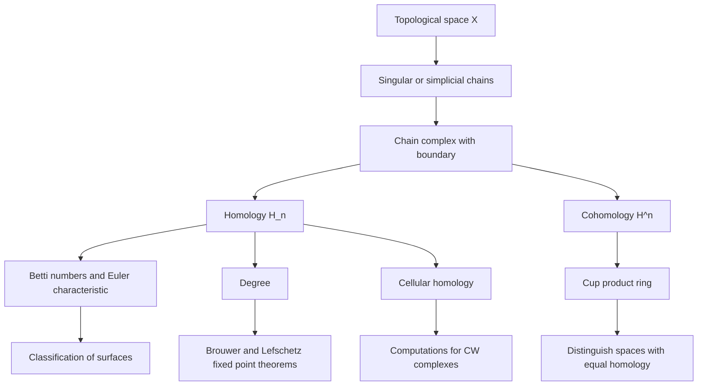
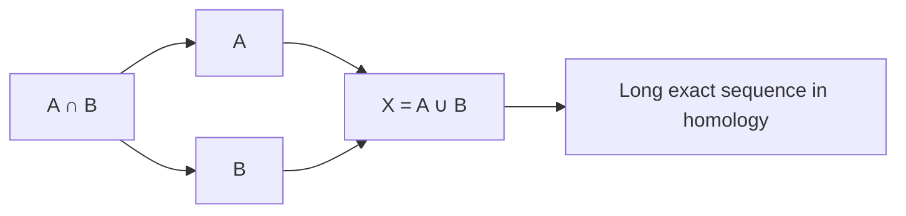

# Algebraic Topology
> [Mathematics](../../README.md) › [Advanced Topics](../README.md) › Algebraic Topology · Level: Advanced · Prerequisites: [Topological Spaces](../../17-topology/01-topological-spaces/README.md), [Continuity and Homeomorphisms](../../17-topology/02-continuity-and-homeomorphisms/README.md), [Compactness](../../17-topology/03-compactness/README.md), [Connectedness](../../17-topology/04-connectedness/README.md), [Introduction to Algebraic Topology](../../17-topology/05-algebraic-topology/README.md), [Groups](../../13-abstract-algebra/01-groups/README.md), [Rings](../../13-abstract-algebra/02-rings/README.md), [Vector Spaces](../../08-linear-algebra/04-vector-spaces/README.md), [Linear Transformations](../../08-linear-algebra/05-linear-transformations/README.md) · Estimated time: 14 h

## 1. Introduction
A topologist wants to know when two spaces are the same. The definition of a homeomorphism is easy to state and almost impossible to apply: exhibiting one is a matter of writing a formula, but proving that none exists means ruling out every continuous bijection with continuous inverse at once. The effective strategy is to replace the space by an algebraic object that is computable and that is unchanged by homeomorphism. Such an object is called an **invariant**.

This tutorial constructs the most important invariant of the subject: **homology**. Homology assigns to a topological space $X$ a sequence of abelian groups $H_0(X), H_1(X), H_2(X), \dots$ which count, roughly, the number of connected pieces, circular holes, spherical cavities, and higher-dimensional voids of $X$. Its name comes from the Greek *homologos*, "agreeing": two cycles are homologous when they bound a common region.

Why homology rather than the fundamental group? The fundamental group $\pi_1$ is easier to define and often more sensitive, but it is a group, in general non-abelian and hard to compute. Homology is a sequence of *abelian* groups, and abelian groups are classified. Moreover homology is the first level of a whole machinery — cohomology, products, spectral sequences — that has become the common language of topology, algebra, geometry and number theory.

The central construction is surprisingly elementary. A space is probed by maps of simplices into it (triangles, tetrahedra, and their higher-dimensional analogues). The free abelian group on the $n$-simplices is the group of **$n$-chains**. The boundary of a simplex is a signed sum of its faces, and the essential combinatorial fact is that *the boundary of a boundary is zero*, $\partial^2 = 0$. Consequently the group of boundaries sits inside the group of cycles, and the quotient
$$H_n(X) = \frac{\ker(\partial_n)}{\operatorname{im}(\partial_{n+1})}$$
is the $n$-th homology group.

The tutorial follows the classical route, with the following plan.

* **The fundamental group and covering spaces** (§7.1–§7.2). A review of $\pi_1$, the lifting theorems, and the classification of covering spaces by subgroups of $\pi_1$. These results are used repeatedly as a source of examples.
* **Simplicial and singular homology** (§7.3–§7.4). Two definitions, the chain complex, cycles and boundaries, and the theorem that $H_0$ is the free abelian group on path components.
* **Functoriality and homotopy invariance** (§7.5). Homology is a functor on the homotopy category; the proof uses the prism operator.
* **The Eilenberg–Steenrod axioms** (§7.6). A short list of properties that determines homology on CW complexes.
* **The Mayer–Vietoris sequence** (§7.7) and its use to compute the homology of spheres and tori (§7.8).
* **Degree** (§7.9), with the Brouwer fixed point theorem and the non-retraction of the disk onto its boundary.
* **Cellular homology** (§7.10): the computational engine for CW complexes.
* **Cohomology and the cup product** (§7.11): homology with a ring structure.
* **The Euler characteristic and Betti numbers** (§7.12).
* **Applications** (§7.13): the classification of surfaces and fixed point theory.

## 2. Prerequisites
You should be comfortable with:

* **Topological spaces, open and closed sets, the subspace and quotient topology, products, Hausdorff spaces** — [Topological Spaces](../../17-topology/01-topological-spaces/README.md). Homology is defined for arbitrary spaces, but the theorems are cleanest for CW complexes, which are built from disks by gluing.
* **Continuity, homeomorphism, compactness and connectedness** — [Continuity and Homeomorphisms](../../17-topology/02-continuity-and-homeomorphisms/README.md), [Compactness](../../17-topology/03-compactness/README.md), [Connectedness](../../17-topology/04-connectedness/README.md). Path components, which index $H_0$, are a connectedness notion.
* **The fundamental group, homotopy of paths and covering spaces** — [Introduction to Algebraic Topology](../../17-topology/05-algebraic-topology/README.md). This tutorial reviews the essential statements in §7.1–§7.2, but a first exposure makes the review much easier.
* **Groups, subgroups, normal subgroups, quotients, free groups, presentations** — [Groups](../../13-abstract-algebra/01-groups/README.md). The fundamental group is a group; $\pi_1$ computations use van Kampen's theorem and free products with amalgamation.
* **Rings, ideals, modules over a ring, abelian groups, the structure of finitely generated abelian groups** — [Rings](../../13-abstract-algebra/02-rings/README.md). The singular chain groups are free abelian groups, and homology groups are often finitely generated.
* **Vector spaces, bases, dimension, linear maps, matrices, kernels and images, the rank–nullity theorem** — [Vector Spaces](../../08-linear-algebra/04-vector-spaces/README.md), [Linear Transformations](../../08-linear-algebra/05-linear-transformations/README.md). Homology with field coefficients is linear algebra with signs.
* **Determinants and orientation** — [Determinants](../../08-linear-algebra/06-determinants/README.md). The sign in the boundary formula encodes orientation.
* **Metric spaces and continuity** — [Metric Spaces](../../14-real-analysis/06-metric-spaces/README.md). The standard simplex is a metric subspace of $\mathbb{R}^{n+1}$.

No prior knowledge of homology, cohomology or spectral sequences is assumed. Homological algebra is developed in [Homological Algebra](../13-homological-algebra/README.md) and is not needed here: every algebraic statement used is proved or explicitly identified as a standard theorem.

## 3. Learning Objectives
After this tutorial you will be able to:

1. Define the fundamental group, verify that it is a group, and compute it for circles, wedges, tori and projective spaces using covering spaces and van Kampen's theorem.
2. Define covering spaces, state and use the path-lifting and homotopy-lifting theorems, and explain the bijection between connected coverings and subgroups of $\pi_1$.
3. Define simplicial and singular homology, prove $\partial^2 = 0$, and compute $H_n$ for small $\Delta$-complexes from the chain complex.
4. Prove that $H_0(X)$ is the free abelian group on the set of path components of $X$.
5. Prove that a continuous map induces a well-defined homomorphism on homology, that $H_n$ is a functor, and that homotopic maps induce equal maps.
6. State the Eilenberg–Steenrod axioms and explain why they determine homology on CW complexes.
7. State and use the Mayer–Vietoris sequence to compute the homology of spheres, wedges and tori.
8. Define the degree of a self-map of $S^n$, prove its basic properties, and use it to prove the Brouwer fixed point theorem and the non-existence of a retraction of $D^n$ onto $S^{n-1}$.
9. Compute cellular homology of CW complexes, including $\mathbb{R}P^n$, $\mathbb{C}P^n$ and surfaces.
10. Define cohomology, compute the cup product in examples, and use the ring structure to distinguish spaces with isomorphic homology.
11. Relate the Euler characteristic to Betti numbers, prove the Euler–Poincaré formula, and use $\chi$ and orientability to classify closed surfaces.
12. State the Lefschetz fixed point theorem and compute Lefschetz numbers in examples.

## 4. Intuition
Imagine a landscape and a collection of rubber bands and balloons. A rubber band that can be slid off a rock without cutting reveals that the rock does not block the region; a band that catches on a hole cannot be removed. Homology formalises this by counting *holes* rather than studying the space directly.

The counting is done with **chains**. A 0-chain is a formal sum of points. A 1-chain is a formal sum of paths, allowed to run backwards when the coefficient is negative. A 2-chain is a formal sum of triangles, and so on. The **boundary** of a path is its endpoint minus its starting point; the boundary of a triangle is the signed sum of its three edges with signs arranged so that the triangle is traversed counterclockwise. The boundary of a tetrahedron is the signed sum of its four triangular faces with alternating signs.

Two facts make the theory work.

* **The boundary of a boundary is zero.** The boundary of a triangle is a closed loop, so it has no endpoints; algebraically, $\partial(\partial(\text{triangle})) = 0$. The boundary of a tetrahedron is a closed surface, so it has no boundary either. This is the general rule.
* **Boundaries are invisible to homology.** If a loop is the boundary of a disk that lies in the space, the loop surrounds no hole and should count as zero. Homology therefore quotients the cycles (things with zero boundary) by the boundaries (things that bound).

The quotient is exactly the count of holes. $H_0$ counts components, $H_1$ counts independent loops, $H_2$ counts independent enclosed cavities, and $H_n$ counts $n$-dimensional voids.

A useful metaphor is a **net**. A 1-cycle is a closed net; a 1-boundary is a net that is the rim of a membrane lying in the space. If the membrane is present, the net catches nothing. Homology asks which nets are not rims of membranes. The same metaphor works one dimension up: a 2-cycle is a closed bag, and a 2-boundary is the skin of a solid that the space contains. A balloon inside a sphere encloses a cavity; a balloon that is the boundary of a solid ball inside the space does not.

The metaphor also explains why homology is weaker than the fundamental group. Homology records only *abelian* information about loops: a loop that goes around a hole twice is twice the generator, and a loop that goes around one hole and back around another has no memory of the order. The fundamental group remembers the order, which is why $\pi_1$ of the wedge of two circles is a free group while $H_1$ is $\mathbb{Z}^2$. Homology buys computability and a rich algebraic structure by forgetting non-abelian data.

## 5. Formal Definition
### 5.1 Homotopy and the fundamental group
**Definition 5.1.1** (homotopy). Let $X$ and $Y$ be topological spaces and let $f, g : X \to Y$ be continuous. A **homotopy** from $f$ to $g$ is a continuous map
$$H : X \times [0,1] \to Y$$
such that $H(x,0) = f(x)$ and $H(x,1) = g(x)$ for every $x \in X$. We write $f \simeq g$ and say that $f$ and $g$ are **homotopic**. If $A \subseteq X$ and $H(a,t) = f(a) = g(a)$ for all $a \in A$ and all $t$, the homotopy is **relative to $A$**, written $f \simeq g \ \mathrm{rel}\ A$.

A space $X$ is **contractible** if the identity map $\operatorname{id}_X$ is homotopic to a constant map. A map $f : X \to Y$ is a **homotopy equivalence** if there is a continuous $g : Y \to X$ with $g \circ f \simeq \operatorname{id}_X$ and $f \circ g \simeq \operatorname{id}_Y$; then $X$ and $Y$ have the same **homotopy type**.

**Definition 5.1.2** (fundamental group). Fix a point $x_0 \in X$. A **loop** based at $x_0$ is a continuous map $\gamma : [0,1] \to X$ with $\gamma(0) = \gamma(1) = x_0$. Two loops $\gamma, \delta$ are **path homotopic** if there is a homotopy $H : [0,1] \times [0,1] \to X$ with $H(s,0) = \gamma(s)$, $H(s,1) = \delta(s)$, and $H(0,t) = H(1,t) = x_0$ for all $s,t$. Write $[\gamma]$ for the class of $\gamma$. The **fundamental group** is
$$\pi_1(X,x_0) = \{[\gamma] : \gamma \text{ a loop at } x_0\}$$
with the operation $[\gamma] \cdot [\delta] = [\gamma * \delta]$, where
$$
(\gamma * \delta)(s) =
\begin{cases}
\gamma(2s), & 0 \le s \le \tfrac12,\\[2pt]
\delta(2s-1), & \tfrac12 \le s \le 1.
\end{cases}
$$
**Theorem 5.1.3.** For every space $X$ and basepoint $x_0$, the set $\pi_1(X,x_0)$ with the operation above is a group. The identity is the class of the constant loop, and the inverse of $[\gamma]$ is the class of the reverse loop $\bar\gamma(s) = \gamma(1-s)$.

*Proof.* Associativity follows from the fact that $(\gamma * \delta) * \varepsilon$ and $\gamma * (\delta * \varepsilon)$ differ only by a reparametrisation of the interval; both traverse $\gamma$, then $\delta$, then $\varepsilon$, and a linear reparametrisation gives a homotopy relative to the endpoints. The constant loop is a two-sided identity, and $\gamma * \bar\gamma$ is homotopic to the constant loop by shrinking the loop to the basepoint. $\blacksquare$

**Definition 5.1.4** (functoriality). A continuous map $f : X \to Y$ with $f(x_0) = y_0$ induces
$$f_* : \pi_1(X,x_0) \to \pi_1(Y,y_0), \qquad f_*([\gamma]) = [f \circ \gamma].$$
This is well defined because a homotopy relative to the endpoints composes with $f$ to a homotopy relative to the endpoints. It satisfies $(g \circ f)_* = g_* \circ f_*$ and $(\operatorname{id}_X)_* = \operatorname{id}$.

### 5.2 Covering spaces
**Definition 5.2.1** (covering map). A continuous surjection $p : E \to B$ is a **covering map** if every point $b \in B$ has an open neighbourhood $U$ such that
$$p^{-1}(U) = \bigsqcup_{\alpha \in A} V_\alpha$$
is a disjoint union of open sets $V_\alpha \subseteq E$, each mapped homeomorphically onto $U$ by $p$. The set $U$ is **evenly covered**, the sets $V_\alpha$ are **sheets**, and the cardinality of $A$ is the **number of sheets** if it is constant. A **deck transformation** is a homeomorphism $\tau : E \to E$ with $p \circ \tau = p$. A **universal cover** is a covering $\tilde X \to X$ with $\tilde X$ simply connected.

**Theorem 5.2.2** (path lifting). Let $p : E \to B$ be a covering, let $e_0 \in E$, put $b_0 = p(e_0)$, and let $\gamma : [0,1] \to B$ be a path with $\gamma(0) = b_0$. Then there is a unique path $\tilde\gamma : [0,1] \to E$ with $p \circ \tilde\gamma = \gamma$ and $\tilde\gamma(0) = e_0$.

*Proof.* Cover $B$ by evenly covered open sets and pull the cover back to an open cover of the compact interval $[0,1]$; by the Lebesgue number lemma there is $n$ such that each interval $[k/n,(k+1)/n]$ maps into an evenly covered set. Lift successively over these intervals, choosing at each stage the unique sheet containing the endpoint of the previous lift. Uniqueness follows because two lifts on an interval that agree at one point and whose images lie in a single sheet must agree everywhere. $\blacksquare$

**Theorem 5.2.3** (homotopy lifting). Let $p : E \to B$ be a covering, let $Y$ be any topological space, and let $H : Y \times [0,1] \to B$ be a homotopy. Given a continuous map $\tilde H_0 : Y \to E$ with $p \circ \tilde H_0 = H(\cdot,0)$, there is a unique homotopy $\tilde H : Y \times [0,1] \to E$ with $p \circ \tilde H = H$ and $\tilde H(\cdot,0) = \tilde H_0$.

The proof applies path lifting to the paths $t \mapsto H(y,t)$ and checks continuity in $y$; it is the standard compactness argument and is omitted here, with a reference to [Introduction to Algebraic Topology](../../17-topology/05-algebraic-topology/README.md).

**Corollary 5.2.4.** If $p : (E,e_0) \to (B,b_0)$ is a covering, then $p_* : \pi_1(E,e_0) \to \pi_1(B,b_0)$ is injective.

*Proof.* A loop in $E$ whose image is null-homotopic in $B$ lifts, by Theorem 5.2.3, to a null-homotopy of the original loop. $\blacksquare$

**Theorem 5.2.5** (lifting criterion). Let $p : (E,e_0) \to (B,b_0)$ be a covering, let $Y$ be path-connected and locally path-connected, and let $f : (Y,y_0) \to (B,b_0)$ be continuous. Then $f$ has a lift $\tilde f : (Y,y_0) \to (E,e_0)$ with $p \circ \tilde f = f$ if and only if
$$f_*\bigl(\pi_1(Y,y_0)\bigr) \subseteq p_*\bigl(\pi_1(E,e_0)\bigr).$$
**Theorem 5.2.6** (classification of covering spaces). Let $X$ be path-connected, locally path-connected and semilocally simply connected, with basepoint $x_0$. Then there is a bijection
$$\left\{\begin{array}{c}\text{connected coverings } p : (E,e_0) \to (X,x_0)\\[2pt] \text{up to isomorphism over } X\end{array}\right\} \longleftrightarrow \left\{\text{subgroups } H \le \pi_1(X,x_0)\right\},$$
given by $p \mapsto p_*\pi_1(E,e_0)$. Under this bijection, the covering is **normal** (equivalently **Galois**, equivalently **regular**) if and only if $H$ is a normal subgroup, and then the deck group is $\pi_1(X,x_0)/H$. The universal cover corresponds to the trivial subgroup.

### 5.3 Simplicial complexes, $\Delta$-complexes and simplicial homology
**Definition 5.3.1** (standard simplex). The **standard $n$-simplex** is
$$\Delta^n = \left\{(t_0,\dots,t_n) \in \mathbb{R}^{n+1} : t_i \ge 0 \text{ and } \sum_{i=0}^n t_i = 1\right\}.$$
Its **vertices** are $v_0 = (1,0,\dots,0), \dots, v_n = (0,\dots,0,1)$. The **$i$-th face map** $F_i^n : \Delta^{n-1} \to \Delta^n$ inserts a zero in the $i$-th coordinate:
$$F_i^n(t_0,\dots,t_{n-1}) = (t_0,\dots,t_{i-1},0,t_i,\dots,t_{n-1}).$$
**Definition 5.3.2** ($\Delta$-complex). A **$\Delta$-complex structure** on a topological space $X$ is a collection of continuous maps $\sigma_\alpha : \Delta^{n_\alpha} \to X$ such that:

1. the restriction of $\sigma_\alpha$ to the interior of $\Delta^{n_\alpha}$ is injective, and every point of $X$ lies in the image of exactly one such restricted map;
2. for every $\alpha$ and every face map $F_i^n$, the restriction $\sigma_\alpha \circ F_i^n$ is equal to some $\sigma_\beta$ of dimension $n-1$;
3. the **closure-finiteness condition** holds: every point of $X$ lies in the image of only finitely many $\sigma_\alpha$;
4. a subset $A \subseteq X$ is open if and only if $\sigma_\alpha^{-1}(A)$ is open in $\Delta^{n_\alpha}$ for every $\alpha$.

A **simplicial complex** is the special case in which the simplices are embedded and any two meet in a common face.

**Definition 5.3.3** (orientations and boundary). An **orientation** of a simplex with vertices $v_0,\dots,v_n$ is an ordering of the vertices up to even permutation; the oriented simplex is written $[v_0,\dots,v_n]$. The **boundary** of an oriented $n$-simplex is
$$\partial [v_0,\dots,v_n] = \sum_{i=0}^{n} (-1)^i [v_0,\dots,\widehat{v_i},\dots,v_n],$$
where the hat means that the vertex is omitted.

**Definition 5.3.4** (simplicial chain complex). For a $\Delta$-complex $X$, let $C_n^\Delta(X)$ be the free abelian group on the $n$-simplices of $X$, with the convention $C_n^\Delta(X) = 0$ for $n < 0$. Extend $\partial$ by linearity to a homomorphism $\partial_n : C_n^\Delta(X) \to C_{n-1}^\Delta(X)$. The **simplicial homology** is
$$H_n^\Delta(X) = \frac{\ker \partial_n}{\operatorname{im} \partial_{n+1}}.$$

### 5.4 Singular homology
**Definition 5.4.1** (singular simplex). A **singular $n$-simplex** in a space $X$ is a continuous map $\sigma : \Delta^n \to X$. Let $C_n(X)$ be the free abelian group on the set of all singular $n$-simplices. Define
$$\partial_n : C_n(X) \to C_{n-1}(X), \qquad \partial_n \sigma = \sum_{i=0}^{n} (-1)^i \sigma \circ F_i^n,$$
and extend by linearity; for $n=0$, set $\partial_0 = 0$. The elements of $C_n(X)$ are **singular $n$-chains**.

**Lemma 5.4.2.** $\partial_{n-1} \circ \partial_n = 0$ for every $n \ge 1$.

*Proof.* Compute
$$\partial_{n-1}\partial_n \sigma = \sum_{i=0}^{n} \sum_{j=0}^{n-1} (-1)^{i+j} \sigma \circ F_i^n \circ F_j^{n-1}.$$
The face maps satisfy $F_i^n \circ F_j^{n-1} = F_j^n \circ F_{i-1}^{n-1}$ whenever $j < i$. For $j < i$ the term has sign $(-1)^{i+j}$ and equals $\sigma \circ F_j^n \circ F_{i-1}^{n-1}$, which also appears in the sum as the term with indices $(i',j') = (j,i-1)$; since $i-1 \ge j$, that term has sign $(-1)^{j+i-1} = -(-1)^{i+j}$. The two cancel. Every term belongs to exactly one such pair, so the double sum is zero. $\blacksquare$

**Definition 5.4.3** (singular homology). Define the groups of **cycles** and **boundaries**
$$Z_n(X) = \ker \partial_n, \qquad B_n(X) = \operatorname{im} \partial_{n+1}.$$
Lemma 5.4.2 gives $B_n(X) \subseteq Z_n(X)$, so the quotient
$$H_n(X) = Z_n(X) / B_n(X)$$
is defined. It is the **$n$-th singular homology group of $X$ with integer coefficients**.

**Definition 5.4.4** (reduced homology). Let $\varepsilon : C_0(X) \to \mathbb{Z}$ be the **augmentation** $\varepsilon(\sum_i n_i \sigma_i) = \sum_i n_i$. The **reduced homology** $\tilde H_n(X)$ is the homology of the augmented complex
$$\cdots \to C_2(X) \xrightarrow{\partial_2} C_1(X) \xrightarrow{\partial_1} C_0(X) \xrightarrow{\varepsilon} \mathbb{Z} \to 0.$$
Thus $\tilde H_n(X) = H_n(X)$ for $n \ge 1$ and $\tilde H_0(X) = \ker \varepsilon / \operatorname{im}\partial_1$.

### 5.5 Chain complexes
**Definition 5.5.1** (chain complex). A **chain complex** of abelian groups is a sequence
$$\cdots \to C_{n+1} \xrightarrow{\partial_{n+1}} C_n \xrightarrow{\partial_n} C_{n-1} \to \cdots$$
of abelian groups and homomorphisms with $\partial_n \circ \partial_{n+1} = 0$ for all $n$. A **chain map** $f : (C_*,\partial) \to (D_*,\partial')$ is a family of homomorphisms $f_n : C_n \to D_n$ with $\partial'_n \circ f_n = f_{n-1} \circ \partial_n$. A **chain homotopy** between chain maps $f,g : C_* \to D_*$ is a family $P_n : C_n \to D_{n+1}$ with
$$\partial'_{n+1} P_n + P_{n-1} \partial_n = g_n - f_n.$$
A chain map induces $f_* : H_n(C_*) \to H_n(D_*)$ by $f_*[z] = [f_n(z)]$; chain homotopic maps induce the same map on homology.

### 5.6 CW complexes and cellular chains
**Definition 5.6.1** (CW complex). A **CW complex** is a Hausdorff space $X$ together with a filtration
$$X^0 \subseteq X^1 \subseteq X^2 \subseteq \cdots \subseteq X = \bigcup_{n \ge 0} X^n$$
such that:

1. $X^0$ is a discrete set of **$0$-cells**;
2. $X^n$ is obtained from $X^{n-1}$ by attaching **$n$-cells**: there is a pushout
$$
\begin{array}{ccc}
\displaystyle\bigsqcup_{\alpha \in A_n} S^{n-1}_\alpha & \longrightarrow & X^{n-1}\\[4pt]
\downarrow & & \downarrow\\[4pt]
\displaystyle\bigsqcup_{\alpha \in A_n} D^n_\alpha & \longrightarrow & X^n;
\end{array}
$$
3. $X$ carries the weak topology with respect to the closed subspaces $X^n$: a set is closed iff its intersection with every $X^n$ is closed.

The **$n$-skeleton** is $X^n$. The space is **finite** if it has finitely many cells and **of finite type** if it has finitely many cells in each dimension.

**Definition 5.6.2** (cellular chain complex). For a CW complex $X$, put
$$C_n^{CW}(X) = H_n(X^n, X^{n-1}).$$
This is a free abelian group with one basis element for each $n$-cell. The **cellular boundary** $d_n : C_n^{CW}(X) \to C_{n-1}^{CW}(X)$ is the composite
$$H_n(X^n,X^{n-1}) \xrightarrow{\ \partial\ } H_{n-1}(X^{n-1}) \xrightarrow{\ j\ } H_{n-1}(X^{n-1},X^{n-2}),$$
where $\partial$ is the boundary map of the pair $(X^n,X^{n-1})$ and $j$ is induced by the quotient $X^{n-1} \to X^{n-1}/X^{n-2}$.

**Theorem 5.6.3.** For every CW complex $X$ there are isomorphisms
$$H_n(X) \cong \frac{\ker d_n}{\operatorname{im} d_{n+1}}$$
for all $n \ge 0$. In particular, cellular homology can be computed from a chain complex of free abelian groups whose ranks are the numbers of cells.

### 5.7 Cohomology and the cup product
**Definition 5.7.1** (cohomology). Let $G$ be an abelian group. The group of **singular $n$-cochains** is $C^n(X;G) = \operatorname{Hom}(C_n(X), G)$, and the **coboundary** is the dual $\delta^n = \partial_{n+1}^* : C^n(X;G) \to C^{n+1}(X;G)$, so $(\delta\varphi)(\sigma) = \varphi(\partial\sigma)$. Since $\partial^2 = 0$, also $\delta^2 = 0$, and
$$H^n(X;G) = \frac{\ker \delta^n}{\operatorname{im} \delta^{n-1}}.$$
**Definition 5.7.2** (cup product). For $\varphi \in C^p(X;R)$ and $\psi \in C^q(X;R)$, where $R$ is a commutative ring, define $\varphi \smile \psi \in C^{p+q}(X;R)$ on a singular simplex $\sigma : \Delta^{p+q} \to X$ by
$$(\varphi \smile \psi)(\sigma) = \varphi\bigl(\sigma|_{[v_0,\dots,v_p]}\bigr) \cdot \psi\bigl(\sigma|_{[v_p,\dots,v_{p+q}]}\bigr),$$
where $\sigma|_{[v_0,\dots,v_p]}$ denotes the restriction to the front $p$-face and $\sigma|_{[v_p,\dots,v_{p+q}]}$ the restriction to the back $q$-face. The cup product induces
$$\smile \ : H^p(X;R) \times H^q(X;R) \to H^{p+q}(X;R).$$

### 5.8 Degree
**Definition 5.8.1** (degree). Let $n \ge 1$ and let $f : S^n \to S^n$ be continuous. Since $H_n(S^n;\mathbb{Z}) \cong \mathbb{Z}$, the induced map $f_*$ is multiplication by a unique integer. That integer is the **degree** of $f$:
$$f_*[S^n] = \deg(f)\,[S^n], \qquad \deg(f) \in \mathbb{Z},$$
where $[S^n]$ is a chosen generator, called the **fundamental class**.

The degree depends on the choice of generator only through a common sign; the integer is independent of the choice because both sides change sign together.

## 6. Mathematical Notation

| Symbol | Read as | Meaning |
|---|---|---|
| $X \simeq Y$ | $X$ is homotopy equivalent to $Y$ | there are maps both ways whose composites are homotopic to identities |
| $f \simeq g$ | $f$ is homotopic to $g$ | there is a continuous deformation from $f$ to $g$ |
| $\pi_1(X,x_0)$ | the fundamental group of $X$ at $x_0$ | loops at $x_0$ up to path homotopy |
| $p : E \to B$ | $p$ from $E$ to $B$ | a covering map when every point of $B$ is evenly covered |
| $\Delta^n$ | the standard $n$-simplex | $\{(t_0,\dots,t_n) : t_i \ge 0,\ \sum t_i = 1\}$ |
| $\partial_n$ | boundary operator | sends an $n$-chain to an $(n-1)$-chain |
| $Z_n(X)$ | $n$-cycles | $\ker \partial_n$ |
| $B_n(X)$ | $n$-boundaries | $\operatorname{im} \partial_{n+1}$ |
| $H_n(X)$ | $n$-th homology group | $Z_n(X)/B_n(X)$ |
| $\tilde H_n(X)$ | reduced homology | homology of the augmented complex |
| $H_n(X,A)$ | relative homology | homology of the quotient complex $C_*(X)/C_*(A)$ |
| $C_n^{CW}(X)$ | cellular $n$-chains | $H_n(X^n,X^{n-1})$, free on $n$-cells |
| $d_n$ | cellular boundary | $H_n(X^n,X^{n-1}) \to H_{n-1}(X^{n-1},X^{n-2})$ |
| $H^n(X;G)$ | $n$-th cohomology with coefficients in $G$ | $\operatorname{Hom}(C_n(X),G)$ modulo coboundaries |
| $\smile$ | cup product | $H^p \times H^q \to H^{p+q}$ |
| $\deg(f)$ | degree of $f$ | integer with $f_*[S^n] = \deg(f)[S^n]$ |
| $b_i$ | $i$-th Betti number | $\dim_{\mathbb{Q}} H_i(X;\mathbb{Q})$ |
| $\chi(X)$ | Euler characteristic | $\sum_i (-1)^i b_i$ |
| $\mathbb{R}P^n$ | real projective $n$-space | the quotient of $S^n$ by the antipodal action |
| $\mathbb{C}P^n$ | complex projective $n$-space | the quotient of $S^{2n+1}$ by the $S^1$ action |
| $\Sigma_g$ | orientable surface of genus $g$ | connected sum of $g$ tori |
| $N_g$ | non-orientable surface of genus $g$ | connected sum of $g$ projective planes |
| $L(f)$ | Lefschetz number | $\sum_i (-1)^i \operatorname{tr}(f_* \mid H_i(X;\mathbb{Q}))$ |

## 7. Core Concepts
### 7.1 The fundamental group reviewed
The fundamental group is the first algebraic invariant of a space, and homology is best understood by comparison with it. Three facts from [Introduction to Algebraic Topology](../../17-topology/05-algebraic-topology/README.md) are used constantly.

**Basepoints.** If $x_0, x_1$ lie in the same path component of $X$, then $\pi_1(X,x_0) \cong \pi_1(X,x_1)$: choose a path $\alpha$ from $x_0$ to $x_1$ and conjugate, $[\gamma] \mapsto [\alpha * \gamma * \bar\alpha]$. The isomorphism depends on the homotopy class of $\alpha$, so for a non-simply-connected space there is no canonical identification. For homology no such problem occurs: $H_n(X)$ does not depend on a basepoint at all.

**Van Kampen's theorem.** Let $X = A \cup B$ where $A$, $B$ and $A \cap B$ are open, path-connected and nonempty. Then for $x_0 \in A \cap B$ the inclusions induce an isomorphism
$$\pi_1(X,x_0) \cong \pi_1(A,x_0) *_{\pi_1(A\cap B,x_0)} \pi_1(B,x_0),$$
the free product of $\pi_1(A,x_0)$ and $\pi_1(B,x_0)$ amalgamated over the common subgroup $\pi_1(A\cap B,x_0)$. The theorem computes groups by decomposing a space into simpler pieces, and it is the model for the Mayer–Vietoris sequence of §7.7.

**Standard computations.** The results below are used repeatedly.

| Space | $\pi_1$ | Method |
|---|---|---|
| $\mathbb{R}^n$, $D^n$, any contractible space | trivial | every loop is null-homotopic |
| $S^1$ | $\mathbb{Z}$ | covering $\mathbb{R} \to S^1$ (§7.2) |
| $S^n$, $n \ge 2$ | trivial | van Kampen with two hemispheres |
| $S^1 \vee S^1$ | free group $F_2 = \langle a, b\rangle$ | van Kampen |
| $T^2 = S^1 \times S^1$ | $\mathbb{Z}^2$ | van Kampen or covering $\mathbb{R}^2 \to T^2$ |
| $\mathbb{R}P^n$, $n \ge 2$ | $\mathbb{Z}/2\mathbb{Z}$ | universal cover $S^n \to \mathbb{R}P^n$ |
| $\Sigma_g$ (orientable genus $g$) | $\langle a_1,b_1,\dots,a_g,b_g \mid [a_1,b_1]\cdots[a_g,b_g] = 1\rangle$ | van Kampen |
| $N_g$ (non-orientable genus $g$) | $\langle a_1,\dots,a_g \mid a_1^2 a_2^2 \cdots a_g^2 = 1\rangle$ | van Kampen |

Here $[a,b] = aba^{-1}b^{-1}$ is the commutator.

**The Hurewicz theorem.** The bridge between homotopy and homology is the **Hurewicz homomorphism**
$$h_n : \pi_n(X,x_0) \to H_n(X;\mathbb{Z}), \qquad h_n([f]) = f_*[S^n],$$
where $[S^n]$ is the fundamental class, the generator of $H_n(S^n;\mathbb{Z}) \cong \mathbb{Z}$ represented by the identity map, and $f : (S^n,*) \to (X,x_0)$ represents an element of $\pi_n$. For $n = 1$ this map is defined on $\pi_1$, which need not be abelian, but it factors through the abelianisation.

**Theorem 7.1.1** (Hurewicz). Let $X$ be path-connected and let $n \ge 1$.

1. If $n = 1$, then $h_1$ induces an isomorphism $\pi_1(X,x_0)^{\mathrm{ab}} \cong H_1(X;\mathbb{Z})$, where the abelianisation is $\pi_1/[\pi_1,\pi_1]$.
2. If $n \ge 2$ and $\pi_k(X,x_0) = 0$ for all $1 \le k < n$, then $H_k(X;\mathbb{Z}) = 0$ for $1 \le k < n$ and $h_n : \pi_n(X,x_0) \to H_n(X;\mathbb{Z})$ is an isomorphism.

Thus the first homology group is the abelian shadow of the fundamental group. For example $H_1(S^1 \vee S^1) = \mathbb{Z}^2$ while $\pi_1$ is the much larger free group $F_2$; and $H_1(\mathbb{R}P^2) = \mathbb{Z}/2$ agrees with $\pi_1(\mathbb{R}P^2)^{\mathrm{ab}} = \mathbb{Z}/2$.

### 7.2 Covering spaces
Covering spaces are the tool that turns a topological question about loops into algebra, and they give the cleanest computation of $\pi_1(S^1)$.

**Path lifting in detail.** Let $p : E \to B$ be a covering and let $\gamma : [0,1] \to B$ start at $b_0 = p(e_0)$. Choose an evenly covered neighbourhood $U$ of $b_0$ and let $V$ be the sheet containing $e_0$. For $t$ small, $\gamma(t) \in U$, and the only possible lift must take values in $V$, so $\tilde\gamma = (p|_V)^{-1} \circ \gamma$ near $0$. This produces a lift on some interval $[0,\varepsilon]$. Let $T$ be the supremum of the set of $t$ for which a lift exists on $[0,t]$. If $T < 1$, lift past $T$ using an evenly covered neighbourhood of $\gamma(T)$ and the sheet containing $\tilde\gamma(T)$, contradicting maximality. Hence $T = 1$, and the lift is unique because two lifts that agree at a point and land in a common sheet coincide on a neighbourhood. This is Theorem 5.2.2.

**Homotopy lifting.** Theorem 5.2.3 says that a homotopy can be lifted once its initial map is lifted. Applying it with $Y = [0,1]$ gives the relative version: two paths in $B$ that are homotopic rel endpoints and that have lifts starting at the same point have homotopic lifts, again rel endpoints. Three consequences are used constantly.

* **Injectivity.** $p_* : \pi_1(E,e_0) \to \pi_1(B,b_0)$ is injective (Corollary 5.2.4).
* **Lifting criterion.** A map $f : (Y,y_0) \to (B,b_0)$ from a path-connected, locally path-connected space lifts to $E$ iff $f_*\pi_1(Y,y_0) \subseteq p_*\pi_1(E,e_0)$ (Theorem 5.2.5). Necessity is immediate from functoriality; for sufficiency, lift paths from $y_0$ and use homotopy lifting to show that the endpoint depends only on $f(y)$, not on the path.
* **Sheets and index.** If $B$ is connected and evenly covered, the number of sheets equals the index $[\pi_1(B,b_0) : p_*\pi_1(E,e_0)]$ when $E$ is connected. Indeed the fibre $p^{-1}(b_0)$ is in bijection with the cosets of the subgroup.

**Classification of coverings.** For a path-connected, locally path-connected and semilocally simply connected space $X$, Theorem 5.2.6 gives a bijection between connected coverings $p : (E,e_0) \to (X,x_0)$ and subgroups $H \le \pi_1(X,x_0)$. The construction in one direction is explicit: the universal cover $\tilde X$ exists, and
$$E_H = \tilde X / H$$
is a covering of $X$ with $p_*\pi_1(E_H) = H$. In the other direction, $H = p_*\pi_1(E,e_0)$, and $E$ is recovered as $\tilde X/H$ because $\tilde X$ is also the universal cover of $E$. The covering is normal iff $H \trianglelefteq \pi_1(X,x_0)$, and then the deck group $\operatorname{Deck}(E/X)$ is $\pi_1(X,x_0)/H$. The universal cover corresponds to $H = 1$ and has deck group $\pi_1(X,x_0)$.

**Examples.** The following table lists the coverings that recur in the exercises.

| Covering | Base | Sheets | Deck group | Subgroup |
|---|---|---|---|---|
| $\exp : \mathbb{R} \to S^1$, $t \mapsto e^{2\pi i t}$ | $S^1$ | countably infinite | $\mathbb{Z}$ | $0$ (universal) |
| $z \mapsto z^n$ on $S^1$ | $S^1$ | $n$ | $\mathbb{Z}/n$ | $n\mathbb{Z}$ |
| $S^n \to \mathbb{R}P^n$, $n \ge 2$ | $\mathbb{R}P^n$ | $2$ | $\mathbb{Z}/2$ | $0$ (universal) |
| $\mathbb{R}^2 \to T^2$, $(s,t) \mapsto (e^{2\pi i s}, e^{2\pi i t})$ | $T^2$ | countably infinite | $\mathbb{Z}^2$ | $0$ (universal) |
| universal cover of $S^1 \vee S^1$ | $S^1 \vee S^1$ | countably infinite | $F_2$ | $0$ |

The universal cover of $S^1 \vee S^1$ is the infinite $4$-valent tree, the Cayley graph of the free group on two generators. Each vertex corresponds to a word in $a^{\pm1}, b^{\pm1}$, and each edge to multiplication by a generator.

**Computation of $\pi_1(S^1)$.** The covering $\exp : \mathbb{R} \to S^1$ has fibre $\mathbb{Z}$ over $1$. A loop $\gamma$ at $1$ lifts uniquely to $\tilde\gamma$ with $\tilde\gamma(0) = 0$; the **winding number** is $\tilde\gamma(1) \in \mathbb{Z}$. Homotopy lifting shows that homotopic loops have the same winding number, and path lifting shows that loops of winding $n$ exist for every $n$ (take $t \mapsto e^{2\pi i n t}$). The map $\gamma \mapsto \operatorname{wind}(\gamma)$ is therefore a surjection $\pi_1(S^1,1) \to \mathbb{Z}$. It is injective: a loop of winding $0$ lifts to a loop in the contractible space $\mathbb{R}$, hence is null-homotopic, and the null-homotopy descends. Therefore
$$\pi_1(S^1,1) \cong \mathbb{Z}.$$
The same computation identifies the degree of $f(z) = z^n$, viewed as a self-map of $S^1$, with $n$: the induced map on $\pi_1$ is multiplication by $n$, and by Hurewicz (Theorem 7.1.1) so is the induced map on $H_1$.

### 7.3 Simplicial and singular homology
There are two definitions of homology, and they agree.

**Simplicial homology** is combinatorial. A $\Delta$-complex is a space built by gluing standard simplices along faces. For each $n$, take the free abelian group on the $n$-simplices and define $\partial$ by the alternating sum of faces. The identity $\partial^2 = 0$ is a finite computation on index pairs, already given in Lemma 5.4.2 in the singular language; the simplicial version is identical because the face relations are the same.

**Singular homology** is topological. A singular simplex is any continuous map $\Delta^n \to X$, with no requirement that it be injective or that its image be a simplex. The chain groups are therefore enormous, and usually not finitely generated. Their virtue is functoriality: every continuous map $X \to Y$ induces a chain map $C_*(X) \to C_*(Y)$ by composition, with no need to choose a triangulation.

**Theorem 7.3.1.** Let $X$ be a $\Delta$-complex with underlying space $|X|$. Then for every $n \ge 0$ there is a natural isomorphism
$$H_n^\Delta(X) \cong H_n^{\mathrm{sing}}(|X|;\mathbb{Z}).$$
The proof compares both sides with a third, **barycentric subdivision**: subdividing a $\Delta$-complex does not change its simplicial homology, and sufficiently fine subdivision makes every singular simplex small enough to be pushed into a single simplex, producing a chain map in the other direction. The two constructions are inverse on homology. The details belong to a second course; this tutorial uses Theorem 7.3.1 to compute singular homology from finite simplicial data.

**Chain-level functoriality.** For a continuous map $f : X \to Y$, define $f_\# : C_n(X) \to C_n(Y)$ by $f_\#(\sigma) = f \circ \sigma$ and extend linearly. Then
$$\partial f_\#(\sigma) = \sum_i (-1)^i f \circ \sigma \circ F_i = f_\#(\partial\sigma),$$
so $f_\#$ is a chain map. This is the origin of functoriality in §7.5.

**A first computation.** Let $X = \partial\Delta^2$ be the boundary of a triangle, with vertices $v_0,v_1,v_2$ and edges $e_{01} = [v_0,v_1]$, $e_{12} = [v_1,v_2]$, $e_{02} = [v_0,v_2]$. Then $C_2 = 0$, $C_1 = \mathbb{Z}^3$ with basis $e_{01}, e_{12}, e_{02}$, and $C_0 = \mathbb{Z}^3$ with basis $v_0,v_1,v_2$. The boundary is
$$\partial e_{01} = v_1 - v_0, \qquad \partial e_{12} = v_2 - v_1, \qquad \partial e_{02} = v_2 - v_0.$$
A cycle $a e_{01} + b e_{12} + c e_{02}$ has boundary
$$(-a-c)v_0 + (a-b)v_1 + (b+c)v_2 = 0,$$
so $a = b = -c$. Hence $Z_1 = \mathbb{Z}\cdot(e_{01}+e_{12}-e_{02}) \cong \mathbb{Z}$, and $B_1 = 0$ because $C_2 = 0$. Thus $H_1(X) \cong \mathbb{Z}$, while $H_0(X) \cong \mathbb{Z}$ because $X$ is path-connected. This is the algebraic shadow of the single loop in the triangle.

### 7.4 The chain complex, cycles, boundaries, and $H_0$
A chain complex is a sequence of abelian groups with $\partial^2 = 0$. Two subgroups are immediate:
$$Z_n = \ker \partial_n \quad \text{(cycles)}, \qquad B_n = \operatorname{im}\partial_{n+1} \quad \text{(boundaries)}.$$
Since $\partial_n \partial_{n+1} = 0$, every boundary is a cycle, so $B_n \subseteq Z_n$ and the homology $H_n = Z_n/B_n$ is defined. Elements of $H_n$ are **homology classes**, written $[z]$; two cycles are **homologous**, written $z \sim z'$, when $z - z' \in B_n$.

The meaning of $H_0$ is completely transparent.

**Theorem 7.4.1.** Let $X$ be a topological space and let $\pi_0(X)$ be its set of path components. Then
$$H_0(X;\mathbb{Z}) \cong \bigoplus_{P \in \pi_0(X)} \mathbb{Z},$$
the free abelian group on the path components of $X$. In particular, if $X$ is path-connected and nonempty then $H_0(X) \cong \mathbb{Z}$, and if $X = \varnothing$ then $H_0(X) = 0$.

*Proof.* A $0$-simplex is a point of $X$; a general $0$-chain is a finite formal sum $c = \sum_i n_i x_i$ with $n_i \in \mathbb{Z}$ and $x_i \in X$.

*Step 1: the map.* Define
$$\Phi : C_0(X) \to \bigoplus_{P \in \pi_0(X)} \mathbb{Z}, \qquad \Phi\Bigl(\sum_i n_i x_i\Bigr) = \sum_i n_i e_{[x_i]},$$
where $[x]$ denotes the path component containing $x$ and $e_P$ is the basis vector of the component $P$. This is well defined because a $0$-chain is a finite sum. If $\sigma : \Delta^1 \to X$ is a singular $1$-simplex, then $\partial\sigma = \sigma(e_1) - \sigma(e_0)$ and the two endpoints lie in the same path component, because $\sigma$ itself is a path between them. Hence $\Phi(\partial\sigma) = e_{[\sigma(e_1)]} - e_{[\sigma(e_0)]} = 0$. Therefore $\Phi$ vanishes on $B_0 = \operatorname{im}\partial_1$ and descends to a homomorphism
$$\Psi : H_0(X) \to \bigoplus_{P \in \pi_0(X)} \mathbb{Z}, \qquad \Psi([c]) = \Phi(c).$$
*Step 2: surjectivity.* Let $P$ be a path component and choose a point $x \in P$. The class of the $0$-cycle $x$ maps to $e_P$. Since the basis vectors generate the direct sum and every $0$-chain is a finite sum, $\Psi$ is surjective.

*Step 3: injectivity.* Suppose $\Psi([c]) = 0$. Write $c = \sum_i n_i x_i$ and group the terms by path component:
$$c = \sum_{P \in \pi_0(X)} c_P, \qquad c_P = \sum_{x_i \in P} n_i x_i.$$
Since the sum is finite, only finitely many $c_P$ are nonzero. The hypothesis $\Psi([c]) = 0$ says that for every path component $P$,
$$\sum_{x_i \in P} n_i = 0.$$
Fix a component $P$ that occurs. Choose a basepoint $b_P \in P$. For every point $x \in P$ choose a path $\gamma_x : [0,1] \to X$ with $\gamma_x(0) = x$ and $\gamma_x(1) = b_P$, and regard it as a singular $1$-simplex. Then $\partial\gamma_x = b_P - x$, so $x - b_P = -\partial\gamma_x$ is a boundary. Hence
$$c_P = \sum_{x_i \in P} n_i x_i = \sum_{x_i \in P} n_i\bigl(b_P + (x_i - b_P)\bigr) = \Bigl(\sum_{x_i \in P} n_i\Bigr) b_P + \partial\Bigl(-\sum_{x_i \in P} n_i \gamma_{x_i}\Bigr).$$
The first term vanishes by the zero-sum condition, so $c_P$ is a boundary. Summing over the finitely many components that occur, $c$ itself is a boundary. Therefore $[c] = 0$ in $H_0(X)$, and $\Psi$ is injective.

Combining the three steps, $\Psi$ is an isomorphism. $\blacksquare$

**Reduced form.** For nonempty $X$, the augmentation $\varepsilon$ kills boundaries and induces $\varepsilon_* : H_0(X) \to \mathbb{Z}$, which is the map $\sum_P n_P e_P \mapsto \sum_P n_P$. Its kernel is the subgroup of tuples with total sum zero, isomorphic to $\bigoplus_{P \ne P_0}\mathbb{Z}$ for any chosen component $P_0$. Hence
$$\tilde H_0(X) \cong \bigoplus_{P \in \pi_0(X),\, P \ne P_0} \mathbb{Z},$$
the free abelian group on all but one path component. In particular $\tilde H_0(X) = 0$ iff $X$ is path-connected (or empty), and $\tilde H_0(S^0) \cong \mathbb{Z}$.

### 7.5 Functoriality and homotopy invariance
Homology is not merely a function on spaces; it respects maps and deformations.

**Theorem 7.5.1** (functoriality). For each $n \ge 0$, homology defines a functor from the category of topological spaces and continuous maps to the category of abelian groups:

1. every continuous $f : X \to Y$ induces a homomorphism $f_* : H_n(X) \to H_n(Y)$;
2. $(g \circ f)_* = g_* \circ f_*$ for composable maps;
3. $(\operatorname{id}_X)_* = \operatorname{id}_{H_n(X)}$.

*Proof.* Define $f_*[z] = [f_\#(z)]$. This is well defined: if $z = \partial w$, then $f_\# z = f_\# \partial w = \partial f_\# w$, so $f_\# z$ is a boundary. It is a homomorphism because $f_\#$ is. The identities follow from $(g \circ f)_\# = g_\# \circ f_\#$ and $(\operatorname{id})_\# = \operatorname{id}$. $\blacksquare$

**Theorem 7.5.2** (homotopy invariance). If $f, g : X \to Y$ are homotopic, then $f_* = g_* : H_n(X) \to H_n(Y)$ for every $n$.

*Proof.* Let $H : X \times [0,1] \to Y$ be a homotopy from $f$ to $g$. The prism $\Delta^n \times [0,1]$ is triangulated by the $(n+1)$-simplices
$$[v_0,\dots,v_i,w_i,\dots,w_n], \qquad i = 0,\dots,n,$$
where $v_j = (v_j,0)$ and $w_j = (v_j,1)$. Define the **prism operator** $P_n : C_n(X) \to C_{n+1}(Y)$ by
$$P_n(\sigma) = \sum_{i=0}^{n} (-1)^i H \circ (\sigma \times \operatorname{id}_{[0,1]}) \circ [v_0,\dots,v_i,w_i,\dots,w_n].$$
This is the algebraic sum of the top-dimensional simplices of the prism over $\sigma$, and the signs are chosen so that the faces lying in the interior of the prism cancel in pairs. The remaining faces are exactly the top copy (giving $g_\#$) and the bottom copy (giving $f_\#$), with the correct signs. Consequently
$$\partial P_n + P_{n-1}\partial = g_\# - f_\#.$$
Now let $z \in Z_n(X)$ be a cycle. Then
$$\partial P_n z = g_\# z - f_\# z - P_{n-1}\partial z = g_\# z - f_\# z,$$
so $g_\# z - f_\# z$ is a boundary and $[g_\# z] = [f_\# z]$ in $H_n(Y)$. Hence $f_* = g_*$. $\blacksquare$

**Corollary 7.5.3.** If $f : X \to Y$ is a homotopy equivalence, then $f_* : H_n(X) \to H_n(Y)$ is an isomorphism for every $n$.

*Proof.* Let $g$ be a homotopy inverse. Then $g_* f_* = (g \circ f)_* = (\operatorname{id}_X)_* = \operatorname{id}$ and similarly $f_* g_* = \operatorname{id}$, so $f_*$ is invertible. $\blacksquare$

**Corollary 7.5.4.** If $X$ is contractible, then $\tilde H_n(X) = 0$ for all $n$.

*Proof.* The identity is homotopic to a constant map, whose induced map on reduced homology is zero because it factors through the reduced homology of a point, which vanishes in every degree. Hence the identity on $\tilde H_n(X)$ is zero, so $\tilde H_n(X) = 0$. $\blacksquare$

**Corollary 7.5.5.** The degree of a self-map of $S^n$ depends only on its homotopy class. Moreover $\deg(f \circ g) = \deg(f)\deg(g)$, $\deg(\operatorname{id}) = 1$ and $\deg(\text{constant}) = 0$.

*Proof.* The first statement is Theorem 7.5.2 applied to $H_n(S^n) \cong \mathbb{Z}$. The multiplicativity follows from functoriality, and the last two statements are immediate from the definitions. $\blacksquare$

Homotopy invariance is what makes homology a topological tool rather than a combinatorial curiosity: any deformation of a space, however violent, leaves its homology unchanged. It also shows that the converse of Corollary 7.5.3 fails in general — there are spaces with isomorphic homology that are not homotopy equivalent — and §7.11 uses the cup product to detect this failure.

### 7.6 The Eilenberg–Steenrod axioms
Singular homology is one example of a **homology theory**. The axioms isolate the properties that every such theory shares and, remarkably, determine it on CW complexes.

**Definition 7.6.1** (homology theory). A **homology theory** $h_*$ on the category of pairs of topological spaces consists of:

1. a functor $h_n$ from pairs $(X,A)$ and maps of pairs to abelian groups, for each $n \in \mathbb{Z}$;
2. natural **connecting homomorphisms** $\partial_n : h_n(X,A) \to h_{n-1}(A,\varnothing)$;

subject to the following axioms.

* **(Homotopy)** If $f, g : (X,A) \to (Y,B)$ are homotopic through maps of pairs, then $f_* = g_* : h_n(X,A) \to h_n(Y,B)$ for all $n$.
* **(Exactness)** For every pair $(X,A)$ with inclusions $i : A \to X$ and $j : (X,\varnothing) \to (X,A)$, the sequence
$$\cdots \to h_n(A) \xrightarrow{i_*} h_n(X) \xrightarrow{j_*} h_n(X,A) \xrightarrow{\partial_n} h_{n-1}(A) \to \cdots$$
is exact.
* **(Excision)** If $Z \subseteq A \subseteq X$ and the closure of $Z$ is contained in the interior of $A$, then the inclusion $(X \setminus Z, A \setminus Z) \to (X,A)$ induces isomorphisms $h_n(X \setminus Z, A \setminus Z) \cong h_n(X,A)$ for all $n$.
* **(Dimension)** $h_n(\mathrm{pt}) = 0$ for all $n \ne 0$.
* **(Additivity)** For a disjoint union $X = \bigsqcup_{\alpha \in I} X_\alpha$, the inclusions induce an isomorphism $h_n(X) \cong \bigoplus_{\alpha \in I} h_n(X_\alpha)$ for all $n$.

A homology theory is **ordinary** if it also satisfies the dimension axiom with $h_0(\mathrm{pt}) = G$ for some fixed abelian group $G$; then $G$ is the **coefficient group**. Theories that satisfy all axioms except possibly the dimension axiom are called **generalised** homology theories; complex $K$-theory and oriented cobordism are the standard examples.

**Theorem 7.6.2** (uniqueness). Let $h_*$ be an ordinary homology theory on the category of CW pairs with $h_0(\mathrm{pt}) = G$. Then there is a natural isomorphism $h_n(X,A) \cong H_n(X,A;G)$ for every CW pair $(X,A)$ and every $n$.

The proof proceeds by induction over skeleta. The axioms force the value on a point, then on a disjoint union of cells, then on a wedge of spheres by additivity, then on a CW pair by the exact sequence of the pair and the attaching maps. At each stage the group is determined and the maps are determined by naturality.

**Consequences.** Several results used below are consequences of the axioms rather than of the singular definition.

* **Reduced homology.** For nonempty $X$, $\tilde h_n(X) = \ker(h_n(X) \to h_n(\mathrm{pt}))$, and $h_n(X) \cong \tilde h_n(X) \oplus h_n(\mathrm{pt})$ in each degree. Thus ordinary homology splits off a copy of the coefficient group in degree $0$ from every nonempty space.
* **Long exact sequence of a triple.** For $B \subseteq A \subseteq X$,
$$\cdots \to h_n(A,B) \to h_n(X,B) \to h_n(X,A) \to h_{n-1}(A,B) \to \cdots$$
is exact. It is obtained by applying the exactness axiom to the pairs and comparing the two resulting sequences.
* **Suspension.** For the reduced suspension $\Sigma X = X \times [0,1]/(X \times \{0,1\})$, there are isomorphisms $\tilde h_n(\Sigma X) \cong \tilde h_{n-1}(X)$ for all $n$. For $X = S^{n-1}$ this recovers the shifting of the homology of spheres.
* **Mayer–Vietoris.** The exactness and excision axioms yield the Mayer–Vietoris sequence of §7.7; conversely, Mayer–Vietoris together with the other axioms is equivalent to excision for CW pairs.

The axioms are not a definition of homology; they are a **characterisation**. They explain why homology computations are robust: any construction that satisfies the axioms must give the same answer on CW complexes.

### 7.7 The Mayer–Vietoris sequence
The Mayer–Vietoris sequence is the homology analogue of van Kampen's theorem: it computes the homology of a union from the homology of the pieces and their intersection.

**Theorem 7.7.1** (Mayer–Vietoris). Let $X$ be a topological space and let $A, B \subseteq X$ be open subsets with $X = A \cup B$. Then there is a long exact sequence
$$\cdots \to H_n(A \cap B) \xrightarrow{\ \alpha_n\ } H_n(A) \oplus H_n(B) \xrightarrow{\ \beta_n\ } H_n(X) \xrightarrow{\ \partial_n\ } H_{n-1}(A \cap B) \to \cdots$$
ending in
$$\cdots \to H_0(A) \oplus H_0(B) \to H_0(X) \to 0.$$
The maps are
$$\alpha_n(x) = \bigl(i_* x,\ -j_* x\bigr), \qquad \beta_n(a,b) = k_* a + l_* b,$$
where $i : A \cap B \to A$, $j : A \cap B \to B$, $k : A \to X$, $l : B \to X$ are the inclusions. The connecting map $\partial_n$ is defined by the commutative diagram
$$
\begin{aligned}
H_n(X) &\xrightarrow{\ j\ } H_n(X,B) && \text{(quotient map of the pair $(X,B)$)}\\
&\xrightarrow[\cong]{\ \text{excision}\ } H_n(A, A \cap B) && \text{(excision of the closed set $X \setminus A$)}\\
&\xrightarrow{\ \partial\ } H_{n-1}(A \cap B) && \text{(boundary of the pair $(A,A\cap B)$)}.
\end{aligned}
$$
The same statement holds for reduced homology, where the sequence reads
$$\cdots \to \tilde H_n(A \cap B) \to \tilde H_n(A) \oplus \tilde H_n(B) \to \tilde H_n(X) \to \tilde H_{n-1}(A \cap B) \to \cdots,$$
provided $A \cap B \ne \varnothing$.

*Proof.* Let $C_*(A) + C_*(B) \subseteq C_*(X)$ be the subcomplex generated by singular simplices whose image lies entirely in $A$ or entirely in $B$. There is a short exact sequence of chain complexes
$$0 \to C_*(A \cap B) \xrightarrow{\ (i_\#, -j_\#)\ } C_*(A) \oplus C_*(B) \xrightarrow{\ k_\# + l_\#\ } C_*(A) + C_*(B) \to 0,$$
which is exact by the definition of the subcomplex. The inclusion $C_*(A) + C_*(B) \to C_*(X)$ is a quasi-isomorphism: by barycentric subdivision every singular chain in $X$ is homologous to a chain all of whose simplices are small enough to lie in $A$ or in $B$, and a chain homotopy inverse is provided by subdivision. Applying the long exact sequence of a short exact sequence of complexes (Theorem 8.6) gives the result. $\blacksquare$

**Warning.** The openness hypothesis is essential for the proof as stated. For CW complexes one may instead take $A$ and $B$ to be subcomplexes whose union is $X$; the subdivision argument still applies. It is *not* enough that $A \cup B = X$ as sets: closed covers require a separate argument (the theory of excisive couples), and the proof above does not apply to them.

**First applications.** The sequence becomes a computational tool as soon as the intersection is simpler than the union.

*Take $X = S^1$.* Let $A = S^1 \setminus \{N\}$ and $B = S^1 \setminus \{S\}$, where $N$ and $S$ are antipodal points. Then $A$ and $B$ are open arcs, hence contractible, and $A \cap B$ is the disjoint union of two open arcs, homotopy equivalent to $S^0$. The reduced sequence is
$$0 \to \tilde H_1(S^1) \to \tilde H_0(S^0) \xrightarrow{\cong} \tilde H_0(A) \oplus \tilde H_0(B) = 0,$$
so $\tilde H_1(S^1) \cong \tilde H_0(S^0) \cong \mathbb{Z}$, and $H_1(S^1) \cong \mathbb{Z}$.

*Take a wedge.* Let $X = S^1 \vee S^1$, with the two circles meeting at a point $p$. Let $A$ and $B$ be small open neighbourhoods of the two circles, chosen so that $A \cap B$ is a contractible neighbourhood of $p$. The reduced sequence gives
$$\tilde H_n(S^1 \vee S^1) \cong \tilde H_n(S^1) \oplus \tilde H_n(S^1)$$
for every $n \ge 1$, because $\tilde H_n(A \cap B) = 0$. Hence $\tilde H_1(S^1 \vee S^1) \cong \mathbb{Z}^2$ and all higher reduced groups vanish. More generally, for a wedge of well-pointed path-connected CW complexes,
$$\tilde H_n\Bigl(\bigvee_{\alpha \in I} X_\alpha\Bigr) \cong \bigoplus_{\alpha \in I} \tilde H_n(X_\alpha), \qquad n \ge 1,$$
for finite wedges; for infinite wedges the same holds with the direct sum because homology commutes with filtered colimits.

*Take a suspension.* Let $X$ be a path-connected CW complex and let $\Sigma X$ be its reduced suspension. Cover $\Sigma X$ by the two open cones $C_+ X$ and $C_- X$; each is contractible, and their intersection is $X \times (-\varepsilon,\varepsilon) \simeq X$. The reduced sequence becomes
$$0 \to \tilde H_n(\Sigma X) \to \tilde H_{n-1}(X) \to 0$$
for $n \ge 1$, giving the suspension isomorphism $\tilde H_n(\Sigma X) \cong \tilde H_{n-1}(X)$.

### 7.8 Homology of spheres and of the torus
**Theorem 7.8.1** (homology of spheres). For $n \ge 0$,
$$
H_k(S^n;\mathbb{Z}) \cong
\begin{cases}
\mathbb{Z}, & k = 0 \text{ and } n \ge 1,\\
\mathbb{Z} \oplus \mathbb{Z}, & k = n = 0,\\
\mathbb{Z}, & k = n \ge 1,\\
0, & \text{otherwise}.
\end{cases}
$$
Equivalently, $\tilde H_n(S^n) \cong \mathbb{Z}$ and $\tilde H_k(S^n) = 0$ for $k \ne n$, for every $n \ge 0$.

*Proof.* The case $n = 0$ is Theorem 7.4.1: $S^0$ is two points, so $H_0(S^0) \cong \mathbb{Z}^2$ and $\tilde H_0(S^0) \cong \mathbb{Z}$.

Let $n \ge 1$. Let $N$ and $S$ be the north and south poles and put
$$A = S^n \setminus \{N\}, \qquad B = S^n \setminus \{S\}.$$
Stereographic projection shows $A \cong \mathbb{R}^n$ and $B \cong \mathbb{R}^n$, so both are contractible. The intersection $A \cap B = S^n \setminus \{N,S\}$ is homeomorphic to $S^{n-1} \times \mathbb{R}$, hence homotopy equivalent to $S^{n-1}$. The reduced Mayer–Vietoris sequence reads
$$0 = \tilde H_k(A) \oplus \tilde H_k(B) \to \tilde H_k(S^n) \xrightarrow{\ \cong\ } \tilde H_{k-1}(S^{n-1}) \to \tilde H_{k-1}(A) \oplus \tilde H_{k-1}(B) = 0,$$
for every $k \ge 1$. Hence $\tilde H_k(S^n) \cong \tilde H_{k-1}(S^{n-1})$ for all $k \ge 1$. Induction on $n$ from the case $n=0$ gives $\tilde H_n(S^n) \cong \mathbb{Z}$ and $\tilde H_k(S^n) = 0$ for $k \ne n$. Since $S^n$ is path-connected for $n \ge 1$, $H_0(S^n) \cong \mathbb{Z}$. $\blacksquare$

**Corollary 7.8.2.** The spaces $\mathbb{R}^m$ and $\mathbb{R}^n$ are not homeomorphic when $m \ne n$, and $S^m$ and $S^n$ are not homotopy equivalent when $m \ne n$.

*Proof.* The reduced homology of $S^n$ is concentrated in degree $n$, so homotopy equivalent spheres have the same dimension. For Euclidean spaces with $m,n \ge 1$, remove a point: $\mathbb{R}^n \setminus \{0\}$ is homotopy equivalent to $S^{n-1}$, and a homeomorphism $\mathbb{R}^m \to \mathbb{R}^n$ would restrict to a homotopy equivalence of the punctured spaces, forcing $m-1 = n-1$. The case $m = 0$ or $n = 0$ is immediate from cardinality, since $\mathbb{R}^0$ is a point and $\mathbb{R}^n$ is infinite for $n \ge 1$. $\blacksquare$

**The torus.** Let $T^2 = S^1 \times S^1$. Remove a small open disk $B$ around a point and let $A = T^2 \setminus \{p\}$, where $p$ is the centre of $B$; then $T^2 = A \cup B$ with $A \cap B$ an open annulus. The space $A$ deformation retracts onto a wedge of two circles (cut the torus open along a meridian and a longitude), so
$$\tilde H_1(A) \cong \mathbb{Z}^2, \qquad \tilde H_2(A) = 0.$$
The first isomorphism is the wedge computation of §7.7; the second also follows from it. The intersection $A \cap B$ is homotopy equivalent to $S^1$. The reduced Mayer–Vietoris sequence is
$$
0 \to \tilde H_2(T^2) \to \tilde H_1(A \cap B) \xrightarrow{\ \partial\ } \tilde H_1(A) \to \tilde H_1(T^2) \to \tilde H_0(A \cap B) = 0.
$$
The map $\partial$ sends the boundary circle of the disk to the class in $H_1(A)$ represented by that circle. In the wedge $S^1 \vee S^1$ with generators $a$ and $b$ coming from the meridian and longitude, the boundary of the removed disk is the commutator $aba^{-1}b^{-1}$. The group $H_1(A) \cong \mathbb{Z}^2$ is abelian, so this class is zero. Hence $\partial = 0$, and the sequence breaks into
$$0 \to \tilde H_2(T^2) \xrightarrow{\ \cong\ } \mathbb{Z} \to 0, \qquad 0 \to \mathbb{Z}^2 \xrightarrow{\ \cong\ } \tilde H_1(T^2) \to 0.$$
Therefore
$$H_0(T^2) \cong \mathbb{Z}, \qquad H_1(T^2) \cong \mathbb{Z}^2, \qquad H_2(T^2) \cong \mathbb{Z}, \qquad H_k(T^2) = 0 \text{ for } k \ge 3.$$
**Consistency check.** The Euler characteristic computed from these groups is $1 - 2 + 1 = 0$, and computed from the cell decomposition with one $0$-cell, two $1$-cells and one $2$-cell it is also $1 - 2 + 1 = 0$. Cellular homology in §7.10 reproduces the same answer directly.

**Products.** The Künneth formula (Theorem 8.8) gives, for finite CW complexes and field coefficients,
$$H_n(X \times Y; k) \cong \bigoplus_{p+q=n} H_p(X;k) \otimes_k H_q(Y;k).$$
For $T^2 = S^1 \times S^1$ this yields $H_0 = k$, $H_1 = k^2$, $H_2 = k$, as above. For the $n$-torus $T^n = (S^1)^n$ it gives $H_k(T^n) \cong \mathbb{Z}^{\binom{n}{k}}$; the binomial coefficients record the number of ways to choose $k$ of the $n$ circle directions.

### 7.9 Degree of a map and its applications
Degree measures how many times a self-map of a sphere wraps the sphere around itself, counted with sign.

**Definition 7.9.1.** Let $n \ge 1$ and let $f : S^n \to S^n$ be continuous. Choose a generator $[S^n] \in H_n(S^n;\mathbb{Z}) \cong \mathbb{Z}$. The **degree** $\deg(f)$ is the unique integer with
$$f_*[S^n] = \deg(f)\,[S^n].$$
If the sign of the generator is reversed, both sides change sign, so $\deg(f)$ is well defined.

**Theorem 7.9.2** (properties of degree). Let $n \ge 1$ and let $f, g : S^n \to S^n$ be continuous.

1. $\deg(\operatorname{id}) = 1$ and $\deg(\text{constant map}) = 0$.
2. If $f \simeq g$, then $\deg(f) = \deg(g)$.
3. $\deg(f \circ g) = \deg(f)\deg(g)$.
4. If $f$ is not surjective, then $\deg(f) = 0$.
5. Let $r_i : S^n \to S^n$ be the reflection in the hyperplane $x_i = 0$. Then $\deg(r_i) = -1$.
6. Let $a_n : S^n \to S^n$ be the antipodal map $x \mapsto -x$. Then $\deg(a_n) = (-1)^{n+1}$.
7. Let $Sf : S^{n+1} \to S^{n+1}$ be the suspension of $f$. Then $\deg(Sf) = \deg(f)$.
8. If $f$ extends to a continuous map $D^{n+1} \to S^n$, then $\deg(f) = 0$.

*Proof.*

1. The identity induces the identity on $H_n$, so its degree is $1$. A constant map factors through a point, whose $n$-th homology vanishes, so its degree is $0$.
2. This is Theorem 7.5.2.
3. Functoriality gives $(f \circ g)_* = f_* \circ g_*$, and multiplication of integers composes.
4. If $f$ is not surjective, choose $p \notin f(S^n)$. Then $f$ factors through $S^n \setminus \{p\} \cong \mathbb{R}^n$, which is contractible. The induced map on $H_n$ factors through $H_n(\mathbb{R}^n) = 0$, hence is zero, so $\deg(f) = 0$.
5. A homeomorphism of $S^n$ acts on $H_n(S^n) \cong \mathbb{Z}$ by $+1$ if it preserves orientation and by $-1$ if it reverses orientation: an orientation is a choice of generator, and the induced map sends that generator to $+$ or $-$ itself according to whether the local orientation is preserved. The reflection $r_i$ has determinant $-1$ as a linear map of $\mathbb{R}^{n+1}$, so it reverses the orientation of $S^n$. Hence $\deg(r_i) = -1$.
6. The antipodal map is the composition of the $n+1$ coordinate reflections $r_0, r_1, \dots, r_n$: the map $x \mapsto -x$ changes the sign of every coordinate, and each $r_i$ changes one sign. By (3) and (5), $\deg(a_n) = (-1)^{n+1}$.
7. The suspension is compatible with the suspension isomorphism $\tilde H_{n+1}(S^{n+1}) \cong \tilde H_n(S^n)$: the diagram
$$
\begin{array}{ccc}
\tilde H_n(S^n) & \xrightarrow{\ f_*\ } & \tilde H_n(S^n)\\
\downarrow & & \downarrow\\
\tilde H_{n+1}(S^{n+1}) & \xrightarrow{\ (Sf)_*\ } & \tilde H_{n+1}(S^{n+1})
\end{array}
$$
commutes, so $Sf$ acts by the same integer.
8. If $f$ extends, it factors as $S^n \hookrightarrow D^{n+1} \to S^n$. The induced map on $H_n$ factors through $H_n(D^{n+1}) = 0$, so it is zero. $\blacksquare$

**Example 7.9.3.** For the map $f_k : S^1 \to S^1$, $f_k(z) = z^k$, the degree is $k$. Indeed $f_k$ induces multiplication by $k$ on $\pi_1(S^1) \cong \mathbb{Z}$, and by the Hurewicz theorem (Theorem 7.1.1) it induces multiplication by $k$ on $H_1(S^1) \cong \mathbb{Z}$.

**Theorem 7.9.4** (Hopf). Let $n \ge 1$ and let $f, g : S^n \to S^n$ be continuous. Then $f \simeq g$ if and only if $\deg(f) = \deg(g)$.

The "only if" direction is Theorem 7.9.2(2). The converse is substantially harder: one proves that any map of degree $d$ is homotopic to a map that is a "degree $d$ suspension" or, equivalently, that the set of homotopy classes of self-maps of $S^n$ is $\mathbb{Z}$. It is not needed for the applications below and is stated for completeness.

**Theorem 7.9.5** (no retraction of the disk). For $n \ge 1$ there is no continuous map $r : D^n \to S^{n-1}$ with $r(x) = x$ for every $x \in S^{n-1}$.

*Proof.* Suppose such an $r$ exists. Let $i : S^{n-1} \to D^n$ be the inclusion. Then $r \circ i = \operatorname{id}_{S^{n-1}}$. Apply the functor $\tilde H_{n-1}$:
$$\tilde H_{n-1}(S^{n-1}) \xrightarrow{\ i_*\ } \tilde H_{n-1}(D^n) \xrightarrow{\ r_*\ } \tilde H_{n-1}(S^{n-1}).$$
The middle group is zero because $D^n$ is contractible, so $r_* \circ i_* = 0$. But $(r \circ i)_* = (\operatorname{id})_*$ is the identity on $\tilde H_{n-1}(S^{n-1}) \cong \mathbb{Z}$, which is nonzero. Contradiction. $\blacksquare$

**Theorem 7.9.6** (Brouwer fixed point theorem). Every continuous map $f : D^n \to D^n$ with $n \ge 1$ has a fixed point.

*Proof.* Suppose $f$ has no fixed point. For each $x \in D^n$ the points $x$ and $f(x)$ are distinct, so there is a unique ray starting at $f(x)$ and passing through $x$. Let $r(x)$ be the point where this ray meets the boundary sphere $S^{n-1}$, extended past $x$ if necessary. Explicitly, $r(x) = x + t(x)\bigl(x - f(x)\bigr)$ where $t(x) \ge 0$ is the nonnegative root of
$$\bigl|x + t(x-f(x))\bigr|^2 = 1.$$
Writing $v = x - f(x)$, $a = |v|^2 > 0$, $b = 2\langle x, v\rangle$ and $c = |x|^2 - 1 \le 0$, the root is
$$t(x) = \frac{-b + \sqrt{b^2 - 4ac}}{2a} \ge 0,$$
and it is continuous because $a$ never vanishes on the compact set $D^n$. If $|x| = 1$, then $c = 0$ and $b = 2(1 - \langle x, f(x)\rangle) \ge 0$ by the Cauchy–Schwarz inequality, so $t(x) = 0$ and $r(x) = x$. Hence $r : D^n \to S^{n-1}$ is a continuous retraction, contradicting Theorem 7.9.5. Therefore $f$ has a fixed point. $\blacksquare$

**Corollary 7.9.7.** If $f : S^n \to S^n$ has $\deg(f) \ne 0$, then $f$ is surjective.

*Proof.* This is the contrapositive of Theorem 7.9.2(4). $\blacksquare$

**Corollary 7.9.8.** The antipodal map $a_n : S^n \to S^n$ has no fixed point and $\deg(a_n) = (-1)^{n+1}$. For even $n$ this is a fixed-point-free map of degree $-1$; for odd $n$ it is a fixed-point-free map of degree $+1$. Thus the existence of fixed points is not determined by the degree alone.

**Application: the fundamental theorem of algebra.** Let $p(z) = z^n + a_{n-1}z^{n-1} + \dots + a_0$ be a monic complex polynomial with $n \ge 1$. Suppose $p$ has no zero. For $R$ large, the loop $\gamma_R(t) = p(Re^{2\pi i t})$ does not pass through $0$, so $t \mapsto p(Re^{2\pi i t})/|p(Re^{2\pi i t})|$ is a loop in $S^1$. For large $R$ the term $z^n$ dominates and this loop has winding number $n$. If $p$ were nowhere zero, the same formula with $R$ replaced by $r$ for $0 \le r \le R$ would give a homotopy from the loop of winding $n$ to the constant loop at $p(0)/|p(0)|$, which has winding $0$; this is impossible. Hence $p$ has a zero.

**Application: hairy ball theorem.** A continuous tangent vector field on $S^2$ that never vanishes would give a map $S^2 \to S^2$ with no fixed points and degree $1$; but the Lefschetz number of such a map would be $1 + \deg = 2 \ne 0$, contradicting the Lefschetz theorem (§7.13). Equivalently, the sum of the indices of the zeros of any tangent field on a closed oriented surface equals its Euler characteristic, which is $2$ for $S^2$, so a nonvanishing field is impossible. The precise statement is the Poincaré–Hopf theorem (Theorem 7.13.4).

### 7.10 Cellular homology and CW complexes
Singular chains are infinite and unwieldy. For a CW complex, the cell structure supplies a finite chain complex in each dimension whose homology is the homology of the space. This is the computational engine of the subject.

**Definition 7.10.1** (cellular chain complex). Let $X$ be a CW complex. For $n \ge 0$ put
$$C_n^{CW}(X) = H_n(X^n, X^{n-1};\mathbb{Z}).$$
Because $(X^n, X^{n-1})$ is a wedge of $n$-spheres, one for each $n$-cell, this group is free abelian with a basis in bijection with the $n$-cells of $X$. The boundary $d_n : C_n^{CW}(X) \to C_{n-1}^{CW}(X)$ is
$$d_n = j \circ \partial : H_n(X^n,X^{n-1}) \to H_{n-1}(X^{n-1}) \to H_{n-1}(X^{n-1},X^{n-2}),$$
where $\partial$ is the connecting map of the pair $(X^n,X^{n-1})$ and $j$ is induced by the quotient. The groups $C_n^{CW}(X)$ with the maps $d_n$ form a chain complex.

**Theorem 7.10.2** (cellular homology). For every CW complex $X$ and every $n \ge 0$,
$$H_n(X;\mathbb{Z}) \cong \frac{\ker d_n}{\operatorname{im} d_{n+1}}.$$
*Proof.* Consider the exact sequence of the pair $(X^n, X^{n-1})$:
$$H_n(X^{n-1}) \to H_n(X^n) \to H_n(X^n,X^{n-1}) \xrightarrow{\ \partial\ } H_{n-1}(X^{n-1}) \to H_{n-1}(X^n).$$
The group $H_n(X^{n-1})$ vanishes because $X^{n-1}$ has no cells of dimension $n$. Hence
$$H_n(X^n) \cong \ker\Bigl(H_n(X^n,X^{n-1}) \xrightarrow{\ \partial\ } H_{n-1}(X^{n-1})\Bigr).$$
Now consider the pair $(X^{n+1}, X^n)$:
$$H_{n+1}(X^{n+1},X^n) \xrightarrow{\ \partial\ } H_n(X^n) \to H_n(X^{n+1}) \to H_n(X^{n+1},X^n) = 0.$$
The first group is free on the $(n+1)$-cells, and the composite of $\partial$ with the inclusion $H_n(X^n) \subseteq H_n(X^n,X^{n-1})$ is exactly $d_{n+1}$. Therefore
$$H_n(X^{n+1}) \cong \frac{\ker d_n}{\operatorname{im} d_{n+1}}.$$
Finally, for $m > n+1$ the pair $(X^m, X^{n+1})$ has no homology in degree $n$, because it is built from cells of dimension at least $n+2$; hence $H_n(X^m) \cong H_n(X^{n+1})$. Taking the colimit over $m$ gives $H_n(X) \cong H_n(X^{n+1})$, and the formula follows. $\blacksquare$

**The degree formula.** Let $e^n_\alpha$ be an $n$-cell with attaching map $\varphi_\alpha : S^{n-1} \to X^{n-1}$. For each $(n-1)$-cell $e^{n-1}_\beta$, let
$$q_\beta : X^{n-1} \longrightarrow X^{n-1}\big/\bigl(X^{n-1} \setminus e^{n-1}_\beta\bigr) \cong S^{n-1}$$
be the map that collapses everything outside the open cell $e^{n-1}_\beta$ to a point. Then
$$d_n(e^n_\alpha) = \sum_\beta \deg(q_\beta \circ \varphi_\alpha)\, e^{n-1}_\beta.$$
This formula reduces every cellular boundary to a collection of degrees of maps between spheres, and those are computed with the methods of §7.9. The identity $d_{n-1} d_n = 0$ follows from the theorem, or directly from the fact that the boundary of a boundary is zero.

**Example 7.10.3** (spheres). $S^n$ has one $0$-cell and one $n$-cell. For $n \ge 1$ the cellular chain complex is
$$0 \to \mathbb{Z} \xrightarrow{\ d_n\ } 0 \to \cdots \to 0 \to \mathbb{Z} \to 0.$$
The only possibly nonzero boundary is $d_n : \mathbb{Z} \to 0$, which is zero. Hence $H_0 = \mathbb{Z}$, $H_n = \mathbb{Z}$ and all other groups vanish, in agreement with Theorem 7.8.1.

**Example 7.10.4** (real projective space). $\mathbb{R}P^n$ has one cell in each dimension $0,1,\dots,n$. The attaching map of the $k$-cell is the quotient $S^{k-1} \to \mathbb{R}P^{k-1}$, which has degree $2$ when $k$ is even and degree $0$ when $k$ is odd. Hence
$$d_k = 1 + (-1)^k = \begin{cases} 2, & k \text{ even},\\ 0, & k \text{ odd},\end{cases} \qquad k \ge 1.$$
The chain complex is
$$0 \to \mathbb{Z} \xrightarrow{\ 1+(-1)^n\ } \mathbb{Z} \xrightarrow{\ 1+(-1)^{n-1}\ } \cdots \xrightarrow{\ 0\ } \mathbb{Z} \xrightarrow{\ 2\ } \mathbb{Z} \xrightarrow{\ 0\ } \mathbb{Z} \to 0.$$
Reading off kernels and images:
$$
H_k(\mathbb{R}P^n;\mathbb{Z}) \cong
\begin{cases}
\mathbb{Z}, & k = 0,\\
\mathbb{Z}/2\mathbb{Z}, & k \text{ odd and } 1 \le k \le n-1,\\
\mathbb{Z}, & k = n \text{ and } n \text{ odd},\\
0, & \text{otherwise}.
\end{cases}
$$
For example $H_*(\mathbb{R}P^2) = (\mathbb{Z}, \mathbb{Z}/2, 0)$ and $H_*(\mathbb{R}P^3) = (\mathbb{Z}, \mathbb{Z}/2, 0, \mathbb{Z})$.

**Example 7.10.5** (complex projective space). $\mathbb{C}P^n$ has one cell in each even dimension $0,2,4,\dots,2n$ and none in odd dimensions. All cellular boundary maps are therefore zero, and
$$
H_k(\mathbb{C}P^n;\mathbb{Z}) \cong
\begin{cases}
\mathbb{Z}, & k = 2j,\ 0 \le j \le n,\\
0, & \text{otherwise}.
\end{cases}
$$
In particular $\mathbb{C}P^2$ has homology $\mathbb{Z}, 0, \mathbb{Z}, 0, \mathbb{Z}$ in degrees $0,1,2,3,4$.

**Example 7.10.6** (torus). $T^2$ has one $0$-cell, two $1$-cells $a,b$ and one $2$-cell attached along the commutator $aba^{-1}b^{-1}$. Since $H_1$ of the one-skeleton is $\mathbb{Z}^2$, abelian, the attaching word becomes $a + b - a - b = 0$, so $d_2 = 0$. The chain complex is
$$0 \to \mathbb{Z} \xrightarrow{\ 0\ } \mathbb{Z}^2 \xrightarrow{\ 0\ } \mathbb{Z} \to 0,$$
giving $H_0 = \mathbb{Z}$, $H_1 = \mathbb{Z}^2$, $H_2 = \mathbb{Z}$, as computed by Mayer–Vietoris.

**Example 7.10.7** (Klein bottle). The Klein bottle $K$ has one $0$-cell, two $1$-cells $a,b$ and one $2$-cell attached along $aba^{-1}b$. Abelianising, $a + b - a + b = 2b$, so $d_2 : \mathbb{Z} \to \mathbb{Z}^2$ is $1 \mapsto (0,2)$. Then
$$H_0(K) \cong \mathbb{Z}, \qquad H_1(K) \cong \frac{\mathbb{Z}^2}{\langle (0,2)\rangle} \cong \mathbb{Z} \oplus \mathbb{Z}/2\mathbb{Z}, \qquad H_2(K) = \ker d_2 = 0.$$
The torsion class in $H_1$ is the algebraic trace of the non-orientability of the Klein bottle.

**Example 7.10.8** (surfaces). The orientable surface $\Sigma_g$ has a cell decomposition with one $0$-cell, $2g$ one-cells $a_1,b_1,\dots,a_g,b_g$ and one $2$-cell attached along $[a_1,b_1]\cdots[a_g,b_g]$. Abelianising gives zero, so $d_2 = 0$ and
$$H_0(\Sigma_g) = \mathbb{Z}, \qquad H_1(\Sigma_g) = \mathbb{Z}^{2g}, \qquad H_2(\Sigma_g) = \mathbb{Z}.$$
The non-orientable surface $N_g$ has one $0$-cell, $g$ one-cells and one $2$-cell attached along $a_1^2 a_2^2 \cdots a_g^2$, so $d_2$ is $1 \mapsto (2,2,\dots,2)$ and
$$H_0(N_g) = \mathbb{Z}, \qquad H_1(N_g) \cong \mathbb{Z}^{g-1} \oplus \mathbb{Z}/2\mathbb{Z}, \qquad H_2(N_g) = 0.$$
The computation of $H_1(N_g)$ uses the change of basis $e_g' = e_1 + \dots + e_g$: the relation becomes $2e_g' = 0$, leaving $g-1$ free generators and one $2$-torsion generator.

**Table of cellular homology.**

| Space | Cells | $H_0$ | $H_1$ | $H_2$ | $H_3$ | $\chi$ |
|---|---|---|---|---|---|---|
| $S^2$ | $e^0,e^2$ | $\mathbb{Z}$ | $0$ | $\mathbb{Z}$ | $0$ | $2$ |
| $T^2$ | $e^0,e^1_a,e^1_b,e^2$ | $\mathbb{Z}$ | $\mathbb{Z}^2$ | $\mathbb{Z}$ | $0$ | $0$ |
| $\mathbb{R}P^2$ | $e^0,e^1,e^2$ | $\mathbb{Z}$ | $\mathbb{Z}/2$ | $0$ | $0$ | $1$ |
| $K$ (Klein) | $e^0,e^1_a,e^1_b,e^2$ | $\mathbb{Z}$ | $\mathbb{Z}\oplus\mathbb{Z}/2$ | $0$ | $0$ | $0$ |
| $\mathbb{C}P^2$ | $e^0,e^2,e^4$ | $\mathbb{Z}$ | $0$ | $\mathbb{Z}$ | $0$ | $3$ |
| $\mathbb{R}P^3$ | $e^0,e^1,e^2,e^3$ | $\mathbb{Z}$ | $\mathbb{Z}/2$ | $0$ | $\mathbb{Z}$ | $0$ |

### 7.11 Cohomology and the cup product
Cohomology is homology with the arrows reversed. It is not merely a dual: cohomology carries a multiplication, the **cup product**, which turns it into a graded ring and makes it a strictly finer invariant than homology.

**Definition 7.11.1.** Let $G$ be an abelian group. The **cochain complex** is $C^n(X;G) = \operatorname{Hom}(C_n(X),G)$ with coboundary $\delta^n = (\partial_{n+1})^*$, so $(\delta\varphi)(\sigma) = \varphi(\partial\sigma)$. Since $\partial^2 = 0$, $\delta^2 = 0$, and
$$H^n(X;G) = \frac{\ker\delta^n}{\operatorname{im}\delta^{n-1}}.$$
A continuous map $f : X \to Y$ induces $f^* : H^n(Y;G) \to H^n(X;G)$ by $f^*[\varphi] = [\varphi \circ f_\#]$, so cohomology is a **contravariant** functor.

**Theorem 7.11.2** (universal coefficient theorem for cohomology). For every space $X$, abelian group $G$ and $n \ge 0$, there is a short exact sequence
$$0 \to \operatorname{Ext}^1_{\mathbb{Z}}\bigl(H_{n-1}(X;\mathbb{Z}),G\bigr) \to H^n(X;G) \to \operatorname{Hom}\bigl(H_n(X;\mathbb{Z}),G\bigr) \to 0,$$
which splits (though not naturally). In particular, if $k$ is a field, then
$$H^n(X;k) \cong \operatorname{Hom}_k\bigl(H_n(X;k),k\bigr),$$
so cohomology is the vector-space dual of homology. The Ext term is developed in [Homological Algebra](../13-homological-algebra/README.md).

**The cup product.** For a commutative ring $R$, cochains $\varphi \in C^p(X;R)$ and $\psi \in C^q(X;R)$ and a singular simplex $\sigma : \Delta^{p+q} \to X$, put
$$(\varphi \smile \psi)(\sigma) = \varphi\bigl(\sigma|_{[v_0,\dots,v_p]}\bigr)\,\psi\bigl(\sigma|_{[v_p,\dots,v_{p+q}]}\bigr).$$
The coboundary satisfies the Leibniz rule
$$\delta(\varphi \smile \psi) = (\delta\varphi) \smile \psi + (-1)^p \varphi \smile (\delta\psi),$$
so the product of two cocycles is a cocycle and the product of a cocycle with a coboundary is a coboundary. Hence the cup product descends to
$$\smile \ : H^p(X;R) \times H^q(X;R) \to H^{p+q}(X;R).$$
**Theorem 7.11.3** (properties of the cup product). Let $R$ be a commutative ring.

1. **Associativity:** $(\alpha \smile \beta) \smile \gamma = \alpha \smile (\beta \smile \gamma)$.
2. **Unit:** there is a class $1 \in H^0(X;R)$ with $1 \smile \alpha = \alpha \smile 1 = \alpha$.
3. **Graded commutativity:** $\alpha \smile \beta = (-1)^{pq} \beta \smile \alpha$ for $\alpha \in H^p$ and $\beta \in H^q$.
4. **Naturality:** $f^*(\alpha \smile \beta) = f^*\alpha \smile f^*\beta$ for every continuous $f : X \to Y$.
5. **Relative version:** the product makes $H^*(X,A;R) = \bigoplus_n H^n(X,A;R)$ into a graded module over the graded ring $H^*(X;R)$.

Thus $H^*(X;R) = \bigoplus_{n \ge 0} H^n(X;R)$ is a graded-commutative ring, the **cohomology ring** of $X$.

**Example 7.11.4.** For $n \ge 1$, $H^*(S^n;\mathbb{Z}) \cong \mathbb{Z}[\alpha]/(\alpha^2)$ with $\alpha$ in degree $n$. The generator $\alpha$ is the class dual to the fundamental class, and $\alpha^2 = 0$ because $H^{2n}(S^n) = 0$.

**Example 7.11.5.** For the torus, $H^*(T^2;\mathbb{Z}) \cong \Lambda_{\mathbb{Z}}(\alpha,\beta)$, the exterior algebra on two generators of degree $1$. Thus $H^0 = \mathbb{Z}$, $H^1 = \mathbb{Z}\alpha \oplus \mathbb{Z}\beta$, $H^2 = \mathbb{Z}(\alpha \smile \beta)$, and
$$\alpha \smile \alpha = \beta \smile \beta = 0, \qquad \alpha \smile \beta = -\beta \smile \alpha.$$
The relation $\alpha \smile \beta = -\beta \smile \alpha$ is the algebraic expression of the fact that the two circle directions of the torus intersect once with opposite signs.

**Example 7.11.6.** For real projective space with $\mathbb{F}_2$ coefficients,
$$H^*(\mathbb{R}P^n;\mathbb{F}_2) \cong \mathbb{F}_2[\alpha]/(\alpha^{n+1}), \qquad |\alpha| = 1.$$
With integer coefficients, $H^*(\mathbb{R}P^2;\mathbb{Z}) \cong \mathbb{Z}[\alpha]/(2\alpha,\alpha^2)$ with $|\alpha| = 2$.

**Example 7.11.7.** For complex projective space,
$$H^*(\mathbb{C}P^n;\mathbb{Z}) \cong \mathbb{Z}[\alpha]/(\alpha^{n+1}), \qquad |\alpha| = 2.$$
Thus $H^*(\mathbb{C}P^2;\mathbb{Z}) = \mathbb{Z}[1,\alpha,\alpha^2]$ with $\alpha^2 \ne 0$.

**The cup product detects spaces that homology cannot.** Let $X = S^2 \vee S^4$. Its cohomology groups are $\mathbb{Z}$ in degrees $0,2,4$ and zero otherwise, exactly the same as those of $\mathbb{C}P^2$. But if $\alpha \in H^2(S^2 \vee S^4)$ is the class pulled back from the $S^2$ summand, then $\alpha^2 \in H^4(S^2 \vee S^4)$ is pulled back from $H^4(S^2) = 0$, so $\alpha^2 = 0$. In $\mathbb{C}P^2$, on the other hand, the generator $\alpha$ satisfies $\alpha^2 \ne 0$. A ring isomorphism would have to send a square-zero class to a square-zero class, so the rings are not isomorphic and the spaces are not homotopy equivalent. Homology alone cannot see the difference.

**Poincaré duality.** Cohomology has a feature with no homology analogue. Let $M$ be a closed connected orientable $n$-manifold and let $k$ be a field. Then there is a **fundamental class** $[M] \in H_n(M;k) \cong k$ and the **cap product** with $[M]$ gives isomorphisms
$$H^k(M;k) \xrightarrow{\ \cap [M]\ } H_{n-k}(M;k)$$
for every $k$. In particular $b_k = b_{n-k}$, so the Betti numbers of a closed orientable manifold are symmetric. For $M = S^n$ this says $b_0 = b_n = 1$; for $M = T^2$ it says $b_0 = b_2 = 1$ and $b_1 = b_1$.

### 7.12 The Euler characteristic and Betti numbers
**Definition 7.12.1** (Betti numbers and Euler characteristic). Let $X$ be a space whose homology groups are finitely generated in each degree. The **$i$-th Betti number** is
$$b_i(X) = \dim_{\mathbb{Q}} H_i(X;\mathbb{Q}) = \operatorname{rank}_{\mathbb{Z}} H_i(X;\mathbb{Z}).$$
For a finite CW complex the Betti numbers are finite and vanish above the dimension, and the **Euler characteristic** is
$$\chi(X) = \sum_{i \ge 0} (-1)^i b_i(X).$$
**Theorem 7.12.2** (Euler–Poincaré). Let $X$ be a finite CW complex with $c_i$ cells of dimension $i$. Then
$$\chi(X) = \sum_{i \ge 0} (-1)^i c_i.$$
*Proof.* Tensor the cellular chain complex with $\mathbb{Q}$. Since $C_i^{CW}(X)$ is a finitely generated free abelian group of rank $c_i$, the resulting complex consists of finite-dimensional $\mathbb{Q}$-vector spaces of dimension $c_i$. Write $\partial_i : C_i \to C_{i-1}$ and put $Z_i = \ker\partial_i$, $B_i = \operatorname{im}\partial_{i+1}$. Rank–nullity applied to $\partial_i$ gives
$$c_i = \dim Z_i + \dim B_{i-1}.$$
Therefore
$$
\sum_i (-1)^i c_i
= \sum_i (-1)^i \bigl(\dim Z_i + \dim B_{i-1}\bigr)
= \sum_i (-1)^i \dim Z_i - \sum_j (-1)^j \dim B_j
= \sum_i (-1)^i \bigl(\dim Z_i - \dim B_i\bigr)
= \sum_i (-1)^i b_i,
$$
because $b_i = \dim Z_i - \dim B_i$. $\blacksquare$

The theorem shows that the alternating sum of cell counts is independent of the CW structure. It also makes the Euler characteristic computable from any cell decomposition, without knowing the homology.

**Properties.** The following consequences are used in the exercises.

1. $\chi$ is a homotopy invariant, because homology is.
2. If $X = A \cup B$ with $A$, $B$ and $A \cap B$ finite CW complexes, then $\chi(X) = \chi(A) + \chi(B) - \chi(A \cap B)$. This follows by taking alternating sums of dimensions in the Mayer–Vietoris sequence.
3. $\chi(X \times Y) = \chi(X)\chi(Y)$ for finite CW complexes, by the Künneth formula over $\mathbb{Q}$.
4. $\chi(S^n) = 1 + (-1)^n$, so $\chi(S^0) = 2$, $\chi(S^1) = 0$, $\chi(S^2) = 2$.
5. For the surfaces, $\chi(\Sigma_g) = 2 - 2g$ and $\chi(N_g) = 2 - g$. In particular $\chi(T^2) = 0$, $\chi(K) = 0$, $\chi(\mathbb{R}P^2) = 1$.
6. If $\chi(X) \ne 0$, then $X$ admits no fixed-point-free map homotopic to the identity, by the Lefschetz theorem below.

### 7.13 Applications: classification of surfaces and fixed point theory
**The classification of closed surfaces.** A **surface** is a Hausdorff space locally homeomorphic to $\mathbb{R}^2$. A **closed** surface is a compact surface without boundary.

**Theorem 7.13.1** (classification of closed surfaces). Every connected closed surface is homeomorphic to exactly one of the following:

* the sphere $\Sigma_0 = S^2$;
* the orientable surface $\Sigma_g$ of genus $g$, for $g \ge 1$;
* the non-orientable surface $N_g$, for $g \ge 1$.

Moreover $\Sigma_g$ is the connected sum of $g$ copies of $T^2$, and $N_g$ is the connected sum of $g$ copies of $\mathbb{R}P^2$.

The proof has three steps. First, every closed surface admits a triangulation (Radó's theorem, a substantial theorem in its own right). Second, cutting the triangulated surface along suitable arcs produces a single polygon whose edges are identified in pairs, and the identification word can be reduced by cutting and pasting without changing the homeomorphism type. Third, the reduced words are exactly the standard words
$$\Sigma_g : \quad a_1 b_1 a_1^{-1} b_1^{-1} \cdots a_g b_g a_g^{-1} b_g^{-1}, \qquad N_g : \quad a_1^2 a_2^2 \cdots a_g^2.$$
**The invariants.** The surface is determined by two invariants:

* **Orientability**: $\Sigma_g$ is orientable, $N_g$ is not.
* **Euler characteristic**: $\chi(\Sigma_g) = 2 - 2g$ and $\chi(N_g) = 2 - g$.

Two connected closed surfaces are homeomorphic if and only if they have the same orientability and the same Euler characteristic. The classification table is:

| Surface | Orientable | $\chi$ | $H_1$ | $\pi_1$ |
|---|---|---|---|---|
| $S^2 = \Sigma_0$ | yes | $2$ | $0$ | $1$ |
| $T^2 = \Sigma_1$ | yes | $0$ | $\mathbb{Z}^2$ | $\langle a,b \mid [a,b]\rangle$ |
| $\Sigma_g$, $g \ge 2$ | yes | $2-2g$ | $\mathbb{Z}^{2g}$ | $\langle a_1,b_1,\dots,a_g,b_g \mid \prod [a_i,b_i]\rangle$ |
| $\mathbb{R}P^2 = N_1$ | no | $1$ | $\mathbb{Z}/2$ | $\mathbb{Z}/2$ |
| $K = N_2$ | no | $0$ | $\mathbb{Z}\oplus\mathbb{Z}/2$ | $\langle a,b \mid abab^{-1}\rangle$ |
| $N_g$, $g \ge 3$ | no | $2-g$ | $\mathbb{Z}^{g-1}\oplus\mathbb{Z}/2$ | $\langle a_1,\dots,a_g \mid a_1^2\cdots a_g^2\rangle$ |

The connected sum operation obeys $\chi(M \# N) = \chi(M) + \chi(N) - 2$, because the disk removed from each surface has Euler characteristic $1$ and the two boundary circles contribute $0$ in the Mayer–Vietoris count. For example $\chi(T^2 \# T^2) = 0 + 0 - 2 = -2$, so $T^2 \# T^2 = \Sigma_2$; and $\chi(\mathbb{R}P^2 \# \mathbb{R}P^2) = 1 + 1 - 2 = 0$ with non-orientability, so $\mathbb{R}P^2 \# \mathbb{R}P^2 = K$.

**Fixed point theory.** Homology produces fixed point theorems through the Lefschetz number.

**Definition 7.13.2** (Lefschetz number). Let $X$ be a finite CW complex and let $f : X \to X$ be continuous. The **Lefschetz number** is
$$L(f) = \sum_{i \ge 0} (-1)^i \operatorname{tr}\bigl(f_* : H_i(X;\mathbb{Q}) \to H_i(X;\mathbb{Q})\bigr).$$
**Theorem 7.13.3** (Lefschetz fixed point theorem). Let $X$ be a compact triangulable space, for example a finite simplicial complex or a compact smooth manifold, and let $f : X \to X$ be continuous. If $L(f) \ne 0$, then $f$ has a fixed point.

The proof approximates $f$ by a simplicial map after subdivision and applies the **Hopf trace formula**, which expresses the alternating sum of traces as the alternating sum of the numbers of fixed simplices of the simplicial approximation. If $f$ has no fixed point, a sufficiently fine subdivision makes every fixed simplex disappear, so $L(f) = 0$.

Two computations illustrate the theorem.

*For $X = S^n$.* $H_0$ and $H_n$ are the only nonzero groups, and $f_*$ is the identity on $H_0$ and multiplication by $\deg(f)$ on $H_n$. Hence
$$L(f) = 1 + (-1)^n \deg(f).$$
If $f$ is the antipodal map $a_n$ with $\deg(a_n) = (-1)^{n+1}$, then $L(a_n) = 1 + (-1)^n(-1)^{n+1} = 1 - 1 = 0$, consistent with the fact that $a_n$ has no fixed points. If $f$ is homotopic to the identity, then $L(f) = 1 + (-1)^n = \chi(S^n)$.

*For $X = T^2$.* An endomorphism of $T^2 = \mathbb{R}^2/\mathbb{Z}^2$ is induced by an integer matrix $A = \begin{pmatrix} a & b \\ c & d \end{pmatrix} \in M_2(\mathbb{Z})$. On $H_0$ the trace is $1$; on $H_1 \cong \mathbb{Z}^2$ the trace is $\operatorname{tr} A$; on $H_2$ the trace is $\det A$. Hence
$$L(f_A) = 1 - \operatorname{tr} A + \det A = \det(I - A).$$
If $\det(I - A) \ne 0$, then $f_A$ has a fixed point, and in fact the number of fixed points is exactly $|\det(I - A)|$, because the fixed points are the kernel of the endomorphism of $T^2$ induced by $A - I$. For $A = \begin{pmatrix} 2 & 1 \\ 1 & 1 \end{pmatrix}$ this gives $L = 1 - 3 + 1 = -1 \ne 0$ and $|\det(I-A)| = 1$, so the corresponding toral automorphism has exactly one fixed point.

**Theorem 7.13.4** (Poincaré–Hopf). Let $M$ be a closed oriented smooth manifold and let $v$ be a smooth vector field on $M$ with isolated zeros. Then the sum of the indices of the zeros of $v$ equals $\chi(M)$.

For $M = S^2$ we have $\chi(S^2) = 2 \ne 0$, so no nonvanishing vector field exists: this is the **hairy ball theorem**. For $M = T^2$ we have $\chi(T^2) = 0$, and indeed the torus carries a nonvanishing vector field.

**Applications.** Beyond the classification of surfaces and fixed point theorems, homology is used in:

* **Topological data analysis.** Persistent homology tracks how the Betti numbers of a nested family of simplicial complexes change with a scale parameter, producing a barcode summary of the shape of point-cloud data.
* **Robotics and configuration spaces.** The homology of configuration spaces of linkages and robots detects obstructions to motion planning.
* **Condensed matter physics.** Topological invariants of band structures (Chern numbers, Berry phases) are cohomological invariants of vector bundles over the Brillouin zone.
* **Computer graphics and geometric modelling.** The Euler characteristic and genus guide mesh simplification, surface reconstruction and collision detection.
* **Knot theory and low-dimensional topology.** The Alexander polynomial and Khovanov homology are homology theories of knot complements and diagrams.
* **Economics and game theory.** Brouwer's and Kakutani's fixed point theorems underlie existence proofs for Nash equilibria and general equilibrium.
* **Differential equations.** The Lefschetz number forces periodic orbits and stationary solutions in dynamical systems.

## 8. Formulas and Properties
This section collects the results used most often. Each statement lists its hypotheses, because homology theorems fail silently when the hypotheses are dropped.

**Theorem 8.1** (homology of a point). For the one-point space, $H_0(\mathrm{pt};\mathbb{Z}) = \mathbb{Z}$ and $H_n(\mathrm{pt};\mathbb{Z}) = 0$ for $n \ge 1$. Equivalently $\tilde H_n(\mathrm{pt}) = 0$ for all $n$. *Why:* the singular chain complex of a point has a contracting homotopy.

**Theorem 8.2** (long exact sequence of a pair). Let $A \subseteq X$ be a subspace and let $i : A \to X$, $j : (X,\varnothing) \to (X,A)$ be the inclusions. Then there is a long exact sequence
$$\cdots \to H_n(A) \xrightarrow{i_*} H_n(X) \xrightarrow{j_*} H_n(X,A) \xrightarrow{\partial_n} H_{n-1}(A) \to \cdots$$
natural in maps of pairs. *Why:* the quotient $C_*(X)/C_*(A)$ is a chain complex and $0 \to C_*(A) \to C_*(X) \to C_*(X)/C_*(A) \to 0$ is exact.

**Theorem 8.3** (excision). If $Z \subseteq A \subseteq X$ and $\overline{Z} \subseteq A^\circ$, then the inclusion $(X \setminus Z, A \setminus Z) \to (X,A)$ induces isomorphisms $H_n(X \setminus Z, A \setminus Z) \cong H_n(X,A)$ for all $n$. *Why:* subdivision makes every chain small with respect to the cover $\{A, X \setminus Z\}$.

**Theorem 8.4** (Mayer–Vietoris). If $A, B \subseteq X$ are open and $X = A \cup B$, then
$$\cdots \to H_n(A \cap B) \to H_n(A) \oplus H_n(B) \to H_n(X) \to H_{n-1}(A \cap B) \to \cdots$$
is exact. The reduced form holds when $A \cap B \ne \varnothing$. *Why:* Theorem 8.6 applied to $0 \to C_*(A \cap B) \to C_*(A) \oplus C_*(B) \to C_*(A) + C_*(B) \to 0$, together with the subdivision quasi-isomorphism $C_*(A) + C_*(B) \to C_*(X)$.

**Theorem 8.5** (suspension). For a path-connected CW complex $X$ and the reduced suspension $\Sigma X$, there are isomorphisms $\tilde H_n(\Sigma X) \cong \tilde H_{n-1}(X)$ for all $n \ge 1$. *Why:* Mayer–Vietoris applied to the two cones covering $\Sigma X$.

**Theorem 8.6** (long exact sequence of complexes). Let $0 \to A_* \xrightarrow{\alpha} B_* \xrightarrow{\beta} C_* \to 0$ be a short exact sequence of chain complexes of abelian groups. Then there is a long exact sequence
$$\cdots \to H_n(A_*) \xrightarrow{\alpha_*} H_n(B_*) \xrightarrow{\beta_*} H_n(C_*) \xrightarrow{\partial_n} H_{n-1}(A_*) \to \cdots.$$
The connecting map is $\partial_n[c] = [\alpha_{n-1}^{-1}(\partial b)]$, where $c \in Z_n(C_*)$, $b \in B_n$ is any lift of $c$, and $\alpha_{n-1}^{-1}$ denotes the unique preimage in $\ker\partial^B_{n-1}$. The map is well defined and the sequence is exact. The full proof is in [Homological Algebra](../13-homological-algebra/README.md), §7.8.

**Theorem 8.7** (universal coefficients). Let $X$ be a space, $G$ an abelian group and $n \ge 0$. There are natural short exact sequences
$$0 \to H_n(X;\mathbb{Z}) \otimes G \to H_n(X;G) \to \operatorname{Tor}_1^{\mathbb{Z}}\bigl(H_{n-1}(X;\mathbb{Z}),G\bigr) \to 0,$$
$$0 \to \operatorname{Ext}^1_{\mathbb{Z}}\bigl(H_{n-1}(X;\mathbb{Z}),G\bigr) \to H^n(X;G) \to \operatorname{Hom}\bigl(H_n(X;\mathbb{Z}),G\bigr) \to 0,$$
both split (non-naturally). *Why:* apply the algebraic universal coefficient theorems to the free chain complex $C_*(X)$.

**Theorem 8.8** (Künneth). Let $X$ and $Y$ be CW complexes whose integral homology is finitely generated in each degree. Then for each $n$ there is a split short exact sequence
$$0 \to \bigoplus_{p+q=n} H_p(X;\mathbb{Z}) \otimes H_q(Y;\mathbb{Z}) \to H_n(X \times Y;\mathbb{Z}) \to \bigoplus_{p+q=n-1} \operatorname{Tor}_1^{\mathbb{Z}}\bigl(H_p(X;\mathbb{Z}), H_q(Y;\mathbb{Z})\bigr) \to 0.$$
Over a field $k$ the Tor term vanishes, so $H_n(X \times Y;k) \cong \bigoplus_{p+q=n} H_p(X;k) \otimes_k H_q(Y;k)$. *Why:* the Eilenberg–Zilber chain equivalence $C_*(X) \otimes C_*(Y) \to C_*(X \times Y)$ plus the algebraic Künneth theorem.

**Theorem 8.9** (Poincaré duality). Let $M$ be a closed connected orientable $n$-manifold and let $k$ be a field. Then cap product with the fundamental class $[M] \in H_n(M;k) \cong k$ gives isomorphisms
$$H^k(M;k) \xrightarrow{\ \cap [M]\ } H_{n-k}(M;k), \qquad 0 \le k \le n.$$
*Why:* dual cell decompositions of a triangulation, or the version of Poincaré duality for cohomology with local coefficients.

**Theorem 8.10** (Euler–Poincaré). For a finite CW complex $X$ with $c_i$ cells in dimension $i$,
$$\chi(X) = \sum_i (-1)^i b_i(X) = \sum_i (-1)^i c_i.$$
*Proof:* Theorem 7.12.2.

**Theorem 8.11** (Lefschetz). If $X$ is a compact triangulable space and $f : X \to X$ is continuous with $L(f) \ne 0$, then $f$ has a fixed point. If $f \simeq \operatorname{id}_X$, then $L(f) = \chi(X)$. *Why:* the Hopf trace formula for a simplicial approximation.

**Theorem 8.12** (degree). For continuous maps $S^n \to S^n$ with $n \ge 1$:

1. $\deg(\operatorname{id}) = 1$, $\deg(\text{constant}) = 0$;
2. $f \simeq g \Rightarrow \deg(f) = \deg(g)$;
3. $\deg(f \circ g) = \deg(f)\deg(g)$;
4. $f$ not surjective $\Rightarrow \deg(f) = 0$;
5. $\deg(\text{reflection}) = -1$, $\deg(a_n) = (-1)^{n+1}$;
6. $\deg(Sf) = \deg(f)$ for the suspension;
7. $f$ extends over $D^{n+1} \Rightarrow \deg(f) = 0$;
8. $\deg(f) = \deg(g) \Rightarrow f \simeq g$ (Hopf).

**Theorem 8.13** (cup product). For a commutative ring $R$, the cup product makes $H^*(X;R)$ into a graded-commutative ring: associative, unital, with $\alpha \smile \beta = (-1)^{pq}\beta \smile \alpha$ for $\alpha \in H^p$, $\beta \in H^q$, and natural under pullback. *Why:* the Leibniz rule for $\delta$ and the Alexander–Whitney chain map.

**Theorem 8.14** (Hurewicz). If $X$ is path-connected, then $H_1(X;\mathbb{Z}) \cong \pi_1(X,x_0)^{\mathrm{ab}}$. If in addition $\pi_k(X,x_0) = 0$ for $1 \le k < n$ with $n \ge 2$, then $H_k(X;\mathbb{Z}) = 0$ for $1 \le k < n$ and $\pi_n(X,x_0) \cong H_n(X;\mathbb{Z})$.

## 9. Step-by-Step Examples
The examples increase in difficulty. Each computation is checked against an independent invariant whenever possible.

### 9.1 Degree of a power map on the circle
**Problem.** Compute the degree of $f_4 : S^1 \to S^1$, $f_4(z) = z^4$.

**Solution.** Identify $S^1$ with the unit circle and use the generator of $H_1(S^1) \cong \mathbb{Z}$ represented by the loop $\gamma(t) = e^{2\pi i t}$, oriented counterclockwise. The map $f_4$ sends $\gamma$ to $t \mapsto e^{8\pi i t}$, which winds four times around the circle. Hence
$$(f_4)_*[\gamma] = 4[\gamma], \qquad \deg(f_4) = 4.$$
**Check.** By the Hurewicz theorem, $(f_4)_*$ on $H_1$ is the abelianisation of the induced map on $\pi_1$, which is multiplication by $4$. The degree is also the winding number of the loop $f_4 \circ \gamma$, which is the number of preimages of a regular value counted with sign: every point of $S^1$ has exactly four preimages, all with the same sign, so the signed count is $4$.

### 9.2 Simplicial homology of a filled triangle
**Problem.** Let $X$ be the closed triangle with vertices $v_0,v_1,v_2$, edges $e_{01},e_{12},e_{02}$ and one $2$-simplex $f = [v_0,v_1,v_2]$. Compute $H_*^\Delta(X)$.

**Solution.** The chain groups are $C_0 = \mathbb{Z}^3$, $C_1 = \mathbb{Z}^3$, $C_2 = \mathbb{Z}$, and $C_n = 0$ for $n \ge 3$. The boundaries are
$$\partial f = e_{12} - e_{02} + e_{01}, \qquad
\partial e_{01} = v_1 - v_0, \quad \partial e_{12} = v_2 - v_1, \quad \partial e_{02} = v_2 - v_0.$$

*Degree $2$.* The map $\partial_2 : \mathbb{Z} \to \mathbb{Z}^3$ is injective because the coefficient of $e_{12}$ in $\partial f$ is $1 \ne 0$. Hence $Z_2 = 0$ and $H_2 = 0$.

*Degree $1$.* A chain $a e_{01} + b e_{12} + c e_{02}$ is a cycle iff
$$(-a-c)v_0 + (a-b)v_1 + (b+c)v_2 = 0,$$
which gives $a = b = -c$. Thus $Z_1 = \mathbb{Z}(e_{01} + e_{12} - e_{02})$. On the other hand $B_1$ is generated by $\partial f = e_{01} + e_{12} - e_{02}$, the same group. Therefore $Z_1 = B_1$ and $H_1 = 0$.

*Degree $0$.* The space is path-connected, so $H_0 = \mathbb{Z}$ by Theorem 7.4.1.

**Conclusion.** $H_0 = \mathbb{Z}$ and $H_n = 0$ for $n \ge 1$, as expected for a contractible space. The Euler characteristic is $3 - 3 + 1 = 1 = b_0$.

### 9.3 Homology of a disconnected union
**Problem.** Let $X = S^1 \sqcup S^2 \sqcup \{\mathrm{pt}\}$. Compute $H_*(X)$, $\tilde H_*(X)$ and $\chi(X)$.

**Solution.** Singular chains split over disjoint unions: $C_n(X) \cong C_n(S^1) \oplus C_n(S^2) \oplus C_n(\mathrm{pt})$. Hence homology splits as a direct sum, and
$$H_0(X) = \mathbb{Z} \oplus \mathbb{Z} \oplus \mathbb{Z} = \mathbb{Z}^3, \qquad H_1(X) = \mathbb{Z} \oplus 0 \oplus 0 = \mathbb{Z}, \qquad H_2(X) = 0 \oplus \mathbb{Z} \oplus 0 = \mathbb{Z},$$
with all higher groups zero. The three path components give $H_0 \cong \mathbb{Z}^3$, in agreement with Theorem 7.4.1.

The reduced groups are $\tilde H_0(X) = \mathbb{Z}^2$, $\tilde H_1(X) = \mathbb{Z}$ and $\tilde H_2(X) = \mathbb{Z}$. The Euler characteristic is
$$\chi(X) = b_0 - b_1 + b_2 = 3 - 1 + 1 = 3,$$
which also equals $\chi(S^1) + \chi(S^2) + \chi(\mathrm{pt}) = 0 + 2 + 1 = 3$ because Euler characteristic is additive over disjoint unions.

### 9.4 Mayer–Vietoris for the sphere and for a wedge
**Problem.** Use Mayer–Vietoris to compute $H_*(S^2)$ and $H_*(S^2 \vee S^2)$.

**Solution.** *The sphere.* Write $S^2 = A \cup B$ where $A$ and $B$ are the complements of the south and north poles. Each is homeomorphic to $\mathbb{R}^2$ and hence contractible, and $A \cap B \simeq S^1$. In reduced homology the Mayer–Vietoris sequence is
$$0 = \tilde H_2(A) \oplus \tilde H_2(B) \to \tilde H_2(S^2) \xrightarrow{\ \cong\ } \tilde H_1(S^1) \to \tilde H_1(A) \oplus \tilde H_1(B) = 0.$$
Hence $\tilde H_2(S^2) \cong \tilde H_1(S^1) \cong \mathbb{Z}$. For $n = 1$ the sequence gives $\tilde H_1(S^2) = 0$ because it is squeezed between $\tilde H_1(A) \oplus \tilde H_1(B) = 0$ and $\tilde H_0(S^1) = 0$. Also $\tilde H_0(S^2) = 0$ because $S^2$ is path-connected. Thus $H_0 = \mathbb{Z}$, $H_2 = \mathbb{Z}$, and all other groups vanish.

*The wedge.* Let $W = S^2 \vee S^2$ with the two spheres meeting at a point $p$. Let $A$ and $B$ be open neighbourhoods of the two summands chosen so that $A \cap B$ is a contractible neighbourhood of $p$. Then the reduced sequence gives
$$0 \to \tilde H_2(A) \oplus \tilde H_2(B) \to \tilde H_2(W) \xrightarrow{\ \ } \tilde H_1(A \cap B) = 0,$$
so $\tilde H_2(W) \cong \mathbb{Z} \oplus \mathbb{Z} = \mathbb{Z}^2$. All other reduced groups vanish because the corresponding groups of $S^2$ vanish and $\tilde H_*(A \cap B) = 0$. Hence $H_0(W) = \mathbb{Z}$, $H_2(W) = \mathbb{Z}^2$, and $H_1(W) = 0$.

**Check.** The Euler characteristics are $\chi(S^2) = 2$ and $\chi(W) = 1 - 0 + 2 = 3 = 2 + 2 - 1$, the last term accounting for the shared point.

### 9.5 Degrees and fixed points on the two-sphere
**Problem.** For each of the following maps $S^2 \to S^2$, compute the degree and the Lefschetz number, and reconcile the answer with the fixed point set: (a) the rotation $R(x,y,z) = (-x,-y,z)$; (b) the reflection $T(x,y,z) = (x,y,-z)$; (c) the antipodal map $a_2(x,y,z) = (-x,-y,-z)$.

**Solution.** All three are homeomorphisms of $S^2$.

(a) $R$ is a rotation by $\pi$ about the $z$-axis; it preserves orientation, so $\deg(R) = 1$. Its fixed points are the north and south poles. The Lefschetz number is
$$L(R) = 1 + (-1)^2\deg(R) = 1 + 1 = 2 \ne 0.$$
(b) $T$ is the reflection in the plane $z = 0$, an orientation-reversing homeomorphism, so $\deg(T) = -1$ by Theorem 7.9.2(5). Its fixed point set is the equator $S^1$. The Lefschetz number is
$$L(T) = 1 + (-1)^2(-1) = 1 - 1 = 0.$$
Thus $L(T) = 0$ although $T$ has infinitely many fixed points: the Lefschetz theorem gives a sufficient condition for the existence of a fixed point, not a necessary one.

(c) The antipodal map is the composition of the three coordinate reflections, so $\deg(a_2) = (-1)^3 = -1$. It has no fixed points, and
$$L(a_2) = 1 + (-1)^2(-1) = 0,$$
consistent with the theorem: a nonzero Lefschetz number would have forced a fixed point, and $L = 0$ leaves the question open.

**Moral.** The degree distinguishes rotations from reflections on $S^2$, while the Lefschetz number does not detect fixed points when it vanishes.

### 9.6 Cellular homology and cohomology of the Klein bottle
**Problem.** Compute $H_*(K;\mathbb{Z})$ and $H^*(K;\mathbb{Z})$ for the Klein bottle $K$.

**Solution.** Use the standard cell decomposition with one $0$-cell, two $1$-cells $a,b$ and one $2$-cell attached along the word $aba^{-1}b$. The cellular chain complex is
$$0 \to \mathbb{Z} \xrightarrow{\ d_2\ } \mathbb{Z}^2 \xrightarrow{\ d_1 = 0\ } \mathbb{Z} \to 0.$$
The attaching word, written additively in the abelian group $H_1(K^1) = \mathbb{Z}^2$, is $a + b - a + b = 2b$. Hence $d_2(1) = (0,2)$.

*Homology.* $H_0 = \mathbb{Z}$ because $K$ is path-connected; $H_2 = \ker d_2 = 0$ because $d_2$ is injective; and
$$H_1 = \frac{\ker d_1}{\operatorname{im} d_2} = \frac{\mathbb{Z}^2}{\langle (0,2)\rangle} \cong \mathbb{Z} \oplus \mathbb{Z}/2.$$
*Cohomology.* Since $H_0 = \mathbb{Z}$ and $H_1 = \mathbb{Z} \oplus \mathbb{Z}/2$ and $H_2 = 0$, the universal coefficient theorem gives
$$H^0(K) = \operatorname{Hom}(\mathbb{Z},\mathbb{Z}) = \mathbb{Z}, \qquad H^1(K) = \operatorname{Hom}(\mathbb{Z}\oplus\mathbb{Z}/2,\mathbb{Z}) \oplus \operatorname{Ext}^1(\mathbb{Z},\mathbb{Z}) = \mathbb{Z},$$
$$H^2(K) = \operatorname{Hom}(0,\mathbb{Z}) \oplus \operatorname{Ext}^1(\mathbb{Z}\oplus\mathbb{Z}/2,\mathbb{Z}) = 0 \oplus \mathbb{Z}/2 = \mathbb{Z}/2.$$
The $2$-torsion of $H_1$ has migrated to $H^2$, exactly as the Ext term predicts.

**Check.** The Euler characteristic is $1 - 2 + 1 = 0$, and from homology it is $1 - 1 + 0 = 0$ because $H_1$ has rank $1$. The Klein bottle is non-orientable, and $H_2(K) = 0$, consistent with the fact that a closed connected surface is orientable iff its top homology is $\mathbb{Z}$.

### 9.7 Cohomology rings distinguish the torus from a wedge
**Problem.** Show that $T^2$ and $W = S^1 \vee S^1 \vee S^2$ have isomorphic homology groups but non-isomorphic cohomology rings.

**Solution.** *Homology.* The torus has $H_0 = \mathbb{Z}$, $H_1 = \mathbb{Z}^2$, $H_2 = \mathbb{Z}$. The wedge has $H_0 = \mathbb{Z}$, $H_1 = \mathbb{Z}^2$ (from the two circles) and $H_2 = \mathbb{Z}$ (from the sphere), by the wedge computation of §7.7. So the homology groups are isomorphic in every degree.

*Cohomology groups.* Both complexes have free homology, so the Ext terms in Theorem 8.7 vanish and the cohomology groups are the duals: $\mathbb{Z}$ in degrees $0$ and $2$ and $\mathbb{Z}^2$ in degree $1$, for both spaces.

*Cohomology rings.* For $T^2$, choose generators $\alpha,\beta \in H^1(T^2;\mathbb{Z})$ dual to the two circle directions. Their cup product $\alpha \smile \beta \in H^2(T^2;\mathbb{Z}) \cong \mathbb{Z}$ is a generator: it evaluates on the fundamental class as the intersection number of the two circles, which is $1$. In particular $\alpha \smile \beta \ne 0$.

For $W$, let $r : W \to S^1 \vee S^1$ collapse the sphere summand and let $i : S^1 \vee S^1 \to W$ be the inclusion. Then $H^1(W) = r^*H^1(S^1 \vee S^1)$. Write $\alpha = r^*\alpha'$ and $\beta = r^*\beta'$ with $\alpha',\beta' \in H^1(S^1 \vee S^1)$. By naturality,
$$\alpha \smile \beta = r^*(\alpha' \smile \beta') = r^*(0) = 0,$$
because $\alpha' \smile \beta' \in H^2(S^1 \vee S^1) = 0$. Hence every product of two degree-$1$ classes in $H^*(W)$ vanishes, while some product in $H^*(T^2)$ does not. A ring isomorphism preserves products, so no such isomorphism exists.

**Conclusion.** $T^2$ and $W$ are not homotopy equivalent. The cup product is strictly finer than the sequence of homology groups.

## 10. Visual Explanations
The following diagram shows how the constructions of the tutorial feed into one another.

**Choosing a computational tool.**

| Situation | Tool | Reason |
|---|---|---|
| Space given as a simplicial or $\Delta$-complex | simplicial chains | finite chain groups |
| Space given as a CW complex | cellular homology | one generator per cell, small complex |
| Space is a union of two simple pieces | Mayer–Vietoris | reduces to the pieces and their intersection |
| Space is a product | Künneth formula | homology of factors determines the product |
| Space is a sphere or a map between spheres | degree | one integer captures the map |
| Need to distinguish spaces with equal homology | cohomology ring | cup product is extra structure |
| Need a numerical invariant | Euler characteristic | alternating sum of Betti numbers |
| Need a fixed point theorem | Lefschetz number | alternating sum of traces |

**The Mayer–Vietoris cover.**

The diagram records the two inclusions of the intersection and the two inclusions into the union. Exactness says that a class in $H_n(X)$ that dies in $H_{n-1}(A \cap B)$ comes from $H_n(A) \oplus H_n(B)$; this is precisely the content of the connecting map.

## 11. Common Mistakes
1. **Confusing cycles with boundaries.** $Z_n$ is a subgroup of $C_n$, but $H_n$ is a quotient, not a subgroup of $C_n$. Writing "the cycle $z$ is zero in $H_n$" means "$z$ is a boundary", not "$z = 0$ as a chain".
2. **Saying $H_0$ counts connected components.** In general $H_0$ counts *path* components (Theorem 7.4.1). For locally path-connected spaces the two notions agree, but the topologist's sine curve is connected and not path-connected, and its $H_0$ is $\mathbb{Z}^2$, not $\mathbb{Z}$.
3. **Forgetting that chains are finite sums.** A $0$-chain is a finite formal sum of points. For $X = \mathbb{Q}$, the group $H_0(X)$ is the direct sum of one copy of $\mathbb{Z}$ for each point, not the product. Infinite sums are not chains; they are limits in a completion that homology does not see.
4. **Believing that $f$ injective implies $f_*$ injective.** The inclusion $S^1 \hookrightarrow D^2$ is injective, but $H_1(S^1) = \mathbb{Z} \to H_1(D^2) = 0$ is not. Functors need not preserve monomorphisms.
5. **Equating degree with the number of preimages.** Degree is the *signed* count of preimages of a regular value. The map $z \mapsto z^n$ on $S^1$ has $n$ preimages and degree $n$, but a reflection of $S^2$ has degree $-1$ although every regular value has one preimage. A surjective map can have degree $0$.
6. **Assuming equal homology implies homotopy equivalence.** The lens spaces $L(5,1)$ and $L(5,3)$ have isomorphic homology, namely $\mathbb{Z}$ in degrees $0$ and $3$ and $\mathbb{Z}/5$ in degree $1$, but they are not homotopy equivalent (the homotopy classification of lens spaces uses the quadratic residues modulo $p$); the torus and $S^1 \vee S^1 \vee S^2$ have isomorphic homology but different cohomology rings (§9.7). Homology is a necessary, not a sufficient, invariant.
7. **Applying Mayer–Vietoris to closed sets.** The theorem requires open sets (or subcomplexes of a CW complex). Two closed arcs covering $S^1$ and meeting in two points do not satisfy the hypothesis, and the naive sequence fails.
8. **Dropping signs in the boundary formula.** The signs $(-1)^i$ are what make $\partial^2 = 0$. Without them, the boundary of a triangle would be $e_{01} + e_{12} + e_{02}$ instead of $e_{01} + e_{12} - e_{02}$, and the boundary of the boundary would not vanish.
9. **Writing $H^n(X;\mathbb{Z}) = \operatorname{Hom}(H_n(X;\mathbb{Z}),\mathbb{Z})$.** This holds only when the relevant Ext group vanishes, for example when $H_{n-1}$ is free. For $\mathbb{R}P^2$ the group $H^2$ is $\mathbb{Z}/2$, not $0 = \operatorname{Hom}(0,\mathbb{Z})$.
10. **Treating the cup product as commutative.** It is graded-commutative: $\alpha \smile \beta = (-1)^{pq}\beta \smile \alpha$. For odd-degree classes the sign is $-1$, and this sign carries geometric information about intersections.
11. **Confusing the Euler characteristic with the number of holes.** $\chi(S^2) = 2$, $\chi(T^2) = 0$, $\chi(\mathbb{R}P^2) = 1$, and $\chi$ can be negative. It is an alternating sum, not a count of holes.
12. **Using $\chi$ alone to classify surfaces.** The torus and the Klein bottle both have $\chi = 0$; they are distinguished by orientability. The pair (orientability, $\chi$) is a complete invariant for closed connected surfaces.
13. **Identifying $\pi_1$ with $H_1$.** They agree only after abelianisation. For $S^1 \vee S^1$, $\pi_1$ is the free group $F_2$ and $H_1$ is $\mathbb{Z}^2$.
14. **Thinking homology detects torsion in $\pi_1$.** $H_1$ is the abelianisation, so it sees the abelian quotient only. A perfect group has trivial $H_1$ but may have nontrivial $\pi_1$.

## 12. Applications
Homology is used far beyond the classification of spaces; the following list indicates the breadth.

**Physics.** Topological invariants of quantum systems are cohomological. The integer quantum Hall effect is characterised by a Chern number, an element of $H^2$ of the Brillouin zone; topological insulators are classified by $K$-theory and equivariant cohomology; anomalies in quantum field theory are obstructions in group cohomology. The Atiyah–Singer index theorem computes the index of elliptic operators as a topological invariant built from characteristic classes.

**Data analysis.** Persistent homology computes the Betti numbers of a filtered family of simplicial complexes built from a point cloud. The output, a barcode or persistence diagram, is stable under small perturbations of the data and is used in shape analysis, neuroscience, materials science and sensor networks.

**Robotics.** Configuration spaces of robot arms and linkages are manifolds whose homology detects components and obstructions to motion planning. The Euler characteristic and the fundamental group of a configuration space constrain the possible gaits of a legged robot.

**Computer graphics.** The Euler characteristic and genus classify surfaces represented as triangle meshes and guide simplification, parameterisation and collision detection. The Poincaré–Hopf theorem guarantees that a nonvanishing tangent field exists exactly when the Euler characteristic vanishes.

**Biology.** The topology of DNA is described by linking and writhing numbers, which are homological invariants of knot diagrams; topological methods also appear in the analysis of protein folding landscapes.

**Economics.** Brouwer's fixed point theorem and its set-valued generalisation, Kakutani's theorem, are the standard tools for proving the existence of Nash equilibria and of competitive equilibria in general equilibrium theory.

**Algebra and number theory.** Group homology and cohomology are the derived functors of invariants and coinvariants; they classify group extensions, define the Schur multiplier, and appear in class field theory via Galois cohomology. The homology of matrix groups is the entry point to algebraic $K$-theory.

**Differential equations and dynamical systems.** The Lefschetz number and the Conley index force the existence of periodic orbits and stationary solutions. Morse theory relates the critical points of a smooth function on a manifold to the homology of the manifold.

## 13. Exercises
The companion problem set contains 36 problems graded from direct computation to challenge level, with a strong emphasis on complete proofs.

* [Exercises](exercises.md)

Attempt the problems before consulting the solutions. Several exercises extend the computations of §9 and §7 to spaces not treated in the text.

## 14. Solutions
Complete worked solutions, with the strategy for each problem and every significant step, are in

* [Solutions](solutions.md)

## 15. Summary
* **Homology** assigns abelian groups $H_n(X)$ to a space, functorially and up to homotopy.
* **Chains, cycles, boundaries.** $C_n(X)$ is free on singular $n$-simplices, $\partial^2 = 0$, $Z_n = \ker\partial_n$, $B_n = \operatorname{im}\partial_{n+1}$, and $H_n = Z_n/B_n$.
* **$H_0$** is the free abelian group on the path components of $X$ (Theorem 7.4.1).
* **Homotopy invariance.** Homotopic maps induce equal maps on homology, so homology is an invariant of homotopy type, not just of homeomorphism type.
* **Eilenberg–Steenrod axioms** characterise ordinary homology on CW pairs; generalised theories relax the dimension axiom.
* **Mayer–Vietoris** computes the homology of a union from the pieces and their intersection and is the main inductive tool.
* **Spheres:** $\tilde H_n(S^n) \cong \mathbb{Z}$ and all other reduced groups vanish.
* **Torus:** $H_* = (\mathbb{Z}, \mathbb{Z}^2, \mathbb{Z})$.
* **Degree** is the integer by which a self-map of $S^n$ multiplies the fundamental class; it is homotopy invariant, multiplicative and detects surjectivity.
* **Brouwer.** Every continuous self-map of $D^n$ has a fixed point; equivalently, there is no retraction of $D^n$ onto $S^{n-1}$.
* **Cellular homology** computes $H_n(X)$ from a chain complex with one generator per cell.
* **Cohomology** is the dual theory, with a graded-commutative cup product that is strictly finer than homology.
* **Euler characteristic** satisfies $\chi = \sum(-1)^i b_i = \sum(-1)^i c_i$, is homotopy invariant and multiplicative on products.
* **Surfaces** are classified by orientability and Euler characteristic: $\Sigma_g$ with $\chi = 2-2g$ and $N_g$ with $\chi = 2-g$.
* **Lefschetz.** If $L(f) \ne 0$ for a self-map of a compact triangulable space, then $f$ has a fixed point.

## 16. Further Learning
**Within this repository.**

* [Introduction to Algebraic Topology](../../17-topology/05-algebraic-topology/README.md) develops the fundamental group, covering spaces and the beginnings of homology in greater detail and with more pictures.
* [Homological Algebra](../13-homological-algebra/README.md) proves the algebraic theorems used here: the snake lemma, the long exact sequence, projective resolutions, Ext and Tor, and spectral sequences.
* [Category Theory](../03-category-theory/README.md) supplies the language of functors, natural transformations and universal properties that makes the definitions of this tutorial precise.
* [Topological Spaces](../../17-topology/01-topological-spaces/README.md), [Compactness](../../17-topology/03-compactness/README.md) and [Connectedness](../../17-topology/04-connectedness/README.md) contain the point-set prerequisites.
* [Groups](../../13-abstract-algebra/01-groups/README.md) and [Rings](../../13-abstract-algebra/02-rings/README.md) contain the algebra of the fundamental group and of the coefficient rings used in cohomology.
* [Vector Spaces](../../08-linear-algebra/04-vector-spaces/README.md) and [Linear Transformations](../../08-linear-algebra/05-linear-transformations/README.md) contain the linear algebra behind Betti numbers and the rank–nullity theorem.

**Standard texts.**

* Allen Hatcher, *Algebraic Topology*, Cambridge University Press, 2002. The standard modern introduction; the first four chapters cover everything in this tutorial, with many examples and exercises.
* J. Peter May, *A Concise Course in Algebraic Topology*, University of Chicago Press, 1999. A fast, categorical treatment that pairs well with the present chapter.
* Edwin Spanier, *Algebraic Topology*, McGraw-Hill, 1966. Encyclopaedic and rigorous; a good reference for the Eilenberg–Steenrod axioms.
* Tammo tom Dieck, *Algebraic Topology*, European Mathematical Society, 2008. A modern comprehensive treatment with careful foundations.
* Glen Bredon, *Topology and Geometry*, Springer, 1993. Emphasises manifolds, duality and the geometric side of the subject.
* John Milnor, *Topology from the Differentiable Viewpoint*, Princeton University Press, 1965. A short, beautiful treatment of degree and fixed points in the smooth setting.
* William Massey, *A Basic Course in Algebraic Topology*, Springer, 1991. A gentle account of homology and covering spaces.

**What to study next.** After this tutorial the natural continuations are [Homological Algebra](../13-homological-algebra/README.md) for the algebraic machinery, and then the cohomology of manifolds, characteristic classes, spectral sequences and homotopy theory. The classification of surfaces proved here is the first case of a much larger programme: the classification of $n$-manifolds for $n \ge 3$ is undecidable in general, and the study of $3$-manifolds (Thurston geometrisation, Perelman's proof of the Poincaré conjecture) is one of the great achievements of modern mathematics.

