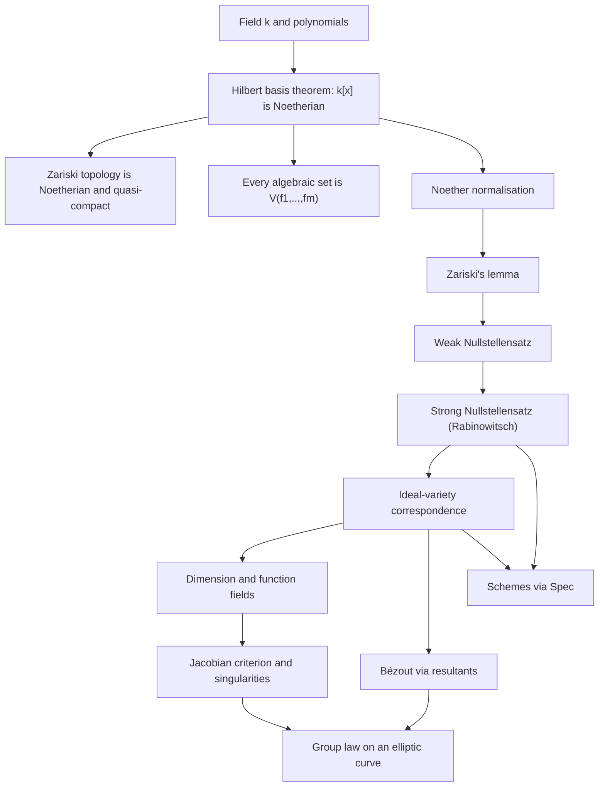

# Algebraic Geometry

> [Mathematics](../../README.md) › [Advanced Topics](../README.md) › Algebraic Geometry · Level: Advanced · Prerequisites: [Logic](../../00-foundations/02-logic/README.md), [Set Theory](../../00-foundations/03-set-theory/README.md), [Proof Techniques](../../00-foundations/04-proof-techniques/README.md), [Polynomials](../../03-algebra/06-polynomials/README.md), [Complex Numbers](../../03-algebra/13-complex-numbers/README.md), [Vector Spaces](../../08-linear-algebra/04-vector-spaces/README.md), [Determinants](../../08-linear-algebra/06-determinants/README.md), [Rings](../../13-abstract-algebra/02-rings/README.md), [Fields](../../13-abstract-algebra/03-fields/README.md), [Topological Spaces](../../17-topology/01-topological-spaces/README.md) · Estimated time: 14 h

## 1. Introduction

Algebraic geometry is the study of the solution sets of systems of polynomial equations. What makes it a subject, rather than a chapter of algebra, is a *dictionary*: every geometric operation on a solution set has an algebraic counterpart in a ring, and every algebraic operation on the ring has a geometric meaning. A circle is a set of points and also an ideal; intersecting two curves is solving two equations at once; a singular point is a place where a Jacobian matrix drops rank; and a rational map is an embedding of fields.

The dictionary answers three questions that motivate the whole subject.

**How many solutions are there?** Two lines meet in one point, a line and a conic in two, two conics in four.
This is not a coincidence and not always literally true — parallel lines meet nowhere, a tangent line meets a circle once. Bézout's theorem repairs both defects at once: work in the *projective* plane, which adds points at infinity, count over an *algebraically closed* field, and count *with multiplicity*. Then two curves of degrees $m$ and $n$ with no common component meet in exactly $mn$ points.

**Which equations define a given set?** Many different polynomials vanish on the same set. The set of *all*
of them is an ideal, and Hilbert's Nullstellensatz says exactly which ideals occur: precisely the radical ones, over an algebraically closed field. This converts the geometry of a set of points into the algebra of a ring, and the conversion loses nothing.

**What happens when the field changes?** The real circle $x^2 + y^2 = 1$ is a familiar curve, but
$x^2 + y^2 + 1 = 0$ has no real points and a perfectly good complex circle of points. Worse, $(x^2+1)$ is a maximal ideal of $\mathbb{R}[x]$ whose zero set is empty. The classical theory resolves this by insisting on algebraically closed fields; Grothendieck's theory of *schemes* resolves it by keeping the ring and treating its prime ideals as the points, so that the arithmetic of $\mathbb{Z}$ and the geometry of $\mathbb{C}[x,y]$ become two instances of one theory.

The subject has a long history with sharp turns: Bézout's counting theorem (1779), Riemann's surfaces and the birational viewpoint (1857), Dedekind and Weber's introduction of ideals into geometry (1882), Hilbert's basis theorem (1890) and Nullstellensatz (1893), Lasker and Noether's primary decomposition (1905), Zariski's topology and local rings (1935–1945), Weil's foundations (1946), Serre's sheaves (1955) and Grothendieck's schemes (1957–1966). The payoff is visible in Section 12: Fermat's Last Theorem, internet cryptography, coding theory and robot kinematics all run on the dictionary developed here.

This tutorial develops the classical core — varieties in affine and projective space, the ideal–variety dictionary, the Nullstellensatz, Bézout's theorem, dimension, singularities — and closes with elliptic curves and the idea of a scheme. It proves the Nullstellensatz only up to two standard commutative-algebra inputs (Noether normalisation and Krull's principal ideal theorem), which are stated precisely and sketched.

## 2. Prerequisites

You should be comfortable with:

* **Quantifiers, implication, and proof by contradiction** — [Logic](../../00-foundations/02-logic/README.md) and [Proof Techniques](../../00-foundations/04-proof-techniques/README.md). Almost every theorem here is a
  statement about *all* polynomials or *all* points, and the Nullstellensatz is proved by contradiction.
* **Sets, subsets, images and preimages, equivalence relations, cardinality** — [Set Theory](../../00-foundations/03-set-theory/README.md). Projective space is a set of equivalence classes; a variety is a subset of a product.
* **Polynomials in several variables, degree, factorisation, the division algorithm** — [Polynomials](../../03-algebra/06-polynomials/README.md). Ideals in $k[x_1,\dots,x_n]$ are the main algebraic objects; the UFD property of $k[x,y]$ is used repeatedly.
* **Complex numbers and the fundamental theorem of algebra** — [Complex Numbers](../../03-algebra/13-complex-numbers/README.md). Algebraically closed fields are the natural home of the theory; $\mathbb{C}$ is the model example.
* **Vector spaces, bases, dimension, linear maps, kernels and images** — [Vector Spaces](../../08-linear-algebra/04-vector-spaces/README.md). The tangent space is a kernel; the Jacobian criterion is a rank condition; dimension of a variety reduces to
  a transcendence degree, which is a dimension of a field extension.
* **Determinants and rank** — [Determinants](../../08-linear-algebra/06-determinants/README.md). The Jacobian matrix's rank decides smoothness in the worked examples.
* **Rings, ideals, quotients, maximal and prime ideals, integral domains, fields** — [Rings](../../13-abstract-algebra/02-rings/README.md). The dictionary is a theorem about ideals; you must know what $\mathfrak m \trianglelefteq R$ and $R/\mathfrak m$ mean.
* **Field extensions, algebraic elements, minimal polynomials, transcendence** — [Fields](../../13-abstract-algebra/03-fields/README.md). Algebraic closure appears in the Nullstellensatz; transcendence degree is the definition of dimension.
  [Galois Theory](../../13-abstract-algebra/04-galois-theory/README.md) is not required but makes the field
  theory in Section 7.9 familiar.
* **Topological spaces, closed sets, closure, density, compactness** — [Topological Spaces](../../17-topology/01-topological-spaces/README.md). The Zariski topology is a topology, and it is deliberately badly behaved (not Hausdorff).
* **Congruences and the ring $\mathbb{Z}/n\mathbb{Z}$** — [Congruences](../../12-number-theory/02-congruences/README.md). Finite fields $\mathbb{F}_p$ appear in the elliptic-curve examples and in the characteristic-$p$ transfer principle.

No prior algebraic geometry is assumed. The commutative algebra that is used — Noetherian rings, localisation, Krull's principal ideal theorem — is introduced here at the point of use; a systematic treatment belongs to a Commutative Algebra course, which the [Advanced Topics](../README.md) discipline lists as a separate topic.

## 3. Learning Objectives

After this tutorial you will be able to:

1. Translate between geometric statements about algebraic sets and algebraic statements about ideals, in both
   directions, for affine varieties over an algebraically closed field.
2. Compute $V(S)$ and $I(X)$ for explicit examples, decide whether an ideal is radical, prime or maximal, and
   decompose a reducible variety into irreducible components.
3. Prove Hilbert's basis theorem and explain why it makes the Zariski topology Noetherian and every algebraic
   set finitely defined.
4. State the weak and strong Nullstellensatz with all hypotheses, prove the weak form from Zariski's lemma,
   and derive the strong form by the Rabinowitsch trick.
5. Verify the axioms of the Zariski topology and distinguish it sharply from metric topologies.
6. Define the coordinate ring and prove that morphisms of affine varieties correspond contravariantly to
   $k$-algebra homomorphisms.
7. Work with projective space and homogeneous ideals: compute projective closures and points at infinity.
8. State Bézout's theorem precisely, compute intersection multiplicities in examples, and explain why each
   hypothesis is necessary.
9. Define dimension by transcendence degree and use it to distinguish curves, surfaces and points.
10. Decide smoothness of a hypersurface with the Jacobian criterion, and resolve a node and a cusp by blowing up.
11. Verify the group law on an elliptic curve with explicit formulas, and explain the elliptic-curve discrete
    logarithm problem and its use in key exchange.
12. Describe $\operatorname{Spec} R$ as a set, a topological space and a ringed space, and explain in which
    sense a scheme generalises a variety.

## 4. Intuition

**Equations as tests.** Think of a polynomial $f(x,y)$ as a *test* that a point $(a,b)$ either passes
($f(a,b)=0$) or fails. A variety is the set of points passing every test in a chosen collection $S$. The collection of *all* tests passed by a given set $X$ is written $I(X)$. Passing from $S$ to $I(V(S))$ is "closing up" the tests: adding every test that is a logical consequence of the ones you have. The Nullstellensatz says this closure operation is exactly taking the radical, so nothing is lost and nothing superfluous remains.

**Why ideals, not just equations.** If $f$ and $g$ both vanish on $X$, then $f+g$ vanishes on $X$; if $f$
vanishes on $X$ and $h$ is any polynomial, then $hf$ vanishes on $X$. So the natural collection of tests is closed under addition and under multiplication by arbitrary polynomials — that is precisely an ideal. Two different finite lists of equations generate the same ideal exactly when each list is a consequence of the other, and then they cut out the same set. So the ideal, not the list, is the invariant.

**Ideals remember more than the set.** In $\mathbb{A}^1$, the ideals $(x)$ and $(x^2)$ have the same zero set
$\{0\}$: both cut out the origin. But $(x^2)$ is not radical, and the Nullstellensatz tells us that it is not of the form $I(X)$ for any set $X$. The extra information in $(x^2)$ is a *multiplicity* — the origin counted twice. Classical algebraic geometry discards that information by taking radicals; scheme theory keeps it, and that is why $(x^2)$ defines a "thickened point" rather than a point. Multiplicities are not a technicality: Bézout's theorem is false without them, and a double root of a polynomial is a tangency.

**A very coarse topology.** Declare a set closed when it is cut out by polynomial equations. Polynomials are
rigid: a nonzero polynomial in one variable has finitely many roots, so in $\mathbb{A}^1$ the closed sets are exactly the finite sets and the whole line. That is the cofinite topology, not the familiar one. In $\mathbb{A}^n$ with $n \ge 1$ over an infinite field, any two nonempty open sets intersect, so the space is nowhere near Hausdorff, and every nonempty open set is dense. This coarseness is a feature: it means that a "generic" point of a variety has every property that holds on a nonempty Zariski open set, which is how statements like "a generic cubic is smooth" are made precise.

**Adding infinity.** Two parallel lines should meet, and a tangent line should meet a circle twice. Projective
space repairs both: it adds a point at infinity in each direction, and a line that was tangent now meets the circle at the tangency point with multiplicity two. Bézout's theorem is the exact statement that after these two repairs (projective space, algebraic closure) the naive count $mn$ becomes true with no exceptions.

**Changing the field changes the picture.** Over $\mathbb{R}$, $x^2+y^2+1=0$ is a circle with no points; over
$\mathbb{C}$ it is an honest conic. Over $\mathbb{F}_p$ the same equation describes a finite set of points, and counting them is the beginning of arithmetic geometry. The algebraic object — the ring $k[x,y]/(x^2+y^2+1)$ — is the same formula in all three cases, which is why the modern theory prefers to study rings and their spectra rather than point sets.

## 5. Formal Definitions

Throughout, $k$ is a field, $n \ge 1$ is an integer, and $k[x_1,\dots,x_n]$ is the polynomial ring in $n$ variables with coefficients in $k$. For a set $S \subseteq k[x_1,\dots,x_n]$, the symbol $\langle S \rangle$ denotes the ideal generated by $S$, that is, the set of all finite sums $\sum_i h_i f_i$ with $h_i \in k[x_1,\dots,x_n]$ and $f_i \in S$.

**Definition 5.1 (Affine $n$-space).** The affine $n$-space over $k$ is the set
$$\mathbb{A}^n(k) := \{(a_1,\dots,a_n) : a_i \in k\} = k^n.$$
When $k$ is fixed by context we write $\mathbb{A}^n$. Its elements are called **points**, and a point is written $P = (a_1,\dots,a_n)$ or, when confusion with projective coordinates is possible, $P = (a_1:\dots:a_n)$.

The word *affine* marks the absence of a distinguished origin: only polynomial expressions in the coordinates are meaningful, which is why projective space (5.9) will be the more symmetric setting.

**Definition 5.2 (Zero set, or vanishing set).** For $S \subseteq k[x_1,\dots,x_n]$ the **zero set** of $S$ is
$$V(S) := \{P \in \mathbb{A}^n : f(P) = 0 \text{ for every } f \in S\}.$$
A subset $X \subseteq \mathbb{A}^n$ is an **affine algebraic set** if $X = V(S)$ for some $S$.

**Definition 5.3 (Ideal of a set).** For $X \subseteq \mathbb{A}^n$ the **ideal of** $X$ is
$$I(X) := \{f \in k[x_1,\dots,x_n] : f(P) = 0 \text{ for every } P \in X\}.$$

A set $X$ is **algebraic** exactly when $X = V(I(X))$: the inclusion $X \subseteq V(I(X))$ is automatic, and the content is that every point outside $X$ is detected by some polynomial vanishing on $X$. This fails for arbitrary subsets: $X = \mathbb{Z} \subseteq \mathbb{A}^1(\mathbb{C})$ has $I(X) = (0)$, so $V(I(X)) = \mathbb{A}^1 \ne X$.

**Definition 5.4 (Radical).** An ideal $J \trianglelefteq R$ is **radical** if $f^m \in J$ for some $m \ge 1$
implies $f \in J$. The **radical** of an ideal $J$ is
$$\sqrt{J} := \{f \in R : f^m \in J \text{ for some } m \ge 1\}.$$
The radical $\sqrt J$ is an ideal containing $J$, and $\sqrt{\sqrt J} = \sqrt J$.

**Definition 5.5 (Irreducible).** A nonempty topological space $X$ is **irreducible** if it cannot be written as
$X = X_1 \cup X_2$ with $X_1, X_2$ proper closed subsets of $X$. A nonempty algebraic set is an **affine variety** if it is irreducible with respect to the Zariski topology of Definition 5.6.

The terminology is not uniform in the literature: some authors call every algebraic set a variety. This tutorial follows the convention above and says "algebraic set" when irreducibility is not assumed. The distinction matters because $V(xy) \subseteq \mathbb{A}^2$ is the union of the two axes, and the coordinate ring of a reducible set has zero divisors, so it is not a domain and has no field of fractions.

**Definition 5.6 (Zariski topology).** The **Zariski topology** on $\mathbb{A}^n$ is the topology whose closed
sets are the algebraic sets of Definition 5.2. Thus a set $U$ is open iff $U = \mathbb{A}^n \setminus V(S)$ for some $S$.

That this really is a topology is Proposition 7.21: finite unions and arbitrary intersections of algebraic sets are algebraic, $\varnothing = V(1)$ and $\mathbb{A}^n = V(0)$.

**Definition 5.7 (Coordinate ring).** Let $X \subseteq \mathbb{A}^n$ be an algebraic set. Its **coordinate
ring** (or **affine ring**) is
$$A(X) := k[x_1,\dots,x_n] \big/ I(X).$$
The images of $x_1,\dots,x_n$ in $A(X)$ are the **coordinate functions**; they generate $A(X)$ as a $k$-algebra, and they separate points of $X$ in the sense that for $P \ne Q$ in $X$ some coordinate function takes different values at $P$ and $Q$.

**Definition 5.8 (Morphism of affine algebraic sets).** Let $X \subseteq \mathbb{A}^n$ and $Y \subseteq
\mathbb{A}^m$ be algebraic sets. A map $\varphi : X \to Y$ is a **morphism** (or **regular map**) if there exist polynomials $f_1,\dots,f_m \in k[x_1,\dots,x_n]$ such that
$$\varphi(P) = (f_1(P),\dots,f_m(P)) \quad \text{for all } P \in X.$$
An **isomorphism** is a morphism with an inverse morphism. A morphism $X \to \mathbb{A}^1$ is a **regular function** on $X$; the regular functions on $X$ form the ring $A(X)$ (Theorem 7.25 with $Y = \mathbb{A}^1$).

**Definition 5.9 (Projective space).** The **projective $n$-space** over $k$ is
$$\mathbb{P}^n(k) := \bigl(k^{n+1} \setminus \{0\}\bigr) \big/ \sim, \qquad (a_0,\dots,a_n) \sim (b_0,\dots,b_n) \iff \exists \lambda \in k^\times : b_i = \lambda a_i.$$
The equivalence class of $(a_0,\dots,a_n)$ is written $[a_0 : \dots : a_n]$, and the entries are **homogeneous coordinates**, defined only up to simultaneous scaling by a nonzero scalar. The point $[0:\dots:0]$ does not exist: the tuple $(0,\dots,0)$ is excluded.

The **standard affine charts** are the subsets $U_i := \{[a_0:\dots:a_n] : a_i \ne 0\}$, $i = 0,\dots,n$, each identified with $\mathbb{A}^n$ by dividing by $a_i$:
$$U_i \to \mathbb{A}^n, \quad [a_0:\dots:a_n] \mapsto \Bigl(\tfrac{a_0}{a_i}, \dots, \widehat{\tfrac{a_i}{a_i}}, \dots, \tfrac{a_n}{a_i}\Bigr),$$
where the hat means the entry is omitted. The complement $\mathbb{P}^n \setminus U_i = \{[a] : a_i = 0\} \cong \mathbb{P}^{n-1}$ is the **hyperplane at infinity** of the chart $U_i$.

**Definition 5.10 (Homogeneous polynomial, homogeneous ideal).** A polynomial $F \in k[x_0,\dots,x_n]$ is
**homogeneous of degree $d$** if every monomial occurring in $F$ has total degree $d$; equivalently,
$F(\lambda x_0,\dots,\lambda x_n) = \lambda^d F(x_0,\dots,x_n)$ for all $\lambda \in k$. An ideal $J \trianglelefteq k[x_0,\dots,x_n]$ is **homogeneous** if it is generated by homogeneous polynomials, equivalently if it contains, together with each $F$, all homogeneous components of $F$.

For $S$ a set of homogeneous polynomials, the **projective zero set** is
$$V_p(S) := \{[a] \in \mathbb{P}^n : F(a) = 0 \text{ for every } F \in S\}.$$
This is well defined because $F(a) = 0 \iff F(\lambda a) = \lambda^d F(a) = 0$ for $\lambda \ne 0$: the condition depends only on the equivalence class. A **projective algebraic set** is a set $V_p(S)$; it is a
**projective variety** if it is irreducible.

**Definition 5.11 (Function field and dimension).** Let $X$ be an irreducible affine algebraic set. Because
$I(X)$ is prime (Proposition 7.4), $A(X)$ is an integral domain, and its fraction field
$$k(X) := \operatorname{Frac} A(X)$$
is the **function field** of $X$; its elements are **rational functions** on $X$. The **dimension** of $X$ is
$$\dim X := \operatorname{tr.deg}_k k(X),$$
the transcendence degree of $k(X)$ over $k$, that is, the maximal cardinality of an algebraically independent subset of $k(X)$.

Equivalently, $\dim X$ is the supremum of the lengths $d$ of chains $X_0 \subsetneq X_1 \subsetneq \dots \subsetneq X_d$ of nonempty irreducible closed subsets of $X$ (Theorem 7.41). The equivalence is not obvious and is one of the places where commutative algebra enters.

**Definition 5.12 (Jacobian, tangent space, smooth point).** Let $X \subseteq \mathbb{A}^n$ be an irreducible
affine variety of dimension $d$, and suppose $I(X) = (f_1,\dots,f_m)$. The **Jacobian matrix** at $P \in X$ is the $m \times n$ matrix
$$J_f(P) := \begin{pmatrix} \dfrac{\partial f_1}{\partial x_1}(P) & \cdots & \dfrac{\partial f_1}{\partial x_n}(P)\\[2mm] \vdots & & \vdots\\[1mm] \dfrac{\partial f_m}{\partial x_1}(P) & \cdots & \dfrac{\partial f_m}{\partial x_n}(P)\end{pmatrix},$$
and the **Zariski tangent space** of $X$ at $P$ is
$$T_P X := \ker J_f(P) = \{v \in k^n : J_f(P)\,v = 0\} \subseteq k^n.$$

A point $P \in X$ is **smooth** (or **nonsingular**, or **regular**) if $\operatorname{rank} J_f(P) = n - d$; otherwise $P$ is **singular**. The variety $X$ is **smooth** if every point is smooth. The definition does not depend on the chosen generators of $I(X)$ (Theorem 7.46), and $\dim T_P X = n - \operatorname{rank} J_f(P) \ge d$ always, with equality exactly at smooth points.

**Definition 5.13 (Intersection multiplicity).** Let $C = V_p(F)$ and $D = V_p(G)$ be projective plane curves
with no common irreducible component, and let $P \in C \cap D$. The **local ring** of $\mathbb{P}^2$ at $P$ is
$$\mathcal O_{P} := \Bigl\{\tfrac{h_1}{h_2} : h_1, h_2 \in k[x_0,x_1,x_2] \text{ homogeneous of the same degree},\ h_2(P) \ne 0\Bigr\} \Big/ \sim,$$
where two fractions are identified when they agree on a nonempty open neighbourhood of $P$; it is a local ring with maximal ideal $\mathfrak m_P = \{h_1/h_2 \in \mathcal O_P : h_1(P) = 0\}$. The **intersection multiplicity** of $C$ and $D$ at $P$ is
$$I_P(C,D) := \dim_k \bigl(\mathcal O_P / (F,G)\bigr).$$
This is a non-negative integer, finite exactly because $F$ and $G$ have no common component, and it is $\ge 1$ exactly when $P \in C \cap D$. For a curve and a line in a coordinate chart it equals the multiplicity of the corresponding root of the one-variable equation obtained by substitution.

**Definition 5.14 (Spectrum of a ring).** Let $R$ be a commutative ring with $1$. Its **spectrum** is the set
$$\operatorname{Spec} R := \{\mathfrak p \trianglelefteq R : \mathfrak p \text{ is a prime ideal}\}.$$
The **Zariski topology** on $\operatorname{Spec} R$ has closed sets $V(I) := \{\mathfrak p : I \subseteq \mathfrak p\}$ for ideals $I \trianglelefteq R$; the sets $D(f) := \{\mathfrak p : f \notin \mathfrak p\} = \operatorname{Spec} R \setminus V(f)$ form a basis of open sets.

For $\mathfrak p \in \operatorname{Spec} R$ the **residue field** is $\kappa(\mathfrak p) := \operatorname{Frac}(R/\mathfrak p) = R_{\mathfrak p}/\mathfrak p R_{\mathfrak p}$, where $R_{\mathfrak p} = \{a/s : a \in R, s \notin \mathfrak p\}$ is the localisation at $\mathfrak p$.

**Definition 5.15 (Structure sheaf, idea).** The **structure sheaf** $\mathcal O_{\operatorname{Spec} R}$ assigns
to each distinguished open $D(f)$ the localisation
$$\mathcal O_{\operatorname{Spec} R}(D(f)) := R_f = \Bigl\{\tfrac{a}{f^k} : a \in R,\ k \ge 0\Bigr\}$$
and to an inclusion $D(g) \subseteq D(f)$ the natural map $R_f \to R_g$. On a general open set $U$ the sections are the functions that are locally of this form, glued: $\mathcal O(U) := \{(s_\alpha) \text{ compatible on overlaps}\}$. The stalk at $\mathfrak p$ is $\mathcal O_{\operatorname{Spec} R,\mathfrak p} = R_{\mathfrak p}$.

A **locally ringed space** is a topological space with a sheaf of rings whose stalks are local rings. A
**scheme** is a locally ringed space that is locally isomorphic, as a locally ringed space, to
$(\operatorname{Spec} R, \mathcal O_{\operatorname{Spec} R})$ for some ring $R$. This tutorial treats schemes at the level of this definition and the examples of Section 7.12; the full theory requires sheaf cohomology.

## 6. Mathematical Notation

| Symbol | Read as | Meaning |
|---|---|---|
| $k$ | the base field | an arbitrary field unless stated; algebraically closed where required |
| $\bar k$ | the algebraic closure of $k$ | every polynomial over $\bar k$ splits into linear factors |
| $k^\times$ | $k$ without zero | the multiplicative group of nonzero elements |
| $\mathbb{A}^n$, $\mathbb{A}^n(k)$ | affine $n$-space | $k^n$ as a set, with the Zariski topology |
| $\mathbb{P}^n$, $\mathbb{P}^n(k)$ | projective $n$-space | equivalence classes $[a_0:\dots:a_n]$ |
| $k[x_1,\dots,x_n]$ | polynomial ring in $n$ variables | coefficients in $k$ |
| $V(S)$ | the zero set of $S$ | $\{P : f(P) = 0\ \forall f \in S\}$ |
| $V_p(S)$ | the projective zero set | the same in homogeneous coordinates |
| $I(X)$ | the ideal of $X$ | all polynomials vanishing on $X$ |
| $\langle S \rangle$ | ideal generated by $S$ | finite sums $\sum h_i f_i$ |
| $\sqrt{J}$ | the radical of $J$ | $\{f : f^m \in J \text{ for some } m \ge 1\}$ |
| $A(X)$ | coordinate ring of $X$ | $k[x_1,\dots,x_n]/I(X)$ |
| $k(X)$ | function field of $X$ | $\operatorname{Frac} A(X)$ for $X$ irreducible |
| $\operatorname{tr.deg}_k K$ | transcendence degree | size of a transcendence basis of $K/k$ |
| $\dim X$ | dimension of $X$ | $\operatorname{tr.deg}_k k(X)$ |
| $\mathfrak m, \mathfrak p$ | fraktur m, fraktur p | a maximal, respectively prime, ideal |
| $R_{\mathfrak p}$, $R_f$ | localisations | fractions with denominators outside $\mathfrak p$, or powers of $f$ |
| $\kappa(\mathfrak p)$ | residue field at $\mathfrak p$ | $\operatorname{Frac}(R/\mathfrak p)$ |
| $\operatorname{Spec} R$ | spectrum of $R$ | the set of prime ideals of $R$, as a scheme |
| $D(f)$ | the distinguished open | $\{\mathfrak p : f \notin \mathfrak p\}$ |
| $\mathcal O_X$, $\mathcal O_{X,P}$ | structure sheaf, stalk | rings of local regular functions |
| $J_f(P)$ | Jacobian matrix | $\bigl(\partial f_i/\partial x_j(P)\bigr)$ |
| $T_P X$ | tangent space at $P$ | $\ker J_f(P)$ |
| $I_P(C,D)$ | intersection multiplicity | $\dim_k \mathcal O_P/(F,G)$ |
| $\Delta$ | discriminant | $-16(4a^3+27b^2)$ for $y^2 = x^3+ax+b$ |
| $E(k)$ | the group of $k$-points | an elliptic curve with its group law |
| $\operatorname{Hom}_{\mathrm{alg}}(X,Y)$ | morphisms $X \to Y$ | regular maps, Definition 5.8 |

## 7. Core Concepts

### 7.1 The geometry–algebra dictionary

The dictionary is the content of the subject. Its entries are proved in the subsections that follow; the table is the map, not the territory.

| Geometry | Algebra |
|---|---|
| affine space $\mathbb{A}^n$ | polynomial ring $k[x_1,\dots,x_n]$ |
| a point $P = (a_1,\dots,a_n)$ | the maximal ideal $\mathfrak m_P = (x_1-a_1,\dots,x_n-a_n)$ |
| algebraic set $X$ | radical ideal $I(X)$ |
| $X \subseteq Y$ | $I(X) \supseteq I(Y)$ |
| $X \cup Y$ | $I(X) \cap I(Y)$ |
| $X \cap Y$ | $\sqrt{I(X)+I(Y)}$ |
| $X$ irreducible | $I(X)$ prime |
| a single point | a maximal ideal |
| dimension of $X$ | transcendence degree of $k(X)$; Krull dimension of $A(X)$ |
| morphism $X \to Y$ | $k$-algebra homomorphism $A(Y) \to A(X)$ |
| isomorphism $X \cong Y$ | isomorphism $A(X) \cong A(Y)$ |
| product $X \times Y$ | tensor product $A(X) \otimes_k A(Y)$ |
| disjoint union $X \sqcup Y$ | product ring $A(X) \times A(Y)$ |
| a smooth point | a regular local ring $\mathcal O_{X,P}$ |
| projective space $\mathbb{P}^n$ | the graded ring $k[x_0,\dots,x_n]$ |

Every entry is a theorem, and each needs its hypotheses. In particular the first column is only equivalent to the second over an algebraically closed field (except for the entries about inclusion, union, irreducibility and morphisms, which hold over any field).

**Lemma 7.1 (elementary properties).** Let $S, T \subseteq k[x_1,\dots,x_n]$ and $X, Y \subseteq \mathbb{A}^n$.

1. If $S \subseteq T$ then $V(T) \subseteq V(S)$; if $X \subseteq Y$ then $I(Y) \subseteq I(X)$.
2. $V(S) = V(\langle S \rangle)$, and $I(X)$ is a radical ideal.
3. $V(I(X)) \supseteq X$, with equality if and only if $X$ is an algebraic set.
4. $I(V(J)) \supseteq \sqrt J$ for every ideal $J$, and $V(\sqrt J) = V(J)$.

**Proof.** (1) A point satisfying more equations satisfies fewer: if $P \in V(T)$ then $f(P) = 0$ for all $f \in T$,
hence for all $f \in S \subseteq T$. The second claim is the same statement read backwards.

(2) $\langle S \rangle$ consists of finite sums $\sum h_i f_i$ with $f_i \in S$, and such a sum vanishes wherever all $f_i$ vanish; so $V(\langle S\rangle) \subseteq V(S)$, while $S \subseteq \langle S\rangle$ gives the reverse inclusion by (1). If $f^m \in I(X)$ then $f(P)^m = 0$ for all $P \in X$, so $f(P) = 0$ because $k$ is a field and hence has no nilpotents; thus $I(X)$ is radical.

(3) $P \in V(I(X))$ means every polynomial vanishing on $X$ vanishes at $P$. Every $P \in X$ has this property, so $X \subseteq V(I(X))$. If $X = V(J)$ is algebraic and $P \notin X$, then some $f \in J$ has $f(P) \ne 0$, and $f \in J \subseteq I(V(J)) = I(X)$, so $P \notin V(I(X))$. Hence $V(I(X)) \subseteq X$. If $X$ is not algebraic then $V(I(X)) \supsetneq X$ by definition of "algebraic".

(4) If $f \in \sqrt J$ then $f^m \in J$ for some $m$, so $f^m$ vanishes on $V(J)$, hence $f$ vanishes on $V(J)$, i.e. $f \in I(V(J))$. For the second claim, $J \subseteq \sqrt J$ gives $V(\sqrt J) \subseteq V(J)$, and the first part with $X = V(J)$ gives $V(J) = V(I(V(J))) \subseteq V(\sqrt J)$. $\blacksquare$

### 7.2 Affine algebraic sets and the ideal of a variety

**Example 7.2 (the basic examples).** In $\mathbb{A}^2$:

* $V(x^2+y^2-1)$ is the circle of radius $1$ over $\mathbb{R}$, and a conic over any field of characteristic $\ne 2$ in which $1$ has a square root.
* $V(y-x^2)$ is a parabola, and $V(y)$ is the $x$-axis; their intersection $V(y-x^2, y) = V(y, x^2) = \{(0,0)\}$.
* $V(xy)$ is the union of the two axes; $V(x^2-y^2) = V((x-y)(x+y))$ is the union of the two diagonal lines.
* $V(x^2+y^2)$ over $\mathbb{R}$ is the single point $\{(0,0)\}$, but over $\mathbb{C}$ it is the union of the two lines $x = \pm iy$. The *ideal* $(x^2+y^2)$ is the same; the geometry changes with the field, and this is
  precisely what the Nullstellensatz constrains.
* $V(x^2, y) = \{(0,0)\}$ and $V(x,y) = \{(0,0)\}$: the same set, different ideals. The first is not radical.

**Proposition 7.3 (finite intersections of hypersurfaces).** Assume $k[x_1,\dots,x_n]$ is Noetherian (Corollary
7.10). Then every algebraic set in $\mathbb{A}^n$ is of the form $V(f_1,\dots,f_m)$ for finitely many polynomials
$f_i$, hence is a finite intersection of hypersurfaces $V(f_i)$.

**Proof.** $X = V(J)$ for some ideal $J$; by Corollary 7.10 the ideal $J$ is generated by $f_1,\dots,f_m$; by Lemma
7.1(2), $V(J) = V(\langle f_1,\dots,f_m\rangle) = V(f_1) \cap \dots \cap V(f_m)$. $\blacksquare$

**Proposition 7.4 (irreducibility is primality).** Let $X \subseteq \mathbb{A}^n$ be a nonempty algebraic set. Then
$X$ is irreducible if and only if $I(X)$ is a prime ideal. In that case $A(X)$ is an integral domain.

**Proof.** Suppose $X$ is irreducible and $fg \in I(X)$ with $f \notin I(X)$. Then $X \not\subseteq V(f)$, but
$X \subseteq V(fg) = V(f) \cup V(g)$ by the identity proved in Proposition 7.21. Intersecting with $X$,
$$X = (X \cap V(f)) \cup (X \cap V(g)),$$
a union of two closed subsets of $X$; the first is proper because $f \notin I(X)$ means some point of $X$ has $f \ne 0$. Irreducibility forces $X = X \cap V(g)$, i.e. $g \in I(X)$. Hence $I(X)$ is prime.

Conversely suppose $I(X)$ is prime and $X = X_1 \cup X_2$ with $X_i$ closed in $X$, so $X_i = X \cap V(J_i)$. Then $I(X) = I(X_1) \cap I(X_2) \supseteq I(X_1) I(X_2)$, and $I(X)$ prime forces $I(X_1) \subseteq I(X)$ or $I(X_2) \subseteq I(X)$ because a prime containing a product contains a factor. Say $I(X_1) \subseteq I(X)$; then $X = V(I(X)) \subseteq V(I(X_1)) = X_1$, so $X_1 = X$. Hence $X$ is irreducible. That $A(X)$ is a domain is exactly primality of $I(X)$ in the quotient. $\blacksquare$

**Definition 7.5 (irreducible components).** The **irreducible components** of an algebraic set $X$ are the
maximal nonempty irreducible closed subsets of $X$. The set $X$ is irreducible precisely when it has exactly one component, namely itself.

**Proposition 7.6 (decomposition into components).** Every nonempty algebraic set $X \subseteq \mathbb{A}^n$ is a
finite union $X = X_1 \cup \dots \cup X_r$ of irreducible algebraic sets with $X_i \not\subseteq X_j$ for $i \ne j$; the $X_i$ are the irreducible components, and the decomposition is unique up to order.

**Proof.** Existence: if $X$ is not irreducible, $X = Y \cup Z$ with $Y, Z$ proper closed; if either is reducible,
split again. This process must terminate because otherwise it produces an infinite strictly decreasing chain of closed sets, contradicting the descending chain condition of Corollary 7.10. Uniqueness: if $X = \bigcup_i X_i = \bigcup_j X'_j$ are two such decompositions, then $X_1 = \bigcup_j (X_1 \cap X'_j)$; irreducibility of $X_1$ gives $X_1 \subseteq X'_j$ for some $j$, and maximality of $X'_j$ gives $X'_j \subseteq X_{i}$ for some $i$; then $X_1 \subseteq X'_j \subseteq X_i$ forces $i = 1$ and $X_1 = X'_j$. $\blacksquare$

The **coordinate ring detects the decomposition**: if $X_1,\dots,X_r$ are the irreducible components of $X$, then $A(X) \cong \prod_i A(X_i)$, and there are orthogonal idempotents $e_1,\dots,e_r$ with $\sum e_i = 1$. This is why a reducible algebraic set has a coordinate ring with zero divisors.

### 7.3 Hilbert's basis theorem and Noetherian rings

**Definition 7.7 (Noetherian ring).** A commutative ring $R$ with $1$ is **Noetherian** if every ideal of $R$ is
finitely generated.

**Proposition 7.8 (equivalent forms).** For a ring $R$ the following are equivalent.

1. Every ideal of $R$ is finitely generated.
2. Every ascending chain $I_1 \subseteq I_2 \subseteq \cdots$ of ideals of $R$ stabilises: there is $N$ with
   $I_n = I_N$ for all $n \ge N$.
3. Every nonempty set $\Sigma$ of ideals of $R$ has a maximal element under inclusion.

**Proof.** (1) $\Rightarrow$ (2): let $I = \bigcup_n I_n$, an ideal because the chain is ascending. By (1),
$I = (a_1,\dots,a_k)$; each $a_j$ lies in some $I_{n_j}$; taking $N = \max n_j$ we get $a_j \in I_N$ for all $j$, so $I = I_N$ and the chain stabilises. (2) $\Rightarrow$ (3): if $\Sigma$ had no maximal element, choose $I_1 \in \Sigma$ and then $I_{n+1} \supsetneq I_n$ in $\Sigma$, giving an infinite ascending chain. (3) $\Rightarrow$ (1): if an ideal $I$ is not finitely generated, the ideals generated by any $n$ chosen elements form a strictly ascending chain without a maximal element in the set of finitely generated subideals of $I$; the union contradicts (3). $\blacksquare$

**Theorem 7.9 (Hilbert's basis theorem).** If $R$ is Noetherian then the polynomial ring $R[x]$ is Noetherian.

**Proof.** Let $I \trianglelefteq R[x]$. For $d \ge 0$ let $L_d$ be the set of leading coefficients of elements of
$I$ of degree exactly $d$, together with $0$. Then $L_d$ is an ideal of $R$: if $a, b \in L_d$ come from $f, g \in I$ of degree $d$, then $f+g \in I$ has degree $\le d$ and leading coefficient $a+b$ (or degree $< d$ if $a+b = 0$), and $ra$ comes from $rf$. Moreover $L_0 \subseteq L_1 \subseteq \cdots$, because multiplying a degree $d$ element by $x$ gives a degree $d+1$ element of $I$ with the same leading coefficient.

Since $R$ is Noetherian, Proposition 7.8(2) applied to the chain $(L_d)$ gives $N$ with $L_d = L_N$ for all $d \ge N$. Each $L_d$ is finitely generated over $R$; choose generators $a_{d,1},\dots,a_{d,m_d}$ and polynomials $f_{d,i} \in I$ of degree $d$ with leading coefficient $a_{d,i}$, for $0 \le d \le N$. Let $I' \subseteq I$ be the ideal generated by all the $f_{d,i}$.

**Claim.** $I = I'$. Suppose not, and pick $f \in I \setminus I'$ of minimal degree $d$. Write $a$ for the leading
coefficient of $f$. If $d \le N$ then $a \in L_d$, so $a = \sum_i r_i a_{d,i}$ with $r_i \in R$, and
$$g := f - \sum_i r_i f_{d,i} \in I$$
has degree $< d$ (the degree-$d$ terms cancel by construction). By minimality of $d$, $g \in I'$, hence $f = g + \sum r_i f_{d,i} \in I'$, contradiction. If $d > N$ then $L_d = L_N$, so $a = \sum_i r_i a_{N,i}$, and
$$g := f - \sum_i r_i x^{d-N} f_{N,i} \in I$$
again has degree $< d$, giving the same contradiction. Therefore $I = I'$ is finitely generated. $\blacksquare$

**Corollary 7.10.** For any field $k$ and any $n \ge 1$, the ring $k[x_1,\dots,x_n]$ is Noetherian. Hence every
ideal is finitely generated, every algebraic set is cut out by finitely many equations, and every descending chain $X_1 \supseteq X_2 \supseteq \cdots$ of algebraic sets stabilises.

**Proof.** A field has only the ideals $(0)$ and $(1)$, so it is Noetherian; apply Theorem 7.9 $n$ times. The
descending chain condition follows from Lemma 7.1(1): an ascending chain of ideals gives a descending chain of zero sets, and conversely a descending chain $X_n$ gives the ascending chain $I(X_1) \subseteq I(X_2) \subseteq \cdots$ of ideals, which stabilises, hence $X_n = V(I(X_n))$ stabilises. $\blacksquare$

**Remark 7.11 (noetherianity is inherited by quotients).** Quotients and localisations of a Noetherian ring are Noetherian, which is why coordinate rings inherit the property; subrings need not be, so the hypothesis of Theorem 7.9 cannot be weakened to "subring of a polynomial ring".

**Theorem 7.12 (Noetherian spaces).** Let $X$ be a topological space in which every descending chain of closed sets
stabilises (a **Noetherian space**). Then (a) every open cover of $X$ has a finite subcover, and (b) every nonempty closed subset of $X$ is a finite union of irreducible closed subsets.

**Proof.** (a) Let $\{U_\lambda\}$ be an open cover and suppose no finite subfamily covers. Choose a countable
subfamily recursively: given $U_1,\dots,U_n$ not covering, pick $x_{n+1} \notin U_1 \cup \dots \cup U_n$ and some $U_{n+1}$ containing it. Then the closed sets $F_n = X \setminus (U_1 \cup \dots \cup U_n)$ form a strictly descending chain, contradiction. (b) The argument of Proposition 7.6 uses only the descending chain condition. $\blacksquare$

The Zariski topology of $\mathbb{A}^n$ is Noetherian by Corollary 7.10, and hence quasi-compact (every open cover has a finite subcover) — a strong statement about a topology with so few open sets.

### 7.4 The Nullstellensatz

**Definition 7.13 (algebraically closed field).** A field $k$ is **algebraically closed** if every nonconstant
polynomial in $k[t]$ has a root in $k$; equivalently, every nonconstant polynomial is a product of linear factors; equivalently, the only irreducible polynomials are the linear ones. The **algebraic closure** $\bar k$ is the smallest algebraically closed field containing $k$; it exists and is unique up to $k$-isomorphism. Examples: $\mathbb{C} = \bar{\mathbb{R}}$, $\overline{\mathbb{Q}}$, and $\overline{\mathbb{F}_p}$.

Two standard commutative-algebra facts are needed. Both are stated with hypotheses and proved or sketched.

**Theorem 7.14 (Noether normalisation).** Let $A$ be a finitely generated $k$-algebra which is an integral domain,
say $A = k[x_1,\dots,x_n]/I$. Then there exist elements $y_1,\dots,y_d \in A$, algebraically independent over $k$, such that $A$ is a finitely generated module over the polynomial ring $k[y_1,\dots,y_d]$; equivalently, $A$ is integral over $k[y_1,\dots,y_d]$.

**Proof sketch.** It suffices to treat $A = k[x_1,\dots,x_n]$ (pass to the quotient at the end). Induct on $n$; for
$n = 0$ take $d = 0$. If $x_1,\dots,x_n$ are algebraically independent, take $y_i = x_i$ and $d = n$. Otherwise choose a nonzero polynomial $f$ with $f(x) = 0$; let $f_r$ be its homogeneous component of top degree $r$. Assume first that $k$ is infinite. Substitute
$$x_i = y_i + c_i y_n \ (1 \le i < n), \qquad x_n = y_n,$$
with $c_i \in k$ to be chosen. Then
$$f(y_1 + c_1y_n, \dots, y_{n-1}+c_{n-1}y_n, y_n)$$
has degree $r$ in $y_n$ with leading coefficient $f_r(c_1,\dots,c_{n-1},1)$, a nonzero polynomial in $(c_1,\dots,c_{n-1})$; since $k$ is infinite it has a point where it does not vanish. With that choice, $y_n$ is integral over $k[y_1,\dots,y_{n-1}]$, so $k[x_1,\dots,x_n] = k[y_1,\dots,y_n]$ is integral over $k[y_1,\dots,y_{n-1}]$, and induction on $n$ finishes. For finite $k$, use the substitution $x_i = y_i + y_n^{N^i}$ with $N > r$, which makes the leading term of $y_n$ unique. $\blacksquare$

**Lemma 7.15 (integral extensions of fields).** Let $B \subseteq A$ be rings with $A$ integral over $B$. If $A$ is a
field, then $B$ is a field.

**Proof.** Let $0 \ne b \in B$; then $b$ is invertible in $A$. Integrality of $b^{-1}$ over $B$ gives
$$b^{-m} + c_{m-1}b^{-(m-1)} + \dots + c_1 b^{-1} + c_0 = 0, \qquad c_i \in B.$$
Multiplying by $b^{m-1}$ yields
$$b^{-1} = -\bigl(c_{m-1} + c_{m-2}b + \dots + c_0 b^{m-1}\bigr) \in B. \qquad \blacksquare$$

**Theorem 7.16 (Zariski's lemma).** If $A$ is a field and a finitely generated $k$-algebra, then $A$ is algebraic
over $k$.

**Proof.** By Theorem 7.14, $A$ is integral over a polynomial ring $k[y_1,\dots,y_d] \subseteq A$. Since $A$ is a
field, Lemma 7.15 makes $k[y_1,\dots,y_d]$ a field. A polynomial ring in $d$ variables is a field only when $d = 0$: for $d \ge 1$, $y_1$ is not invertible, since $1 = y_1 \cdot h$ has degree $1 + \deg h > 0$ on the right. Hence $d = 0$ and $A$ is integral, i.e. algebraic, over $k$. $\blacksquare$

**Theorem 7.17 (weak Nullstellensatz).** Let $k$ be algebraically closed and let $I \subsetneq
k[x_1,\dots,x_n]$ be a proper ideal. Then $V(I) \ne \varnothing$. Equivalently, every maximal ideal of $k[x_1,\dots,x_n]$ is of the form
$$\mathfrak m_P = (x_1 - a_1, \dots, x_n - a_n)$$
for a unique point $P = (a_1,\dots,a_n) \in \mathbb{A}^n$.

**Proof.** A proper ideal is contained in a maximal ideal $\mathfrak m$ (by Zorn's lemma applied to the set of proper
ideals containing $I$, ordered by inclusion), and $V(\mathfrak m) \subseteq V(I)$, so it suffices to treat a maximal ideal $\mathfrak m$. The quotient $K := k[x_1,\dots,x_n]/\mathfrak m$ is a field, and it is a finitely generated $k$-algebra (generated by the images of the $x_i$). By Theorem 7.16, $K$ is algebraic over $k$; since $k$ is algebraically closed, $K = k$. Let $a_i$ be the image of $x_i$ under the resulting isomorphism $K \cong k$. Then every $f \in \mathfrak m$ has $f(a_1,\dots,a_n) = 0$, so $\mathfrak m \subseteq \mathfrak n := (x_1-a_1,\dots,x_n-a_n)$. The ideal $\mathfrak n$ is maximal, because $k[x]/\mathfrak n \cong k$ via evaluation at $P$; hence $\mathfrak m = \mathfrak n$ and $V(\mathfrak m) = \{P\} \ne \varnothing$. $\blacksquare$

The hypothesis "algebraically closed" is indispensable. Over $\mathbb{R}$ the ideal $(x^2+1) \subsetneq \mathbb{R}[x]$ is maximal (its quotient is $\mathbb{C}$) but $V(x^2+1) = \varnothing$. The geometric statement that survives over $\mathbb{R}$ is the real Nullstellensatz, which replaces"radical" by "real radical" and the condition $f \in \sqrt J$ by: $-f^{2m} \in J + \Sigma \mathbb{R}[x]^2$ for some $m \ge 0$, where $\Sigma \mathbb{R}[x]^2$ is the set of sums of squares.

**Theorem 7.18 (strong Nullstellensatz, Hilbert).** Let $k$ be algebraically closed and $J \trianglelefteq
k[x_1,\dots,x_n]$ any ideal. Then
$$I(V(J)) = \sqrt{J}.$$

**Proof (Rabinowitsch trick).** The inclusion $\sqrt J \subseteq I(V(J))$ is Lemma 7.1(4). For the converse, let
$f \in I(V(J))$; we must show $f^N \in J$ for some $N$. If $f = 0$ there is nothing to prove, so assume $f \ne 0$ and consider the ideal
$$J' := J \cdot k[x_1,\dots,x_n,y] + (1 - yf) \quad \trianglelefteq \quad k[x_1,\dots,x_n,y].$$
**Claim: $V(J') = \varnothing$.** A point $(a_1,\dots,a_n,b) \in V(J')$ would satisfy $g(a) = 0$ for all $g \in J$,
so $a \in V(J)$, and also $1 - b f(a) = 0$. But $f \in I(V(J))$ gives $f(a) = 0$, so $1 = b \cdot 0 = 0$ — absurd.

By the weak Nullstellensatz in $n+1$ variables (Theorem 7.17), the proper ideal $J'$ cannot exist, so $J' = (1)$. Therefore there are $g_1,\dots,g_s \in J$, polynomials $h_1,\dots,h_s \in k[x,y]$ and $q \in k[x,y]$ with
$$1 = \sum_{i=1}^{s} g_i h_i + q \cdot (1 - yf).$$
Now substitute $y = 1/f$, which is legitimate in the field $k(x_1,\dots,x_n)$ because $f \ne 0$:
$$1 = \sum_{i=1}^{s} g_i\, h_i\Bigl(x, \tfrac1f\Bigr).$$
Each $h_i(x,1/f)$ is a rational function whose denominator is a power of $f$; multiplying the identity by $f^{N}$ for $N$ larger than all the exponents of $f$ occurring in denominators gives
$$f^{N} = \sum_{i=1}^{s} g_i\, H_i(x)$$
with $H_i \in k[x_1,\dots,x_n]$. Hence $f^N \in J$. $\blacksquare$

**Theorem 7.19 (ideal–variety correspondence).** Let $k$ be algebraically closed. The maps
$$J \longmapsto V(J), \qquad X \longmapsto I(X)$$
are mutually inverse, inclusion-reversing bijections between the set of radical ideals of $k[x_1,\dots,x_n]$ and the set of algebraic subsets of $\mathbb{A}^n$. Under this correspondence:

1. prime ideals correspond to irreducible algebraic sets;
2. maximal ideals correspond to points;
3. $V(J_1 + J_2) = V(J_1) \cap V(J_2)$ and $V(J_1 J_2) = V(J_1) \cup V(J_2)$;
4. $I(X_1 \cup X_2) = I(X_1) \cap I(X_2)$.

**Proof.** For a radical ideal $J$, Theorem 7.18 gives $I(V(J)) = \sqrt J = J$. For an algebraic set $X$,
Lemma 7.1(3) gives $V(I(X)) = X$. Hence the two maps are mutually inverse bijections. Both reverse inclusions by Lemma 7.1(1). (1) is Proposition 7.4. (2): a maximal ideal is radical and $V(\mathfrak m) \ne \varnothing$ by Theorem 7.17; if $V(\mathfrak m)$ contained two distinct points $P \ne Q$, then $I(V(\mathfrak m)) = \mathfrak m$ would be contained in the two distinct maximal ideals $\mathfrak m_P, \mathfrak m_Q$, contradicting maximality; so $V(\mathfrak m)$ is a single point, and conversely $I(\{P\}) = \mathfrak m_P$ is maximal. (3) and (4) are immediate from the definitions: $P$ kills $J_1 + J_2$ iff it kills both, and $P$ kills $J_1J_2$ iff it kills one of them (as in Proposition 7.21); dually for (4). $\blacksquare$

**Corollary 7.20 (points are detected).** Over an algebraically closed field, for distinct points $P \ne Q$ of
$\mathbb{A}^n$ there is a polynomial $f$ with $f(P) = 0 \ne f(Q)$; and a polynomial vanishing at every point of $\mathbb{A}^n$ is zero. In ring terms, $\bigcap_{P} \mathfrak m_P = (0)$ and the $\mathfrak m_P$ are pairwise distinct.

### 7.5 The Zariski topology

**Proposition 7.21 (the Zariski topology is a topology).** Let $k$ be any field. The algebraic subsets of
$\mathbb{A}^n$ are the closed sets of a topology.

**Proof.** (i) $\varnothing = V(1)$ and $\mathbb{A}^n = V(0)$. (ii) For ideals $I, J$,
$$V(I) \cup V(J) = V(IJ) = V(I \cap J).$$
Indeed if $P \notin V(I) \cup V(J)$ then there are $f \in I$, $g \in J$ with $f(P) \ne 0 \ne g(P)$, so $(fg)(P) \ne 0$ and $fg \in IJ$; thus $P \notin V(IJ)$. Since $IJ \subseteq I \cap J \subseteq I$, the three sets are nested, and the displayed equality follows. (iii) For any family of ideals $(I_\lambda)$,
$$\bigcap_\lambda V(I_\lambda) = V\Bigl(\sum_\lambda I_\lambda\Bigr),$$
because a point kills every $I_\lambda$ iff it kills all finite sums of their elements. $\blacksquare$

**Proposition 7.22 (pathology of the Zariski topology).** Let $k$ be a field and $n \ge 1$.

1. Points are closed, so the Zariski topology is $T_1$.
2. If $k$ is infinite, any two nonempty open subsets of $\mathbb{A}^n$ intersect. Hence the space is not Hausdorff,
   and every nonempty open set is dense.
3. On $\mathbb{A}^1$ with $k$ infinite, the closed sets are exactly the finite sets and $\mathbb{A}^1$: the Zariski
   topology is the cofinite topology.
4. $\mathbb{A}^n$ is quasi-compact and Noetherian.
5. $\mathbb{A}^n$ is irreducible, hence connected.

**Proof.** (1) $\{P\} = V(x_1-a_1,\dots,x_n-a_n)$.

(2) Let $U = \mathbb{A}^n \setminus V(I)$ and $W = \mathbb{A}^n \setminus V(J)$ be nonempty, so $V(I) \ne \mathbb{A}^n$ and $V(J) \ne \mathbb{A}^n$, i.e. $I \ne (0)$ and $J \ne (0)$ by Corollary 7.20. If $U \cap W = \varnothing$ then $\mathbb{A}^n = V(I) \cup V(J) = V(IJ)$, so $IJ \subseteq I(V(IJ)) = I(\mathbb{A}^n) = (0)$ by Theorem 7.19 and Corollary 7.20. Since $k[x_1,\dots,x_n]$ is a domain, $IJ = (0)$ forces $I = (0)$ or $J = (0)$ — contradiction. Density follows: a nonempty open $U$ meets every nonempty open $W$, so its closure is everything.

(3) A nonzero polynomial in one variable has at most $\deg f$ roots, so every proper closed set is finite; every finite set $\{a_1,\dots,a_m\}$ is $V\bigl(\prod_j (x-a_j)\bigr)$.

(4) Quasi-compactness is Theorem 7.12(a) applied to the Noetherian space of Corollary 7.10.

(5) If $\mathbb{A}^n = V(I) \cup V(J)$ then $IJ = (0)$ by the argument of (2), so $I = 0$ or $J = 0$; hence one of the closed sets is everything. Irreducible spaces are connected. $\blacksquare$

**Remark 7.23 (why the coarseness is useful).** A property that holds on a nonempty Zariski open subset is said to
hold **generically**. Because nonempty open sets are dense and any two intersect, "generic" behaves like "almost everywhere", but it is an algebraic condition: a generic point of $\mathbb{A}^2$ has coordinates that are algebraically independent over $k$. This is the precise sense in which "a generic plane cubic is smooth" and "a generic line meets a curve in distinct points" are theorems rather than heuristics.

### 7.6 Coordinate rings and morphisms

**Proposition 7.24 (coordinate rings are reduced finitely generated algebras).** Let $X \subseteq \mathbb{A}^n$ be
an algebraic set. Then $A(X)$ is a finitely generated $k$-algebra with no nonzero nilpotent elements (it is
**reduced**), generated by $n$ elements. Conversely, every reduced finitely generated $k$-algebra $A$ is isomorphic
to the coordinate ring of some algebraic set, namely of $X = V(I) \subseteq \mathbb{A}^n$ for any presentation $A \cong k[x_1,\dots,x_n]/I$ with $I$ radical.

**Proof.** $A(X) = k[x_1,\dots,x_n]/I(X)$ is generated by the images of the $x_i$; it is reduced because $I(X)$ is
radical (Lemma 7.1(2)), and a quotient $R/J$ is reduced iff $J$ is radical. Conversely, if $I$ is radical then $I(V(I)) = I$ by Theorem 7.19, so $k[x]/I \cong A(V(I))$. $\blacksquare$

**Theorem 7.25 (morphisms are algebra homomorphisms).** Let $X \subseteq \mathbb{A}^n$ and $Y \subseteq
\mathbb{A}^m$ be affine algebraic sets over a field $k$. Pullback of coordinate functions gives a bijection
$$\operatorname{Hom}_{\mathrm{alg}}(X, Y) \longrightarrow \operatorname{Hom}_{k\text{-}\mathrm{alg}}(A(Y), A(X)), \qquad \varphi \longmapsto \varphi^{*},$$
where $\varphi^{*}(g) := g \circ \varphi$. The inverse sends a $k$-algebra homomorphism $\alpha : A(Y) \to A(X)$ to the morphism $P \mapsto (\alpha(y_1)(P), \dots, \alpha(y_m)(P))$, where $y_j$ is the $j$-th coordinate function on $Y$.

**Proof.** *Well defined.* If $\varphi$ is given by polynomials $f_1,\dots,f_m \in k[x_1,\dots,x_n]$, then for
$g \in k[y_1,\dots,y_m]$ the function $g \circ \varphi = g(f_1,\dots,f_m)$ is polynomial; if $g \in I(Y)$ then $g \circ \varphi$ vanishes on $X$ because $\varphi(X) \subseteq Y$. Hence $\varphi^*$ descends to a map $A(Y) \to A(X)$, and it is a $k$-algebra homomorphism because substitution is.

*Injectivity.* If $\varphi^* = \psi^*$, then $\varphi^*(y_j) = \psi^*(y_j)$, i.e. the $j$-th coordinate of
$\varphi(P)$ equals that of $\psi(P)$ for all $P \in X$; hence $\varphi = \psi$.

*Surjectivity.* Given $\alpha$, define $\varphi(P) := (\alpha(y_1)(P),\dots,\alpha(y_m)(P))$. For $g \in I(Y)$,
$g(\varphi(P)) = (\alpha(g))(P) = 0$ because $\alpha$ is a homomorphism defined on $A(Y) = k[y]/I(Y)$ and $g$ vanishes in $A(Y)$; so $\varphi$ maps $X$ into $Y$. It is a morphism by construction, and $\varphi^*(y_j) = y_j \circ \varphi = \alpha(y_j)$, so $\varphi^* = \alpha$ on generators, hence everywhere.

*Functoriality.* $(\psi \circ \varphi)^* = \varphi^* \circ \psi^*$, and $\operatorname{id}_X^* =
\operatorname{id}_{A(X)}$. $\blacksquare$

**Corollary 7.26 (isomorphism criterion).** For affine algebraic sets over any field, $X \cong Y$ if and only if
$A(X) \cong A(Y)$ as $k$-algebras. The contravariant functor $X \mapsto A(X)$ is a duality between affine algebraic sets and reduced finitely generated $k$-algebras.

**Example 7.27 (a non-isomorphic bijection).** Let $X = V(y^2 - x^3) \subseteq \mathbb{A}^2$ and consider
$$\varphi : \mathbb{A}^1 \to X, \qquad t \mapsto (t^2, t^3).$$
Then $\varphi$ is a morphism: $y^2 - x^3$ becomes $t^6 - t^6 = 0$. It is bijective onto $X$ for every field: given $(x,y) \in X$ with $y^2 = x^3$, if $x = 0$ then $y = 0$ and $t = 0$; otherwise set $t = y/x$, and then $t^2 = y^2/x^2 = x^3/x^2 = x$, $t^3 = t \cdot t^2 = (y/x)\cdot x = y$. But $\varphi$ is **not** an isomorphism, because the induced map on coordinate rings
$$\varphi^* : k[x,y]/(y^2-x^3) \to k[t], \qquad x \mapsto t^2,\ y \mapsto t^3$$
has image $k[t^2,t^3] \subsetneq k[t]$: the element $t$ is not in the image, since every element of $k[t^2,t^3]$ has no term of degree $1$. By Corollary 7.26 the varieties are not isomorphic. The geometric difference is visible at the origin, where $X$ has a cusp (Section 7.10).

**Example 7.28 (the hyperbola is an affine line minus a point).** Let $H = V(xy - 1) \subseteq \mathbb{A}^2$ and
$U = \mathbb{A}^1 \setminus \{0\}$. The morphisms
$$U \to H, \quad t \mapsto (t, 1/t), \qquad H \to U, \quad (x,y) \mapsto x$$
are inverse to each other, and the corresponding algebra maps $k[x,y]/(xy-1) \to k[t,1/t]$ and $k[t,1/t] \to k[x,y]/(xy-1)$ are inverse isomorphisms, where $k[t,1/t]$ denotes the localisation $k[t]_t$. Note that $U$ is not a closed subset of $\mathbb{A}^1$; it is a *principal open set*, and its coordinate ring is a localisation. This is the first hint that affine varieties can be glued from open pieces, which is the route to schemes.

### 7.7 Projective space and homogeneous ideals

**Lemma 7.29 (charts).** For $i = 0,\dots,n$ the chart $U_i \subseteq \mathbb{P}^n$ is in bijection with
$\mathbb{A}^n$ via $[a] \mapsto (a_0/a_i, \dots, \widehat{a_i/a_i}, \dots, a_n/a_i)$. The charts cover $\mathbb{P}^n$, and on $U_i \cap U_k$ the coordinates $u_j = x_j/x_i$ and $v_j = x_j/x_k$ are related by
$$u_j = \frac{v_j}{v_i} \quad (j \ne i), \qquad u_k = \frac{1}{v_i}.$$
Hence $\mathbb{P}^n$ is obtained by gluing $n+1$ copies of $\mathbb{A}^n$ along these transition maps.

**Proof.** Every nonzero tuple has some nonzero entry, so the $U_i$ cover. The transition formula is immediate from
$x_j/x_i = (x_j/x_k)/(x_i/x_k)$. $\blacksquare$

**Proposition 7.30 (homogenisation and projective closure).** Let $f \in k[x_1,\dots,x_n]$ of degree $d$, and let
$$f^{h}(x_0,\dots,x_n) := x_0^d\, f\Bigl(\frac{x_1}{x_0},\dots,\frac{x_n}{x_0}\Bigr)$$
be its **homogenisation**. For an affine algebraic set $X = V(f_1,\dots,f_m) \subseteq \mathbb{A}^n = U_0$ with $U_0 = \{x_0 \ne 0\}$, the **projective closure** $\bar X \subseteq \mathbb{P}^n$ is $V_p(f_1^h,\dots,f_m^h)$, and $\bar X \cap U_0 = X$. The set $\bar X \setminus X = \bar X \cap V(x_0)$ is the set of **points at infinity** of $X$.

**Proof.** On $U_0$ we may set $x_0 = 1$, and then $f^h(1,x_1,\dots,x_n) = f(x_1,\dots,x_n)$; hence $V_p(f_i^h)
\cap U_0 = V(f_1,\dots,f_m) = X$. $\blacksquare$

**Example 7.31 (the parabola closes to a conic).** The affine parabola $V(y - x^2) \subseteq \mathbb{A}^2$ with
coordinates $(x,y)$ and $x_0 = 1$ has homogenisation $f^h = x_0 x_2 - x_1^2$, i.e. $YZ = X^2$ in coordinates $X,Y,Z$. Its points at infinity satisfy $Z = 0$ and $X^2 = 0$, so $X = 0$: the single point $[0:1:0]$. A line through the origin with slope $t$ meets the parabola in the origin and in $(t,t^2)$; as $t \to \infty$ the second point tends to $[0:1:0]$, which is exactly the missing point of the affine picture.

**Theorem 7.32 (projective Nullstellensatz).** Let $k$ be algebraically closed and let $J \trianglelefteq
k[x_0,\dots,x_n]$ be a homogeneous ideal. Write $\mathfrak m_0 = (x_0,\dots,x_n)$ for the **irrelevant ideal**.

1. $V_p(J) = \varnothing$ if and only if $\sqrt J \supseteq \mathfrak m_0$, equivalently $\sqrt J = \mathfrak m_0$.
2. If $V_p(J) \ne \varnothing$ and $J$ is radical, then $J = I_p(V_p(J))$, where $I_p(X)$ is the ideal generated
   by the homogeneous polynomials vanishing at every point of $X$.
3. $V_p$ and $I_p$ are mutually inverse, inclusion-reversing bijections between radical homogeneous ideals
   $J \subsetneq \mathfrak m_0$ and nonempty projective algebraic subsets of $\mathbb{P}^n$.

**Proof.** (1) $V_p(J) = \varnothing$ iff the affine cone $V(J) \subseteq \mathbb{A}^{n+1}$ is contained in
$\{0\}$, iff every $x_i$ vanishes on $V(J)$, iff $x_i \in I(V(J)) = \sqrt J$ for all $i$ (Theorem 7.18). (2) and (3) follow from the affine correspondence (Theorem 7.19) applied to cones: for a radical homogeneous $J$ with $V(J) \ne \{0\}$, the ideal $I(V(J)) = J$ is homogeneous and is generated by the homogeneous polynomials vanishing on $V_p(J)$. $\blacksquare$

### 7.8 Bézout's theorem

**Definition 7.33 (plane curve).** A **projective plane curve** of degree $d$ over $k$ is a subset $C = V_p(F)
\subseteq \mathbb{P}^2$ where $F \in k[X,Y,Z]$ is a nonzero homogeneous polynomial of degree $d$ with no repeated irreducible factor. A curve of degree $1$ is a **line**, of degree $2$ a **conic**, of degree $3$ a **cubic**.

**Theorem 7.34 (Bézout).** Let $k$ be algebraically closed, and let $C = V_p(F)$ and $D = V_p(G) \subseteq
\mathbb{P}^2$ be projective plane curves of degrees $m \ge 1$ and $n \ge 1$. If $C$ and $D$ have no common irreducible component, then
$$\sum_{P \in C \cap D} I_P(C,D) = m\,n,$$
where $I_P(C,D)$ is the intersection multiplicity of Definition 5.13. In particular, $C \cap D$ is finite and nonempty.

**Proof sketch (the resultant).** View $F$ and $G$ as polynomials in $Z$ with coefficients in $k[X,Y]$ (after a
linear change of coordinates one may assume neither curve contains the point $[0:0:1]$ and that the leading coefficients in $Z$ do not both vanish at any point of the line at infinity not under consideration). The resultant
$$R(X,Y) := \operatorname{Res}_Z(F,G) \in k[X,Y]$$
is homogeneous of degree $mn$. For a point $[a:b] \in \mathbb{P}^1$ with $(a,b) \ne (0,0)$, the polynomial $R(a,b)$ vanishes exactly when the two one-variable polynomials $F(a,b,Z)$ and $G(a,b,Z)$ have a common root $c$, i.e. exactly when $[a:b:c] \in C \cap D$. Since $k$ is algebraically closed, $R$ factors into $mn$ linear factors over $k$; grouping the factors according to the finitely many common roots and using that the order of vanishing of $R$ at $[a:b]$ equals the sum of the multiplicities of the shared roots yields the formula. The hypothesis "no common component" guarantees $R \ne 0$; the projective setting guarantees that the points with $Z = 0$ are counted too. $\blacksquare$

**Remark 7.35 (each hypothesis is needed).** Three failures show why the statement is stated as it is.

* *Projective:* in $\mathbb{A}^2$ the parallel lines $y = 0$ and $y = 1$ of degrees $1, 1$ meet in $0 \ne 1$ points. In $\mathbb{P}^2$ they meet at the point $[1:0:0]$ at infinity.
* *Algebraically closed:* the circle $x^2+y^2 = 1$ and the line $x = 2$ over $\mathbb{R}$ meet in no real point, although $2 = 1 \cdot 2$ intersections are expected; over $\mathbb{C}$ there are two, at $y = \pm i\sqrt 3$.
* *Multiplicity and no common component:* the parabolas $y = x^2$ and $y = x^2 + 1$ do not meet, and they are two conics, so $mn = 4$ intersections must be at infinity with multiplicity — indeed both contain $[0:1:0]$, giving
  $I_{[0:1:0]} = 4$. If the curves share a component, e.g. $F = XY$ and $G = X(Y-1)$, the intersection is infinite
  and no finite formula holds.

**Corollary 7.36 (bounded intersection).** Under the hypotheses of Theorem 7.34, two curves of degrees $m,n$ with
no common component meet in at most $mn$ distinct points, with equality if and only if all intersection multiplicities are $1$ (the curves meet **transversally**).

**Example 7.37 (a tangency counted twice).** Let $C = V_p(X^2+Y^2-Z^2)$ and $D = V_p(X^2-Y^2-Z^2)$ over a field
of characteristic $\ne 2$ containing $i$. Subtracting the equations gives $2Y^2 = 0$, so $Y = 0$ and $X^2 = Z^2$: the intersection is $\{[1:0:1], [1:0:-1]\}$, only two points for $mn = 4$. Both are tangencies. At $P = [1:0:1]$ the gradient of $F = X^2+Y^2-Z^2$ is $(2,0,-2)$, so the tangent line is $X - Z = 0$; the gradient of $G$ is $(2,0,-2)$ as well, so $D$ has the same tangent line at $P$. Hence $I_P(C,D) = 2$, and likewise at $[1:0:-1]$, so $2 + 2 = 4 = 2 \cdot 2$. Section 9.5 verifies the multiplicities by direct computation.

### 7.9 Rational functions and dimension

**Definition 7.38 (rational map, birational equivalence).** Let $X$ and $Y$ be irreducible affine varieties. A
**rational map** $\varphi : X \dashrightarrow Y$ is a morphism defined on a nonempty open subset $U \subseteq X$,
with two such maps identified when they agree on a nonempty open subset of the intersection of their domains. The map is **dominant** if its image is dense in $Y$. A **birational map** is a rational map with a rational inverse; $X$ and $Y$ are **birational** (or have the same **function field**) if such a map exists.

**Theorem 7.39 (function fields classify birational types).** For irreducible affine varieties $X$ and $Y$ over
$k$, dominant rational maps $X \dashrightarrow Y$ correspond bijectively to $k$-algebra embeddings $k(Y) \hookrightarrow k(X)$, contravariantly. Consequently $X$ and $Y$ are birational if and only if $k(X) \cong k(Y)$ as $k$-algebras.

**Proof sketch.** A dominant rational map with domain $U$ pulls back regular functions on a nonempty open subset of
$Y$ to rational functions on $X$; density ensures injectivity. Conversely an embedding $k(Y) \hookrightarrow k(X)$ sends each coordinate function $y_j$ to a rational function on $X$; clearing denominators gives a morphism on the open set where all the denominators are nonzero, and the image is dense because the $y_j$ generate $k(Y)$. The two constructions are inverse up to the equivalence relation of Definition 7.38. $\blacksquare$

**Example 7.40 (the cusp is birational to a line).** The morphism $\varphi : \mathbb{A}^1 \to V(y^2-x^3)$, $t
\mapsto (t^2,t^3)$ of Example 7.27 is birational: on $X \setminus \{(0,0)\}$ the inverse is $(x,y) \mapsto y/x$. Hence $k(X) \cong k(t)$ and $\dim X = 1$, although $X \not\cong \mathbb{A}^1$. Birational geometry is therefore strictly coarser than isomorphism: it forgets the singular structure.

**Theorem 7.41 (dimension as a chain length).** Let $X$ be a nonempty affine variety of dimension $d$. Then the
supremum of the lengths $r$ of chains
$$X_0 \subsetneq X_1 \subsetneq \dots \subsetneq X_r = X$$
of nonempty irreducible closed subsets of $X$ is exactly $d$.

**Proof sketch.** The inequality "chain length $\le \operatorname{tr.deg}$" follows by passing to the corresponding
chain of prime ideals in $A(X)$ and using that a strict inclusion of primes in a finitely generated domain drops the transcendence degree by at least $1$. The reverse inequality constructs, from a transcendence basis $t_1,\dots,t_d$ of $k(X)$, a chain $k \subsetneq k(t_1) \subsetneq \dots \subsetneq k(t_1,\dots,t_d)$ and realises each intermediate field as the function field of an irreducible closed subvariety. The identification of the supremum with the **Krull dimension** of $A(X)$ (the supremum of lengths of chains of prime ideals) is a theorem of commutative algebra, proved for finitely generated $k$-algebras by the same argument. $\blacksquare$

**Theorem 7.42 (Krull's principal ideal theorem).** Let $R$ be a Noetherian ring and $f \in R$ a nonunit that is
not a zero divisor. Then every minimal prime ideal containing $f$ has height $1$.

**Corollary 7.43 (hypersurfaces have codimension one).** Let $X$ be an irreducible affine variety of dimension $d$
and let $f \in A(X)$ be nonzero and not a unit. Then every irreducible component of $V(f) \subseteq X$ has dimension $d-1$.

**Proof.** The components of $V(f)$ correspond to the minimal primes of $A(X)/(f)$, which by Theorem 7.42 have
height $1$; height $1$ primes in a domain of dimension $d$ give quotients of dimension $d-1$ by Theorem 7.41. $\blacksquare$

**Example 7.44 (dimensions).** $\dim \mathbb{A}^n = \operatorname{tr.deg}_k k(x_1,\dots,x_n) = n$, and
$\dim \mathbb{P}^n = n$ because the chart $U_0 \cong \mathbb{A}^n$ is a nonempty open subset and dimension is birational. A point has dimension $0$. The curve $V(y^2-x^3) \subseteq \mathbb{A}^2$ has dimension $1$ since $k(X) \cong k(t)$; the surface $V(z) \subseteq \mathbb{A}^3$ has dimension $2$; the union of the two axes $V(xy) \subseteq \mathbb{A}^2$ has dimension $1$, since dimension is a local (birational) invariant of each irreducible component and both components are lines. Note the contrast with linear algebra: two equations in $\mathbb{A}^3$ can cut out a curve (dimension $1$) or a surface or a point, depending on the equations.

### 7.10 Singularities and smoothness

**Theorem 7.45 (Jacobian criterion for hypersurfaces).** Let $k$ be a field and let $f \in k[x_1,\dots,x_n]$ be a
nonzero polynomial with no repeated irreducible factor, so that $X = V(f)$ has pure dimension $n-1$ (Corollary
7.43). For $P \in X$, the following are equivalent:

1. $P$ is a smooth point of $X$ in the sense of Definition 5.12;
2. the gradient $\nabla f(P) = \bigl(\partial f/\partial x_1(P),\dots,\partial f/\partial x_n(P)\bigr)$ is nonzero;
3. the tangent space $T_P X = \{v : \nabla f(P)\cdot v = 0\}$ has dimension $n-1$.

**Proof.** Here $m = 1$, so $J_f(P)$ is the $1 \times n$ matrix $\nabla f(P)$ and its rank is $0$ or $1$. Since $n -
d = n - (n-1) = 1$, smoothness is rank $= 1$, i.e. $\nabla f(P) \ne 0$. The tangent space is the kernel of a nonzero linear functional, of dimension $n-1$, in that case; if the gradient vanishes the kernel is all of $k^n$, of dimension $n > n-1$, and the point is singular. $\blacksquare$

**Theorem 7.46 (general Jacobian criterion).** Let $k$ be a perfect field — for instance any field of characteristic $0$, any finite field, or any algebraically closed field — and let $X \subseteq \mathbb{A}^n$ be an irreducible affine variety of dimension $d$ with $I(X) = (f_1,\dots,f_m)$. Then for all $P \in X$, $\operatorname{rank} J_f(P) \le n-d$, with equality if and only if $P$ is smooth. The rank is independent of the chosen generators of $I(X)$, and the singular locus
$$X_{\mathrm{sing}} := \{P \in X : \operatorname{rank} J_f(P) < n-d\}$$
is a proper closed subset of $X$. Over a non-perfect field the equivalence can fail; the local-ring definition of regularity (Remark 7.49) is the one that is always correct.

The condition $\operatorname{rank} J_f(P) \le n-d$ reflects the fact that $T_P X$ always contains the "true" tangent space of dimension $d$. A point is smooth exactly when the linear approximations to the defining equations capture the local geometry.

**Example 7.47 (node and cusp).** Consider $f = y^2 - x^3 - x^2$ (**nodal cubic**) and $g = y^2 - x^3$
(**cuspidal cubic**).

* For $f$: $\nabla f = (-3x^2-2x,\ 2y)$ vanishes exactly at $(0,0)$, which lies on the curve. So the node is singular and every other point is smooth. The lowest-degree part of $f$ at the origin is $y^2 - x^2 =
  (y-x)(y+x)$, a product of two distinct linear forms: two branches cross transversally. Parametrise by lines
  through the origin, $y = tx$: then $t^2x^2 = x^3 + x^2$ gives $x = t^2 - 1$, $y = t(t^2-1)$; the two values
  $t = \pm 1$ both map to the origin, exhibiting the two branches.
* For $g$: $\nabla g = (-3x^2, 2y)$ vanishes exactly at $(0,0) \in V(g)$. The lowest-degree part is $y^2$, a double line: one branch with multiplicity two, which is a cusp. The same substitution gives $x = t^2$, $y = t^3$, i.e.
  Example 7.27.

**Example 7.48 (blowing up a singularity).** The **blow-up** of $\mathbb{A}^2$ at the origin is
$$B := \{((x,y),[u:v]) \in \mathbb{A}^2 \times \mathbb{P}^1 : xv = yu\}.$$
The projection $\pi : B \to \mathbb{A}^2$ is an isomorphism away from the origin, and $\pi^{-1}(0) \cong \mathbb{P}^1$ is the **exceptional divisor**. For the node $y^2 = x^3+x^2$, in the chart $v \ne 0$ put $y = ux$; the strict transform is $u^2 = x+1$, hence $x = u^2-1$, $y = u(u^2-1)$: a smooth curve. The two points $u = \pm 1$ map to the origin, so the node is resolved by separating its two branches. For the cusp $y^2 = x^3$, the same chart gives $u^2 = x$, again smooth; the branch is not separated but its multiplicity drops, and one blow-up already makes the cusp smooth. In general a singular point is resolved after finitely many blow-ups in dimension $2$ (embedded resolution of curves), a theorem of great depth in higher dimension.

**Remark 7.49 (the algebraic meaning of smoothness).** A point $P$ is smooth if and only if the local ring
$\mathcal O_{X,P}$ is a **regular local ring**, meaning that its maximal ideal is generated by $\dim \mathcal O_{X,P} = \dim X$ elements. This is the definition that survives on schemes and in mixed characteristic; the Jacobian criterion is a computable numerical criterion valid for varieties over a field.

### 7.11 Elliptic curves and the group law

**Definition 7.50 (elliptic curve).** Let $k$ be a field with $\operatorname{char} k \ne 2,3$, and let $a, b \in k$
with
$$\Delta := -16\,(4a^3 + 27b^2) \ne 0.$$
The **elliptic curve** $E$ is the projective curve
$$E := V_p(Y^2 Z - X^3 - aXZ^2 - bZ^3) \subseteq \mathbb{P}^2,$$
with the **point at infinity** $O := [0:1:0]$. The affine chart $Z = 1$ is the **Weierstrass equation**
$$E_{\mathrm{aff}} : \quad y^2 = x^3 + ax + b.$$
The **$j$-invariant** of $E$ is $j(E) := 1728\cdot 4a^3/\Delta$.

**Proposition 7.51 (smoothness).** With the notation of Definition 7.50, $E$ is a smooth projective curve if and
only if $\Delta \ne 0$.

**Proof.** On the affine chart $Z = 1$ put $f = y^2 - x^3 - ax - b$. A point is singular iff
$$2y = 0, \qquad -3x^2 - a = 0, \qquad y^2 = x^3+ax+b.$$
Since $\operatorname{char} k \ne 2$, the first equation gives $y = 0$; then $x^3+ax+b = 0$ and $3x^2 + a = 0$, which say exactly that $x$ is a double root of $t^3+at+b$. A cubic has a double root iff its discriminant $-4a^3-27b^2$ vanishes (the standard formula for the discriminant of $t^3+at+b$), i.e. iff $\Delta = 0$. At the point at infinity, $F = Y^2Z - X^3 - aXZ^2 - bZ^3$ has $\partial F/\partial Z = Y^2 - 2aXZ - 3bZ^2 = 1 \ne 0$ at $[0:1:0]$, so $O$ is always smooth. $\blacksquare$

**Definition 7.52 (the chord–tangent group law).** Define a binary operation $+$ on $E(k)$ as follows.

* $O$ is the identity: $P + O = O + P = P$.
* For $P = (x_1,y_1)$, put $-P := (x_1,-y_1)$ and $P + (-P) := O$; also $-O := O$.
* For $P, Q$ with $Q \ne -P$, let $L$ be the line through $P$ and $Q$ (the tangent line to $E$ at $P$ if $P = Q$). By Bézout $L$ meets $E$ in a third point $S$ (with multiplicity, so $S = P$ for a tangent). Set $P + Q := -S$.

Three cases cover the construction: two distinct points give a secant; a point with itself gives a tangent; a point and its negative give a vertical line, whose third intersection is $O$.

**Theorem 7.53 (the group law).** For every field $k$ with $\operatorname{char} k \ne 2,3$ and every elliptic curve
$E$ over $k$, the operation of Definition 7.52 makes $E(k)$ into an abelian group. In explicit coordinates, for $P_1 = (x_1,y_1)$ and $P_2 = (x_2,y_2)$ with $P_2 \ne \pm P_1$,
$$\lambda = \frac{y_2-y_1}{x_2-x_1}, \qquad x_3 = \lambda^2 - x_1 - x_2, \qquad y_3 = \lambda(x_1-x_3) - y_1,$$
and $P_1 + P_2 = (x_3,y_3)$. For $P_1 = P_2 = (x_1,y_1)$ with $y_1 \ne 0$ the same formulas hold with
$$\lambda = \frac{3x_1^2 + a}{2y_1}.$$

**Proof sketch.** *The formulas.* The line through $P_1, P_2$ is $y = \lambda x + \nu$ with $\nu = y_1 - \lambda
x_1$. Substituting into $y^2 = x^3+ax+b$ gives
$$x^3 - \lambda^2 x^2 + (a - 2\lambda\nu)x + (b-\nu^2) = 0.$$
The three roots are $x_1, x_2, x_3$, so their sum is $\lambda^2$ by Vieta, giving $x_3 = \lambda^2 - x_1 - x_2$. The point $(x_3, \lambda x_3+\nu)$ is the third intersection $S$, and $P_1+P_2 = -S = (x_3, -\lambda x_3 - \nu) = (x_3, \lambda(x_1-x_3)-y_1)$. For the tangent case, differentiate $y^2 = x^3+ax+b$ implicitly to get $2y\,y' = 3x^2+a$, so $\lambda = (3x_1^2+a)/(2y_1)$.

*Commutativity and inverses* are immediate from the symmetry of the construction; $O$ is an identity by
definition.

*Associativity.* Let $\operatorname{Div}^0(E)$ be the group of degree-zero divisors (finite formal sums
$\sum n_P (P)$ with $\sum n_P = 0$) modulo principal divisors, i.e. the Picard group $\operatorname{Pic}^0(E)$. Riemann–Roch for the genus-$1$ curve $E$ says that for every divisor $D$ of degree $\ge 1$ the space of rational functions $f$ with $\operatorname{div}(f) + D \ge 0$ has dimension $\deg D$; consequently the map
$$\Phi : E(k) \to \operatorname{Pic}^0(E), \qquad P \mapsto \operatorname{cl}\bigl((P) - (O)\bigr)$$
is a bijection: injectivity because $(P) - (Q)$ is principal only if $P = Q$ (a nonconstant rational function on a curve of genus $1$ has at least two poles, counted with multiplicity), and surjectivity because for a degree-zero divisor $D_0$ the divisor $D := D_0 + (O)$ has degree $1$, so $\ell(D) = 1$ and there is a rational function with $\operatorname{div}(f) \ge -D$; its divisor has degree $0$, hence equals $-D + (P)$ for a point $P$, which gives $D_0 = (P) - (O)$. Since $\operatorname{Pic}^0(E)$ is an abelian group, transporting its group structure along $\Phi$ gives an abelian group structure on $E(k)$; the chord–tangent law is precisely the transported addition. Indeed, if the line $L$ through $P, Q$ meets $E$ at $P, Q, S$ and the line $M$ through $O, S$ meets $E$ at $O, S, R$, then the quotient $L/M$, viewed as a rational function on $E$, has divisor $P + Q + S - (O + S + R) = P + Q - O - R$, so $(P)+(Q)-(R)-(O)$ is principal and $R = P+Q$. Associativity follows because it holds in $\operatorname{Pic}^0$. $\blacksquare$

**Corollary 7.54 (torsion and inflection points).** In the notation above: $2P = O$ iff $y_1 = 0$; $3P = O$ iff $P$
is an inflection point of $E$, i.e. the tangent line at $P$ meets $E$ only at $P$ (with multiplicity $3$). For a cubic in Weierstrass form the points of order $2$ are exactly the three roots of $x^3+ax+b$, so there are three of them over $\bar k$ and hence $E[2] \cong (\mathbb{Z}/2)^2$.

**Example 7.55 (a computation).** On $E : y^2 = x^3+8$ over $\mathbb{Q}$ the point $P = (1,3)$ lies on $E$ because
$9 = 1+8$. Doubling: $\lambda = 3x_1^2/(2y_1) = 3/6 = 1/2$, so
$$x_3 = \tfrac14 - 2 = -\tfrac74, \qquad y_3 = \tfrac12\bigl(1+\tfrac74\bigr) - 3 = \tfrac{11}{8} - \tfrac{24}{8} = -\tfrac{13}{8}.$$
Check: $x_3^3+8 = -343/64 + 512/64 = 169/64 = (-13/8)^2$. Hence $2P = (-7/4, -13/8)$, a rational point. The group $E(\mathbb{Q})$ is finitely generated by the Mordell–Weil theorem, and $P$ has infinite order: by the Nagell–Lutz theorem every torsion point of $E(\mathbb{Q})$ has integer coordinates, but $2P = (-7/4,-13/8)$ does not, so $2P$ — and hence $P$ — is not torsion.

**Theorem 7.56 (Hasse).** Let $E$ be an elliptic curve over $\mathbb{F}_q$. Then
$$\bigl|\#E(\mathbb{F}_q) - (q+1)\bigr| \le 2\sqrt{q}.$$
Equivalently, if $a_q := q + 1 - \#E(\mathbb{F}_q)$, then $|a_q| \le 2\sqrt q$, and $a_q$ is the trace of the Frobenius endomorphism acting on the two-dimensional Tate module $T_\ell E$ for any prime $\ell \ne \operatorname{char}\mathbb{F}_q$. Consequently $\#E(\mathbb{F}_q) \sim q$.

**Application 7.57 (elliptic-curve cryptography).** Let $E$ be an elliptic curve over a finite field $\mathbb{F}_p$
with $\#E(\mathbb{F}_p) = h\cdot n$, where $n$ is a large prime and $h$ is a small cofactor. The **elliptic-curve discrete logarithm problem** (ECDLP) is: given $P \in E(\mathbb{F}_p)$ of order $n$ and $Q = mP$, find $m \in (\mathbb{Z}/n)^\times$.

* **Key exchange (ECDH).** Alice and Bob choose secret integers $a, b$, publish $aP$ and $bP$, and both compute $abP = a(bP) = b(aP)$. An eavesdropper sees $P, aP, bP$ and must compute $abP$, which is at least as hard as
  ECDLP. The shared secret is then hashed to a symmetric key.
* **Signatures (ECDSA).** A signer with secret $a$ and public $A = aP$ chooses a random $k$, computes $R = kP$ and $r = R_x \bmod n$, then $s = k^{-1}(H(m) + ra) \bmod n$; verification uses the bilinearity of scalar
  multiplication, $sR = H(m)P + rA$.
* **Security.** For a *generic* group of order $n$ the best algorithms (baby-step giant-step, Pollard's rho) take $O(\sqrt n)$ group operations, so a $256$-bit prime $n$ gives roughly $128$-bit security. Unlike the
  multiplicative group $\mathbb{F}_p^\times$, where index calculus gives subexponential attacks, no such attack is
  known for general elliptic curves, which is why elliptic curves achieve the same security with much shorter keys.
* **Pitfalls.** The curve must be chosen so that $\#E(\mathbb{F}_p)$ has a large prime factor; anomalous curves ($\#E = p$) and curves of small **embedding degree** are vulnerable (the MOV/Frey–Rück attacks use pairings to
  move the discrete logarithm to a finite field). Standards such as Curve25519, secp256k1 and NIST P-256 specify
  curves and base points; point counting is done by Schoof's polynomial-time algorithm.

### 7.12 An introduction to schemes

Classical varieties have three defects that arithmetic demands we repair. First, over a non-algebraically closed field, maximal ideals need not correspond to points: $(x^2+1)$ is maximal in $\mathbb{R}[x]$ with no real zero. Second, the theory cannot see nilpotents, so it cannot distinguish $(x)$ from $(x^2)$, although deformation theory and intersection theory need that distinction. Third, gluing is awkward: $\mathbb{P}^n$ is a union of affine pieces with transition maps, and there is no single affine object that remembers the whole. Schemes solve all three by changing the definition of "point" and remembering the rings.

**The construction.** Recall Definition 5.14: for a ring $R$, $\operatorname{Spec} R$ is the set of prime ideals with
the Zariski topology, and Definition 5.15 gives the structure sheaf whose value on the basic open $D(f)$ is $R_f$.

| Ring $R$ | $\operatorname{Spec} R$ as a space | Geometric meaning |
|---|---|---|
| $k[x]$ over alg. closed $k$ | $(0)$ generic point; $(x-a)$ closed | the affine line with a generic point |
| $k[x,y]/(f)$, $f$ irreducible | $(0)$ generic; maximal ideals for points of $V(f)$ | the curve $V(f)$ plus its generic point |
| $\mathbb{Z}$ | $(0)$ generic; $(p)$ closed for each prime | the "arithmetic line" |
| $k[x]/(x^2)$ | one point, $(x)$ | a point thickened by a nilpotent |
| $k[x,y]/(xy)$ | $(0)$ generic, $(x)$, $(y)$ closed | two lines meeting at a point |
| $k[x_0,\dots,x_n]$ | maximal ideals = points of $\mathbb{A}^n$; $(0)$ generic | affine $n$-space |

**Example 7.58 (the spectrum of $\mathbb{Z}$).** The points of $\operatorname{Spec} \mathbb{Z}$ are $(0)$ and the
principal ideals $(p)$ for primes $p$. The closed points are the $(p)$, each with residue field $\kappa((p)) = \mathbb{Z}/p\mathbb{Z}$; the point $(0)$ has residue field $\mathbb{Q}$, and its closure is all of $\operatorname{Spec} \mathbb{Z}$, because the only prime ideal contained in $(0)$ is $(0)$ itself. The generic point is where "the generic integer" lives, and specialising to $(p)$ means reducing modulo $p$. A single scheme thus encodes all reductions of $\mathbb{Z}$ at once.

**Example 7.59 (the thick point).** $R = k[x]/(x^2)$ has exactly one prime ideal $(x)$, so
$\operatorname{Spec} R$ is a single point. But $\mathcal O = k[x]/(x^2) = k[\epsilon]/(\epsilon^2)$ with $\epsilon^2 = 0$ is not $k$: it carries a **nilpotent**. Functions on $\operatorname{Spec} R$ include $\epsilon$, which is zero as a function (its value at the unique point is $0$ in $\kappa = k$) but nonzero in the structure sheaf. This is the algebraic counterpart of a tangent vector: $\operatorname{Spec} k[\epsilon]/(\epsilon^2)$ is the infinitesimal neighbourhood of a point, and maps into it compute derivatives. The classical variety underlying $\operatorname{Spec} R$ is the single reduced point $\operatorname{Spec} k$.

**Definition 7.60 (scheme).** A **scheme** is a locally ringed space $(X, \mathcal O_X)$ in which every point has an
open neighbourhood isomorphic, as a locally ringed space, to $(\operatorname{Spec} R, \mathcal O_{\operatorname{Spec} R})$ for some ring $R$. A **morphism of schemes** is a morphism of locally ringed spaces. The category of schemes contains the category of varieties over $k$ as a full subcategory (the varieties correspond to the reduced schemes of finite type over $k$).

**Definition 7.61 (closed subschemes and Proj).** For an ideal $I \trianglelefteq R$ there is a canonical morphism
$\operatorname{Spec}(R/I) \to \operatorname{Spec} R$ which is a homeomorphism onto $V(I)$; its image is the **closed subscheme** defined by $I$. Distinct ideals with the same radical give the same underlying closed set but different schemes. For a graded ring $S = \bigoplus_{d \ge 0} S_d$ generated by $S_1$ over $S_0 = k$, the **Proj** construction $\operatorname{Proj} S$ is the scheme of homogeneous prime ideals not containing the irrelevant ideal $\bigoplus_{d \ge 1} S_d$; it is the scheme-theoretic version of projective space, and $\mathbb{P}^n_k = \operatorname{Proj} k[x_0,\dots,x_n]$.

**Example 7.62 (a first computation with the structure sheaf).** Let $R = k[x]$ and $U = D(x) = \mathbb{A}^1 \setminus
\{(x)\}$. Then
$$\mathcal O_{\mathbb{A}^1}(U) = R_x = k[x, x^{-1}] = \Bigl\{\tfrac{p(x)}{x^m} : p \in k[x],\ m \ge 0\Bigr\},$$
which matches Example 7.28: the ring of regular functions on the punctured line is not $k[x]$ but $k[x,x^{-1}]$. The global sections are $\mathcal O_{\mathbb{A}^1}(\mathbb{A}^1) = k[x]$, so the only globally regular functions are polynomials. On $\mathbb{P}^1$ the global sections are the constants, $\mathcal O_{\mathbb{P}^1}(\mathbb{P}^1) = k$: the only morphism $\mathbb{P}^1 \to \mathbb{A}^1$ is constant.

**Remark 7.63 (the functor of points).** For a scheme $X$ and a ring $R$, the set $X(R) :=
\operatorname{Hom}_{\mathrm{Sch}}(\operatorname{Spec} R, X)$ is the set of **$R$-points** of $X$. For $X = \operatorname{Spec} \mathbb{Z}[x,y]/(y^2-x^3-x)$ the set $X(R)$ is exactly the set of solutions in $R$ of the equation. Scheme theory thus recovers the classical "solutions in any ring" picture, including nilpotent rings such as $k[\epsilon]/(\epsilon^2)$, where the solutions are points together with tangent directions. This is the viewpoint that makes moduli spaces and deformation theory work.

## 8. Formulas and Properties

The following table collects the statements a reader should be able to reproduce, with their hypotheses. "Alg. closed" means the base field is algebraically closed; a missing hypothesis is a common source of error.

| Statement | Formula | Hypotheses | Reference |
|---|---|---|---|
| Zero set depends on the ideal | $V(S) = V(\langle S\rangle)$ | any field | Lemma 7.1(2) |
| Ideal is radical | $f^m \in I(X) \Rightarrow f \in I(X)$ | any field | Lemma 7.1(2) |
| Union and intersection | $V(I)\cup V(J) = V(IJ) = V(I\cap J)$ | any field | Proposition 7.21 |
| Arbitrary intersection | $\bigcap_\lambda V(I_\lambda) = V(\sum_\lambda I_\lambda)$ | any field | Proposition 7.21 |
| Ideal of a union | $I(X\cup Y) = I(X)\cap I(Y)$ | any field | Theorem 7.19(4) |
| Nullstellensatz | $I(V(J)) = \sqrt J$ | alg. closed | Theorem 7.18 |
| Points are maximal ideals | $\mathfrak m_P = (x_1-a_1,\dots,x_n-a_n)$ | alg. closed | Theorem 7.17 |
| Irreducible $\leftrightarrow$ prime | $X$ irreducible $\iff I(X)$ prime | any field | Proposition 7.4 |
| Dimension | $\dim X = \operatorname{tr.deg}_k k(X)$ | $X$ irreducible | Definition 5.11 |
| Hypersurface dimension | $\dim V(f) = n-1$ | $f$ nonzero, no repeated factor | Corollary 7.43 |
| Smooth hypersurface | $\nabla f(P) \ne 0$ | $X = V(f)$ of dimension $n-1$ | Theorem 7.45 |
| Bézout | $\sum_P I_P(C,D) = mn$ | alg. closed, projective, no common component | Theorem 7.34 |
| Elliptic smoothness | $E$ smooth $\iff \Delta \ne 0$ | char $k \ne 2,3$ | Proposition 7.51 |
| Group law, distinct $x$ | $x_3 = \lambda^2-x_1-x_2$, $y_3 = \lambda(x_1-x_3)-y_1$ | char $k \ne 2$, $P_2 \ne \pm P_1$ | Theorem 7.53 |
| Doubling | $\lambda = (3x_1^2+a)/(2y_1)$ | char $k \ne 2,3$, $y_1 \ne 0$ | Theorem 7.53 |
| Hasse bound | $\lvert \#E(\mathbb{F}_q) - q - 1\rvert \le 2\sqrt q$ | $E$ elliptic over $\mathbb{F}_q$ | Theorem 7.56 |
| Sections on $D(f)$ | $\mathcal O_{\operatorname{Spec} R}(D(f)) = R_f$ | any ring | Definition 5.15 |

**Why the union formula is $V(IJ)$ and not $V(I+J)$.** Intersecting varieties corresponds to adding ideals,
because a point lies in $X \cap Y$ exactly when it satisfies both sets of equations. Taking unions is dual: $V(I) \cup V(J) = V(IJ)$ because a point outside both varieties fails at least one equation from each list, and the product of the two failing polynomials fails at the union. The ideal $I+J$ describes the intersection, which is usually much smaller: for $I = (x)$, $J = (y)$ in $k[x,y]$, $V(I)\cup V(J)$ is the union of the two axes (a curve), while $V(I+J) = V(x,y)$ is the origin (a point).

**Why the radical appears.** If $f$ vanishes on $X$ then so does $f^m$, but the converse needs the field: $f(P)^m
= 0$ implies $f(P) = 0$ because a field has no nilpotents. So $I(X)$ is always radical, and an ideal such as $(x^2)$ cannot be the full ideal of any set. The Nullstellensatz says this is the only obstruction: over an algebraically closed field every radical ideal is $I(X)$ for $X = V(J)$.

**Why Bézout's count is $mn$ and not smaller.** A line ($m = 1$) cuts a degree-$n$ curve in $n$ points counted with
multiplicity, by the fundamental theorem of algebra applied to the restriction of the defining polynomial to the line. Bézout generalises this: restricting $G$ to $C$ gives a "function" with $mn$ zeros, because $G$ has degree $n$ and $C$ has degree $m$. Making this precise requires projective space (so that no zero escapes to infinity), algebraic closure (so that every zero is counted) and multiplicities (so that tangencies count correctly).

**Why the group law is associative.** This is the only non-formal axiom. The proof in Theorem 7.53 identifies
$E(k)$ with the Picard group $\operatorname{Pic}^0(E)$, where associativity is inherited from addition of divisor classes. In elementary terms, the chord–tangent construction is "the unique group law for which three collinear points sum to zero", and the uniqueness can be checked by the Cayley–Bacharach theorem for plane cubics: if two cubics meet in nine points and a third cubic passes through eight of them, it passes through the ninth. Applying this to the two reducible cubics formed by the relevant triples of lines gives associativity.

## 9. Step-by-Step Examples

### 9.1 A conic and its ideal

**Problem.** Let $X = V(x^2 - y) \subseteq \mathbb{A}^2$ over an algebraically closed field $k$ of characteristic
$\ne 2$. Compute $I(X)$, the coordinate ring $A(X)$, decide whether $I(X)$ is prime, and describe $X$.

**Solution.** *Step 1: show $I(X) = (x^2-y)$.* The inclusion $(x^2-y) \subseteq I(X)$ is clear. Conversely let
$f \in I(X)$. Divide $f$ by $x^2-y$ in the variable $y$: since $x^2-y$ is monic of degree $1$ in $y$, the division algorithm gives
$$f = (x^2-y)\,q(x,y) + r(x), \qquad r \in k[x].$$
For $t \in k$, the point $(t,t^2)$ lies on $X$, so $0 = f(t,t^2) = r(t)$. A polynomial in one variable with infinitely many roots is zero, so $r = 0$ and $f \in (x^2-y)$. Hence $I(X) = (x^2-y)$.

*Step 2: primality.* $k[x,y]/(x^2-y) \cong k[x]$ via $y \mapsto x^2$, which is a domain, so $(x^2-y)$ is prime. By
Proposition 7.4, $X$ is irreducible.

*Step 3: coordinate ring and dimension.* $A(X) \cong k[x]$, so $k(X) \cong k(x)$ and $\dim X = 1$: a curve.
The coordinate ring is a polynomial ring in one variable, so $X$ is isomorphic to $\mathbb{A}^1$ as a variety — the isomorphism is $t \mapsto (t,t^2)$, whose inverse is $(x,y) \mapsto x$.

*Step 4: check.* The parabola is smooth: $\nabla(x^2-y) = (2x,-1)$ never vanishes because $-1 \ne 0$. This matches
Theorem 7.45, and $\dim X = 1 = 2-1$ ✓.

### 9.2 A variety with no real points

**Problem.** Let $X = V(x^2+y^2+1) \subseteq \mathbb{A}^2(\mathbb{R})$. Show $X = \varnothing$, that
$(x^2+y^2+1)$ is a prime but not a maximal ideal of $\mathbb{R}[x,y]$, and explain why the weak Nullstellensatz does not apply.

**Solution.** *Step 1: no real points.* For real $x,y$ we have $x^2 + y^2 + 1 \ge 1 > 0$, so no point of
$\mathbb{A}^2(\mathbb{R})$ satisfies the equation. Hence $X = \varnothing$ and $I(X) = \mathbb{R}[x,y]$, the whole ring, whereas $(x^2+y^2+1) \subsetneq \mathbb{R}[x,y]$. So $V(I(X)) = V(\mathbb{R}[x,y]) = \varnothing = X$ ✓; the set is algebraic, but its ideal is not the one generated by the defining equation.

*Step 2: primality.* Regard $f = x^2+y^2+1$ as a polynomial in $x$ over the field $\mathbb{R}(y)$. It is
irreducible there because $-1$ is not a square in $\mathbb{R}(y)$: from $-(y^2+1) = (p/q)^2$ with $q \ne 0$ we get $p^2 + (y^2+1)q^2 = 0$, and evaluating at a real $y$ makes the left side positive unless $p(y) = q(y) = 0$ for every real $y$, i.e. $p = q = 0$. Since $f$ is primitive of degree $2$ in $x$, Gauss's lemma upgrades irreducibility over $\mathbb{R}(y)$ to irreducibility in $\mathbb{R}[y][x] = \mathbb{R}[x,y]$, and in the UFD $\mathbb{R}[x,y]$ irreducible implies prime.

*Step 3: not maximal.* In $A = \mathbb{R}[x,y]/(x^2+y^2+1)$ the class $\bar x$ satisfies $\bar x^2 =
-(y^2+1)$, so $A$ is a free $\mathbb{R}[y]$-module with basis $1, \bar x$. Multiplication by $\bar x$ has matrix
$\begin{pmatrix} 0 & -(y^2+1) \\ 1 & 0\end{pmatrix}$ and determinant $y^2+1$, which is not a unit of $\mathbb{R}[y]$; hence $\bar x$ is not invertible and $A$ is not a field. So $(x^2+y^2+1)$ is prime but not maximal.

*Step 4: conclusion.* The weak Nullstellensatz fails over $\mathbb{R}$ exactly because $\mathbb{R}$ is not
algebraically closed. Over $\mathbb{C}$ the same equation has plenty of points, for instance $(i,0)$: $i^2+0+1 = 0$ ✓.

### 9.3 A reducible variety and its components

**Problem.** Let $X = V(xz, yz) \subseteq \mathbb{A}^3$. Compute $I(X)$, show $X$ is reducible, find its
irreducible components and the idempotents in $A(X)$.

**Solution.** *Step 1: describe $X$.* The conditions are $z(x,y) = (0,0)$, so either $z = 0$ (any $x,y$) or
$x = y = 0$ (any $z$). Hence
$$X = V(z) \cup V(x,y),$$
the plane $z = 0$ union the $z$-axis.

*Step 2: $I(X)$.* $I(X) = I(V(z)) \cap I(V(x,y)) = (z) \cap (x,y)$ by Theorem 7.19(4). Now
$$(z) \cap (x,y) = (xz, yz).$$
The inclusion $\supseteq$ is clear. For $\subseteq$, let $f = zg \in (z) \cap (x,y)$. Since $(x,y)$ is prime and $z \notin (x,y)$, the membership $zg \in (x,y)$ forces $g \in (x,y)$, so $f \in z(x,y) = (xz,yz)$. Hence $I(X) = (xz,yz)$.

*Step 3: reducibility and components.* $(xz,yz) = (z) \cap (x,y)$ is an intersection of two primes, hence is
radical. Both $(z)$ and $(x,y)$ are prime, so $V(z)$ (a plane) and $V(x,y)$ (a line) are irreducible, and neither contains the other. They are the two irreducible components, of dimensions $2$ and $1$. Note $\dim X = 2$, the maximum of the dimensions of the components.

*Step 4: coordinate ring.*
$$A(X) = k[x,y,z]/(xz,yz) \cong k[x,y,z]/(z) \times k[x,y,z]/(x,y) \cong k[x,y] \times k[z],$$
by the Chinese remainder theorem, since $(z) + (x,y) = (x,y,z)$ is the whole ring and $(z)\cap(x,y) = (xz,yz)$. The idempotents are $e_1 = (1,0)$ and $e_2 = (0,1)$, corresponding to the plane and the line. The ring has zero divisors, consistent with $X$ being reducible.

### 9.4 Bézout for a line and a cubic

**Problem.** Let $C = V_p(Y^2Z - X^3 + XZ^2)$ and $D = V_p(X)$. Compute $C \cap D$ over an algebraically closed
field of characteristic $\ne 2$, with multiplicities, and verify Bézout.

**Solution.** *Step 1: affine picture.* On $Z = 1$ the curve is $y^2 = x^3 - x$ and the line is $x = 0$. Substituting:
$y^2 = 0$, so $y = 0$ with multiplicity $2$: the line $x = 0$ is tangent to the cubic at $(0,0)$. Indeed $\nabla(y^2 - x^3 + x) = (1-3x^2, 2y)$ equals $(1,0)$ at the origin, and the tangent line is $x = 0$ ✓.

*Step 2: other affine points.* Setting $x = 0$ forces $y = 0$; the line meets the affine cubic only at the origin.

*Step 3: the point at infinity.* On $Z = 0$ the cubic is $-X^3 = 0$, so $X = 0$ and the point is $[0:1:0]$; the line
$X = 0$ contains it. So $C \cap D = \{[0:0:1], [0:1:0]\}$.

*Step 4: multiplicities.* At $P = [0:0:1]$, work in the chart $Z = 1$: the local ring is $k[x,y]_{(x,y)}$ and the
quotient is
$$k[x,y]_{(x,y)}/(x,\ y^2 - x^3 + x) = k[x,y]_{(x,y)}/(x, y^2) \cong k[y]_{(y)}/(y^2),$$
of dimension $2$ over $k$. So $I_P = 2$. At $Q = [0:1:0]$, use the chart $Y = 1$ with coordinates $u = X/Y$, $v = Z/Y$. Then
$$Y^2Z - X^3 + XZ^2 = v - u^3 + uv^2, \qquad X = u.$$
The quotient $k[u,v]_{(u,v)}/(u, v - u^3 + uv^2) = k[u,v]_{(u,v)}/(u,v) \cong k$, of dimension $1$. So $I_Q = 1$. Total: $2 + 1 = 3 = 1 \cdot 3$ ✓.

*Step 5: interpretation.* In the affine plane the line meets the cubic in one point of multiplicity $2$, and the
count $3$ is restored only by including the point at infinity. This is Bézout's theorem in its smallest interesting case.

### 9.5 Two conics tangent at both intersection points

**Problem.** Over an algebraically closed field of characteristic $\ne 2$, let $C = V_p(X^2+Y^2-Z^2)$ and
$D = V_p(X^2-Y^2-Z^2)$. Compute $C \cap D$ with multiplicities and verify Bézout.

**Solution.** *Step 1: solve the equations.* Subtracting: $2Y^2 = 0$, so $Y = 0$ (characteristic $\ne 2$). Then
$X^2 = Z^2$, so $X = \pm Z$. In projective coordinates the solutions are $[1:0:1]$ and $[1:0:-1]$; the case $X = 0$ would force $Z = 0$, impossible. So there are exactly two points, but $mn = 4$.

*Step 2: local computation at $P = [1:0:1]$.* Chart $Z = 1$: $f = x^2+y^2-1$, $g = x^2-y^2-1$. The local ring is
$\mathcal O = k[x,y]_{(x-1,y)}$. In $\mathcal O$ the element $x+1$ is invertible, and
$$f - g = 2y^2, \qquad f+g = 2x^2 - 2 = 2(x-1)(x+1).$$
So $(f,g) = (y^2,\ (x-1)(x+1)) = (y^2, x-1)$ because $x+1$ is a unit. Hence
$$\mathcal O/(f,g) \cong k[x,y]_{(x-1,y)}/(y^2, x-1) \cong k[y]_{(y)}/(y^2),$$
of dimension $2$. So $I_P = 2$.

*Step 3: local computation at $Q = [1:0:-1]$.* Chart $Z = 1$ is not valid at $Q$ (there $Z = -1 \ne 0$; use the
chart $X = 1$ or translate). Use the chart $X = 1$ with $u = Y/X$, $v = Z/X$. Then
$$X^2+Y^2-Z^2 \mapsto 1 + u^2 - v^2, \qquad X^2-Y^2-Z^2 \mapsto 1 - u^2 - v^2,$$
and $Q$ is $(u,v) = (0,-1)$. The sum and the difference of the two equations are $2(1-v^2)$ and $2u^2$; since $1-v^2 = (1-v)(1+v)$ with $1-v$ a unit at $v = -1$, we get $(f,g) = (u^2, v+1)$ near $Q$. The quotient is $k[u]_{(u)}/(u^2)$, of dimension $2$. So $I_Q = 2$.

*Step 4: conclusion.* $2 + 2 = 4 = 2\cdot 2$ ✓. Both intersections are tangencies: at $P$ both curves have tangent
$X = Z$, and at $Q$ both have tangent $X = -Z$.

### 9.6 A singular surface and its resolution

**Problem.** Let $Y = V(z^2 - x^2 - y^2) \subseteq \mathbb{A}^3$ over a field of characteristic $\ne 2$. Find the
singular locus, describe the tangent cone at the singular point, and resolve the singularity by blowing up.

**Solution.** *Step 1: Jacobian.* $f = z^2 - x^2 - y^2$, so $\nabla f = (-2x, -2y, 2z)$, which vanishes exactly at
the origin. The origin lies on $Y$, so it is the unique singular point; every other point is smooth by Theorem
7.45. The variety is a cone with apex at the origin.

*Step 2: tangent cone.* The lowest-degree homogeneous part of $f$ at the origin is $z^2 - x^2 - y^2$, of degree $2$.
The tangent cone is $V(z^2 - x^2 - y^2) \subseteq T_0\mathbb{A}^3$: a quadratic cone, not a plane. A cone of degree $\ge 2$ is the typical picture of a singular point; the multiplicity of the point is $2$.

*Step 3: blow-up.* Blow up the origin: $B = \{((x,y,z),[u:v:w]) : xv = yu,\ xw = zu,\ yw = zv\} \subseteq
\mathbb{A}^3 \times \mathbb{P}^2$. In the chart $w = 1$ write $x = uz$, $y = vz$; then
$$z^2 - u^2z^2 - v^2z^2 = z^2(1 - u^2 - v^2) = 0,$$
so the strict transform is $1 = u^2+v^2$, a smooth curve, and the exceptional divisor $z = 0$ meets it in the two points $(u,v) = (\pm 1, 0)$: the two rulings of the cone have been separated. The other charts give the same picture (for instance $u = 1$ gives $w^2 - 1 - v^2 = 0$ in the variables $y = vx$, $z = wx$).

*Step 4: check.* A single blow-up resolves the cone: the strict transform is smooth and the map to $Y$ is an
isomorphism away from the apex, while the apex is replaced by a curve (the exceptional divisor $\mathbb{P}^1$) meeting the strict transform in two points.

### 9.7 Points on an elliptic curve

**Problem.** Let $E : y^2 = x^3 + 2x + 3$ over $\mathbb{Q}$, with points $P = (3,6)$ and $Q = (-1,0)$. Verify that
$P, Q \in E$, compute $2P$ and $P+Q$, and check the results lie on $E$.

**Solution.** *Step 1: verify membership.* At $P$: $6^2 = 36$ and $3^3 + 2\cdot 3 + 3 = 27 + 6 + 3 = 36$ ✓. At
$Q$: $0^2 = 0$ and $(-1)^3 + 2(-1) + 3 = -1 - 2 + 3 = 0$ ✓. So $Q$ is a point of order $2$: the tangent at $Q$ is vertical, hence $2Q = O$.

*Step 2: smoothness.* $\Delta = -16(4a^3+27b^2)$ with $a = 2$, $b = 3$: $\Delta = -16(32 + 243) = -16 \cdot 275 =
-4400 \ne 0$, so $E$ is smooth by Proposition 7.51 ✓.

*Step 3: doubling $P$.* Here $a = 2$, $x_1 = 3$, $y_1 = 6$, so
$$\lambda = \frac{3x_1^2+a}{2y_1} = \frac{27+2}{12} = \frac{29}{12}.$$
Then
$$x_3 = \lambda^2 - 2x_1 = \frac{841}{144} - 6 = \frac{841 - 864}{144} = -\frac{23}{144},$$
$$y_3 = \lambda(x_1-x_3) - y_1 = \frac{29}{12}\Bigl(3 + \frac{23}{144}\Bigr) - 6 = \frac{29}{12}\cdot\frac{455}{144} - 6 = \frac{13195}{1728} - \frac{10368}{1728} = \frac{2827}{1728}.$$
So $2P = \bigl(-\tfrac{23}{144}, \tfrac{2827}{1728}\bigr)$.

*Step 4: check the doubling.* Compute $x_3^3 + 2x_3 + 3$ with denominator $144^3 = 2985984$:
$$x_3^3 = -\frac{12167}{2985984}, \qquad 2x_3 = -\frac{953856}{2985984}, \qquad 3 = \frac{8957952}{2985984}.$$
The sum is $\frac{8957952 - 953856 - 12167}{2985984} = \frac{7991929}{2985984}$, and $2827^2 = 7991929$ ✓, so $y_3^2 = x_3^3 + 2x_3 + 3$ ✓.

*Step 5: adding $P$ and $Q$.* Since $x_1 = 3 \ne -1 = x_2$,
$$\lambda = \frac{6-0}{3-(-1)} = \frac{6}{4} = \frac32, \qquad x_3 = \frac94 - 3 + 1 = \frac14, \qquad y_3 = \frac32\Bigl(3-\frac14\Bigr) - 6 = \frac{33}{8} - 6 = -\frac{15}{8}.$$
So $P + Q = \bigl(\tfrac14, -\tfrac{15}{8}\bigr)$. Check: $x_3^3 + 2x_3 + 3 = \frac{1}{64} + \frac12 + 3 = \frac{1 + 32 + 192}{64} = \frac{225}{64} = \bigl(\frac{15}{8}\bigr)^2$ ✓.

*Step 6: consistency.* Since $2Q = O$, we have $P + Q = P - Q$; and indeed the line through $P$ and $Q$ has slope
$3/2$ and equation $y = \tfrac32(x+1)$, whose third intersection with $E$ has $x = 1/4$ and $y = 15/8$; reflecting gives $y = -15/8$ ✓.

## 10. Visual Explanations

The dependency structure of the main results is a chain, not a tree: everything rests on finite generation, and the Nullstellensatz converts it into geometry.

The table below carries information that prose does not.

**Which hypothesis does which job.**

| Hypothesis | Needed for | Without it |
|---|---|---|
| $k$ algebraically closed | weak Nullstellensatz, Bézout | $(x^2+1)$ maximal in $\mathbb{R}[x]$ with $V = \varnothing$ |
| $k$ infinite | Zariski topology is cofinite on $\mathbb{A}^1$; generic arguments | over $\mathbb{F}_q$ a nonzero polynomial can vanish everywhere |
| projective rather than affine | Bézout counts points at infinity | parallel lines meet $0$ times, not $1$ |
| no common component | finiteness of $C \cap D$ | a line and itself meet in infinitely many points |
| radical ideal | ideal–variety bijection | $(x)$ and $(x^2)$ have the same zero set |
| irreducible | function field, dimension, primality | $V(xy)$ has two components of different dimensions |

## 11. Common Mistakes

**Mistake 1: "The variety determines the ideal."** Only for radical ideals, and only over an algebraically closed
field. Over $\mathbb{R}$, $X = V(x^2+y^2)$ is the origin but $(x^2+y^2) \ne (x,y)$. The correct statement is $V(I(X)) = X$ and $I(V(J)) = \sqrt J$; the radical is not optional.

**Mistake 2: "$V(I) \cup V(J) = V(I+J)$".** Union corresponds to product (or intersection) of ideals, not to sum.
$V(I+J) = V(I) \cap V(J)$. Confusing the two turns a pair of axes into a point.

**Mistake 3: forgetting algebraic closure.** "Every proper ideal has a common zero" is false over $\mathbb{R}$;
"every nonconstant polynomial has a root" is false over $\mathbb{Q}$. Both are used constantly and both need $\bar k$.

**Mistake 4: using the affine plane in Bézout.** Two parallel lines, two conics meeting only at infinity, a cubic
and a line whose third point is at infinity — all violate the naive count in $\mathbb{A}^2$. The theorem is projective, and the affine version must add "points at infinity counted with multiplicity".

**Mistake 5: counting points instead of multiplicities.** "Two conics meet in at most four points" is true, but "two
conics meet in four points" is false: they may meet in two points each of multiplicity two, or in one point of multiplicity four. Bézout counts with multiplicity.

**Mistake 6: thinking the Zariski topology is Hausdorff or metrisable.** It is $T_1$ but rarely Hausdorff; two
nonempty open sets in $\mathbb{A}^n$ always meet. Consequences: limits are not unique, compactness means quasi-compactness (no separatedness), and "closed" is a very strong condition.

**Mistake 7: assuming dimension equals the number of equations.** In $\mathbb{A}^3$ two equations can give a
curve, a surface, a point or the empty set: $V(x,y)$ is a line, $V(x)$ is a plane, $V(x,y,z)$ is a point, $V(x, x+1)$ is empty. Codimension is governed by the height of the ideal, not by the number of generators.

**Mistake 8: "bijective morphism is an isomorphism".** Example 7.27 gives a bijective morphism
$\mathbb{A}^1 \to V(y^2-x^3)$ whose inverse is not a morphism. In the Zariski topology, bijective continuous maps need not be homeomorphisms, and a bijective morphism of varieties need not be an isomorphism.

**Mistake 9: treating a projective point as an affine point.** A point $[a_0:\dots:a_n]$ with $a_0 = 0$ has no
affine representative in the chart $x_0 \ne 0$. Homogenising equations without adding the hyperplane at infinity loses exactly the points Bézout needs.

**Mistake 10: "smooth means the equations are simple".** Smoothness is a property of the point, not of the chosen
equations: $V(x^2-y^2, x-y)$ is a line (smooth), although the first equation alone is singular along two lines. The Jacobian must be computed from generators of the full ideal $I(X)$, not from an arbitrary list.

**Mistake 11: "a point of a scheme is a point of a variety".** The points of $\operatorname{Spec} R$ are prime
ideals, and include generic points and non-closed points. A classical point over $k$ corresponds to a maximal ideal only when $k$ is algebraically closed; over $\mathbb{R}$, the maximal ideal $(x^2+1)$ is a point of $\operatorname{Spec} \mathbb{R}[x]$ whose residue field is $\mathbb{C}$.

**Mistake 12: cancelling in rational functions.** A rational function is an equivalence class of fractions, defined
only on the open set where the denominator does not vanish. Writing $f = x/x = 1$ is legitimate as a rational function, but the *morphism* $x \mapsto x/x$ is not defined at $0$. Birational equivalence forgets this; morphisms do not.

## 12. Applications

**Cryptography.** Elliptic curves over finite fields (Section 7.11) give the most widely deployed public-key
systems after RSA: ECDH for key exchange, ECDSA and EdDSA for signatures, and pairings (Weil and Tate) for identity-based encryption and short signatures. The security rests on the hardness of the elliptic-curve discrete logarithm, and the choice of curve is governed by theorems: Hasse's bound gives the group order approximately, Schoof's algorithm computes it exactly, and the theory of torsion and pairings identifies the weak curves.

**Coding theory.** Algebraic geometry supplies codes that beat the Gilbert–Varshamov bound: Goppa constructed codes
from curves over finite fields, and the Tsfasman–Vlăduţ–Zink theorem uses curves with many points relative to their genus (modular curves, Drinfeld–Vladut towers) to exceed the asymptotic GV bound over $\mathbb{F}_{q^2}$ for $q \ge 49$. Reed–Muller codes are evaluations of polynomials on affine or projective spaces, and their minimum distance is a statement about the number of zeros of a polynomial — the same circle of ideas as Bézout.

**Robotics and computer-aided design.** The forward kinematics of a robot arm is a polynomial map from joint
angles to positions; inverse kinematics is solving a polynomial system. Gröbner bases compute a canonical presentation of the ideal, decide consistency, and produce all solutions with multiplicities. Bézout's theorem predicts the number of assembly configurations of a mechanism (the "Bézout bound"), and the actual number is computed by intersection theory on the relevant variety.

**Computer vision.** Multiple-view geometry is algebraic: the essential matrix, the trifocal tensor and the
constraints between corresponding points are polynomial equations in the camera parameters. The epipolar constraint is a rank-$2$ condition, hence a determinantal variety, and its singularities correspond to degenerate camera configurations (pure rotation, planar scenes). Solving these systems robustly uses the same elimination techniques.

**Number theory.** Integer solutions of polynomial equations are the subject of Diophantine geometry: Fermat's Last
Theorem is a statement about the curve $x^n+y^n = z^n$; the Mordell–Weil theorem says that $E(\mathbb{Q})$ is finitely generated; Falting's theorem (formerly Mordell's conjecture) says that a curve of genus $\ge 2$ over a number field has finitely many rational points. The proofs pass through scheme theory and arithmetic intersection theory.

**Physics.** Mirror symmetry is a duality between pairs of Calabi–Yau varieties, and much of it is formulated as an
equivalence of derived categories of coherent sheaves; the enumerative predictions (Gromov–Witten invariants, counts of rational curves on a quintic threefold) are Bézout-type counts on moduli spaces. Toric varieties give combinatorial models of physically relevant geometries.

**Statistics and optimisation.** Algebraic statistics studies statistical models that are algebraic varieties:
conditional independence models, log-linear models and mixture models are varieties or their projections, and maximum-likelihood estimation becomes a polynomial optimisation problem. Sum-of-squares relaxations use the Nullstellensatz: a polynomial is nonnegative on a real variety iff it is a sum of squares modulo the ideal, a statement of the real Nullstellensatz and Positivstellensatz.

**Combinatorics.** Toric varieties are built from polytopes and fans, and the Bernstein–Kushnirenko theorem generalises Bézout to Laurent polynomials with prescribed Newton polytopes, giving the number of solutions of a sparse polynomial system as a mixed volume.

## 13. Exercises

The problem set is in [exercises.md](exercises.md): 36 problems in four levels, from direct computations of zero sets and ideals to proofs of the ideal–variety correspondence, Bézout for degenerate configurations, and the group law on elliptic curves. Attempt each problem in writing before consulting the solutions; several problems are marked *(proof)* and require complete arguments with all hypotheses stated.

## 14. Solutions

Complete solutions, including strategy and every significant step, are in [solutions.md](solutions.md). The numbering matches [exercises.md](exercises.md) exactly.

## 15. Summary

* Algebraic geometry studies $V(S) \subseteq \mathbb{A}^n$ and the ideal $I(X)$ of polynomials vanishing on a set, linked by $V(I(X)) \supseteq X$ and the Nullstellensatz.
* Hilbert's basis theorem makes $k[x_1,\dots,x_n]$ Noetherian, so every algebraic set is defined by finitely many equations and the Zariski topology has no infinite descending chains of closed sets.
* The weak Nullstellensatz (every proper ideal has a common zero over an algebraically closed field) follows from Noether normalisation and Zariski's lemma; the strong form $I(V(J)) = \sqrt J$ follows by the Rabinowitsch trick.
* Over an algebraically closed field, $V$ and $I$ are mutually inverse, inclusion-reversing bijections between radical ideals and algebraic sets, matching prime ideals with irreducible varieties and maximal ideals with points.
* The Zariski topology is $T_1$ but not Hausdorff, quasi-compact, Noetherian, and every nonempty open set is dense.
* Morphisms of affine varieties correspond contravariantly to $k$-algebra homomorphisms of coordinate rings; hence $X \cong Y$ iff $A(X) \cong A(Y)$.
* Projective space adds points at infinity; homogeneous ideals and the projective Nullstellensatz describe projective varieties, and homogenisation computes the projective closure.
* Bézout's theorem: over an algebraically closed field, two projective plane curves of degrees $m,n$ with no common component meet in exactly $mn$ points counted with intersection multiplicity.
* Dimension is the transcendence degree of the function field, equivalently the maximal length of a chain of irreducible closed subvarieties; a hypersurface in $\mathbb{A}^n$ has dimension $n-1$.
* Smoothness is the Jacobian rank condition $\operatorname{rank} J_f(P) = n-\dim X$; the singular locus is a proper closed subset, and nodes and cusps are resolved by blowing up.
* The chord–tangent law makes an elliptic curve into an abelian group, with explicit rational formulas; the group structure is that of $\operatorname{Pic}^0$, and Hasse's bound controls its order over $\mathbb{F}_q$.
* Schemes replace points by prime ideals and rings of functions by the structure sheaf, keeping nilpotents and generic points; $\mathbb{A}^n = \operatorname{Spec} k[x_1,\dots,x_n]$ and $\mathbb{P}^n =
  \operatorname{Proj} k[x_0,\dots,x_n]$.

## 16. Further Learning

Within this repository:

* [Model Theory](../10-model-theory/README.md) — quantifier elimination for algebraically closed fields is the logical counterpart of the Nullstellensatz, and the Lefschetz principle transfers theorems between
  characteristics.
* [Category Theory](../03-category-theory/README.md) — the contravariant equivalence between varieties and coordinate rings is an anti-equivalence of categories, and schemes are best phrased as functors of points.
* [Topology](../../17-topology/README.md) — the Zariski topology is a test case for separation axioms, irreducibility and quasi-compactness.
* [Abstract Algebra](../../13-abstract-algebra/README.md) — rings, ideals, localisation and field extensions are the algebraic backbone.
* [Complex Analysis](../../15-complex-analysis/README.md) — smooth projective curves are compact Riemann surfaces, which is why elliptic curves are tori $\mathbb{C}/\Lambda$.
* [Number Theory](../../12-number-theory/README.md) — Diophantine equations and congruences are the arithmetic side of the same dictionary.
* [Combinatorics](../../20-combinatorics/README.md) — toric varieties and Bernstein's theorem connect polytopes with polynomial systems.

Standard texts, in increasing order of difficulty:

* W. Fulton, *Algebraic Curves* — the classical theory of plane curves with complete proofs, including Bézout.
* D. Cox, J. Little, D. O'Shea, *Ideals, Varieties, and Algorithms* — computational algebraic geometry, Gröbner bases and applications.
* I. Shafarevich, *Basic Algebraic Geometry 1* — a comprehensive classical treatment.
* R. Hartshorne, *Algebraic Geometry* — varieties, schemes and cohomology; the standard graduate reference.
* D. Mumford, *The Red Book of Varieties and Schemes* — schemes explained with unusual clarity.
* R. Vakil, *The Rising Sea: Foundations of Algebraic Geometry* — a freely available modern textbook.
* M. Atiyah, I. Macdonald, *Introduction to Commutative Algebra* — Noetherian rings, localisation, Krull dimension.
* J. Silverman, *The Arithmetic of Elliptic Curves* — the group law, Mordell–Weil and heights.
* L. Washington, *Elliptic Curves: Number Theory and Cryptography* — the cryptographic applications in detail.

