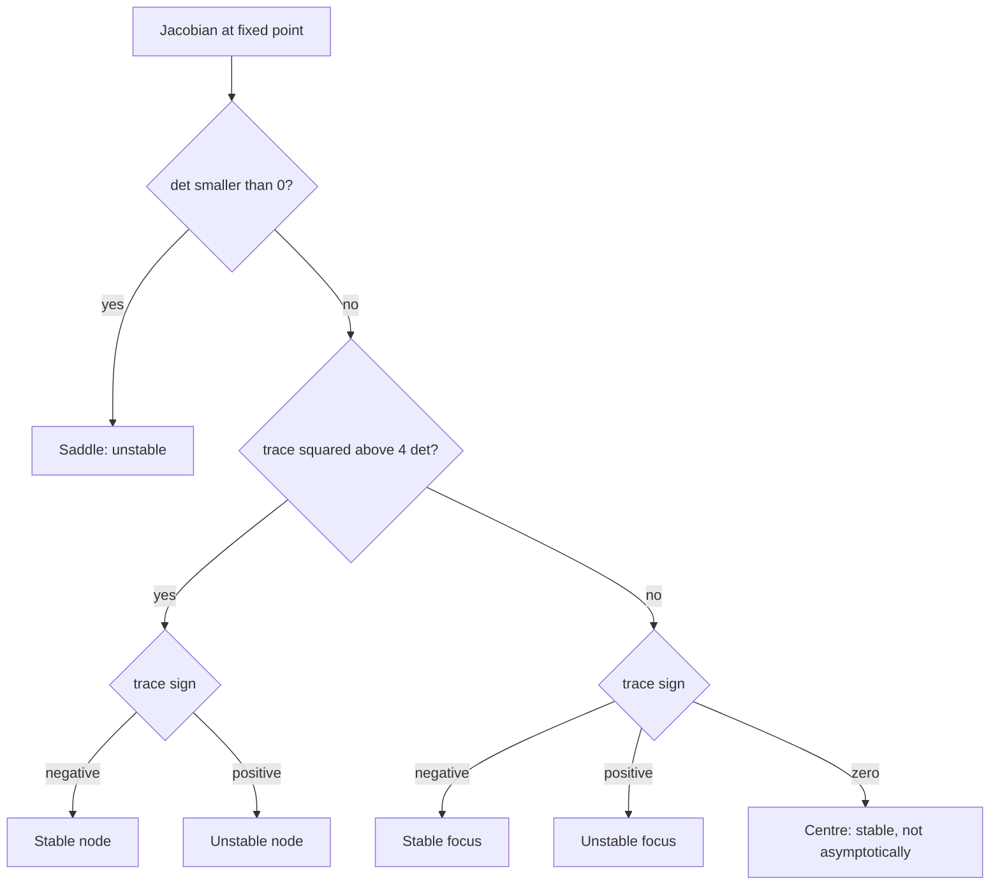

# Dynamical Systems and Chaos

> [Advanced Topics](../README.md) · Level: Advanced · Prerequisites: [Systems of ODEs](../../16-differential-equations/03-systems-of-odes/README.md), [Eigenvalues and Eigenvectors](../../08-linear-algebra/07-eigenvalues-and-eigenvectors/README.md), [Linear Transformations](../../08-linear-algebra/05-linear-transformations/README.md), [Continuity and Homeomorphisms](../../17-topology/02-continuity-and-homeomorphisms/README.md), [Metric Spaces](../../14-real-analysis/06-metric-spaces/README.md), [Applications of Derivatives](../../07-calculus/05-applications-of-derivatives/README.md) · Estimated time: 660 min

## 1. Introduction

A **dynamical system** is a rule that carries a state forward in time. The rule may be a
differential equation, as for a pendulum, a chemical reaction or a population; or a map, as for the
number of insects in one generation, the balance of a bank account after one year, or the position
of a point after one step of a numerical method. **Dynamical systems theory** asks the questions
that do not depend on solving the equation: does the state settle down, oscillate, escape, or wander
irregularly? How does the answer change when a parameter is tuned? And what is *irregular*,
precisely?

Three ideas organise the subject.

*Geometry replaces formulas.* Except in special cases, a nonlinear equation has no closed-form
solution. The qualitative theory of Poincaré and Lyapunov abandons formulas and studies the
*geometry of orbits*: fixed points, closed curves, invariant surfaces and the way solutions move
between them. This is why a two-dimensional system can be understood by drawing its phase portrait,
and why the classification of a fixed point reduces to the signs of two eigenvalues.

*Stability is local, and often decided by the linearisation.* Near a fixed point a smooth system is
approximately linear, and if the linearisation is *hyperbolic* — no eigenvalue on the imaginary axis
or the unit circle — the approximation is faithful in the strongest sense: the nonlinear flow is
topologically conjugate to the linear one (Hartman–Grobman). Degenerate cases are exactly the
interesting ones, because they are the places where the qualitative behaviour can change.

*Chaos is deterministic unpredictability.* In 1963 Edward Lorenz, running a weather simulation,
restarted a computation from a printout rounded to three decimals and obtained a completely
different forecast. The equations were deterministic; the solutions separated exponentially.
Sensitive dependence on initial conditions, together with recurrence (transitivity) and an abundance
of periodic orbits, is now the working definition of chaos. It is compatible with determinism
because it concerns *predictability*, not *causation*: a deterministic system can amplify an
arbitrarily small uncertainty until it fills the whole attractor.

The subject has two halves, discrete and continuous, and this tutorial treats them in parallel:
flows $\dot x = f(x)$ generated by vector fields, and maps $x_{n+1} = f(x_n)$. The discrete theory is not a poor relation: the
logistic map exhibits the period-doubling route to chaos with a universal constant, and it is the
setting in which chaos can be *proved* rather than observed. The tent map is proved chaotic in full
detail (§7.8) and then explained by symbolic dynamics (§7.9), which turns the dynamics into the
shift on a sequence space.

## 2. Prerequisites

* **Systems of linear ODEs** — eigenvalues, matrix exponentials and phase portraits:
  [Systems of ODEs](../../16-differential-equations/03-systems-of-odes/README.md).
* **Eigenvalues and eigenvectors** — the classification of fixed points is entirely spectral:
  [Eigenvalues and Eigenvectors](../../08-linear-algebra/07-eigenvalues-and-eigenvectors/README.md).
* **Linear transformations** — invariance of subspaces, change of coordinates:
  [Linear Transformations](../../08-linear-algebra/05-linear-transformations/README.md).
* **Continuity, homeomorphisms and compactness** — topological conjugacy and invariant sets:
  [Continuity and Homeomorphisms](../../17-topology/02-continuity-and-homeomorphisms/README.md).
* **Metric spaces** — open sets, density, sequences, completeness:
  [Metric Spaces](../../14-real-analysis/06-metric-spaces/README.md).
* **Derivatives and the intermediate value theorem** — linearisation and the proof that the tent map
  is chaotic: [Applications of Derivatives](../../07-calculus/05-applications-of-derivatives/README.md).
* **Population models** — the logistic equation and its discrete analogue:
  [Population Dynamics](../../22-mathematical-modeling/02-population-dynamics/README.md).

No measure theory or functional analysis is required: results that usually need those tools are stated with
their hypotheses and their proof strategy.

## 3. Learning Objectives

After working through this tutorial you will be able to:

1. Distinguish a flow from a map, and an orbit from a trajectory.
2. Find fixed points of one- and two-dimensional systems and determine their type from the
   eigenvalues of the linearisation.
3. State the Hartman–Grobman theorem with its hypotheses and explain what fails without hyperbolicity.
4. Sketch a phase portrait using stable and unstable manifolds.
5. Construct a Lyapunov function and use it to prove stability or asymptotic stability.
6. Apply the LaSalle invariance principle and explain why $\dot V \le 0$ is not enough by itself.
7. Derive the normal forms of the saddle-node, transcritical, pitchfork and Hopf bifurcations, and
   draw their bifurcation diagrams.
8. Compute the fixed points, the period-2 orbit and the stability intervals of the logistic map.
9. Explain period doubling, the Feigenbaum constant and universality.
10. Define chaos (sensitive dependence, transitivity, dense periodic points) and prove that the tent
    map is chaotic.
11. Use symbolic dynamics to count periodic orbits and compute growth rates.
12. Describe the Lorenz attractor, verify that it is dissipative, and explain the role of the
    Poincaré map.

## 4. Intuition

**A river with fixed rocks.** Think of the state space as the surface of a river and the vector
field as the velocity of the water at every point. An orbit is the path of a leaf dropped into the
river. Where the water is still, the leaf stops: that is a fixed point. A whirlpool is a closed
orbit that nothing drifts away from. The stable manifold of a fixed point is the set of starting
positions from which the leaf is swept to that point; the unstable manifold is the set from which it
is swept away. Phase portraits are maps of the river.

**Why linearisation works near a rock.** Zoom in on a stretch of water and it looks like uniform
flow. Zoom in on the neighbourhood of a resting point and the dominant terms are the first-order
ones: the local picture is linear. The Hartman–Grobman theorem is the precise statement that this
zooming can be made into a homeomorphism — a continuous change of coordinates that turns the
nonlinear picture exactly into its linear shadow.

**Bifurcation is a tipping point.** Tune a parameter — the strength of a current, the growth rate of
a population — and at most values the qualitative picture is unchanged. At isolated values something
snaps: two fixed points collide and annihilate (saddle-node), a symmetric pair is born (pitchfork),
or a fixed point begins to spiral outwards into a limit cycle (Hopf). These snap points are the
bifurcations, and they are classified by the *degeneracy* that allows them: an eigenvalue crossing
zero or the imaginary axis.

**Chaos as a folding machine.** Kneading dough is the best analogy for a chaotic map. Stretch the
dough to twice its length and fold it back on itself; repeat. Any two nearby grains separate
exponentially (stretching), yet the dough always occupies the same region (folding). Stretching is
sensitive dependence; folding brings orbits back near each other, which is transitivity. The tent
map of §7.8 is exactly this operation on an interval, and the binary digits of the initial condition
are the recipe: each iteration shifts the list and drops the front digit.

**Predicting a coin toss.** The toss of a fair coin is deterministic mechanics. Because the outcome
is extremely sensitive to the initial conditions, no practical measurement can predict it, and the
outcome behaves as if it were random. Chaos is the mathematical content of that sentence: randomness
of *prediction* without randomness of *law*.

## 5. Formal Definition

**Definition 5.1** (Vector field; flow). A vector field on an open set $U \subseteq \mathbb{R}^n$ is a map $f : U \to \mathbb{R}^n$. The *flow*
generated by $f$ is the family $\varphi_t$ of maps defined by $\varphi_t(x_0) = x(t)$, where $x$ is the solution of the initial
value problem $\dot x = f(x)$, $x(0) = x_0$. If $f$ is locally Lipschitz, then for every $x_0 \in U$ there is a unique maximal
solution, defined on an interval containing $0$; the flow then satisfies $\varphi_0 = \mathrm{id}$, $\varphi_{t+s} = \varphi_t\circ\varphi_s$ wherever both
sides are defined, and $t \mapsto \varphi_t(x)$ is continuous. When every solution exists for all $t \in \mathbb{R}$ the flow is
called *complete*; that holds if $f$ grows at most linearly, or if $U$ is replaced by a compact
invariant set.

**Definition 5.2** (Map; orbit). A *discrete dynamical system* is a map $f : X \to X$ on a set $X$, usually a
metric space. The *orbit* of $x$ is the sequence $x, f(x), f^2(x), \dots$, where $f^n = f\circ\cdots\circ f$ ($n$ times). A set $S \subseteq X$ is
*invariant* if $f(S)\subseteq S$ and *forward invariant* if $f(S)\subseteq S$ only. A *semi-flow* is a one-parameter family
defined for $t \ge 0$, which is what a non-invertible map produces.

**Definition 5.3** (Fixed and periodic points). For a flow, a point $p$ is a *fixed point* (or
equilibrium) if $f(p) = 0$, i.e. $\varphi_t(p) = p$ for all $t$. For a map, $p$ is fixed if $f(p) = p$, and *periodic of period
$n$* if $f^n(p) = p$ and $f^k(p)\ne p$ for $1\le k<n$. A periodic point of a flow is a point lying on a *closed orbit*: $\varphi_T(p) = p$
for some $T>0$, with $\varphi_t(p)\ne p$ for $0<t<T$.

**Definition 5.4** (Limit sets). For a flow, the *$\omega$-limit set* of $x$ is $\omega(x) = \{y : \varphi_{t_k}(x)\to y \text{ for some } t_k\to\infty\}$; the $\alpha$-limit set is
the same with $t_k\to-\infty$. For a map, $\omega(x)$ is the set of accumulation points of the orbit.

**Definition 5.5** (Hyperbolicity). A fixed point $p$ of a $C^1$ flow is *hyperbolic* if no eigenvalue
of $Df(p)$ has zero real part. A fixed point of a $C^1$ map is hyperbolic if no eigenvalue of $Df(p)$ has
modulus $1$. A periodic orbit is hyperbolic if the corresponding fixed point of its Poincaré map
(Definition 5.13) is hyperbolic.

**Definition 5.6** (Topological conjugacy). Two maps $f : X\to X$ and $g : Y\to Y$ are *topologically conjugate* if
there is a homeomorphism $h : X\to Y$ with $h\circ f = g\circ h$. They are *topologically equivalent* if $h$ carries orbits of
$f$ onto orbits of $g$, preserving the direction of time but not necessarily the parametrisation.
Conjugate systems have identical orbit structure; equivalence forgets only the speed.

**Definition 5.7** (Lyapunov stability). A fixed point $p$ of a flow is *stable* (in the sense of
Lyapunov) if for every $\varepsilon>0$ there is $\delta>0$ such that $\lVert x_0 - p\rVert < \delta$ implies $\lVert\varphi_t(x_0) - p\rVert < \varepsilon$ for all $t\ge0$. It is *asymptotically
stable* if it is stable and there is $\delta_0>0$ such that $\lVert x_0-p\rVert<\delta_0$ implies $\varphi_t(x_0)\to p$. It is *globally asymptotically
stable* if the last property holds for every $x_0$ in the domain. It is *exponentially stable* if $\lVert\varphi_t(x_0)-p\rVert \le Ce^{-\lambda t}\lVert x_0-p\rVert$
for some $C, \lambda>0$.

**Definition 5.8** (Bifurcation). Let $\dot x = f(x,\mu)$ (or $x_{n+1}=f(x_n,\mu)$) depend on a parameter $\mu$. A value $\mu_0$ is a
*bifurcation value* if the orbit structure near a fixed point changes as $\mu$ crosses $\mu_0$ — more
precisely, if no neighbourhood of $\mu_0$ gives a family of systems that is topologically equivalent for
all $\mu$ in it.

**Definition 5.9** (Chaos, Devaney's definition). Let $f : X\to X$ be continuous on a metric space $X$.
Then $f$ is *chaotic* on an invariant set $S\subseteq X$ if

1. *(transitivity)* for all nonempty open $U, V\subseteq S$ there is $n>0$ with $f^n(U)\cap V\ne\varnothing$;
2. *(dense periodic points)* the set of periodic points of $f$ is dense in $S$;
3. *(sensitive dependence)* there is $\delta>0$ such that for every $x\in S$ and every
   $\varepsilon>0$ there is $y\in S$ with $d(x,y)<\varepsilon$ and $d(f^n x, f^n y)\ge\delta$ for
   some $n\ge0$.

**Definition 5.10** (Lyapunov exponent, one dimension). For a $C^1$ map $f : \mathbb{R}\to\mathbb{R}$
and a point $x$ whose orbit never hits a critical point, the *Lyapunov exponent* is

$$\lambda(x) = \lim_{n\to\infty}\frac1n\sum_{k=0}^{n-1}\ln\bigl\lvert f'(x_k)\bigr\rvert,
\qquad x_k = f^k(x),$$

when the limit exists. Positive $\lambda$ means exponential separation of nearby orbits; for a flow the
definition uses $\frac1t\int_0^t \ln\lVert D\varphi_s(x)\rVert ds$ with the derivative along the flow, and there is always one exponent equal to
$0$ in the direction of the flow.

**Definition 5.11** (Attractor; strange attractor). A compact invariant set $A$ is an *attractor* if
it has a neighbourhood $U$ such that $\varphi_t(x)\to A$ for every $x\in U$, and no proper subset of $A$ has this
property. An attractor is *strange* if it is chaotic (positive Lyapunov exponent, sensitive
dependence) and has non-integer Hausdorff dimension. There is no universally agreed formal
definition of "strange attractor"; the operative content is always the pair (chaotic dynamics,
fractal geometry), and both parts must be verified in each example.

**Definition 5.12** (Normal form). A *normal form* of a bifurcation is the simplest parametrised
family that exhibits it. If every system undergoing that bifurcation can be reduced to the normal
form by a smooth change of coordinates and rescaling of parameters, the normal form is called
*versal*; if the change of coordinates also preserves the qualitative type of every nearby system,
it is *universal*.

**Definition 5.13** (Poincaré map). Let $\varphi_t$ be a flow in $\mathbb{R}^n$ and let $\Sigma\subset\mathbb{R}^n$ be a codimension-one
surface transverse to the flow at a point $p$ (that is, $f(p)\notin T_p\Sigma$). The *first return map* (Poincaré map)
$P$ assigns to $x\in\Sigma$, close enough to $p$, the point where $\varphi_t(x)$ next meets $\Sigma$ in forward time. Then
$P(p) = p$ if and only if the orbit through $p$ is periodic, and the stability of the periodic orbit is
that of the fixed point $p$ of $P$.

## 6. Mathematical Notation

| Symbol | Read as | Meaning |
|---|---|---|
| $x(t)$, $x_n$ | state, iterate | point of $\mathbb{R}^n$ at time $t$, or after $n$ steps |
| $f$ | vector field / map | right-hand side of $\dot x = f(x)$, or $x_{n+1}=f(x_n)$ |
| $\varphi_t$ | flow | solution operator: $x(t) = \varphi_t(x_0)$ |
| $Df(p)$ | derivative at $p$ | Jacobian matrix of $f$ at $p$ |
| $\lambda_j$ | eigenvalue | of $Df(p)$; for flows $\operatorname{Re}\lambda_j$ governs growth |
| $E^s, E^u, E^c$ | stable, unstable, centre subspace | spans of eigenvectors with $\operatorname{Re}\lambda<0$, $>0$, $=0$ |
| $W^s(p), W^u(p)$ | stable, unstable manifold | points tending to $p$ forward, respectively backward |
| $\omega(x)$, $\alpha(x)$ | omega, alpha limit set | forward and backward accumulation points |
| $V$ | Lyapunov function | scalar function decreasing along orbits |
| $\dot V$ | orbital derivative | $\nabla V(x)\cdot f(x)$ |
| $\mu$ | bifurcation parameter | the knob that is tuned |
| $f_\mu$, $f_c$ | parametrised family | for example $f_\mu(x) = \mu x(1-x)$ |
| $\delta$ | Feigenbaum constant | $4.669201609\ldots$ |
| $\alpha$ | Feigenbaum rescaling | $2.502907875\ldots$ |
| $\Sigma_2$ | full two-shift | $\{0,1\}^{\mathbb{N}_0}$ with the product topology |
| $\sigma$ | shift map | $(\sigma s)_k = s_{k+1}$ |
| $\lambda(x)$ | Lyapunov exponent | exponential rate of separation |
| $P$ | Poincaré map | first-return map on a cross-section |
| $\operatorname{div} f$ | divergence | $\sum_j\partial f_j/\partial x_j$; rate of volume change |
| $\Lambda$ | attractor | compact invariant attracting set |
| $C^k$ | class $k$ | $k$ times continuously differentiable |

Vector fields are written $f$, their components $f_1,\dots,f_n$; in the plane the coordinates are usually $(x,y)$
and the components $(f,g)$. Throughout, $\dot x$ means $dx/dt$ and $x_{n+1}$ is the next iterate of a map; the notation
is kept parallel deliberately, because the theories are parallel.

## 7. Core Concepts

### 7.1 Flows and maps

Two kinds of time produce two theories.

**Continuous time: a flow.** Given $f : U\subseteq\mathbb{R}^n\to\mathbb{R}^n$ locally Lipschitz, the initial value problem $\dot x = f(x)$, $x(0)=x_0$ has a
unique maximal solution. Writing $\varphi_t(x_0)$ for its value at time $t$ gives a family of maps with the
*semi-group property* $\varphi_{t+s} = \varphi_t\circ\varphi_s$, valid wherever the solutions exist. The semi-group property is not an
extra axiom: it is a consequence of uniqueness, because $s\mapsto\varphi_{t+s}(x_0)$ and $s\mapsto\varphi_s(\varphi_t(x_0))$ solve the same initial value
problem at time $s = 0$ and therefore coincide. Each $\varphi_t$ is a homeomorphism of its domain onto its
image, with inverse $\varphi_{-t}$; flows are always invertible.

*Example.* For $\dot x = -x$ the flow is $\varphi_t(x_0) = x_0e^{-t}$, defined for all $t$; for $\dot x = x^2$ it is $\varphi_t(x_0) = x_0/(1 - tx_0)$, defined only for $t < 1/x_0$
when $x_0>0$. Finite-time blow-up is possible, which is why flows are usually defined only locally.

**Discrete time: a map.** A map $f : X\to X$ defines orbits by iteration. Unlike a flow it need not be
invertible: $f(x) = \mu x(1-x)$ is two-to-one, so a state has two possible pasts. Non-invertibility is the source of
most of the extra richness of discrete dynamics: a non-injective map can fold the space onto itself,
and folding plus stretching is the mechanism of chaos.

**How the two are related.** Three standard bridges: the *time-one map* $f = \varphi_1$ of a complete flow
samples it at integer times; a *Poincaré map* of a closed orbit is a lower-dimensional return map that may
be non-invertible (§7.10); and a *one-step numerical scheme* $x_{n+1} = \Phi_h(x_n)$ is a map that is not
the flow — a large step changes the qualitative behaviour (explicit Euler for $\dot x = -x$ gives
$x_{n+1} = (1-h)x_n$, stable only for $h<2$).

**Definition 7.1** (Conjugacy of flows). Two flows $\varphi_t$ and $\psi_t$ are *topologically conjugate* if
there is a homeomorphism $h$ with $h\circ\varphi_t = \psi_t\circ h$ for all $t$. For flows, a conjugacy automatically preserves
periodic orbits and their periods; an equivalence that allows a time change preserves only the shape
of orbits.

### 7.2 Fixed points and linear stability

**One dimension.** For $\dot x = f(x)$ with $f\in C^1$ and $f(p)=0$: if $f'(p)<0$ then $p$ is asymptotically stable; if $f'(p)>0$ then
$p$ is unstable (indeed repelling). The proof is the mean value theorem: $x$ decreases while $x>p$ and
increases while $x<p$, because the sign of $\dot x = f(x)$ near $p$ is that of $f'(p)(x-p)$. If $f'(p) = 0$ the linear term is
silent and the first nonzero higher-order term decides; the point is then called *non-hyperbolic*
and can be stable one-sidedly (as for $\dot x = -x^3$) or unstable one-sidedly ($\dot x = x^3$).

**$n$ dimensions, linear systems.** For $\dot x = Ax$ the solution is $x(t) = e^{At}x_0$, and the behaviour is read from the
eigenvalues $\lambda_1,\dots,\lambda_n$ of $A$ (with Jordan blocks for repeated eigenvalues):

| Spectral condition | Behaviour of the origin |
|---|---|
| $\operatorname{Re}\lambda_j < 0$ for all $j$ | asymptotically stable; $\lVert x(t)\rVert\le Ce^{-\alpha t}\lVert x_0\rVert$ |
| $\operatorname{Re}\lambda_j > 0$ for some $j$ | unstable; some orbits leave every neighbourhood |
| some $\operatorname{Re}\lambda_j = 0$, others $<0$ | stable or unstable according to the Jordan blocks of the purely imaginary eigenvalues |
| all $\operatorname{Re}\lambda_j = 0$, $A$ diagonalisable | stable but not asymptotically stable (a centre) |

The exponential bound follows from the Jordan form: each block contributes a factor $t^{k-1}e^{\operatorname{Re}\lambda t}$, and $t^{k-1}e^{-\alpha t}$ is
bounded on $t\ge0$ for $\alpha>0$.

**The plane.** With $\tau = \operatorname{tr}A$ and $\Delta = \det A$, the eigenvalues are
$\frac12\left(\tau \pm\sqrt{\tau^2 - 4\Delta}\right)$, so

| Condition | Type | Portrait |
|---|---|---|
| $\Delta<0$ | saddle | two eigendirections, one attracting, one repelling |
| $\Delta>0$, $\tau^2>4\Delta$, $\tau<0$ | stable node | all orbits enter, tangentially to the slow direction |
| $\Delta>0$, $\tau^2>4\Delta$, $\tau>0$ | unstable node | all orbits leave |
| $\Delta>0$, $\tau^2<4\Delta$, $\tau<0$ | stable focus | spirals into the origin |
| $\Delta>0$, $\tau^2<4\Delta$, $\tau>0$ | unstable focus | spirals out |
| $\Delta>0$, $\tau = 0$ | centre | closed elliptical orbits |
| $\Delta = 0$ | degenerate | a line of fixed points or a nilpotent node |

**Maps.** For $x_{n+1} = f(x_n)$ with $f\in C^1$ and fixed point $p$, the linearisation is $y_{n+1} = Df(p)y_n$ with $y_n = x_n - p$. Then $y_n = Df(p)^ny_0$, and the
origin is asymptotically stable iff every eigenvalue of $Df(p)$ satisfies $\lvert\lambda_j\rvert<1$ (spectral radius $<1$); it
is unstable if some $\lvert\lambda_j\rvert>1$. Multipliers with $\lvert\lambda\rvert=1$ are the non-hyperbolic cases.

**Theorem 7.1** (stability by linearisation). Let $f = A\cdot + g$ with $f(0)=0$, $A = Df(0)$ and $g(x) = o(\lVert x\rVert)$ as $x\to0$ (this holds
automatically if $f\in C^1$). If $\operatorname{Re}\lambda_j<0$ for all eigenvalues of $A$, then the origin is asymptotically stable
for $\dot x = f(x)$; if some $\operatorname{Re}\lambda_j>0$ it is unstable.

*Proof of the stable case.* Choose $\alpha>0$ with $\operatorname{Re}\lambda_j<-\alpha$ for all $j$. There is a positive definite symmetric
$P$ solving the *Lyapunov equation* $A^{\mathsf T}P + PA = -I$ (namely $P = \int_0^{\infty}e^{A^{\mathsf T}t}e^{At}dt$, which converges because $e^{At}$ decays
exponentially). Let $V(x) = x^{\mathsf T}Px$. Then

$$\dot V = x^{\mathsf T}(A^{\mathsf T}P + PA)x + 2g(x)^{\mathsf T}Px = -\lVert x\rVert^2 + o(\lVert x\rVert^2) \le -\tfrac12\lVert x\rVert^2$$

for $\lVert x\rVert$ small, so $\dot V<0$ off the origin and Lyapunov's theorem (§7.5) gives asymptotic stability. The
unstable case follows by reversing time and applying the same argument, or by the Hartman–Grobman
theorem of §7.3. $\blacksquare$

The theorem is *local* and says nothing when the linearisation is non-hyperbolic; then the nonlinear
terms decide, as $\dot x = \pm x^3$ shows.

### 7.3 The Hartman–Grobman theorem

**Theorem 7.2** (Hartman–Grobman). Let $f : U\to\mathbb{R}^n$ be of class $C^1$ on a neighbourhood of a fixed point $p$,
and suppose $p$ is hyperbolic, i.e. no eigenvalue of $A = Df(p)$ has zero real part (for flows) or modulus
one (for maps). Then there is a homeomorphism $h$ from a neighbourhood of $p$ onto a neighbourhood
of $0$ with $h(p) = 0$ such that

$$h\circ\varphi_t = e^{At}\circ h \quad\text{(flows)}, \qquad h\circ f = A\circ h \quad\text{(maps)},$$

for all $t$ and all points where the objects are defined. The homeomorphism is in general *not*
differentiable, even when $f$ is $C^\infty$.

**What it does and does not say.** It says that hyperbolicity is exactly the condition under which
the linear part determines the topological picture: node, saddle, focus, and the dimensions of the
stable and unstable sets. It does not say that the nonlinear system is *linearly* conjugate (that
would require $f$ to be affine), nor that the conjugacy preserves angles, lengths or times.

**Why hyperbolicity is needed.** Consider $\dot x = x^2$ and $\dot x = 0$; both have linearisation $0$ at the origin, so
both are non-hyperbolic. In the first system the orbit starting at $x_0>0$ reaches infinity in finite
time $1/x_0$, while in the second every point is fixed forever. No homeomorphism can match these
behaviours, so no conjugacy exists. The failure is caused precisely by the vanished linear term.

**Regularity.** Sternberg's theorem gives $C^k$ linearisation under *non-resonance* conditions on the
eigenvalues ($\lambda_i \ne \sum_j m_j\lambda_j$ for integer $m_j\ge0$ with $\sum m_j\ge2$). Without non-resonance, smooth conjugacy can fail; an
example is $\dot x = -x$, $\dot y = -2y + x^2$, whose quadratic term cannot be removed by a smooth change of variables.

**A sharpening for maps.** For a $C^1$ diffeomorphism with a hyperbolic fixed point, Hartman's theorem
actually provides a conjugacy that is $C^1$ when $f$ is $C^2$; but no amount of smoothness gives a $C^1$
conjugacy in the resonant cases above. The safe statement, and the one used here, is topological.

### 7.4 The phase plane and invariant manifolds

In two dimensions the phase portrait is a picture, and pictures can be classified.

**Theorem 7.3** (stable manifold theorem). Let $f : U\to\mathbb{R}^n$ be $C^1$ and let $p$ be a hyperbolic fixed point.
Let $E^s$ and $E^u$ be the invariant subspaces of $A = Df(p)$ spanned by the eigenvectors whose eigenvalues
satisfy $\operatorname{Re}\lambda<0$, respectively $\operatorname{Re}\lambda>0$ (for maps: $\lvert\lambda\rvert<1$, respectively $\lvert\lambda\rvert>1$). Then there exist $C^1$ embedded
discs $W^s_{\mathrm{loc}}(p)$ and $W^u_{\mathrm{loc}}(p)$, tangent to $E^s$ and $E^u$ at $p$, invariant under the flow, and characterised
by

$$W^s(p) = \{x : \varphi_t(x)\to p \text{ as } t\to+\infty\}, \qquad
W^u(p) = \{x : \varphi_t(x)\to p \text{ as } t\to-\infty\}.$$

If $f\in C^r$ then the local manifolds are $C^r$, and $\dim W^s = \dim E^s$,
$\dim W^u = \dim E^u$. $\square$

The stable manifold is the set of states that end at $p$; it is what an experimenter would call the
basin of attraction of $p$ inside a neighbourhood. The unstable manifold is the set of states that
came from $p$.

**Computing a manifold.** For $\dot x = -x$, $\dot y = 2y + x^2$, the linearisation at the origin has $E^s = \{y=0\}$ and $E^u = \{x=0\}$. Look for
the stable manifold as a graph $y = h(x)$ with $h(0)=h'(0)=0$. Invariance requires $\dot y = h'(x)\dot x$, i.e.

$$-x\,h'(x) = 2h(x) + x^2 .$$

Substituting $h = ax^2 + bx^3 + \cdots$ gives $-2ax^2 - 3bx^3 = 2ax^2 + 2bx^3 + x^2 + \cdots$, so $a = -\frac14$ and $b = 0$; in fact $h(x) = -x^2/4$ solves the equation exactly. The stable
manifold is the parabola $y = -x^2/4$, tangent to the $x$-axis as the theorem promises.

**Theorem 7.4** (Poincaré–Bendixson). Let $f$ be $C^1$ on an open set in $\mathbb{R}^2$ and let $\varphi_t$ be its flow.
If a forward orbit is bounded and its $\omega$-limit set contains no fixed point, then that $\omega$-limit set
is a closed orbit. $\square$

This is the reason planar systems are tame: bounded orbits either settle at a fixed point, close
into a cycle, or connect fixed points (homoclinic and heteroclinic orbits). There is no chaos in the
plane for flows — chaos needs at least three dimensions (or a non-invertible map in one). A
*homoclinic* orbit leaves a fixed point along $W^u$ and returns along $W^s$; a *heteroclinic* orbit
connects two distinct fixed points. Both are the skeletons of the phase portrait, and both are
destroyed by small perturbations unless a structural condition protects them.

### 7.5 Lyapunov functions and global stability

Linearisation is local. To prove stability over a whole region, or global asymptotic stability, one
uses a scalar quantity that decreases along every orbit.

**Definition 7.2** (Lyapunov function). Let $p$ be a fixed point of $\dot x = f(x)$ on an open set $U\ni p$. A $C^1$
function $V : U\to\mathbb{R}$ is a *Lyapunov function* for $p$ if $V(p)=0$ and $V(x)>0$ for $x\in U\setminus\{p\}$ (positive definite), and its
orbital derivative $\dot V(x) := \nabla V(x)\cdot f(x)$ satisfies $\dot V\le0$ on $U$ (negative semidefinite).

**Theorem 7.5** (Lyapunov). With $V$ as above:

1. if $\dot V\le0$ on $U$, then $p$ is stable;
2. if $\dot V<0$ on $U\setminus\{p\}$, then $p$ is asymptotically stable;
3. if in addition $U = \mathbb{R}^n$ and $V(x)\to\infty$ as $\lVert x\rVert\to\infty$ ($V$ is radially
   unbounded), then $p$ is globally asymptotically stable.

*Proof of (1).* Fix $\varepsilon>0$ small enough that the closed ball $\overline{B_\varepsilon(p)}$ lies in $U$. The sphere $S_\varepsilon = \{\lVert x-p\rVert = \varepsilon\}$ is compact
and $V>0$ on it, so $m := \min_{S_\varepsilon}V>0$. By continuity and $V(p)=0$ there is $\delta\in(0,\varepsilon)$ with $V(x)<m$ whenever $\lVert x-p\rVert<\delta$. If $\lVert x_0-p\rVert<\delta$, then $V(\varphi_t(x_0))$
is non-increasing, so it stays $<m$; but any orbit leaving $\overline{B_\varepsilon(p)}$ would have to cross $S_\varepsilon$ where $V\ge m$,
a contradiction. Hence the orbit stays inside $B_\varepsilon(p)$: this is the $\varepsilon$–$\delta$ definition of stability.

Part (2) needs an extra argument: $\dot V<0$ makes $V(\varphi_t(x_0))$ strictly decreasing, so it has a limit $\ell\ge0$; if $\ell>0$
the orbit must stay away from $p$, and compactness of an annulus plus strict negativity of $\dot V$ there
contradict $\ell>0$. Part (3) follows because radial unboundedness makes the sublevel sets $\{V\le c\}$ compact,
so every orbit is bounded; then the $\omega$-limit set is nonempty and invariant, and (2) applied to any
limit point forces it to be $p$. $\blacksquare$

**Theorem 7.6** (LaSalle invariance principle). Let $\Omega$ be a compact set that is forward invariant
for the flow, and let $V$ be $C^1$ with $\dot V\le0$ on $\Omega$. Let $E = \{x\in\Omega : \dot V(x)=0\}$ and let $M$ be the largest invariant
subset of $E$. Then every solution starting in $\Omega$ approaches $M$ as $t\to\infty$. $\square$

LaSalle's principle is what makes $\dot V\le0$ useful: the derivative may vanish on a whole set, as long as
no orbit can stay inside that set forever except at the fixed point. A typical application is $\dot x = y$,
$\dot y = -x - y^3$, with $V = \frac12(x^2+y^2)$ and $\dot V = -y^4$. Here $E = \{y=0\}$, which is not invariant: on it $\dot y = -x$, so an orbit can remain only if
$x=0$. Hence $M = \{(0,0)\}$ and the origin is globally asymptotically stable, even though $\dot V$ vanishes along a
line.

**Exponential versus asymptotic stability.** $\dot x = -x^3$ is asymptotically stable but not exponentially so:
solving $dx/x^3 = -dt$ gives $x(t) = x_0/\sqrt{1+2x_0^2t}$, which decays like $t^{-1/2}$. The Lyapunov function $V = x^2$ gives $\dot V = -2x^4 = -2V^2$, not $-cV$, and a
linear decay rate is exactly what exponential stability forbids.

**Theorem 7.7** (Chetaev). If there is a neighbourhood $\Omega$ of the fixed point and a $C^1$ function $V$
with $V=0$ on part of $\partial\Omega$, $V>0$ and $\dot V>0$ in the interior of $\Omega$, then $p$ is unstable. $\square$

The function $V = x^2 - y^2$ for the saddle $\dot x = x$, $\dot y = -y$ is the model: on the wedge
$x>\lvert y\rvert$ it increases, and orbits there escape along the unstable direction.

### 7.6 Bifurcations

A hyperbolic fixed point is robust: perturb the system slightly and its type cannot change, because
the eigenvalues move continuously and cannot cross the axis. Therefore *every* change of qualitative
behaviour must happen at a non-hyperbolic point. Bifurcation theory classifies the ways this can
happen, and the classification is short because most degeneracies are unstable and disappear under
perturbation.

**Saddle-node (fold, blue-sky) bifurcation.** Normal form

$$\dot x = \mu - x^2 .$$

For $\mu>0$ there are two fixed points $x = \pm\sqrt{\mu}$; since $f'(x) = -2x$, the right one is stable ($f'<0$) and the left one
unstable. At $\mu = 0$ they merge into the single non-hyperbolic point $x=0$ with $f'=0$. For $\mu<0$ there is no
fixed point at all: the two equilibria have annihilated each other. Nothing dramatic happens to
individual orbits — trajectories simply slide through the region where the fixed points used to be —
but the *repertoire* of long-term behaviour changes abruptly.

**Theorem 7.8** (saddle-node). Let $f$ be smooth, $f(0,0)=0$, $\partial_xf(0,0)=0$, $\partial_\mu f(0,0)\ne0$ and $\partial_{xx}^2f(0,0)\ne0$. Then near the origin the
family is topologically conjugate to $\dot y = \pm\mu' \pm y^2$ for a smooth change of parameter $\mu' = \mu'(x,\mu)$. $\square$

The two non-degeneracy conditions have clear meanings: $\partial_\mu f \ne 0$ says the parameter actually moves the
graph up and down, and $\partial_{xx}^2f\ne0$ says the graph is curved (a quadratic tangency). If either vanishes, the
bifurcation is of higher codimension and a small perturbation destroys it.

**Transcritical bifurcation.** Normal form $\dot x = \mu x - x^2 = x(\mu - x)$. Fixed points $x=0$ and $x=\mu$ exist for all $\mu$ and pass
through each other at $\mu = 0$, exchanging stability: $f'(0) = \mu$ so $0$ is stable for $\mu<0$; $f'(\mu) = -\mu$ so $\mu$ is stable
for $\mu>0$. This is the typical behaviour of a model with a trivial solution (extinction, no epidemic)
that becomes unstable exactly when a nontrivial solution becomes available.

**Pitchfork bifurcation.** Assume the family is odd in $x$: $f(-x,\mu) = -f(x,\mu)$. Then $x=0$ is
always a fixed point and the Taylor expansion has no even terms:

$$\dot x = \mu x - x^3 + O(x^5) \qquad\text{(supercritical)}, \qquad \dot x = \mu x + x^3 + O(x^5) \qquad\text{(subcritical)}.$$

For $\dot x = \mu x - x^3$ the fixed points are $0$ and, for $\mu>0$, the pair $\pm\sqrt{\mu}$. Stability: $f'(x) = \mu - 3x^2$, so $f'(0) = \mu$ (stable for $\mu<0$)
and $f'(\pm\sqrt\mu) = -2\mu<0$ (stable). The symmetric state loses stability at $\mu=0$ and two symmetric stable states take
over: this is *supercritical* — the new states are stable and appear where the old one dies, so the
system moves continuously. In the subcritical case $\dot x = \mu x + x^3$ two *unstable* states exist for $\mu<0$ and
disappear at $\mu=0$, while the origin is stable only for $\mu<0$: there is a jump, and the system can
find itself far from the origin for $\mu>0$ (hysteresis in the reverse direction). The
symmetry-breaking pitchfork is the archetype of a second-order phase transition.

**Theorem 7.9** (pitchfork). Let $f$ be smooth and odd in $x$, with $f(0,0)=0$, $\partial_\mu\partial_xf(0,0)\ne0$ and $\partial_{xxx}^3f(0,0)\ne0$. Then the
family is locally topologically equivalent to $\dot y = \pm\mu y \pm y^3$ with $\mu$ replaced by a smooth function of $\mu$. $\square$

**Hopf bifurcation.** The saddle-node and pitchfork are one-dimensional in essence: they concern a
real eigenvalue crossing zero. A complex pair crossing the imaginary axis produces oscillation
instead: a fixed point turns into a small closed orbit.

**Theorem 7.10** (Hopf, planar version). Let $\dot x = f(x,\mu)$, $f$ smooth, $f(0,\mu)=0$ for all $\mu$
near $0$, and let $\lambda(\mu) = \alpha(\mu) \pm i\omega(\mu)$ be the eigenvalues of $D_xf(0,\mu)$. Assume

1. $\alpha(0) = 0$ and $\omega(0) = \omega_0 \ne 0$ (a purely imaginary pair, no other eigenvalue on the
   imaginary axis);
2. $\alpha'(0) \ne 0$ (transversality: the pair crosses the axis with nonzero speed);
3. the first Lyapunov coefficient $a \ne 0$, where $a$ is the coefficient of the cubic term in the
   reduced normal form $\dot r = \alpha(\mu) r + a r^3 + O(r^5)$.

Then a branch of periodic orbits bifurcates from the origin, with amplitude $r(\mu) \approx \sqrt{\lvert\alpha(\mu)\rvert/\lvert a\rvert}$. If $a<0$ the branch
exists for $\alpha>0$ and consists of *stable* limit cycles (*supercritical* Hopf); if $a>0$ it exists for
$\alpha<0$ and consists of unstable cycles, with the origin destabilised (*subcritical* Hopf). $\square$

The sharp conclusion — stability of the cycle — is exactly what condition 3 buys. The quantity $a$
is computable from the third derivatives of $f$ at the fixed point; it is rarely worth memorising
the formula, and usually better to transform to polar coordinates as in Example 6.

**Period-doubling (flip) bifurcation for maps.** A fixed point of a map loses stability when a
multiplier crosses the unit circle at $-1$. The normal form is

$$x_{n+1} = -(1+\mu)x_n + x_n^3,$$

for which the fixed point $0$ has multiplier $-(1+\mu)$ and a 2-cycle of amplitude $O(\sqrt{\lvert\mu\rvert})$ is born at $\mu = 0$,
stable for $\mu>0$ (supercritical) and unstable for $\mu<0$ (subcritical). This is the elementary step of
the period-doubling cascade of §7.7: the new 2-cycle can itself double, and so on.

### 7.7 The logistic map: period doubling and the Feigenbaum constant

The discrete logistic model $N_{n+1} = N_n + rN_n\left(1 - N_n/K\right)$ becomes, after rescaling
$x_n = N_n/K$,

$$x_{n+1} = f_\mu(x_n) = \mu x_n(1-x_n), \qquad \mu = 1+r,$$

and the interesting range is $0\le\mu\le4$, where $f_\mu$ maps $[0,1]$ into itself. It is unimodal: it
increases on $[0,\tfrac12]$, decreases on $[\tfrac12,1]$, and its maximum is $f_\mu(\tfrac12) = \mu/4$.

**Fixed points and their stability.** Solving $\mu x(1-x) = x$ gives

$$x^*_0 = 0, \qquad x^*_1 = 1 - \frac{1}{\mu}\quad(\mu \ne 0),$$

and $f_\mu'(x) = \mu(1-2x)$, so the multipliers are

$$f_\mu'(0) = \mu, \qquad f_\mu'(x^*_1) = \mu\left(1 - 2 + \frac{2}{\mu}\right) = 2 - \mu .$$

Hence $x^*_0$ is stable for $0<\mu<1$ (the population dies), and $x^*_1$ exists and is stable for
$1<\mu<3$. At $\mu = 3$ the multiplier of $x^*_1$ equals $-1$: a flip bifurcation.

**The 2-cycle.** A point of exact period $2$ satisfies $f_\mu^2(x) = x$ but $f_\mu(x)\ne x$. Factoring
out the two fixed points from the quartic $f_\mu^2(x) - x$ leaves

$$\mu^2x^2 - \mu(\mu+1)x + (\mu+1) = 0,$$

so the 2-cycle is $\{x_-,x_+\}$ with

$$x_\pm = \frac{\mu+1 \pm \sqrt{(\mu-3)(\mu+1)}}{2\mu},$$

real exactly when $\mu\ge3$. Its multiplier is the product of the derivatives at the two points:

$$(f_\mu^2)'(x_+) = f_\mu'(x_+)f_\mu'(x_-) = \mu^2(1-2x_+)(1-2x_-) = -\mu^2 + 2\mu + 4,$$

using $x_+ + x_- = (\mu+1)/\mu$ and $x_+x_- = (\mu+1)/\mu^2$. The cycle is stable when $\lvert-\mu^2+2\mu+4\rvert<1$, i.e. when $3<\mu<1+\sqrt6$. The lower end $\mu=3$ is where the
multiplier is $+1$ at birth (coinciding with the flip of $x^*_1$), and the upper end $\mu = 1+\sqrt6 \approx 3.44949$ is where it
reaches $-1$ and the 2-cycle doubles.

**The cascade.** Repeating the calculation for cycles of period $4, 8, 16,\dots$ gives a sequence of
bifurcation parameters $\mu_n$ at which the $2^{n-1}$-cycle loses stability:

| $n$ | cycle born | $\mu_n$ |
|---|---|---|
| 1 | fixed point $x^*_1$ | $3$ |
| 2 | period 2 | $1+\sqrt6 = 3.449490$ |
| 3 | period 4 | $3.544090$ |
| 4 | period 8 | $3.564407$ |
| 5 | period 16 | $3.568759$ |
| $\infty$ | chaos begins | $3.569946$ |

The ratios of successive parameter intervals converge:

$$\delta = \lim_{n\to\infty}\frac{\mu_n - \mu_{n-1}}{\mu_{n+1}-\mu_n} = 4.669201609102990\ldots,
\qquad \alpha = \lim_{n\to\infty}\frac{d_n}{d_{n+1}} = 2.502907875095892\ldots,$$

where $d_n$ is the width of the central period-$2^n$ window. The numbers are *universal*: the same $\delta$
and $\alpha$ appear for every unimodal family with a quadratic maximum (the sine map, the Ricker map, the
quadratic family $x^2+c$), because the renormalisation that maps $f_\mu^{2}$ near its maximum back onto a
rescaled copy of $f_\mu$ is the same operation in all of them. Feigenbaum discovered this in 1978; it is
the first example of universality in a purely mathematical setting, and it is why the constant
appears in experiments on convection and on electronic oscillators.

**Beyond $\mu_\infty$.** Above $3.569946$ the attractor is no longer a finite cycle, but the interval is dotted with
*periodic windows* — parameter intervals where a stable cycle reappears. The largest is the period-3
window, which opens at $\mu = 1+\sqrt8 \approx 3.828427$ (a tangent, i.e. saddle-node, bifurcation of a 3-cycle) and contains its
own cascade of doublings. Within the windows the dynamics is periodic; between them it is chaotic,
and the chaotic bands merge as $\mu$ increases until at $\mu=4$ the map is chaotic on the whole interval.

**The case $\mu = 4$.** The substitution $x = \sin^2(\pi\theta/2)$ is a homeomorphism of $[0,1]$ onto
itself, and

$$f_4\bigl(\sin^2(\pi\theta/2)\bigr) = 4\sin^2(\pi\theta/2)\cos^2(\pi\theta/2) = \sin^2(\pi\theta),$$

so $f_4$ is topologically conjugate to the tent map of §7.8 through $h(x) = \sin^2(\pi x/2)$. It follows
that $f_4$ is chaotic on $[0,1]$ and that its Lyapunov exponent is $\log 2$ (Exercise 36).

### 7.8 Chaos defined, and the tent map proved chaotic

Devaney's definition (Definition 5.9) has three parts, and each catches a different intuition.

* *Sensitive dependence* says that no measurement is ever precise enough to predict the far future.
  It is the property Lorenz observed.
* *Transitivity* says that the system cannot be decomposed into independent pieces: no matter how
  small the target, an orbit starting in any open set eventually enters it. Without transitivity a
  chaotic set could be a union of invariant pieces, each boring.
* *Dense periodic points* says that, although most orbits are aperiodic, the periodic ones are
  interleaved everywhere. This is what makes numerical simulation possible at all: a computer's finite
  precision effectively snaps the state onto a periodic orbit.

The three properties are not independent. For a continuous map on a metric space with no isolated
points, transitivity together with a dense set of periodic points already implies sensitive
dependence (a theorem of Banks, Brooks, Cairns, Davis and Stacey, 1992). Sensitivity alone is weak:
the map $x\mapsto 2x$ on $\mathbb{R}$ is sensitive but not chaotic in any useful sense. Positive Lyapunov exponents
imply sensitive dependence in one dimension: on a cylinder where no critical point is visited, the mean
value theorem gives $\lvert f^n(x)-f^n(y)\rvert = e^{n\lambda+o(n)}\lvert x-y\rvert$. The converse can fail at
exceptional points.

**The tent map.** Define $T : [0,1]\to[0,1]$ by

$$T(x) = \begin{cases}2x, & 0\le x\le\tfrac12,\\ 2-2x, & \tfrac12<x\le1.\end{cases}$$

It stretches the left half onto $[0,1]$ and folds the right half onto $[0,1]$, which is the kneading of
§4 made into a formula. Its slope has modulus $2$ wherever it exists.

**Theorem 7.11.** The tent map is chaotic on $[0,1]$ in the sense of Definition 5.9.

*Proof.* For a finite word $w = (s_0,\dots,s_{n-1})\in\{0,1\}^n$ define the *cylinder*

$$C_w = \{x\in[0,1] : s_k(T^kx) = s_k \text{ for } k = 0,\dots,n-1\}, \qquad s_k(y) = \begin{cases}0, & y\le\tfrac12,\\ 1, & y>\tfrac12.\end{cases}$$

*Step 1: cylinders are intervals of length $2^{-n}$ on which $T^n$ is an affine bijection onto $[0,1]$.* For
$n=1$: $C_0 = [0,\tfrac12]$ and $C_1 = (\tfrac12,1]$, both of length $\tfrac12$, and $T$ maps the first increasingly and the second
decreasingly onto $[0,1]$. Inductively, $C_{ws} = C_w\cap T^{-n}(C_s)$; since $T^n$ maps $C_w$ affinely onto $[0,1]$ and $C_s$ is a
half-interval at one end of $[0,1]$, its preimage is a half-interval at one end of $C_w$, of length
$2^{-n}\cdot\tfrac12 = 2^{-(n+1)}$, and $T^{n+1} = T\circ T^n$ is affine there with slope $\pm2^{n+1}$.

*Step 2: sensitive dependence.* Let $x\in[0,1]$ and $\varepsilon>0$. Choose $n$ with $2^{-(n+1)}<\varepsilon$ and let $C$ be the cylinder of
length $2^{-n}$ containing $x$. Choose $y\in C$ with $\lvert x - y\rvert = 2^{-(n+1)}$ (possible because $C$ has length $2^{-n}$ and $x\in C$; move
towards the longer side). Then by Step 1, $\lvert T^n x - T^n y\rvert = 2^n\lvert x-y\rvert = \tfrac12$. So $\delta = \tfrac14$ witnesses sensitivity.

*Step 3: transitivity.* Let $U,V$ be nonempty open sets. Choose $x\in U$ and $m$ so large that the cylinder
$C$ of length $2^{-m}$ containing $x$ lies inside $U$ (the cylinders have arbitrarily small length and
contain neighbourhoods of their points). By Step 1, $T^m(C) = [0,1]\supseteq V$, so $T^m(U)\cap V\ne\varnothing$.

*Step 4: dense periodic points.* For each word $w$ of length $n$, $T^n$ maps $C_w$ affinely onto $[0,1]$
with slope $\pm2^n \ne 1$, so the graph of $T^n|_{C_w}$ crosses the diagonal exactly once: a point $p_w\in C_w$ with $T^n(p_w) = p_w$. The $2^n$
cylinders have length $2^{-n}$ and cover $[0,1]$, so for every $x$ and every $\varepsilon$ a periodic point lies
within $2^{-n}<\varepsilon$ of $x$ once $n$ is large. Hence periodic points are dense. $\blacksquare$

Since a fixed point of $T^n$ is a point of period dividing $n$, and each of the $2^n$ cylinders contains
exactly one, $T$ has exactly $2^n$ fixed points of $T^n$. The number of orbits of exact period $n$ is
therefore $\frac1n\sum_{d\mid n}\mu(d)2^{n/d}$ by the Möbius inversion formula (the standard count of necklaces), which grows like
$2^n/n$: periodic orbits proliferate exponentially.

**The Lyapunov exponent.** On any orbit that never hits the critical point $\tfrac12$,
$\lvert T'(x_k)\rvert = 2$ for every $k$, so

$$\lambda(x) = \lim_{n\to\infty}\frac1n\sum_{k=0}^{n-1}\ln 2 = \log 2 \approx 0.693$$

for every such $x$. A positive exponent means that an initial error of $10^{-16}$ becomes of order $1$
after about $\log(10^{16})/\log2 \approx 53$ iterations — the quantitative content of Lorenz's observation.

### 7.9 Symbolic dynamics and the shift map

The proof of Theorem 7.11 used only the cylinder structure. That structure can be turned into a
dynamical system in its own right, and the resulting model is the cleanest chaotic system there is.

**The shift space.** Let $\Sigma_2 = \{0,1\}^{\mathbb{N}_0}$ be the set of all one-sided infinite binary
sequences, with the metric

$$d(s,t) = \sum_{k=0}^{\infty}2^{-(k+1)}\lvert s_k - t_k\rvert .$$

Then $d(s,t)\le 2^{-n}$ whenever $s$ and $t$ agree in the first $n$ positions, and $\Sigma_2$ is compact (it is a closed
subset of the compact product space, or directly: every sequence of sequences has a convergent
diagonal subsequence). The *shift map* is

$$\sigma(s_0,s_1,s_2,\dots) = (s_1,s_2,s_3,\dots).$$

It is continuous, onto, and two-to-one: it forgets the first digit.

**Cylinders.** For a word $w$ of length $n$, the set $[w] = \{s : s_k = w_k,\ k<n\}$ is open *and* closed (clopen), has diameter
exactly $2^{-n}$, and the cylinders form a base for the topology. These two facts make every proof
elementary.

**Theorem 7.12.** The shift map $\sigma$ is chaotic on $\Sigma_2$.

*Proof.* *Transitivity:* given cylinders $[u]$ and $[v]$ with $\lvert u\rvert = m$, the sequence $s = (u_0,\dots,u_{m-1},v_0,v_1,\dots)$ satisfies $s\in[u]$ and
$\sigma^m(s)\in[v]$; since every open set contains a cylinder, transitivity follows.

*Dense periodic points:* if $w$ is a finite word, the periodic sequence $\overline{w} = www\cdots$ is fixed by $\sigma^{\lvert w\rvert}$. Given
any $s$ and $n$, the periodic sequence generated by the word $s_0\cdots s_{n-1}$ agrees with $s$ in the first $n$
digits, so it lies within distance $2^{-n}$.

*Sensitivity:* let $\delta = \tfrac14$. Given $s$ and $\varepsilon>0$, choose $n$ with $2^{-n}<\varepsilon$ and let $t$ agree with $s$ in the
first $n$ digits but differ at position $n$. Then $d(s,t) = 2^{-(n+1)}<\varepsilon$, while $\sigma^n(s)$ and $\sigma^n(t)$ differ in position $0$,
so $d(\sigma^ns,\sigma^nt) = \tfrac12\ge\delta$. $\blacksquare$

**Coding the tent map.** Define the *itinerary* $S(x) = (s_0,s_1,\dots)$ by $s_k = 0$ if $T^k(x)\le\tfrac12$ and $s_k = 1$ otherwise. By definition
of the cylinders, $x\in C_w$ iff $S(x)$ begins with $w$; since the cylinders shrink to points, $S$ is a
bijection. And

$$S\circ T = \sigma\circ S,$$

because shifting the itinerary is exactly forgetting the first digit. Thus the tent map is
*conjugate* to the shift, up to the countable set of points whose orbit hits $\tfrac12$ (where the
itinerary has to be defined by a half-open convention). This single identity explains every earlier
count: periodic points of $T$ correspond to periodic sequences, of which there are $2^n$ with period
dividing $n$; dense periodic points correspond to eventually periodic sequences, which are dense;
sensitivity corresponds to the shift separating sequences that differ far to the right.

$S$ is continuous at every point whose orbit avoids $\tfrac12$ and discontinuous at the others: at such a
point, a perturbation can flip the digit $s_k$ for large $k$ and change the whole tail. The map is
nevertheless a homeomorphism between $[0,1]$ with the topology generated by the half-open cylinders and
$\Sigma_2$, which is the precise sense in which the two systems are the same.

**Growth rates.** The number of $n$-cylinders is $2^n$, the number of $n$-periodic points is $2^n$, and
both grow exponentially at rate $\log 2$ — the same number as the Lyapunov exponent of the tent map. For
piecewise monotone interval maps with slopes of modulus $\ge2$, the topological entropy, the growth
rate of periodic orbits and the Lyapunov exponent of the absolutely continuous invariant measure all
coincide with that rate; the coincidence is a theorem for this class of maps, not an accident.

### 7.10 Strange attractors and Poincaré maps

**The Lorenz system.** In 1963 Lorenz truncated the equations of Rayleigh–Bénard convection to three
modes and obtained

$$\dot x = \sigma(y-x), \qquad \dot y = x(\rho - z) - y, \qquad \dot z = xy - \beta z,$$

with $\sigma = 10$, $\beta = 8/3$ and $\rho$ the control parameter (proportional to the temperature difference). The system
is invariant under the symmetry $(x,y,z)\mapsto(-x,-y,z)$, which forces the fixed points to come in symmetric pairs.

*Fixed points.* Solving $\dot x = \dot y = \dot z = 0$: either $x = y = 0$, $z = 0$, giving the origin
$O$; or $x = y$, $z = \rho - 1$ and $x^2 = \beta(\rho-1)$, giving

$$C^\pm = \left(\pm\sqrt{\beta(\rho-1)},\ \pm\sqrt{\beta(\rho-1)},\ \rho-1\right),$$

which exist for $\rho\ge1$ and coincide with $O$ at $\rho=1$.

*Stability of $O$.* The Jacobian at the origin is $\begin{pmatrix}-\sigma & \sigma & 0\\ \rho & -1 & 0\\ 0&0&-\beta\end{pmatrix}$, with eigenvalues $-\beta$ and the roots of $\lambda^2 + (\sigma+1)\lambda + \sigma(1-\rho) = 0$.
For $\rho<1$ both roots have negative real part; at $\rho = 1$ one root is $0$ and the other $-(1+\sigma)$; for $\rho>1$ one
root is positive. The origin therefore undergoes a *pitchfork* bifurcation at $\rho=1$, losing stability
to the symmetric pair $C^\pm$ — precisely the supercritical pitchfork of §7.6, protected by the
reflection symmetry.

*Stability of $C^\pm$.* At $C^\pm$ the Jacobian is $\begin{pmatrix}-\sigma&\sigma&0\\1&-1&-x\\x&x&-\beta\end{pmatrix}$
with $x^2 = \beta(\rho-1)$, and its characteristic polynomial is

$$\lambda^3 + (\sigma+\beta+1)\lambda^2 + \beta(\rho+\sigma)\lambda + 2\sigma\beta(\rho-1) = 0 .$$

A Hopf bifurcation occurs when this cubic has a pair of purely imaginary roots $\pm i\omega$. Substituting $\lambda = i\omega$
and separating real and imaginary parts gives $\omega^2 = \beta(\sigma+\rho)$ and $2\sigma(\rho-1) = (\sigma+\beta+1)(\sigma+\rho)$, i.e.

$$\rho_H = \frac{\sigma(\sigma+\beta+3)}{\sigma-\beta-1} = \frac{10(10+\tfrac83+3)}{10-\tfrac83-1} = 24.7368\ldots$$

For $10<\rho<24.7368$ the points $C^\pm$ are stable and trajectories spiral into one of them; for $\rho>\rho_H$ they are
unstable and the attractor is the famous butterfly. At $\rho = 28$ the numerical Lyapunov exponents are
approximately $(0.906,\ 0,\ -14.572)$.

*Dissipation.* The divergence of the vector field is $\operatorname{div}f = -\sigma - 1 - \beta = -13.6667 < 0$, so volumes contract at the constant rate
$e^{-(\sigma+1+\beta)t}$: after one unit of time a volume is reduced by a factor $e^{-13.67}$. A bounded attractor in a
volume-contracting flow must have zero volume — it is a fractal set of dimension between $2$ and
$3$. The Kaplan–Yorke formula gives $D_{KY} = 2 + \lambda_1/\lvert\lambda_3\rvert = 2 + 0.906/14.572 = 2.062$. The sum of the exponents equals the divergence, $-13.667$, as it
must.

*Boundedness.* Let $V = \rho x^2 + \sigma y^2 + \sigma(z-2\rho)^2$. Then a direct computation gives $\dot V = -2\sigma\rho x^2 - 2\sigma y^2 - 2\sigma\beta(z-\rho)^2 + 2\sigma\beta\rho^2$, which is negative outside a fixed
ellipsoid. Hence every orbit eventually enters a bounded absorbing region: the attractor exists as a
compact set (Exercise 33).

**Why "strange".** The Lorenz attractor has positive Lyapunov exponent (so nearby orbits separate),
zero volume (so it is not a solid region) and a non-integer dimension (about $2.06$, so it is not a
surface). None of the three alone would be surprising; together they describe an object on which the
flow is chaotic and to which every nearby orbit is attracted. The fractal geometry and the chaos are
two faces of the same mechanism: stretching creates the positive exponent, folding keeps everything
bounded, and repeated stretching and folding creates the Cantor-like transverse structure.

**Poincaré maps.** A continuous-time flow in three dimensions is hard to visualise, but a surface of
section reduces it to a two-dimensional map. Let $\Sigma$ be a surface transverse to the flow and, for
$x\in\Sigma$ near a point where the flow crosses $\Sigma$, let $P(x)$ be the next intersection of the orbit with $\Sigma$
in forward time.

* $P$ is a local diffeomorphism (when the flow is smooth and the crossing is transverse), by the implicit
  function theorem.
* Fixed points of $P$ correspond to periodic orbits of the flow, and the stability of the orbit is the
  stability of the fixed point of $P$; the eigenvalues of $DP$ are the *Floquet multipliers* of the orbit
  (the third, trivial multiplier $1$ corresponding to the direction of the flow has been quotiented out).
* For the Lorenz system with $\Sigma = \{z = \rho-1\}$, the Poincaré map is a two-dimensional map whose
  attractor looks like a one-dimensional curve with Cantor-like structure: the flow spirals around one
  wing, crosses $\Sigma$, and is reinjected near the other wing. The map is close to a one-dimensional
  unimodal map — which is why the logistic map is a useful caricature of the Lorenz dynamics.

Poincaré maps also explain why chaotic *flows* need three dimensions while chaotic *maps* need only
one: the section of a three-dimensional flow is two-dimensional, and the return map, being
non-invertible when orbits merge, has all the folding freedom that planar flows lack (Theorem 7.4
forbids chaos in the plane).

## 8. Formulas and Properties

| Result | Statement | Hypotheses |
|---|---|---|
| 1D stability | $f'(p)<0$ stable, $f'(p)>0$ unstable | $f\in C^1$, $f(p)=0$ |
| Linear flow | $\operatorname{Re}\lambda_j<0\ \forall j$ $\Rightarrow$ asymptotically stable | $\dot x = Ax$ |
| Linear map | $\lvert\lambda_j\rvert<1\ \forall j$ $\Rightarrow$ asymptotically stable | $x_{n+1}=Ax_n$ |
| Plane types | $\Delta<0$ saddle; $\Delta>0,\tau^2>4\Delta$ node; $\Delta>0,\tau^2<4\Delta$ focus; $\tau=0$ centre | $\tau=\operatorname{tr}A$, $\Delta=\det A$ |
| Linearisation | hyperbolicity transfers stability and type | $f\in C^1$, $Df(p)$ hyperbolic |
| Hartman–Grobman | topological conjugacy to $e^{At}$ or $A$ | $f\in C^1$, $p$ hyperbolic |
| Stable manifold | $\dim W^s = \dim E^s$, tangent at $p$ | $f\in C^1$, $p$ hyperbolic |
| Lyapunov | $V>0$, $\dot V\le0$ stable; $\dot V<0$ asymptotically stable | $V\in C^1$, positive definite |
| LaSalle | orbits tend to the largest invariant subset of $\{\dot V=0\}$ | $\Omega$ compact, forward invariant |
| Poincaré–Bendixson | bounded orbit, no fixed point in $\omega$-limit $\Rightarrow$ cycle | planar $C^1$ flow |
| Saddle-node | $\dot x = \mu - x^2$; $x=\pm\sqrt\mu$ | $\partial_\mu f\ne0$, $\partial_{xx}^2f\ne0$ |
| Transcritical | $\dot x = \mu x - x^2$; $x=0,\mu$ exchange stability | $\partial_\mu f\ne0$, $\partial_{xx}^2f\ne0$ |
| Pitchfork | $\dot x = \mu x - x^3$; $x=0,\pm\sqrt\mu$ | odd symmetry, $\partial_\mu\partial_xf\ne0$, $\partial_{xxx}^3f\ne0$ |
| Hopf | cycle of radius $\sqrt{\lvert\alpha\rvert/\lvert a\rvert}$ | imaginary pair, $\alpha'(0)\ne0$, $a\ne0$ |
| Flip | multiplier crosses $-1$; 2-cycle born | $f\in C^1$ family, $Df$ at $-1$ |
| Logistic fixed points | $0$ and $1-1/\mu$; multipliers $\mu$ and $2-\mu$ | $f_\mu(x)=\mu x(1-x)$ |
| Logistic 2-cycle | $x_\pm = \frac{\mu+1\pm\sqrt{(\mu-3)(\mu+1)}}{2\mu}$, multiplier $-\mu^2+2\mu+4$ | $3\le\mu\le4$ |
| Feigenbaum | $\delta = 4.669201609\ldots$, $\alpha = 2.502907875\ldots$ | unimodal maps, quadratic maximum |
| Tent map | $2^n$ periodic points of period dividing $n$; $\lambda = \log2$ | $T$ as in §7.8 |
| Lorenz fixed points | $C^\pm = (\pm\sqrt{\beta(\rho-1)},\pm\sqrt{\beta(\rho-1)},\rho-1)$ | $\rho\ge1$ |
| Lorenz Hopf | $\rho_H = \sigma(\sigma+\beta+3)/(\sigma-\beta-1)$ | $\sigma>\beta+1$ |
| Lorenz divergence | $\operatorname{div}f = -(\sigma+1+\beta)$ | constant contraction |
| Kaplan–Yorke | $D_{KY} = k + \frac{\sum_{j\le k}\lambda_j}{\lvert\lambda_{k+1}\rvert}$ | $\sum_{j\le k}\lambda_j\ge0>\lambda_{k+1}$ |

## 9. Step-by-Step Examples

**Example 1** (fixed points in one dimension; easy). Classify the fixed points of $\dot x = x^2-4$ and of
$\dot x = \sin x$.

For $x^2-4$: fixed points $x=\pm2$, $f'(x) = 2x$. At $x=-2$, $f'=-4<0$: asymptotically stable. At $x=2$, $f'=4>0$: unstable. The
potential picture confirms it: $x^2-4$ is negative between the roots, so orbits there move leftwards
into $-2$, and positive outside, so orbits move away from $+2$.

For $\sin x$: fixed points $x = n\pi$, $f'(n\pi) = \cos n\pi = (-1)^n$. Even multiples are stable, odd multiples unstable. The stable ones
are the bottoms of the potential $-\cos x$, the unstable ones its tops; orbits cannot pass an unstable
point, so each stable point has basin $((2n-1)\pi,(2n+1)\pi)$.

**Example 2** (classification in the plane; easy–medium). Classify the origin for
$A = \begin{pmatrix}0&1\\-2&-3\end{pmatrix}$ and $B = \begin{pmatrix}-1&2\\-5&-1\end{pmatrix}$.

For $A$: $\tau = -3$, $\Delta = 0\cdot(-3) - 1\cdot(-2) = 2$. Eigenvalues solve $\lambda^2+3\lambda+2=0$, so $\lambda = -1,-2$: real, distinct, negative — a stable node. Since
$\lvert\lambda_1\rvert<\lvert\lambda_2\rvert$, orbits arrive tangentially to the eigenvector of $\lambda = -1$ (the slow direction).

For $B$: $\tau = -2$, $\Delta = 11$, and $\tau^2-4\Delta<0$: complex eigenvalues $-1\pm i\sqrt{10}$, a stable focus. The negative real part gives the inward spiral, and $\sqrt{10}\approx3.16$ rad per unit time gives about two turns per unit time. The negative real
part gives the inward spiral; $\sqrt{10}\approx3.16$ rad per unit time gives about $2\pi/3.16 \approx 2$ turns per unit time.

**Example 3** (a saddle-node; medium). Analyse $\dot x = \mu + x - x^2$ as $\mu$ varies.

Fixed points solve $x^2 - x - \mu = 0$:

$$x_\pm(\mu) = \frac{1\pm\sqrt{1+4\mu}}{2}, \qquad \text{real for } \mu \ge -\tfrac14 .$$

Since $f'(x) = 1-2x$, at $x_+$ we get $f' = -\sqrt{1+4\mu}<0$ (stable) and at $x_-$ we get $f' = +\sqrt{1+4\mu}>0$ (unstable), for $\mu>-\tfrac14$. At $\mu = -\tfrac14$ the two
points merge at $x=\tfrac12$ with $f'=0$ — a non-hyperbolic point — and for $\mu<-\tfrac14$ there is no fixed point, so
every orbit diverges to $-\infty$. The bifurcation value is $\mu_c = -\tfrac14$, and it is a saddle-node: a stable and
an unstable equilibrium are born together. Note that the parameter enters linearly with $\partial_\mu f = 1\ne0$ and the
curvature is $\partial_{xx}^2f = -2\ne0$, so Theorem 7.8 applies.

**Example 4** (damped pendulum; medium). For $\dot\theta = \omega$, $\dot\omega = -\frac{g}{L}\sin\theta - \frac{b}{m}\omega$ with $b>0$, prove that $(0,0)$ is asymptotically
stable and $(\pi,0)$ is unstable.

Take the mechanical energy $V = \tfrac12\omega^2 + \frac{g}{L}(1-\cos\theta)$, positive definite near $\theta=0$ (since $1-\cos\theta \approx \theta^2/2$) and radially unbounded in $(\theta,\omega)$
modulo $2\pi$. Then

$$\dot V = \omega\dot\omega + \frac{g}{L}\sin\theta\,\dot\theta
= \omega\left(-\frac{g}{L}\sin\theta - \frac{b}{m}\omega\right) + \frac{g}{L}\sin\theta\,\omega = -\frac{b}{m}\omega^2 \le 0.$$

So the energy decreases at a rate proportional to the square of the velocity — damping, as expected.
$\dot V$ vanishes on the whole set $E = \{\omega = 0\}$, which is not invariant: on it $\dot\omega = -\frac{g}{L}\sin\theta \ne 0$ except at $\theta = 0,\pi$. In a
neighbourhood of $(0,0)$ the only invariant subset of $E$ is the origin, so LaSalle's principle gives
asymptotic stability. At $(\pi,0)$ the linearisation has eigenvalues $\pm\sqrt{g/L}$ (a saddle), hence instability.
The stable manifold of the saddle is the separatrix between "swinging" and "rotating" motions.

**Example 5** (period doubling in the logistic map; medium–hard). For $\mu = 3.2$, find the fixed points,
the 2-cycle, and decide which is attracting.

Fixed points: $0$ and $x^*_1 = 1 - 1/3.2 = 0.6875$; multipliers $\mu = 3.2$ and $2-\mu = -1.2$. The nontrivial fixed point has multiplier $-1.2$,
so it is unstable and a 2-cycle has taken over. From the formula,

$$x_\pm = \frac{\mu+1\pm\sqrt{(\mu-3)(\mu+1)}}{2\mu} = \frac{4.2\pm\sqrt{0.2\cdot4.2}}{6.4}
= \frac{4.2\pm0.9165}{6.4},$$

so $x_+ = 0.79946$ and $x_- = 0.51304$. The multiplier of the cycle is $-\mu^2+2\mu+4 = -10.24+6.4+4 = 0.16$, whose modulus is less than $1$: the 2-cycle is
attracting. As a check, iterating from $x_0 = 0.1$ gives $0.5130, 0.7995, 0.5130,\dots$ after a transient. ✓ The Lyapunov exponent of
the cycle is $\tfrac12\ln0.16 = -0.916$, negative, as it must be for an attracting cycle.

**Example 6** (a Hopf bifurcation in Cartesian coordinates; hard). Analyse
$\dot x = \mu x - y - x(x^2+y^2)$, $\dot y = x + \mu y - y(x^2+y^2)$.

Pass to polar coordinates $r^2 = x^2+y^2$, $\theta = \arctan(y/x)$. Two identities do all the work:
$r\dot r = x\dot x + y\dot y$ and $r^2\dot\theta = x\dot y - y\dot x$. Substituting,

$$r\dot r = \mu(x^2+y^2) - (x^2+y^2)^2 = \mu r^2 - r^4 \ \Rightarrow\ \dot r = \mu r - r^3,$$
$$r^2\dot\theta = x^2 + \mu xy - xy + y^2 - \mu xy + xy = r^2 \ \Rightarrow\ \dot\theta = 1.$$

The radial equation is independent of $\theta$: the system is a normal form already. For $\mu\le0$ the only
non-negative solution of $\dot r = 0$ is $r=0$, and $\dot r<0$ for $r>0$, so the origin is globally attracting. For $\mu>0$
there are two: $r=0$ (now unstable, since $\dot r \approx \mu r$) and $r=\sqrt{\mu}$, a circular limit cycle traversed
counterclockwise with period $2\pi$. Its stability follows from the linearisation in $s = r-\sqrt{\mu}$: $\dot s = -2\mu s + O(s^2)$, so
the cycle is attracting — a supercritical Hopf bifurcation with $\alpha(\mu) = \mu$ and first Lyapunov coefficient
$a = -1$.

**Example 7** (the Lorenz fixed points at $\rho = 28$; hard). Locate the fixed points, test them by the
Routh–Hurwitz criterion, and compute the dimension of the attractor.

With $\sigma = 10$, $\beta = 8/3$, $\rho = 28$: $C^\pm = (\pm\sqrt{72}, \pm\sqrt{72}, 27) = (\pm8.4853,\pm8.4853,27)$,
since $\beta(\rho-1) = \tfrac83\cdot27 = 72$. The characteristic polynomial at $C^\pm$ has coefficients

$$a_1 = \sigma+\beta+1 = 13.6667, \qquad a_2 = \beta(\rho+\sigma) = 101.333, \qquad a_3 = 2\sigma\beta(\rho-1) = 1440 .$$

For a cubic with positive leading coefficient, the Routh–Hurwitz criterion for all roots to have
negative real part is $a_1>0$, $a_3>0$ and $a_1a_2>a_3$. Here $a_1a_2 = 13.6667\times101.333 = 1384.9 < 1440 = a_3$, so the criterion fails and $C^\pm$ are unstable —
consistent with $\rho = 28 > \rho_H = 24.7368$.

Volume contraction: $\operatorname{div}f = -13.6667$, so any volume shrinks as $e^{-13.6667t}$. With exponents $(0.906, 0, -14.572)$ the Kaplan–Yorke dimension
is $D_{KY} = 2 + 0.906/14.572 = 2.062$, and indeed $0.906 + 0 - 14.572 = -13.666$. A bounded set of dimension $2.062$ that attracts every nearby orbit and has a
positive exponent is, by Definition 5.11, a strange attractor.

## 10. Visual Explanations

The eigenvalues of the Jacobian give a complete decision procedure in the plane.

## 11. Common Mistakes

1. **Reading $\dot V\le0$ as asymptotic stability.** It gives stability only; the extra step needs strict
   negativity or LaSalle. The pendulum of Example 4 shows why: the energy stops decreasing as soon as the
   bob stops moving, which happens only in the limit.
2. **Applying the linear test at a non-hyperbolic point.** If an eigenvalue has zero real part, the
   linearisation decides nothing: $\dot x = -x^3$ is stable and $\dot x = x^3$ unstable, with the same
   linear part.
3. **Mixing the flow and map criteria.** For flows the condition is $\operatorname{Re}\lambda<0$, for
   maps it is $\lvert\lambda\rvert<1$. Using one where the other belongs is the most common computational
   error in the subject.
5. **Believing that chaos means randomness.** Chaotic systems are deterministic and often have a
   perfectly computable invariant density; what fails is prediction, not law.
7. **Extrapolating Poincaré–Bendixson to three dimensions.** It is false there, and that is exactly why
   the Lorenz attractor can exist.
## 12. Applications

* **Populations and ecology.** The logistic map is the discrete generation model; its period-doubling
  cascade predicts that a population with high reproductive rate can oscillate with period 2, 4, 8 and
  eventually fluctuate irregularly. Measured insect populations (Nicholson's blowflies) and laboratory
  populations of beetles show such transitions.
* **Weather and climate.** Lorenz's three-mode truncation is the origin of the phrase "butterfly
  effect"; operational forecasting estimates the growth rate of errors (the leading Lyapunov exponent) and
  runs ensembles of perturbed initial states because a single trajectory is meaningless beyond the
  predictability horizon.
* **Oscillators and engineering.** The Hopf bifurcation explains the onset of self-sustained oscillation:
  the van der Pol oscillator, flute and violin tone production, laser threshold, aeroelastic flutter and
  compressor surge are all supercritical or subcritical Hopf bifurcations. Control engineers deliberately
  place or suppress them.
* **Physiology.** Cardiac arrhythmias, bursting neurons and circadian rhythms are modelled as coupled
  oscillators undergoing saddle-node and Hopf bifurcations; the transition from regular to chaotic heart
  rhythms is studied with Lyapunov exponents of recorded time series.
## 13. Exercises

The problem set is in [exercises.md](exercises.md): 36 problems from beginner to challenge, covering classification, Lyapunov
functions, bifurcations, the logistic and tent maps, symbolic dynamics and the Lorenz system.

## 14. Solutions

Complete worked solutions are in [solutions.md](solutions.md).

## 15. Summary

* A flow is generated by a vector field and is invertible; a map is iterated and need not be.
* Fixed points are classified by the eigenvalues of the linearisation: node, saddle, focus or centre;
  asymptotically stable iff all $\operatorname{Re}\lambda<0$ (flows) or all $\lvert\lambda\rvert<1$ (maps).
* At a hyperbolic point the nonlinear system is topologically conjugate to its linearisation
  (Hartman–Grobman); differentiability of the conjugacy needs non-resonance.
* Stable and unstable manifolds are tangent to the corresponding eigenspaces and organise the phase
  portrait; in the plane bounded orbits end at fixed points or cycles (Poincaré–Bendixson).
* A Lyapunov function proves stability globally; $\dot V<0$ gives asymptotic stability, $\dot V\le0$ plus
  LaSalle gives it when no orbit can hide in $\{\dot V=0\}$.
* Every change of qualitative behaviour is a bifurcation at a non-hyperbolic point: saddle-node,
  transcritical, pitchfork, Hopf, flip, each with a universal normal form.
* The logistic map has a cascade of period doublings accumulating at $\mu_\infty = 3.569946$, with
  universal ratios $\delta = 4.6692\ldots$ and $\alpha = 2.5029\ldots$.
* Chaos means transitivity, dense periodic points and sensitive dependence; the tent map satisfies all
  three, with $2^n$ periodic points of period dividing $n$ and Lyapunov exponent $\log2$.
* Symbolic dynamics identifies the tent map with the shift on two symbols, turning dynamics into digit
  manipulation and making every count elementary.
* The Lorenz system is a dissipative, symmetric flow whose fixed points lose stability through a
  pitchfork at $\rho=1$ and a Hopf bifurcation at $\rho_H=24.74$; its attractor is fractal, chaotic and
  two-dimensional in the Poincaré section.

## 16. Further Learning

* Strogatz, *Nonlinear Dynamics and Chaos* — the standard introduction, with the best pictures and the
  same emphasis on flows versus maps used here.
* Guckenheimer & Holmes, *Nonlinear Oscillations, Dynamical Systems, and Bifurcations of Vector
  Fields* — the reference for the Hopf theorem, normal forms and averaging.
* Devaney, *An Introduction to Chaotic Dynamical Systems* — the source of the definition of chaos used
  here, with a full treatment of the logistic and tent maps.
* The original papers are short and readable: Lorenz, "Deterministic Nonperiodic Flow" (1963) and
  Feigenbaum, "Quantitative Universality for a Class of Nonlinear Transformations" (1978).
