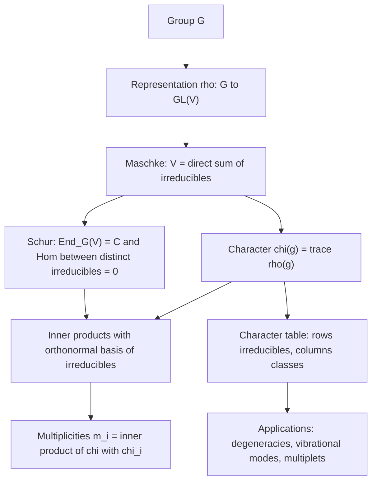

# Representation Theory

> [Mathematics](../../README.md) › [Advanced Topics](../README.md) · Level: Advanced · Prerequisites: [Group Theory](../../13-abstract-algebra/01-groups/README.md), [Vector Spaces](../../08-linear-algebra/04-vector-spaces/README.md), [Matrices](../../08-linear-algebra/02-matrices/README.md), [Linear Transformations](../../08-linear-algebra/05-linear-transformations/README.md), [Eigenvalues and Eigenvectors](../../08-linear-algebra/07-eigenvalues-and-eigenvectors/README.md), [Inner Product Spaces](../../08-linear-algebra/08-inner-product-spaces/README.md), [Complex Numbers and Geometry](../../15-complex-analysis/01-complex-numbers-and-geometry/README.md) · Estimated time: 600 min

## 1. Introduction

A group is an abstract description of symmetry. It records *which* transformations exist and how they
compose, but says nothing about *what* they transform. **Representation theory** supplies the missing
half: it lets a group act on a vector space by invertible linear maps, so that abstract symmetry becomes
concrete matrix algebra — and linear algebra can then be brought to bear on the group.

Why would one want that? Three reasons recur throughout this chapter.

1. **Structure.** Linear algebra has a sharp structure theory (eigenspaces, invariant subspaces, traces).
   Feeding a group into it reveals the group's inner structure, in particular its normal subgroups and
   quotients, through the representations they support.
2. **Computation.** A finite group's invariants — its character table — can be computed by linear
   algebra alone, and they answer counting questions that are hard to answer group-theoretically: the
   number of colourings of a cube's faces fixed up to rotation, the number of ways a molecule can
   vibrate, the fusion rules of a particle multiplet.
3. **Physics and chemistry.** Quantum mechanics is linear algebra plus symmetry. An energy level's
   degeneracy is the dimension of an irreducible representation of the symmetry group of the Hamiltonian;
   selection rules are statements that certain inner products vanish because they are intertwiners
   between non-isomorphic irreducibles. The classification of hadrons in the 1960s was the decomposition
   $3\otimes 3\otimes 3 = 10\oplus 8\oplus 8\oplus 1$ written in the language of this chapter.

The chapter moves from the definitions to the two pillars — **Maschke's theorem** (every representation
of a finite group splits into irreducibles) and **Schur's lemma** (intertwiners between irreducibles are
as simple as possible) — then builds the **character** machinery, which reduces all of representation
theory over $\mathbb{C}$ to a finite table of numbers. With characters in hand the theory becomes
computational: Section 7.7 computes the tables of $S_3$ and every cyclic group, Section 7.8 proves that
the regular representation contains each irreducible with multiplicity equal to its dimension, Section
7.11 classifies the representations of finite abelian groups completely, and Section 7.9 turns
representations into a ring with multiplication $\otimes$.

Two glimpses beyond the finite case close the theory. Section 7.10 introduces **induced
representations**, which build representations of $G$ from those of a subgroup, and Section 7.12 passes
to **compact groups**, where orthogonality becomes an integral and the Peter–Weyl theorem says that
Fourier analysis *is* representation theory of the circle.

Sections 9 and 12 apply all of this: seven worked examples from $C_4$ to the eightfold way, and
applications to angular momentum, particle physics and molecular spectroscopy.

## 2. Prerequisites

**Groups, subgroups, cosets, normality, conjugacy, homomorphisms.** The whole chapter is a theory of
homomorphisms $G \to GL(V)$, so homomorphisms, kernels and quotients are used constantly, and conjugacy
classes organise the character table. See
[Group Theory](../../13-abstract-algebra/01-groups/README.md), especially its sections on cosets,
normal subgroups and the first isomorphism theorem.

**Vector spaces, bases, dimension, direct sums; linear maps and matrices.** Representations are vector
spaces with extra structure, Maschke's theorem constructs a direct-sum decomposition, and the matrix of
a representation depends on a basis with conjugation as the effect of changing it. See
[Vector Spaces](../../08-linear-algebra/04-vector-spaces/README.md),
[Linear Transformations](../../08-linear-algebra/05-linear-transformations/README.md) and
[Matrices](../../08-linear-algebra/02-matrices/README.md).

**Eigenvalues, characteristic polynomials, the trace.** Schur's lemma uses the existence of an
eigenvalue over $\mathbb{C}$; characters are traces. See
[Eigenvalues and Eigenvectors](../../08-linear-algebra/07-eigenvalues-and-eigenvectors/README.md).

**Inner product spaces and orthonormal bases.** Unitary representations exist for every finite group
(by averaging an inner product), which makes character orthogonality an instance of Parseval's identity.
See [Inner Product Spaces](../../08-linear-algebra/08-inner-product-spaces/README.md).

**Complex roots of unity.** Cyclic groups act by rotations; their characters are powers of
$\omega = e^{2\pi i/n}$. See
[Complex Numbers and Geometry](../../15-complex-analysis/01-complex-numbers-and-geometry/README.md).

## 3. Learning Objectives

By the end of this tutorial you will be able to: define representations, subrepresentations,
intertwiners and equivalence, and verify them on explicit matrices; prove Maschke's theorem by the
averaging argument and decompose representations into irreducibles; state and prove Schur's lemma and
deduce that finite abelian groups have only one-dimensional irreducibles; compute characters, prove the
orthogonality relations, and extract multiplicities as inner products; compute character tables of
$S_3$, $D_4$, $A_4$ and every cyclic group, verifying orthogonality by hand; prove that the regular
representation contains each irreducible with multiplicity its dimension, and deduce
$\lvert G\rvert = \sum_i d_i^2$; classify the representations of finite abelian groups and read the
Fourier transform as a decomposition of the regular representation; define the representation ring and
compute it for $C_n$; compute induced characters and apply Frobenius reciprocity; explain how
orthogonality becomes an integral for compact groups and state Peter–Weyl; and use character tables to
count molecular vibrations and to decompose $SU(3)$ tensor products in the eightfold way.

## 4. Intuition

**Symmetry needs something to move.** A group element is a command — "rotate by $120^\circ$", "swap the
first two objects". A representation is a way of obeying the command inside a vector space: a set of
invertible matrices, one per group element, whose products mirror the group's multiplication table.

The simplest analogy is a dance. The group is the choreography (which moves may follow which). A
representation is a particular set of dancers realising the choreography: the same abstract move looks
different for a soloist, a pair, or a chorus, and two different ensembles can realise the *same*
choreography in genuinely different ways. **Irreducible** representations are the dances that cannot be
split into independent sub-dances. Maschke's theorem says that for a finite group every dance is a
superposition of irreducible ones, with no "gluing" between them: the ensemble can always be partitioned
into groups that ignore each other.

**Characters: the shadow of a matrix.** A representation assigns a matrix to each group element; the trace
of that matrix — the character — is a single number, and for many purposes the trace is all that matters.
This is surprising on first contact, since the trace discards almost everything, but for a finite group
over $\mathbb{C}$ the traces of all elements determine the representation up to isomorphism, and their
orthogonality relations make them behave like the coordinates of an orthonormal basis. Decomposing a
representation then becomes an inner product, $m_i = \langle \chi_W, \chi_i\rangle$: representation theory
of finite groups over $\mathbb{C}$ is a finite computation, laid out in a table.

**Why the trace?** Because the trace is invariant under conjugation, so it sees only conjugacy classes —
exactly the data that a representation over $\mathbb{C}$ cannot distinguish; and because the trace of a
direct sum is a sum of traces while that of a tensor product is a product, the trace turns
$\oplus,\otimes$ on representations into $+,\times$ on numbers.

**A physical picture.** An atom with spherical symmetry has a Hamiltonian commuting with rotations, so
its eigenspaces are representations of $SO(3)$; because the irreducibles are indexed by
$l = 0,1,2,\dots$ with dimension $2l+1$, an energy level carries a $(2l+1)$-fold degeneracy. That the
$p$-orbital is threefold degenerate and the $d$-orbital fivefold is Maschke's theorem plus the
classification of $SO(3)$ irreducibles; the same reasoning predicts vibrational spectra of molecules
(Section 12.3) and the hadron multiplets of the eightfold way (Section 12.2).

## 5. Formal Definition

Throughout, $G$ is a group with identity $e$, $k$ is a field (in practice $k = \mathbb{C}$), and $V$ is
a finite-dimensional vector space over $k$. $GL(V)$ denotes the group of invertible linear maps
$V \to V$ under composition; after a choice of basis it is the group of invertible $n\times n$ matrices
over $k$, written $GL_n(k)$.

**Definition 5.1 (Representation).** A *representation* of $G$ on $V$ is a group homomorphism

$$\rho : G \longrightarrow GL(V).$$

Equivalently, $\rho$ assigns to each $g \in G$ a linear map $\rho(g)$ with

$$\rho(e) = \operatorname{id}_V, \qquad \rho(gh) = \rho(g)\rho(h) \ \text{ for all } g,h \in G .$$

The *dimension* (or *degree*) of $\rho$ is $\dim V$, written $\dim \rho$. A representation of dimension
$1$ is a homomorphism $G \to k^{\times}$; such maps are the *one-dimensional representations*.

**Definition 5.2 (Matrix representation).** A *matrix representation* is a homomorphism
$G \to GL_n(k)$. Choosing a basis of $V$ converts $\rho$ into a matrix representation
$g \mapsto [\rho(g)]_{\mathcal{B}}$; choosing another basis conjugates every matrix by the same
invertible matrix $P$.

**Definition 5.3 (Equivalence, intertwiner).** Let $\rho : G \to GL(V)$ and $\sigma : G \to GL(W)$ be
representations. A linear map $T : V \to W$ is an *intertwining operator* (or *$G$-equivariant map*, or
*morphism of representations*) if

$$T\,\rho(g) = \sigma(g)\,T \qquad \text{for all } g \in G .$$

The set of such $T$ is a vector space denoted $\operatorname{Hom}_G(V,W)$; when $V = W$ and
$\rho = \sigma$, its elements are the *endomorphisms* $\operatorname{End}_G(V)$.

$\rho$ and $\sigma$ are *equivalent*, written $\rho \cong \sigma$, if there is an invertible
intertwiner, i.e. an isomorphism $T : V \to W$ satisfying the relation above. Equivalence is exactly
"the same representation in different bases".

**Definition 5.4 (Subrepresentation).** A linear subspace $W \subseteq V$ is *$G$-invariant* (or a
*subrepresentation*) if $\rho(g)w \in W$ for every $w \in W$ and every $g \in G$. Then $\rho$ restricts
to a representation $\rho|_W : G \to GL(W)$, and the quotient $V/W$ carries the representation
$\bar\rho(g)(v + W) = \rho(g)v + W$.

**Definition 5.5 (Irreducibility).** A representation $\rho$ on $V \ne \{0\}$ is *irreducible* if its only
invariant subspaces are $\{0\}$ and $V$. It is *indecomposable* if it is not a direct sum of two nonzero
subrepresentations. Every irreducible representation is indecomposable; the converse fails in general
(it holds for finite groups over $\mathbb{C}$, by Maschke's theorem, Theorem 7.9).

**Definition 5.6 (Direct sum, complete reducibility).** If $V = W_1 \oplus \cdots \oplus W_r$ is a
direct sum of invariant subspaces, then $\rho \cong \rho|_{W_1} \oplus \cdots \oplus \rho|_{W_r}$ and
$\dim \rho = \sum_i \dim \rho|_{W_i}$. A representation is *completely reducible* (or *semisimple*) if it
is a direct sum of irreducibles.

**Definition 5.7 (Unitary representation).** Suppose $k = \mathbb{C}$ and $V$ carries a positive
definite Hermitian inner product $\langle\cdot,\cdot\rangle$. The representation is *unitary* if every
$\rho(g)$ is unitary, i.e. $\langle \rho(g)v, \rho(g)w\rangle = \langle v,w\rangle$ for all $v,w$ and all
$g$.

**Definition 5.8 (Permutation representation).** If $G$ acts on a finite set $X$, then the vector space
$k[X]$ with basis $(e_x)_{x \in X}$ carries the *permutation representation*
$\rho(g)e_x = e_{g\cdot x}$. Its dimension is $\lvert X\rvert$, and its character at $g$ counts the fixed
points of $g$ (Proposition 7.9).

**Definition 5.9 (Left regular representation).** Taking $X = G$ with the left action $g \cdot h = gh$
gives the *left regular representation* $\rho_{\mathrm{reg}}$ on $k[G]$, of dimension $\lvert G\rvert$.

**Definition 5.10 (Tensor product and dual).** If $\rho$ acts on $V$ and $\sigma$ on $W$, then
$V \otimes W$ carries $\rho \otimes \sigma$, defined on simple tensors by
$(\rho\otimes\sigma)(g)(v\otimes w) = \rho(g)v \otimes \sigma(g)w$ and extended bilinearly. The dual
space $V^{*}$ carries the *contragredient* representation $\rho^{*}(g) = \rho(g^{-1})^{\mathsf{T}}$, that
is, $(\rho^{*}(g)f)(v) = f(\rho(g^{-1})v)$.

## 6. Mathematical Notation

| Symbol | Read as | Meaning |
|---|---|---|
| $\rho : G \to GL(V)$ | "rho from $G$ to $GL(V)$" | a representation of $G$ on $V$ |
| $GL(V)$, $GL_n(k)$ | "G-L of $V$", "G-L-$n$ over $k$" | invertible linear maps, invertible $n\times n$ matrices |
| $\dim \rho$ | "dimension of rho" | $\dim V$, the degree of the representation |
| $\rho \cong \sigma$ | "rho is equivalent to sigma" | there is an invertible intertwiner |
| $\operatorname{Hom}_G(V,W)$ | "hom-$G$ of $V$ and $W$" | linear maps commuting with the action |
| $\operatorname{End}_G(V)$ | "end-$G$ of $V$" | $G$-equivariant linear maps $V \to V$ |
| $V^{G}$ | "the $G$-invariants of $V$" | $\{v : \rho(g)v = v \ \forall g\}$ |
| $V \oplus W$ | "$V$ direct sum $W$" | invariant decomposition into two blocks |
| $V \otimes W$ | "$V$ tensor $W$" | tensor product representation |
| $V^{*}$, $\rho^{*}$ | "$V$ dual", "rho dual" | contragredient representation |
| $\chi_\rho$, $\chi_V$ | "chi of rho" | the character $g \mapsto \operatorname{tr}\rho(g)$ |
| $\chi_i$, $d_i$ | "chi sub $i$", "d sub $i$" | the $i$-th irreducible character and its degree |
| $\langle \chi, \psi\rangle_G$ | "inner product of chi and psi" | $\frac{1}{\lvert G\rvert}\sum_{g}\chi(g)\overline{\psi(g)}$ |
| $C_1,\dots,C_k$ | "C one to C k" | the conjugacy classes of $G$ |
| $\lvert C\rvert$, $\lvert G\rvert$ | "order of $C$", "order of $G$" | class size, group order |
| $\mathbb{1}_G$ | "the trivial character" | the character of the trivial representation |
| $k[G]$ | "$k$ adjoin $G$" | group algebra, with basis $G$ |
| $\operatorname{Ind}_H^G W$ | "induction from $H$ to $G$ of $W$" | induced representation |
| $R(G)$ | "$R$ of $G$" | representation ring |
| $\omega_n$ | "omega sub $n$" | $e^{2\pi i/n}$, a primitive $n$-th root of unity |
| $\widehat{G}$ | "G hat" | the group of one-dimensional characters (the dual group) |

Two conventions are worth stating explicitly. First, all inner products of characters are **conjugate
linear in the second variable**, so that they are positive definite:
$\langle \chi,\psi\rangle = \frac1{\lvert G\rvert}\sum_g \chi(g)\overline{\psi(g)}$. Second,
"irreducible" always means "nonzero and with no proper nonzero invariant subspace"; the zero
representation is neither irreducible nor a direct sum of irreducibles, and is excluded from statements
about decomposition.

## 7. Core Concepts

### 7.1 Representations and their first examples

A representation is a homomorphism into matrices, so specifying one means specifying matrices whose
products obey the group law. For a group given by generators and relations, it is enough to give matrices
for the generators and check the relations: if $G = \langle s_1,\dots,s_m \mid r_1,\dots,r_\ell\rangle$
and matrices $M_1,\dots,M_m$ satisfy every relation $r_j(M_1,\dots,M_m) = I$, then there is a unique
homomorphism $G \to GL_n(k)$ sending $s_i \mapsto M_i$. This is the practical method for constructing
representations, and it is the reason a finite group can be *defined* by a multiplication table but
*represented* by a small list of matrices.

**Example 7.1 (The standard examples).** Let $\lvert G\rvert = n$.

* *Trivial representation.* $\rho(g) = 1$ for all $g$; dimension $1$; character $\mathbb{1}_G$.
* *Sign representation* of $S_n$. $\rho(\sigma) = \operatorname{sgn}(\sigma) \in \{\pm 1\}$; dimension
  $1$. It is trivial exactly on $A_n$, so it is really a representation of $S_n/A_n \cong C_2$.
* *Permutation representation.* If $G$ acts on a set $X$ with $\lvert X\rvert = m$, then $k[X]$ with
  $\rho(g)e_x = e_{g x}$ is a representation of dimension $m$.
* *Regular representation.* The permutation representation of $G$ acting on itself by left
  multiplication, of dimension $n$. In the basis indexed by $G$, $\rho_{\mathrm{reg}}(g)$ is a
  permutation matrix with no fixed basis vector when $g \ne e$.
* *Rotation representation of $C_n$.* Let $C_n = \langle r \mid r^n = e\rangle$ and put
  $\rho(r) = R_{2\pi/n}$, the rotation matrix. Over $\mathbb{R}$ this is a faithful representation of
  dimension $2$; for $n \ge 3$ it is irreducible over $\mathbb{R}$ (no real invariant line), while over
  $\mathbb{C}$ it splits into two one-dimensional pieces (Section 7.2).
* *Standard representation of $S_n$.* Let $S_n$ act on $k^n$ by permuting coordinates. The line spanned
  by $(1,1,\dots,1)$ is invariant, and so is the hyperplane $H = \{(x_1,\dots,x_n) : \sum x_i = 0\}$ of
  dimension $n-1$. For $n = 3$ this gives the two-dimensional representation of $S_3$ that reappears
  throughout this chapter; for general $n$ it is irreducible (Problem 14 carries out the norm
  computation for $n = 4$, and the same argument works for every $n$).
* *$SU(2)$ and $SO(3)$.* The group $SU(2)$ of unitary $2\times 2$ matrices with determinant $1$ acts on
  $\mathbb{C}^2$; the symmetric powers $\operatorname{Sym}^l(\mathbb{C}^2)$ give irreducible
  representations of dimension $l+1$, which descend to the rotation group $SO(3)$ when $l$ is even
  (Section 7.12).

**Proposition 7.2 (Effect of a change of basis).** Let $\rho$ be a representation on $V$ and let
$P$ be the matrix of a change of basis. Then $g \mapsto P^{-1}\rho(g)P$ is a representation equivalent
to $\rho$. Conversely, every equivalent representation arises this way.

*Proof.* The map $g \mapsto P^{-1}\rho(g)P$ is a composite of homomorphisms, hence a homomorphism. If
$T : V \to W$ is an invertible intertwiner, choosing bases and writing $P$ for the matrix of $T$
conjugates $[\rho(g)]$ into $[\sigma(g)]$. $\square$

The proposition explains why representation theory is the study of conjugacy classes of homomorphisms,
and why invariants such as the trace and the eigenvalues of $\rho(g)$ are the natural invariants to
compute.

### 7.2 Subrepresentations and irreducibility

Invariant subspaces are the sub-objects of representation theory. Two elementary facts generate
everything: kernels and images of intertwiners are invariant, and sums and intersections of invariant
subspaces are invariant.

**Lemma 7.3.** Let $T : V \to W$ be an intertwiner between representations of $G$.

1. $\ker T$ is a $G$-invariant subspace of $V$, and $\operatorname{im} T$ is a $G$-invariant subspace of
   $W$.
2. If $V$ is irreducible and $T \ne 0$, then $T$ is injective.
3. If $W$ is irreducible and $T \ne 0$, then $T$ is surjective.

*Proof.* (1) If $Tv = 0$ then $T\rho_V(g)v = \sigma_W(g)Tv = 0$. If $w = Tv$ then
$\sigma_W(g)w = T\rho_V(g)v \in \operatorname{im}T$. (2) A nonzero kernel would be a proper invariant
subspace of the irreducible $V$. (3) A proper image would be a nonzero proper invariant subspace of $W$.
$\square$

**Proposition 7.4.** Let $W_1, W_2$ be invariant subspaces of $V$. Then $W_1 + W_2$ and $W_1 \cap W_2$
are invariant. If $V = W_1 \oplus W_2$ as vector spaces with both summands invariant, then
$V \cong W_1 \oplus W_2$ as representations.

*Proof.* Immediate from the definitions: $\rho(g)(w_1 + w_2) = \rho(g)w_1 + \rho(g)w_2$, and if
$w \in W_1 \cap W_2$ then $\rho(g)w$ lies in both. $\square$

**Example 7.5 (A real representation that splits over $\mathbb{C}$).** Let $C_4 = \langle r\rangle$ act
on $\mathbb{R}^2$ by rotation through $90^\circ$:
$\rho(r) = \begin{pmatrix}0 & -1\\ 1 & 0\end{pmatrix}$. A one-dimensional real invariant subspace would
be an eigenline, i.e. a real eigenvector; but the eigenvalues are $\pm i$, so none exists, and $\rho$ is
irreducible over $\mathbb{R}$. Over $\mathbb{C}$ the eigenvectors $(1,\mp i)$ span two invariant complex
lines, so the complexification splits as a sum of two one-dimensional representations
$r \mapsto i$ and $r \mapsto -i$. **Irreducibility depends on the field.**

**Example 7.6 (The standard representation of $S_3$, decomposed).** Let $S_3$ permute the coordinates of
$\mathbb{C}^3$. The vector $u = (1,1,1)$ spans an invariant line $L$; the hyperplane
$H = \{x : x_1+x_2+x_3 = 0\}$ is invariant of dimension $2$. Since $\mathbb{C}^3 = L \oplus H$ (any
$x$ equals $\frac{x_1+x_2+x_3}{3}u + (x - \frac{x_1+x_2+x_3}{3}u)$, and the second summand lies in $H$),
the permutation representation is the direct sum of the trivial representation and the two-dimensional
standard representation.

**Example 7.7 (An indecomposable but reducible representation).** Over $k = \mathbb{F}_p$ let
$C_p = \langle r\rangle$ act on $k^2$ by $\rho(r) = \begin{pmatrix}1 & 1\\ 0 & 1\end{pmatrix}$. The line
$L = \langle e_1\rangle$ is invariant, so $\rho$ is reducible. Is there an invariant complement? A
complement is a line $\langle (a,1)\rangle$ with $a \in \mathbb{F}_p$ (the line $\langle e_2\rangle$ is
not a complement to $L$). But $\rho(r)(a,1) = (a+1,1) \notin \langle(a,1)\rangle$, since $a+1 \ne a$ in
$\mathbb{F}_p$. Hence no invariant complement exists and $\rho$ is indecomposable. This shows that
Maschke's theorem is not a triviality: it fails when the characteristic divides the group order.

### 7.3 Maschke's theorem

The central structural result for finite groups is that reducible always means decomposable.

**Lemma 7.8 (Unitarisability).** Let $G$ be finite and let $\rho$ be a representation on a complex
vector space $V$. Then $V$ carries a $G$-invariant positive definite Hermitian inner product.

*Proof.* Start from any positive definite Hermitian inner product
$\langle\cdot,\cdot\rangle_0$ (for instance the standard one in some basis) and average:

$$\langle v, w\rangle := \frac{1}{\lvert G\rvert}\sum_{h \in G}\langle \rho(h)v, \rho(h)w\rangle_0 .$$

This is a sum of positive definite Hermitian forms with positive coefficients, hence again positive
definite and Hermitian. For $g \in G$,

$$\langle \rho(g)v,\rho(g)w\rangle = \frac1{\lvert G\rvert}\sum_h \langle \rho(hg)v,\rho(hg)w\rangle_0
= \frac1{\lvert G\rvert}\sum_{h'}\langle \rho(h')v,\rho(h')w\rangle_0 = \langle v,w\rangle,$$

because $h \mapsto hg$ is a bijection of $G$. Hence every $\rho(g)$ is unitary for the new product.
$\square$

**Theorem 7.9 (Maschke).** Let $G$ be a finite group and $\rho$ a representation of $G$ on a complex
vector space $V$. If $W \subseteq V$ is an invariant subspace, then there exists an invariant subspace
$W'$ with $V = W \oplus W'$. Consequently every finite-dimensional complex representation of a finite
group is a direct sum of irreducible representations.

*Proof.* By Lemma 7.8 we may assume the inner product is $G$-invariant. Let

$$W^{\perp} = \{v \in V : \langle v, w\rangle = 0 \text{ for all } w \in W\}.$$

Linear algebra gives $V = W \oplus W^{\perp}$. If $v \in W^{\perp}$ and $w \in W$, then for every $g$,
$\langle \rho(g)v, w\rangle = \langle v, \rho(g)^{-1}w\rangle = 0$ because $\rho(g)^{-1}w \in W$; hence
$\rho(g)v \in W^{\perp}$ and $W^{\perp}$ is invariant.

For the second claim, argue by induction on $\dim V$. If $V$ is irreducible there is nothing to prove.
Otherwise choose a proper nonzero invariant subspace $W$; by the first part $V = W \oplus W^{\perp}$ with
both summands invariant and of strictly smaller dimension, so the induction hypothesis applies to each.
$\square$

**Remark 7.10 (The averaging proof without an inner product).** The proof above uses an inner product.
There is a purely algebraic version that also reveals the general hypothesis. Let $\pi : V \to W$ be any
linear projection onto $W$ (so $\pi|_W = \mathrm{id}$), and define

$$\bar\pi := \frac1{\lvert G\rvert}\sum_{g \in G} \rho(g)\,\pi\,\rho(g)^{-1}.$$

Then $\bar\pi$ is a projection ($\bar\pi^2 = \bar\pi$, since each summand is a projection onto $W$ and
$\rho(g)$ preserves $W$), it still satisfies $\bar\pi|_W = \mathrm{id}$, and for any $h$,
$h\bar\pi h^{-1} = \bar\pi$ because $g \mapsto hg$ permutes the sum. Hence $\bar\pi$ is
$G$-equivariant, $\ker\bar\pi$ is invariant, and $V = W \oplus \ker\bar\pi$. This argument divides by
$\lvert G\rvert$, so it works over any field whose characteristic does not divide $\lvert G\rvert$, and
it proves that complete reducibility holds in that generality. In characteristic $p \mid \lvert G\rvert$
it fails, as Example 7.7 shows.

**Corollary 7.11 (Canonical decomposition).** Let $V_1,\dots,V_r$ be the pairwise non-isomorphic
irreducibles of $G$. Every finite-dimensional complex representation $V$ decomposes as

$$V \cong \bigoplus_{i=1}^{r} m_i V_i, \qquad m_i = \dim\operatorname{Hom}_G(V_i,V) \in \mathbb{N}_0 ,$$

and the integer $m_i$ (the *multiplicity* of $V_i$ in $V$) does not depend on the chosen decomposition.
The subspace $m_iV_i \cong V_i^{\oplus m_i}$ is called the *isotypic component* of type $i$.

*Proof.* Maschke gives some decomposition $V = \bigoplus_j U_j$ into irreducibles. Group the $U_j$
according to isomorphism type: each $U_j$ is isomorphic to exactly one $V_i$. The multiplicity formula
follows from Schur's lemma (Theorem 7.12 below): $\operatorname{Hom}_G(V_i, V_i^{\oplus m}) \cong
\mathbb{C}^m$ and $\operatorname{Hom}_G(V_i,V_j) = 0$ for $i \ne j$. $\square$

### 7.4 Schur's lemma

**Theorem 7.12 (Schur's lemma).** Let $V$ and $W$ be irreducible complex representations of $G$.

1. Every intertwiner $T : V \to W$ is either zero or an isomorphism. Hence if $V \not\cong W$, then
   $\operatorname{Hom}_G(V,W) = 0$, while $\operatorname{Hom}_G(V,V)$ consists of invertible maps and
   $0$.
2. Every $T \in \operatorname{End}_G(V)$ is a scalar: $T = \lambda\,\mathrm{id}_V$ for some
   $\lambda \in \mathbb{C}$. Hence $\operatorname{End}_G(V) \cong \mathbb{C}$ as an algebra.

*Proof.* (1) By Lemma 7.3, $\ker T$ and $\operatorname{im}T$ are invariant. Since $V$ is irreducible,
$\ker T$ is $\{0\}$ or $V$; since $W$ is irreducible, $\operatorname{im}T$ is $\{0\}$ or $W$. If
$T \ne 0$ then $\ker T \ne V$, so $\ker T = \{0\}$ and $\operatorname{im} T \ne \{0\}$, so
$\operatorname{im} T = W$: $T$ is an isomorphism.

(2) The characteristic polynomial of $T$ has a root $\lambda \in \mathbb{C}$ because $\mathbb{C}$ is
algebraically closed, so $T - \lambda\,\mathrm{id}$ is singular. It is also an intertwiner, so by (1) it
must be $0$. $\square$

Part (2) is exactly where algebraic closure is used. Over $\mathbb{R}$ it fails: the $90^\circ$ rotation
of Example 7.5 is an endomorphism of an irreducible real representation, and it is not a scalar. Over
$\mathbb{R}$ the correct statement is that $\operatorname{End}_G(V)$ is a finite-dimensional real
division algebra, hence $\mathbb{R}$, $\mathbb{C}$ or $\mathbb{H}$ (Frobenius' theorem).

**Corollary 7.13 (Irreducibles of abelian groups are one-dimensional).** If $G$ is abelian, then every
irreducible complex representation of $G$ has dimension $1$.

*Proof.* Let $\rho$ be irreducible on $V$ and fix $g \in G$. For every $h$,
$\rho(g)\rho(h) = \rho(gh) = \rho(hg) = \rho(h)\rho(g)$, so $\rho(g) \in \operatorname{End}_G(V)$. By
Schur, $\rho(g) = \lambda(g)\mathrm{id}_V$. Every one-dimensional subspace is therefore invariant, and
irreducibility forces $\dim V = 1$. $\square$

This is a striking statement: an abelian group of order $10^6$ has irreducible representations of
dimension at most $1$, i.e. its representation theory is the theory of homomorphisms into
$\mathbb{C}^{\times}$. Section 7.11 exploits it fully.

**Corollary 7.14 (Multiplicities and endomorphisms).** For irreducible $V_i$ and any representation $V$,
$\dim\operatorname{Hom}_G(V_i,V) = m_i$, the multiplicity of $V_i$ in $V$.

*Proof.* Write $V \cong \bigoplus_j m_j V_j$. By Schur, $\operatorname{Hom}_G(V_i, m_jV_j)$ is
$\mathbb{C}^{m_j}$ if $j = i$ and $0$ otherwise; add over $j$. $\square$

### 7.5 Characters

**Definition 7.15 (Character).** The *character* of a representation $\rho$ on $V$ is the function

$$\chi_\rho : G \to \mathbb{C}, \qquad \chi_\rho(g) = \operatorname{tr}\bigl(\rho(g)\bigr).$$

A character of an irreducible representation is called an *irreducible character*. A *class function* is
a function constant on conjugacy classes; the class functions form a vector space
$\mathrm{Cl}(G)$ of dimension equal to the number $k$ of conjugacy classes.

**Proposition 7.16 (Elementary properties of characters).** Let $\rho,\sigma$ be representations of a
finite group $G$ and $g,h \in G$.

1. $\chi_\rho(e) = \dim\rho$.
2. $\chi_\rho$ is a class function: $\chi_\rho(hgh^{-1}) = \chi_\rho(g)$.
3. $\chi_\rho(g^{-1}) = \overline{\chi_\rho(g)}$.
4. $\chi_{\rho\oplus\sigma} = \chi_\rho + \chi_\sigma$ and
   $\chi_{\rho\otimes\sigma} = \chi_\rho\cdot\chi_\sigma$.
5. $\chi_{\rho^{*}} = \overline{\chi_\rho}$.
6. $\lvert\chi_\rho(g)\rvert \le \chi_\rho(e)$, with equality if and only if $\rho(g)$ is a scalar
   matrix.
7. $\chi_\rho(g)$ is a sum of $\dim\rho$ roots of unity, hence an algebraic integer.

*Proof.* (1) $\operatorname{tr}(\mathrm{id}) = \dim V$. (2) $\operatorname{tr}(P^{-1}AP) =
\operatorname{tr}(A)$: the trace is conjugation invariant. (3) For a unitary representation,
$\rho(g^{-1}) = \rho(g)^{*} = \overline{\rho(g)}^{\mathsf{T}}$, whose trace is
$\overline{\operatorname{tr}\rho(g)}$; every finite-group representation is unitarisable by Lemma 7.8,
and traces are unchanged by changing the inner product. (4) In a basis adapted to a direct sum, the
matrix is block diagonal; the trace of a tensor product is the product of the traces because
$\operatorname{tr}(A\otimes B) = \operatorname{tr}A\cdot\operatorname{tr}B$. (5) The eigenvalues of
$\rho^{*}(g)$ are the inverses of those of $\rho(g)$, i.e. their complex conjugates since the eigenvalues
are roots of unity. (6) The eigenvalues $\lambda_1,\dots,\lambda_d$ of the unitary matrix $\rho(g)$ have
modulus $1$, so $\lvert\sum\lambda_i\rvert \le \sum\lvert\lambda_i\rvert = d$ with equality exactly when
all $\lambda_i$ coincide, which for a unitary matrix means $\rho(g)$ is scalar. (7) Immediate from (6)'s
proof and the fact that a finite-order matrix is diagonalisable with roots of unity as eigenvalues.
$\square$

Statement (7) is the entry point to the arithmetic theory of characters: the degrees $d_i$ divide
$\lvert G\rvert$, a classical theorem whose proof uses algebraic integers and the regular
representation.

**Proposition 7.17 (Characters of permutation representations).** Let $G$ act on a finite set $X$ and
let $\rho$ be the permutation representation on $k[X]$. Then $\chi_\rho(g)$ is the number of fixed
points of $g$ acting on $X$.

*Proof.* In the basis $(e_x)$, the matrix of $\rho(g)$ has a $1$ in position $(x,x)$ exactly when
$gx = x$, and no other nonzero entries. $\square$

**Example 7.18.** For the permutation representation of $S_3$ on $\mathbb{C}^3$, the character is
$\chi(g) = \#\{i : g(i) = i\}$, so $\chi = (3,1,0)$ on the classes $e$, transposition, $3$-cycle. By
Example 7.6 this is the sum of the trivial character $(1,1,1)$ and the standard character $(2,0,-1)$.

### 7.6 Orthogonality of characters

The inner product on class functions is

$$\langle \chi,\psi\rangle_G := \frac{1}{\lvert G\rvert}\sum_{g\in G}\chi(g)\overline{\psi(g)} .$$

The main theorem says that irreducible characters are orthonormal for this product. The proof is a
beautiful application of "the trace of a projection is its rank".

**Lemma 7.19 (The averaging projection).** Let $V,W$ be representations of a finite group $G$. The map

$$\mathrm{Ave} : \operatorname{Hom}(V,W)\to\operatorname{Hom}(V,W), \qquad
\mathrm{Ave}(T) = \frac1{\lvert G\rvert}\sum_{g\in G}\rho_W(g)\,T\,\rho_V(g)^{-1}$$

is a projection (i.e. $\mathrm{Ave}^2 = \mathrm{Ave}$) with image exactly $\operatorname{Hom}_G(V,W)$.

*Proof.* For $h \in G$,

$$\rho_W(h)\mathrm{Ave}(T)\rho_V(h)^{-1}
= \frac1{\lvert G\rvert}\sum_g \rho_W(hg)T\rho_V(hg)^{-1}
= \frac1{\lvert G\rvert}\sum_{g'}\rho_W(g')T\rho_V(g')^{-1} = \mathrm{Ave}(T),$$

using the substitution $g' = hg$. Hence every $\mathrm{Ave}(T)$ is an intertwiner, and if $T$ already is
one, every summand equals $T$, so $\mathrm{Ave}(T) = T$. Therefore $\mathrm{Ave}$ fixes exactly
$\operatorname{Hom}_G(V,W)$ pointwise and lands in it, which is precisely the statement that it is a
projection onto that subspace. $\square$

**Lemma 7.20 (Trace of $T \mapsto ATB$).** For $A \in \operatorname{End}(W)$ and
$B \in \operatorname{End}(V)$, the trace of the linear map $\operatorname{Hom}(V,W) \to
\operatorname{Hom}(V,W)$, $T \mapsto ATB$, is $\operatorname{tr}(A)\operatorname{tr}(B)$.

*Proof.* Choose bases and let $X$ be the coordinate matrix of $T$. The map is $X \mapsto AXB$. With the
column-wise vectorisation $\operatorname{vec}(X)$, one has
$\operatorname{vec}(AXB) = (B^{\mathsf{T}}\otimes A)\operatorname{vec}(X)$, so the trace is
$\operatorname{tr}(B^{\mathsf{T}}\otimes A) = \operatorname{tr}(B^{\mathsf{T}})\operatorname{tr}(A) =
\operatorname{tr}(B)\operatorname{tr}(A)$. $\square$

**Theorem 7.21 (First orthogonality relation).** For representations $V,W$ of a finite group $G$,

$$\langle \chi_V,\chi_W\rangle_G = \dim\operatorname{Hom}_G(V,W).$$

If $V,W$ are irreducible, then $\langle\chi_V,\chi_W\rangle_G = \delta_{VW}$.

*Proof.* Apply Lemma 7.20 to $A = \rho_W(g)$ and $B = \rho_V(g)^{-1}$: the map
$T \mapsto \rho_W(g)T\rho_V(g)^{-1}$ has trace
$\operatorname{tr}\rho_W(g)\operatorname{tr}\rho_V(g)^{-1} = \chi_W(g)\overline{\chi_V(g)}$. Summing with
weight $1/\lvert G\rvert$ and using Lemma 7.19 plus "trace of a projection = its rank",

$$\langle \chi_W,\chi_V\rangle_G = \operatorname{tr}(\mathrm{Ave}) = \operatorname{rank}(\mathrm{Ave})
= \dim\operatorname{Hom}_G(V,W).$$

The last claim is Schur's lemma: $\dim\operatorname{Hom}_G(V,W) = \delta_{VW}$. $\square$

**Corollary 7.22 (Multiplicity formula and detection).** Let $V \cong \bigoplus_i m_i V_i$ be the
decomposition of $V$ into irreducibles. Then

$$m_i = \langle \chi_V,\chi_i\rangle_G, \qquad \langle \chi_V,\chi_V\rangle_G = \sum_i m_i^2 .$$

Consequently two representations are isomorphic if and only if they have the same character, and $V$ is
irreducible if and only if $\langle\chi_V,\chi_V\rangle_G = 1$ and $\chi_V(e) > 0$.

*Proof.* By additivity of characters, $\langle \chi_V,\chi_i\rangle = \sum_j m_j\langle\chi_j,\chi_i\rangle
= m_i$. Then $\langle\chi_V,\chi_V\rangle = \sum_{ij}m_im_j\delta_{ij} = \sum_i m_i^2$. If
$\chi_V = \chi_W$, then the multiplicities agree for every $i$, so $V \cong W$. Finally, $\sum m_i^2 = 1$
if and only if exactly one $m_i$ equals $1$ and the rest are $0$. $\square$

**Theorem 7.23 (Second orthogonality relation).** Let $C_1,\dots,C_k$ be the conjugacy classes, let
$\chi_1,\dots,\chi_r$ be the irreducible characters, and let $C_G(g)$ denote the centraliser of $g$. Then
for all $g,h \in G$,

$$\sum_{i=1}^{r}\chi_i(g)\overline{\chi_i(h)} =
\begin{cases} \lvert C_G(g)\rvert, & h \text{ is conjugate to } g,\\ 0, & \text{otherwise.}\end{cases}$$

*Proof.* Set $U_{ij} = \sqrt{\lvert C_j\rvert/\lvert G\rvert}\,\chi_i(C_j)$, where $\chi_i(C_j)$ denotes
the constant value of $\chi_i$ on $C_j$. Then

$$(UU^{*})_{ij} = \sum_{\ell}\frac{\lvert C_\ell\rvert}{\lvert G\rvert}
\chi_i(C_\ell)\overline{\chi_j(C_\ell)} = \langle\chi_i,\chi_j\rangle_G = \delta_{ij},$$

because the sum over $g$ groups into classes of size $\lvert C_\ell\rvert$. So $U$ is a square matrix
(same number of rows and columns, as Corollary 7.24 will show) with orthonormal rows, hence unitary;
therefore its columns are orthonormal as well:
$\sum_i U_{ij}\overline{U_{i\ell}} = \delta_{j\ell}$. Multiplying by
$\lvert G\rvert/\sqrt{\lvert C_j\rvert\lvert C_\ell\rvert}$ gives the claim, and for $j = \ell$ we get
$\lvert G\rvert/\lvert C_j\rvert = \lvert C_G(g)\rvert$ for $g \in C_j$, by the orbit–stabiliser theorem
applied to the conjugation action. $\square$

**Corollary 7.24 (The number of irreducibles).** The irreducible characters form a basis of the space
$\mathrm{Cl}(G)$ of class functions. In particular, the number of irreducible representations equals the
number $k$ of conjugacy classes, and the character table is a square $k \times k$ matrix.

*Proof.* The irreducible characters are orthonormal (Theorem 7.21) and therefore linearly independent, so
$r \le k$; this also justifies the unitarity step in Theorem 7.23. For the reverse inequality, let
$f$ be a class function with $\langle f,\chi_i\rangle = 0$ for all $i$. For each irreducible $\rho_i$ on
$V_i$, the operator $T_i = \sum_{g}f(g)\rho_i(g)$ is an intertwiner (it lies in the centre of the
convolution algebra, so it commutes with every $\rho_i(h)$), hence $T_i = \lambda_i\mathrm{id}$ by Schur.
Taking traces, $\lambda_i\dim V_i = \sum_g f(g)\chi_i(g) = \lvert G\rvert\overline{\langle f,\chi_i\rangle}
= 0$, so $T_i = 0$. By Maschke, the same holds for every representation, in particular for the regular
representation: $\sum_g f(g)\rho_{\mathrm{reg}}(g) = 0$. Applying this operator to the basis vector $e_e$
gives $\sum_g f(g)e_g = 0$ in $\mathbb{C}[G]$, and the $e_g$ are linearly independent, so $f(g) = 0$ for
all $g$. Hence the orthogonal complement of $\operatorname{span}\{\chi_i\}$ in $\mathrm{Cl}(G)$ is zero,
so the span is everything and $r \ge k$. $\square$

**Corollary 7.25 (Sum of squares of degrees).** $\sum_{i=1}^{k}(\dim V_i)^2 = \lvert G\rvert$.

*Proof.* Put $g = h = e$ in Theorem 7.23: $\sum_i\lvert\chi_i(e)\rvert^2 = \lvert C_G(e)\rvert =
\lvert G\rvert$. $\square$

### 7.7 Character tables: $S_3$ and the cyclic groups

**Definition 7.26 (Character table).** The *character table* of $G$ is the square array whose rows are
the irreducible characters and whose columns are the conjugacy classes, together with the class sizes
(equivalently, the centraliser orders). Corollary 7.22 says the table is a complete invariant of the
representation theory: it determines every representation up to isomorphism, and every decomposition
into irreducibles.

**Example 7.27 (Character table of $S_3$).** Write $S_3 = \{e\}\cup\{(12),(13),(23)\}\cup
\{(123),(132)\}$; the three classes have sizes $1,3,2$ and orders of centralisers $6,2,3$. Since there
are three classes, there are exactly three irreducible characters. Two are obvious: the trivial
character $\mathbb{1}$ with values $(1,1,1)$, and the sign character $\varepsilon$ with values
$(1,-1,1)$. Corollary 7.25 forces $1^2+1^2+d_3^2 = 6$, so $d_3 = 2$. Apply the column relation of
Theorem 7.23 with $g = e$ and $h$ a transposition, so that the sum over $i$ runs over the three
characters and equals $0$:

$$1\cdot\overline{\chi_1(\text{tr})} + 1\cdot\overline{\chi_2(\text{tr})}
+ 2\cdot\overline{\chi_3(\text{tr})} = 1\cdot 1 + 1\cdot(-1) + 2\,\overline{\chi_3(\text{tr})} = 0,$$

so $\chi_3(\text{tr}) = 0$. With $h$ a $3$-cycle the same relation reads
$1\cdot1 + 1\cdot1 + 2\overline{\chi_3(3\text{-cycle})} = 0$, so $\chi_3(3\text{-cycle}) = -1$. The table is

| $S_3$ | $e$ | $(12)$ | $(123)$ |
|---|---|---|---|
| class size | 1 | 3 | 2 |
| centraliser order | 6 | 2 | 3 |
| $\chi_1$ (trivial) | 1 | 1 | 1 |
| $\chi_2$ (sign) | 1 | $-1$ | 1 |
| $\chi_3$ (standard) | 2 | 0 | $-1$ |

Checks. Row orthogonality:
$\langle\chi_3,\chi_3\rangle = \frac16\bigl(2^2 + 3\cdot0^2 + 2\cdot(-1)^2\bigr) = \frac{6}{6} = 1$;
$\langle\chi_1,\chi_3\rangle = \frac16(1\cdot2 + 3\cdot1\cdot0 + 2\cdot1\cdot(-1)) = 0$;
$\langle\chi_2,\chi_3\rangle = \frac16(2 + 0 - 2) = 0$. Column orthogonality at $e$ and $(12)$:
$1\cdot1 + 1\cdot(-1) + 2\cdot0 = 0$, and the sum of squares of the first column is
$1+1+4 = 6 = \lvert S_3\rvert$.

The standard character $\chi_3$ is the one computed in Example 7.18. Its tensor square illustrates the
ring structure of Section 7.9: pointwise,
$\chi_3^2 = (4,0,1) = (1,1,1) + (1,-1,1) + (2,0,-1) = \chi_1+\chi_2+\chi_3$, so
$V_3\otimes V_3 \cong V_1\oplus V_2\oplus V_3$ — the familiar statement that the tensor square of a
2-dimensional representation is $3+1 = 4$-dimensional and splits as symmetric square plus exterior
square, here
$\operatorname{Sym}^2 V_3 \cong V_1\oplus V_3$ (character $(3,1,0)$) and
$\Lambda^2 V_3 \cong V_2$ (character $(1,-1,1)$). These symmetric and exterior characters were checked
above against explicit matrices.

**Example 7.28 (Character table of $C_n$).** Let $C_n = \langle r\mid r^n = e\rangle$. It is abelian, so
all irreducibles are one-dimensional (Corollary 7.13), and there are $n$ of them because $C_n$ has $n$
singleton conjugacy classes. A one-dimensional representation is a homomorphism
$\chi : C_n \to \mathbb{C}^{\times}$, determined by $\chi(r) = \omega$ with $\omega^n = 1$. Writing
$\omega_n = e^{2\pi i/n}$, the $n$ characters are

$$\chi_k(r^j) = \omega_n^{jk}, \qquad k = 0,1,\dots,n-1 .$$

The character table of $C_n$ is therefore the Vandermonde-type matrix $(\omega_n^{jk})_{j,k=0}^{n-1}$.
For $n = 4$:

| $C_4$ | $e$ | $r$ | $r^2$ | $r^3$ |
|---|---|---|---|---|
| $\chi_0$ | 1 | 1 | 1 | 1 |
| $\chi_1$ | 1 | $i$ | $-1$ | $-i$ |
| $\chi_2$ | 1 | $-1$ | 1 | $-1$ |
| $\chi_3$ | 1 | $-i$ | $-1$ | $i$ |

Orthogonality is the geometric sum formula: rows $k \ne \ell$ give
$\sum_{j=0}^{n-1}\omega_n^{(k-\ell)j} = \frac{1-\omega_n^{(k-\ell)n}}{1-\omega_n^{k-\ell}} = 0$, and each
row against itself gives $n$. Note that the two-dimensional real rotation representation of Example 7.5
has complex character $\chi_1+\chi_3 = (2, i-i, -2, -i+i) = (2,0,-2,0)$, consistent with the trace of a
rotation matrix.

**Remark 7.29 (The character table does not determine the group).** The dihedral group $D_4$ and the
quaternion group $Q_8$, both of order $8$, have exactly the same character table. Order the classes of
$D_4$ as $e,\ r^2,\ \{r,r^3\},\ \{s,r^2s\},\ \{rs,r^3s\}$ and those of $Q_8$ as
$1,\ -1,\ \{\pm i\},\ \{\pm j\},\ \{\pm k\}$; both groups then have the table

| | $1$st class | $2$nd class | $3$rd class | $4$th class | $5$th class |
|---|---|---|---|---|---|
| class size | 1 | 1 | 2 | 2 | 2 |
| $\chi_1$ | 1 | 1 | 1 | 1 | 1 |
| $\chi_2$ | 1 | 1 | 1 | $-1$ | $-1$ |
| $\chi_3$ | 1 | 1 | $-1$ | 1 | $-1$ |
| $\chi_4$ | 1 | 1 | $-1$ | $-1$ | 1 |
| $\chi_5$ | 2 | $-2$ | 0 | 0 | 0 |

Every orthogonality relation holds for both readings, so no character-theoretic argument can distinguish
the two groups; yet $D_4$ has five elements of order $2$ while $Q_8$ has only one. Representation theory
sees the semisimple algebra $\mathbb{C}[G] \cong \prod_i M_{d_i}(\mathbb{C})$ — and $D_4$ and $Q_8$ have
isomorphic group algebras — but not the group itself.

### 7.8 The regular representation and the decomposition theorem

**Theorem 7.30 (Character of the regular representation).** Let $\rho_{\mathrm{reg}}$ be the left
regular representation of a group $G$ on $\mathbb{C}[G]$. Then

$$\chi_{\mathrm{reg}}(g) = \begin{cases}\lvert G\rvert, & g = e,\\ 0, & g \ne e.\end{cases}$$

*Proof.* In the basis $(e_h)_{h\in G}$, the operator $\rho_{\mathrm{reg}}(g)$ sends $e_h \mapsto e_{gh}$.
If $g \ne e$, no basis vector is fixed, so every diagonal entry is $0$ and the trace is $0$. If $g = e$,
the matrix is the identity of size $\lvert G\rvert$. $\square$

**Theorem 7.31 (Decomposition of the regular representation).** Let $V_1,\dots,V_k$ be the irreducible
complex representations of the finite group $G$, of dimensions $d_1,\dots,d_k$. Then

$$\mathbb{C}[G] \;\cong\; \bigoplus_{i=1}^{k} d_i\,V_i, \qquad\text{so}\qquad
\lvert G\rvert = \sum_{i=1}^{k} d_i^{2}.$$

*Proof.* By Corollary 7.22 the multiplicity of $V_i$ in $\mathbb{C}[G]$ is
$\langle\chi_{\mathrm{reg}},\chi_i\rangle = \frac{1}{\lvert G\rvert}\sum_g\chi_{\mathrm{reg}}(g)
\overline{\chi_i(g)} = \frac{1}{\lvert G\rvert}\cdot\lvert G\rvert\cdot\overline{\chi_i(e)} = d_i$.
Comparing dimensions gives $\lvert G\rvert = \sum_i d_i\dim V_i = \sum_i d_i^2$. $\square$

**Corollary 7.32.** Every irreducible representation of $G$ occurs in the regular representation, so
there are at most $\lvert G\rvert$ of them; and every irreducible representation of $G$ is a
subrepresentation of $\mathbb{C}[G]$.

**Remark 7.33 (The algebra structure).** More is true: the decomposition of $\mathbb{C}[G]$ is an
isomorphism of algebras,

$$\mathbb{C}[G] \;\cong\; \prod_{i=1}^{k}\operatorname{End}_{\mathbb{C}}(V_i)
\;\cong\; \prod_{i=1}^{k} M_{d_i}(\mathbb{C}),$$

the complex group algebra being semisimple by Maschke's theorem. This is the Artin–Wedderburn theorem
for $\mathbb{C}[G]$, and it explains why the *left* regular representation contains $V_i$ with
multiplicity $d_i$: the block $M_{d_i}(\mathbb{C})$ acts on its $d_i$-dimensional column space as
$d_i$ copies of $V_i$.

**Example 7.34.** For $S_3$, Theorem 7.31 reads $6 = 1^2+1^2+2^2$, and indeed
$\mathbb{C}[S_3] \cong V_1 \oplus V_2 \oplus 2V_3$. For $C_n$, it reads $n = 1^2+\cdots+1^2$ with $n$
terms, consistent with Example 7.28. For $S_4$ the degrees are $1,1,2,3,3$ and
$1+1+4+9+9 = 24 = \lvert S_4\rvert$.

### 7.9 The representation ring

Representations can be added (direct sum) and multiplied (tensor product). Additive inverses are missing,
so one formally adjoins them.

**Definition 7.35 (Representation ring).** Let $G$ be finite. The *representation ring* $R(G)$ is the
Grothendieck group of the commutative semiring of finite-dimensional complex representations under
$\oplus$ and $\otimes$: it is the free abelian group on the isomorphism classes $[V_i]$ of the
irreducibles, with multiplication determined by
$[V][W] = [V\otimes W]$ and bilinear extension. The class of the trivial representation is the unit
$1 = [\mathbb{1}]$, and the *augmentation* is $\varepsilon : R(G) \to \mathbb{Z}$,
$\varepsilon([V]) = \dim V$.

An element of $R(G)$ is a *virtual representation*: a formal difference $[V]-[W]$. By Theorem 7.21 the
map

$$\operatorname{ch} : R(G) \longrightarrow \mathrm{Cl}(G), \qquad [V]\mapsto\chi_V$$

is an injective ring homomorphism: injective because $\chi_V = \chi_W$ implies $V \cong W$ (Corollary
7.22), and multiplicative because $\chi_{V\otimes W} = \chi_V\chi_W$. Its image is the lattice spanned by
the irreducible characters, so

$$R(G) \;\cong\; \mathbb{Z}^{k}\quad\text{as an abelian group},\qquad
R(G)\otimes_{\mathbb{Z}}\mathbb{C} \;\cong\; \mathrm{Cl}(G) \;\cong\; \mathbb{C}^{k},$$

with $k$ the number of conjugacy classes. Under this identification, multiplication becomes pointwise
multiplication of class functions.

**Example 7.36 (Rings for the two basic families).**

* $G = C_n$: the irreducibles are the characters $\chi_k$, and
  $\chi_k\otimes\chi_\ell = \chi_{k+\ell \bmod n}$. Hence $R(C_n) \cong \mathbb{Z}[x]/(x^{n}-1)$, with
  $x = [\chi_1]$.
* $G = S_3$: $R(S_3) \cong \mathbb{Z}^3$ with basis $1,\varepsilon,\chi_3$, and the multiplication table
  $1\cdot a = a$, $\varepsilon^2 = 1$, $\varepsilon\chi_3 = \chi_3$ (because $\varepsilon\otimes V_3 \cong
  V_3$: tensoring with a one-dimensional representation just twists the action), and
  $\chi_3^2 = 1+\varepsilon+\chi_3$ (Example 7.27). In particular $R(S_3)$ is *not* a polynomial ring.

**Definition 7.37 (Adams operations).** For $k \ge 1$ define
$\psi^{k} : R(G) \to R(G)$ by requiring
$\psi^k([V])$ to be the virtual representation with character $g \mapsto \chi_V(g^{k})$. Each $\psi^k$ is
a ring endomorphism ("$\psi^k(a b) = \psi^k(a)\psi^k(b)$" and "$\psi^k(a+b) = \psi^k(a)+\psi^k(b)$"),
$\psi^1 = \mathrm{id}$, $\psi^{k}\psi^{\ell} = \psi^{k\ell}$, and for a one-dimensional representation
$\psi^k(\chi) = \chi^{k}$. The reason is that $\rho(g^k) = \rho(g)^k$ has eigenvalues
$\lambda_i^k$ when $\rho(g)$ has eigenvalues $\lambda_i$, so $\psi^k$ raises every eigenvalue to the $k$-th
power.

The symmetric and exterior powers define the two basic *$\lambda$-operations*
$s_j(V) = \operatorname{Sym}^j V$ and $\lambda_j(V) = \Lambda^j V$; they are recovered from the Adams
operations by the character identities of Theorem 8.6 (and, in general, by Newton's identities). For a
$2$-dimensional $V$ this gives $\operatorname{Sym}^2V - \Lambda^2 V = \psi^2(V) - V$ and
$\operatorname{Sym}^2V+\Lambda^2V = V^2$, which reproduce the computations of Example 7.27.

**Remark 7.38 (Induction, restriction and the projection formula).** A subgroup $H \le G$ gives two
additive maps: restriction $\operatorname{Res}^G_H : R(G)\to R(H)$ (a ring homomorphism) and induction
$\operatorname{Ind}_H^G : R(H) \to R(G)$ (not multiplicative). They are adjoint, by Frobenius
reciprocity (Theorem 7.41), and satisfy the *projection formula*
$\operatorname{Ind}_H^G\bigl(\operatorname{Res}^G_H(a)\cdot b\bigr) = a\cdot \operatorname{Ind}_H^G(b)$
for $a \in R(G)$, $b\in R(H)$. This is the algebraic reason induction is computable: it is a module map
over $R(G)$.

### 7.10 Induced representations

Given $H \le G$ and a representation $W$ of $H$, one wants the "smallest" representation of $G$ whose
restriction to $H$ contains $W$. The construction is a change of scalars.

**Definition 7.39 (Induced representation).** The *induced representation* is the $\mathbb{C}[G]$-module

$$\operatorname{Ind}_H^G W := \mathbb{C}[G]\otimes_{\mathbb{C}[H]} W,$$

where $\mathbb{C}[H]$ acts on $\mathbb{C}[G]$ by right multiplication. Equivalently, choose coset
representatives $g_1,\dots,g_r$ of $H$ in $G$; then
$\operatorname{Ind}_H^G W = \bigoplus_{j} g_j\otimes W$ as a vector space, and $G$ permutes the summands,
twisting by the $H$-action when $g g_j = g_{j'}h$. In particular
$\dim\operatorname{Ind}_H^G W = [G:H]\dim W$.

**Theorem 7.40 (Character of an induced representation).** For $g \in G$,

$$\chi_{\operatorname{Ind}_H^G W}(g) = \frac{1}{\lvert H\rvert}\sum_{\substack{x\in G\\ x^{-1}gx\in H}}
\chi_W(x^{-1}gx)
= \sum_{\substack{j\\ g_j^{-1}gg_j \in H}}\chi_W(g_j^{-1}gg_j),$$

the second sum running over the chosen coset representatives.

*Proof.* In the basis $g_j \otimes w_\alpha$ obtained from a basis $(w_\alpha)$ of $W$, the operator
$g$ sends $g_j\otimes w$ to $g_{j'}h\otimes w = g_{j'}\otimes h w$, where $g g_j = g_{j'}h$. This
contributes to the trace only if $j' = j$, i.e. only if $g_j^{-1}gg_j = h \in H$, and then its
contribution is the trace of $h$ acting on $W$. Summing over $j$ gives the second formula; regrouping
$g_j h' \leftrightarrow x$ for $h' \in H$ gives the first, since each coset contributes
$\lvert H\rvert$ elements $x$. $\square$

**Theorem 7.41 (Frobenius reciprocity).** For $H \le G$, $W$ a representation of $H$ and $V$ a
representation of $G$, there is a natural isomorphism

$$\operatorname{Hom}_G\bigl(\operatorname{Ind}_H^G W,\, V\bigr)
\;\cong\;\operatorname{Hom}_H\bigl(W,\, \operatorname{Res}^G_H V\bigr),$$

hence at the level of characters
$\bigl\langle \chi_{\operatorname{Ind}W},\chi_V\bigr\rangle_G =
\bigl\langle \chi_W,\chi_{V|_H}\bigr\rangle_H$.

*Proof.* The isomorphism is the standard adjunction of "extension of scalars" and "restriction of
scalars": a $\mathbb{C}[G]$-linear map out of $\mathbb{C}[G]\otimes_{\mathbb{C}[H]}W$ corresponds to a
$\mathbb{C}[H]$-linear map out of $W$ by the universal property of the tensor product. Taking dimensions
and using Theorem 7.21 converts the isomorphism into the inner-product identity. $\square$

**Example 7.42 (Inducing the sign character from $C_2 \subset S_3$).** Let $H = \{e,(12)\}$, $W$ the sign
representation of $H$, so $\chi_W(e) = 1$, $\chi_W((12)) = -1$. The induced representation has dimension
$[S_3:H]\cdot 1 = 3$. Apply Theorem 7.40.

* For $g = e$: every $x$ satisfies $x^{-1}ex = e \in H$, so $\chi(e) = \frac12\cdot 6\cdot 1 = 3$.
* For $g = (12)$: $x^{-1}(12)x \in H$ means $x^{-1}(12)x = (12)$, i.e. $x$ centralises $(12)$, so
  $x \in \{e,(12)\}$ and $\chi = \frac12\bigl((-1)+(-1)\bigr) = -1$.
* For $g = (123)$: conjugates of a $3$-cycle are $3$-cycles, never in $H$, so $\chi = 0$.

Thus $\chi_{\operatorname{Ind}W} = (3,-1,0)$. Comparing with Example 7.27, this is
$\chi_2+\chi_3$: the induced representation is *sign* $\oplus$ *standard*. Frobenius reciprocity confirms
it: $\langle \operatorname{Ind}W, V\rangle_G = \langle W, V|_H\rangle_H$, and for $V = V_2$ (sign) the
right side is $1$, for $V = V_3$ it is $\frac12(1\cdot2 + (-1)\cdot0) = 1$, and for the trivial $V_1$ it
is $\frac12(1 - 1) = 0$. This computation was verified above by constructing the $3\times3$ matrices of
the induced representation explicitly.

### 7.11 The representation theory of finite abelian groups, completely

**Theorem 7.43 (Classification).** Let $G$ be a finite abelian group.

1. Every irreducible complex representation of $G$ is one-dimensional, hence is a homomorphism
   $\chi : G \to \mathbb{C}^{\times}$.
2. The set $\widehat G = \operatorname{Hom}(G,\mathbb{C}^{\times})$ of such homomorphisms, with pointwise
   multiplication, is a group — the *dual group* — and $\widehat G \cong G$.
3. The number of irreducible representations is $\lvert G\rvert$; the character table is the
   $\lvert G\rvert\times\lvert G\rvert$ matrix $\bigl(\chi(g)\bigr)_{\chi \in \widehat G,\, g\in G}$, whose
   rows and columns are orthogonal, and $\sum_{\chi}\chi(g)\overline{\chi(h)} = \lvert G\rvert\delta_{gh}$.

*Proof.* (1) is Corollary 7.13. (2) For cyclic $G = C_n$, $\widehat G = \{\chi_k : k = 0,\dots,n-1\}$
with $\chi_k(r^j) = \omega_n^{jk}$, and $k \mapsto \chi_k$ is an isomorphism $C_n \to \widehat G$. For a
product $G = G_1\times G_2$, restriction to each factor gives
$\widehat{G_1\times G_2} \to \widehat{G_1}\times\widehat{G_2}$, $\chi\mapsto(\chi|_{G_1},
\chi|_{G_2})$, which is an isomorphism with inverse $(\chi_1,\chi_2)\mapsto
\chi_1\otimes\chi_2$ (tensor product of one-dimensional representations, i.e.
$(g_1,g_2)\mapsto\chi_1(g_1)\chi_2(g_2)$); this follows from the universal property of the direct
product. Since every finite abelian group is a product of cyclic groups (the structure theorem for
finite abelian groups, proved in [Group Theory](../../13-abstract-algebra/01-groups/README.md)), we get
$\widehat G \cong G$ in general. (3) Every $g \ne e$ has a character with $\chi(g) \ne 1$ (choose a
cyclic subgroup containing $g$, use (2) to find a character nontrivial there), so the columns are
distinct; orthogonality of distinct columns and of rows follows from the sum formula
$\sum_{g}\chi(g)\overline{\psi(g)} = \lvert G\rvert\delta_{\chi\psi}$, which is the multiplicativity of
$\chi\psi^{-1}$ together with $\sum_g \phi(g) = 0$ for any nontrivial homomorphism $\phi$ (a nontrivial
$\phi$ takes some value $\zeta \ne 1$, and $\sum_g\phi(g) = \sum_g \phi(hg) = \zeta\sum_g\phi(g)$).
$\square$

**Example 7.44 ($G = C_2\times C_2$).** Write $G = \{e,a,b,ab\}$ with $a^2 = b^2 = e$. The four
characters are determined by the signs $\chi(a) = \pm1$, $\chi(b) = \pm1$:

| $C_2\times C_2$ | $e$ | $a$ | $b$ | $ab$ |
|---|---|---|---|---|
| $\chi_{++}$ | 1 | 1 | 1 | 1 |
| $\chi_{+-}$ | 1 | 1 | $-1$ | $-1$ |
| $\chi_{-+}$ | 1 | $-1$ | 1 | $-1$ |
| $\chi_{--}$ | 1 | $-1$ | $-1$ | 1 |

This is the character table of the Klein four-group; each of the four one-dimensional representations is
a "parity" of the two generators, and the table is the $4\times4$ Hadamard matrix.

**The Fourier transform on a finite abelian group.** Corollary 7.22 with the table of Theorem 7.43 says
that the functions $g \mapsto \chi(g)$ form an orthogonal basis of the space of *all* functions on $G$,
not merely of the class functions (which, $G$ being abelian, is the same space). Expanding a function
$f : G \to \mathbb{C}$ in this basis gives the *Fourier transform*

$$\widehat f(\chi) = \sum_{g\in G} f(g)\overline{\chi(g)},
\qquad f(g) = \frac{1}{\lvert G\rvert}\sum_{\chi\in\widehat G}\widehat f(\chi)\chi(g),
\qquad \sum_{g}\lvert f(g)\rvert^{2} = \frac1{\lvert G\rvert}\sum_{\chi}\lvert\widehat f(\chi)\rvert^{2}.$$

These are exactly the decomposition of the regular representation $\mathbb{C}[G] \cong \bigoplus_\chi
\mathbb{C}_\chi$ of Theorem 7.31 (all $d_i = 1$), Fourier inversion, and Plancherel. Fourier analysis on
finite groups is representation theory of abelian groups; the classical Fourier series is the case
$G = S^{1}$ (Section 7.12).

### 7.12 Compact groups and the Peter–Weyl idea

A compact group has a *Haar measure*: a positive measure $\mu$ with $\mu(G) = 1$ invariant under left and
right translation, $\mu(gE) = \mu(E) = \mu(Eg)$. For a finite group this is the normalised counting
measure $\frac{1}{\lvert G\rvert}\sum_g$, so every formula in this chapter with a sum has an integral
analogue. The averaging argument of Lemma 7.8 becomes: average any inner product over $G$ with respect
to Haar measure, which converges because $G$ is compact. Hence **every finite-dimensional unitary
representation of a compact group is completely reducible**, and Maschke's theorem holds verbatim.

**Orthogonality.** If $V, W$ are irreducible unitary representations of a compact group $G$, then

$$\int_G \chi_V(g)\overline{\chi_W(g)}\,d\mu(g) = \delta_{VW},$$

and the same "trace of a projection" proof applies, with the finite sum replaced by an integral and
$\operatorname{Hom}_G$ being the space of invariant vectors of $\operatorname{Hom}(V,W)$.

**Example 7.45 ($G = S^1$).** The irreducible unitary representations are the characters
$\chi_n(z) = z^{n}$, $n\in\mathbb{Z}$, all one-dimensional; orthogonality is
$\frac{1}{2\pi}\int_0^{2\pi}e^{in\theta}e^{-im\theta}d\theta = \delta_{nm}$, and Peter–Weyl reduces to
completeness of the trigonometric system — Fourier series (Example 7.28 with $\mathbb{Z}$ in place of a
finite cyclic group).

**Example 7.46 ($G = SU(2)$ and $SO(3)$).** The irreducible representations of $SU(2)$ are
$V_j = \operatorname{Sym}^{2j}(\mathbb{C}^2)$, $j = 0,\tfrac12,1,\tfrac32,\dots$, of dimension $2j+1$;
the character of $V_j$ at a rotation by angle $\theta$ is

$$\chi_j(\theta) = \frac{\sin\bigl((2j+1)\theta/2\bigr)}{\sin(\theta/2)} .$$

For integral $j = l$ these descend to representations $V_l$ of $SO(3)$, of dimension $2l+1$; for
half-integral $j$ they are genuine *spinor* representations of $SU(2)$ and do not descend. With Haar
measure normalised so that $\int_{SO(3)}f = \frac{2}{\pi}\int_0^{\pi}f(\theta)\sin^{2}(\theta/2)\,d\theta$,
the orthogonality relation reads
$\frac{2}{\pi}\int_0^{\pi}\chi_l(\theta)\chi_{l'}(\theta)\sin^{2}(\theta/2)\,d\theta = \delta_{ll'}$.
Numerically, for $l,l' \le 3$, the matrix of these integrals is the identity to ten decimal places, and
the character identity $\chi_1^2 = \chi_0+\chi_1+\chi_2$ holds pointwise, expressing
$V_1\otimes V_1 \cong V_0\oplus V_1\oplus V_2$ — the quantum-mechanical addition of two angular momenta
$l = 1$, giving total $l = 0,1,2$.

**Theorem 7.47 (Peter–Weyl, statement).** Let $G$ be a compact group and let
$\{V_i\}$ run over the isomorphism classes of irreducible unitary representations, with
$d_i = \dim V_i$. Choose an orthonormal basis of each $V_i$ and let
$u^{(i)}_{ab}(g) = \langle e_a, \rho_i(g)e_b\rangle$ be the *matrix coefficients*. Then
$\{\sqrt{d_i}\,u^{(i)}_{ab}\}$ is an orthonormal basis of $L^{2}(G,\mu)$, and consequently

$$L^{2}(G) \;\cong\; \widehat{\bigoplus_{i}}\; V_i\otimes V_i^{*}$$

as unitary $G\times G$-representations, where $G$ acts on the left factor of $V_i\otimes V_i^{*}$ and on
the right factor of the second copy.

The theorem is the exact analogue of Theorem 7.31: the "regular representation" $L^2(G)$ contains each
irreducible with multiplicity $d_i$. The dimension count $\lvert G\rvert = \sum_i d_i^2$ of Theorem 7.31
is the finite-case shadow of the basis statement, since each irreducible contributes exactly $d_i^{2}$
matrix coefficients. For $G = S^1$ the matrix coefficients are $z\mapsto z^n$; for $G = SO(3)$ they are
the spherical harmonics $Y_l^m$, which is why the $2l+1$-fold degeneracy of the hydrogen atom's $l$-th
shell is a representation-theoretic fact.

**Remark 7.48 (Where finiteness is really used).** For non-compact groups there is no finite Haar
measure, the averaging argument fails, and finite-dimensional unitary representations generally do not
separate points: translation on $L^2(\mathbb{R})$ is a unitary representation of $(\mathbb{R},+)$ with no
nonzero finite-dimensional subrepresentation. The remedy is infinite-dimensional representation theory
(direct integrals), the beginning of harmonic analysis and of Lie-group representations.

## 8. Formulas and Properties

**Theorem 8.1 (Character identities).** For representations $V,W$ of a finite group $G$ and $g,h\in G$:

$$\chi_{V\oplus W} = \chi_V+\chi_W, \qquad \chi_{V\otimes W} = \chi_V\chi_W, \qquad
\chi_{V^{*}}(g) = \overline{\chi_V(g)}, \qquad \chi_V(hgh^{-1}) = \chi_V(g).$$

*Why.* Block matrices have additive traces; the trace of a Kronecker product is the product of traces;
the eigenvalues of the contragredient are the inverses, i.e. the conjugates, of roots of unity; the trace
is conjugation invariant.

**Theorem 8.2 (Decomposition).** Writing $m_i = \langle \chi_V,\chi_i\rangle$,

$$\chi_V = \sum_i m_i\chi_i, \qquad \sum_i m_i^{2} = \langle\chi_V,\chi_V\rangle, \qquad
m_i = \frac{1}{\lvert G\rvert}\sum_{g}\chi_V(g)\overline{\chi_i(g)} .$$

*Why.* Orthonormality of the irreducible characters (Theorem 7.21) turns expansion in a basis into
inner products.

**Theorem 8.3 (Orthogonality).** With $d_i = \chi_i(e)$, class sizes $\lvert C_j\rvert$ and
$c(g) = \lvert C_G(g)\rvert$:

$$\frac1{\lvert G\rvert}\sum_g\chi_i(g)\overline{\chi_j(g)} = \delta_{ij}, \qquad
\sum_i\chi_i(g)\overline{\chi_i(h)} = c(g)\,\delta_{g\sim h}, \qquad \sum_i d_i^{2} = \lvert G\rvert.$$

**Theorem 8.4 (Regular representation).** $\chi_{\mathrm{reg}}(g) = \lvert G\rvert\delta_{ge}$ and
$\mathbb{C}[G]\cong\bigoplus_i d_iV_i$.

**Theorem 8.5 (Induction).** $\dim\operatorname{Ind}_H^G W = [G:H]\dim W$ and
$\chi_{\operatorname{Ind}W}(g) = \frac{1}{\lvert H\rvert}\sum_{x^{-1}gx\in H}\chi_W(x^{-1}gx)$, with
$\langle\chi_{\operatorname{Ind}W},\chi_V\rangle_G = \langle\chi_W,\chi_V|_H\rangle_H$.

**Theorem 8.6 (Symmetrisation).** For any representation with character $\chi$,

$$\chi_{\operatorname{Sym}^2V}(g) = \tfrac12\bigl(\chi(g)^2+\chi(g^2)\bigr), \qquad
\chi_{\Lambda^2V}(g) = \tfrac12\bigl(\chi(g)^2-\chi(g^2)\bigr).$$

*Why.* On a basis of eigenvectors with eigenvalues $\lambda_1,\dots,\lambda_d$, the symmetric square has
eigenvalues $\lambda_i\lambda_j$ with $i \le j$ and the exterior square has $\lambda_i\lambda_j$ with
$i<j$; summing the first set gives $\frac12\bigl((\sum\lambda_i)^2 + \sum\lambda_i^2\bigr)$ and the second
gives $\frac12\bigl((\sum\lambda_i)^2 - \sum\lambda_i^2\bigr)$, while $\sum\lambda_i^2 = \chi(g^2)$.

**Corollary 8.7 (Dimension formulas).** $\dim\operatorname{Sym}^2V = \frac{d(d+1)}{2}$,
$\dim\Lambda^2V = \frac{d(d-1)}{2}$, and $\chi_V(g)$ is a sum of $d$ roots of unity, so
$\lvert\chi_V(g)\rvert \le d$ with equality if and only if $\rho(g)$ is scalar.

## 9. Step-by-Step Examples

### Example 9.1 (Easy): the trivial and sign characters of $S_n$

Take $n \ge 2$. The trivial character is $\mathbb{1}(g) = 1$ and the sign character is
$\varepsilon(g) = \operatorname{sgn}(g)$. Both are one-dimensional, so each is its own character and
$\langle\mathbb{1},\mathbb{1}\rangle = \frac{1}{n!}\sum_g 1 = 1$; likewise $\langle\varepsilon,
\varepsilon\rangle = \frac{1}{n!}\sum_g 1 = 1$ because $\varepsilon(g)^2 = 1$. The product
$\mathbb{1}\cdot\varepsilon = \varepsilon$ reflects $\mathbb{1}\otimes\varepsilon\cong\varepsilon$.
Finally $\langle\mathbb{1},\varepsilon\rangle = \frac{1}{n!}\bigl(\lvert A_n\rvert - \lvert S_n\setminus
A_n\rvert\bigr) = 0$ for $n \ge 2$, since half the permutations are even. So the trivial and sign
characters are orthonormal — an instance of Theorem 7.21, and a first check that "number of even minus
number of odd permutations is zero".

### Example 9.2 (Easy): a real representation with a complex character

Let $C_4 = \langle r\rangle$ act on $\mathbb{R}^2$ by $\rho(r) = \begin{pmatrix}0&-1\\1&0\end{pmatrix}$.
Then $\rho(r)^2 = -I$, $\rho(r)^3 = -\rho(r)$, so the character is

$$\chi(e) = 2,\quad \chi(r) = 0,\quad \chi(r^2) = -2,\quad \chi(r^3) = 0 .$$

Decompose over $\mathbb{C}$ using Example 7.28: $m_0 = \frac14(2 + 0 - 2 + 0) = 0$,
$m_1 = \frac14\bigl(2\cdot1 + 0\cdot(-i) + (-2)(-1) + 0\cdot i\bigr) = \frac14(2+2) = 1$, and similarly
$m_3 = 1$, $m_2 = 0$. Hence $\rho\cong\chi_1\oplus\chi_3$, as predicted in Example 7.5. Note
$\chi$ is real-valued although the two summands are not: $m_1 = m_3$ because $\chi_3 = \overline{\chi_1}$.
Real-valuedness of the character does not mean the irreducible pieces are real — it means the
representation is self-dual.

### Example 9.3 (Medium): decomposing permutation and regular representations of $S_3$

The permutation character is $\chi_{\mathrm{perm}} = (3,1,0)$. With the table of Example 7.27,
$m_1 = \frac16(3\cdot1 + 3\cdot1\cdot1 + 2\cdot0\cdot1) = 1$;
$m_2 = \frac16(3\cdot1 + 3\cdot1\cdot(-1) + 0) = 0$;
$m_3 = \frac16(3\cdot2 + 3\cdot1\cdot0 + 2\cdot0\cdot(-1)) = 1$. Hence
$\mathbb{C}^3\cong V_1\oplus V_3$, recovering Example 7.6 purely from the table. The regular character is
$\chi_{\mathrm{reg}} = (6,0,0)$, so $m_1 = m_2 = 1$ and $m_3 = 2$: the regular representation is
$V_1\oplus V_2\oplus 2V_3$, of dimension $1+1+4 = 6$, in agreement with Theorem 7.31. Check
$\langle\chi_{\mathrm{reg}},\chi_{\mathrm{reg}}\rangle = \frac16\cdot36 = 6 = \sum m_i^2 = 1+1+4$.

### Example 9.4 (Medium): the character table of $D_4$

Let $D_4 = \langle r,s\mid r^4 = s^2 = e,\ srs = r^{-1}\rangle$ act on the plane with $r$ a rotation by
$90^\circ$ and $s$ a reflection. The eight elements fall into five classes:
$\{e\}$, $\{r^2\}$, $\{r,r^3\}$, $\{s,r^2s\}$, $\{rs,r^3s\}$, of sizes $1,1,2,2,2$. Hence there are five
irreducibles, and $\sum d_i^2 = 8$ forces degrees $1,1,1,1,2$. Four one-dimensional characters come from
the signs of the action on the rotation axis and on the plane: writing the values on
$(e,r^2,r,r^2s\text{-class},rs\text{-class})$,

$$A_1 = (1,1,1,1,1),\quad A_2 = (1,1,1,-1,-1),\quad B_1 = (1,1,-1,1,-1),\quad
B_2 = (1,1,-1,-1,1),$$

and the two-dimensional rotation representation has character $E = (2,-2,0,0,0)$. Row orthogonality:
$\langle E,E\rangle = \frac18(4 + 4) = 1$ and $\langle A_2,E\rangle = \frac18(2 - 2) = 0$. Columns are
orthogonal too: at $e$ and $r^2$ the sum is $1+1+1+1+2\cdot(-2) = 0$. Note $\chi_E(r) = 0$: a
$90^\circ$ rotation has eigenvalues $\pm i$ in the complex plane.

### Example 9.5 (Medium–hard): tensor, symmetric and exterior squares of the standard representation

For $V_3$ the $2$-dimensional irreducible of $S_3$ (Example 7.27), $\chi(g^2) = (2,2,-1)$ on
$(e,\text{transposition},3\text{-cycle})$ since the square of a transposition is $e$. By Theorem 8.6,

$$\chi_{\operatorname{Sym}^2} = \tfrac12\bigl((4,0,1)+(2,2,-1)\bigr) = (3,1,0), \qquad
\chi_{\Lambda^2} = \tfrac12\bigl((4,0,1)-(2,2,-1)\bigr) = (1,-1,1).$$

The first is $\chi_1+\chi_3$ (multiplicities $m_1 = \frac16(3+3+0) = 1$, $m_3 = \frac16(6+0+0) = 1$);
the second is $\chi_2$. So
$\operatorname{Sym}^2V_3\cong V_1\oplus V_3$ and $\Lambda^2V_3\cong V_2$, and adding,
$V_3\otimes V_3\cong V_1\oplus V_2\oplus V_3$ as in Example 7.27. Dimension check:
$3+1 = 4 = \binom{2+1}{2}$ and $1 = \binom{2}{2}$; $4 = 2\cdot2$.

### Example 9.6 (Hard): the character table of $A_4$

$A_4$ has $12$ elements in four classes: $e$ (size 1), the three double transpositions (size 3), and the
eight $3$-cycles, which split into two classes of size $4$ because the centraliser of a $3$-cycle in $A_4$
is the cyclic group it generates. Four classes give four irreducibles, and $12 = 1+1+1+9$ forces degrees
$1,1,1,3$. The three one-dimensional characters factor through $A_4/V_4\cong C_3$ ($V_4$ the Klein
four-group), so they take values in $\{1,\omega,\omega^2\}$, $\omega = e^{2\pi i/3}$:

| $A_4$ | $e$ | $(12)(34)$ | $(123)$ | $(132)$ |
|---|---|---|---|---|
| class size | 1 | 3 | 4 | 4 |
| $\chi_1$ | 1 | 1 | 1 | 1 |
| $\chi_2$ | 1 | 1 | $\omega$ | $\omega^2$ |
| $\chi_3$ | 1 | 1 | $\omega^2$ | $\omega$ |
| $\chi_4$ | 3 | $-1$ | 0 | 0 |

The last row is forced by column orthogonality at the double transpositions
($1+1+1+3\chi_4 = 0$) and at the $3$-cycles ($1+\omega+\omega^2+3\chi_4 = 0$, using $1+\omega+\omega^2=0$).
Checks: $\langle\chi_4,\chi_4\rangle = \frac1{12}(9 + 3\cdot1) = 1$; columns $(123)$ and $(132)$ are
orthogonal because $1 + \omega\overline{\omega^2} + \omega^2\overline{\omega} = 1+\omega^2+\omega = 0$.
The $3$-dimensional irreducible is the restriction of the standard representation of $S_4$; restricting an
irreducible can give an irreducible (here) or a sum (as $V_3|_{C_2}$ does).

### Example 9.7 (Hard): the eightfold way as a decomposition problem

For $SU(3)$, irreducible representations are labelled by pairs $(p,q)$ of non-negative integers with
$\dim(p,q) = (p+1)(q+1)(p+q+2)/2$; the basic ones are
$3 = (1,0)$, $\bar 3 = (0,1)$, $8 = (1,1)$, $6 = (2,0)$, $10 = (3,0)$ and $27 = (2,2)$.

1. **Mesons: $3\otimes\bar3$.** The $3$ has weights $u,d,s$ and the $\bar3$ has weights
   $\bar u,\bar d,\bar s$, all with multiplicity one, so the tensor product has nine weights $q\bar q'$.
   The weight $0$ occurs three times ($u\bar u,d\bar d,s\bar s$). An irreducible with highest weight
   $(1,1)$ — the adjoint representation — has dimension $8$ and weight $0$ with multiplicity $2$ (the
   hexagon's centre is doubly occupied); subtracting leaves one weight, the singlet. Hence
   $3\otimes\bar 3 = 8\oplus 1$, and $9 = 8+1$.
2. **Baryons: $3\otimes3\otimes3$.** The $27$ states split by symmetry type: the totally symmetric part
   has dimension $\binom{5}{3} = 10$ (the decuplet $(3,0)$), the totally antisymmetric part has dimension
   $1$ (the singlet $\varepsilon_{ijk}q^iq^jq^k$), and the mixed-symmetry part has dimension
   $27-10-1 = 16 = 8+8$. Hence $3\otimes3\otimes3 = 10\oplus8\oplus8\oplus1$, the baryon multiplets.
3. **Meson scattering: $8\otimes8$.** Dimension bookkeeping matches $64 = 27+10+10+8+8+1$ again with
   the two $8$'s, i.e. $8\otimes8 = 27\oplus10\oplus\overline{10}\oplus8\oplus8\oplus1$.

All decompositions were checked computationally by computing $SU(3)$ weight multiplicities with the
Kostant multiplicity formula and subtracting highest-weight modules greedily; the dimension formula above
reproduces $9, 27, 64$ exactly.

## 10. Visual Explanations

The same pipeline read from right to left is the practical algorithm: from the group's multiplication
table, compute the classes and the character table, and read off every decomposition by inner products.

| Group notion | Linear-algebra shadow |
|---|---|
| subgroup $H \le G$ | restriction $\operatorname{Res}^G_H$ |
| quotient $G/N$ | representations of $G$ trivial on $N$ |
| normal subgroup | kernel of a representation |
| conjugacy class | value of a character |

## 11. Common Mistakes

1. **"Reducible implies decomposable."** True over $\mathbb{C}$ for finite groups (Maschke), false in
   characteristic $p \mid \lvert G\rvert$ (Example 7.7) and false for general rings of operators.
2. **Forgetting the field.** The rotation representation of $C_4$ is irreducible over $\mathbb{R}$ and
   reducible over $\mathbb{C}$ (Example 7.5). A "real" matrix does not mean a real irreducible.
3. **Dropping the $1/\lvert G\rvert$ or the conjugate** in $\langle\chi,\psi\rangle$. Without the
   normalisation, orthogonality reads $\sum_g\chi_i(g)\overline{\chi_j(g)} = \lvert G\rvert\delta_{ij}$;
   without the conjugate, complex characters give wrong answers.
4. **Using $\langle\chi,\chi\rangle = 1$ alone as a test for irreducibility.** A virtual character
   $-\chi_i$ also has norm $1$. The correct test is $\langle\chi,\chi\rangle = 1$ **and** $\chi(e) > 0$,
   which forces $m_i = 1$ for exactly one $i$.
5. **Believing the character table determines the group.** $D_4$ and $Q_8$ share a table
   (Remark 7.29).
6. **Confusing $\chi(g)$ with a count.** It counts fixed points only for permutation representations
   (Proposition 7.17); in general it is a sum of eigenvalues, e.g. $\chi_E(r) = 0$ for a $90^\circ$
   rotation in $D_4$.
7. **Assuming $\chi$ real-valued means a real form exists.** For $Q_8$ the $2$-dimensional character
   $(2,-2,0,0,0)$ is real, yet no real $2$-dimensional representation has it: real matrices $I,J$ with
   $J^2 = -I$ and $IJ = -JI$ do not exist. (A real $4$-dimensional form does exist.)
8. **Tensoring characters of different groups.** Inner products only make sense inside one $G$; to
   combine representations of $H$ and $G$ use induction or the external tensor product of $G\times H$.

## 12. Applications

### 12.1 Quantum mechanics and angular momentum

The rotation group $SO(3)$ acts on the state space of a particle; its irreducible representations
$V_l$ have dimension $2l+1$, and if the Hamiltonian commutes with rotations every eigenspace is a sum of
$V_l$'s, each contributing a $(2l+1)$-fold degeneracy. The angular-momentum operators $J_z$ and
$\mathbf{J}^2$ are the infinitesimal generators; $V_l$ carries eigenvalues $m = -l,\dots,l$ of $J_z$ and
the eigenvalue $l(l+1)$ of $\mathbf{J}^2$. Adding two angular momenta is the Clebsch–Gordan decomposition
$V_{l_1}\otimes V_{l_2} = \bigoplus_{l=\lvert l_1-l_2\rvert}^{l_1+l_2}V_l$, which follows from
$\chi_{l_1}\chi_{l_2} = \sum_l\chi_l$ and was verified numerically in Section 7.12. The
**Wigner–Eckart theorem** says that matrix elements of a tensor operator factor as a Clebsch–Gordan
coefficient times a reduced matrix element,
$\langle j'm'\rvert T^{(k)}_q\lvert jm\rangle = \langle jm;kq\mid j'm'\rangle\langle j'\|T^{(k)}\|j
\rangle$ — Schur's lemma applied to the intertwiner $V_j\otimes V_k\to V_{j'}$. **Selection rules** are the
vanishing of that coefficient when $V_j\otimes V_k$ contains no $V_{j'}$.

### 12.2 Particle physics: the eightfold way

In the quark model, the three light quarks span the $3$ of $SU(3)$ flavour and the antiquarks the
$\bar3$; hadrons are tensor products, decomposed by the rules of Example 9.7. Mesons are $q\bar q$, hence
$8\oplus1$: an octet (the pions, kaons and eta) plus a singlet. Baryons are $qqq$, hence
$10\oplus8\oplus8\oplus1$: the decuplet (with the $\Omega^-$ at its tip, whose predicted mass matched
observation), two octets and a singlet. Meson–meson and baryon–meson couplings use $8\otimes8$ and
$8\otimes3$. The eightfold-way mass formula of Gell-Mann and Okubo,
$M = a + bY + c\bigl(I(I+1) - \tfrac14Y^{2}\bigr)$, is a statement that the symmetry-breaking
Hamiltonian transforms in the adjoint representation $8$, so its matrix elements between members of a
multiplet are governed by a few reduced matrix elements. The same mathematics organises the $SU(2)$
isospin multiplets and the $SU(3)$ colour symmetry of quantum chromodynamics.

### 12.3 Chemistry: molecular vibrations and spectroscopy

A molecule's symmetry group is a finite subgroup of $O(3)$ (a *point group*). The $3N$ displacement
coordinates of $N$ atoms span a representation $\Gamma_{3N}$, and its decomposition into irreducibles
classifies the normal modes. For water, in the $C_{2v}$ convention with the molecule in the $xz$ plane
and the $C_2$ axis along $z$, the character of $\Gamma_{3N}$ is computed from "fixed atoms times trace of
the Cartesian operation": $9$ at $E$, $-1$ at $C_2$ (only oxygen fixed, trace $-1$), $3$ at
$\sigma_v(xz)$ (all atoms fixed, trace $1$) and $1$ at $\sigma_v'(yz)$ (only oxygen fixed). Reducing with
the $C_{2v}$ table gives

$$\Gamma_{3N} = 3A_1 + A_2 + 3B_1 + 2B_2,$$

and subtracting translations ($A_1+B_1+B_2$) and rotations ($A_2+B_1+B_2$) leaves
$\Gamma_{\mathrm{vib}} = 2A_1 + B_1$: the symmetric stretch and the bend are $A_1$, the asymmetric stretch
is $B_1$. This was verified by constructing the $9\times9$ matrices from the atomic coordinates
$\mathrm{O} = (0,0,0)$, $\mathrm{H} = (\pm0.757, 0, 0.586)$ Å and reducing the resulting character.

**Selection rules.** A vibrational mode is infrared active exactly when its symmetry species occurs in
the representation spanned by $(x,y,z)$, and Raman active exactly when it occurs in that spanned by the
six quadratic functions. For $C_{2v}$ the coordinates transform as $z\sim A_1$, $x\sim B_1$, $y\sim B_2$
and the quadratic functions span $A_1,B_1,B_2$, so all three water modes are both infrared and Raman
active. Symmetry-adapted linear combinations of atomic orbitals are computed by the same projection
formula $m_i = \frac1{\lvert G\rvert}\sum_g\chi_\Gamma(g)\overline{\chi_i(g)}$, which is how
molecular-orbital diagrams are built without solving the Schrödinger equation first.

### 12.4 A remark on other applications

Fourier analysis on a finite abelian group is the decomposition of its regular representation
(Section 7.11), the representation theory of $S_n$ governs symmetric polynomials and, via Schur–Weyl
duality, invariant theory, and Galois representations connect groups with number theory.

## 13. Exercises

Thirty-six problems, graded from direct computation to open-ended exploration and each tagged with the
section that supplies the method, are in [exercises.md](exercises.md).

## 14. Solutions

Complete worked solutions, with the same numbering, are in [solutions.md](solutions.md).

## 15. Summary

* A representation is a homomorphism $\rho : G \to GL(V)$; equivalent representations differ by a change
  of basis, and the trace is the basis-independent invariant.
* **Maschke's theorem:** for a finite group in characteristic not dividing $\lvert G\rvert$, every
  invariant subspace has an invariant complement, so every representation is a direct sum of
  irreducibles; the proof averages an inner product (or a projection) over $G$.
* **Schur's lemma:** intertwiners between irreducibles are zero or isomorphisms, and endomorphisms of an
  irreducible are scalars. Hence abelian groups have one-dimensional irreducibles, and multiplicities are
  dimensions of $\operatorname{Hom}_G$ spaces.
* **Characters** are class functions with $\chi(e) = \dim V$, $\chi(g^{-1}) = \overline{\chi(g)}$ and
  $\lvert\chi(g)\rvert \le \chi(e)$, and they determine the representation.
* **Orthogonality:** $\langle\chi_i,\chi_j\rangle = \delta_{ij}$ and
  $\sum_i\chi_i(g)\overline{\chi_i(h)} = \lvert C_G(g)\rvert\delta_{g\sim h}$; hence
  $m_i = \langle\chi_V,\chi_i\rangle$, the number of irreducibles equals the number of classes, and
  $\sum_i d_i^2 = \lvert G\rvert$.
* **Character tables** of $S_3$, $C_n$, $D_4$ and $A_4$ are computed by counting classes, using
  $\sum d_i^2 = \lvert G\rvert$, and applying column orthogonality.
* **Regular representation:** $\chi_{\mathrm{reg}} = \lvert G\rvert\delta_e$ and
  $\mathbb{C}[G]\cong\bigoplus_i d_iV_i$, the multiplicity-$d_i$ statement behind
  $\lvert G\rvert = \sum d_i^2$.
* **The representation ring** $R(G)$ is the free abelian group on irreducibles with multiplication
  $\otimes$; it embeds in class functions by the character map, and $R(C_n)\cong\mathbb{Z}[x]/(x^n-1)$.
* **Induction:** $\operatorname{Ind}_H^G W$ has dimension $[G:H]\dim W$, character given by Theorem 7.40,
  and is adjoint to restriction (Frobenius reciprocity).
* **Finite abelian groups:** all irreducibles are one-dimensional, $\widehat G\cong G$, and the character
  table is the Fourier matrix. For compact groups Haar measure replaces averaging, orthogonality becomes
  an integral, and Peter–Weyl makes the matrix coefficients an orthonormal basis of $L^2(G)$.

## 16. Further Learning

**Next in this repository.** The structural theorems here are the beginning of the representation theory
of Lie groups and algebras; the smooth setting is developed in the
[Advanced Topics](../README.md) index (differential geometry and functional analysis), while the
algebraic side continues with rings, modules and homological methods in
[Abstract Algebra](../../13-abstract-algebra/README.md). For the physical applications, see
[Linear Algebra](../../08-linear-algebra/README.md) for the spectral theory used throughout and
[Complex Analysis](../../15-complex-analysis/README.md) for roots of unity.

**Standard references.**

* J.-P. Serre, *Linear Representations of Finite Groups* — the classical concise treatment, and the
  source of the averaging and orthogonality proofs used here.
* M. Artin, *Algebra*, Chapter 9 — character tables with many computed examples.
* W. Fulton and J. Harris, *Representation Theory: A First Course* — the bridge from finite groups to
  $SU(2)$, $SU(3)$ and the eightfold way.
* I. M. Isaacs, *Character Theory of Finite Groups* — the arithmetic theory (algebraic integers, degrees
  dividing $\lvert G\rvert$, Brauer's theorems).
* B. Hall, *Lie Groups, Lie Algebras, and Representations* — Peter–Weyl and the compact case.
* D. M. Bishop, *Group Theory and Chemistry* — point groups, SALCs and selection rules.

