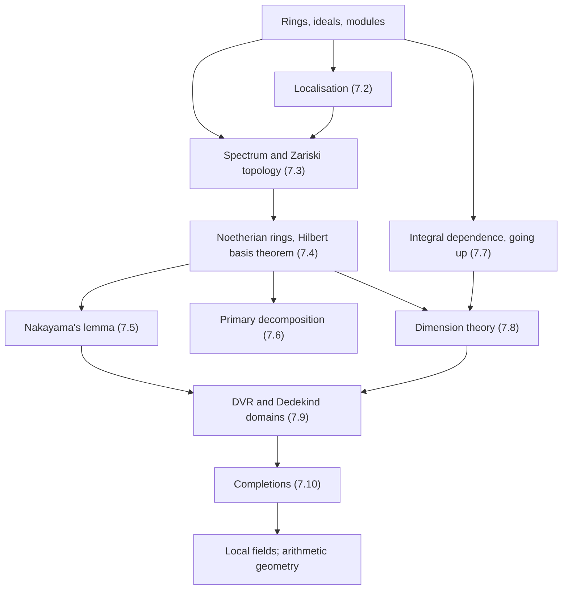
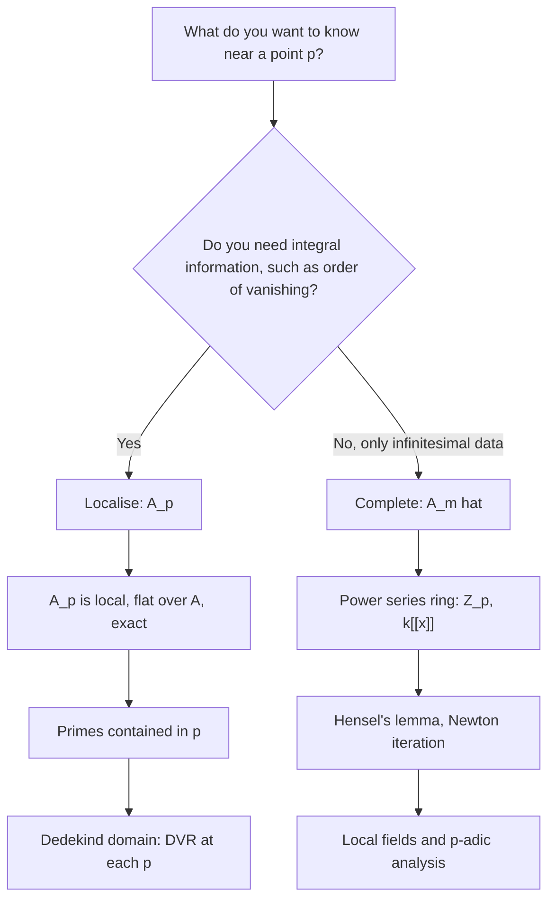

# Commutative Algebra

> [Mathematics](../../README.md) › [Advanced Topics](../README.md) · Level: Advanced · Prerequisites: [Logic](../../00-foundations/02-logic/README.md), [Set Theory](../../00-foundations/03-set-theory/README.md), [Proof Techniques](../../00-foundations/04-proof-techniques/README.md), [Groups](../../13-abstract-algebra/01-groups/README.md), [Rings](../../13-abstract-algebra/02-rings/README.md), [Fields](../../13-abstract-algebra/03-fields/README.md), [Vector Spaces](../../08-linear-algebra/04-vector-spaces/README.md), [Linear Transformations](../../08-linear-algebra/05-linear-transformations/README.md) · Estimated time: 900 min

## 1. Introduction

Every serious account of algebraic geometry and algebraic number theory begins with the same observation: *rings are rings of functions*. The polynomial ring $k[x,y]$ is the ring of polynomial functions on the plane; the ring $\mathbb{Z}$ is the ring of "functions" on the set of primes, in the sense that an integer is determined by its residues modulo every prime; the ring $\mathbb{Z}[i]$ is the ring of functions on the Gaussian integers. Once the observation is made, two questions follow immediately, and they organise the whole subject:

* **Which points?** The classical answer — points of a variety, primes of a number ring — is replaced by a single universal answer: the *prime ideals* of the ring. This is the **spectrum** $\operatorname{Spec} A$, and it carries a topology, the Zariski topology, in which closed sets are the vanishing loci of ideals.
* **Which functions?** Functions are elements of the ring, and restricting to a subset corresponds to taking a quotient; inverting a function corresponds to passing to an open subset. This is **localisation**, and it is the algebraic analogue of restricting attention to a neighbourhood.

Commutative algebra is the systematic development of these two ideas together with the finiteness conditions that make them tractable. Its history explains its shape. Dedekind and Kronecker, studying algebraic integers in the 1870s, discovered that unique factorisation of elements fails but unique factorisation of *ideals* holds in the rings now called Dedekind domains. Hilbert, proving his basis theorem in 1890, showed that finitely generated ideals in polynomial rings behave like finite-dimensional objects; his argument introduced the ascending chain condition and with it the whole finiteness machinery. Lasker and Noether, around 1905–1921, abstracted the factorisation of ideals into **primary decomposition**. Zariski, in the 1930s and 1940s, defined the topology on $\operatorname{Spec}$ and developed **dimension theory** by purely algebraic means. Krull's *Idealtheorie* (1938) assembled the local theory, the **principal ideal theorem** and the **completion** of local rings. Finally, Grothendieck's *Éléments de géométrie algébrique* (from 1960) recast everything in the language of schemes, in which a scheme is a ring together with its spectrum, glued locally, and the dictionary of §7.11 became the definition of algebraic geometry.

The chapter is organised as a sequence of tools, each of which answers a question that the previous tools raise.

1. **Rings, ideals, modules** (§7.1) — the vocabulary, recalled precisely, including exact sequences and flatness, which is the structure that makes localisation well behaved.
2. **Localisation** (§7.2) — inverting elements. It has a clean universal property, it is exact, and prime ideals of a localisation correspond to prime ideals of the original ring avoiding the inverted set. This is the operation that turns a global ring into a local one.
3. **Spectrum and Zariski topology** (§7.3) — the geometric object attached to a ring. It is not Hausdorff; its points are not all closed; and its nilpotent elements are invisible, which is exactly the feature that schemes exploit.
4. **Noetherian rings and Hilbert's basis theorem** (§7.4) — the finiteness hypothesis that prevents pathology. It is inherited by quotients, localisations and polynomial extensions, and it makes Noetherian induction possible.
5. **Nakayama's lemma** (§7.5) — the tool that promotes information from the fibre $M/\mathfrak{m}M$ to the module $M$. It is the algebraic form of "a vector bundle is trivial if its fibre is trivial, provided the base is local".
6. **Primary decomposition** (§7.6) — the structure theorem for ideals in a Noetherian ring, and the algebraic shadow of decomposing a closed set into irreducible components.
7. **Integral dependence and going-up** (§7.7) — the algebraic form of "a finite branched covering", which controls how primes move under an extension of rings.
8. **Dimension theory** (§7.8) — Krull dimension, its computation for finitely generated algebras, and the principal ideal theorem, which explains why a single equation drops dimension by exactly one.
9. **Discrete valuation rings and Dedekind domains** (§7.9) — the one-dimensional local model and its global counterpart, the setting in which ideals factorise uniquely.
10. **Completions** (§7.10) — the formal neighbourhood of a point, which turns local algebra into power-series algebra and connects to $p$-adic analysis.
11. **The dictionary** (§7.11) — a summary of how each algebraic notion translates into geometry and number theory.

Two methodological remarks. First, hypotheses in this subject are not decorative: "Noetherian" and "finitely generated" appear in almost every statement, and the chapter occasionally shows what fails without them (Nakayama without finite generation, §11; Hilbert's theorem without noetherianity). Second, we follow the modern convention that rings are commutative with identity and that homomorphisms preserve $1$. The zero ring is allowed but excluded from most statements about primes and spectra, because it has no prime ideals.

## 2. Prerequisites

**Groups, rings and fields.** You need the definitions of ring, ideal, quotient ring, domain, field, and the isomorphism theorems. In particular: a ring is a set with two operations satisfying the usual axioms, not necessarily a domain; an ideal is a subgroup closed under multiplication by ring elements; quotient rings exist and satisfy the universal property. See [Rings](../../13-abstract-algebra/02-rings/README.md), and for the field-theoretic background (field extensions, algebraic elements, the degree of an extension) [Fields](../../13-abstract-algebra/03-fields/README.md).

**Groups, for the character and localisation arguments.** Quotient groups, the first isomorphism theorem, and the notion of a group acting on a set appear when ideals of a localisation are classified. See [Groups](../../13-abstract-algebra/01-groups/README.md).

**Linear algebra.** A module over a ring is a generalisation of a vector space, and every statement about finite generation, bases, and dimension in this chapter has a linear-algebraic prototype. You need subspaces, quotients, bases, dimension, and linear maps. See [Vector Spaces](../../08-linear-algebra/04-vector-spaces/README.md) and [Linear Transformations](../../08-linear-algebra/05-linear-transformations/README.md).

**Set theory, including Zorn's lemma.** Every proper ideal lies in a maximal ideal, and this is a Zorn's lemma argument. You also need the language of partially ordered sets (chains, upper bounds, maximal elements) and of cardinality. See [Set Theory](../../00-foundations/03-set-theory/README.md).

**Logic and proof technique.** Statements of the form "for all prime ideals $\mathfrak{p}$ there exists ..." are everywhere, and proofs by contradiction, contraposition and induction on chains are the standard tools. See [Logic](../../00-foundations/02-logic/README.md) and [Proof Techniques](../../00-foundations/04-proof-techniques/README.md).

**Polynomial rings and Gauss's lemma.** Hilbert's basis theorem is about $A[x]$, and the examples use $k[x_1,\dots,x_n]$, irreducibility, and the fact that a polynomial ring over a domain is a domain. See [Rings](../../13-abstract-algebra/02-rings/README.md).

**Galois theory (optional, for §7.7 and §7.9).** The connection between Dedekind domains and rings of integers uses the integral closure of $\mathbb{Z}$ in a number field, and the splitting of primes in extensions. See [Galois Theory](../../13-abstract-algebra/04-galois-theory/README.md); the chapter is written so that this is a source of examples rather than a prerequisite.

## 3. Learning Objectives

After working through this chapter and its exercises you will be able to:

* state the definitions of ring, ideal, module, exact sequence, and flat module, and prove the isomorphism theorems for modules;
* construct the localisation $S^{-1}A$, verify its universal property, and prove that localisation is an exact functor;
* classify the prime ideals of $S^{-1}A$ in terms of those of $A$, and deduce that $A_{\mathfrak{p}}$ is a local ring;
* define the Zariski topology on $\operatorname{Spec} A$ and prove that it is a topology; compute $\operatorname{Spec}$ for $\mathbb{Z}$, $k[x]$, $\mathbb{Z}/n\mathbb{Z}$ and $k[x,y]/(f)$;
* prove the equivalence of the three formulations of "Noetherian" and prove the Hilbert basis theorem;
* state and prove Nakayama's lemma, and use it to compute minimal generating sets over local rings;
* state the Lasker–Noether theorem with its uniqueness clauses, and compute primary decompositions in $\mathbb{Z}$ and in $k[x,y]$;
* define integral dependence, prove that integral elements form a ring, state the going-up theorem, and use it to compare dimensions;
* compute Krull dimension in examples, state the principal ideal theorem, and use it to bound heights;
* define discrete valuation rings and Dedekind domains, prove that a DVR is a PID, and explain unique factorisation of ideals;
* define the $I$-adic completion, compute $\widehat{\mathbb{Z}}_{(p)}=\mathbb{Z}_p$ and $\widehat{k[x]}_{(x)}=k[[x]]$, and state the exactness and flatness properties;
* explain the dictionary between algebra and geometry, and between algebra and number theory.

## 4. Intuition

### 4.1 Rings as rings of functions

Think of a ring as a collection of functions on some space, closed under addition and multiplication. The polynomial ring in two variables is the ring of polynomial functions on the plane. The integers are the ring of functions on the set of primes, where the "value" of an integer at a prime is its residue class. A ring of algebraic integers is the ring of functions on the primes of a number field.

Once this picture is adopted, every algebraic notion acquires a geometric meaning, and the meaning is what carries the intuition:

* An **ideal** is a collection of functions that vanish simultaneously on some set. The quotient by the ideal is the ring of functions restricted to that set.
* A **prime ideal** is the vanishing set of a *point*. Why prime rather than maximal? Because a point may live in a larger field than the ground field, and because a "generic point" — a point spread over a whole irreducible subvariety — has a prime ideal that is not maximal. The prime spectrum is the set of all such points, and it is the correct notion of space.
* **Localising** means restricting attention to a neighbourhood: one allows division by any function that does not vanish there.
* A **module** is a family of vector spaces varying over the space, or more prosaically a ring acting on an abelian group; the localisation of a module restricts the family to the neighbourhood.
* **Dimension** is the length of the longest chain of irreducible subvarieties, nested one inside the next.

The elegance of the subject is that these geometric ideas can be defined purely algebraically, and then they apply to rings that have no obvious geometric interpretation — rings of integers, rings of power series, rings of invariants.

### 4.2 The two ways a ring can be complicated

A ring can fail to be well behaved in two independent directions.

**It can have too many ideals.** A ring in which every ideal is generated by finitely many elements is called Noetherian, and the condition is equivalent to the ascending chain condition: every increasing sequence of ideals stabilises. The intuition is that no infinite process of "adding one more generator" can go on forever. Hilbert's theorem says the condition is preserved by adjoining variables, which is what makes polynomial rings — and hence algebraic geometry — tractable.

**It can have zero divisors and nilpotents.** In a domain, an element is either zero or a non-zero-divisor, and one can cancel. Without that, ideals can intersect in complicated ways, and a single ideal can be expressible as an intersection of primary ideals in several ways. Primary decomposition is the structure theory that survives: it is the algebraic analogue of writing a set as a union of irreducible pieces, and the ambiguity in the decomposition is exactly the ambiguity in choosing which pieces to merge.

### 4.3 Zooming in: localisation and completion

Two operations let one study a ring "near a point", and they are different in an instructive way.

**Localisation** keeps all the information visible in some neighbourhood: it inverts every element that does not vanish at the point. The result $A_{\mathfrak{p}}$ is a local ring — one maximal ideal, hence one notion of "near the point" — and it sees the ring's behaviour at the generic level of that point. In a Dedekind domain, localising at a prime gives a discrete valuation ring, which records the *order of vanishing* at that prime.

**Completion** keeps only the infinitesimal information: it remembers the ring modulo higher and higher powers of the maximal ideal. For $k[x]$ at the origin this gives $k[[x]]$, the ring of formal power series, which sees the Taylor expansion but forgets whether the function converges anywhere. For $\mathbb{Z}$ at the prime $p$ this gives the $p$-adic integers $\mathbb{Z}_p$, which see the integer modulo all powers of $p$ but forget its size.

Localisation is like looking at a map with a magnifying glass; completion is like looking only at the tangent cone and all its infinitesimal thickenings. Both are "local", but they answer different questions, and both are essential.

### 4.4 The finiteness that makes Nakayama work

Nakayama's lemma is the subject's most quoted result, and its content is a kind of conservation law: for a finitely generated module over a local ring, the module is zero if and only if its fibre is zero. The finiteness is not a technicality — it is the whole hypothesis. Without it a module can be non-zero while all its fibres vanish, like a sheaf supported at no point but not zero. The lemma is used constantly to turn a computation over a field (the residue field) into a statement about a module over a ring, and it is the reason local computations in algebraic geometry and number theory are finite-dimensional linear algebra.

### 4.5 Why one equation lowers dimension by one

Geometry says that a curve in the plane is cut out by one equation, a surface in space by one equation, and that imposing one more independent equation lowers the dimension by one. The principal ideal theorem is the exact algebraic statement of this intuition, and it is surprisingly delicate: it fails for non-Noetherian rings, and its proof needs a genuine argument. Its consequence is that height is bounded by the number of generators, so a prime ideal generated by $r$ elements has codimension at most $r$ — the algebraic version of "a variety defined by $r$ equations has codimension at most $r$".

## 5. Formal Definition

Throughout, a **ring** is a commutative ring with identity $1$, and a **homomorphism** $f:A\to B$ satisfies $f(1_A)=1_B$. The zero ring is denoted $0$. A **domain** is a non-zero ring with no zero divisors. Fix a ring $A$.

**Definition 5.1** (Ideal). An *ideal* $\mathfrak{a}\subseteq A$ is an additive subgroup with $A\mathfrak{a}\subseteq\mathfrak{a}$. An ideal is *proper* if $\mathfrak{a}\ne A$; *principal* if $\mathfrak{a}=(a)=Aa$ for some $a$; *finitely generated* if $\mathfrak{a}=(a_1,\dots,a_n)$ for some $a_i\in A$. For ideals $\mathfrak{a},\mathfrak{b}$ we write $\mathfrak{a}+\mathfrak{b}=\{a+b:a\in\mathfrak{a},b\in\mathfrak{b}\}$ and $\mathfrak{a}\mathfrak{b}$ for the ideal generated by products $ab$.

**Definition 5.2** (Prime and maximal ideal). An ideal $\mathfrak{p}\subsetneq A$ is *prime* if $ab\in\mathfrak{p}$ implies $a\in\mathfrak{p}$ or $b\in\mathfrak{p}$. An ideal $\mathfrak{m}\subsetneq A$ is *maximal* if the only ideals containing $\mathfrak{m}$ are $\mathfrak{m}$ and $A$.

**Definition 5.3** (Module). An *$A$-module* $M$ is an abelian group with a map $A\times M\to M$, $(a,m)\mapsto am$, satisfying $a(m+n)=am+an$, $(a+b)m=am+bm$, $(ab)m=a(bm)$ and $1m=m$. A *submodule* is a subgroup closed under the action; $M/N$ denotes the quotient module. An $A$-module is *free* if it has a basis, and *finitely generated* if $M=Am_1+\dots+Am_n$ for some $m_i\in M$.

**Definition 5.4** (Exact sequence). A sequence of $A$-modules and homomorphisms
$$
\cdots\longrightarrow M_{i+1}\xrightarrow{\ f_i\ }M_i\xrightarrow{\ f_{i-1}\ }M_{i-1}\longrightarrow\cdots
$$
is *exact* at $M_i$ if $\operatorname{im} f_i=\ker f_{i-1}$. A *short exact sequence* is an exact sequence $0\to M'\to M\to M''\to 0$.

**Definition 5.5** (Flat module). An $A$-module $N$ is *flat* if for every injective homomorphism $M'\hookrightarrow M$ the induced map $N\otimes_A M'\to N\otimes_A M$ is injective.

**Definition 5.6** (Finitely generated algebra). An $A$-algebra is a ring $B$ with a homomorphism $A\to B$. It is *finitely generated* (as an $A$-algebra) if $B\cong A[x_1,\dots,x_n]/\mathfrak{a}$ for some $n$ and some ideal $\mathfrak{a}$.

**Definition 5.7** (Multiplicative set and localisation). A subset $S\subseteq A$ is *multiplicative* if $1\in S$ and $s,t\in S\Rightarrow st\in S$. On $A\times S$ define
$$
(a,s)\sim(a',s')\iff \exists t\in S:\ t(as'-a's)=0 .
$$
This is an equivalence relation; the quotient set $S^{-1}A$ is a ring under
$$
\frac{a}{s}+\frac{a'}{s'}=\frac{as'+a's}{ss'},\qquad \frac{a}{s}\cdot\frac{a'}{s'}=\frac{aa'}{ss'},
$$
with zero $0/1$ and identity $1/1$. The map $\iota:A\to S^{-1}A$, $a\mapsto a/1$, is a homomorphism. For an ideal $\mathfrak{a}\subseteq A$, $S^{-1}\mathfrak{a}$ denotes the ideal generated by $\iota(\mathfrak{a})$.

**Definition 5.8** (Local ring). A ring $A$ is *local* if it has exactly one maximal ideal $\mathfrak{m}$; one writes $(A,\mathfrak{m})$. Its *residue field* is $k=A/\mathfrak{m}$. For a prime $\mathfrak{p}$, $A_{\mathfrak{p}}:=S^{-1}A$ with $S=A\setminus\mathfrak{p}$.

**Definition 5.9** (Spectrum and Zariski topology). $\operatorname{Spec} A$ is the set of prime ideals of $A$. For an ideal $\mathfrak{a}$ set $V(\mathfrak{a})=\{\mathfrak{p}\in\operatorname{Spec}A:\mathfrak{a}\subseteq\mathfrak{p}\}$, and for $f\in A$ set $D(f)=\operatorname{Spec}A\setminus V(f)=\{\mathfrak{p}:f\notin\mathfrak{p}\}$. The *Zariski topology* is the topology whose closed sets are the $V(\mathfrak{a})$; the $D(f)$ form a basis of open sets.

**Definition 5.10** (Irreducible space, generic point). A topological space $X$ is *irreducible* if it is non-empty and cannot be written as the union of two proper closed subsets. A point $\eta\in X$ is *generic* if its closure is all of $X$.

**Definition 5.11** (Noetherian ring). A ring $A$ is *Noetherian* if it satisfies the ascending chain condition: every chain $\mathfrak{a}_1\subseteq\mathfrak{a}_2\subseteq\cdots$ of ideals stabilises (that is, $\mathfrak{a}_n=\mathfrak{a}_{n+1}=\cdots$ for some $n$).

**Definition 5.12** (Jacobson radical). The *Jacobson radical* $\operatorname{Jac}(A)$ is the intersection of all maximal ideals of $A$.

**Definition 5.13** (Primary ideal). A proper ideal $\mathfrak{q}\subsetneq A$ is *primary* if $ab\in\mathfrak{q}$ implies $a\in\mathfrak{q}$ or $b\in\sqrt{\mathfrak{q}}$, where $\sqrt{\mathfrak{q}}=\{x:x^n\in\mathfrak{q}\text{ for some }n\ge1\}$ is the radical. Equivalently, every zero divisor of $A/\mathfrak{q}$ is nilpotent. One says $\mathfrak{q}$ is *$\mathfrak{p}$-primary* when $\sqrt{\mathfrak{q}}=\mathfrak{p}$.

**Definition 5.14** (Associated prime). A prime $\mathfrak{p}$ is *associated* to an ideal $\mathfrak{a}$ (or to the module $A/\mathfrak{a}$) if $\mathfrak{p}=(\mathfrak{a}:x):=\{y:yx\in\mathfrak{a}\}$ for some $x\in A$. The set of such primes is denoted $\operatorname{Ass}(\mathfrak{a})$.

**Definition 5.15** (Integral element). Let $A\subseteq B$ be rings. An element $b\in B$ is *integral over $A$* if there are $a_0,\dots,a_{n-1}\in A$ with
$$
b^{n}+a_{n-1}b^{n-1}+\cdots+a_1b+a_0=0 .
$$
The *integral closure* of $A$ in $B$ is the set of elements of $B$ integral over $A$; $A$ is *integrally closed in $B$* if it equals its integral closure. A domain $A$ is *integrally closed* (or *normal*) if it is integrally closed in its fraction field.

**Definition 5.16** (Krull dimension and height). The *Krull dimension* of $A$ is
$$
\dim A:=\sup\{n:\ \mathfrak{p}_0\subsetneq\mathfrak{p}_1\subsetneq\cdots\subsetneq\mathfrak{p}_n,\ \mathfrak{p}_i\ \text{prime}\},
$$
with $\dim A=-1$ for the zero ring and $\dim A=0$ if there are no strict inclusions. The *height* of a prime $\mathfrak{p}$ is $\operatorname{ht}\mathfrak{p}:=\dim A_{\mathfrak{p}}$, the supremum of lengths of chains of primes contained in $\mathfrak{p}$. For a proper ideal $\mathfrak{a}$, $\operatorname{ht}\mathfrak{a}:=\min\{\operatorname{ht}\mathfrak{p}:\mathfrak{p}\ \text{minimal over}\ \mathfrak{a}\}$.

**Definition 5.17** (Discrete valuation ring). A *discrete valuation ring* (DVR) is a Noetherian local domain $(A,\mathfrak{m})$ of dimension $1$ whose maximal ideal is principal.

**Definition 5.18** (Dedekind domain). A *Dedekind domain* is a Noetherian, integrally closed domain of dimension $1$.

**Definition 5.19** ($I$-adic completion). Let $I\subseteq A$ be an ideal. The *$I$-adic topology* on $A$ has the powers $I^n$ as a basis of neighbourhoods of $0$. The *completion* is
$$
\widehat{A}:=\varprojlim_n A/I^n,
$$
the inverse limit of the rings $A/I^n$ with the natural projections. $A$ is *$I$-adically separated* if $\bigcap_n I^n=0$. For a module $M$ one defines $\widehat{M}:=\varprojlim_n M/I^nM$ similarly.

**Definition 5.20** (Support). The *support* of an $A$-module $M$ is $\operatorname{Supp}M=\{\mathfrak{p}\in\operatorname{Spec}A:M_{\mathfrak{p}}\ne0\}$.

## 6. Mathematical Notation

| Symbol | Read as | Meaning |
|---|---|---|
| $A, B$ | ay, bee | commutative rings with $1$ |
| $A\subseteq B$ | ay contained in bee | a subring (same $1$) |
| $\mathfrak{a},\mathfrak{b},\mathfrak{c}$ | fraktur a, b, c | ideals (Fraktur is the traditional font for ideals) |
| $\mathfrak{p},\mathfrak{q},\mathfrak{m}$ | fraktur p, q, m | prime, primary, maximal ideals respectively |
| $(a_1,\dots,a_n)$ | the ideal generated by … | $Aa_1+\dots+Aa_n$ |
| $\sqrt{\mathfrak{a}}$ | radical of a | $\{x:x^n\in\mathfrak{a}\ \text{for some}\ n\}$ |
| $A/\mathfrak{a}$ | ay mod a | quotient ring |
| $S^{-1}A$, $A_S$ | ess-inverse ay, ay sub ess | localisation, Definition 5.7 |
| $A_{\mathfrak{p}}$ | ay sub p | localisation at the prime $\mathfrak{p}$, i.e. $S=A\setminus\mathfrak{p}$ |
| $M_{\mathfrak{p}}$ | em sub p | $S^{-1}M$ for $S=A\setminus\mathfrak{p}$ |
| $A_{\mathfrak{m}}$, $k=A/\mathfrak{m}$ | local ring and residue field | Definition 5.8 |
| $\operatorname{Spec}A$ | spec of ay | set of prime ideals with the Zariski topology |
| $V(\mathfrak{a})$, $D(f)$ | vee of a, dee of f | closed set of primes containing $\mathfrak{a}$; basic open set |
| $\dim A$ | dimension of ay | Krull dimension, Definition 5.16 |
| $\operatorname{ht}\mathfrak{p}$ | height of p | length of the longest chain of primes below $\mathfrak{p}$ |
| $\operatorname{Jac}(A)$ | jac of ay | Jacobson radical |
| $\operatorname{Ass}(\mathfrak{a})$ | ass of a | associated primes |
| $\operatorname{Frac}A$ | fraction field of ay | field of fractions of a domain |
| $\widehat{A}$ | ay hat | completion, Definition 5.19 |
| $k[[x]]$ | kay double bracket x | formal power series ring |
| $\mathbb{Z}_p$ | zed sub p | $p$-adic integers, the completion of $\mathbb{Z}$ at $(p)$ |
| $\otimes_A$ | tensor over ay | tensor product of modules |
| $\varprojlim$ | inverse limit | limit of an inverse system of rings |
| $\operatorname{trdeg}_k K$ | transcendence degree | size of a transcendence basis of $K/k$ |
| $\mathbf{1}$ | one | the identity element or the constant function $1$ |

Two conventions. First, inclusion of ideals is written $\mathfrak{a}\subseteq\mathfrak{b}$ and strict inclusion $\mathfrak{a}\subsetneq\mathfrak{b}$; the notation $\mathfrak{a}\subset\mathfrak{b}$ is avoided because authors disagree about it. Second, "local ring" always means a ring with exactly one maximal ideal, not a ring with finitely many; the latter are called semilocal.

## 7. Core Concepts

### 7.1 Rings, Ideals and Modules Reviewed

The chapter uses a small vocabulary with great frequency, so it is worth fixing it precisely before adding anything.

**Proposition 7.1** (Quotients detect primeness and maximality). Let $\mathfrak{a}\subsetneq A$ be an ideal.

(i) $\mathfrak{a}$ is prime if and only if $A/\mathfrak{a}$ is a domain.
(ii) $\mathfrak{a}$ is maximal if and only if $A/\mathfrak{a}$ is a field.
(iii) Every maximal ideal is prime, and the converse fails in general.

*Proof.* (i) The condition $ab\in\mathfrak{a}$ is the condition $\bar a\bar b=0$ in $A/\mathfrak{a}$, and $\mathfrak{a}$ is proper exactly when $A/\mathfrak{a}$ is not the zero ring. So primeness says precisely that a product of two elements of $A/\mathfrak{a}$ vanishes only if one factor does, which is the definition of a domain.

(ii) Ideals of $A/\mathfrak{a}$ correspond bijectively to ideals of $A$ containing $\mathfrak{a}$, by $\mathfrak{b}\leftrightarrow\mathfrak{b}/\mathfrak{a}$. Hence $\mathfrak{a}$ is maximal (no intermediate ideal) if and only if $A/\mathfrak{a}$ has no proper non-zero ideal. A non-zero ring whose only ideals are $0$ and itself is a field: if $x\ne0$ then $(x)=A$, so $x$ is a unit; conversely in a field the only ideals are $0$ and $A$.

(iii) A field is a domain, so maximal implies prime by (i) and (ii). For the failure of the converse, $(x)\subset\mathbb{Z}[x]$ is prime because $\mathbb{Z}[x]/(x)\cong\mathbb{Z}$ is a domain, but $(x)\subsetneq(2,x)\subsetneq\mathbb{Z}[x]$, so $(x)$ is not maximal. $\blacksquare$

**Proposition 7.2** (Maximal ideals exist). Every proper ideal $\mathfrak{a}\subsetneq A$ is contained in a maximal ideal.

*Proof.* Order the set $\Sigma$ of proper ideals containing $\mathfrak{a}$ by inclusion. It is non-empty ($\mathfrak{a}\in\Sigma$), and the union of a chain of proper ideals is a proper ideal: it does not contain $1$, since no member of the chain does, and it is closed under addition and multiplication by $A$ because any two elements lie in a common member of the chain. By Zorn's lemma $\Sigma$ has a maximal element, which is a maximal ideal containing $\mathfrak{a}$. $\blacksquare$

This is the only place in the chapter where the Axiom of Choice is used in an essential way, and it is what guarantees that $\operatorname{Spec} A$ is non-empty for $A\ne0$.

**Proposition 7.3** (Nilradical = intersection of primes). Let $\operatorname{nil}(A)=\{x\in A:x^n=0\ \text{for some}\ n\ge1\}$ be the set of nilpotent elements. Then
$$
\operatorname{nil}(A)=\bigcap_{\mathfrak{p}\in\operatorname{Spec}A}\mathfrak{p}.
$$

*Proof.* If $x^n=0$ and $\mathfrak{p}$ is prime, then $x^n\in\mathfrak{p}$ and induction on $n$ using primeness gives $x\in\mathfrak{p}$. Conversely, suppose $x$ is not nilpotent. Then the localisation $A_x:=A[1/x]$ is not the zero ring, because $1/1=0/1$ would mean $x^n\cdot1=0$ for some $n$. It therefore has a maximal ideal (Proposition 7.2), whose contraction $\mathfrak{p}$ to $A$ is prime and does not contain $x$, since $x$ becomes a unit in $A_x$. So $x$ is missing from some prime. $\blacksquare$

**Modules.** An $A$-module is an abelian group with an action of $A$; the basic constructions are identical to those for vector spaces, with scalars in a ring rather than a field. We record the facts used later, without proof, since they are the same arguments as in linear algebra.

* **Submodule correspondence.** Submodules of $M/N$ correspond to submodules of $M$ containing $N$.
* **Isomorphism theorems.** $M/\ker f\cong\operatorname{im}f$; $(M/N)/(N'/N)\cong M/N'$ for $N\subseteq N'\subseteq M$; and for submodules $N,N'$, $(N+N')/N\cong N'/(N\cap N')$.
* **Exactness.** A short exact sequence $0\to M'\xrightarrow{f}M\xrightarrow{g}M''\to0$ exhibits $M'$ as a submodule of $M$ and $M''$ as the quotient, so that (up to isomorphism) every short exact sequence is of the form $0\to M'\to M\to M/M'\to0$.
* **Finite generation.** If $M'$ and $M''$ are finitely generated and $M$ sits in an exact sequence $M'\to M\to M''\to0$, then $M$ is finitely generated (lift generators of $M''$ and add images of generators of $M'$). If $M$ is finitely generated then so is every quotient, but not necessarily every submodule: that is exactly what noetherianity repairs (§7.4).

**Tensor products and Hom.** For modules $M,N$ over $A$, $M\otimes_A N$ is the module generated by symbols $m\otimes n$ subject to bilinearity, and $\operatorname{Hom}_A(M,N)$ is the module of $A$-linear maps. Both are functorial, $\operatorname{Hom}$ is left exact in each variable, and $-\otimes_A N$ is right exact. The failure of $\operatorname{Hom}$ to be right exact and of $\otimes$ to be left exact is measured by Ext and Tor, which lie outside this chapter; what matters here is the notion of flatness (Definition 5.5), which says that $-\otimes_A N$ *is* left exact, i.e. preserves injections.

### 7.2 Localisation: Universal Property and Exactness

Localisation is the algebraic operation of adjoining denominators. It is defined in 5.7 by an equivalence relation whose role is to make the construction well defined even when $S$ contains zero divisors.

**Theorem 7.4** (Universal property of localisation). Let $S\subseteq A$ be multiplicative and $\iota:A\to S^{-1}A$ the map $a\mapsto a/1$. For every ring homomorphism $\varphi:A\to B$ with $\varphi(S)\subseteq B^{\times}$, there is a unique homomorphism $\psi:S^{-1}A\to B$ with $\psi\circ\iota=\varphi$.

*Proof.* Define $\psi(a/s)=\varphi(a)\varphi(s)^{-1}$. This is well defined: if $(a,s)\sim(a',s')$, there is $t\in S$ with $t(as'-a's)=0$; applying $\varphi$ gives $\varphi(t)\big(\varphi(a)\varphi(s')-\varphi(a')\varphi(s)\big)=0$, and $\varphi(t)$ is a unit, so $\varphi(a)\varphi(s')=\varphi(a')\varphi(s)$, which after multiplying by $\varphi(s)^{-1}\varphi(s')^{-1}$ gives $\varphi(a)\varphi(s)^{-1}=\varphi(a')\varphi(s')^{-1}$. That $\psi$ is a ring homomorphism follows from the formulas in Definition 5.7. It satisfies $\psi(\iota(a))=\varphi(a)\varphi(1)^{-1}=\varphi(a)$. For uniqueness: any $\psi'$ with $\psi'\iota=\varphi$ must send $a/1$ to $\varphi(a)$, and must send $s/1$ to $\varphi(s)$; since $a/s=(a/1)(s/1)^{-1}$ in $S^{-1}A$, it must send $a/s$ to $\varphi(a)\varphi(s)^{-1}$. $\blacksquare$

The universal property is the reason localisation is "the best possible way to invert $S$": every homomorphism that inverts $S$ factors through it, uniquely. In categorical language, $\iota$ is initial among such homomorphisms.

**Theorem 7.5** (What localisation does to kernels and primes). (i) The kernel of $\iota:A\to S^{-1}A$ is $\{a:\exists s\in S,\ sa=0\}$. In particular $\iota$ is injective when $A$ is a domain and $0\notin S$, and $S^{-1}A=0$ if and only if $0\in S$.

(ii) The maps
$$
\{\mathfrak{p}\in\operatorname{Spec}A:\mathfrak{p}\cap S=\varnothing\}\ \longrightarrow\ \operatorname{Spec}\big(S^{-1}A\big),\qquad
\mathfrak{p}\longmapsto S^{-1}\mathfrak{p},
\qquad
\mathfrak{q}\longmapsto\iota^{-1}(\mathfrak{q}),
$$
are mutually inverse bijections.

*Proof.* (i) $a/1=0/1$ means, by definition, that there is $s\in S$ with $s(a\cdot1-0\cdot1)=0$, i.e. $sa=0$. If $0\in S$ then $s=0$ shows that every $a/1=0$, so $S^{-1}A=0$; if $S^{-1}A=0$ then $1/1=0/1$, so $s\cdot1=0$ for some $s\in S$, i.e. $0=s\in S$.

(ii) Let $\mathfrak{p}$ be prime with $\mathfrak{p}\cap S=\varnothing$, and suppose $ab/st\in S^{-1}\mathfrak{p}$, meaning $ab/st=p'/s'$ for some $p'\in\mathfrak{p}$, $s'\in S$. Then there is $u\in S$ with $u(ab s'-st p')=0$, so $uabs'\in\mathfrak{p}$; now $u,s'\notin\mathfrak{p}$, so $ab\in\mathfrak{p}$, hence $a\in\mathfrak{p}$ or $b\in\mathfrak{p}$, so $a/s\in S^{-1}\mathfrak{p}$ or $b/t\in S^{-1}\mathfrak{p}$. Also $1\notin S^{-1}\mathfrak{p}$ since that would force $\mathfrak{p}\cap S\ne\varnothing$. So $S^{-1}\mathfrak{p}$ is prime.

Conversely, if $\mathfrak{q}\subset S^{-1}A$ is prime, then $\mathfrak{p}=\iota^{-1}(\mathfrak{q})$ is prime (the preimage of a prime under a ring map is prime, because $A/\mathfrak{p}\hookrightarrow S^{-1}A/\mathfrak{q}$), and $\mathfrak{p}\cap S=\varnothing$ since $\iota(S)$ consists of units. Finally $S^{-1}\mathfrak{p}=\mathfrak{q}$: one inclusion is clear since $\iota(\mathfrak{p})\subseteq\mathfrak{q}$; for the other, if $a/s\in\mathfrak{q}$ then $a/1=(s/1)(a/s)\in\mathfrak{q}$, so $a\in\mathfrak{p}$ and $a/s\in S^{-1}\mathfrak{p}$. The two maps are inverse by the same computation. $\blacksquare$

**Corollary 7.6** ($A_{\mathfrak{p}}$ is local). For a prime $\mathfrak{p}$, the ring $A_{\mathfrak{p}}$ has exactly one maximal ideal, namely $\mathfrak{p}A_{\mathfrak{p}}$, and residue field $A_{\mathfrak{p}}/\mathfrak{p}A_{\mathfrak{p}}\cong\operatorname{Frac}(A/\mathfrak{p})$.

*Proof.* By Theorem 7.5(ii), primes of $A_{\mathfrak{p}}$ correspond to primes of $A$ contained in $\mathfrak{p}$. Among these, $\mathfrak{p}$ is the largest, so $\mathfrak{p}A_{\mathfrak{p}}$ contains every prime and is the unique maximal one. For the residue field, localise the exact sequence $0\to\mathfrak{p}\to A\to A/\mathfrak{p}\to0$ at $A\setminus\mathfrak{p}$ to get $A_{\mathfrak{p}}/\mathfrak{p}A_{\mathfrak{p}}\cong(A\setminus\mathfrak{p})^{-1}(A/\mathfrak{p})$, which is the fraction field of the domain $A/\mathfrak{p}$. $\blacksquare$

**Theorem 7.7** (Localisation is exact). Let $0\to M'\xrightarrow{f}M\xrightarrow{g}M''\to0$ be exact. Then
$$
0\longrightarrow S^{-1}M'\xrightarrow{S^{-1}f}S^{-1}M\xrightarrow{S^{-1}g}S^{-1}M''\longrightarrow0
$$
is exact. Consequently $S^{-1}A$ is a flat $A$-algebra, and for any submodule $N\subseteq M$ one has $S^{-1}(M/N)\cong S^{-1}M/S^{-1}N$.

*Proof.* Write $f_S=S^{-1}f$ and $g_S=S^{-1}g$, with $f_S(m'/s)=f(m')/s$.

*Injectivity of $f_S$.* If $f_S(m'/s)=0$, then $f(m')/s=0$, so there is $t\in S$ with $tf(m')=0$. Hence $f(tm')=0$ and, since $f$ is injective, $tm'=0$, so $m'/s=0$ in $S^{-1}M'$.

*Exactness at $S^{-1}M$.* Clearly $g_Sf_S=0$. Conversely, if $g_S(m/s)=0$ then $g(m)/s=0$, so $tg(m)=0$ for some $t\in S$; then $g(tm)=0$, so $tm\in\ker g=\operatorname{im}f$, say $tm=f(m')$. Then $m/s=f(m')/(ts)=f_S(m'/(ts))$.

*Surjectivity of $g_S$.* Given $m''/s$ with $m''\in M''$, write $m''=g(m)$; then $m''/s=g_S(m/s)$.

Flatness is the statement that $S^{-1}A\otimes_A-$ preserves injections, and $S^{-1}M\cong S^{-1}A\otimes_AM$ naturally, so exactness of $S^{-1}$ is exactly flatness. The final statement follows by applying $S^{-1}$ to $0\to N\to M\to M/N\to0$. $\blacksquare$

Exactness is the technical heart of the usefulness of localisation: it means that localising a complex of modules preserves all its cohomological information, so questions about kernels, images and quotients can be checked locally.

**Corollary 7.8** (Local–global principle for vanishing). For an $A$-module $M$, the following are equivalent: (i) $M=0$; (ii) $M_{\mathfrak{p}}=0$ for every prime $\mathfrak{p}$; (iii) $M_{\mathfrak{m}}=0$ for every maximal ideal $\mathfrak{m}$.

*Proof.* (i)$\Rightarrow$(ii)$\Rightarrow$(iii) are trivial. For (iii)$\Rightarrow$(i), suppose $M\ne0$ and choose $0\ne m\in M$. Its annihilator $\operatorname{Ann}(m)=\{a:am=0\}$ is a proper ideal, hence contained in a maximal ideal $\mathfrak{m}$ (Proposition 7.2). In $M_{\mathfrak{m}}$ the element $m/1$ is non-zero: if $m/1=0$ there is $s\notin\mathfrak{m}$ with $sm=0$, so $s\in\operatorname{Ann}(m)\subseteq\mathfrak{m}$, a contradiction. Hence $M_{\mathfrak{m}}\ne0$. $\blacksquare$

**Localisation commutes with quotients.** For an ideal $\mathfrak{a}\subseteq A$ there is a natural isomorphism
$$
S^{-1}(A/\mathfrak{a})\ \cong\ S^{-1}A\,/\,S^{-1}\mathfrak{a}.
$$
Indeed, applying the exact functor $S^{-1}$ to $0\to\mathfrak{a}\to A\to A/\mathfrak{a}\to0$ gives an exact sequence $0\to S^{-1}\mathfrak{a}\to S^{-1}A\to S^{-1}(A/\mathfrak{a})\to0$, and the first isomorphism theorem identifies the cokernel with the quotient. In particular, localising at $\mathfrak{p}$ gives $A_{\mathfrak{p}}/\mathfrak{a}A_{\mathfrak{p}}\cong(A/\mathfrak{a})_{\mathfrak{p}}$, which is the algebraic form of restricting a quotient ring to a neighbourhood.

**Example 7.9.** (a) For a prime $p$, $\mathbb{Z}_{(p)}=\{a/b\in\mathbb{Q}:p\nmid b\}$ is local with maximal ideal $p\mathbb{Z}_{(p)}$ and residue field $\mathbb{F}_p$. (b) For a field $k$, $k[x]_{(x)}$ is local with maximal ideal $(x)$, residue field $k$, and consists of rational functions defined at $0$. (c) $\mathbb{Z}[1/6]=\mathbb{Z}[1/2,1/3]$ has spectrum consisting of $(0)$ and the primes $p\ne2,3$; the primes $2$ and $3$ have been "removed" by inverting them. This last example is the algebraic form of restricting to the open subset where $6$ does not vanish.

### 7.3 The Prime Spectrum and the Zariski Topology

**Theorem 7.10** (The Zariski topology is a topology). With the notation of Definition 5.9, the family $\{V(\mathfrak{a})\}$ is the family of closed sets of a topology on $\operatorname{Spec}A$.

*Proof.* We must check the axioms. $V(0)=\operatorname{Spec}A$ because every prime contains $0$, and $V(A)=\varnothing$ because no prime contains $1$. For a family of ideals $(\mathfrak{a}_i)$,
$$
\bigcap_i V(\mathfrak{a}_i)=V\Big(\sum_i\mathfrak{a}_i\Big),
$$
since $\mathfrak{p}$ contains every $\mathfrak{a}_i$ if and only if it contains their sum. For two ideals, $V(\mathfrak{a})\cup V(\mathfrak{b})=V(\mathfrak{a}\mathfrak{b})$: if $\mathfrak{p}\supseteq\mathfrak{a}\mathfrak{b}$ and $\mathfrak{p}\not\supseteq\mathfrak{a}$, pick $a\in\mathfrak{a}\setminus\mathfrak{p}$; then for every $b\in\mathfrak{b}$, $ab\in\mathfrak{p}$ and $a\notin\mathfrak{p}$, so $b\in\mathfrak{p}$ by primeness, giving $\mathfrak{b}\subseteq\mathfrak{p}$. The reverse inclusion is immediate from $\mathfrak{a}\mathfrak{b}\subseteq\mathfrak{a}\cap\mathfrak{b}$. $\blacksquare$

Three properties distinguish the Zariski topology from the topologies of analysis.

* **It is not Hausdorff, and usually not even $T_1$.** In $\operatorname{Spec}\mathbb{Z}$ the point $(0)$ is dense: its closure is $V(0)=\operatorname{Spec}\mathbb{Z}$, since every prime contains $0$. So $(0)$ cannot be separated from $(p)$ by disjoint open sets.
* **The generic point.** A point whose closure is the whole space is called generic (Definition 5.10). $\operatorname{Spec}A$ has a generic point exactly when the nilradical is prime, i.e. when $A_{\mathrm{red}}$ is a domain; the generic point is then the nilradical.
* **Nilpotents are invisible.** Since $V(\mathfrak{a})$ depends only on $\sqrt{\mathfrak{a}}$, the rings $A$ and $A/\operatorname{nil}(A)$ have the *same* underlying topological space. This is the deficiency that scheme theory repairs by adding a structure sheaf, which remembers the nilpotents.

**Proposition 7.11** (Basic open sets and localisation). For $f\in A$ the set $D(f)$ is open and is homeomorphic to $\operatorname{Spec}A_f$, where $A_f=A[1/f]$.

*Proof.* $D(f)=\operatorname{Spec}A\setminus V(f)$ is open by definition. The map $\operatorname{Spec}A_f\to\operatorname{Spec}A$ induced by $\iota:A\to A_f$ has image exactly the primes not containing $f$, i.e. $D(f)$, by Theorem 7.5(ii). It is a continuous bijection onto $D(f)$; moreover the closed sets of $\operatorname{Spec}A_f$ are the $V(\mathfrak{b})$ for ideals $\mathfrak{b}\subseteq A_f$, which correspond to ideals $\mathfrak{b}^c\subseteq A$ and match the traces $V(\mathfrak{b}^c)\cap D(f)$. So the map is a homeomorphism. $\blacksquare$

**Proposition 7.12** (Irreducibility). $\operatorname{Spec}A$ is irreducible if and only if $\operatorname{nil}(A)$ is prime.

*Proof.* $\operatorname{Spec}A$ is irreducible iff any two non-empty open sets intersect (equivalently, any two non-empty basic opens intersect), iff for all $f,g$ with $D(f),D(g)\ne\varnothing$ we have $D(f)\cap D(g)=D(fg)\ne\varnothing$. Now $D(f)\ne\varnothing$ means $f\notin\operatorname{nil}(A)$, by Proposition 7.3. So irreducibility says: whenever $f,g\notin\operatorname{nil}(A)$, also $fg\notin\operatorname{nil}(A)$, i.e. the nilradical is prime. $\blacksquare$

**Proposition 7.13** (Functoriality). A ring homomorphism $\varphi:A\to B$ induces a continuous map
$$
\varphi^{*}:\operatorname{Spec}B\to\operatorname{Spec}A,\qquad \mathfrak{q}\mapsto\varphi^{-1}(\mathfrak{q}).
$$

*Proof.* Preimages of primes are prime, as in the proof of Theorem 7.5. For continuity, it suffices to pull back closed sets: $(\varphi^{*})^{-1}(V(\mathfrak{a}))=\{\mathfrak{q}:\mathfrak{a}\subseteq\varphi^{-1}(\mathfrak{q})\}=\{\mathfrak{q}:\varphi(\mathfrak{a})\subseteq\mathfrak{q}\}=V(\varphi(\mathfrak{a})B)$, which is closed. $\blacksquare$

**Examples 7.14** (Spectra worth knowing).

(a) $\operatorname{Spec}\mathbb{Z}=\{(0)\}\cup\{(p):p\ \text{prime}\}$. The closed sets are $\varnothing$, the whole space, and finite sets of primes: $V(n)=\{(p):p\mid n\}$. So the closed points are the $(p)$, and $(0)$ is the generic point.

(b) $\operatorname{Spec}k[x]$ for a field $k$: the points are $(0)$ and $(f)$ for $f$ irreducible and monic. When $k$ is algebraically closed, the latter are $(x-a)$, $a\in k$, so the closed points are the elements of $k$ and there is one extra generic point.

(c) $\operatorname{Spec}(\mathbb{Z}/n\mathbb{Z})$: primes of $\mathbb{Z}/n\mathbb{Z}$ correspond to primes $p\mid n$, i.e. $(p)/(n)$. All points are closed and the space is finite and discrete; it is the spectrum of an Artinian ring.

(d) $\operatorname{Spec}\mathbb{Z}[i]$: the points are $(0)$, the primes $(p)$ with $p\equiv3\pmod4$ (since $\mathbb{Z}[i]/(p)\cong\mathbb{F}_{p^{2}}$ is a field), the primes $(a+bi)$ with $a^{2}+b^{2}=p\equiv1\pmod4$, and $(1+i)$ over $2$. This single example already shows the arithmetic content of the spectrum: the splitting of $p$ in $\mathbb{Z}[i]$ is visible as the number of primes above $(p)$.

(e) $\operatorname{Spec}k[x,y]$: $(0)$; the height-one primes $(f)$ for $f$ irreducible; and the maximal ideals $(x-a,y-b)$ when $k$ is algebraically closed. A chain $(0)\subsetneq(f)\subsetneq(x-a,y-b)$ has length $2$, which is where $\dim k[x,y]=2$ will come from.

### 7.4 Noetherian Rings and the Hilbert Basis Theorem

**Theorem 7.15** (Three faces of noetherianity). For a ring $A$ the following are equivalent.

(i) Every ascending chain $\mathfrak{a}_1\subseteq\mathfrak{a}_2\subseteq\cdots$ of ideals stabilises.
(ii) Every non-empty family of ideals has a maximal element under inclusion.
(iii) Every ideal of $A$ is finitely generated.

*Proof.* (i)$\Rightarrow$(ii): if a non-empty family $\Sigma$ had no maximal element, one could choose $\mathfrak{a}_1\in\Sigma$ and then, given $\mathfrak{a}_n$, an element $\mathfrak{a}_{n+1}\in\Sigma$ with $\mathfrak{a}_n\subsetneq\mathfrak{a}_{n+1}$; the resulting strictly increasing chain violates (i). (ii)$\Rightarrow$(iii): if an ideal $I$ is not finitely generated, the family of finitely generated ideals contained in $I$ is non-empty, and any member $(a_1,\dots,a_n)$ can be enlarged by adding an element of $I$ outside it; so the family has no maximal element. (iii)$\Rightarrow$(i): the union $\mathfrak{a}=\bigcup_n\mathfrak{a}_n$ of an increasing chain is an ideal, and if $\mathfrak{a}=(a_1,\dots,a_r)$ then each $a_i$ lies in some $\mathfrak{a}_{n_i}$; with $N=\max n_i$ we get $\mathfrak{a}\subseteq\mathfrak{a}_N$, so $\mathfrak{a}_N=\mathfrak{a}_{N+1}=\cdots=\mathfrak{a}$. $\blacksquare$

**Proposition 7.16** (Stability properties). Let $A$ be Noetherian.

(i) Every quotient $A/\mathfrak{a}$ is Noetherian.
(ii) Every localisation $S^{-1}A$ is Noetherian.
(iii) If $M$ is a finitely generated $A$-module, every submodule of $M$ is finitely generated.

*Proof.* (i) Ideals of $A/\mathfrak{a}$ correspond to ideals of $A$ containing $\mathfrak{a}$, so an ascending chain there is an ascending chain in $A$.

(ii) Ideals of $S^{-1}A$ are of the form $S^{-1}\mathfrak{b}$ (Theorem 7.5), and if $S^{-1}\mathfrak{b}_1\subseteq S^{-1}\mathfrak{b}_2\subseteq\cdots$, the chain of contractions $\mathfrak{b}_i\cap A$ stabilises, and a localised ideal is determined by its contraction; so the chain in $S^{-1}A$ stabilises. (One checks $S^{-1}(\mathfrak{b}\cap A)=\mathfrak{b}$ for ideals $\mathfrak{b}$ of $S^{-1}A$.)

(iii) Induct on the number of generators of $M$. For $M=A m_1+\dots+Am_r$ consider the exact sequence $0\to Am_r\to M\to M/Am_r\to0$ and use the induction hypothesis on $M/Am_r$ and the fact that submodules of $Am_r\cong A/\operatorname{Ann}(m_r)$ are finitely generated by (i). $\blacksquare$

**Theorem 7.17** (Hilbert basis theorem). If $A$ is Noetherian then so is the polynomial ring $A[x]$.

*Proof.* Let $I\subseteq A[x]$ be an ideal; we show it is finitely generated. Let $L\subseteq A$ be the set of leading coefficients of elements of $I$, together with $0$. Then $L$ is an ideal: if $a,b\in L$ arise from $f,g\in I$ of degrees $m\le n$, then $x^{n-m}f+g\in I$ has leading coefficient $a+b$ (or degree $<n$ if $a+b=0$, in which case $a+b=0\in L$), and for $r\in A$, $rf\in I$ has leading coefficient $ra$.

Since $A$ is Noetherian, $L=(a_1,\dots,a_n)$. Choose $f_i\in I$ with leading coefficient $a_i$, and let $d_i=\deg f_i$, $d=\max_i d_i$. Let
$$
M:=I\cap\{f\in A[x]:\deg f<d\},
$$
which is an $A$-submodule of the finitely generated free module $A+Ax+\dots+Ax^{d-1}$, hence is finitely generated by Proposition 7.16(iii); choose generators $g_1,\dots,g_m$.

*Claim:* $I=M+(f_1,\dots,f_n)$.

One inclusion is clear, since all listed elements lie in $I$. For the other, let $f\in I$ have degree $e$. If $e<d$ then $f\in M$. If $e\ge d$, let $a$ be the leading coefficient of $f$; since $a\in L$ we may write $a=\sum_{i=1}^{n}r_i a_i$ with $r_i\in A$. Then
$$
g:=f-\sum_{i=1}^{n}r_i\,x^{e-d_i}f_i\in I
$$
has degree $<e$, because the term of degree $e$ in $x^{e-d_i}f_i$ is $a_ix^{e}$, and these cancel against $ax^{e}$. By induction on $e$ (the case $e<d$ being the base case), $g\in M+(f_1,\dots,f_n)$, whence $f\in M+(f_1,\dots,f_n)$. $\blacksquare$

**Corollary 7.18** (Consequences).

* By induction on $n$, if $A$ is Noetherian then $A[x_1,\dots,x_n]$ is Noetherian. In particular $\mathbb{Z}[x_1,\dots,x_n]$ and $k[x_1,\dots,x_n]$ are Noetherian for every field $k$.
* Every finitely generated algebra over a Noetherian ring is Noetherian, being a quotient of a polynomial ring.
* If $A$ is Noetherian then so is the formal power series ring $A[[x]]$; this is again a theorem of Hilbert, but the argument requires more care than the polynomial case, because the coefficient sequence in a power series need not terminate.
* The polynomial ring in infinitely many variables $k[x_1,x_2,\dots]$ is *not* Noetherian: the ideal $(x_1,x_2,\dots)$ is not finitely generated.

Noetherianity is the hypothesis that makes induction possible in the category of ideals. The technique is **Noetherian induction**: to prove that every ideal of a Noetherian ring has a property $P$, it suffices to prove that if $P$ fails for some ideal $I$, then $P$ fails for a strictly larger ideal — for then a maximal counterexample exists (Theorem 7.15(ii)) and yields a contradiction. This is used in §7.6 to prove existence of primary decompositions.

### 7.5 Nakayama's Lemma

**Lemma 7.19** (Characterisation of the Jacobson radical). For $x\in A$, the following are equivalent: (i) $x\in\operatorname{Jac}(A)$; (ii) $1-xy$ is a unit for every $y\in A$.

*Proof.* If $x\notin\operatorname{Jac}(A)$, there is a maximal ideal $\mathfrak{m}$ with $x\notin\mathfrak{m}$. Then $\mathfrak{m}+(x)=A$, so $m+xy=1$ for some $m\in\mathfrak{m}$, $y\in A$; thus $1-xy=m\in\mathfrak{m}$ is not a unit. Conversely, if $1-xy$ is not a unit for some $y$, it is a proper ideal and lies in a maximal ideal $\mathfrak{m}$; then $xy\in\mathfrak{m}$ with $y\notin\mathfrak{m}$ (else $1\in\mathfrak{m}$), so $x\in\mathfrak{m}$, and $x\notin\operatorname{Jac}(A)$. $\blacksquare$

**Theorem 7.20** (Nakayama's lemma). Let $I\subseteq\operatorname{Jac}(A)$ be an ideal, and let $M$ be a finitely generated $A$-module with $IM=M$. Then $M=0$.

*Proof.* Suppose $M\ne0$ and choose a generating set $m_1,\dots,m_n$ with $n$ minimal. Since $IM=M$, the element $m_n$ lies in $IM$, so there are $a_1,\dots,a_n\in I$ with
$$
m_n=\sum_{i=1}^{n}a_im_i .
$$
Rearranging,
$$
(1-a_n)\,m_n=\sum_{i=1}^{n-1}a_im_i .
$$
By Lemma 7.19 the element $1-a_n$ is a unit (here $a_n\in I\subseteq\operatorname{Jac}(A)$). Hence
$$
m_n=(1-a_n)^{-1}\sum_{i=1}^{n-1}a_im_i\in Am_1+\dots+Am_{n-1},
$$
so $m_1,\dots,m_{n-1}$ generate $M$, contradicting the minimality of $n$. Therefore $M=0$. $\blacksquare$

**Corollary 7.21** (The useful forms). Let $M$ be a finitely generated $A$-module and $I\subseteq\operatorname{Jac}(A)$.

(i) If $N\subseteq M$ is a submodule with $M=N+IM$, then $M=N$.
(ii) If $(A,\mathfrak{m})$ is local with residue field $k=A/\mathfrak{m}$, elements $m_1,\dots,m_r\in M$ generate $M$ if and only if their images generate $M/\mathfrak{m}M$ over $k$. Consequently the minimal number of generators of $M$ equals $\dim_k M/\mathfrak{m}M$.
(iii) $M=0$ if and only if $M/\mathfrak{m}M=0$.

*Proof.* (i) Apply Theorem 7.20 to $M/N$, which is finitely generated and satisfies $I(M/N)=(IM+N)/N=M/N$. (ii) If the images generate, then $M=\langle m_1,\dots,m_r\rangle+\mathfrak{m}M$, so (i) applies. Conversely, a generating set maps to a spanning set, so its size is at least the dimension of $M/\mathfrak{m}M$. (iii) is (i) with $N=0$ and $I=\mathfrak{m}$. $\blacksquare$

**Example 7.22.** Let $A=k[[x,y]]$ with maximal ideal $\mathfrak{m}=(x,y)$ and $M=A/(x^{2},xy,y^{3})$. The monomials $1,x,y,y^{2}$ are not in the ideal $(x^{2},xy,y^{3})$, while every monomial of degree at least $3$ is ($x^{3}=x\cdot x^{2}$, $x^{2}y\in(x^{2})$, $xy^{2}=y\cdot xy$, $y^{3}\in(y^{3})$). Hence $M$ has $k$-basis $\{1,x,y,y^{2}\}$, and $M/\mathfrak{m}M$ has dimension $4$. By Corollary 7.21, $M$ is generated by exactly four elements, namely the images of $1,x,y,y^{2}$.

The geometric reading is that a finitely generated module over a local ring is determined, as far as generation is concerned, by its fibre at the closed point. This is why local computations in geometry reduce to linear algebra over the residue field.

### 7.6 Primary Decomposition and the Lasker–Noether Theorem

**Lemma 7.23** (The radical of a primary ideal is prime). If $\mathfrak{q}$ is primary then $\mathfrak{p}=\sqrt{\mathfrak{q}}$ is prime.

*Proof.* Suppose $ab\in\mathfrak{p}$. Then $(ab)^{n}\in\mathfrak{q}$ for some $n$, i.e. $a^{n}b^{n}\in\mathfrak{q}$. Since $\mathfrak{q}$ is primary, either $a^{n}\in\mathfrak{q}$ (so $a\in\mathfrak{p}$) or $b^{n}\in\sqrt{\mathfrak{q}}=\mathfrak{p}$, which gives $b\in\mathfrak{p}$ because $\mathfrak{p}$ is closed under taking roots: if $b^{m}\in\mathfrak{p}=\sqrt{\mathfrak{q}}$ then $b^{mk}\in\mathfrak{q}$ for some $k$, so $b\in\sqrt{\mathfrak{q}}=\mathfrak{p}$. Also $\mathfrak{p}\ne A$ because $\mathfrak{q}\ne A$. $\blacksquare$

Two important classes of examples. In $\mathbb{Z}$, the ideal $(p^{n})$ is $(p)$-primary, and $(0)$ is $(0)$-primary. In $k[x,y]$, the ideal $(x^{2},y)$ is $(x,y)$-primary: its radical is $(x,y)$, which is maximal, and an ideal whose radical is maximal is primary. The ideal $(xy)$ is *not* primary: $xy\in(xy)$ but $x\notin(xy)$ and $y\notin\sqrt{(xy)}=(xy)$.

**Theorem 7.24** (Lasker–Noether; stated). Let $A$ be Noetherian and $\mathfrak{a}\subsetneq A$ an ideal. Then $\mathfrak{a}$ can be written as a finite intersection
$$
\mathfrak{a}=\mathfrak{q}_1\cap\cdots\cap\mathfrak{q}_n
$$
of primary ideals. If the decomposition is taken *irredundant* (no $\mathfrak{q}_i$ contains the intersection of the others), then:

(i) the primes $\mathfrak{p}_i=\sqrt{\mathfrak{q}_i}$ are distinct;
(ii) the minimal elements of $\{\mathfrak{p}_1,\dots,\mathfrak{p}_n\}$ are exactly the minimal primes of $\mathfrak{a}$, and they are therefore determined by $\mathfrak{a}$ alone (first uniqueness theorem);
(iii) the whole set $\{\mathfrak{p}_1,\dots,\mathfrak{p}_n\}$ is determined by $\mathfrak{a}$ alone (second uniqueness theorem); these are the associated primes of $\mathfrak{a}$;
(iv) the primary components $\mathfrak{q}_i$ belonging to *minimal* primes $\mathfrak{p}_i$ are determined by $\mathfrak{a}$; components belonging to embedded primes need not be.

The theorem is proved in two steps, each powered by Noetherian induction. First, every ideal of a Noetherian ring is a finite intersection of *irreducible* ideals, where $\mathfrak{q}$ is irreducible if it is not the intersection of two strictly larger ideals: an ideal maximal among the ideals that are not irreducible is the intersection of two strictly larger ideals, and each of those decomposes. Second, every irreducible ideal of a Noetherian ring is primary: suppose $xy\in\mathfrak{q}$ with $x\notin\mathfrak{q}$ and $y\notin\sqrt{\mathfrak{q}}$, and let the ascending chain $(\mathfrak{q}:y)\subseteq(\mathfrak{q}:y^{2})\subseteq\cdots$ stabilise at $n$. Then
$$
\mathfrak{q}=(\mathfrak{q}+(x))\cap(\mathfrak{q}+(y^{n})),
$$
and both ideals on the right are strictly larger than $\mathfrak{q}$ (because $x\notin\mathfrak{q}$ and $y^{n}\notin\mathfrak{q}$), so $\mathfrak{q}$ is reducible. The uniqueness statements require a separate argument comparing two irredundant decompositions and the primes belonging to them.

**Example 7.25** (Primary decompositions).

(a) In $\mathbb{Z}$, $(12)=(4)\cap(3)$ with $(4)$ a $2$-primary ideal and $(3)$ a $3$-primary ideal; the minimal primes are $(2)$ and $(3)$.

(b) In $k[x,y]$, the ideal $(x^{2},xy)$ has the decomposition
$$
(x^{2},xy)=(x)\cap(x^{2},y).
$$
The right side is contained in the left because both $(x)$ and $(x^{2},y)$ contain $x^{2}$ and $xy$; conversely, if $f\in(x)\cap(x^{2},y)$ then $f=xg$ and $f=ax^{2}+by$; reducing modulo $x$ gives $by\in(x)$, and since $y\notin(x)$ and $(x)$ is prime, $b\in(x)$, say $b=xc$; then $f=ax^{2}+xyc\in(x^{2},xy)$. The minimal primes are $(x)$ and $(x,y)$.

(c) The embedded component in (b) is not unique: also
$$
(x^{2},xy)=(x)\cap(x,y)^{2},
$$
since $f\in(x)\cap(x,y)^{2}$ means $f=xg$ with $g\in(x,y)$, i.e. $f\in x(x,y)=(x^{2},xy)$. Both $(x^{2},y)$ and $(x,y)^{2}$ are $(x,y)$-primary, illustrating clause (iv) of the theorem.

The geometric content is exactly the decomposition of the closed set $V(\mathfrak{a})$ into irreducible components: the minimal primes give the components, and the embedded primes give components that sit inside others. This is the historical origin of the notion: Lasker's theorem was proved for polynomial rings as a statement about varieties, and Noether abstracted it to rings.

### 7.7 Integral Dependence and the Going-Up Theorem

**Lemma 7.26** (Integrality and finite generation). Let $A\subseteq B$ be rings and $b\in B$. Then $b$ is integral over $A$ if and only if the subring $A[b]\subseteq B$ is a finitely generated $A$-module.

*Proof.* If $b^{n}+a_{n-1}b^{n-1}+\cdots+a_0=0$, then $b^{n}\in A+Ab+\dots+Ab^{n-1}$, and multiplying by $b$ and substituting repeatedly shows that every power $b^{k}$ lies in the $A$-span of $1,b,\dots,b^{n-1}$; so $A[b]$ is generated as an $A$-module by those $n$ elements.

Conversely, suppose $A[b]$ is generated by $m_1,\dots,m_r$. Then $bm_i=\sum_j a_{ij}m_j$ for some $a_{ij}\in A$, so the column vector $m=(m_1,\dots,m_r)^{t}$ satisfies $(bI-(a_{ij}))m=0$. Multiplying by the adjugate matrix gives $\det(bI-(a_{ij}))\cdot m_k=0$ for every $k$; since $1\in A[b]$ is one of the $m_k$ in the spanning set, $\det(bI-(a_{ij}))=0$. Expanding the determinant produces a monic polynomial in $b$ of degree $r$ with coefficients in $A$. $\blacksquare$

**Proposition 7.27** (The integral closure is a ring). Let $A\subseteq B$. The set $C$ of elements of $B$ integral over $A$ is a subring of $B$ containing $A$.

*Proof.* If $b,b'\in C$, then $A[b]$ is a finitely generated $A$-module and $A[b,b']=A[b][b']$ is a finitely generated $A[b]$-module (because $b'$ is integral over $A$, hence over $A[b]$, and Lemma 7.26 applies). A finitely generated module over a finitely generated module is finitely generated over the base, so $A[b,b']$ is a finitely generated $A$-module. Both $b+b'$ and $bb'$ lie in it, so both are integral over $A$ by Lemma 7.26. $\blacksquare$

**Fact 7.27b** (Integral over a field). If $A\subseteq B$ is integral and $B$ is a field, then $A$ is a field.

*Proof.* Let $0\ne a\in A$. Since $B$ is integral over $A$, the element $a^{-1}\in B$ satisfies a monic equation
$$
(a^{-1})^{n}+c_{n-1}(a^{-1})^{n-1}+\cdots+c_1a^{-1}+c_0=0
$$
with $c_i\in A$. Multiplying by $a^{n-1}$ gives $a^{-1}+c_{n-1}+c_{n-2}a+\cdots+c_0a^{n-1}=0$, so
$a^{-1}=-(c_{n-1}+c_{n-2}a+\cdots+c_0a^{n-1})\in A$. Hence every non-zero element of $A$ is a unit. $\blacksquare$

This little lemma is used twice: in the proof of lying over (Theorem 7.28) and in the proof of incomparability (Theorem 7.30). It is the algebraic statement that a field cannot be integral over a proper subring that is not itself a field — the simplest example being that $\mathbb{Q}$ is not integral over $\mathbb{Z}$.

**Theorem 7.28** (Lying over). Let $A\subseteq B$ be an integral extension and $\mathfrak{p}\in\operatorname{Spec}A$. Then there is $\mathfrak{q}\in\operatorname{Spec}B$ with $\mathfrak{q}\cap A=\mathfrak{p}$.

*Proof.* Let $S=A\setminus\mathfrak{p}$ and consider $A_{\mathfrak{p}}\subseteq S^{-1}B$, which is again integral (integrality is preserved by localisation, since a monic equation can be divided by an element of $S$). Choose a maximal ideal $\mathfrak{n}$ of $S^{-1}B$ (Proposition 7.2) and let $\mathfrak{q}=\mathfrak{n}\cap B$.

Write $k=A_{\mathfrak{p}}/\mathfrak{n}^{c}$ where $\mathfrak{n}^{c}=\mathfrak{n}\cap A_{\mathfrak{p}}$. Then $S^{-1}B/\mathfrak{n}$ is a field, integral over $k$. A field that is integral over a subring forces the subring to be a field: if $0\ne x\in k$, its inverse in the big field is integral over $k$, hence lies in $k$. So $k$ is a field, i.e. $\mathfrak{n}^{c}$ is maximal in $A_{\mathfrak{p}}$. The only maximal ideal of $A_{\mathfrak{p}}$ is $\mathfrak{p}A_{\mathfrak{p}}$ (Corollary 7.6), so $\mathfrak{n}\cap A_{\mathfrak{p}}=\mathfrak{p}A_{\mathfrak{p}}$, and contracting further to $A$ gives $\mathfrak{q}\cap A=\mathfrak{p}$. $\blacksquare$

**Theorem 7.29** (Going up). Let $A\subseteq B$ be an integral extension, let $\mathfrak{p}_1\subseteq\mathfrak{p}_2$ be primes of $A$, and let $\mathfrak{q}_1$ be a prime of $B$ with $\mathfrak{q}_1\cap A=\mathfrak{p}_1$. Then there is a prime $\mathfrak{q}_2\supseteq\mathfrak{q}_1$ of $B$ with $\mathfrak{q}_2\cap A=\mathfrak{p}_2$.

*Proof.* The quotient $B/\mathfrak{q}_1$ is integral over $A/\mathfrak{p}_1$ (a monic equation for $b$ reduces modulo $\mathfrak{q}_1$ to a monic equation for $\bar b$). The prime $\mathfrak{p}_2/\mathfrak{p}_1$ of $A/\mathfrak{p}_1$ has, by Theorem 7.28, a prime $\bar{\mathfrak{q}}_2$ of $B/\mathfrak{q}_1$ lying over it. Its preimage $\mathfrak{q}_2\subseteq B$ contains $\mathfrak{q}_1$ and contracts to $\mathfrak{p}_2$. $\blacksquare$

**Theorem 7.30** (Incomparability, stated). In an integral extension $A\subseteq B$, two primes $\mathfrak{q}_1\subseteq\mathfrak{q}_2$ of $B$ with $\mathfrak{q}_1\cap A=\mathfrak{q}_2\cap A$ must be equal.

The proof localises at the common contraction $\mathfrak{p}$: then $B_{\mathfrak{p}}$ is integral over the local ring $A_{\mathfrak{p}}$, and $B_{\mathfrak{p}}/\mathfrak{q}_1B_{\mathfrak{p}}$ is a domain that is integral over the field $A_{\mathfrak{p}}/\mathfrak{p}A_{\mathfrak{p}}$; an integral domain integral over a field is a field, so $\mathfrak{q}_1B_{\mathfrak{p}}$ is maximal, forcing $\mathfrak{q}_1B_{\mathfrak{p}}=\mathfrak{q}_2B_{\mathfrak{p}}$.

**Corollary 7.31** (Dimension is preserved). If $A\subseteq B$ is integral and both are domains, then $\dim A=\dim B$; more precisely $\operatorname{ht}\mathfrak{q}=\operatorname{ht}(\mathfrak{q}\cap A)$ for every prime $\mathfrak{q}$ of $B$.

*Proof.* Going up (Theorem 7.29) lifts a chain of primes below $\mathfrak{q}\cap A$ to a chain of the same length below $\mathfrak{q}$, so $\operatorname{ht}\mathfrak{q}\ge\operatorname{ht}(\mathfrak{q}\cap A)$; incomparability (Theorem 7.30) prevents two distinct primes of $B$ from sitting over the same prime of $A$, so a chain in $B$ contracts to a chain of the same length in $A$, giving the reverse inequality. $\blacksquare$

**Theorem 7.32** (Krull–Cohen–Seidenberg; stated). Let $A$ be a domain, $K=\operatorname{Frac}A$, and let $B$ be the integral closure of $A$ in a finite extension field $L/K$. Then the extension $A\subseteq B$ satisfies lying over, going up, incomparability, and additionally *going down*: if $\mathfrak{p}_1\subseteq\mathfrak{p}_2$ and $\mathfrak{q}_2$ lies over $\mathfrak{p}_2$, there is $\mathfrak{q}_1\subseteq\mathfrak{q}_2$ lying over $\mathfrak{p}_1$.

Going down is what fails for general integral extensions, and it is the property that makes the prime spectrum of a ring of integers behave like a branched covering: primes can be lifted downward along inclusions. This is the structural input for the theory of decompositions of primes in number fields.

**Theorem 7.33** (Zariski's lemma; stated). If $k$ is a field and $A$ is a finitely generated $k$-algebra that is a field, then $A$ is a finite algebraic extension of $k$.

The consequence for spectra is the **Nullstellensatz**: if $k$ is algebraically closed, the maximal ideals of $k[x_1,\dots,x_n]$ are exactly the ideals $(x_1-a_1,\dots,x_n-a_n)$ with $a_i\in k$. Indeed each such ideal is maximal (the quotient is $k$), and conversely if $\mathfrak{m}$ is maximal then $k[x_1,\dots,x_n]/\mathfrak{m}$ is a finitely generated $k$-algebra that is a field, hence algebraic over $k$, hence equal to $k$ because $k$ is algebraically closed; the images of the $x_i$ are then in $k$, which gives the displayed form.

### 7.8 Dimension Theory

**Proposition 7.34** (Height, localisation, and global dimension). For a ring $A$,
$$
\dim A=\sup_{\mathfrak{m}\ \mathrm{maximal}}\operatorname{ht}\mathfrak{m}=\sup_{\mathfrak{m}\ \mathrm{maximal}}\dim A_{\mathfrak{m}},
$$
and for every prime $\mathfrak{p}$, $\operatorname{ht}\mathfrak{p}=\dim A_{\mathfrak{p}}$.

*Proof.* Primes of $A_{\mathfrak{p}}$ correspond to primes of $A$ contained in $\mathfrak{p}$ (Theorem 7.5), so chains below $\mathfrak{p}$ correspond exactly to chains in $A_{\mathfrak{p}}$: this is $\operatorname{ht}\mathfrak{p}=\dim A_{\mathfrak{p}}$. Every chain of primes in $A$ can be extended at the top until it ends at a maximal ideal without decreasing its length, so the supremum over all chains equals the supremum over chains ending at maximal ideals, which is $\sup_{\mathfrak{m}}\operatorname{ht}\mathfrak{m}$. $\blacksquare$

**Zero-dimensional rings.** The definition of dimension immediately gives: $\dim A=0$ if and only if every prime ideal is maximal, equivalently if and only if $\operatorname{Spec}A$ has no strict chains of primes. For a Noetherian ring this is also equivalent to $A$ being Artinian (the descending chain condition on ideals holds), a theorem of Akizuki and Hopkins–Levitzki. The elementary examples are fields, finite products of fields, and $\mathbb{Z}/n\mathbb{Z}$; the ring $k[x]/(x^{2})$ is zero-dimensional with a nilpotent, and $\mathbb{Z}_{(p)}/(p^{2})$ is zero-dimensional and local.

**Theorem 7.35** (Noether normalisation; stated). Let $k$ be a field and $A\ne0$ a finitely generated $k$-algebra. Then there exist elements $y_1,\dots,y_n\in A$, algebraically independent over $k$, such that $A$ is a finitely generated $k[y_1,\dots,y_n]$-module; in particular $A$ is integral over the polynomial subring $k[y_1,\dots,y_n]$.

**Theorem 7.36** (Krull's principal ideal theorem; stated). Let $A$ be Noetherian and let $x\in A$ be a non-zero-divisor. If $\mathfrak{p}$ is a prime ideal minimal over $(x)$, then $\operatorname{ht}\mathfrak{p}\le1$. More generally, if $\mathfrak{a}=(x_1,\dots,x_r)$, then every prime $\mathfrak{p}$ minimal over $\mathfrak{a}$ satisfies $\operatorname{ht}\mathfrak{p}\le r$.

Conversely (Krull's converse, also stated), if $\mathfrak{p}$ is a prime of a Noetherian ring with $\operatorname{ht}\mathfrak{p}=r$, then there exist $x_1,\dots,x_r\in\mathfrak{p}$ such that $\mathfrak{p}$ is minimal over $(x_1,\dots,x_r)$.

The theorem is the algebraic form of the geometric fact that $r$ equations cut out a set of codimension at most $r$. Its proof is genuinely deeper than the results of §7.4–7.7: it proceeds by reducing to a local ring, passing to the associated graded ring with respect to the maximal ideal, and proving that the latter is a finitely generated polynomial ring over the residue field — an argument that occupies a full section in every textbook.

**Theorem 7.37** (Dimension of finitely generated algebras). Let $k$ be a field and $A$ a finitely generated $k$-algebra that is a domain. Then
$$
\dim A=\operatorname{trdeg}_k\operatorname{Frac}A .
$$
In particular $\dim k[x_1,\dots,x_n]=n$.

*Proof.* By Theorem 7.35, $A$ is integral over $k[y_1,\dots,y_n]$ with $y_1,\dots,y_n$ algebraically independent and $n=\operatorname{trdeg}_k\operatorname{Frac}A$. By Corollary 7.31, $\dim A=\dim k[y_1,\dots,y_n]$.

For the polynomial ring, the chain
$$
(0)\subsetneq(y_1)\subsetneq(y_1,y_2)\subsetneq\cdots\subsetneq(y_1,\dots,y_n)
$$
shows $\dim\ge n$. For the reverse inequality, argue by induction on $n$. Let
$\mathfrak{p}_0\subsetneq\mathfrak{p}_1\subsetneq\cdots\subsetneq\mathfrak{p}_d$ be a chain in $k[y_1,\dots,y_n]$. If $d=0$ there is nothing to prove. Otherwise $\mathfrak{p}_1\ne(0)$, so it contains a non-zero polynomial $f$; by Theorem 7.36, $\operatorname{ht}\mathfrak{p}_1\le1$ because $\mathfrak{p}_1$ is minimal over the principal ideal $(f)$ generated by a non-zero-divisor (the ring is a domain). And the quotient $k[y_1,\dots,y_n]/\mathfrak{p}_1$ is a finitely generated domain of transcendence degree at most $n-1$, so by induction its dimension is at most $n-1$, giving $d-1\le n-1$. Hence $d\le n$. $\blacksquare$

**Corollary 7.38** (Height bounds in polynomial rings). In $k[x_1,\dots,x_n]$, every maximal ideal has height $n$, and $\operatorname{ht}(f_1,\dots,f_r)\le r$ for every ideal generated by $r$ elements.

*Proof.* For the first statement: $\operatorname{ht}\mathfrak{m}=\dim A_{\mathfrak{m}}$ by Proposition 7.34, and $A_{\mathfrak{m}}$ is again a finitely generated $k$-algebra that is a domain, with the same fraction field as $A$; so Theorem 7.37 gives $\dim A_{\mathfrak{m}}=\operatorname{trdeg}_k\operatorname{Frac}A=n$. The second statement is Theorem 7.36. $\blacksquare$

**Systems of parameters.** A consequence of Theorem 7.36 worth recording separately: if $(A,\mathfrak{m})$ is a Noetherian local ring with residue field $k$, then
$$
\dim A=\min\{r:\ \text{there exist }x_1,\dots,x_r\text{ generating an }\mathfrak{m}\text{-primary ideal}\}.
$$
The inequality $\dim A\le r$ is Theorem 7.36 applied to the primary ideal; the reverse inequality is Krull's converse. A tuple attaining the minimum is called a *system of parameters*, and its images form a homogeneous system of parameters when $A$ is a finitely generated graded algebra. In a regular local ring the maximal ideal itself is generated by $\dim A$ elements, which is the algebraic definition of smoothness at a point.

**Example 7.39.** In $k[x,y,z]$:

* $\operatorname{ht}(x,y)=2$: the chain $(0)\subsetneq(x)\subsetneq(x,y)$ gives $\ge2$, and Theorem 7.36 applied to the two generators gives $\le2$.
* $\operatorname{ht}(xz)=1$: $xz$ is a non-zero-divisor, so every minimal prime of $(xz)$ has height at most $1$; and $(xz)\ne0$ in a domain, so the height is exactly $1$. Note that $(xz)\subseteq(x)$, and $(x)$ is one of the minimal primes.
* $\dim k[x,y,z]/(xz,yz)=2$: the minimal primes of $(xz,yz)=(z)\cap(x,y)$ are $(z)$ and $(x,y)$, and $\dim A=\max\{\dim A/(z),\dim A/(x,y)\}=\max\{\dim k[x,y],\dim k[z]\}=2$.

### 7.9 Discrete Valuation Rings and Dedekind Domains

**Definition 7.40** (Discrete valuation). A *discrete valuation* on a field $K$ is a surjective map $v:K^{\times}\to\mathbb{Z}$ with
$$
v(xy)=v(x)+v(y),\qquad v(x+y)\ge\min\{v(x),v(y)\}.
$$
Its *valuation ring* is $\mathcal{O}_v=\{0\}\cup\{x\in K^{\times}:v(x)\ge0\}$; this is a local ring with maximal ideal $\{x:v(x)\ge1\}$.

**Theorem 7.41** (Characterisations of a DVR; stated). For a domain $A$ with fraction field $K$, the following are equivalent:

(i) $A$ is a discrete valuation ring (Definition 5.17);
(ii) $A=\mathcal{O}_v$ for some discrete valuation $v$ of $K$;
(iii) $A$ is a principal ideal domain with exactly one non-zero prime ideal;
(iv) $A$ is a Noetherian local domain of dimension $1$ whose maximal ideal is principal.

**Proposition 7.42** (Structure of ideals in a DVR). Let $(A,\mathfrak{m})$ be a DVR with $\mathfrak{m}=(\pi)$. Then every non-zero ideal of $A$ is $(\pi^{n})$ for a unique $n\ge0$; the only prime ideals are $(0)$ and $\mathfrak{m}$; $A$ is integrally closed; and $A^{\times}=\{x:v(x)=0\}$.

*Proof.* By the Krull intersection theorem (Theorem 7.49(i), whose proof is independent of this section), $\bigcap_n(\pi^{n})=0$ in the Noetherian local ring $A$. Hence for $0\ne x\in A$ the set $\{n:x\in(\pi^{n})\}$ is finite and has a maximum $k$; then $x=\pi^{k}u$ with $u\notin(\pi)=\mathfrak{m}$, and such a $u$ is a unit (the non-units are exactly $\mathfrak{m}$). So every non-zero element of $A$ is $\pi^{k}u$ with $u$ a unit and $k\ge0$.

Now let $I\ne0$ be an ideal and let $n$ be the least integer with $I\subseteq(\pi^{n})$; such an $n$ exists because $\bigcap_n(\pi^{n})=0$ and $I\ne0$. By minimality $I\not\subseteq(\pi^{n+1})$, so some $x\in I$ has $x=\pi^{n}u$ with $u$ a unit; then $\pi^{n}=xu^{-1}\in I$, so $(\pi^{n})\subseteq I$ and hence $I=(\pi^{n})$.

Any non-zero prime contains some $\pi^{n}$, hence contains $\pi$, hence equals $\mathfrak{m}$; and $(0)$ is prime because $A$ is a domain.

For integral closedness, let $x=u/\pi^{k}\in K$ with $u$ a unit and $k\ge1$; we show $x$ is not integral over $A$. If $x^{n}+a_{n-1}x^{n-1}+\cdots+a_0=0$ with $a_i\in A$, extend $v$ to $K$ by $v(u/\pi^{k})=-k$; then $v(x^{n})=-nk$ while $v(a_ix^{i})\ge-ik\ge-(n-1)k>-nk$, so by the ultrametric inequality $v$ of the whole sum equals $-nk\ne\infty=v(0)$, a contradiction. $\blacksquare$

**Examples 7.43.** (a) $\mathbb{Z}_{(p)}$ with $v=v_p$ the exponent of $p$; $\pi=p$. (b) $k[x]_{(x)}$ with $v$ the order of vanishing at $0$; $\pi=x$. (c) $k[[x]]$ with $v$ the order of the lowest non-zero term. (d) $\mathbb{Z}_p$, the $p$-adic integers, with maximal ideal $(p)$. (e) The localisation $\mathcal{O}_{K,\mathfrak{p}}$ of a ring of integers at a non-zero prime $\mathfrak{p}$, with $\pi$ a uniformiser.

**Theorem 7.44** (Dedekind domains; stated equivalences). For a Noetherian domain $A$ of dimension $1$ the following are equivalent:

(i) $A$ is integrally closed, i.e. $A$ is a Dedekind domain;
(ii) every non-zero ideal is a product of prime ideals, and the factorisation is unique up to order;
(iii) every non-zero ideal is invertible: there is a fractional ideal $I^{-1}$ with $II^{-1}=A$;
(iv) $A_{\mathfrak{m}}$ is a discrete valuation ring for every maximal ideal $\mathfrak{m}$;
(v) the non-zero fractional ideals form a group under multiplication.

**Theorem 7.45** (Unique factorisation of ideals). Let $A$ be a Dedekind domain and $I\ne0$ an ideal. Then there are unique distinct non-zero primes $\mathfrak{p}_1,\dots,\mathfrak{p}_r$ and unique exponents $e_i\ge1$ with
$$
I=\mathfrak{p}_1^{e_1}\cdots\mathfrak{p}_r^{e_r}.
$$

The failure of unique factorisation of *elements* is measured by the **ideal class group**: the fractional ideals form a group, the principal fractional ideals $(x)=xA$, $x\in K^{\times}$, form a subgroup, and
$$
\operatorname{Cl}(A):=\{\text{fractional ideals}\}/\{\text{principal fractional ideals}\}.
$$
A Dedekind domain is a unique factorisation domain if and only if $\operatorname{Cl}(A)=0$. The class number of a number field is the size of this group for its ring of integers, and it is finite (a theorem of Minkowski's geometry of numbers). A concrete failure: $\mathbb{Z}[\sqrt{-5}]$ is a Dedekind domain with class number $2$; the element $6$ has two inequivalent factorisations,
$$
6=2\cdot3=(1+\sqrt{-5})(1-\sqrt{-5}),
$$
but the *ideals* $(2)$, $(3)$, $(1+\sqrt{-5})$, $(1-\sqrt{-5})$ factorise consistently into four prime ideals.

**Fractional ideals and the class group.** The factorisation theorem is cleanest when extended to *fractional ideals*: a non-zero $A$-submodule $I\subseteq K=\operatorname{Frac}A$ such that $xI\subseteq A$ for some $x\ne0$. Every fractional ideal is $x^{-1}\mathfrak{a}$ for an ideal $\mathfrak{a}$ and an element $x\in K^{\times}$, and the product
$$
I\cdot J:=\Big\{\textstyle\sum_{i} x_iy_i: x_i\in I,\ y_i\in J\Big\}
$$
makes the set of non-zero fractional ideals into a group when $A$ is Dedekind, with inverse
$$
I^{-1}=\{x\in K: xI\subseteq A\}.
$$
The principal fractional ideals $(x)=xA$ form a subgroup, and the quotient $\operatorname{Cl}(A)$ is the class group. In a DVR the computation is transparent: if $I=(\pi^{n})$ then $I^{-1}=(\pi^{-n})$, so $II^{-1}=A$ and every fractional ideal is principal, which is why a DVR has trivial class group.

**Examples 7.46.** (a) $\mathbb{Z}$, with $\operatorname{Cl}=0$. (b) The ring of integers $\mathcal{O}_K$ of a number field, always Dedekind; for $K=\mathbb{Q}(\sqrt{-5})$ it is $\mathbb{Z}[\sqrt{-5}]$ with class number $2$. (c) $k[x]$, with $\operatorname{Cl}=0$. (d) The coordinate ring $k[x,y]/(y^{2}-x^{3}-x)$ of a smooth elliptic curve with the point at infinity removed is a Dedekind domain whose class group is the Picard group of the curve, generally non-trivial. (e) $k[x,y]/(y^{2}-x^{3})\cong k[t^{2},t^{3}]$ is *not* Dedekind: it is a one-dimensional Noetherian domain, but it is not integrally closed, since $t=y/x$ satisfies $t^{2}=x$ and lies in the fraction field without lying in the ring. Its integral closure is $k[t]$.

### 7.10 Completions

Localisation at a prime keeps a whole neighbourhood of the point. Completion keeps only the infinitesimal neighbourhood, encoded in the successive quotients $A/I^{n}$.

**Definition 7.47** ($I$-adic completion). Let $I\subseteq A$ be an ideal. The completion is $\widehat{A}=\varprojlim_nA/I^{n}$, the subring of the product $\prod_nA/I^{n}$ consisting of sequences $(a_n)$ with $a_n\equiv a_{n+1}\bmod I^{n}$. The natural map $\iota:A\to\widehat{A}$, $a\mapsto(a\bmod I^{n})_{n}$, is a ring homomorphism with kernel $\bigcap_nI^{n}$; $A$ is *$I$-adically separated* when this kernel is zero, and *complete* when $\iota$ is an isomorphism.

**Examples 7.48.** (a) $A=\mathbb{Z}$, $I=(p)$: $\widehat{A}=\mathbb{Z}_p$, the ring of $p$-adic integers, whose elements are the sums $\sum_{k\ge0}c_kp^{k}$ with $c_k\in\{0,\dots,p-1\}$. It is a DVR with maximal ideal $(p)$ and residue field $\mathbb{F}_p$; its fraction field is $\mathbb{Q}_p$.

(b) $A=k[x]$, $I=(x)$: $\widehat{A}=k[[x]]$, the formal power series ring. The map sends a polynomial to its Taylor series at $0$; it is injective because a non-zero polynomial has a finite expansion, but it is not surjective (a polynomial is a power series with finitely many terms).

(c) $A=k[x]_{(x)}$, $I=(x)$: again $\widehat{A}=k[[x]]$, and here the completion contains much more than the localisation: the series $\sum_nx^{n!}$ lies in $k[[x]]$ but is not the Taylor expansion of any rational function, so it is not in the image of $A$.

(d) $A=\mathbb{Z}[x]$, $I=(p,x)$: $\widehat{A}=\mathbb{Z}_p[[x]]$.

**Theorem 7.49** (Properties of completion; stated). Let $A$ be Noetherian, $I\subseteq A$, and $\widehat{A}$ the $I$-adic completion.

(i) (Krull intersection theorem) If $(A,\mathfrak{m})$ is local and $M$ is a finitely generated $A$-module, then $\bigcap_n\mathfrak{m}^{n}M=0$. In particular $\bigcap_n\mathfrak{m}^{n}=0$, so a Noetherian local ring is separated for the $\mathfrak{m}$-adic topology.
(ii) $\widehat{A}$ is a flat $A$-algebra.
(iii) For every finitely generated $A$-module $M$, the natural map $\widehat{M}\to M\otimes_A\widehat{A}$ is an isomorphism, and the functor $M\mapsto\widehat{M}$ is exact on finitely generated modules.
(iv) $\dim\widehat{A}=\dim A$ when $A$ is local and $I$ is its maximal ideal.

*Proof of (i).* Let $N=\bigcap_n\mathfrak{m}^{n}M$. Since $A$ is Noetherian and $M$ finitely generated, $N$ is a finitely generated submodule. By the Artin–Rees lemma, applied to the $\mathfrak{m}$-adic filtration of $M$, one has $\mathfrak{m}\big(\bigcap_n\mathfrak{m}^{n}M\big)=\bigcap_n\mathfrak{m}^{n+1}M$, so $\mathfrak{m}N=N$. Nakayama's lemma (Theorem 7.20, with $I=\mathfrak{m}\subseteq\operatorname{Jac}(A)$) then gives $N=0$. $\blacksquare$

The Krull intersection theorem is exactly what makes the completion *lossless* in the local case: no information is destroyed by passing to the inverse limit, because the kernel of $A\to\widehat{A}$ is $\bigcap_n\mathfrak{m}^{n}=0$.

**The shape of $\mathbb{Z}_p$.** Since every class modulo $p^{n}$ has a unique representative $\sum_{k=0}^{n-1}c_kp^{k}$ with $c_k\in\{0,\dots,p-1\}$, every element of $\mathbb{Z}_p$ has a unique expansion
$$
\sum_{k\ge0}c_kp^{k},\qquad c_k\in\{0,1,\dots,p-1\},
$$
convergent in the $p$-adic topology, in which $p^{n}\to0$. The ring $\mathbb{Z}_p$ is uncountable (Cantor's diagonal argument applies to the digit sequences), its fraction field $\mathbb{Q}_p$ consists of the finite-tailed Laurent series $\sum_{k\ge -N}c_kp^{k}$, and the absolute value $|x|_p=p^{-v_p(x)}$ makes $\mathbb{Q}_p$ a complete non-archimedean field. Ostrowski's theorem (stated) says that the only non-trivial absolute values on $\mathbb{Q}$, up to powers, are the usual one and the $p$-adic ones — so the completions of $\mathbb{Q}$ are $\mathbb{R}$ and the fields $\mathbb{Q}_p$, one for each prime.

Completion is not a conservative operation: it preserves dimension and (for Noetherian rings) exactness on finitely generated modules, but it can destroy other properties. A Noetherian local domain can have a completion with zero divisors (an example due to Nagata), and completion does not commute with arbitrary colimits. It is nevertheless the right tool for local analysis, because it turns questions about a local ring into questions about power series, where one can compute.

**Theorem 7.50** (Hensel's lemma; stated). Let $(A,\mathfrak{m})$ be a complete local ring with residue field $k$, and let $f\in A[x]$ with reduction $\bar f\in k[x]$. If $\bar f$ has a simple root $\bar a\in k$, then $f$ has a root $a\in A$ reducing to $\bar a$.

Hensel's lemma is the algebraic form of Newton's method: a simple root modulo $\mathfrak{m}$ lifts uniquely to a root in the completion. It is what makes $\mathbb{Z}_p$ and $k[[x]]$ behave like "analytic" rings, and it is the basis of the theory of local fields.

### 7.11 The Dictionary: Algebraic Geometry and Number Theory

The following table is the summary of the chapter. Each row states an algebraic notion, its geometric meaning in algebraic geometry, and its arithmetic meaning in number theory.

| Algebra | Algebraic geometry | Number theory |
|---|---|---|
| ring $A$ | ring of functions on $\operatorname{Spec}A$ | ring of integers $\mathcal{O}_K$, or $\mathbb{Z}$ |
| prime ideal $\mathfrak{p}$ | a point of the variety (possibly generic) | a prime, or a prime ideal of $\mathcal{O}_K$ |
| maximal ideal $\mathfrak{m}$ | a closed point | a finite prime |
| quotient $A/\mathfrak{a}$ | restriction to the closed subset $V(\mathfrak{a})$ | reduction modulo $\mathfrak{a}$ |
| localisation $A_{\mathfrak{p}}$ | the local ring of the point $\mathfrak{p}$ | the $\mathfrak{p}$-adic local ring, order of vanishing |
| $D(f)\cong\operatorname{Spec}A_f$ | the open subset where $f\ne0$ | inverting $f$; the primes not dividing $f$ |
| nilradical | invisible; needs scheme structure | — |
| Noetherian | the variety is defined by finitely many equations | the ring of integers is Noetherian |
| primary decomposition | irreducible components, embedded components | factorisation of ideals in a Dedekind domain |
| integral extension | finite (branched) morphism | extension of number fields $\mathcal{O}_K\subseteq\mathcal{O}_L$ |
| going up / lying over | primes lift along finite morphisms | primes of $L$ above a given prime of $K$ |
| Krull dimension | dimension of the variety | Krull dimension of $\mathcal{O}_K$ is $1$ |
| principal ideal theorem | $r$ equations give codimension $\le r$ | height of $(x)$ is at most $1$ |
| DVR | smooth point of a curve, local model $k[[t]]$ | completion at a prime, $\mathbb{Z}_p$ |
| Dedekind domain | smooth affine curve | ring of integers, unique factorisation of ideals |
| class group | Picard group of the curve | ideal class group, class number |
| completion $\widehat{A}$ | formal neighbourhood of a point | $p$-adic numbers, local fields |
| Hensel's lemma | analytic continuation of a root | lifting roots modulo $p^n$ |

Three consequences deserve to be spelled out.

**Geometry.** The pair $(\operatorname{Spec}A,\mathcal{O}_{\operatorname{Spec}A})$ is an affine scheme, and a general scheme is obtained by gluing affine schemes along open immersions. Every construction in this chapter — localisation, quotients, primary decomposition, integral closure, completion — has a geometric counterpart in the category of schemes, and most of them were invented in order to make geometric statements precise. The Nullstellensatz (Theorem 7.33) identifies the closed points of $\operatorname{Spec}k[x_1,\dots,x_n]$ with the points of affine $n$-space when $k$ is algebraically closed, which is why the algebraic and the classical pictures agree in that case.

**Number theory.** $\operatorname{Spec}\mathbb{Z}$ is the terminal object of the category of schemes: every scheme has a unique morphism to it. Its points are $(0)$ (the generic point) and $(p)$ for each prime $p$ (the closed points), and a number field $K$ corresponds to a finite extension $\operatorname{Spec}\mathcal{O}_K\to\operatorname{Spec}\mathbb{Z}$. Primes of $\mathcal{O}_K$ lying over $(p)$ are the primes above $p$, and the going-up theorem guarantees that at least one exists; the Dedekind domain structure guarantees that the factorisation $(p)=\mathfrak{p}_1^{e_1}\cdots\mathfrak{p}_g^{e_g}$ is well defined and unique. Localising at $\mathfrak{p}$ and completing gives the local field $K_{\mathfrak{p}}$, and the product formula for absolute values is the statement that these local pictures fit together globally.

**Arithmetic geometry.** The two dictionaries combine: an arithmetic surface is a scheme of dimension $2$ fibred over $\operatorname{Spec}\mathbb{Z}$, with fibres $\operatorname{Spec}\mathbb{F}_p[x,y]/(\cdots)$ over the closed points and the generic fibre over $(0)$. The tools of this chapter — dimension, flatness, normalisation, completion — are exactly the tools used to study such objects, and they are the entry point to modern arithmetic geometry.

## 8. Formulas and Properties

| Statement | Hypotheses | Why it holds |
|---|---|---|
| $A/\mathfrak{a}$ is a domain $\iff\mathfrak{a}$ is prime | $\mathfrak{a}\subsetneq A$ | Proposition 7.1 |
| $A/\mathfrak{a}$ is a field $\iff\mathfrak{a}$ is maximal | $\mathfrak{a}\subsetneq A$ | Proposition 7.1 |
| every proper ideal lies in a maximal ideal | Zorn's lemma | Proposition 7.2 |
| $\operatorname{nil}(A)=\bigcap_{\mathfrak{p}}\mathfrak{p}$ | — | Proposition 7.3 |
| $S^{-1}$ is exact and $S^{-1}A$ is flat | $S$ multiplicative | Theorem 7.7 |
| primes of $S^{-1}A$ $\leftrightarrow$ primes of $A$ disjoint from $S$ | $S$ multiplicative | Theorem 7.5 |
| $A_{\mathfrak{p}}$ is local with maximal ideal $\mathfrak{p}A_{\mathfrak{p}}$ | $\mathfrak{p}$ prime | Corollary 7.6 |
| $M=0\iff M_{\mathfrak{m}}=0$ for all maximal $\mathfrak{m}$ | — | Corollary 7.8 |
| $A$ Noetherian $\Rightarrow A[x]$ Noetherian | — | Theorem 7.17 |
| $A$ Noetherian $\Rightarrow A[[x]]$ Noetherian | — | Corollary 7.18 |
| $IM=M\Rightarrow M=0$ | $I\subseteq\operatorname{Jac}(A)$, $M$ finitely generated | Theorem 7.20 |
| $\mu(M)=\dim_kM/\mathfrak{m}M$ | $(A,\mathfrak{m})$ local, $M$ finitely generated | Corollary 7.21 |
| $\sqrt{\mathfrak{q}}$ prime | $\mathfrak{q}$ primary | Lemma 7.23 |
| $\mathfrak{a}=\bigcap\mathfrak{q}_i$ with $\mathfrak{q}_i$ primary | $A$ Noetherian | Theorem 7.24 |
| $b$ integral $\iff A[b]$ is a finitely generated $A$-module | $A\subseteq B$ | Lemma 7.26 |
| integral closure is a subring | $A\subseteq B$ | Proposition 7.27 |
| lying over, going up | $A\subseteq B$ integral | Theorems 7.28, 7.29 |
| $\dim A=\dim B$ | $A\subseteq B$ integral, both domains | Corollary 7.31 |
| $\dim A=\operatorname{trdeg}_k\operatorname{Frac}A$ | $A$ f.g. $k$-algebra domain | Theorem 7.37 |
| $\dim k[x_1,\dots,x_n]=n$ | $k$ field | Theorem 7.37 |
| $\operatorname{ht}\mathfrak{p}\le r$ for $\mathfrak{p}$ minimal over $(x_1,\dots,x_r)$ | $A$ Noetherian | Theorem 7.36 |
| every non-zero ideal of a DVR is $(\pi^{n})$ | $(A,\mathfrak{m})$ DVR | Proposition 7.42 |
| every non-zero ideal of a Dedekind domain factors uniquely | $A$ Dedekind | Theorem 7.45 |
| $\widehat{A}$ is flat over $A$ | $A$ Noetherian | Theorem 7.49 |
| $\widehat{\mathbb{Z}}_{(p)}=\mathbb{Z}_p$, $\widehat{k[x]}_{(x)}=k[[x]]$ | — | Examples 7.48 |

## 9. Step-by-Step Examples

### Example 9.1 — A maximal ideal that is not principal

**Problem.** Show that $(2,x)\subseteq\mathbb{Z}[x]$ is maximal but not principal, and deduce that $\mathbb{Z}[x]$ is Noetherian but not a principal ideal domain.

**Solution.** *Maximality.* By the third isomorphism theorem for rings,
$$
\mathbb{Z}[x]/(2,x)\ \cong\ \big(\mathbb{Z}[x]/(2)\big)\big/\big((2,x)/(2)\big)\ \cong\ \mathbb{F}_2[x]/(x)\ \cong\ \mathbb{F}_2 ,
$$
since $\mathbb{Z}[x]/(2)\cong\mathbb{F}_2[x]$ and the image of $x$ generates $(x)$. The quotient is a field, so $(2,x)$ is maximal by Proposition 7.1(ii).

*Not principal.* Suppose $(2,x)=(f)$. Then $f\mid2$ and $f\mid x$ in $\mathbb{Z}[x]$. Since $f$ divides $x$, either $f$ is a unit or $f$ is associated to $x$; and since $f$ divides $2$, either $f$ is a unit or $f$ is associated to $2$ or to $2x$. The two requirements leave only $f=\pm1$ (unit, giving the unit ideal) or $f=\pm2$ (giving $(2)$, which does not contain $x$). Neither equals $(2,x)$. More systematically: $\deg f\le\deg x=1$; if $\deg f=1$ then $f$ cannot divide the constant $2$; so $f$ is constant, hence $\pm1$ or $\pm2$, and both fail.

*Consequence.* $\mathbb{Z}[x]$ is Noetherian by the Hilbert basis theorem (Theorem 7.17) applied to the Noetherian ring $\mathbb{Z}$, but it is not a PID because it has a non-principal ideal. The example separates two properties that are often conflated: noetherianity is about finite generation of every ideal, principal-ideal-ness is about generation by a *single* element. $\blacksquare$

### Example 9.2 — Localising $\mathbb{Z}$ and inverting $6$

**Problem.** (a) Describe $\mathbb{Z}_{(p)}$, its maximal ideal, its residue field and its units. (b) Describe $\mathbb{Z}[1/6]$ and its spectrum. (c) Illustrate the universal property with the reduction map modulo $p$.

**Solution.** (a) $S=\mathbb{Z}\setminus(p)=\{n:p\nmid n\}$ is multiplicative. Since $\mathbb{Z}$ is a domain, the equivalence relation of Definition 5.7 is just equality of rational numbers, so
$$
\mathbb{Z}_{(p)}=\left\{\frac ab\in\mathbb{Q}: p\nmid b\right\}.
$$
By Corollary 7.6 the ring is local with maximal ideal $p\mathbb{Z}_{(p)}$, and
$$
\mathbb{Z}_{(p)}/p\mathbb{Z}_{(p)}\cong\mathbb{F}_p .
$$
The units are the fractions $a/b$ with $p\nmid a$ and $p\nmid b$: such an $a/b$ has inverse $b/a\in\mathbb{Z}_{(p)}$, and conversely if $p\mid a$ then $a/b$ cannot be a unit because its inverse would need a factor $p$ in the numerator. So the non-units are exactly $p\mathbb{Z}_{(p)}$.

(b) With $S=\{6^{n}:n\ge0\}$,
$$
\mathbb{Z}[1/6]=\left\{\frac{a}{6^{n}}:a\in\mathbb{Z},\ n\ge0\right\}=\mathbb{Z}[1/2,1/3]\subseteq\mathbb{Q},
$$
the last equality because $6^{-n}=2^{-n}3^{-n}$ and conversely $2^{-1}=3\cdot6^{-1}$, $3^{-1}=2\cdot6^{-1}$. By Theorem 7.5 the primes of $\mathbb{Z}[1/6]$ are the primes of $\mathbb{Z}$ not meeting $S$, i.e. the primes $p\ne2,3$, together with $(0)$. The primes $2$ and $3$ are gone: they have become units. The inclusion $\mathbb{Z}\to\mathbb{Z}[1/6]$ corresponds geometrically to the open immersion $\operatorname{Spec}\mathbb{Z}[1/6]\hookrightarrow\operatorname{Spec}\mathbb{Z}$ whose complement is the two closed points $(2)$ and $(3)$.

(c) The reduction map $\varphi:\mathbb{Z}\to\mathbb{F}_p$ sends every $n\notin(p)$ to a unit, so the universal property (Theorem 7.4) produces a unique ring homomorphism $\psi:\mathbb{Z}_{(p)}\to\mathbb{F}_p$ with $\psi(a/b)=ab^{-1}\bmod p$. It is given by reducing a fraction whose denominator is not divisible by $p$. Uniqueness is the substantive part: there is no other way to extend $\varphi$, since $a/b$ is forced to go to $\varphi(a)\varphi(b)^{-1}$. $\blacksquare$

### Example 9.3 — A spectrum with nilpotents

**Problem.** Compute $\operatorname{Spec}(\mathbb{Z}/12\mathbb{Z})$, its closed sets, and its nilradical. Show that $\mathbb{Z}/12\mathbb{Z}$ and $\mathbb{Z}/6\mathbb{Z}$ have the same underlying topological space.

**Solution.** Primes of $\mathbb{Z}/12\mathbb{Z}$ correspond to primes $p$ of $\mathbb{Z}$ containing $12$, i.e. $2$ and $3$. So
$$
\operatorname{Spec}(\mathbb{Z}/12\mathbb{Z})=\{(2),(3)\},
$$
both points closed, because both ideals are maximal in $\mathbb{Z}/12\mathbb{Z}$. The closed sets are $V(0)=\{(2),(3)\}$, $V(2)=\{(2)\}$, $V(3)=\{(3)\}$ and $V(1)=\varnothing$: the topology is discrete.

The nilradical is the ideal generated by $6$: indeed $6^{2}=36=3\cdot12\equiv0$, and $2,3$ are not nilpotent ($2^{n}\not\equiv0$ and $3^{n}\not\equiv0$ mod $12$). Thus $\operatorname{nil}(\mathbb{Z}/12\mathbb{Z})=(6)=\{0,6\}$, and
$$
(\mathbb{Z}/12\mathbb{Z})/(6)\cong\mathbb{Z}/6\mathbb{Z}\cong\mathbb{F}_2\times\mathbb{F}_3 ,
$$
the last isomorphism by the Chinese remainder theorem.

Since $V(\mathfrak{a})$ depends only on $\sqrt{\mathfrak{a}}$, the two rings $\mathbb{Z}/12\mathbb{Z}$ and $\mathbb{Z}/6\mathbb{Z}$ have exactly the same closed sets, hence the same topology on the same two-point set. The nilpotents — the element $6$ and its multiples — are invisible to the topology. This is precisely the phenomenon that motivates keeping the structure sheaf in scheme theory: the topological space does not remember that $6$ is nilpotent, but the ring does. $\blacksquare$

### Example 9.4 — Nakayama's lemma at work

**Problem.** Let $A=k[[x,y]]$, $\mathfrak{m}=(x,y)$, and $M=A/(x^{2},xy,y^{3})$. Compute $\dim_kM/\mathfrak{m}M$ and the minimal number of generators of $M$.

**Solution.** The quotient $M$ has a $k$-basis consisting of the images of the monomials not lying in $I=(x^{2},xy,y^{3})$:
$$
1,\ x,\ y,\ y^{2}.
$$
Indeed every monomial of degree at least $3$ lies in $I$: $x^{3}=x\cdot x^{2}$, $x^{2}y\in(x^{2})$, $xy^{2}=y\cdot xy$, $y^{3}\in(y^{3})$, and any monomial $x^{a}y^{b}$ with $a+b\ge3$ is one of these four forms (if $a\ge2$ use $x^{2}$; if $a=1$ and $b\ge2$ use $xy$; if $a=0$ use $y^{3}$). So $\dim_kM=4$.

Now $\mathfrak{m}M$ is spanned over $k$ by $x,y$ times the basis, i.e. by $x$, $y$, $xy$, $y^{2}$, $y^{3}=0$; so
$$
M/\mathfrak{m}M\cong k^{\,4},\qquad\text{basis }\bar1,\bar x,\bar y,\overline{y^{2}} .
$$
By Corollary 7.21, $M$ is generated by exactly four elements, and no three suffice. The generators are the images of $1,x,y,y^{2}$.

The point of the example is that the computation over $k$ is finite-dimensional linear algebra, and Nakayama promotes it to a statement about $M$ over the power series ring. Without finite generation the promotion fails: see §11, mistake 6. $\blacksquare$

### Example 9.5 — An element that is algebraic but not integral

**Problem.** Let $\alpha=\frac{1+\sqrt5}{2}$. Show that $\alpha$ is integral over $\mathbb{Z}$, that $\alpha\notin\mathbb{Z}[\sqrt5]$, and conclude that $\mathbb{Z}[\sqrt5]$ is not integrally closed.

**Solution.** Since $\alpha^{2}=\frac{6+2\sqrt5}{4}=\frac{3+\sqrt5}{2}$ and $\alpha+1=\frac{3+\sqrt5}{2}$, we have $\alpha^{2}=\alpha+1$, i.e.
$$
\alpha^{2}-\alpha-1=0 .
$$
This is a monic polynomial with coefficients in $\mathbb{Z}$, so $\alpha$ is integral over $\mathbb{Z}$ by definition.

On the other hand
$$
\mathbb{Z}[\sqrt5]=\{a+b\sqrt5:a,b\in\mathbb{Z}\},
$$
and $\alpha=\frac12+\frac12\sqrt5$ has coefficients $\frac12\notin\mathbb{Z}$, so $\alpha\notin\mathbb{Z}[\sqrt5]$.

Since $\alpha$ lies in the fraction field $\mathbb{Q}(\sqrt5)$ of $\mathbb{Z}[\sqrt5]$ and is integral over $\mathbb{Z}$, hence over $\mathbb{Z}[\sqrt5]$, the ring $\mathbb{Z}[\sqrt5]$ fails to be integrally closed in its fraction field. Its integral closure is
$$
\mathbb{Z}[\alpha]=\left\{\frac{m+n\sqrt5}{2}: m,n\in\mathbb{Z},\ m\equiv n\pmod2\right\},
$$
which is the ring of integers of $\mathbb{Q}(\sqrt5)$ — as expected, since $5\equiv1\pmod4$.

Why this matters: $\mathbb{Z}[\sqrt5]$ is Noetherian and one-dimensional, so it satisfies two of the three conditions defining a Dedekind domain; the failure of integral closedness is exactly what prevents unique factorisation of ideals. The element $2$ is irreducible but the ideal $(2)$ is not prime, since $\mathbb{Z}[\sqrt5]/(2)$ has the zero divisor $\bar\alpha$ with $\bar\alpha^{2}=\bar\alpha+\bar1$, and $\bar\alpha(\bar\alpha-\bar1)=0$. $\blacksquare$

### Example 9.6 — A primary decomposition, and its non-uniqueness

**Problem.** Decompose $I=(x^{2},xy)\subseteq k[x,y]$ into primary ideals, identify the minimal primes, and exhibit a second decomposition with the same minimal primes but a different embedded component.

**Solution.** *First decomposition.*
$$
(x^{2},xy)=(x)\cap(x^{2},y).
$$
The inclusion $\subseteq$ is clear since $x^{2},xy$ lie in both ideals. For $\supseteq$, let $f\in(x)\cap(x^{2},y)$, so $f=xg$ and $f=ax^{2}+by$ with $a,b\in k[x,y]$. Reducing modulo $x$ gives $by\equiv0\pmod x$; since $k[x,y]/(x)\cong k[y]$ is a domain and $y\ne0$ there, $b\in(x)$, say $b=xc$. Then
$$
f=ax^{2}+xcy=x(ax+cy)\in(x^{2},xy).
$$

*The components.* The ideal $(x)$ is prime, hence primary. The ideal $(x^{2},y)$ has radical $(x,y)$, which is maximal, and an ideal whose radical is maximal is primary; so $(x^{2},y)$ is $(x,y)$-primary. The minimal primes of $I$ are $(x)$ and $(x,y)$: both contain $I$, and neither contains the other.

*Second decomposition.* Also
$$
(x^{2},xy)=(x)\cap(x,y)^{2}.
$$
Indeed $f\in(x)\cap(x,y)^{2}$ means $f=xg$ with $g\in(x,y)$, hence $f\in x(x,y)=(x^{2},xy)$; the reverse inclusion is clear since $x^{2},xy\in(x,y)^{2}$. The ideal $(x,y)^{2}=(x^{2},xy,y^{2})$ is again $(x,y)$-primary.

So the embedded $(x,y)$-primary component can be taken to be $(x^{2},y)$ or $(x,y)^{2}$; only the *minimal* component $(x)$ is determined by $I$, in accordance with clause (iv) of Theorem 7.24. Geometrically, $V(I)$ is the union of the line $x=0$ and the origin, and the origin is an embedded component whose "thickening" is not visible in the set $V(I)$. $\blacksquare$

### Example 9.7 — Dimension of a cone

**Problem.** Let $A=k[x,y,z]/(xy-z^{2})$. Show that $A$ is a domain, that $\dim A=2$, and that $\operatorname{ht}(x,z)=1$ while $\operatorname{ht}(x,y,z)=2$.

**Solution.** *$A$ is a domain.* Suppose $xy-z^{2}$ factors in $k[x,y,z]$. Viewing it as a quadratic in $z$, any factorisation has the form $(az+b)(cz+d)$ with $a,c\in k$ and $b,d\in k[x,y]$. Comparing coefficients of $z^{2}$, $z$ and $1$ gives $ac=1$, $ad+bc=0$, $bd=xy$. Rescaling, take $a=c=1$; then $d=-b$ and $-b^{2}=xy$. But $xy$ is not a square in $k[x,y]$: if $b$ has degree $1$, $b=\alpha x+\beta y$ and $b^{2}=\alpha^{2}x^{2}+2\alpha\beta xy+\beta^{2}y^{2}$, which cannot equal $xy$ (it would force $\alpha^{2}=\beta^{2}=0$ and $2\alpha\beta=1$). Hence $xy-z^{2}$ is irreducible, and $A$ is a domain.

*Dimension.* The fraction field of $A$ is $k(x,y)(\sqrt{xy})$, a degree-two extension of $k(x,y)$, so $\operatorname{trdeg}_k\operatorname{Frac}A=2$ and $\dim A=2$ by Theorem 7.37.

*Height of $(x,z)$.* Since $A$ is a domain, $z$ is a non-zero-divisor. Now
$$
A/(z)\cong k[x,y]/(xy),
$$
whose minimal primes are $(x)$ and $(y)$; hence $(x,z)$ and $(y,z)$ are exactly the primes minimal over $(z)$. By Krull's principal ideal theorem (Theorem 7.36), each has height at most $1$; and each is non-zero, so the height is exactly $1$. Concretely, the chain $(0)\subsetneq(x,z)$ has length $1$, and no longer chain can exist below $(x,z)$.

*Height of the maximal ideal.* One has $A/(x,z)\cong k[y]$, a domain, so $(x,y,z)$ is prime; the chain
$$
(0)\subsetneq(x,z)\subsetneq(x,y,z)
$$
has length $2$, and $\dim A=2$ forbids anything longer. Hence $\operatorname{ht}(x,y,z)=2=\dim A$.

Geometrically, $A$ is the coordinate ring of a cone in three-space; the line $x=z=0$ is a ruling of the cone, and it is cut out by the two equations $x=0$, $z=0$, of which $z=0$ alone already cuts the cone in a curve whose component at the line has codimension $1$. $\blacksquare$

## 10. Visual Explanations

**Figure 10.1 — The dependency structure of the chapter.** Each tool feeds the next.

**Figure 10.2 — The shape of a spectrum.** The diagram below lists the points of $\operatorname{Spec}A$ for three rings and the containments among primes; the containment order is the specialisation order of the topology.

| Ring | Primes | Picture |
|---|---|---|
| $\mathbb{Z}$ | $(0)$, $(2)$, $(3)$, $(5)$, … | a generic point $(0)$ whose closure is everything, with closed points below it |
| $k[x]$ ($k$ algebraically closed) | $(0)$, $(x-a)$ for $a\in k$ | one generic point, closed points indexed by $k$ |
| $k[x,y]$ | $(0)$, $(f)$ irreducible, $(x-a,y-b)$ | generic point, curves, points: a chain of length $2$ |
| $\mathbb{Z}/12\mathbb{Z}$ | $(2)$, $(3)$ | two closed points, discrete topology |

A chain of primes $\mathfrak{p}_0\subsetneq\mathfrak{p}_1\subsetneq\cdots\subsetneq\mathfrak{p}_n$ is drawn as a vertical chain of points, and $\dim A$ is the maximal length of such a chain. The picture explains why dimension is not the same as cardinality: $\operatorname{Spec}\mathbb{Z}$ is countable but one-dimensional, while $\operatorname{Spec}\mathbb{Z}/12\mathbb{Z}$ is finite and zero-dimensional.

**Figure 10.3 — The two ways of "looking locally".**

| | Localisation $A_{\mathfrak{p}}$ | Completion $\widehat{A}_{\mathfrak{m}}$ |
|---|---|---|
| Keeps | everything visible in a neighbourhood | only the infinitesimal data |
| Typical element | $a/b$ with $b\notin\mathfrak{p}$ | $\sum_nc_n\pi^{n}$ |
| Example | $\mathbb{Z}_{(p)}$ | $\mathbb{Z}_p$ |
| Example | $k[x]_{(x)}$ | $k[[x]]$ |
| Preserves | primes contained in $\mathfrak{p}$ | dimension, exactness on f.g. modules |
| Loses | primes not contained in $\mathfrak{p}$ | convergence, and sometimes domain-ness |

**Figure 10.4 — Choosing the right localisation.** The following decision diagram summarises which construction to use for which question.

## 11. Common Mistakes

**1. "Every prime ideal is maximal."** False: $(0)\subset\mathbb{Z}$ is prime and not maximal, and $(x)\subset k[x,y]$ is prime and properly contained in $(x,y)$. The correct statement is that in a ring of dimension $0$ (for example a field or $\mathbb{Z}/n\mathbb{Z}$) every prime is maximal.

**2. "Localising just divides everything by the elements of $S$."** The kernel of $\iota$ can be non-zero when $S$ contains zero divisors: in $A=\mathbb{Z}/6\mathbb{Z}$ with $S=\{1,2,4\}$, the element $3$ dies because $2\cdot3=0$. The equivalence relation in Definition 5.7 exists precisely to handle this.

**3. "$\operatorname{Spec}A$ is Hausdorff, or at least $T_1$."** It is almost never either. In $\operatorname{Spec}\mathbb{Z}$ the generic point $(0)$ is dense, so no neighbourhood of $(0)$ can be disjoint from a neighbourhood of $(p)$.

**4. "Nilpotents change the topological space."** They do not: $V(\mathfrak{a})$ depends only on $\sqrt{\mathfrak{a}}$, so $A$ and $A_{\mathrm{red}}$ have the same spectrum as topological spaces. The information carried by nilpotents is scheme-theoretic, not topological.

**5. "A subring of a Noetherian ring is Noetherian."** False. The ring $k[x,xy,xy^{2},\dots]\subseteq k[x,y]$ is a subring of a Noetherian ring but is not Noetherian: the ideals $(x,xy,\dots,xy^{n})$ form a strictly increasing chain. Noetherianity passes to quotients and localisations, not to subrings.

**6. "Nakayama's lemma holds without finite generation."** It does not. Take $A=\mathbb{Z}_{(p)}$, $\mathfrak{m}=pA$, and $M=\mathbb{Q}$. Then $\mathfrak{m}M=M$ (every rational is divisible by $p$), but $M\ne0$; $M$ is not finitely generated. The finite generation is used to choose a minimal generating set in the proof, and without it the argument has no starting point.

**7. "Primary decompositions are unique."** Only the associated primes and the components at *minimal* primes are unique (Theorem 7.24). Embedded components can vary, as Example 9.6 shows.

**8. "Integral over $A$ means algebraic over $\operatorname{Frac}A$."** Integrality is stronger. The element $\frac12$ is algebraic over $\mathbb{Q}=\operatorname{Frac}\mathbb{Z}$, but it is not integral over $\mathbb{Z}$: a monic equation $x^{n}+a_{n-1}x^{n-1}+\cdots+a_0=0$ with $a_i\in\mathbb{Z}$ evaluated at $x=1/2$ and multiplied by $2^{n}$ gives $1+2a_{n-1}+\cdots+2^{n}a_0=0$, i.e. $1$ is even, a contradiction.

**9. "Dimension is always finite."** The ring $k[x_1,x_2,\dots]$ has infinite Krull dimension: the chain $(x_1)\subsetneq(x_1,x_2)\subsetneq\cdots$ does not terminate. Finite generation over a field, or noetherianity plus additional hypotheses, is what bounds dimension.

**10. "$\operatorname{ht}\mathfrak{p}+\dim A/\mathfrak{p}=\dim A$ always."** Only the inequality $\operatorname{ht}\mathfrak{p}+\dim A/\mathfrak{p}\le\dim A$ is automatic (concatenate chains). Equality can fail; rings for which it holds at every prime are called *equidimensional* (more precisely, *catenary*), and most rings in this chapter are, but not all Noetherian rings are.

**11. "A DVR is just a PID."** Every DVR is a PID (Theorem 7.41), but $\mathbb{Z}$ is a PID that is not a DVR: it is not local and has infinitely many non-zero primes. A DVR is a PID with exactly one non-zero prime.

**12. "Dedekind domain means unique factorisation of elements."** It means unique factorisation of *ideals*. The ring $\mathbb{Z}[\sqrt{-5}]$ is Dedekind and not a UFD; its class group is $\mathbb{Z}/2$.

**13. "Completion preserves every property."** Completion preserves dimension and flatness, but a Noetherian local domain can have a completion with zero divisors (Nagata's example). Properties that are not preserved by completion must be checked separately.

**14. "A ring homomorphism need not send $1$ to $1$."** In this chapter it must. Without that convention, the map $\mathbb{Z}\to\mathbb{Z}\times\mathbb{Z}$, $n\mapsto(n,0)$, would be a homomorphism, and the correspondence between ideals and quotients would break; for instance $(0)$ would be "prime" in a ring that is not a domain.

**15. "The ideal $(x,y)^{2}$ is $(x^{2},y^{2})$."** No: $(x,y)^{2}=(x^{2},xy,y^{2})$. This matters in primary decomposition, where $(x,y)^{2}$ and $(x^{2},y)$ are both $(x,y)$-primary but distinct.

**16. "$\operatorname{Spec}$ is a covariant functor."** It is contravariant: a ring map $A\to B$ gives $\operatorname{Spec}B\to\operatorname{Spec}A$. The direction reversal reflects the reversal of pullback of functions.

## 12. Applications

**Algebraic geometry.** The entire vocabulary of modern algebraic geometry — affine scheme, local ring at a point, generic point, irreducible component, dimension, normalisation, formal neighbourhood — is the vocabulary of this chapter. A scheme is a topological space with a sheaf of rings that is locally $\operatorname{Spec}A$; the gluing is over open sets of the form $D(f)$, which is why Proposition 7.11 (that $D(f)$ is $\operatorname{Spec}A_f$) is the foundational computation.

**Algebraic number theory.** For a number field $K$ with ring of integers $\mathcal{O}_K$, the extension $\mathcal{O}_K/\mathbb{Z}$ is integral, and the going-up theorem guarantees that every prime $p$ has at least one prime $\mathfrak{p}$ above it. The factorisation $p\mathcal{O}_K=\mathfrak{p}_1^{e_1}\cdots\mathfrak{p}_g^{e_g}$ is the arithmetic content of the extension, and the local rings $\mathcal{O}_{K,\mathfrak{p}}$ are DVRs with residue fields $\mathcal{O}_K/\mathfrak{p}$. Completions give the local fields $K_{\mathfrak{p}}$, and the product formula relates the global absolute values to the local ones.

**Class field theory and the class group.** The ideal class group of a Dedekind domain measures the failure of unique factorisation, and for rings of integers it is finite. Its computation, and the reciprocity laws that describe it, are the content of class field theory, whose modern formulation is entirely in terms of the prime spectrum and localisations.

**$p$-adic analysis and cryptography.** The ring $\mathbb{Z}_p$ and its fraction field $\mathbb{Q}_p$ are completions, and Hensel's lemma is the tool that lifts solutions of congruences to solutions in $\mathbb{Z}_p$. Elliptic curve cryptography over finite fields uses the quotient-ring description of $\mathbb{F}_{p^{n}}=\mathbb{F}_p[x]/(f)$ with $f$ irreducible, which is a direct application of the ideal–quotient correspondence; the AES standard uses $\mathbb{F}_{2^{8}}=\mathbb{F}_2[x]/(x^{8}+x^{4}+x^{3}+x+1)$.

**Computational algebra.** Algorithms for Gröbner bases, primary decomposition, normalisation and dimension computation are built on the results of §7.4–7.9. The noetherianity of $k[x_1,\dots,x_n]$ is what guarantees that Buchberger's algorithm terminates; primary decomposition algorithms produce the irredundant decompositions of Theorem 7.24; and dimension is computed as the maximal length of a chain of primes, or via the Hilbert polynomial.

**Systems and control theory.** A linear operator on a finite-dimensional vector space is the same thing as a module over $k[t]$, and the classification of finitely generated modules over the PID $k[t]$ gives the rational canonical form. More generally, linear systems are modules over a ring of operators, and controllability and observability become statements about torsion and free parts.

**Invariant theory.** Hilbert's fourteenth problem and its descendants ask whether rings of invariants are finitely generated; the original proof that they are, for finite groups, uses the Hilbert basis theorem and the Reynolds operator. The geometric invariant theory of Mumford is the modern development, and it is phrased entirely in the language of this chapter.

**Coding theory and combinatorics.** The Chinese remainder theorem, which is the statement that $\mathbb{Z}/mn\cong\mathbb{Z}/m\times\mathbb{Z}/n$ for coprime $m,n$, is the algebraic basis of Reed–Solomon and CRT codes. Ideals in polynomial rings over finite fields describe cyclic codes, and primary decomposition explains their structure.

**Algebraic statistics and phylogenetics.** Families of probability distributions defined by polynomial equations give ideals in a polynomial ring; the primary decomposition of those ideals corresponds to the different models that share the same set of distributions. Toric ideals, which are prime ideals generated by binomials, are a standard tool.

## 13. Exercises

The problem set is in [exercises.md](exercises.md): 36 problems in four bands — Beginner, Intermediate, Advanced and Challenge — numbered continuously. The Beginner problems fix the definitions and the elementary computations of spectra; the Intermediate ones combine localisation, noetherianity and Nakayama; the Advanced ones are proofs of the main structural theorems; the Challenge problems include the Lasker–Noether existence theorem, the lying-over theorem, and Zariski's lemma. Problems give the section of the tutorial they exercise.

A suggested pace is ten Beginner problems in one sitting, then one section of the tutorial followed by the corresponding Intermediate problems, then the Advanced problems after a second reading. The Challenge problems are meant to be attempted with the tutorial open: they are guided proofs, and the guidance is part of the exercise. Several of them (31, 32, 34) are full proofs of theorems that the tutorial states without proof, so they double as a check that the statements have been understood precisely.

## 14. Solutions

Complete solutions are in [solutions.md](solutions.md). Each begins with the strategy, then carries out every step, names the theorem used, and flags the likely error where one exists. Attempt the problems before reading the solutions.

The solutions are written to be read as a continuation of the tutorial, not as an answer key:

* every quoted theorem is named with its hypotheses checked, so a solution doubles as a model of how to apply the result;
* computations of spectra, localisations and dimensions are accompanied by a verification that the answer is consistent (for instance, that a claimed maximal ideal really is maximal, or that a claimed decomposition really is an intersection);
* where two methods exist — typically a direct computation and an appeal to a structure theorem — both are indicated, because the comparison is where the understanding lies.

## 15. Summary

* **Localisation** $S^{-1}A$ inverts a multiplicative set; it is characterised by a universal property, it is exact, its primes correspond to primes of $A$ disjoint from $S$, and $A_{\mathfrak{p}}$ is local with maximal ideal $\mathfrak{p}A_{\mathfrak{p}}$. A module vanishes if and only if all its localisations at maximal ideals vanish.
* **$\operatorname{Spec}A$** with the Zariski topology is the geometric object attached to $A$: $V(\mathfrak{a})$ are the closed sets, $D(f)\cong\operatorname{Spec}A_f$ are the basic opens, $\operatorname{Spec}$ is a contravariant functor, and nilpotents are invisible to the topology.
* **Noetherian** means ascending chains of ideals stabilise, equivalently every ideal is finitely generated. It passes to quotients, localisations and polynomial rings (Hilbert basis theorem), and it enables Noetherian induction.
* **Nakayama's lemma**: for a finitely generated module over a local ring, $M=\mathfrak{m}M$ implies $M=0$; consequently a minimal generating set has size $\dim_kM/\mathfrak{m}M$.
* **Primary decomposition** (Lasker–Noether): in a Noetherian ring every ideal is a finite intersection of primary ideals; the minimal primes and the set of associated primes are determined by the ideal, but embedded components are not.
* **Integral dependence**: $b$ is integral over $A$ iff $A[b]$ is a finitely generated $A$-module; integral elements form a subring; integral extensions satisfy lying over and going up, and preserve dimension.
* **Dimension**: $\dim A=\sup_{\mathfrak{m}}\operatorname{ht}\mathfrak{m}$; for a finitely generated $k$-algebra domain, $\dim A=\operatorname{trdeg}_k\operatorname{Frac}A$, so $\dim k[x_1,\dots,x_n]=n$; the principal ideal theorem says a prime minimal over $r$ elements has height at most $r$.
* **DVR**: a Noetherian local domain of dimension $1$ with principal maximal ideal; every non-zero ideal is $(\pi^{n})$, and the ring is integrally closed. **Dedekind domains** are the one-dimensional Noetherian integrally closed domains; in them every non-zero ideal factors uniquely into primes, and the class group measures the failure of unique factorisation of elements.
* **Completion** $\widehat{A}=\varprojlim A/I^{n}$ is flat, preserves dimension, is exact on finitely generated modules over Noetherian rings, and turns local rings into power series rings: $\widehat{\mathbb{Z}}_{(p)}=\mathbb{Z}_p$, $\widehat{k[x]}_{(x)}=k[[x]]$.
* The **dictionary** between algebra, geometry and number theory is summarised in §7.11 and is the reason the subject exists.

## 16. Further Learning

**Within this repository.** The algebraic prerequisites are in [Rings](../../13-abstract-algebra/02-rings/README.md), [Fields](../../13-abstract-algebra/03-fields/README.md) and [Galois Theory](../../13-abstract-algebra/04-galois-theory/README.md); the module-theoretic background is in [Vector Spaces](../../08-linear-algebra/04-vector-spaces/README.md) and [Linear Transformations](../../08-linear-algebra/05-linear-transformations/README.md). The topological language of §7.3 is developed in [Topological Spaces](../../17-topology/01-topological-spaces/README.md). For the analytic side of completions and local fields, [Measure Theory](../01-measure-theory/README.md) supplies the general framework of limits and completions. The categorical viewpoint on localisation and spectra is in [Category Theory](../03-category-theory/README.md), and the arithmetic applications connect to [Divisibility and Primes](../../12-number-theory/01-divisibility-and-primes/README.md) and [Congruences](../../12-number-theory/02-congruences/README.md).

**Standard texts.** M. F. Atiyah and I. G. Macdonald, *Introduction to Commutative Algebra* (Addison-Wesley, 1969), is the canonical short course and covers everything in this chapter except completions in depth. H. Matsumura, *Commutative Ring Theory* (Cambridge, 1989), is the standard comprehensive reference. D. Eisenbud, *Commutative Algebra with a View Toward Algebraic Geometry* (Springer, 1995), is the modern encyclopaedic treatment, with excellent motivation. N. Bourbaki, *Algèbre commutative*, and O. Zariski and P. Samuel, *Commutative Algebra* (2 vols., Van Nostrand, 1958–1960), are the historical sources. For the geometric side, R. Hartshorne, *Algebraic Geometry* (Springer, 1977), Chapter II, translates this chapter into schemes; for the arithmetic side, J. Neukirch, *Algebraic Number Theory* (Springer, 1999), and S. Lang, *Algebraic Number Theory* (Springer, 1994), develop Dedekind domains, completions and class field theory.

**What to study next.** Four directions open from here. (i) *Homological algebra*: Ext and Tor, derived functors, and the cohomology of sheaves, which measure the failures of exactness that §7.1 only mentions. (ii) *Scheme theory*: structure sheaves, coherent modules, and the relative point of view, which turns the dictionary of §7.11 into definitions. (iii) *Algebraic number theory*: rings of integers, ramification, local fields and class field theory, where Dedekind domains and completions are the main tools. (iv) *Computational commutative algebra*: Gröbner bases, primary decomposition algorithms and their complexity, where the finiteness results of this chapter become algorithms.

<!--END-->

