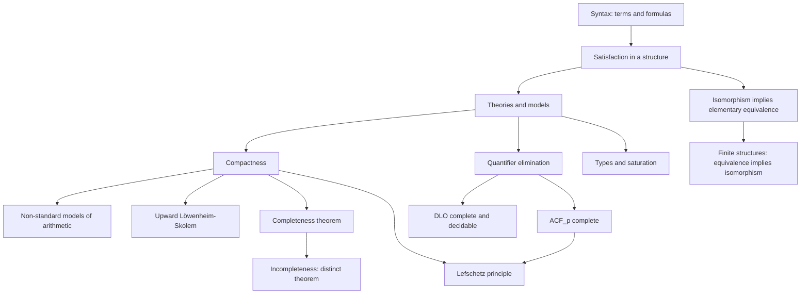

# Model Theory

> [Mathematics](../../README.md) › [Advanced Topics](../README.md) › Model Theory · Level: Advanced · Prerequisites: [Logic](../../00-foundations/02-logic/README.md), [Proof Techniques](../../00-foundations/04-proof-techniques/README.md), [Set Theory](../../00-foundations/03-set-theory/README.md), [Relations and Functions](../../00-foundations/05-relations-and-functions/README.md), [Arithmetic](../../01-arithmetic/README.md), [Groups](../../13-abstract-algebra/01-groups/README.md), [Rings](../../13-abstract-algebra/02-rings/README.md), [Fields](../../13-abstract-algebra/03-fields/README.md), [Combinatorics](../../20-combinatorics/README.md) · Estimated time: 11 h

## 1. Introduction

Model theory is the study of mathematical structures by the first-order sentences they satisfy. It asks which properties can be expressed in a formal language, which structures cannot be distinguished by any such property,
and what the answers imply for ordinary mathematics. Its central tool is a dictionary between *syntax* (formulas, theories, proofs) and *semantics* (structures, satisfaction, consequence), and its central theorems are
compactness, Löwenheim–Skolem and quantifier elimination.

Three examples show the flavour.

**A sentence cannot say "finite".** For each $n$ there is a sentence $\lambda_n$ saying "there are at least $n$
elements". If some sentence $\sigma$ were true exactly in the finite structures, then the theory $\{\sigma\} \cup \{\lambda_n : n \ge 1\}$ would be finitely satisfiable but unsatisfiable, contradicting compactness. So finiteness
is not a first-order property.

**The real numbers have a countable look-alike.** The theory of $(\mathbb{R},+,\cdot,<,0,1)$ has a countable model
by the downward Löwenheim–Skolem theorem, elementarily equivalent to the uncountable reals: the two structures satisfy exactly the same sentences, although one is countable and the other is not. Nothing in first-order logic can
tell them apart.

**Algebraically closed fields have quantifier elimination.** Every first-order statement about an algebraically
closed field is equivalent to a boolean combination of polynomial equations. This is the logical content of Hilbert's Nullstellensatz, and it implies that the theory of algebraically closed fields of a fixed characteristic
is complete: any two algebraically closed fields of the same characteristic satisfy the same sentences. That is the Lefschetz principle, by which a theorem proved over $\mathbb{C}$ by transcendental methods can be transferred to
fields of characteristic $p$.

Model theory began with Löwenheim (1915), Skolem (1920), Gödel's completeness theorem (1929) and the compactness theorem, and it was transformed by Tarski's work on truth and on real closed fields (1930s–1950s), by Robinson's
non-standard analysis (1960s), and by the classification theory of Shelah and the geometric stability theory of the 1980s–2000s. It now interacts closely with algebraic geometry (definable sets, o-minimality), group theory
(ultraproducts, the Ax–Kochen theorem), combinatorics (the compactness method) and theoretical computer science (decidable theories, database query languages).

This tutorial develops the core: languages and structures, the satisfaction relation, definability, elementary equivalence, compactness with two proofs, the Löwenheim–Skolem theorems, quantifier elimination for dense linear
orders and algebraically closed fields, types and saturation, and the distinction between the completeness and incompleteness theorems.

## 2. Prerequisites

You should be comfortable with:

* **Propositional and first-order logic, truth tables, quantifiers, bound and free variables** — [Logic](../../00-foundations/02-logic/README.md). This tutorial *defines* first-order syntax and semantics from scratch, but prior exposure makes the definitions readable.
* **Proof by induction on the complexity of a formula, and proof by contradiction** — [Proof Techniques](../../00-foundations/04-proof-techniques/README.md). Almost every proof here is an induction on formulas or on the length of a derivation.
* **Sets, functions, ordered pairs, Cartesian products, cardinality, countable and uncountable sets** — [Set Theory](../../00-foundations/03-set-theory/README.md). Structures are sets with operations; Löwenheim–Skolem is a theorem about cardinalities.
* **Equivalence relations and quotient sets** — [Relations and Functions](../../00-foundations/05-relations-and-functions/README.md). The term model of a Henkin theory is a quotient of the set of closed terms.
* **The natural numbers, induction and recursion** — [Arithmetic](../../01-arithmetic/README.md). Non-standard models of arithmetic are one of the main examples.
* **Groups, subgroups, homomorphisms** — [Groups](../../13-abstract-algebra/01-groups/README.md). Abelian groups and their theories provide examples; ultraproducts of groups are used in applications.
* **Rings, ideals, integral domains, algebraically closed fields** — [Rings](../../13-abstract-algebra/02-rings/README.md) and [Fields](../../13-abstract-algebra/03-fields/README.md). Quantifier elimination for algebraically closed fields is an algebraic statement, and its proof uses the Nullstellensatz.
* **Ordinals, transfinite induction and Zorn's lemma** — the [Set Theory](../../00-foundations/03-set-theory/README.md) tutorial covers the needed facts; Zorn's lemma is used to extend consistent theories and to build ultrafilters.
* **Basic combinatorics (finite counting, pigeonhole)** — [Combinatorics](../../20-combinatorics/README.md). The compactness method and the ultraproduct proof are combinatorial.

No prior model theory is assumed. The tutorial is self-contained except for two standard inputs that are stated precisely: the algebraic fact that a projection of a constructible set is constructible (used in quantifier
elimination for algebraically closed fields), and the arithmetic fact that Robinson arithmetic is essentially undecidable (used only in Section 7.11 to state the incompleteness theorems).

## 3. Learning Objectives

After this tutorial you will be able to:

1. Specify a first-order language, write terms and formulas in it, and distinguish free from bound occurrences of a
   variable.
2. Define an $\mathcal{L}$-structure and interpret terms and formulas in it, giving the satisfaction relation
   $\mathcal{M} \models_\sigma \varphi$ by a precise recursion.
3. Use the coincidence and substitution lemmas, and explain why satisfaction is defined by recursion on the
   *formula*, not on the structure.
4. Distinguish theories from their models, define $\operatorname{Th}(\mathcal{M})$, and decide whether a given class
   of structures is elementary.
5. Prove that isomorphic structures are elementarily equivalent, and give an example showing that the converse
   fails; prove that for finite structures elementary equivalence implies isomorphism.
6. Prove the compactness theorem by the Henkin construction, including the truth lemma for the term model, and
   sketch the ultraproduct proof via Łoś's theorem.
7. Derive the existence of non-standard models of arithmetic and state and prove the Lefschetz principle.
8. State and prove the downward and upward Löwenheim–Skolem theorems and explain Skolem's paradox.
9. Prove quantifier elimination for dense linear orders without endpoints, and derive completeness,
   $\aleph_0$-categoricity and decidability.
10. State quantifier elimination for algebraically closed fields, derive completeness of $\mathrm{ACF}_p$, and
    explain the role of the Nullstellensatz.
11. Define types, the Stone space $S_n(A)$, and saturation; compute $S_1$ for dense linear orders and for
    algebraically closed fields.
12. State Gödel's completeness and incompleteness theorems precisely and explain why they do not conflict.

## 4. Intuition

**Syntax is a game with symbols; semantics is what the symbols are about.** A first-order language is a list of
symbols: $+$, $\cdot$, $<$, $0$, $1$, and so on, each with an arity. A formula is a finite string built from these symbols, variables, logical connectives and quantifiers. A structure is a set with actual operations and relations
of the right arities. Satisfaction is the bridge: it says when the structure makes the formula true.

**The crucial design choice: quantifiers range over elements only.** In first-order logic we may write $\forall x\
\exists y\ (y \cdot y = x)$, quantifying over elements of the domain. We may not write $\forall A\ \forall x\ (x \in A \to \ldots)$ with $A$ ranging over *subsets*. This restriction is what makes the subject both powerful
(compactness, Löwenheim–Skolem) and limited (no categoricity for infinite structures, no finiteness, no well-ordering of $\mathbb{N}$). Second-order logic removes the restriction and loses the theorems.

**Why compactness is surprising.** A theory is an infinite set of sentences. Compactness says that if every finite
part of it has a model, the whole theory has one. This is a strong finiteness property: it means first-order logic cannot express "infinitely many" in a way that distinguishes the finite approximations from the infinite case. The
price is non-standard models: a theory that intends to describe $\mathbb{N}$ also describes structures with "infinite" integers.

**Why Löwenheim–Skolem is surprising.** If a theory in a countable language has a model at all, it has a countable
one. Applied to set theory, this says that a model of ZFC can be countable, although ZFC proves that uncountable sets exist. The resolution is that "uncountable" is asserted *inside* the model, using the model's own notion of
function; from outside, the set that the model believes to be uncountable is merely countable. This is Skolem's paradox, and it is not a contradiction: countability is not absolute.

**Why quantifier elimination matters.** A theory with quantifier elimination reduces every formula to a
quantifier-free one. For dense linear orders this makes the theory transparent: everything is a boolean combination of comparisons. For algebraically closed fields it makes definable sets constructible, which is a geometric
statement, and it makes the theory complete. Quantifier elimination is the model-theoretic version of "solve the equations".

**Two Gödel theorems, two directions.** The completeness theorem says the proof rules of first-order logic are
adequate: everything that follows semantically is provable. The incompleteness theorem says that no effective set of axioms can capture all truths of arithmetic. They concern different objects — the first, the logic; the second,
a particular theory — and there is no tension between them. The theory $\operatorname{Th}(\mathbb{N})$ is complete but not effectively axiomatisable, which is exactly what the incompleteness theorem predicts.

## 5. Formal Definitions

**Definition 5.1 (signature, or language).** A **signature** (also called a **language**) $\mathcal{L}$ is a set of
symbols, each of a specified kind and **arity**:

* **function symbols** $f, g, \ldots$ of arity $n \ge 1$;
* **relation symbols** $R, S, \ldots$ of arity $n \ge 1$;
* **constant symbols** $c, d, \ldots$ (arity $0$).

The **equality symbol** $=$ is always present and is not listed in $\mathcal{L}$. Examples: the language of groups is $\{e, \cdot, {}^{-1}\}$ with $e$ a constant, $\cdot$ binary and ${}^{-1}$ unary; the language of ordered rings is
$\{0,1,+,\cdot,<\}$; the language of graphs is $\{E\}$ with $E$ binary.

**Definition 5.2 (terms).** The set of $\mathcal{L}$-**terms** is the smallest set containing every variable
$x_0,x_1,\dots$ and every constant symbol, and closed under: if $t_1,\dots,t_n$ are terms and $f$ is an $n$-ary function symbol, then $f(t_1,\dots,t_n)$ is a term. Terms are the "names of elements"; they contain no
connectives and no quantifiers.

**Definition 5.3 (formulas).** The set of $\mathcal{L}$-**formulas** is the smallest set such that:

1. if $t_1, t_2$ are terms then $t_1 = t_2$ is a formula (**atomic**);
2. if $R$ is an $n$-ary relation symbol and $t_1,\dots,t_n$ are terms then $R(t_1,\dots,t_n)$ is a formula
   (**atomic**);
3. if $\varphi, \psi$ are formulas then so are $\neg\varphi$, $(\varphi \wedge \psi)$, $(\varphi \vee \psi)$,
   $(\varphi \to \psi)$, $(\varphi \leftrightarrow \psi)$;
4. if $\varphi$ is a formula and $x$ a variable then $\exists x\,\varphi$ and $\forall x\,\varphi$ are formulas.

A variable $x$ occurs **free** in $\varphi$ if it occurs outside the scope of any quantifier $\exists x$ or $\forall x$; otherwise it occurs **bound**. A formula with no free variables is a **sentence**. Thus $\forall x
\exists y (y \cdot y = x)$ is a sentence, while $y \cdot y = x$ has free variables $x$ and $y$.

The definitions of term and formula are inductive; this is what allows proofs by **induction on the complexity** of a formula, meaning induction on the number of connectives and quantifiers in it. Unique readability (every formula
is built in exactly one way from its parts) justifies definition by recursion on that complexity.

**Definition 5.4 ($\mathcal{L}$-structure).** An $\mathcal{L}$-**structure** is a pair $\mathcal{M} = (M,
\mathrm{Int})$ where $M$ is a nonempty set, the **domain** (or **universe**), and $\mathrm{Int}$ assigns:

* to each $n$-ary function symbol $f$ a function $f^{\mathcal{M}} : M^n \to M$;
* to each $n$-ary relation symbol $R$ a subset $R^{\mathcal{M}} \subseteq M^n$;
* to each constant symbol $c$ an element $c^{\mathcal{M}} \in M$.

When the signature contains finitely many symbols we write a structure as a tuple, for example $\mathcal{N} = (\mathbb{N}, 0, 1, +, \cdot, <)$ for the language of ordered rings. The **cardinality** $|\mathcal{M}|$ of a
structure is $|M|$.

Two conventions must be fixed. First, domains are nonempty: the empty structure is excluded, because the sentence $\forall x(x = x)$ would fail in it and many theorems would need an exception. Second, equality is interpreted by
the actual equality of $M$, not by an arbitrary equivalence relation; structures with a nonstandard equality are handled by passing to a quotient.

**Definition 5.5 (assignment and interpretation of terms).** An **assignment** in $\mathcal{M}$ is a function
$\sigma : \{\text{variables}\} \to M$. Given a term $t$, its **value** $t^{\mathcal{M}}[\sigma] \in M$ is defined by recursion on $t$:
$$x^{\mathcal{M}}[\sigma] := \sigma(x), \qquad c^{\mathcal{M}}[\sigma] := c^{\mathcal{M}}, \qquad
f(t_1,\dots,t_n)^{\mathcal{M}}[\sigma] := f^{\mathcal{M}}\bigl(t_1^{\mathcal{M}}[\sigma], \dots, t_n^{\mathcal{M}}[\sigma]\bigr).$$
For $a \in M$ we write $\sigma[x \mapsto a]$ for the assignment that agrees with $\sigma$ except at $x$, where it takes the value $a$.

**Definition 5.6 (the satisfaction relation).** Let $\mathcal{M}$ be an $\mathcal{L}$-structure, $\sigma$ an
assignment and $\varphi$ an $\mathcal{L}$-formula. We define $\mathcal{M} \models_\sigma \varphi$ ("$\mathcal{M}$ satisfies $\varphi$ under $\sigma$") by recursion on the complexity of $\varphi$:

1. $\mathcal{M} \models_\sigma t_1 = t_2$ iff $t_1^{\mathcal{M}}[\sigma] = t_2^{\mathcal{M}}[\sigma]$;
2. $\mathcal{M} \models_\sigma R(t_1,\dots,t_n)$ iff $\bigl(t_1^{\mathcal{M}}[\sigma], \dots,
   t_n^{\mathcal{M}}[\sigma]\bigr) \in R^{\mathcal{M}}$;
3. $\mathcal{M} \models_\sigma \neg\psi$ iff not $\mathcal{M} \models_\sigma \psi$;
4. $\mathcal{M} \models_\sigma (\psi \wedge \chi)$ iff both $\mathcal{M}\models_\sigma\psi$ and
   $\mathcal{M}\models_\sigma\chi$; similarly $\vee$ is "or", $\to$ is "not $\psi$ or $\chi$", and
   $\leftrightarrow$ is "$\psi$ iff $\chi$";
5. $\mathcal{M} \models_\sigma \exists x\,\psi$ iff there exists $a \in M$ with $\mathcal{M}
   \models_{\sigma[x\mapsto a]} \psi$;
6. $\mathcal{M} \models_\sigma \forall x\,\psi$ iff for every $a \in M$, $\mathcal{M}\models_{\sigma[x\mapsto a]}
   \psi$.

This is Tarski's definition of truth. It is a recursion on the *syntax*, and the quantifier clauses are where the domain $M$ is used: the existential clause searches through all of $M$, which is why the structure must be given as
a set.

If $\varphi(\bar x)$ is a formula with free variables among $\bar x = (x_1,\dots,x_n)$ and $\bar a = (a_1,\dots,a_n) \in M^n$, we write $\mathcal{M} \models \varphi(\bar a)$ for $\mathcal{M}\models_\sigma \varphi$ where
$\sigma(x_i) = a_i$. For a sentence $\sigma$ the relation $\mathcal{M}\models\sigma$ does not depend on the assignment, and we write $\mathcal{M} \models \varphi$ for "$\mathcal{M}$ satisfies $\varphi$".

**Lemma 5.7 (coincidence).** If $\sigma$ and $\tau$ agree on all variables occurring free in $\varphi$, then
$\mathcal{M}\models_\sigma \varphi \iff \mathcal{M}\models_\tau \varphi$. In particular, the satisfaction of a sentence does not depend on the assignment.

**Proof.** Induction on the complexity of $\varphi$. For atomic formulas the value of a term depends only on the
values of the variables occurring in it (induction on the term), so the claim follows; the propositional clauses are immediate from the induction hypothesis; the quantifier clauses use that the assignments $\sigma[x\mapsto a]$ and
$\tau[x\mapsto a]$ agree on the free variables of $\psi$ whenever $\sigma$ and $\tau$ agree on those of $\exists x\,\psi$. $\blacksquare$

**Lemma 5.8 (substitution).** Let $t$ be a term, $x$ a variable and $\varphi$ a formula in which no variable of $t$
becomes bound after substituting $t$ for $x$ (the substitution is **admissible**). Then for every assignment $\sigma$,
$$\mathcal{M}\models_\sigma \varphi[x := t] \iff \mathcal{M}\models_{\sigma[x \mapsto t^{\mathcal{M}}[\sigma]]}
\varphi.$$
**Proof.** Induction on $\varphi$; the only subtle case is the quantifier, where admissibility is exactly what is
needed to keep the induction hypothesis applicable. $\blacksquare$

Admissibility matters: substituting $y$ for $x$ in $\exists y\,(x = y)$ gives $\exists y\,(y = y)$, which is true in every nonempty structure, whereas the original formula defines the singleton $\{y^{\mathcal{M}}\}$. The
correct substitution renames the bound variable first.

**Definition 5.9 (theory, model, consequence).** An $\mathcal{L}$-**theory** $T$ is a set of $\mathcal{L}$-sentences.
A **model** of $T$ is a structure $\mathcal{M}$ with $\mathcal{M}\models\sigma$ for every $\sigma \in T$; we write $\mathcal{M}\models T$. The class of models of $T$ is $\operatorname{Mod}(T)$. A sentence $\sigma$ is a
**semantic consequence** of $T$, written $T\models\sigma$, if every model of $T$ satisfies $\sigma$. The
**theory of a structure** is
$$\operatorname{Th}(\mathcal{M}) := \{\sigma \text{ sentence} : \mathcal{M}\models\sigma\}.$$
A theory $T$ is **complete** if for every sentence $\sigma$, either $T\models\sigma$ or $T\models\neg\sigma$ (equivalently, $T \cup \{\sigma\}$ or $T\cup\{\neg\sigma\}$ is inconsistent). A class $\mathcal{K}$ of
$\mathcal{L}$-structures is **elementary** if $\mathcal{K} = \operatorname{Mod}(T)$ for some theory $T$.

Note the two senses of "complete" that will be kept apart throughout: a *theory* is complete when it decides every sentence, and a *proof system* is complete when it proves every semantic consequence (Section 7.11).

**Definition 5.10 (definability).** Let $\mathcal{M}$ be an $\mathcal{L}$-structure, $B \subseteq M$ and $n \ge 1$.
A set $A \subseteq M^n$ is **definable in $\mathcal{M}$ with parameters from $B$** if there is a formula $\varphi(x_1,\dots,x_n, y_1,\dots,y_m)$ and a tuple $\bar b \in B^m$ such that
$$A = \{\bar a \in M^n : \mathcal{M}\models\varphi(\bar a,\bar b)\}.$$
When $B = \varnothing$ we say $A$ is **$0$-definable** (or definable without parameters). An element $a$ is definable if $\{a\}$ is. A function $f : M^n \to M$ is definable if its graph is a definable subset of $M^{n+1}$.

**Definition 5.11 (elementary equivalence and isomorphism).** Two $\mathcal{L}$-structures $\mathcal{M}$ and
$\mathcal{N}$ are **elementarily equivalent**, written $\mathcal{M}\equiv\mathcal{N}$, if they satisfy the same sentences. They are **isomorphic**, written $\mathcal{M}\cong\mathcal{N}$, if there is a bijection $h : M \to N$
such that for every function symbol $f$, relation symbol $R$ and constant $c$,
$$h(f^{\mathcal{M}}(\bar a)) = f^{\mathcal{N}}(h(\bar a)), \qquad \bar a \in R^{\mathcal{M}} \iff h(\bar a) \in
R^{\mathcal{N}}, \qquad h(c^{\mathcal{M}}) = c^{\mathcal{N}}.$$

**Definition 5.12 (embedding, substructure, elementary embedding).** A map $h : M \to N$ is an **embedding** if it
is injective and preserves all functions, relations and constants as above (with $R^{\mathcal{M}} = h^{-1}[R^{ \mathcal{N}}]$). If $M \subseteq N$ and the inclusion is an embedding, $\mathcal{M}$ is a **substructure** of
$\mathcal{N}$, written $\mathcal{M}\subseteq\mathcal{N}$. The substructure is **elementary**, written $\mathcal{M}\preceq\mathcal{N}$, if for all $\bar a \in M^n$ and all formulas $\varphi(\bar x)$, $\mathcal{M}
\models\varphi(\bar a) \iff \mathcal{N}\models\varphi(\bar a)$.

**Definition 5.13 (type).** Let $\mathcal{M}$ be an $\mathcal{L}$-structure and $A \subseteq M$. An **$n$-type over
$A$** is a set $p(\bar x)$ of formulas with parameters from $A$ and free variables among $x_1,\dots,x_n$. It is
**consistent** (or **finitely satisfiable**) if every finite subset $p_0 \subseteq p$ is satisfied by some tuple in
some elementary extension of $\mathcal{M}$; it is **complete** if for every formula $\varphi(\bar x)$ with parameters from $A$, exactly one of $\varphi, \neg\varphi$ lies in $p$. The set of complete $n$-types over $A$ is
the **Stone space** $S_n^{\mathcal{M}}(A)$ (often written $S_n(A)$). A type is **realised** in $\mathcal{M}$ if some $\bar a \in M^n$ satisfies every formula in it, and **omitted** otherwise.

**Definition 5.14 (saturation).** Let $\kappa$ be an infinite cardinal. $\mathcal{M}$ is **$\kappa$-saturated** if
for every $A \subseteq M$ with $|A| < \kappa$, every complete $1$-type over $A$ is realised in $\mathcal{M}$. It is
**$\omega$-saturated** if it is $\aleph_0$-saturated, i.e. every type over a finite set is realised.

## 6. Mathematical Notation

| Symbol | Read as | Meaning |
|---|---|---|
| $\mathcal{L}$ | the language | a signature: function, relation and constant symbols |
| $\mathcal{M}, \mathcal{N}$ | script M, script N | structures |
| $M, N$ | the domain of $\mathcal{M}$ | the underlying nonempty set |
| $t, s$ | terms | names built from variables, constants and function symbols |
| $\varphi, \psi, \sigma$ | formulas, sentences | $\sigma$ is usually a sentence |
| $\models$ | models / satisfies | semantic relation between structures and formulas |
| $\not\models$ | does not satisfy | negation of $\models$ |
| $\vdash$ | proves | syntactic derivability in a proof system |
| $\equiv$ | elementarily equivalent | same sentences |
| $\cong$ | isomorphic | structure-preserving bijection |
| $\preceq$ | elementary substructure | inclusion preserving all formulas |
| $\operatorname{Th}(\mathcal{M})$ | the theory of $\mathcal{M}$ | all sentences true in $\mathcal{M}$ |
| $\operatorname{Mod}(T)$ | the models of $T$ | class of structures satisfying $T$ |
| $\models_\sigma$ | satisfies under the assignment $\sigma$ | the recursive satisfaction relation |
| $\bar x, \bar a$ | tuple of variables, tuple of elements | $(x_1,\dots,x_n)$, $(a_1,\dots,a_n)$ |
| $\sigma[x\mapsto a]$ | the assignment modified at $x$ | agrees with $\sigma$ off $x$ |
| $S_n(A)$ | the Stone space of $n$-types | complete types over $A$ |
| $\varphi[x:=t]$ | substitution | replace free $x$ by the term $t$ |
| $\aleph_0, \kappa, \lambda$ | cardinals | $\aleph_0$ is the cardinality of $\mathbb{N}$ |
| $\omega$-saturated | omega-saturated | types over finite sets are realised |
| $\operatorname{DLO}$ | theory of dense linear orders | dense, no endpoints, at least two points |
| $\mathrm{ACF}$, $\mathrm{ACF}_p$ | theory of algebraically closed fields | of characteristic $0$ or $p$ |
| $\mathrm{RCF}$ | theory of real closed fields | $(\mathbb{R},+,\cdot,<)$ and its relatives |
| $\mathrm{Th}(\mathbb{N})$ | full arithmetic | all sentences true in $(\mathbb{N},+,\cdot)$ |
| $Q$, $\mathrm{PA}$ | Robinson arithmetic, Peano arithmetic | finitely axiomatised weak arithmetic, full induction |
| $\eta$ | the order type of $\mathbb{Q}$ | used for order types of non-standard models |

## 7. Core Concepts

### 7.1 First-order languages and what they can say

A signature fixes the vocabulary. The **language of rings** is $\mathcal{L}_{\mathrm{ring}} = \{0,1,+,-,\cdot\}$; the **language of ordered rings** adds $<$; the **language of groups** is $\{e,\cdot,{}^{-1}\}$; the **language of
graphs** is $\{E\}$ with $E$ binary; the **language of arithmetic** is $\{0,1,+,\cdot,<\}$, or $\{0,S,+,\cdot\}$ with $S$ unary.

**Example 7.1 (sentences that express algebraic properties).**

* *Field*: the finitely many axioms for a commutative ring with $1 \ne 0$ plus $\forall x(x \ne 0 \to \exists y\,(xy
  = 1))$.
* *Characteristic $p$*: the single sentence $\underline{p} = 0$, where $\underline{p} := \underbrace{1+\dots+1}_{p}$.
  Characteristic $0$ needs the infinite scheme $\{\underline{p} \ne 0 : p \text{ prime}\}$.
* *Algebraically closed*: for each $n \ge 1$ the sentence $\forall a_0 \cdots \forall a_{n-1} \exists x\,(x^n + a_{n-1}
  x^{n-1} + \dots + a_0 = 0)$.
* *Dense linear order without endpoints*: the axioms in Section 7.9.
* *Torsion-free abelian group*: for each $n \ge 1$, $\forall x\,(nx = 0 \to x = 0)$.
* *Non-trivial group*: $\exists x\,(x \ne e)$.

Each of these is a *set* of sentences, possibly infinite. A property is **first-order** (or **elementary**) if it is defined by such a set. The restriction that quantifiers range over elements only is what makes the examples above
finite or at worst countable schemes.

**Example 7.2 (properties that are not first-order).**

* *Finiteness.* For each $n$ let $\lambda_n$ be the sentence "there exist at least $n$ elements", i.e.
  $\exists x_1\cdots\exists x_n \bigwedge_{i<j} x_i \ne x_j$. If a sentence $\sigma$ held exactly in the finite
  structures, then $\{\sigma\} \cup \{\lambda_n : n \ge 1\}$ would be finitely satisfiable but unsatisfiable,
  contradicting Theorem 7.19.
* *Well-order.* "Every nonempty subset has a least element" quantifies over subsets, not elements. No set of
  first-order sentences defines the well-orders among linear orders (a compactness argument with an infinite
  descending sequence shows this).
* *Isomorphism to $(\mathbb{N},+,\cdot)$.* By the upward Löwenheim–Skolem theorem, any theory with an infinite model
  has models of every infinite cardinality, so no first-order theory has exactly one infinite model up to
  isomorphism.
* *Connectedness of a graph.* "There is a path of length $n$ between any two vertices" is first-order for each fixed
  $n$, but "there is a path of some finite length" is not: a compactness argument produces a graph that is
  "locally" connected at every finite distance but disconnected.

### 7.2 Structures and interpretations

**Example 7.3 (structures).**

* $\mathcal{N} = (\mathbb{N}, 0, 1, +, \cdot, <)$, the standard model of arithmetic.
* $\mathcal{R} = (\mathbb{R}, 0, 1, +, \cdot, <)$, the ordered field of reals.
* $\mathcal{C} = (\mathbb{C}, 0, 1, +, \cdot)$, an algebraically closed field.
* $(\mathbb{Q}, <)$, a countable dense linear order without endpoints.
* A graph $\mathcal{G} = (V, E)$ with $E^{\mathcal{G}} \subseteq V^2$; if $E$ is required to be irreflexive and
  symmetric, this is a simple graph.
* $(\mathbb{Z}, 0, 1, +, -)$, an abelian group; the language is $\{0,+,-\}$.

**Proposition 7.4 (embeddings preserve atomic formulas).** Let $h : \mathcal{M} \to \mathcal{N}$ be an embedding.
Then for every quantifier-free formula $\varphi(\bar x)$ and every $\bar a \in M^n$,
$$\mathcal{M}\models\varphi(\bar a) \iff \mathcal{N}\models\varphi(h(\bar a)).$$
**Proof.** Induction on the term shows $h(t^{\mathcal{M}}[\sigma]) = t^{\mathcal{N}}[h\circ\sigma]$. For atomic
formulas this gives the claim because $h$ preserves relations and equality (injectivity is needed for $\neg(t_1 = t_2)$). The propositional clauses follow by induction. $\blacksquare$

Note that the proposition fails for formulas with quantifiers: the inclusion $\mathbb{Q} \subseteq \mathbb{R}$ of ordered fields preserves all quantifier-free formulas but not the sentence $\exists x\,(x\cdot x = 2)$, which is
true in $\mathbb{R}$ and false in $\mathbb{Q}$. This is exactly the distinction between substructure and elementary substructure (Definition 5.12).

### 7.3 The satisfaction relation

Definition 5.6 gives the recursion. Three remarks make it usable.

**Remark 7.5 (why the recursion is well founded).** Formulas are finite objects built from atomic formulas by
finitely many applications of the connectives and quantifiers. The *complexity* of $\varphi$ — the number of connectives and quantifiers in it — decreases in each clause of Definition 5.6, so the recursion terminates and
defines a unique truth value for each pair $(\mathcal{M},\sigma,\varphi)$. Unique readability of formulas is what guarantees that each formula falls under exactly one clause.

**Remark 7.6 (a worked evaluation).** In $\mathcal{N} = (\mathbb{N},0,1,+,\cdot,<)$, let $\varphi(x)$ be
$$\varphi(x) := \exists y\,(y \cdot y = x) \wedge \forall z\,(z < x \to z < 1 \vee \exists w\,(w \cdot w = z)).$$
At $x = 4$ the first conjunct holds ($4 = 2^2$), but the second fails: $z = 2$ satisfies $2 < 4$, while $2 < 1$ is false and $2$ is not a square. So $\mathcal{N}\not\models\varphi(4)$. At $x = 2$ the values $z<2$ are $z \in
\{0,1\}$, and both satisfy the disjunction ($0<1$; $1 = 1^2$), so $\mathcal{N}\models\varphi(2)$. The moral: satisfaction must be checked clause by clause, and a single counterexample $z$ refutes a universal clause.

**Remark 7.7 (Tarski's theorem and the limits of the object language).** Satisfaction is defined in the
*méta-language*. One cannot express "$\varphi$ is true" inside the language of arithmetic itself: by Tarski's
undefinability theorem (1936), there is no formula $\mathrm{Tr}(x)$ in the language of arithmetic such that for every sentence $\sigma$, $\mathcal{N}\models\mathrm{Tr}(\ulcorner\sigma\urcorner) \leftrightarrow \sigma$, where
$\ulcorner\sigma\urcorner$ is the Gödel number of $\sigma$. The proof combines the diagonal lemma with the liar paradox. Consequently a theory cannot contain its own satisfaction predicate, which is why model theory is done in a
richer meta-theory.

**Lemma 7.8 (isomorphism invariance).** If $h : \mathcal{M}\to\mathcal{N}$ is an isomorphism, then for every formula
$\varphi(\bar x)$ and every $\bar a\in M^n$,
$$\mathcal{M}\models\varphi(\bar a) \iff \mathcal{N}\models\varphi(h(\bar a)).$$
**Proof.** Induction on the complexity of $\varphi$. Terms are handled by induction on terms using that $h$ preserves
the functions and constants. Atomic formulas use that $h$ preserves relations. The propositional cases are immediate. For $\exists x\,\psi$: $\mathcal{M}\models\exists x\,\psi(\bar a)$ iff there is $b \in M$ with
$\mathcal{M}\models\psi(\bar a,b)$ iff (by the induction hypothesis applied to $h(b)$) there is $b \in M$ with $\mathcal{N}\models\psi(h(\bar a), h(b))$; since $h$ is surjective, $h(b)$ ranges over all of $N$, so this is
equivalent to $\mathcal{N}\models\exists x\,\psi(h(\bar a))$. The universal case is dual. $\blacksquare$

**Corollary 7.9.** Isomorphic structures are elementarily equivalent. The converse fails: see Example 7.14.

### 7.4 Theories, models and definability

**Example 7.10 (definable sets).**

* In $(\mathbb{N},+,<)$, the even numbers are definable by $\exists y\,(y+y = x)$; the multiples of $3$ by
  $\exists y\,(y+y+y = x)$.
* In $(\mathbb{Z},+,<)$, the positive integers are definable by $0 < x$; in $(\mathbb{N},+,<)$ the set $\{0\}$ is
  definable by $\forall y\,(x \le y)$.
* In $(\mathbb{R},+,\cdot,<)$, the interval $(0,1)$ is definable by $0 < x \wedge x < 1$; the graph of the function
  $x\mapsto x^2$ by $y = x\cdot x$. By the Tarski–Seidenberg theorem, the definable subsets of $\mathbb{R}^n$ are
  exactly the **semialgebraic** sets, i.e. finite boolean combinations of sets $\{f = 0\}$ and $\{g > 0\}$ for
  polynomials $f,g$.
* In $(\mathbb{C},+,\cdot)$, the definable subsets of $\mathbb{C}^n$ are the **constructible** sets: finite boolean
  combinations of Zariski closed sets. This is a consequence of quantifier elimination for algebraically closed
  fields (Corollary 7.31). In particular the *real* line $\mathbb{R}\subseteq\mathbb{C}$ is **not** definable, since
  its Zariski closure is all of $\mathbb{C}$ and a constructible set equal to $\mathbb{R}$ would have to be finite
  or cofinite.
* In $(\mathbb{Q},<)$, the definable subsets of $\mathbb{Q}$ are finite unions of singletons and intervals with
  rational endpoints (by quantifier elimination for DLO). So $\mathbb{Z}$ is not definable in $(\mathbb{Q},<)$.

Definability is relative to the structure and to the allowed parameters. In $(\mathbb{N},+,\cdot)$, every recursively enumerable set is definable (the MRDP theorem makes this precise for Diophantine sets), which is a vast
increase over the $+$-only language.

**Proposition 7.11 (elementary classes are closed under elementary equivalence).** If $\mathcal{K} =
\operatorname{Mod}(T)$ and $\mathcal{M}\in\mathcal{K}$, $\mathcal{N}\equiv\mathcal{M}$, then $\mathcal{N}\in\mathcal{K}$.
**Proof.** Every $\sigma \in T$ is true in $\mathcal{M}$, hence in $\mathcal{N}$ by elementary equivalence. $\blacksquare$

### 7.5 Elementary equivalence versus isomorphism

The relation $\equiv$ is coarser than $\cong$, but for finite structures they coincide.

**Theorem 7.12 (finite structures).** Let $\mathcal{L}$ be a finite signature and let $\mathcal{M},\mathcal{N}$ be
finite $\mathcal{L}$-structures with $\mathcal{M}\equiv\mathcal{N}$. Then $\mathcal{M}\cong\mathcal{N}$.

**Proof.** Let $M = \{a_1,\dots,a_n\}$. For $\bar x = (x_1,\dots,x_n)$, let $\delta(\bar x)$ be the conjunction of:

* $\bigwedge_{i<j} x_i \ne x_j$;
* for every atomic formula $\varphi(\bar x)$, either $\varphi$ or $\neg\varphi$, according to whether
  $\mathcal{M}\models\varphi(\bar a)$.

Because $\mathcal{L}$ is finite, there are only finitely many atomic formulas in the $n$ variables $x_1,\dots,x_n$. Then
$$\sigma := \exists x_1\cdots\exists x_n\,\delta(\bar x)$$
is a sentence true in $\mathcal{M}$. Since $\mathcal{M}\equiv\mathcal{N}$, $\mathcal{N}\models\sigma$, so there are $b_1,\dots,b_n \in N$, pairwise distinct, satisfying the same atomic formulas as $\bar a$. Since $|N| = n$ (as
$\mathcal{N}$ satisfies $\lambda_n$ and $\lambda_{n+1}$ fails, being false in $\mathcal{M}$), the map $a_i\mapsto b_i$ is a bijection, and it preserves all atomic formulas, hence is an isomorphism. $\blacksquare$

**Example 7.13 (elementarily equivalent, not isomorphic).** $(\mathbb{Q},<)$ and $(\mathbb{R},<)$ are both dense
linear orders without endpoints, so they satisfy the same sentences (Theorem 7.30). They are not isomorphic because one is countable and the other is not — an isomorphism is in particular a bijection. This shows that first-order
logic cannot distinguish two structures of different cardinality when both are "saturated enough".

**Example 7.14 (elementarily equivalent, same cardinality, not isomorphic).** The fields $\overline{\mathbb{Q}}$
and $\overline{\mathbb{Q}(t)}$ are both countable and algebraically closed of characteristic $0$, so they are elementarily equivalent by Corollary 7.32. They are not isomorphic: an isomorphism of fields would carry the
transcendental element $t$ to an element of $\overline{\mathbb{Q}}$, which is algebraic over $\mathbb{Q}$, and algebraicity over the prime field is preserved by field isomorphisms. So first-order logic cannot capture the
transcendence degree of a field, even when the cardinalities agree.

### 7.6 The compactness theorem

**Theorem 7.15 (compactness).** Let $T$ be a set of $\mathcal{L}$-sentences. If every finite subset $T_0 \subseteq T$
has a model, then $T$ has a model.

**Corollary 7.16 (finite character of consequence).** If $T\models\sigma$, then there is a finite $T_0 \subseteq T$
with $T_0\models\sigma$.

**Proof of the corollary.** If no finite $T_0$ implied $\sigma$, then each $T_0\cup\{\neg\sigma\}$ would be
satisfiable, so by compactness $T\cup\{\neg\sigma\}$ would be satisfiable, contradicting $T\models\sigma$. $\blacksquare$

**Proof of Theorem 7.15 (Henkin construction).** Assume for simplicity that $\mathcal{L}$ is countable; the general
case replaces $\aleph_0$ by $\max(\aleph_0,|\mathcal{L}|)$ everywhere.

*Step 1: expand the language and enumerate.* Add countably many new constant symbols $c_0,c_1,\dots$ to
$\mathcal{L}$, obtaining $\mathcal{L}^+$, and enumerate all $\mathcal{L}^+$-sentences as $\sigma_0,\sigma_1,\dots$.

*Step 2: build a maximal consistent Henkin theory.* Define $T_0 := T$. Given $T_n$, first set
$$T'_{n+1} := \begin{cases} T_n \cup \{\sigma_n\} & \text{if this set is finitely satisfiable,}\\ T_n \cup
\{\neg\sigma_n\} & \text{otherwise,}\end{cases}$$ and then define $T_{n+1} := T'_{n+1} \cup \{\psi(c)\}$ if $\sigma_n \in T'_{n+1}$ has the form $\exists
x\,\psi(x)$, where $c$ is the first new constant not occurring in $T'_{n+1}$ nor in $\sigma_n$; otherwise $T_{n+1} := T'_{n+1}$. Let $T^* := \bigcup_n T_n$.

*Finite satisfiability is preserved.* In the first alternative, if $T_n\cup\{\sigma_n\}$ is not finitely satisfiable
then some finite $T_n^0\cup\{\sigma_n\}$ is unsatisfiable, so $T_n^0\models\neg\sigma_n$ and $T_n\cup\{\neg\sigma_n\}$ is finitely satisfiable. For the extra sentence $\psi(c)$: let $S\subseteq T_n\cup\{\sigma_n\}\cup\{\psi(c)\}$ be
finite. The constant $c$ does not occur in $S\setminus\{\psi(c)\}$, so a model $\mathcal{M}$ of the finite set $S\setminus\{\psi(c)\}$ satisfies $\exists x\,\psi(x)$; interpreting $c$ as a witness in $\mathcal{M}$ gives a model
of $S$.

Then $T^*$ is **finitely satisfiable** (every finite subset lies in some $T_n$), **maximal** (for every sentence $\sigma$, exactly one of $\sigma,\neg\sigma$ lies in $T^*$, by the construction) and **Henkin** (if $\exists
x\,\psi(x)\in T^*$, it was added as some $\sigma_n$, and the construction added $\psi(c)$ for a fresh constant at that stage).
Also $T^*$ is deductively closed: if $T^*\vdash\sigma$ and $\sigma \notin T^*$, then $\neg\sigma\in T^*$, so $T^*\vdash\sigma$ and $T^*\vdash\neg\sigma$, i.e. some finite subset is inconsistent, contradicting finite
satisfiability.

*Step 3: the term model.* Let $\mathrm{CT}$ be the set of closed $\mathcal{L}^+$-terms (it is nonempty because of the
new constants). Define, for $t,s\in \mathrm{CT}$,
$$t \sim s :\iff (t = s) \in T^*.$$
This is an equivalence relation: reflexivity, symmetry and transitivity follow from the equality axioms and deductive closure. Let $M := \mathrm{CT}/\!\sim$ and $[t]$ for the class of $t$. Define an $\mathcal{L}^+$-structure
$\mathcal{M}$ by
$$c^{\mathcal{M}} := [c], \qquad f^{\mathcal{M}}([t_1],\dots,[t_n]) := [f(t_1,\dots,t_n)], \qquad
R^{\mathcal{M}}([t_1],\dots,[t_n]) :\iff R(t_1,\dots,t_n)\in T^*.$$ These are well defined: if $t_i \sim s_i$ then $(t_i = s_i)\in T^*$, hence $f(t_1,\dots,t_n) = f(s_1,\dots,s_n)\in
T^*$ and $R(\bar t)\leftrightarrow R(\bar s)\in T^*$ by the equality axioms and deductive closure.

*Step 4: the truth lemma.* For every $\mathcal{L}^+$-sentence $\varphi$,
$$\mathcal{M}\models\varphi \iff \varphi\in T^*.$$
*Proof.* Induction on $\varphi$. For atomic $\varphi$ this is the definition of the relations and the fact that
$t^{\mathcal{M}} = [t]$ for closed terms (proved by induction on $t$). For $\neg,\wedge,\vee,\to$ use maximality and deductive closure. For $\varphi = \exists x\,\psi(x)$: if $\varphi\in T^*$ then, because $T^*$ is Henkin, $\psi(c)\in T^*$
for some constant $c$; by induction $\mathcal{M}\models\psi(c)$, so $\mathcal{M}\models\exists x\,\psi$. Conversely, if $\mathcal{M}\models\exists x\,\psi(x)$, then for some class $[t]$ we have $\mathcal{M}\models\psi(t)$ (every element of $M$ is a class of a closed term), so by induction
$\psi(t)\in T^*$; since $T^*\vdash\psi(t)\to\exists x\,\psi(x)$, deductive closure gives $\exists x\,\psi\in T^*$. $\square$

*Step 5: conclusion.* By the truth lemma, $\mathcal{M}\models T^*$, hence $\mathcal{M}\models T$; and $\mathcal{M}$
is a structure for $\mathcal{L}^+$, whose reduct to $\mathcal{L}$ is a model of $T$. $\blacksquare$

The Henkin proof is the syntactic heart of the completeness theorem: the term model is built out of syntax and the truth lemma compares syntax with itself.

**Definition 7.17 (filters and ultraproducts).** Let $I$ be a nonempty set. A **filter** on $I$ is a family
$\mathcal{F}\subseteq\mathcal{P}(I)$ containing $I$, closed under finite intersections, and upward closed; it is an
**ultrafilter** if for every $X\subseteq I$ exactly one of $X, I\setminus X$ lies in $\mathcal{F}$. Given structures
$\mathcal{M}_i$ and an ultrafilter $\mathcal{U}$ on $I$, the **ultraproduct** $\prod_{\mathcal U}\mathcal{M}_i$ has domain the set of equivalence classes of $\prod_i M_i$ under
$$f\sim_{\mathcal U}g :\iff \{i\in I : f(i) = g(i)\}\in\mathcal{U},$$
with operations and relations defined coordinatewise modulo $\mathcal U$.

**Theorem 7.18 (Łoś).** For every formula $\varphi(\bar x)$ and every $f_1,\dots,f_n \in \prod_i M_i$,
$$\prod_{\mathcal U}\mathcal{M}_i \models \varphi([f_1],\dots,[f_n]) \iff \{i\in I : \mathcal{M}_i\models
\varphi(f_1(i),\dots,f_n(i))\}\in\mathcal{U}.$$
**Proof sketch.** Induction on $\varphi$. The atomic case is the definition. The propositional cases use that
$\mathcal U$ is a filter closed under complements of members (ultrafilter). The existential case: if the set $\{i : \mathcal{M}_i\models\exists x\,\psi(x, f_1(i),\dots)\}$ lies in $\mathcal U$, use the axiom of choice to pick
a witness $g(i)$ for each $i$ in that set (and arbitrary elsewhere); then $\{i : \mathcal M_i\models\psi(g(i),\bar f(i))\}$ contains that set, hence lies in $\mathcal U$, and the induction hypothesis applies. Conversely, if the
ultraproduct satisfies $\exists x\,\psi$, then some $[g]$ witnesses it, and the set where $\psi(g(i),\bar f(i))$ holds lies in $\mathcal U$ and is contained in the set where the existential holds. $\blacksquare$

**Proof of compactness via ultraproducts.** Let $I$ be the set of finite subsets of $T$, and for $i\in I$ choose a
model $\mathcal{M}_i\models i$. For $\sigma\in T$ let $A_\sigma := \{i\in I : \sigma\in i\}$. The family $\{A_\sigma\}_{\sigma\in T}$ has the finite intersection property, so it generates a filter, which extends to an
ultrafilter $\mathcal U$ by Zorn's lemma. For each $\sigma$, the set $A_\sigma\subseteq\{i : \mathcal M_i\models\sigma\}$ lies in $\mathcal U$, so Łoś's theorem gives $\prod_{\mathcal U}\mathcal M_i\models\sigma$.
Hence the ultraproduct models $T$. $\blacksquare$

### 7.7 Consequences of compactness

**Theorem 7.19 (non-standard models of arithmetic).** Let $\mathcal{N} = (\mathbb{N},0,1,+,\cdot,<)$ and let
$\bar n := \underline{n}$ be the numeral of $n$. Let $\mathcal{L}' = \mathcal{L}\cup\{c\}$ with $c$ a new constant and
$$T := \operatorname{Th}(\mathcal{N}) \cup \{c > \bar n : n \in \mathbb{N}\}.$$
Then $T$ has a model $\mathcal{N}^*$, and every such model is elementarily equivalent to $\mathcal{N}$ but not isomorphic to it.

**Proof.** Every finite subset of $T$ involves finitely many sentences from $\operatorname{Th}(\mathcal N)$ and
finitely many inequalities $c > \bar n$; interpret $c$ in $\mathcal{N}$ as a natural number larger than all the finitely many $n$ involved (and interpret the remaining symbols as in $\mathcal{N}$). So every finite subset has a
model, and compactness gives $\mathcal{N}^*\models T$.

Then $\mathcal{N}^*\equiv\mathcal{N}$ because $\operatorname{Th}(\mathcal N)\subseteq T$. If $h : \mathcal{N}^*\to \mathcal{N}$ were an isomorphism, then $h(c^{\mathcal{N}^*})$ would be a natural number $m$, but $c^{\mathcal
N^*} > \bar n^{\mathcal N^*}$ for every $n$, so $m = h(c^{\mathcal N^*}) > h(\bar n^{\mathcal N^*}) = n$ for every $n$ — impossible. Hence $\mathcal{N}^*\not\cong\mathcal{N}$. $\blacksquare$

**Facts about non-standard models.** In a model of $\operatorname{Th}(\mathbb N)$ the elements $\bar n^{\mathcal
N^*}$ form an initial segment isomorphic to $\mathbb{N}$; any other element is called **non-standard** and is larger than every standard element. The model is not well ordered (the non-standard part has no least element). For
models of full Peano arithmetic, the order type of a countable non-standard model is
$$\mathbb{N} + \mathbb{Z}\cdot\eta,$$
where $\eta$ is the order type of $(\mathbb{Q},<)$: a copy of $\mathbb{N}$ followed by densely many copies of $\mathbb{Z}$ (Kaye, *Models of Peano Arithmetic*). The **overspill** principle says that a definable set containing
all standard elements contains a non-standard element.

**Theorem 7.20 (Lefschetz principle, transfer form).** Let $\sigma$ be a sentence in the language of rings. If
$\sigma$ holds in every algebraically closed field of characteristic $0$, then there is a finite set of primes $F$ such that $\sigma$ holds in every algebraically closed field of characteristic $p$ for all $p\notin F$.

**Proof.** Let $\mathrm{ACF}_0 = \mathrm{ACF}\cup\{\underline{p}\ne 0 : p\ \text{prime}\}$, where $\mathrm{ACF}$ is
the set of axioms for algebraically closed fields. By hypothesis every model of $\mathrm{ACF}_0$ satisfies $\sigma$, i.e. $\mathrm{ACF}_0\models\sigma$. By Corollary 7.16 there is a finite subset
$$\mathrm{ACF}_0^{(0)}\cup\{\underline{p}\ne 0 : p\in F\}\models\sigma$$
with $\mathrm{ACF}_0^{(0)}\subseteq \mathrm{ACF}$ finite and $F$ a finite set of primes. Every algebraically closed field of characteristic $p\notin F$ satisfies $\mathrm{ACF}_0^{(0)}$ and all $\underline{q}\ne 0$ for $q\in F$
(because $q \ne p$ implies $q\cdot 1 \ne 0$ in characteristic $p$). Hence it satisfies $\sigma$. $\blacksquare$

The converse — if $\sigma$ holds in all but finitely many characteristics then it holds in characteristic $0$ — is proved in Theorem 7.33 using the completeness of $\mathrm{ACF}_0$, which follows from quantifier elimination. Both
directions together are the **Lefschetz principle**: a first-order statement true over one algebraically closed field of characteristic $0$ is true over all of them, and over all but finitely many characteristics.

### 7.8 The Löwenheim–Skolem theorems

**Theorem 7.21 (downward Löwenheim–Skolem).** Let $\kappa := \max(\aleph_0,|\mathcal{L}|)$ and let $\mathcal{M}$ be
an $\mathcal{L}$-structure. Then $\mathcal{M}$ has an elementary substructure of cardinality $\le\kappa$.

**Proof.** We build an elementary substructure using **Skolem functions**. For each formula $\psi(x,\bar y)$ choose a
function $f_\psi : M^{|\bar y|}\to M$ such that $f_\psi(\bar b)$ is a witness for $\exists x\,\psi(x,\bar b)$ when one exists, and arbitrary otherwise (axiom of choice). Start with any $X_0\subseteq M$ of cardinality
$\le\kappa$ (for instance, the interpretations of the constants, if any, together with one arbitrary element). Define $X_{n+1}$ as the closure of $X_n$ under all functions of $\mathcal{M}$ and all Skolem functions; then
$|X_{n+1}|\le \kappa$ because there are $\le\kappa$ formulas and $|X_n| \le \kappa$. Let $A := \bigcup_n X_n$; then $|A|\le \kappa$, $A$ is closed under the functions of $\mathcal M$, and it is closed under witnesses. By the
Tarski–Vaught test below, $A$ is the domain of an elementary substructure $\mathcal{A}\preceq\mathcal{M}$. $\blacksquare$

**Theorem 7.22 (Tarski–Vaught test).** Let $\mathcal{N}$ be a structure and $A\subseteq N$ nonempty and closed under
all functions of $\mathcal N$ (and containing the constants). If for every formula $\psi(x,\bar y)$ and every $\bar a\in A^{|\bar y|}$,
$$\mathcal{N}\models\exists x\,\psi(x,\bar a) \implies \text{there is } b\in A \text{ with }
\mathcal{N}\models\psi(b,\bar a),$$ then $A$ is the domain of an elementary substructure $\mathcal{A}\preceq\mathcal{N}$.

**Proof.** $A$ is the domain of a substructure by closure. One shows $\mathcal{A}\models\varphi(\bar a)
\iff\mathcal{N}\models\varphi(\bar a)$ for all $\bar a\in A^n$ by induction on $\varphi$. The atomic and propositional cases are immediate (quantifier-free formulas are absolute between a substructure and the ambient
structure). For $\exists x\,\psi$: if $\mathcal{A}\models\exists x\,\psi(\bar a)$, a witness $b\in A$ gives $\mathcal{N}\models\psi(b,\bar a)$ by induction, hence $\mathcal{N}\models\exists x\,\psi$. Conversely if
$\mathcal{N}\models\exists x\,\psi(\bar a)$, the hypothesis gives a witness $b\in A$, and induction plus the definition of satisfaction in $\mathcal{A}$ gives $\mathcal{A}\models\exists x\,\psi$. The universal case follows
from the existential one by negation. $\blacksquare$

**Theorem 7.23 (upward Löwenheim–Skolem).** If $T$ has an infinite model, then for every cardinal $\lambda\ge
\max(\aleph_0,|\mathcal{L}|)$ the theory $T$ has a model of cardinality exactly $\lambda$.

**Proof.** Add $\lambda$ new constants $\{c_\alpha : \alpha<\lambda\}$ and the sentences $c_\alpha\ne c_\beta$ for
$\alpha\ne\beta$. Every finite subset involves finitely many constants and is satisfiable in the given infinite model (interpret them distinctly). By compactness there is a model $\mathcal{M}$; it has at least $\lambda$ elements.
Apply the downward theorem to $\mathcal{M}$ in the expanded language: it has an elementary substructure of size at most $\max(\aleph_0,\lambda) = \lambda$, and since it contains the $\lambda$ distinct constants it has exactly
$\lambda$ elements. $\blacksquare$

**Corollary 7.24 (no first-order categoricity).** No theory with an infinite model is categorical in all infinite
cardinalities. In particular no first-order theory has $\mathbb{N}$ (or $\mathbb{R}$, or $\mathbb{C}$) as its only model up to isomorphism.

**Corollary 7.25 (Skolem's paradox).** If ZFC is consistent, it has a countable model. In that model there is a set
that the model believes to be uncountable, although from outside it is countable.

**Discussion 7.26.** The paradox is dissolved by noticing that "uncountable" is defined *inside* the model: a set
$X$ is uncountable in $\mathcal{M}$ if there is no bijection $X\to\mathbb{N}$ *belonging to* $\mathcal{M}$. A countable model has only countably many functions, so many bijections that exist in the real world are missing
inside the model. The Löwenheim–Skolem theorem therefore does not say that uncountable sets do not exist; it says that no first-order theory can pin down cardinality absolutely. The same observation makes "countable" a
non-absolute notion, and it is the reason model theorists speak of the model's *version* of set theory.

### 7.9 Quantifier elimination

**Definition 7.27 (quantifier elimination).** A theory $T$ has **quantifier elimination** (QE) if for every formula
$\varphi(\bar x)$ there is a quantifier-free formula $\psi(\bar x)$ with $T\models\varphi\leftrightarrow\psi$. It suffices to eliminate a single existential quantifier in front of a conjunction of literals: every formula is
equivalent to one in prenex form, a quantifier-free matrix is a disjunction of conjunctions of literals, and $\exists$ distributes over $\vee$.

**Theorem 7.28 (QE for dense linear orders).** Let $\mathrm{DLO}$ be the theory in the language $\{<\}$ with axioms

* $\forall x\,\neg(x<x)$;
* $\forall x\forall y\forall z\,(x<y\wedge y<z\to x<z)$;
* $\forall x\forall y\,(x<y\vee x=y\vee y<x)$;
* $\forall x\forall y\,(x<y\to\exists z\,(x<z\wedge z<y))$;
* $\forall x\exists y\,(y<x)$ and $\forall x\exists y\,(x<y)$.

Then $\mathrm{DLO}$ has quantifier elimination.

**Proof.** By Definition 7.27 it suffices to consider $\exists x\,\theta(x,\bar y)$ where $\theta$ is a conjunction of
literals and $\bar y = (y_1,\dots,y_n)$. Atomic formulas are $u<v$ or $u=v$ with $u,v\in\{x,y_1,\dots,y_n\}$.

*Step 1: eliminate equations.* If $\theta$ contains $x=x$ (or its negation) remove it (or replace $\theta$ by
$\bot$). If $\theta$ contains $x = y_i$, replace $x$ by $y_i$ everywhere in $\theta$ and drop that literal; if it contains two such literals $x = y_i$, $x = y_j$ with $i\ne j$, add $y_i = y_j$. Negated equations $x\ne y_i$ are
kept.

*Step 2: normal form.* After Step 1, deleting the false atoms $y_i<y_i$ (which make $\theta$ equivalent to $\bot$)
and the true atoms $\neg(y_i<y_i)$, the formula $\theta$ is equivalent modulo the axioms to
$$\bigwedge_{i\in L}(y_i<x)\ \wedge\ \bigwedge_{j\in R}(x<z_j)\ \wedge\ \bigwedge_{k\in E}(x\ne w_k)$$
with $y_i,z_j,w_k\in\{y_1,\dots,y_n\}$ and $L,R,E$ finite index sets (the atoms $x<x$ are false and make $\theta$ equivalent to $\bot$, in which case $\exists x\,\theta\equiv\bot$).

*Step 3: eliminate.* Let $\alpha(\bar y)$ be the quantifier-free formula
$$\bigwedge_{i\in L,\ j\in R}(y_i<z_j)$$
(an empty conjunction is $\top$). We claim $\mathrm{DLO}\models\exists x\,\theta\leftrightarrow\alpha$.

($\Rightarrow$) If $x$ satisfies all $y_i<x<z_j$, then $y_i<z_j$ for all $i,j$ by transitivity.

($\Leftarrow$) Suppose $\alpha$ holds. Let $A := \{y_i : i\in L\}$ and $B := \{z_j : j\in R\}$.
* If $A,B\ne\varnothing$, put $a := \max A$ and $b := \min B$ (finite sets); then $a<b$ because $a = y_i$, $b =
  z_j$ and $y_i<z_j$. By density there are infinitely many $x$ with $a<x<b$; choose one avoiding the finite set
  $\{w_k\}$ — possible because the interval is infinite (between any two points there are infinitely many, by
  iterated density).
* If $A = \varnothing$, $B\ne\varnothing$, put $b := \min B$; by "no left endpoint" there are infinitely many $x<b$;
  choose one avoiding $\{w_k\}$.
* If $A\ne\varnothing$, $B=\varnothing$, similarly choose $x > \max A$ avoiding $\{w_k\}$.
* If both are empty, choose any $x$ avoiding the finite set $\{w_k\}$ (the domain is infinite, since $\mathrm{DLO}$
  has no endpoints and is dense).

In every case the chosen $x$ satisfies all literals of $\theta$. $\blacksquare$

**Corollary 7.29 (completeness, categoricity, decidability).** $\mathrm{DLO}$ is complete,
$\aleph_0$-categorical, and decidable.

**Proof.** *Completeness.* By Theorem 7.28 every sentence $\sigma$ is equivalent modulo $\mathrm{DLO}$ to a
quantifier-free sentence. Since the language has no constant or function symbols, the only quantifier-free sentences are built from $x=x$ with $x$ free — impossible in a sentence — so the only quantifier-free sentences are boolean
combinations of $\top$ and $\bot$. Hence $\sigma$ is either provable or refutable from $\mathrm{DLO}$, i.e. the theory is complete.

*$\aleph_0$-categoricity.* Let $\mathcal{M},\mathcal{N}$ be countable models. Enumerate their elements and build an
isomorphism by back-and-forth: at each stage, given a finite partial isomorphism $f$, and a new element $a\in M$, find $b\in N$ such that $f\cup\{(a,b)\}$ is again order preserving — possible because the order is dense and has no
endpoints, so the cut of $a$ in the finite set $\operatorname{dom} f$ is realised in $N$; then extend to a new element of $N$ symmetrically. The union of the stages is an isomorphism.

*Decidability.* $\mathrm{DLO}$ is recursively axiomatised and complete, so an algorithm enumerating all theorems
decides membership in the theory: run the enumeration until either $\sigma$ or $\neg\sigma$ appears. $\blacksquare$

**Theorem 7.30 (QE for algebraically closed fields).** Let $\mathrm{ACF}$ be the theory of algebraically closed
fields in the language of rings. Then $\mathrm{ACF}$ has quantifier elimination.

**Proof sketch.** By Definition 7.27 it suffices to eliminate $\exists x$ from a conjunction
$$\theta(x,\bar y) :\quad \bigwedge_{i=1}^{m} p_i(x,\bar y) = 0\ \wedge\ \bigwedge_{j=1}^{k} q_j(x,\bar y)\ne 0.$$
Work over the field $K = k(\bar y)$ and let $g\in K[x]$ be the greatest common divisor of the nonzero $p_i$ (if all $p_i$ are zero, take $g = 0$). The common zeros in $\overline{K}$ of the $p_i$ are exactly the roots of $g$.
Therefore $\exists x\,\theta$ holds in the algebraic closure if and only if $g$ has a root that is not a root of any $q_j$. If $g \ne 0$ this is equivalent to $g \nmid \prod_j q_j$, hence to the non-vanishing of the resultant
$\operatorname{Res}_x\bigl(g, \prod_j q_j\bigr)$. If $g = 0$ (all $p_i$ vanish identically) the equation part imposes no condition and a solution exists unless some $q_j$ is the zero polynomial, because an algebraically closed
field is infinite and a nonzero polynomial has finitely many roots. All these conditions are polynomial conditions on the coefficients of the $p_i$ and $q_j$, hence are expressed by a quantifier-free formula in $\bar y$.
The translation from the generic point to every point $\bar y$ uses that projections of constructible sets are constructible (Chevalley's theorem), which follows from the Nullstellensatz. $\blacksquare$

**Corollary 7.31 (definable sets in algebraically closed fields).** In an algebraically closed field, the definable
subsets of $K^n$ are exactly the constructible sets, i.e. the finite boolean combinations of Zariski closed sets. In particular the definable subsets of $K$ are the finite and cofinite sets.

**Proof.** QE reduces every formula to a boolean combination of polynomial equations, which defines a constructible
set. Conversely every constructible set is clearly definable. For $n=1$: a constructible subset of $K$ is a finite boolean combination of finite sets (zero sets of nonzero polynomials), hence finite or cofinite. $\blacksquare$

**Corollary 7.32 (completeness of $\mathrm{ACF}_p$).** For each prime $p$ or $p = 0$, the theory $\mathrm{ACF}_p$ is
complete. Consequently any two algebraically closed fields of the same characteristic are elementarily equivalent.

**Proof.** By QE, a sentence $\sigma$ is equivalent modulo $\mathrm{ACF}_p$ to a quantifier-free sentence, which in
the language of rings is a boolean combination of sentences $\underline{n} = 0$ for integers $n$. But $\mathrm{ACF}_p$ decides each of these: $\underline{n} = 0$ holds iff $p \mid n$ (for $p>0$) or iff $n = 0$ (for
$p=0$). Hence $\mathrm{ACF}_p$ decides $\sigma$. $\blacksquare$

**Theorem 7.33 (Lefschetz principle, complete form).** For a sentence $\sigma$ in the language of rings the following
are equivalent:

1. $\sigma$ holds in every algebraically closed field of characteristic $0$;
2. $\sigma$ holds in some algebraically closed field of characteristic $0$;
3. $\sigma$ holds in every algebraically closed field of characteristic $p$ for all but finitely many primes $p$;
4. $\sigma$ holds in some algebraically closed field of characteristic $p$ for infinitely many primes $p$.

**Proof.** (1)$\Leftrightarrow$(2) is Corollary 7.32 for $p=0$. (1)$\Rightarrow$(3) is Theorem 7.20.
(3)$\Rightarrow$(4) is immediate. (4)$\Rightarrow$(2): let $P$ be the infinite set of primes with $\mathrm{ACF}_p\models\sigma$, choose a non-principal ultrafilter $\mathcal U$ on $P$, and let $K := \prod_{\mathcal
U}\overline{\mathbb{F}_p}$. By Łoś's theorem $K$ is an algebraically closed field; it has characteristic $0$ because for each prime $q$ the set $\{p\in P : p\ne q\}$ is cofinite, hence in $\mathcal U$; and $K\models\sigma$ because
$\sigma$ holds at every factor. $\blacksquare$

**Remark 7.34 (transfer in practice).** A typical use: to prove that a polynomial map $\mathbb{C}^n\to\mathbb{C}^n$
that is injective is surjective, one writes the statement as a schema of first-order sentences (one for each degree), verifies it over finite fields (where injective implies surjective on a finite set), and transfers to
characteristic $0$ by Theorem 7.33. This is the Ax–Grothendieck theorem.

### 7.10 Types and saturation

**Example 7.35 (types in dense linear orders).** Let $\mathcal{M} = (\mathbb{Q},<)$ and $A = \mathbb{Q}$. A complete
$1$-type over $\mathbb{Q}$ is determined by a **cut** $(L,R)$: a partition $\mathbb{Q} = L\cup R$ with every element of $L$ below every element of $R$. The type is
$$p_{L,R}(x) := \{y<x : y\in L\}\cup\{x<y : y\in R\}.$$
Two different cuts give different types, so $|S_1(\mathbb{Q})| = 2^{\aleph_0}$. Cuts of the form $L = \{y : y<q\}$, $R = \{y : y \ge q\}$ for a fixed $q$ are realised by $x = q$; all other cuts are omitted in $\mathbb{Q}$ and
realised in $\mathbb{R}$.

**Proposition 7.36 (the Stone space is compact).** For any $\mathcal{M}$ and $A\subseteq M$, the set $S_n(A)$ with
the topology whose basic open sets are $[\varphi] := \{p : \varphi\in p\}$ is a compact Hausdorff totally disconnected space, and each $[\varphi]$ is closed as well as open.

**Proof.** *Compactness:* if $\{[\varphi_i]\}$ covers $S_n(A)$, then no type contains all $\neg\varphi_i$; by
compactness of the logic, some finite subset $\{\neg\varphi_{i_1},\dots,\neg\varphi_{i_k}\}$ is inconsistent, so the corresponding $[\varphi_{i_j}]$ cover. *Hausdorff:* distinct complete types differ on some formula $\varphi$, so
$[\varphi]$ and $[\neg\varphi]$ separate them. *Totally disconnected:* the clopen sets $[\varphi]$ form a basis and separate points. $\blacksquare$

**Example 7.37 (saturation).**

* $(\mathbb{Q},<)$ is not $\omega$-saturated: the type $p(x) = \{n<x : n\in\mathbb{N}\}$ over the empty set
  (using the definable elements $\bar n$) is finitely satisfiable but not realised, since $\mathbb{Q}$ is
  Archimedean.
* $(\mathbb{R},<)$ is $\omega$-saturated: every type over a finite set is a cut, and $\mathbb{R}$ is Dedekind
  complete, so every cut is realised.
* $\overline{\mathbb{Q}}$ is not $\omega$-saturated as an algebraically closed field: the type
  $\{p(x)\ne 0 : p\in\mathbb{Q}[x]\setminus\{0\}\}$ says "$x$ is transcendental", is finitely satisfiable (a
  nonzero polynomial has finitely many roots) but is omitted in $\overline{\mathbb{Q}}$.
* $\mathbb{C}$ is $\omega$-saturated: it has infinite transcendence degree over any finitely generated subfield, so
  every finitely satisfiable type over a finite set is realised (a type over a finite set in $\mathrm{ACF}$ is
  determined by finitely many polynomial conditions plus a transcendence condition, and $\mathbb{C}$ has room for
  it).

**Remark 7.38 (why saturation matters).** A back-and-forth argument shows that any two saturated models of a complete
theory in a countable language of the same uncountable cardinality $\kappa$ are isomorphic. Saturated models are the "monster models" in which every type over a small set is realised; they make compactness arguments concrete and give
canonical representatives of a theory. They also explain why elementary equivalence is much coarser than isomorphism: a theory may have many pairwise non-isomorphic models of a given cardinality, of which at most one is
saturated.

**Theorem 7.39 (omitting types, statement).** Let $T$ be a consistent theory in a countable language and let
$p(x)$ be a type over $\varnothing$ that is **non-principal**: for every formula $\varphi(x)$ consistent with $T$ there is $\psi(x)\in p$ such that $T\cup\{\varphi\}\cup\{\neg\psi\}$ is consistent. Then $T$ has a countable model
omitting $p$.

### 7.11 Completeness versus incompleteness

Two theorems of Gödel are often confused. They concern different objects and point in opposite directions.

**Theorem 7.40 (Gödel's completeness theorem, 1929).** Fix a sound and effective proof calculus for first-order
logic (for instance a Hilbert system with modus ponens and generalization). For every theory $T$ and sentence $\sigma$,
$$T\vdash\sigma \iff T\models\sigma.$$
Equivalently, every consistent theory has a model.

**Proof.** The direction $\vdash\Rightarrow\models$ is soundness, proved by induction on the length of a derivation.
The direction $\models\Rightarrow\vdash$ is the Henkin construction of Theorem 7.15 applied to $T\cup\{\neg\sigma\}$: if $T\nvdash\sigma$, then $T\cup\{\neg\sigma\}$ is consistent, and the construction produces a model of it, so
$T\not\models\sigma$. $\blacksquare$

**Definition 7.41 (the language of arithmetic and Robinson arithmetic).** The language of arithmetic is
$\{0,S,+,\cdot\}$ (with $<$ definable). **Robinson arithmetic** $Q$ is the finite theory with axioms

* $Sx\ne 0$;
* $Sx = Sy \to x = y$;
* $x\ne 0 \to \exists y\,(x = Sy)$;
* $x+0 = x$ and $x+Sy = S(x+y)$;
* $x\cdot 0 = 0$ and $x\cdot Sy = x\cdot y + x$.

**Peano arithmetic** $\mathrm{PA}$ adds, for every formula $\varphi(x,\bar y)$, the induction axiom
$\bigl(\varphi(0,\bar y)\wedge\forall x(\varphi(x,\bar y)\to\varphi(Sx,\bar y))\bigr)\to\forall x\,\varphi(x,\bar y)$.

**Theorem 7.42 (Gödel's first incompleteness theorem, 1931).** Let $T$ be a consistent theory in the language of
arithmetic that is recursively axiomatisable and contains $Q$ (in the sense that $Q\subseteq T$, or that $T$ proves the axioms of $Q$). Then $T$ is incomplete: there is a sentence $\gamma$ such that $T\nvdash\gamma$ and
$T\nvdash\neg\gamma$.

**Theorem 7.43 (Gödel's second incompleteness theorem).** Under the same hypotheses, let
$\operatorname{Con}(T)$ be the arithmetised sentence expressing the consistency of $T$. Then $T\nvdash\operatorname{Con}(T)$.

**Theorem 7.44 (Church, 1936).** The set of valid sentences of first-order logic is recursively enumerable but not
recursive; hence first-order validity is undecidable.

**Remark 7.45 (no conflict).** The completeness theorem says that *first-order logic* is complete: it proves every
semantic consequence. It does *not* say that a particular theory decides every sentence. The theory $\operatorname{Th}(\mathbb{N})$ is complete by definition (every sentence or its negation is true in $\mathbb{N}$),
but by Theorem 7.42 it cannot be recursively axiomatised. What incompleteness forbids is an *effective* axiom system that captures all arithmetic truths. The two theorems fit together as follows:

| | Completeness theorem | Incompleteness theorem |
|---|---|---|
| Object | first-order logic (the proof calculus) | a theory extending $Q$ |
| Says | $T\vdash\sigma\iff T\models\sigma$ | such a $T$ is incomplete |
| Proof technique | Henkin construction / term models | arithmetisation, diagonal lemma |
| Consequence | compactness, Löwenheim–Skolem | no recursive axiomatisation of $\operatorname{Th}(\mathbb{N})$ |
| Fails if | — | the axiom set is not recursive, or $Q$ is not contained |

**Remark 7.46 (Tarski and the limits).** Tarski's undefinability theorem (Remark 7.7) completes the picture: truth
for arithmetic cannot be defined in arithmetic, so $\operatorname{Th}(\mathbb{N})$ cannot be described from inside. The three results — completeness, incompleteness, undefinability of truth — are consistent and together delineate
exactly what first-order logic can and cannot do.

## 8. Formulas and Properties

| Result | Statement | Hypotheses | Reference |
|---|---|---|---|
| Isomorphism invariance | $\mathcal{M}\cong\mathcal{N}\Rightarrow\mathcal{M}\equiv\mathcal{N}$ | any signature | Lemma 7.8 |
| Finite structures | $\mathcal{M}\equiv\mathcal{N}\Rightarrow\mathcal{M}\cong\mathcal{N}$ | finite signature, finite domains | Theorem 7.12 |
| Compactness | finitely satisfiable $\Rightarrow$ satisfiable | first-order logic | Theorem 7.15 |
| Finite character | $T\models\sigma\Rightarrow T_0\models\sigma$ for finite $T_0$ | first-order logic | Corollary 7.16 |
| Non-standard arithmetic | $\operatorname{Th}(\mathbb{N})$ has non-standard models | $\mathbb{N}$ infinite | Theorem 7.19 |
| Transfer | char $0$ $\Rightarrow$ almost all char $p$ | sentence in the language of rings | Theorem 7.20 |
| Downward LS | elementary substructure of size $\le\max(\aleph_0,\lvert\mathcal{L}\rvert)$ | any structure | Theorem 7.21 |
| Upward LS | models of every cardinal $\lambda\ge\max(\aleph_0,\lvert\mathcal{L}\rvert)$ | infinite model | Theorem 7.23 |
| Tarski–Vaught | closure under witnesses gives $\preceq$ | $A$ closed under functions | Theorem 7.22 |
| QE for DLO | every formula is equivalent to a quantifier-free one | $\mathrm{DLO}$ axioms | Theorem 7.28 |
| Completeness of DLO | decides every $\{<\}$-sentence | $\mathrm{DLO}$ axioms | Corollary 7.29 |
| QE for ACF | every formula is equivalent to a Boolean combination of equations | algebraically closed fields | Theorem 7.30 |
| Completeness of $\mathrm{ACF}_p$ | any two ACF of characteristic $p$ are equivalent | fixed characteristic | Corollary 7.32 |
| Lefschetz principle | char $0$ $\iff$ all but finitely many char $p$ | sentence in the language of rings | Theorem 7.33 |
| Completeness theorem | $T\vdash\sigma\iff T\models\sigma$ | first-order proof calculus | Theorem 7.40 |
| Incompleteness | $T$ incomplete | consistent, r.e., extends $Q$ | Theorem 7.42 |

**Why compactness fails for second-order logic.** Compactness rests on the finiteness of proofs: a derivation uses
finitely many hypotheses, and the Henkin construction builds a *term* model whose elements are syntactic objects. In second-order logic the quantifier $\forall X$ ranges over all subsets of the domain, and the second-order sentence
"every nonempty subset has a least element" plus the sentences $\{c > \bar n\}$ is finitely satisfiable but unsatisfiable. No compactness theorem can hold there, and indeed second-order logic can define $\mathbb{N}$ up to
isomorphism.

**Why QE is a strong property.** QE says that every formula is equivalent modulo the theory to a quantifier-free
formula. For DLO this reduces all of mathematics to comparisons; for ACF it reduces geometry to equations. Theories with QE are rare and valuable, and the two examples here are the prototypes: one combinatorial, one algebraic.

**Why the two Löwenheim–Skolem directions point in opposite ways.** The downward theorem shrinks a structure while
preserving its theory; the upward theorem expands it. Together they say that first-order logic can control neither the lower nor the upper end of the cardinality spectrum of a theory with infinite models. The only cardinality that
first-order logic can pin down is "exactly $n$", for finite $n$.

## 9. Step-by-Step Examples

### 9.1 Quantifier order matters

**Problem.** In $(\mathbb{Z},<)$ compare $\psi := \forall x\exists y\,(x<y)$ and $\chi := \exists y\forall x\,(x<y)$.
Determine the truth values and explain the difference in one sentence.

**Solution.** *Step 1: evaluate $\psi$.* For every integer $x$ the integer $y = x+1$ satisfies $x < x+1$. So
$\psi$ holds.

*Step 2: evaluate $\chi$.* If some $y$ satisfied $x<y$ for all $x$, then in particular $y<y$, which is false. So
$\chi$ fails.

*Step 3: interpretation.* The order of quantifiers changes the dependencies: in $\psi$ the witness $y$ may depend on
$x$; in $\chi$ one $y$ must work for every $x$ simultaneously. This is the single most common source of errors in reading formulas, and it is why prenex normal forms must keep the quantifier order.

### 9.2 Separating and identifying structures

**Problem.** (a) Show that $(\mathbb{Q},<)\not\equiv(\mathbb{Z},<)$. (b) Show $(\mathbb{Q},<)\equiv(\mathbb{R},<)$
although they are not isomorphic.

**Solution.** (a) The sentence $\sigma := \forall x\forall y\,\bigl(x<y\to\exists z\,(x<z\wedge z<y)\bigr)$ ("the
order is dense") is true in $(\mathbb{Q},<)$ and false in $(\mathbb{Z},<)$, since $0<1$ and no integer lies strictly between them. So the structures are not elementarily equivalent.

(b) Both satisfy the $\mathrm{DLO}$ axioms, and $\mathrm{DLO}$ is complete by Corollary 7.29; hence every sentence true in one is true in the other. They are not isomorphic because $\mathbb{Q}$ is countable and $\mathbb{R}$ is not,
and an isomorphism is a bijection.

*Moral.* Cardinality is invisible to first-order logic, so "same theory" is much weaker than "same structure".

### 9.3 Defining and not defining sets

**Problem.** (a) Show that the set of primes is definable in $(\mathbb{N},+,\cdot)$. (b) Show that $\mathbb{Z}$ is not
definable in $(\mathbb{Q},<)$.

**Solution.** (a) The formula
$$\varphi(x) := \bigl(1 < x\bigr) \wedge \forall y\,\forall z\,\bigl(y\cdot z = x \to (y = 1 \vee z = 1)\bigr)$$
says "$x>1$ and $x$ has no non-trivial factorisation". Then $\mathbb{N}\models\varphi(n)$ iff $n$ is prime: a composite $n = yz$ with $1<y,z<n$ violates the second conjunct, and a prime satisfies it by Euclid's lemma (if
$y z = p$ then one factor is $1$).

(b) By quantifier elimination for $\mathrm{DLO}$ (Theorem 7.28), every formula $\varphi(x)$ with parameters $q_1,\dots,q_m\in\mathbb{Q}$ is equivalent to a boolean combination of atoms $x<q_i$ and $x = q_i$. The subset of
$\mathbb{Q}$ defined is therefore a finite union of singletons and intervals with rational endpoints. If this set were $\mathbb{Z}$, then since $\mathbb{Z}$ is infinite one of the intervals would have to be infinite, and an
interval with rational endpoints that contains one integer contains many non-integers. Contradiction. (A finite union of finite sets is finite, so at least one component must be an infinite interval.) Hence $\mathbb{Z}$ is not
definable in $(\mathbb{Q},<)$.

### 9.4 Compactness at work

**Problem.** (a) Let $T$ be a theory with models of every finite cardinality. Prove that $T$ has an infinite model.
(b) Prove that no set of first-order sentences in the language $\{E\}$ defines the class of connected graphs.

**Solution.** (a) Let $\lambda_n$ be the sentence "there are at least $n$ elements". Consider
$T' := T\cup\{\lambda_n : n \ge 1\}$. Every finite subset involves finitely many $\lambda_n$, say up to $n \le N$; a model of $T$ of size at least $N$ satisfies all of them. So every finite subset has a model, and by compactness
$T'$ has a model, which is infinite.

(b) Suppose $\Sigma$ axiomatises connected graphs. Add new constants $c_0,c_1,\dots$ and the sentences $\gamma_n$: "there is no path of length $\le n$ from $c_0$ to $c_n$". A path of length $k$ between two vertices is
expressible by a formula $\exists z_1\cdots\exists z_{k-1}\,(c_0Ez_1\wedge\cdots\wedge z_{k-1}Ec_n)$. Every finite subset of $\Sigma\cup\{\gamma_n\}$ is satisfiable: take a long path with $c_0$ at one end and the finitely many
$c_n$ at distance larger than the largest bound; the graph is connected, so it satisfies $\Sigma$. By compactness the whole set has a model $\mathcal{G}$, which is connected (it satisfies $\Sigma$) but in which $c_0$ and $c_n$ are
at distance $>n$ for every $n$ — impossible. Hence no such $\Sigma$ exists.

### 9.5 Eliminating a quantifier in a dense order

**Problem.** Eliminate the quantifier in $\exists x\,\bigl(y_1<x\wedge x<y_2\wedge x\ne y_3\bigr)$ modulo
$\mathrm{DLO}$.

**Solution.** *Step 1: put in normal form.* The matrix is already a conjunction of literals with
$L = \{1\}$, $R=\{2\}$, $E=\{3\}$ in the notation of Theorem 7.28.

*Step 2: apply the elimination rule.* The rule replaces the formula by $\bigwedge_{i\in L, j\in R}(y_i<z_j)$, which
here is the single formula $y_1<y_2$.

*Step 3: verify both directions.* If $y_1<x$, $x<y_2$ and $x\ne y_3$, then $y_1<y_2$ by transitivity. Conversely, if
$y_1<y_2$ then the open interval $(y_1,y_2)$ is infinite: density gives some $c$ with $y_1<c<y_2$, and applying density inside $(c,y_2)$, $(c,(c+y_2))$, and so on produces infinitely many points. So the interval contains a
point $x\ne y_3$, and that $x$ satisfies all three literals.

*Step 4: edge cases.* If $L$ or $R$ is empty the conjunction $\bigwedge_{i,j}$ is empty, i.e. $\top$, which is
correct because a dense order without endpoints has points above any element and below any element.

### 9.6 Eliminating a quantifier in an algebraically closed field

**Problem.** Show that modulo $\mathrm{ACF}$ the formula $\exists x\,(x^2 = y \wedge x \ne 0)$ is equivalent to
$y \ne 0$.

**Solution.** *Step 1: the forward direction.* If $x^2 = y$ and $x\ne 0$ then $y = x^2 \ne 0$ in a field.

*Step 2: the converse.* If $y \ne 0$, the polynomial $T^2 - y$ has a root $x$ in the algebraically closed field, and
$x \ne 0$ because $x = 0$ would give $y = 0$. (In characteristic $\ne 2$ there are two roots $\pm x$; in characteristic $2$ there is one, still nonzero.)

*Step 3: comment.* The result is a quantifier-free formula in $y$, as QE promises. Note that
$\exists x\,(x^2 = y)$ alone is equivalent to $\top$ (every element is a square in an algebraically closed field), which is a good check that the inequality is doing the work.

*Step 4: a non-definability consequence.* The set of algebraic numbers inside $\mathbb{C}$ is countable but not
finite, and its complement is uncountable; by Corollary 7.31 the definable subsets of $\mathbb{C}$ are finite or cofinite, so the algebraic numbers are **not** definable in $(\mathbb{C},+,\cdot)$.

### 9.7 Counting types

**Problem.** (a) Describe $S_1(\mathbb{Q})$ for the structure $(\mathbb{Q},<)$. (b) Show that $\mathbb{Q}$ is not
$\omega$-saturated but $\mathbb{R}$ is. (c) Show that $\overline{\mathbb{Q}}$ omits a type that $\mathbb{C}$ realises.

**Solution.** (a) A complete $1$-type over $\mathbb{Q}$ is determined by the cut it describes. For a partition
$\mathbb{Q} = L\cup R$ with $L<R$, let
$$p_{L,R}(x) := \{y<x : y\in L\}\cup\{x<y : y\in R\}.$$
Any two elements of an ordered set determine a cut, and by QE every formula with parameter $q$ is a boolean combination of $x<q$, $x=q$, $q<x$; hence the truth values of all formulas at $x$ are determined by $L$ and $R$. So
the map $(L,R)\mapsto p_{L,R}$ is a bijection between cuts and complete $1$-types, and $|S_1(\mathbb{Q})| = 2^{\aleph_0}$.

(b) The type $p(x) := \{ \bar n < x : n\in\mathbb{N}\}$ is finitely satisfiable in $\mathbb{Q}$ (finitely many inequalities are satisfied by a large enough rational) but not realised (no rational is larger than every natural
number). So $\mathbb{Q}$ is not $\omega$-saturated. For $\mathbb{R}$: a type over a finite set $A$ is again a cut in $A$, and by Dedekind completeness (and density) $\mathbb{R}$ realises every cut, so every such type is realised.

(c) Let $p(x) := \{f(x)\ne 0 : f\in\mathbb{Q}[x],\ f\ne 0\}$ be the type of a transcendental element. It is finitely satisfiable in $\overline{\mathbb{Q}}$ (a nonzero polynomial has finitely many roots, so there is an
algebraic number avoiding finitely many of them — indeed all but finitely many algebraic numbers work), but it is omitted there because every element of $\overline{\mathbb{Q}}$ is algebraic, i.e. a root of some nonzero rational
polynomial. In $\mathbb{C}$ the type is realised by $\pi$ (or by any transcendental number).

## 10. Visual Explanations

The logical dependencies among the main results form a single connected web, with compactness at the centre.

**Which theorem answers which question.**

| Question | Tool | Answer |
|---|---|---|
| Can this property be expressed? | compactness, QE | finiteness, connectedness, well-order: no |
| Does this theory have a model? | compactness, completeness | iff every finite part does |
| How large are the models? | Löwenheim–Skolem | any cardinal $\ge\max(\aleph_0,\lvert\mathcal{L}\rvert)$ |
| Can two structures be distinguished? | $\equiv$, saturation | not by cardinality or transcendence degree |
| Does this theory decide every sentence? | QE | DLO and $\mathrm{ACF}_p$ do |
| What sets are definable? | QE | intervals; constructible sets; semialgebraic sets |
| Why is arithmetic not decidable? | incompleteness | no recursive axiomatisation of $\operatorname{Th}(\mathbb{N})$ |

## 11. Common Mistakes

**Mistake 1: confusing the two senses of "complete".** A *theory* is complete when it decides every sentence; a
*logic* is complete when its proof rules prove every semantic consequence. Gödel's completeness theorem is about
the logic; Gödel's incompleteness theorem is about theories of arithmetic. Neither contradicts the other (Remark 7.45).

**Mistake 2: writing $\vdash$ for $\models$.** "$T\models\sigma$" means every model of $T$ satisfies $\sigma$;
"$T\vdash\sigma$" means there is a finite derivation. The completeness theorem identifies them for first-order logic, but not before it is proved, and not for other logics.

**Mistake 3: thinking Löwenheim–Skolem makes every structure countable.** The downward theorem produces an
*elementary substructure*, not an isomorphism; the original $\mathbb{R}$ stays uncountable. Only its theory has a
countable model.

**Mistake 4: thinking $\equiv$ implies $\cong$.** For infinite structures this fails dramatically: $(\mathbb{Q},<)$
and $(\mathbb{R},<)$ are elementarily equivalent and not isomorphic; $\overline{\mathbb{Q}}$ and $\overline{\mathbb{Q}(t)}$ are countable and elementarily equivalent but not isomorphic. The converse, $\cong
\Rightarrow\equiv$, always holds.

**Mistake 5: treating "definable" as "computable".** Definability is about a formula existing, with no effectiveness
requirement. In $(\mathbb{N},+,\cdot)$ every arithmetically definable set is definable, including non-computable ones. Conversely many computable sets are not definable in weak structures: multiplication is not definable in
$(\mathbb{N},+,<)$.

**Mistake 6: forgetting the parameters.** A set may be definable with parameters and not without. In
$(\mathbb{R},+,<)$ the singleton $\{\sqrt2\}$ is definable with the parameter $\sqrt2$ and also without (by $x\cdot x = 1+1 \wedge 0<x$), but in $(\mathbb{R},+)$ the element $1$ is not definable without parameters in a way
that distinguishes it from $-1$.

**Mistake 7: assuming every theory has quantifier elimination.** QE is a strong property of very special theories.
Presburger arithmetic in $\{0,1,+,<\}$ does have QE, but $(\mathbb{N},+,\cdot)$ — true arithmetic — does not, and neither do most interesting theories. QE must be proved separately for each theory.

**Mistake 8: applying compactness to second-order logic.** The compactness theorem is proved for first-order logic,
using that proofs are finite and that a term model can be built. In second-order logic the analogous statement is false (Section 8).

**Mistake 9: leaving out the signature when comparing structures.** "$(\mathbb{N},+)$ and $(\mathbb{N},\cdot)$ are
isomorphic" is false; "$(\mathbb{Q},<)$ and $(\mathbb{Q},+)$ are not elementarily equivalent" is true because the languages differ. Always say which symbols are interpreted.

**Mistake 10: thinking a theory can be categorical in all infinite cardinalities.** By the upward
Löwenheim–Skolem theorem, a theory with an infinite model has models of every infinite cardinality, so it has many non-isomorphic models. No first-order theory with infinite models is categorical in every infinite cardinal; only
finite structures can be pinned down up to isomorphism by a single sentence in a finite signature.

**Mistake 11: identifying consistency with satisfiability too early.** They coincide by the completeness theorem,
which is a theorem, not a definition. In a proof, keep "no derivation of $\bot$" and "has a model" separate until Theorem 7.40 is available.

**Mistake 12: putting the Henkin constants into the original language.** The constants $c_0,c_1,\dots$ are added
only to build the term model; the resulting model is a structure for the expanded language, and one takes its reduct to the original $\mathcal{L}$ at the end.

## 12. Applications

**Non-standard analysis.** Theorem 7.19 applied to the ordered field $\mathbb{R}$ produces a field ${}^*\mathbb{R}$
elementarily equivalent to $\mathbb{R}$ and containing infinitesimals: elements $\varepsilon>0$ smaller than every positive real number. Because the two structures satisfy the same first-order sentences, every first-order statement
about $\mathbb{R}$ transfers to ${}^*\mathbb{R}$ (the *transfer principle*), and proofs with infinitesimals become rigorous. Robinson's reformulation of calculus this way is the historical model-theoretic application.

**Real algebraic geometry and o-minimality.** Tarski proved that $\mathrm{RCF}$, the theory of real closed fields,
has quantifier elimination and is decidable. Consequently the definable subsets of $\mathbb{R}^n$ are the semialgebraic sets, a fact that underlies cylindrical algebraic decomposition, motion planning in robotics and
decisions in computational geometry. O-minimality, an abstraction of this behaviour, is a central tool in modern real analytic geometry.

**Algebraic geometry.** Quantifier elimination for $\mathrm{ACF}$ is the model-theoretic form of Chevalley's theorem
that projections of constructible sets are constructible, and it yields the Lefschetz principle (Theorem 7.33). The Ax–Grothendieck theorem — an injective polynomial map $\mathbb{C}^n\to\mathbb{C}^n$ is surjective — is proved by
transferring the finite-field case, where injectivity implies surjectivity by counting.

**Group theory and algebra.** Ultraproducts of groups and rings produce new structures with controlled first-order
properties. The Ax–Kochen theorem, proved by ultraproduct methods, states that every non-trivial homogeneous polynomial over $\mathbb{Q}_p$ of degree $d$ in more than $d^2$ variables has a nontrivial zero for all but
finitely many $p$; the transfer principle converts an algebraic statement about one prime into a statement about almost all primes.

**Combinatorics.** Compactness is a proof technique: to build a finite or infinite combinatorial object with
prescribed local properties, axiomatise the local conditions and apply compactness. The compactness theorem for propositional logic is a special case, and it is the basis of the "compactness method" in Ramsey theory and in the
theory of graph limits.

**Number theory and computability.** Matiyasevich's theorem (MRDP) shows that every recursively enumerable set is
Diophantine, i.e. definable in $(\mathbb{N},+,\cdot)$ by an existential formula. Combined with the incompleteness theorems, this links definability, computability and Diophantine equations, and it gives the negative solution of
Hilbert's tenth problem.

**Databases and verification.** First-order logic is the query language of relational databases (relational
algebra is equivalent to first-order logic without recursion), and decidability of theories such as Presburger arithmetic and $\mathrm{RCF}$ is used in program verification, scheduling and hybrid systems.

## 13. Exercises

The problem set is in [exercises.md](exercises.md): 36 problems in four levels, covering translations between English and first-order formulas, satisfaction computations, definability, compactness arguments, Löwenheim–Skolem
constructions, quantifier elimination, types and saturation, and the distinction between completeness and incompleteness. Problems marked *(proof)* require a complete argument with all hypotheses stated.

## 14. Solutions

Complete solutions, including strategy and every significant step, are in [solutions.md](solutions.md). The numbering matches [exercises.md](exercises.md) exactly.

## 15. Summary

* A first-order language is a signature of function, relation and constant symbols; terms name elements, formulas
  make assertions, and sentences have no free variables.
* An $\mathcal{L}$-structure interprets the symbols in a nonempty set; satisfaction $\mathcal{M}\models_\sigma\varphi$
  is defined by recursion on the formula, with quantifiers ranging over elements of the domain only.
* Isomorphic structures are elementarily equivalent; the converse fails for infinite structures and holds for finite
  structures in a finite signature.
* A theory is a set of sentences; its models are the structures satisfying it; $\operatorname{Th}(\mathcal{M})$ is
  the set of sentences true in $\mathcal{M}$.
* A set is definable if it is the solution set of a formula (possibly with parameters). QE describes all definable
  sets in the theories where it holds.
* The compactness theorem — finitely satisfiable implies satisfiable — is proved by the Henkin construction (term
  models) and by ultraproducts (Łoś's theorem).
* Compactness yields non-standard models of arithmetic and the transfer half of the Lefschetz principle.
* Löwenheim–Skolem: every structure has an elementary substructure of size $\le\max(\aleph_0,|\mathcal{L}|)$, and an
  infinite model has models of every larger cardinality; hence no first-order theory is categorical in all infinite
  cardinalities.
* $\mathrm{DLO}$ has quantifier elimination and is complete, $\aleph_0$-categorical and decidable.
* $\mathrm{ACF}$ has quantifier elimination, so $\mathrm{ACF}_p$ is complete and definable sets are constructible;
  this is the Lefschetz principle.
* Types are consistent sets of formulas; the Stone space $S_n(A)$ is compact and Hausdorff; saturated models realise
  all types over small parameter sets.
* Gödel's completeness theorem ($T\vdash\sigma\iff T\models\sigma$) and his incompleteness theorem (no consistent
  recursive theory extending $Q$ is complete) concern different objects and do not conflict.

## 16. Further Learning

Within this repository:

* [Algebraic Geometry](../06-algebraic-geometry/README.md) — quantifier elimination for algebraically closed fields
  is the logical form of the Nullstellensatz, and constructible sets are the definable sets.
* [Logic](../../00-foundations/02-logic/README.md) — propositional and first-order syntax and semantics, the
  background for everything here.
* [Set Theory](../../00-foundations/03-set-theory/README.md) — cardinals, ordinals, Zorn's lemma and the
  absoluteness issues behind Skolem's paradox.
* [Abstract Algebra](../../13-abstract-algebra/README.md) — the structures that model theory studies: groups, rings,
  fields, and their homomorphisms.
* [Real Analysis](../../14-real-analysis/README.md) — the completeness of $\mathbb{R}$ is what makes it
  $\omega$-saturated as an ordered set.
* [Category Theory](../03-category-theory/README.md) — the compactness theorem is a compactness property of a
  category of models, and ultraproducts are a categorical construction.
* [Combinatorics](../../20-combinatorics/README.md) — the compactness method in finite combinatorics.

Standard texts:

* W. Hodges, *A Shorter Model Theory* — the standard modern introduction.
* D. Marker, *Model Theory: An Introduction* — algebraically oriented, with a full treatment of QE for ACF.
* H. Enderton, *A Mathematical Introduction to Logic* — the Henkin construction done in complete detail.
* C. Chang and J. Keisler, *Model Theory* — the classical reference, including ultraproducts.
* K. Tent and M. Ziegler, *A Course in Model Theory* — concise and modern.
* R. Kaye, *Models of Peano Arithmetic* — non-standard models and their order types.
* A. Robinson, *Non-standard Analysis* — the original development.
* J. Barwise (ed.), *Handbook of Model Theory* — a survey of geometric stability and its applications.
