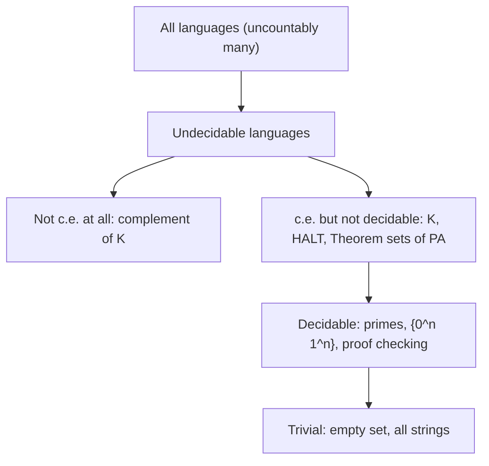
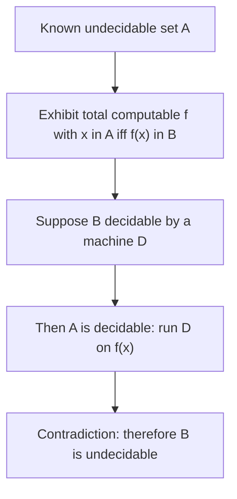
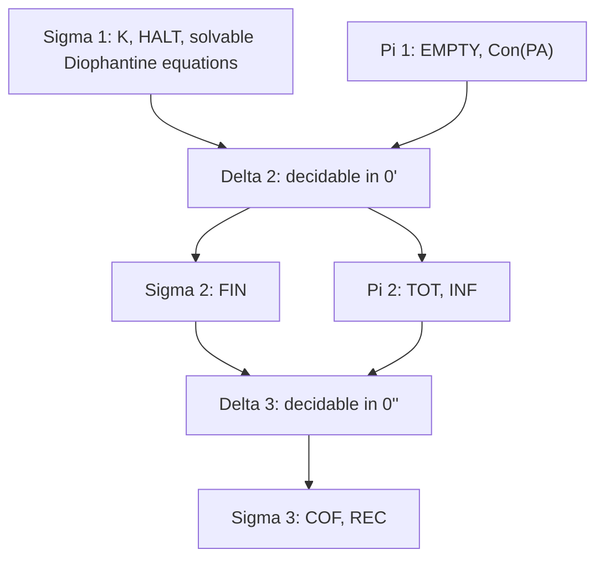

# Computability and Decidability

> [Mathematics](../../README.md) › [Advanced Topics](../README.md) · Level: Advanced · Prerequisites: [Logic](../../00-foundations/02-logic/README.md), [Set Theory](../../00-foundations/03-set-theory/README.md), [Proof Techniques](../../00-foundations/04-proof-techniques/README.md), [Mathematical Induction](../../09-discrete-mathematics/01-mathematical-induction/README.md), [Algorithms and Complexity](../../09-discrete-mathematics/03-algorithms-and-complexity/README.md), [Divisibility and Primes](../../12-number-theory/01-divisibility-and-primes/README.md), [Groups](../../13-abstract-algebra/01-groups/README.md) · Estimated time: 720 min

## 1. Introduction

In 1928 David Hilbert posed three questions about first-order logic: is it *complete* (does every valid formula have a proof), is it *consistent*, and is it *decidable* (is there a mechanical procedure that decides validity)? The third question, the **Entscheidungsproblem**, is the one that forced mathematics to say what "mechanical procedure" means. Hilbert was confident the answer to all three would be yes; his programme was to secure all of mathematics by finitistic, formal, checkable reasoning.

Three results destroyed the programme within a decade:

* Gödel (1931) proved that every consistent, effectively axiomatised theory containing elementary arithmetic has a sentence it can neither prove nor refute. Completeness of first-order logic survives — its *valid* formulas are exactly its theorems — but no single effective axiom system captures all arithmetical truth.
* Church (1936), using the λ-calculus, and Turing (1936), using a machine model he invented for the purpose, independently proved the Entscheidungsproblem undecidable.
* Turing's paper contained a second, sharper result: the **halting problem** — decide, given a program and an input, whether the program eventually stops — has no algorithmic solution. This is not a statement about logic but about computation itself.

The conceptual novelty is that these results are *theorems about algorithms* and therefore require a mathematical definition of algorithm. Before 1936 "algorithm" was an informal notion: a finite list of unambiguous instructions, obeying a recipe, executable without insight. Turing supplied a definition built from the smallest possible ingredients — a finite control, a tape, one symbol read at a time — and argued that any procedure a human could carry out mechanically can be carried out by such a machine. That argument cannot be proved, because the left-hand side is informal; it is the **Church–Turing thesis**. What *can* be proved is that every proposed formalisation since 1936 defines exactly the same class of functions: Turing machines, Church's λ-calculus, Kleene's recursive functions, register machines, Markov algorithms, cellular automata, every programming language in use. This confluence is the strongest evidence for the thesis, and it makes "computable" an absolute notion, independent of hardware, language, or era. (Contrast *complexity*: polynomial time is machine-dependent, and no such absoluteness is known or expected there.)

This chapter builds the subject in four layers.

1. **Machines and the thesis** (§7.1–§7.4): the definition of a Turing machine, the universal machine, and the evidence that the model is the right one.
2. **The halting problem and reductions** (§7.5–§7.7): a concrete undecidable set, and the technique — many-one reduction — that transfers undecidability from one problem to another, organising problems into *m-degrees*.
3. **Self-reference** (§7.8–§7.9): Kleene's recursion theorem, which says a program may legitimately refer to its own code, and Rice's theorem, which converts self-reference into a sweeping undecidability result for *semantic* properties of programs.
4. **Arithmetic and incompleteness** (§7.10–§7.14): Gödel numbering, the representability of computable functions by formulas, the two incompleteness theorems, undecidability inside ordinary mathematics (Hilbert's tenth problem, the word problem), and the arithmetical hierarchy that stratifies the sets that are *not* decidable.

Two honest remarks before starting.

*First*, there are two quite different ways to prove that undecidable problems exist. **Counting** is the cheap one: there are only countably many programs (finite strings over a finite alphabet) but uncountably many languages (subsets of $\Sigma^*$), so almost every language is undecidable. This proves existence and nothing else — it never exhibits a specific problem. **Diagonalisation** is the sharp one: it produces the halting problem explicitly and, with more work, the whole arithmetical hierarchy. Every concrete undecidability result in this chapter is proved by diagonalisation or by reduction from something proved by diagonalisation.

*Second*, "undecidable" is a statement about the *nonexistence of an algorithm*, not about truth, meaning, or difficulty. The question "does this particular program halt on this particular input" always has a definite answer. What fails is the *uniform* procedure that answers it for all pairs.

## 2. Prerequisites

**First-order logic.** The chapter uses the syntax and semantics of first-order logic constantly: formulas, sentences, free variables, structures, satisfaction $\mathbb{N} \models \sigma$, derivability $\vdash$, and the completeness theorem. Section §7.10 onward is written entirely in the language of arithmetic. See [Logic](../../00-foundations/02-logic/README.md).

**Sets, functions and countability.** A language is a subset of $\Sigma^*$; a decision problem *is* a language; the counting argument needs the countability of finite strings and Cantor's theorem that $\mathcal{P}(\mathbb{N})$ is uncountable; the diagonal argument used for the halting problem is the same diagonal argument that proves $\lvert \mathbb{R}\rvert > \lvert \mathbb{N} \rvert$. See [Set Theory](../../00-foundations/03-set-theory/README.md) and [Relations and Functions](../../00-foundations/05-relations-and-functions/README.md).

**Proof technique.** Almost every proof here is either a proof by contradiction from a hypothetical decision procedure or an induction on the length of a computation. Being able to negate a quantified statement correctly — $\neg\forall x\exists y\,P$ is $\exists x\forall y\,\neg P$ — is used in every "the complement is not c.e." argument. See [Proof Techniques](../../00-foundations/04-proof-techniques/README.md).

**Induction and recursion.** Definitions by primitive recursion, proofs by induction on the number of steps of a computation, and the equivalence between "definable by recursion" and "computable" (used in §7.10) all rest on this. See [Mathematical Induction](../../09-discrete-mathematics/01-mathematical-induction/README.md).

**Algorithms and their cost.** The informal notion of an algorithm, the idea of a simulation, and big-O notation (for the overhead of simulating one machine model by another) are assumed. See [Algorithms and Complexity](../../09-discrete-mathematics/03-algorithms-and-complexity/README.md).

**Elementary number theory.** Primes, divisibility, congruences, the Chinese remainder theorem and Diophantine equations appear in the Gödel numbering (§7.10) and in Hilbert's tenth problem (§7.13). See [Divisibility and Primes](../../12-number-theory/01-divisibility-and-primes/README.md) and [Diophantine Equations](../../12-number-theory/04-diophantine-equations/README.md).

**A little group theory.** Only for §7.13: a finitely presented group is a quotient of a free group by the normal closure of finitely many relators, and the word problem asks whether a word lies in that normal closure. See [Groups](../../13-abstract-algebra/01-groups/README.md).

## 3. Learning Objectives

By the end of this chapter you will be able to:

1. Write down a Turing machine as a finite object (states, alphabet, transition function), trace its computation on a concrete input, and prove that it decides a stated language.
2. Explain why multi-tape machines, two-way infinite tapes, larger alphabets and nondeterminism do not change the class of decidable languages, and estimate the cost of the simulation.
3. State the Church–Turing thesis, distinguish it from a theorem, and list the evidence for it.
4. Prove that the halting problem is undecidable, and prove that its complement is not even semi-decidable.
5. Define many-one reduction, prove that both $\le_m$ and $\le_T$ are transitive and that $\le_m$ implies $\le_T$, and construct explicit reductions between given problems.
6. Prove Kleene's second recursion theorem and use it to build self-referential programs.
7. Prove Rice's theorem and use it to decide quickly whether a given index set is undecidable; recognise the cases where Rice's theorem does *not* apply.
8. Explain Gödel numbering, state the representability theorem and the diagonal lemma, and give the proof sketch of the first incompleteness theorem.
9. State the second incompleteness theorem precisely, explain the derivability conditions, and explain why it rules out a finitistic consistency proof of arithmetic.
10. State Hilbert's tenth problem and the Novikov–Boone theorem, and explain what each says about algorithms in ordinary mathematics.
11. Place a given set in the arithmetical hierarchy, state Post's theorem, and explain why the hierarchy does not collapse.

## 4. Intuition

### 4.1 Programs are strings; problems are sets

Fix a finite alphabet, say $\{0,1\}$. Every program in every reasonable language can be written as a finite string over a finite alphabet, and every such string can be encoded as a finite sequence of bits. So there are only countably many programs: list them as $P_0, P_1, P_2, \dots$ in some fixed, algorithmic order.

A decision problem, on the other hand, is an arbitrary set of strings: "is this number prime", "is this graph connected", "does this program halt". There are uncountably many such sets. So the programs are a countable subfamily of an uncountable family, and **almost every decision problem has no program that solves it**. This is a perfectly good existence proof, but it is useless as a construction: it does not tell you a single undecidable problem, and it gives no handle on *why* particular problems resist.

The remedy is to make the counting argument *effective*: instead of comparing two cardinalities, build the diagonal. Enumerate all programs, ask each one a question about itself, and construct a new program whose behaviour is the negation of the answer it "should" give. That is exactly the proof of the halting theorem.

### 4.2 The universal machine

The single most surprising fact in the theory is that one machine can run all machines. A **universal** Turing machine takes as input a description of a machine $M$ together with an input $w$, and simulates $M$ on $w$. Nothing in the definition forbids this: the description of $M$ is just another string of symbols on the tape, and the simulation is a bookkeeping exercise (keep $M$'s tape on the universal machine's tape, keep $M$'s state in the universal machine's finite control, consult the description whenever a transition is needed).

Universality is what makes software possible: a fixed piece of hardware executes arbitrary programs. It is also what makes self-reference possible: a program can be handed its own description, because its own description is a string like any other. Every deep result in this chapter uses universality somewhere.

### 4.3 The contrarian program

Here is the halting problem in one paragraph. Suppose a perfect analyser $H$ exists: given a program $P$ and an input $x$, it prints "halts" or "loops" and is never wrong. Build a new program $C$ that takes a program $P$ as input, calls $H$ on the pair $(P, \text{the code of } P)$, and then deliberately does the opposite: if $H$ says "$P$ halts on its own code", then $C$ loops forever; if $H$ says "$P$ loops on its own code", then $C$ halts immediately. Now run $C$ on its own code. $C$ halts on $C$'s code exactly when $H$ says $C$ loops on $C$'s code, exactly when $C$ does not halt on $C$'s code. Both answers are self-contradictory, so $H$ cannot exist.

Two features of the argument deserve to be isolated, because they recur in every variant.

* The contradiction is **internal**: no external fact about the world is used, only the behaviour of the hypothetical decision procedure applied to a program built from it.
* The construction of $C$ from $H$ must be **effective**: given the code of $H$, we can mechanically write the code of $C$. This is not a technicality; it is the reason the theorem is about algorithms rather than about abstract functions. §7.8 makes the point precise: an effective construction of programs from programs is exactly what the recursion theorem formalises.

### 4.4 Why "unprovable" is not "false"

The incompleteness theorem is often paraphrased as "there are true statements that cannot be proved", which is correct but invites a confusion: it suggests that provability is a mysterious, non-mathematical notion. It is not. Fix a formal system $T$ whose axioms are given by an algorithm (so that a computer can check whether a string is an axiom) and whose rules of inference are mechanical. Then:

* the set of theorems of $T$ is **semi-decidable** — enumerate strings, check each for being a proof, output the conclusion of the ones that are;
* "$\sigma$ is provable in $T$" is therefore a statement of the form "there exists a finite object with a computable property", i.e. a $\Sigma_1$ statement;
* being $\Sigma_1$, it can be *represented inside arithmetic* by a formula $\operatorname{Prov}_T(x)$.

Now apply the diagonal trick *inside the language*: build a sentence $G$ that says "I am not provable in $T$". If $T$ proves $G$, then $T$ proves a false $\Sigma_1$ statement, which cannot happen if $T$'s axioms are true; so $T$ does not prove $G$. But that very argument shows $G$ is *true*, so $T$'s axioms do not capture all truth.

The difference from the liar paradox ("this sentence is false", which has no truth value) is that **provability is a concrete relation between finite objects**, whereas truth is not. That is the whole content of §7.10–§7.11, and it is why incompleteness is a theorem rather than a paradox.

### 4.5 Two analogies, and their limits

* *The perfect antivirus.* A program that decides, for every program, whether it ever performs a malicious action would be a decision procedure for a nontrivial semantic property; Rice's theorem (§7.9) says no such program exists. Real antivirus software is therefore necessarily incomplete (it misses things) or unsound (it flags innocent programs), and the engineering question is which failure to accept.
* *The self-checking compiler.* A compiler that detects, for every input program, whether it will loop would decide the halting problem. What compilers do instead is prove the *absence* of certain loop patterns (bounded loops, structural recursion); the analyses are sound but deliberately incomplete.

The limit of both analogies: undecidability is not a statement about engineering effort. No amount of cleverness, hardware, or time converts an undecidable problem into a decidable one. It converts *decidable* problems that are merely expensive (exponential-time) into feasible ones, and that is a different phenomenon (see §11).

## 5. Formal Definitions

### 5.1 Alphabets, strings and languages

**Definition 5.1** (Alphabet, string, language). An *alphabet* $\Sigma$ is a finite nonempty set whose elements are called *symbols*. A *string* over $\Sigma$ is a finite sequence of symbols; $\Sigma^*$ is the set of all strings, $\varepsilon$ is the empty string, and $\lvert w\rvert$ is the length of $w$. A *language* over $\Sigma$ is a subset $L \subseteq \Sigma^*$. For $n \in \mathbb{N}_0$ we write $\Sigma^n = \{w \in \Sigma^* : \lvert w\rvert = n\}$ and $\Sigma^{\le n} = \bigcup_{k \le n}\Sigma^k$ (both finite).

We work with $\Sigma = \{0,1\}$ whenever a concrete alphabet is needed. Every finite alphabet can be encoded in binary by a fixed-length code, and every finite object of the subject — a machine, a proof, a graph, a polynomial with integer coefficients — can be encoded as a string, so a "problem" and a "language" are the same thing.

**Definition 5.2** (Decision problem). A *decision problem* is a language $L \subseteq \Sigma^*$; the answer on input $w$ is "yes" if $w \in L$ and "no" otherwise. A *function problem* is a partial function $f : \Sigma^* \rightharpoonup \Sigma^*$; the answer on input $w$ is the value $f(w)$ when it is defined.

A language is *trivial* if it is $\varnothing$ or $\Sigma^*$; every other language is *nontrivial*. Trivial languages are decidable by the machines that reject everything and accept everything.

**Notation for encodings.** $\langle x \rangle$ denotes the encoding of an object $x$ as a string. For a pair we write $\langle x, y\rangle$, and we fix once and for all a computable bijection $\Sigma^* \times \Sigma^* \to \Sigma^*$ with computable inverse (obtained, for example, from the Cantor pairing function on $\mathbb{N}_0$). The choice of encoding never matters: any two reasonable encodings are related by computable translations in both directions, so decidability is encoding-invariant.

### 5.2 Turing machines

**Definition 5.3** (Turing machine). A *Turing machine* is a tuple
$$M = (Q,\ \Sigma,\ \Gamma,\ \delta,\ q_0,\ q_{\mathrm{acc}},\ q_{\mathrm{rej}})$$
with the following data.

* $Q$ is a finite set of *states*; $\Sigma$ is the finite *input alphabet*; $\Gamma$ is the finite *tape alphabet* with $\Sigma \subseteq \Gamma$; the *blank* symbol $\sqcup$ satisfies $\sqcup \in \Gamma \setminus \Sigma$.
* $q_0 \in Q$ is the *start state*; $q_{\mathrm{acc}}, q_{\mathrm{rej}} \in Q$ are distinct *halting states*; write $Q_{\mathrm{halt}} = \{q_{\mathrm{acc}}, q_{\mathrm{rej}}\}$ and $Q_{\mathrm{run}} = Q \setminus Q_{\mathrm{halt}}$.
* The *transition function* is a total map
$$\delta : Q_{\mathrm{run}} \times \Gamma \longrightarrow Q \times \Gamma \times \{L, R\}.$$

The machine has one tape, unbounded to the right, divided into cells; the tape is blank except for finitely many cells. At any moment the machine is in a state $p \in Q$ and its *head* scans one cell. If the scanned symbol is $a$ and $\delta(p,a) = (q, b, D)$, the machine writes $b$ into the scanned cell, moves the head one cell left or right according to $D$, and enters state $q$. If $q \in Q_{\mathrm{halt}}$ the machine *halts* immediately and the last move is not performed.

A machine is *deterministic* by definition here: $\delta$ is a function. Nondeterministic machines, machines with several tapes, and machines whose tape is infinite in both directions are discussed in §7.3, where they are shown not to enlarge the class of decidable languages.

**Definition 5.4** (Configuration and computation). A *configuration* is a string $u\,q\,a\,v$ with $u, v \in \Gamma^*$, $q \in Q$ and $a \in \Gamma$: the tape holds $uav$ (followed by blanks), the head scans the symbol $a$, and the state is $q$. For $q \in Q_{\mathrm{halt}}$ the configuration is *halting*.

The *one-step relation* $\vdash_M$ on configurations is defined as follows, where $b, D$ and $q$ come from $\delta(p, a)$.

* If $D = R$ and $v = c v'$ with $c \in \Gamma$, then $u\,p\,a\,c\,v' \vdash_M u\,b\,q\,c\,v'$ — the machine writes $b$ in place of $a$, and the head moves right onto $c$.
* If $D = R$ and $v = \varepsilon$, the head moves right onto a blank: $u\,p\,a \vdash_M u\,b\,q\,\sqcup$.
* If $D = L$ and $u = u' c$ with $c \in \Gamma$, then $u' c\, p\, a\, v \vdash_M u'\, q\, c\, b\,v$ — the machine writes $b$ in place of $a$, and the head moves left onto $c$.
* If $D = L$ and $u = \varepsilon$, the head moves left onto a blank: $p\,a\,v \vdash_M q\,\sqcup\,b\,v$.

In each clause the machine writes $b$ in place of $a$ before moving. A *computation* is a (possibly infinite) sequence $C_0 \vdash_M C_1 \vdash_M \cdots$, and $\vdash_M^{*}$ is the reflexive-transitive closure of $\vdash_M$.

**Definition 5.5** (Halting and output). The *initial configuration on input* $w = a_1 \cdots a_n \in \Sigma^*$ is $q_0 a_1 \cdots a_n$. We write $M(w)\!\downarrow$ if the computation from $q_0 w$ reaches a halting configuration, and $M(w)\!\uparrow$ otherwise; in the latter case $M$ *loops* or *diverges* on $w$. Since $Q_{\mathrm{run}} \times \Gamma$ is finite and $\delta$ is total, exactly one of the two alternatives occurs: the computation is finite and ends in $q_{\mathrm{acc}}$ or $q_{\mathrm{rej}}$, or it is infinite.

If $M(w)\!\downarrow$, the *output* $M(w) \in \Sigma^*$ is the longest prefix of the final tape content that lies in $\Sigma^*$; that is, the machine's answer is the block of symbols up to the first blank or non-input symbol. The *language of* $M$ is the set of inputs it accepts:
$$L(M) = \{\, w \in \Sigma^* : M(w)\!\downarrow \text{ and the halting state is } q_{\mathrm{acc}} \,\}.$$

**Definition 5.6** (Deciding and recognising). Let $L \subseteq \Sigma^*$.

* $M$ *decides* $L$ if $M$ halts on every $w \in \Sigma^*$ and $w \in L \iff M(w)$ ends in $q_{\mathrm{acc}}$. Equivalently $M$ computes the total function $\Sigma^* \to \{0,1\}$ that is the characteristic function of $L$.
* $M$ *recognises* $L$ if for every $w$, $M$ accepts $w$ iff $w \in L$; on inputs outside $L$ the machine may reject or loop. Equivalently $L = \operatorname{dom}(\text{the partial function computed by } M)$.

**Definition 5.7** (Computable function). A partial function $f : \Sigma^* \rightharpoonup \Sigma^*$ is *computable* if some Turing machine $M$ satisfies: for all $w$, $M(w)\!\downarrow$ iff $f(w)$ is defined, and then $M(w) = f(w)$. The function is *total computable* if in addition $\operatorname{dom} f = \Sigma^*$. A set $A$ is *computable* (or *decidable*) if its characteristic function $\chi_A$ is total computable.

### 5.3 Indices and the standard enumeration

Fix an effective enumeration $M_0, M_1, M_2, \dots$ of all Turing machines, obtained by listing all strings over $\{0,1\}$ in order of length and then lexicographically, and interpreting the $e$-th string as a machine if it is a well-formed description (otherwise $M_e$ is a fixed machine that halts immediately and rejects everything).

**Definition 5.8** (Index, $\varphi_e$, $W_e$). The number $e$ is an *index* of $M_e$. Put
$$\varphi_e := \text{the partial function computed by } M_e, \qquad W_e := \operatorname{dom}\varphi_e = L(M_e).$$
The sequence $\varphi_0, \varphi_1, \dots$ is the *standard enumeration* of the partial computable functions, and $W_0, W_1, \dots$ is the standard enumeration of the c.e. sets. A function may have infinitely many indices (Lemma 7.7), so "$\varphi_e$" is a name for a function, not a canonical one.

### 5.4 Decidable and semi-decidable sets

**Definition 5.9** (Decidable, semi-decidable). A set $A \subseteq \Sigma^*$ is *decidable* if $\chi_A$ is total computable. It is *semi-decidable*, or *computably enumerable* (c.e.), if $A = \varnothing$ or $A$ is the range of a total computable function $\Sigma^* \to \Sigma^*$; equivalently (Theorem 7.8) if $A = W_e$ for some $e$.

The three descriptions of c.e. sets — domain of a partial computable function, range of a total computable function, and language recognised by a machine — agree; the proof of the equivalence is the dovetailing argument in Theorem 7.8. The word "enumerable" is the operative one: a c.e. set is one whose elements can be *listed*, but the listing need not be in increasing order and membership of a non-member may never be settled.

### 5.5 Reductions

**Definition 5.10** (Many-one reduction). Let $A, B \subseteq \Sigma^*$. Then $A$ *many-one reduces* to $B$, written $A \le_m B$, if there is a total computable $f : \Sigma^* \to \Sigma^*$ with
$$w \in A \iff f(w) \in B \qquad \text{for all } w \in \Sigma^*.$$
Such an $f$ is a *many-one reduction* of $A$ to $B$.

**Definition 5.11** (Turing reduction). $A$ *Turing reduces* to $B$, written $A \le_T B$, if there is a Turing machine with an *oracle* for $B$ — a machine allowed to ask, in one step, whether any string lies in $B$ — that decides $A$.

**Definition 5.12** (m-equivalence, m-completeness, m-degree). $A \equiv_m B$ means $A \le_m B$ and $B \le_m A$. The *m-degree* of $A$ is its equivalence class under $\equiv_m$. If $\mathcal{C}$ is a class of sets, then $A$ is *m-complete for* $\mathcal{C}$ if $A \in \mathcal{C}$ and $B \le_m A$ for every $B \in \mathcal{C}$.

### 5.6 The arithmetical hierarchy

**Definition 5.13** ($\Sigma^0_n$, $\Pi^0_n$, $\Delta^0_n$). Let $A \subseteq \mathbb{N}$. Then:

* $A \in \Sigma^0_0 = \Pi^0_0 = \Delta^0_0$ iff $A$ is computable;
* $A \in \Sigma^0_{n+1}$ iff there is $B \in \Pi^0_n$ and a computable $f$ with $x \in A \iff \exists y\, (x,y) \in B$, i.e. $A$ is the projection of a $\Pi^0_n$ set;
* $A \in \Pi^0_{n+1}$ iff $\mathbb{N} \setminus A \in \Sigma^0_{n+1}$;
* $\Delta^0_{n} = \Sigma^0_n \cap \Pi^0_n$.

Equivalently, $A \in \Sigma^0_n$ iff $A$ is definable in $(\mathbb{N}, +, \cdot, <, 0, 1)$ by a formula in prenex form with $n$ alternating quantifier blocks, beginning with $\exists$ (see §7.14 for this equivalence and for the standard complete sets).

## 6. Mathematical Notation

| Symbol | Read as | Meaning |
|---|---|---|
| $\Sigma$, $\Sigma^{*}$ | sigma, sigma star | finite alphabet; all finite strings over it |
| $\varepsilon$ | epsilon | the empty string, $\lvert\varepsilon\rvert = 0$ |
| $\Gamma$, $\sqcup$ | gamma, square | tape alphabet; the blank symbol |
| $Q$, $q_0$, $q_{\mathrm{acc}}$, $q_{\mathrm{rej}}$ | cue, cue zero, cue accept, cue reject | states; start; accepting; rejecting |
| $\delta(p,a) = (q,b,D)$ | delta of $p$ and $a$ | in state $p$ reading $a$: write $b$, go to $q$, move $D$ |
| $u\,q\,a\,v$ | the configuration $u q a v$ | tape $uav$, head on $a$, state $q$ |
| $C \vdash_M C'$ | $C$ yields $C'$ in one step | one-step relation of $M$ |
| $\vdash_M^{*}$ | yields in finitely many steps | reflexive-transitive closure |
| $M(w)\!\downarrow$ | $M$ halts on $w$ | the computation from $q_0w$ reaches a halting state |
| $M(w)\!\uparrow$ | $M$ loops on $w$ | the computation from $q_0w$ is infinite |
| $L(M)$ | the language of $M$ | the set of strings $M$ accepts |
| $\langle x \rangle$, $\langle x,y\rangle$ | code of $x$ | a fixed effective encoding into $\Sigma^{*}$ |
| $\varphi_e$ | phi sub $e$ | the $e$-th partial computable function |
| $W_e$ | $W$ sub $e$ | $\operatorname{dom}\varphi_e$, the $e$-th c.e. set |
| $K$ | $K$ | $\{e : \varphi_e(e)\!\downarrow\}$, the halting set |
| $\mathrm{HALT}$ | halt | $\{\langle e, w\rangle : \varphi_e(w)\!\downarrow\}$ |
| $A \le_m B$ | $A$ many-one reduces to $B$ | a computable $f$ with $w \in A \iff f(w) \in B$ |
| $A \le_T B$ | $A$ Turing reduces to $B$ | $A$ is decidable relative to an oracle for $B$ |
| $A \equiv_m B$ | $A$ is m-equivalent to $B$ | $A \le_m B$ and $B \le_m A$ |
| $\mathbf{0}$, $\mathbf{0}'$ | zero, zero prime | degree of the computable sets; degree of $K$ |
| $\emptyset^{(n)}$ | the $n$-th jump | $K$ iterated $n$ times; $\Sigma^0_n$-complete |
| $\ulcorner\sigma\urcorner$ | corner code of $\sigma$ | the Gödel number of the formula $\sigma$ |
| $\vdash_T \sigma$ | $T$ proves $\sigma$ | $\sigma$ is derivable from the axioms of $T$ |
| $\mathbb{N} \models \sigma$ | $\mathbb{N}$ satisfies $\sigma$ | $\sigma$ is true in the standard model |
| $\operatorname{Prov}_T(x)$ | provability in $T$ | the $\Sigma_1$ formula "some proof codes a theorem with code $x$" |
| $\operatorname{Con}(T)$ | consistency of $T$ | $\neg\operatorname{Prov}_T(\ulcorner 0 = 1\urcorner)$ |
| $\Sigma^0_n$, $\Pi^0_n$, $\Delta^0_n$ | sigma nought $n$ | levels of the arithmetical hierarchy |
| $Q$, $\mathrm{PA}$ | cue, pee-ay | Robinson arithmetic; Peano arithmetic |
| $\operatorname{Th}(\mathbb{N})$ | the theory of $\mathbb{N}$ | all sentences true in the standard model |

Typographic points that matter in this chapter.

* $\varphi_e$ is a *partial function*, so $\varphi_e(x) = 0$ and $\varphi_e(x) \ne 0$ may both fail; there is no "third value", rather the value may not exist. When a statement says "$\varphi_e(x) = 0$" it implicitly asserts convergence.
* $W_e$ and $\varphi_e$ carry the same index but different information: $\varphi_e$ determines $W_e$, and conversely $W_e$ determines $\varphi_e$ (because $\varphi_e$ is computed relative to a decoding of indices). Nevertheless $W_e$ is often the more convenient object, since sets are easier to compare than functions.
* The arrow in $A \le_m B$ points from the problem being reduced *to* the problem used as a tool. If $A \le_m B$ and $B$ is decidable, then $A$ is decidable; equivalently, if $A$ is undecidable and $A \le_m B$, then $B$ is undecidable. Remembering this implication removes most errors about direction.

## 7. Core Concepts

### 7.1 Algorithms and effective procedures

An **effective procedure** — an algorithm — is a finite list of instructions with four properties:

1. it is described in finitely many symbols;
2. it operates in discrete steps, each step being a definite, mechanical operation;
3. it may use unbounded storage (paper, tape, memory) but needs no insight, guessing, or judgement at any step;
4. when applied to an input for which the procedure is supposed to produce an answer, it halts and outputs that answer.

Every formalisation of computation in the twentieth century was an attempt to replace conditions 2 and 3 by a mathematical object. Turing's insight in 1936 was to model the *human* executing the procedure: a person working with paper and pencil has (i) a bounded amount of attention, modelled by finitely many states of mind; (ii) a finite collection of distinguishable symbols; (iii) a potentially unlimited supply of paper, modelled by an unbounded tape; and (iv) a fixed rule deciding the next action from the current state of mind and the symbol being looked at. Those four assumptions are exactly Definition 5.3.

The *reason* a precise definition is needed is not pedantry. To prove that a problem has **no** algorithmic solution, one must quantify over all algorithms, and one cannot quantify over an informal notion. Before 1936 the sentence "there is no algorithm for $X$" was not a mathematical statement at all; after 1936 it became one, and the price is that it is a statement about Turing machines rather than about algorithms in the informal sense. The Church–Turing thesis (§7.3) is the bridge between the two.

### 7.2 Turing machines at work

The definition is minimal, but programming is possible. Three conventions make machines readable.

* The input $w = a_1\cdots a_n$ is written in the leftmost $n$ cells, the head scans $a_1$, all other cells are blank, and the state is $q_0$. If $n = 0$ the head scans a blank.
* A machine may use a *marked* copy of the input: replace $a$ by a new symbol $\hat a \in \Gamma \setminus \Sigma$ to record "this symbol has been processed". This is how most small machines avoid counting.
* States are named by their purpose (`scan right`, `return left`, `check`) rather than by number; a machine specification of a few dozen states is written as a table of transitions, exactly as in Definition 5.3.

The resource that the model does *not* restrict is time: a computation may be arbitrarily long, and it may be infinite. The resource that it *does* restrict is memory access: one symbol at a time, one cell at a time. Everything surprising about the subject comes from that combination: unbounded time with local access.

*Example of the style.* The language $L = \{0^n 1^n : n \ge 1\}$ is decided by the following strategy: sweep right to the first $1$; if none, reject. Sweep left to the first unmarked $0$; mark it. Sweep right to the first unmarked $1$; mark it. Return to the left end. If the numbers of marked $0$s and $1$s ever disagree at the end of a sweep, reject; when all symbols are marked, accept. The machine halts on every input because every pass either marks two symbols or detects an error, and there are only finitely many symbols. The full transition table and a trace are in Example 9.1.

Two facts about the model deserve emphasis.

* The tape alphabet can be reduced to $\Gamma = \{0, 1, \sqcup\}$ at the cost of encoding: each symbol of the original alphabet becomes a block of fixed length over $\{0,1,\sqcup\}$. The class of decidable languages is unchanged; only the running time changes by a constant factor.
* The tape is infinite to the right, but this is not a real restriction. A machine with a two-way infinite tape is simulated by a machine with a one-way tape that folds the left half into a second "track" using an expanded alphabet, at the cost of a constant factor.

### 7.3 The Church–Turing thesis and equivalent models

**Thesis 7.1** (Church–Turing). A partial function $f : \Sigma^* \rightharpoonup \Sigma^*$ is computable by an effective procedure if and only if it is computable by a Turing machine (Definition 5.7).

The thesis is not a theorem and cannot be: its left-hand side quantifies over an informal notion. It is a statement of *identification*, and its evidence is of three kinds.

**Concordance of independent formalisations.** Between 1931 and 1936, Gödel and Herbrand defined the recursive functions, Church and Kleene the λ-definable functions, Turing the machine-computable functions, Post a similar machine model. Each was designed from a different intuition. All define the same class.

**Robustness of the model.** Every natural modification of the definition leaves the class of computable functions unchanged: more tapes, more heads, two-way tapes, larger alphabets, random access, nondeterminism, parallel steps, and any programming language with unbounded integers and recursion. Theorem 7.2 records the simulations; each is elementary, and none is delicate.

**Physical realizability.** Every computing device ever built, and every device permitted by known physics with finite control and unbounded storage, computes a Turing-computable function. There is no experiment, and no proposed experiment, whose outcome would distinguish "computable by a machine" from "computable by a Turing machine".

*The* ***physical*** *Church–Turing thesis* is the stronger claim that every physically realisable computation is Turing-computable. It is a claim about physics and could in principle be refuted by a device; no such device is known.

**Theorem 7.2** (Robustness of the model). Each of the following machines computes exactly the same class of partial functions as the Turing machines of Definition 5.3.

1. Machines with $k \ge 1$ tapes, each with its own head.
2. Machines whose tape is infinite in both directions.
3. Machines whose tape alphabet is any finite set containing a blank.
4. Nondeterministic machines: machines whose transition relation allows several possible moves from a configuration.

*Why it is true.* For (1), keep the $k$ tapes in $k$ tracks on a single tape, with a marker for each head position; one simulated step costs $O(k)$ sweeps, and a computation of $t$ steps is simulated in $O(t^2)$ steps. For (2), fold the left half of the tape onto a second track, or shift the input right by a marker symbol. For (3), encode each symbol in binary, or in unary with separators. For (4), simulate the nondeterministic machine by a breadth-first search over the tree of configurations; if the machine halts on every branch, the search terminates, and it finds an accepting branch exactly when one exists. The price is exponential time, which does not affect decidability. $\square$

**Theorem 7.3** (Equivalence of models). The following classes of partial functions $\mathbb{N}^k \rightharpoonup \mathbb{N}$ coincide: Turing-computable; λ-definable; partial recursive (built from zero, successor and projections by composition, primitive recursion and minimisation); computable by a register machine (a finite program over finitely many registers with instructions $x \mathrel{+}= 1$, $x \mathrel{-}= 1$, and jump-if-zero); computable by a while-program; computable by any Turing-complete programming language.

*Why it is true.* Each model is simulated by each other. The only non-obvious step is that primitive recursion and minimisation are Turing-computable, which is a programming exercise (a stack on the tape implements recursion; an unbounded search implements minimisation). $\square$

Because of Theorems 7.2 and 7.3 one may prove a function computable by exhibiting a program in any language, and prove it non-computable only by an argument that refers to *no* model in particular. That is the methodological content of the thesis.

**Remark 7.4** (What the thesis does and does not license). The thesis licenses reading "Turing machine" as "algorithm" in *negative* results: "no Turing machine decides $L$" becomes "no algorithm decides $L$". It does not license any claim about *efficiency*: a problem may be decidable yet require more than the lifetime of the universe, and "undecidable" says nothing about difficulty beyond the impossibility of a uniform exact procedure.

### 7.4 Universal machines, enumeration and the s-m-n theorem

**Theorem 7.5** (Universal machine). There is a Turing machine $\mathcal{U}$, the *universal machine*, such that for all $e$ and $w$,
$$\mathcal{U}(\langle e, w\rangle) \downarrow \iff \varphi_e(w)\downarrow, \qquad \text{and then } \mathcal{U}(\langle e,w\rangle) = \varphi_e(w).$$
Moreover $\mathcal{U}$ simulates $t$ steps of $M_e$ in $O(t^2)$ steps.

*Proof.* On input $\langle e, w\rangle$ the machine decodes $e$ into the transition table of $M_e$, writes $w$ on a segment of its tape marked as the *simulated tape*, records the simulated state and head position in its finite control (as one of $\lvert Q\rvert$ markers), and then repeatedly looks up the transition $\delta(p,a)$ in the table on its own tape, updates the simulated tape and the markers, and continues. The simulated tape is finite at every stage (only $t+1$ cells can have been visited after $t$ steps), so all bookkeeping fits on the tape. Each simulated step costs $O(t)$ steps of $\mathcal{U}$ because $\mathcal{U}$ must sweep between the description, the simulated head and the simulated state; hence $O(t^2)$ in total. $\blacksquare$

The universal machine is the formal counterpart of "software": a fixed machine executing arbitrary programs. It is also the reason the halting set is c.e.

**Theorem 7.6** (s-m-n theorem, parameter theorem). For every partial computable $\psi : \mathbb{N}^2 \rightharpoonup \mathbb{N}$ there is a total computable $s : \mathbb{N} \to \mathbb{N}$ such that
$$\varphi_{s(x)}(y) = \psi(x, y) \qquad \text{for all } x, y.$$
More generally, for every partial computable $\psi(\vec x, \vec y)$ there are total computable functions $s^m_n$ with $\varphi_{s^m_n(e,\vec a)}(\vec y) = \varphi_e^{(m+n)}(\vec a, \vec y)$.

*Proof.* Given a program $P$ for $\psi$ and a value $x$, construct a program $P_x$ that writes the constant $x$ into a reserved block of the tape and then runs $P$. The construction is uniform and mechanical, so the map $x \mapsto \langle P_x\rangle$ is total computable. $\blacksquare$

**Lemma 7.7** (Padding lemma). For every $e$ there are infinitely many $e'$ with $\varphi_{e'} = \varphi_e$. Moreover the set $\{\langle e, e'\rangle : \varphi_{e'} = \varphi_e\}$ is c.e., and there is a total computable injective $p$ with $\varphi_{p(e,n)} = \varphi_e$ for all $n$.

*Proof.* Add $n$ dummy instructions at the start of $M_e$'s program that change nothing: for example, insert $n$ steps that move right and then left again, using a fresh state. Distinct $n$ give distinct programs, hence distinct indices, and all compute $\varphi_e$. $\blacksquare$

Lemma 7.7 isolates the central gap of the subject: **indices are syntax, functions are semantics**, and the map $e \mapsto \varphi_e$ is very far from injective. Rice's theorem (§7.9) says that no nontrivial question about the *function* $\varphi_e$ can be decided from $e$; questions about the *program* $M_e$ (its length, its number of states, its first instruction) frequently can.

### 7.5 Decidable and semi-decidable sets

**Theorem 7.8** (Closure properties). Let $A, B \subseteq \Sigma^*$.

1. If $A$ and $B$ are decidable, then so are $A \cup B$, $A \cap B$, $A \setminus B$, $\overline A$, and $f^{-1}[B]$ for every total computable $f$.
2. If $A$ and $B$ are c.e., then so are $A \cup B$, $A \cap B$, and $f^{-1}[B]$.
3. Every decidable set is c.e.
4. A set $A$ is decidable if and only if $A$ and $\overline A$ are both c.e.

*Proof.* (1) is immediate from the closure of total computable functions under boolean operations: run the deciding machines and combine the answers.

(2) For $A \cup B$: run the recognisers for $A$ and $B$ in parallel (dovetail their steps) and accept when either accepts. Sequential running fails, because the first recogniser may loop on an input that belongs to $B$. For $A \cap B$: run the recognisers sequentially and accept when both accept. For $f^{-1}[B]$: compute $f(w)$ and run the recogniser for $B$.

(3) A decider for $A$ is a recogniser.

(4) If $A$ is decidable then $\overline A$ is decidable (part 1), hence both are c.e. (part 3). Conversely, let $M_A$ and $M_{\overline A}$ recognise $A$ and $\overline A$. To decide $w$, dovetail the computations of $M_A(w)$ and $M_{\overline A}(w)$. Since $w$ lies in exactly one of the two sets, one of the computations accepts after finitely many steps, and the dovetailing reaches that step in finitely many steps. Accept if $M_A$ accepted, reject otherwise. $\blacksquare$

The three descriptions of c.e. sets in Definition 5.9 coincide by Theorem 7.8: a set is the domain of a partial computable function iff it is recognised by a machine; and it is the range of a total computable function iff it is recognised by a machine, by dovetailing over all inputs and all numbers of steps.

**Corollary 7.9.** If $A$ is c.e. and not decidable, then $\overline A$ is not c.e.

**Table of examples.**

| Set | Decidable? | c.e.? | Reason |
|---|---|---|---|
| $\{w : \lvert w\rvert \text{ is prime}\}$ | yes | yes | elementary arithmetic |
| $\{\langle p, n\rangle : p \text{ is a proof of } n \text{ in PA}\}$ | yes | yes | proof checking is mechanical |
| theorems of PA | no | yes | enumerate proofs (§7.11) |
| $K = \{e : \varphi_e(e)\!\downarrow\}$ | no | yes | Theorems 7.11, 7.12 |
| $\overline K$ | no | no | Corollary 7.13 |
| $\{\langle P\rangle : P \text{ has an integer root}\}$ | no | yes | MRDP, §7.13 |
| Presburger arithmetic (truth of $(\mathbb{N},+,<)$) | yes | yes | Presburger's theorem |
| $\operatorname{Th}(\mathbb{N},+,\cdot)$ | no | no | Corollary 7.38 |

### 7.6 The halting problem

**Definition 7.10** (Halting sets). The *halting set* and the *halting problem* are
$$K = \{\, e \in \mathbb{N} : \varphi_e(e)\!\downarrow\,\}, \qquad \mathrm{HALT} = \{\, \langle e, w\rangle : \varphi_e(w)\!\downarrow\,\}.$$
$K$ is the set of machines that halt on their own index; $\mathrm{HALT}$ is the set of machine–input pairs that halt.

**Theorem 7.11.** $K$ is c.e.

*Proof.* By Theorem 7.5, the universal machine $\mathcal{U}$ on input $\langle e, e\rangle$ halts exactly when $\varphi_e(e)\downarrow$ and accepts exactly then. Hence $\mathcal{U}$ recognises $K$, so $K$ is c.e. (Definition 5.9). $\blacksquare$

**Theorem 7.12** (Undecidability of the halting problem). $K$ is not decidable.

*Proof.* Suppose, for contradiction, that $D$ is a Turing machine deciding $K$: for every $n$, $D(n)$ halts, accepting if $n \in K$ and rejecting otherwise. We construct a machine $C$ with the opposite behaviour on its own code.

*Construction of $C$.* On input $x$, the machine $C$ first runs $D$ on $x$ (this terminates by hypothesis on $D$). If $D$ accepts, $C$ enters a loop that never terminates; if $D$ rejects, $C$ halts immediately and accepts. The description of $C$ is obtained mechanically from the description of $D$ — one writes the finitely many states implementing the loop — so $C$ is a Turing machine with some index $c$.

*The contradiction.* Compare $C$'s behaviour on its own index $c$ with $D$'s verdict.

* If $\varphi_c(c)\!\downarrow$, then $c \in K$, so $D(c)$ accepts, so by construction $C$ loops on $c$, i.e. $\varphi_c(c)\!\uparrow$: contradiction.
* If $\varphi_c(c)\!\uparrow$, then $c \notin K$, so $D(c)$ rejects, so by construction $C$ halts on $c$, i.e. $\varphi_c(c)\!\downarrow$: contradiction.

Exactly one of the two cases holds, and each yields a contradiction. Hence no such $D$ exists. $\blacksquare$

Note what the proof does *not* rely on: nothing about the length of computations, the size of $K$, or the cleverness of $D$. The argument is a fixed-point argument in disguise: the hypothetical decider is applied to a program built from itself. §7.8 makes the disguise transparent.

**Corollary 7.13.** $\overline{K}$ is not c.e.

*Proof.* $K$ is c.e. by Theorem 7.11. If $\overline K$ were c.e. too, Theorem 7.8(4) would make $K$ decidable, contradicting Theorem 7.12. $\blacksquare$

**Theorem 7.14.** $\mathrm{HALT}$ is c.e. but not decidable.

*Proof.* $\mathrm{HALT}$ is recognised by the universal machine, hence c.e. For undecidability, reduce $K$ to $\mathrm{HALT}$: the map $f(e) = \langle e, e\rangle$ is total computable and $e \in K \iff f(e) \in \mathrm{HALT}$. If $\mathrm{HALT}$ were decidable, then $K$ would be decidable by running the decider on $f(e)$, contradicting Theorem 7.12. $\blacksquare$

**Remark 7.15** (Why "just run the program" is not a decision procedure). Running $M$ on $w$ decides membership in $\mathrm{HALT}$ *in the limit*: if $M(w)$ halts, the simulation eventually says so. If $M(w)$ does not halt, the simulation never terminates, and the observer learns nothing at any finite time. A decision procedure must halt with "no" on non-members, and that is exactly what no machine can do here. This asymmetry — "yes" is verifiable in finite time, "no" is not — is the informal content of the statement "$K$ is c.e. but not co-c.e.".

**Remark 7.16** (Many undecidable sets). There are countably many Turing machines and uncountably many languages, so almost all languages are undecidable; $K$ is merely the first one written down explicitly. The *arithmetical hierarchy* (§7.14) classifies the undecidable ones by the complexity of their definitions.

### 7.7 Reductions and m-degrees

A reduction converts a decision procedure for one problem into a decision procedure for another. It is the main tool for *proving* undecidability: to show that a new problem $B$ is undecidable, encode a known undecidable problem $A$ into it.

**Lemma 7.17** (Elementary properties of $\le_m$). Let $A, B, C \subseteq \Sigma^*$.

1. $A \le_m A$ (take $f$ the identity).
2. If $A \le_m B$ and $B \le_m C$, then $A \le_m C$ (compose the reductions).
3. If $A \le_m B$ and $B$ is decidable, then $A$ is decidable; contrapositively, if $A$ is undecidable and $A \le_m B$, then $B$ is undecidable.
4. If $A \le_m B$ then $\overline A \le_m \overline B$ (the same reduction works).
5. If $A \le_m B$ and $B$ is c.e., then $A$ is c.e.
6. $A \le_m B$ implies $A \le_T B$.
7. $\le_m$ is not antisymmetric: distinct sets can be m-equivalent.

*Proof.* (1)–(6) follow immediately from Definition 5.10 and Theorem 7.8. For (7), $K \equiv_m \mathrm{HALT}$ by Theorem 7.14 and the reduction $g(\langle e,w\rangle) = $ index of the machine that ignores its input and runs $\varphi_e(w)$: this gives $\mathrm{HALT} \le_m K$, and $K \le_m \mathrm{HALT}$ was shown in Theorem 7.14; the two sets are certainly different since $K \subseteq \mathbb{N}$ consists of single numbers while $\mathrm{HALT}$ consists of codes of pairs, and even after identifying $\mathbb{N}$ with $\Sigma^*$ they differ on infinitely many inputs. $\blacksquare$

**Theorem 7.18** (Post's completeness theorem). Let $A \subseteq \mathbb{N}$. Then $A$ is c.e. if and only if $A \le_m K$. Consequently $K$ is m-complete for the class of c.e. sets.

*Proof.* ($\Leftarrow$) If $A \le_m K$ then $A$ is c.e. by Lemma 7.17(5), since $K$ is c.e.

($\Rightarrow$) Let $A = W_i$ be c.e. Define $f : \mathbb{N} \to \mathbb{N}$ by letting $f(x)$ be an index of the following program $P_x$: *on input $y$, ignore $y$ and simulate $M_i$ on $x$; if that simulation halts, halt and accept.* The map $x \mapsto f(x)$ is total computable by Theorem 7.6, since the program $P_x$ is built uniformly from $x$ and the fixed index $i$.

For each $x$, the function computed by $P_x$ is either the constant function $y \mapsto 0$ (if $x \in W_i$) or the empty function, defined nowhere (if $x \notin W_i$). Hence
$$x \in A = W_i \iff \varphi_{f(x)}(f(x))\!\downarrow \iff f(x) \in K .$$
So $f$ is a many-one reduction of $A$ to $K$. $\blacksquare$

Theorem 7.18 is the engine behind nearly every undecidability result: rather than repeat the diagonal argument, one encodes $K$ into the new problem. The whole of §7.13 is a list of such encodings.

**Definition 7.19** (m-degrees). The relation $\equiv_m$ is an equivalence relation (Lemma 7.17(1),(2),(7) and symmetry of the definition). An *m-degree* is an $\equiv_m$-class, and $\le_m$ is well defined on degrees. The degree of the computable sets is denoted $\mathbf{0}$; the degree of $K$ is denoted $\mathbf{0}'$.

**Proposition 7.20** (Structure of the m-degrees).

1. $\mathbf{0}$ is the least m-degree: every computable set is m-equivalent to every other, and to nothing else that is decidable.
2. There is no greatest m-degree: for every set $B$, only countably many $A$ satisfy $A \le_m B$, since there are only countably many computable functions, while there are uncountably many sets.
3. The m-degrees form an upper semilattice: the join of the degrees of $A$ and $B$ is the degree of $A \oplus B = \{2x : x \in A\} \cup \{2x+1 : x \in B\}$, and this is the least degree above both.
4. $\mathbf{0}'$ is the greatest *c.e.* m-degree, by Theorem 7.18.

*Proof.* (1) Any two computable sets reduce to each other: the reduction can be the constant function to a member followed by a case distinction, both computable. (2) is counting. (3) $A \le_m A\oplus B$ and $B \le_m A \oplus B$ via the injections $x \mapsto 2x$ and $x\mapsto 2x+1$; and if $A \le_m C$ via $f$ and $B \le_m C$ via $g$, then $A\oplus B \le_m C$ via the function that sends $2x\mapsto f(x)$ and $2x+1 \mapsto g(x)$, which is computable. (4) is Theorem 7.18. $\blacksquare$

Two cautions about degrees. First, $\le_T$ is coarser than $\le_m$: many-one reducibility is a strong, syntactic form of reduction, and there are sets Turing-equivalent but not m-equivalent. Second, the structure of m-degrees is *not* a lattice — there are incomparable c.e. m-degrees — but nothing in this chapter depends on that fact, and we shall only use (1)–(4).

### 7.8 The recursion theorem

The proof of Theorem 7.12 built a machine $C$ whose behaviour depends on $C$'s own index. That manoeuvre is used so often that it deserves a theorem. Informally, the **recursion theorem** says that a program may assume it knows its own source code: for any effective way of transforming programs, some program is behaviourally identical to its transform.

**Theorem 7.21** (Kleene's second recursion theorem). For every total computable $t : \mathbb{N} \to \mathbb{N}$ there exists $e$ such that $\varphi_e = \varphi_{t(e)}$.

*Proof.* Define a partial computable function of two variables by
$$\psi(u, x) := \begin{cases} \varphi_{\varphi_u(u)}(x) & \text{if } \varphi_u(u)\!\downarrow, \\ \uparrow & \text{if } \varphi_u(u)\!\uparrow. \end{cases}$$
The definition is mechanical: run machine $M_u$ on input $u$; if it halts with output $m$, run $M_m$ on $x$. By the s-m-n theorem (Theorem 7.6) there is a total computable $d$ with
$$\varphi_{d(u)}(x) = \psi(u,x) \qquad \text{for all } u, x. \tag{7.1}$$
Now let $v$ be an index of the total computable function $u \mapsto t(d(u))$; such a $v$ exists because $t \circ d$ is total computable. Set
$$e := d(v).$$
Because $\varphi_v = t \circ d$ is total, $\varphi_v(v) = t(d(v)) = t(e)$ is defined. Therefore, using (7.1) at $u = v$,
$$\varphi_e = \varphi_{d(v)} = \psi(v,\cdot) = \varphi_{\varphi_v(v)} = \varphi_{t(e)}. \qquad \blacksquare$$

The proof is a diagonal argument with a twist: the diagonal $u \mapsto \varphi_u(u)$ is used not to produce a contradiction but to *manufacture* a fixed point. Substituting an index into its own program is legitimate precisely because a program is a string and strings can be manipulated by programs.

**Corollary 7.22** (Self-reference and its uses). Let $t$ be total computable.

1. There are infinitely many $e$ with $\varphi_e = \varphi_{t(e)}$.
2. There is $e$ with $W_e = \{e\}$.
3. There is a program that halts on input $w$ exactly when $w$ is its own index.

*Proof.* (1) Apply Theorem 7.21 to $t' := t\circ p$ where $p$ is the padding function of Lemma 7.7: a fixed point of $t'$ is a fixed point of $t$ up to padding, and distinct padding values give distinct indices.

(2) Let $t(e)$ be an index of the program "on input $x$: if $x = e$ then halt, else loop". The map $e \mapsto t(e)$ is total computable (it is a substitution of a constant into a fixed program). By Theorem 7.21 there is $e$ with $\varphi_e = \varphi_{t(e)}$, so $\operatorname{dom}\varphi_e = \{e\}$, i.e. $W_e = \{e\}$.

(3) is the same construction as (2), read as a statement about halting sets. $\blacksquare$

**Remark 7.23** (Why self-reference is not paradoxical). In Corollary 7.22(2), the program $e$ halts on exactly one input, namely $e$. There is no circularity in the *definition*, because $e$ is obtained from a fixed-point equation rather than from an infinite regress: Theorem 7.21 supplies a number that satisfies the equation. Compare the liar paradox: "this sentence is false" has no truth value because truth is not a computable predicate on sentences (that is Tarski's theorem, §8.6). Provability *is* a computable predicate on proofs, which is why the analogous sentence "this sentence is unprovable" is perfectly well defined and, as §7.11 shows, true but unprovable.

**Remark 7.24** (The first recursion theorem). There is a companion result, usually called the first recursion theorem: if $F$ is a computable functional (a program with a placeholder for a function), then the least fixed point of $F$ is partial computable, and it is computed by the program that replaces every call to the placeholder by a recursive call to itself. This is the theorem that justifies recursive definitions in programming languages, and it is *constructive* in a way the second recursion theorem is not: the first gives the least solution of a recursive equation, the second gives a program that can inspect its own index.

### 7.9 Rice's theorem

Lemma 7.7 showed that indices carry almost no information about the function they name. Rice's theorem turns this observation into a complete classification of *decidable* properties.

**Definition 7.25** (Index set). A set $P \subseteq \mathbb{N}$ is an *index set* if it is closed under m-equivalence of indices: whenever $e \in P$ and $\varphi_{e'} = \varphi_e$, then $e' \in P$. Equivalently, $P$ is an index set iff there is a class $\mathcal{C}$ of partial computable functions with
$$P = \{\, e : \varphi_e \in \mathcal{C} \,\}.$$
An index set is *nontrivial* if $\mathcal{C} \ne \varnothing$ and $\mathcal{C}$ is not the class of all partial computable functions, i.e. if $P \ne \varnothing$ and $P \ne \mathbb{N}$.

An index set is a property of the *function computed*, not of the program. "$\varphi_e(0) = 0$" defines an index set; "$M_e$ has 17 states" does not, because two indices of the same function can have programs of different lengths.

**Theorem 7.26** (Rice's theorem). Every nontrivial index set is undecidable.

*Proof.* Let $P = \{e : \varphi_e \in \mathcal{C}\}$ be a nontrivial index set, so there are partial computable $f \in \mathcal{C}$ and $g \notin \mathcal{C}$. Suppose, for contradiction, that $P$ is decidable.

Using a decider for $P$, define a total computable $t : \mathbb{N} \to \mathbb{N}$ by
$$t(e) := \begin{cases} \text{an index of } g & \text{if } e \in P,\\ \text{an index of } f & \text{if } e \notin P. \end{cases}$$
This is total computable: run the decider for $P$ on $e$, then output the appropriate fixed index. By Theorem 7.21 there is $e$ with $\varphi_e = \varphi_{t(e)}$.

Now examine $e$. Either $e \in P$ or $e \notin P$.

* If $e \in P$, then $\varphi_e \in \mathcal{C}$. But by construction $t(e)$ is an index of $g \notin \mathcal{C}$, so $\varphi_{t(e)} \notin \mathcal{C}$, and $\varphi_e = \varphi_{t(e)}$ gives $\varphi_e \notin \mathcal{C}$: contradiction.
* If $e \notin P$, then $\varphi_e \notin \mathcal{C}$. But $t(e)$ is an index of $f \in \mathcal{C}$, so $\varphi_{t(e)} \in \mathcal{C}$, hence $\varphi_e \in \mathcal{C}$: contradiction.

Both cases are impossible, so $P$ is not decidable. $\blacksquare$

**Corollary 7.27** (A catalogue of undecidable problems). The following sets are undecidable:
$$\{e : \varphi_e \text{ is total}\},\quad \{e : W_e = \varnothing\},\quad \{e : W_e \text{ is finite}\},\quad \{e : \varphi_e \text{ is constant}\},$$
$$\{e : W_e = \mathbb{N}\},\quad \{e : \varphi_e = \varphi_{e_0}\} \text{ for fixed } e_0,\quad \{e : W_e \text{ is decidable}\}.$$
Each is an index set, and each is nontrivial: for example $\{e : W_e \text{ is finite}\}$ contains all indices of the empty function and excludes all indices of the identity function.

*Proof.* Apply Theorem 7.26 to each. The only verification needed is nontriviality, which is exhibited in each case by two functions, one in the class and one outside. $\blacksquare$

**Remark 7.28** (What Rice's theorem does not say). Rice's theorem applies to *index* sets. It says nothing about the following decidable questions:

* $\{e : M_e \text{ has at most } 17 \text{ states}\}$ — decidable, since the description of $M_e$ is available;
* $\{e : e \text{ is even}\}$ — decidable, trivially;
* $\{e : M_e \text{ halts on input } 0 \text{ within } 100 \text{ steps}\}$ — decidable by simulating;
* any set of *programs* defined by a syntactic property.

The distinction is exactly the one between *intensional* (about the program) and *extensional* (about the function). Rice's theorem is the precise statement that no nontrivial extensional property of programs is decidable. In software engineering this is the theorem behind the slogan "there is no complete static analyser": every analysis that is sound for a nontrivial semantic property must fail to terminate on some inputs, i.e. must be incomplete.

**Remark 7.29** (Rice implies the halting theorem). Take $\mathcal{C} = \{$partial computable functions defined at $0\}$. Then $P = \{e : \varphi_e(0)\!\downarrow\}$ is a nontrivial index set, so undecidable. But $P$ is just the halting problem with the input fixed to $0$, and $K \le_m P$ by the reduction $e \mapsto$ index of the program "ignore the input and run $\varphi_e(e)$". So Theorem 7.26 is a strict generalisation of Theorem 7.12.

### 7.10 Gödel numbering, representability and the diagonal lemma

This subsection moves from computation to arithmetic. The plan is to *internalise* the theory of computation in the language of arithmetic: programs become numbers, computations become sequences of numbers, and "$\varphi_e(w)\!\downarrow$" becomes a formula.

**Definition 7.30** (Language of arithmetic). The language $\mathcal{L}$ of arithmetic is first-order with signature $(0, S, +, \cdot, <)$, where $0$ is a constant, $S$ a unary function symbol, and $+,\cdot$ binary function symbols, $<$ a binary relation symbol. Terms are built from $0$, variables and $S,+,\cdot$; formulas are built from atomic formulas $s = t$ and $s < t$ using $\neg,\land,\lor,\to,\forall,\exists$. The *numeral* of $n \in \mathbb{N}_0$ is $\underline{n} = S^{n}0$.

A formula is $\Delta_0$ if all its quantifiers are bounded, $\Sigma_1$ if it has the form $\exists \vec y\, \theta$ with $\theta$ $\Delta_0$ (up to logical equivalence), and $\Pi_1$ if it is the negation of a $\Sigma_1$ formula. More generally, $\Sigma_n$ formulas have $n$ alternating blocks of unbounded quantifiers, the outermost being $\exists$.

**Definition 7.31** (Gödel numbering). Fix an injection $\# : \{\text{symbols of } \mathcal{L}\} \to \{1,\dots,K\}$. The *Gödel number* of a string $s_1 s_2 \cdots s_k$ of symbols is
$$\ulcorner s_1\cdots s_k\urcorner := 2^{\#s_1}\, 3^{\#s_2} \cdots p_k^{\#s_k},$$
where $p_k$ is the $k$-th prime. By unique factorisation the map is injective, and every syntactic operation (concatenation, substitution at a variable, forming the negation, forming a proof) is primitive recursive on codes. Formally:

* the predicates "$\mathrm{Term}(x)$", "$\mathrm{Formula}(x)$", "$\mathrm{Sentence}(x)$", "$\mathrm{Axiom}_{T}(x)$" are primitive recursive;
* the function $\operatorname{sub}(x, v, y)$, giving the code of the formula coded by $x$ with the numeral of $y$ substituted for the variable coded by $v$, is primitive recursive;
* the predicate $\operatorname{Proof}_T(p, x)$ — "$p$ codes a proof in $T$ whose last line has code $x$" — is primitive recursive, provided the set of axioms of $T$ is decidable.

**Definition 7.32** (Representability). Let $T$ be a theory in $\mathcal{L}$.

* A total function $f : \mathbb{N}^k \to \mathbb{N}$ is *representable in* $T$ if there is a formula $\varphi(\vec x, y)$ such that for all $\vec n \in \mathbb{N}^k$,
$$T \vdash \forall y\,\bigl(\varphi(\underline{\vec n}, y) \leftrightarrow y = \underline{f(\vec n)}\bigr).$$
* A relation $R \subseteq \mathbb{N}^k$ is *representable* if its characteristic function is.
* $T$ is *$\Sigma_1$-complete* if $T \vdash \sigma$ for every $\Sigma_1$ sentence $\sigma$ true in $\mathbb{N}$.

Representability is a strong requirement: the theory must *prove*, for each tuple of numerals, a full characterisation of the graph. It says that the theory knows how to compute.

**Theorem 7.33** (Gödel's representability theorem). Let $Q$ be Robinson arithmetic, the theory with the axioms
$$Sx \ne 0,\quad Sx = Sy \to x = y,\quad x \ne 0 \to \exists y\,(x = Sy),$$
$$x + 0 = x,\quad x + Sy = S(x+y),\quad x \cdot 0 = 0,\quad x \cdot Sy = x\cdot y + x,\quad x < y \leftrightarrow \exists z\,(z \ne 0 \land x + z = y).$$
Then every total computable function is representable in $Q$, and every c.e. relation is definable in $Q$ by a $\Sigma_1$ formula. Consequently $Q$ is $\Sigma_1$-complete.

*Proof sketch.* Proceed by induction over a model of computation. The graph of $+$ and $\cdot$ is definable by $\Delta_0$ formulas, since $Q$ proves the recursive clauses. Composition and primitive recursion preserve $\Sigma_1$-definability: a primitive recursion unfolds into "there exists a finite sequence of values satisfying the recursion", and finite sequences are coded by numbers (via the Chinese remainder theorem or via prime powers), which is where the existential quantifier comes from. Unbounded minimisation becomes one further existential quantifier: $\varphi_e(\vec x) = y$ iff there is a halting computation of $M_e$ on $\vec x$ with output $y$, and "there is a halting computation" is $\Sigma_1$ because a computation is a finite object checked step by step. The verification that each step of a Turing machine is local and arithmetic is tedious but elementary. $\square$

The important content is the *shape* of the result: **every assertion of the form "this computation halts" is $\Sigma_1$**, hence expressible in arithmetic, hence subject to the diagonal lemma.

**Theorem 7.34** (Diagonal lemma / self-reference lemma). Let $\psi(x)$ be a formula of $\mathcal{L}$ with at most the variable $x$ free. Then there is a sentence $\sigma$ with
$$Q \vdash \sigma \leftrightarrow \psi(\ulcorner\sigma\urcorner).$$

*Proof.* Define a total computable function $d : \mathbb{N} \to \mathbb{N}$ by
$$d(m) := \ulcorner \psi(\underline{s})\urcorner, \qquad s := \operatorname{sub}(m,m),$$
so that $s$ is the code of the formula obtained by substituting the numeral $\underline m$ for the free variable of the formula coded by $m$, and $d(m)$ is the code of the result of substituting the numeral $\underline s$ into $\psi$. By Theorem 7.33 the function $d$ is representable in $Q$: there is a formula $\delta(x, y)$ with
$$Q \vdash \forall y\,\bigl(\delta(\underline m, y) \leftrightarrow y = \underline{d(m)}\bigr) \quad \text{for every } m.$$
Let $\theta(x)$ be the formula $\exists y\,(\delta(x,y) \land \psi(y))$, let $m := \ulcorner\theta\urcorner$, and let $\sigma := \theta(\underline m)$. Then
$$Q \vdash \sigma \leftrightarrow \exists y\,\bigl(\delta(\underline m, y) \land \psi(y)\bigr) \leftrightarrow \psi(\underline{d(m)}).$$
Now $\operatorname{sub}(m,m)$ is by definition the code of $\theta(\underline m) = \sigma$, so $d(m) = \ulcorner\psi(\ulcorner\sigma\urcorner)\urcorner$, and since the numeral $\underline{\ulcorner\sigma\urcorner}$ denotes $\ulcorner\sigma\urcorner$ we get $Q \vdash \sigma \leftrightarrow \psi(\ulcorner\sigma\urcorner)$. $\blacksquare$

The diagonal lemma is the arithmetic counterpart of the recursion theorem: both manufacture a finite object that refers to itself, one at the level of programs and one at the level of formulas. Neither is paradoxical, because in both cases the self-reference is *achieved by a construction*, not postulated.

### 7.11 The first incompleteness theorem

Throughout this subsection $T$ is a theory in the language $\mathcal{L}$ of arithmetic: a set of sentences closed under logical consequence. Write $\operatorname{Thm}_T = \{\ulcorner\sigma\urcorner : T \vdash \sigma\}$ for the set of codes of theorems.

**Definition 7.35** (Provability predicate). The theory $T$ is *recursively axiomatised* if the set of its axioms is decidable; a c.e. axiom set may always be replaced by a decidable one (declare the conjunction of the first $s$ enumerated axioms to be the $s$-th axiom). Under this hypothesis the predicate $\operatorname{Proof}_T(p,x)$ of Definition 7.31 is primitive recursive, and
$$\operatorname{Prov}_T(x) := \exists p\, \operatorname{Proof}_T(p, x)$$
is a $\Sigma_1$ formula expressing "$x$ codes a theorem of $T$". Its negation $\neg \operatorname{Prov}_T(x)$ is $\Pi_1$ and expresses "$\sigma$ is not provable".

**Theorem 7.36** (Gödel's first incompleteness theorem, 1931). Let $T$ be a theory in $\mathcal{L}$ that is recursively axiomatised and contains $Q$ (every axiom of $Q$ is a theorem of $T$). Then the *Gödel sentence* $G$ obtained from Theorem 7.34 with $\psi(x) := \neg\operatorname{Prov}_T(x)$ satisfies:

1. if $T$ is consistent, then $T \nvdash G$;
2. if $T$ is $\Sigma_1$-sound — every $\Sigma_1$ sentence provable in $T$ is true in $\mathbb{N}$ — then $T \nvdash \neg G$.

Hence no consistent, recursively axiomatised, $\Sigma_1$-sound theory containing $Q$ is complete.

*Proof.* By Theorem 7.34 applied to $\neg\operatorname{Prov}_T(x)$, the sentence $G$ satisfies
$$Q \vdash G \leftrightarrow \neg \operatorname{Prov}_T(\ulcorner G\urcorner), \tag{7.2}$$
and since $Q \subseteq T$, also $T \vdash G \leftrightarrow \neg\operatorname{Prov}_T(\ulcorner G\urcorner)$.

(1) Suppose $T \vdash G$. Then $G$ is a theorem, so the $\Sigma_1$ sentence $\operatorname{Prov}_T(\ulcorner G\urcorner)$ is true in $\mathbb{N}$ (the proof exists and can be exhibited). By $\Sigma_1$-completeness of $Q$ (Theorem 7.33) and $Q \subseteq T$, we get $T \vdash \operatorname{Prov}_T(\ulcorner G\urcorner)$. Combined with (7.2) this gives $T \vdash \neg G$. Since $T$ also proves $G$, the theory is inconsistent. Hence, if $T$ is consistent, $T \nvdash G$.

(2) Suppose $T \vdash \neg G$. By (7.2), $T \vdash \operatorname{Prov}_T(\ulcorner G\urcorner)$. This is a $\Sigma_1$ sentence provable in $T$, so by $\Sigma_1$-soundness it is true in $\mathbb{N}$: there really is a proof of $G$ in $T$, i.e. $T \vdash G$. Together with $T \vdash \neg G$ this makes $T$ inconsistent. Hence, if $T$ is consistent and $\Sigma_1$-sound, $T \nvdash \neg G$. $\blacksquare$

The hypothesis of $\Sigma_1$-soundness in (2) is stronger than consistency, and it is natural to ask whether it can be removed. It can:

**Theorem 7.37** (Rosser's strengthening, 1936). Let $T$ be a consistent, recursively axiomatised theory in $\mathcal{L}$ containing $Q$. Then $T$ is incomplete: there is a sentence $R$ with $T \nvdash R$ and $T \nvdash \neg R$.

*Proof sketch.* Let $\operatorname{Neg}(x,y)$ be the primitive recursive formula expressing "$y$ is the code of the negation of the formula coded by $x$". Apply the diagonal lemma to
$$\psi(x) := \forall p\,\forall y\,\Bigl(\operatorname{Neg}(x,y) \to \bigl(\operatorname{Proof}_T(p, x) \to \exists q\,(q < p \land \operatorname{Proof}_T(q, y))\bigr)\Bigr).$$
The resulting sentence $R$ satisfies $Q \vdash R \leftrightarrow \psi(\ulcorner R\urcorner)$, and since $Q$ proves $\operatorname{Neg}(\ulcorner R\urcorner, \ulcorner\neg R\urcorner)$ this reads: "every proof of $R$ is preceded by a shorter proof of $\neg R$."

If $T \vdash R$, take the least proof $p$ of $R$. By the equivalence, $T$ proves that there is a proof of $\neg R$ shorter than $p$. That statement is $\Sigma_1$ and true (the proof exists), so by $\Sigma_1$-completeness $T$ proves it, and $T$ proves $\neg R$; this contradicts consistency. If $T \vdash \neg R$, take a proof $q$ of $\neg R$. By consistency there is no proof of $R$ at all, so each instance $\neg\operatorname{Proof}_T(\underline p,\ulcorner R\urcorner)$ is true and provable in $T$ (the predicate is $\Delta_0$); bounding the proofs by $q$, $T$ proves "for every proof $p$ of $R$ there is a shorter proof of $\neg R$", that is $T \vdash R$, again contradicting consistency. $\square$

**Corollary 7.38.** $\operatorname{Th}(\mathbb{N})$, the set of all sentences true in the standard model, is not c.e., hence not decidable and not recursively axiomatisable.

*Proof.* Suppose $\operatorname{Th}(\mathbb{N})$ were c.e. Then it is a consistent, complete, c.e. theory. A complete c.e. theory is decidable: to decide $\sigma$, enumerate the theorems and wait until either $\sigma$ or $\neg\sigma$ appears, which happens in finite time because the theory is complete. But $\operatorname{Th}(\mathbb{N})$ contains $Q$ and is consistent, so by Theorem 7.37 it cannot be both complete and decidable — contradiction. $\blacksquare$

**Remark 7.39** (What the theorem says, and what it does not).

* The Gödel sentence $G$ is *true in $\mathbb{N}$*, by the argument in part (1) of Theorem 7.36: $G$ says that $G$ is not provable, and indeed $G$ is not provable. So incompleteness produces a *true* unprovable sentence, not a meaningless one.
* The theorem is not a paradox and does not show that mathematics is inconsistent or that truth is subjective. It shows that no single effective axiom system captures all arithmetical truth.
* The hypothesis "recursively axiomatised" is essential. $\operatorname{Th}(\mathbb{N})$ is complete and consistent; it is simply not listable. Incompleteness is a statement about *effective* access to truth.
* The independence of the continuum hypothesis from ZFC (Gödel 1938, Cohen 1963) is a different phenomenon: CH is not an arithmetical sentence, and its independence does not follow from Theorem 7.36. The methods overlap — forcing is a sophisticated relative-consistency technique — but the theorems are distinct.
* Goodstein's theorem and the Paris–Harrington theorem are natural arithmetical statements, independent of PA, whose independence is provable in ZFC; they are *instances* of the incompleteness phenomenon rather than consequences of a single sentence supplied by the theorem.

### 7.12 The second incompleteness theorem

Gödel's first theorem produces, for each suitable $T$, a sentence $T$ cannot decide. The second theorem identifies one such sentence with a statement of central mathematical interest: the consistency of $T$ itself.

**Definition 7.40** (Consistency statement). Let $T$ be recursively axiomatised, so that $\operatorname{Prov}_T$ is a $\Sigma_1$ formula (Definition 7.35). Put
$$\operatorname{Con}(T) := \neg \operatorname{Prov}_T(\ulcorner 0 = 1\urcorner).$$
Since $T$ is a theory in classical logic, $T$ is consistent iff $T \nvdash 0=1$, so $\operatorname{Con}(T)$ is a $\Pi_1$ sentence that expresses "$T$ is consistent".

**Theorem 7.41** (Hilbert–Bernays–Löb derivability conditions). Let $T$ be a recursively axiomatised theory extending PA, with $\operatorname{Prov}_T$ as above. Then for all sentences $\sigma, \tau$:

1. if $T \vdash \sigma$, then $T \vdash \operatorname{Prov}_T(\ulcorner\sigma\urcorner)$;
2. $T \vdash \operatorname{Prov}_T(\ulcorner\sigma \to \tau\urcorner) \to \bigl(\operatorname{Prov}_T(\ulcorner\sigma\urcorner) \to \operatorname{Prov}_T(\ulcorner\tau\urcorner)\bigr)$;
3. $T \vdash \operatorname{Prov}_T(\ulcorner\sigma\urcorner) \to \operatorname{Prov}_T(\ulcorner\operatorname{Prov}_T(\ulcorner\sigma\urcorner)\urcorner)$.

*Why it is true.* (1) is the arithmetic shadow of "if there is a proof, then there is a proof": the proof itself, coded, witnesses the existential quantifier. (2) is the shadow of modus ponens: concatenate the proof of $\sigma\to\tau$ with the proof of $\sigma$ and append $\tau$. (3) says that the proof of (1) is itself uniform and formalisable: $T$ can verify, for a specific numeral, that the corresponding sentence is provable, and this verification is an instance of $\Sigma_1$-completeness internalised. Conditions (1)–(3) are provable in PA but *not* in $Q$; this is exactly where the second theorem needs more than the first. $\square$

**Theorem 7.42** (Gödel's second incompleteness theorem; Gödel 1931, von Neumann 1931). Let $T$ be a recursively axiomatised theory extending PA. If $T$ is consistent, then
$$T \nvdash \operatorname{Con}(T).$$

*Proof sketch.* Let $G$ be the Gödel sentence, so $T \vdash G \leftrightarrow \neg\operatorname{Prov}_T(\ulcorner G\urcorner)$ (Theorem 7.36). The argument of Theorem 7.36(1) — "if $T \vdash G$ then $T$ is inconsistent" — can be formalised inside $T$, because it uses only the derivability conditions of Theorem 7.41. The formalised statement is
$$T \vdash \operatorname{Con}(T) \to G. \tag{7.3}$$
Now suppose $T \vdash \operatorname{Con}(T)$. Then by (7.3) and modus ponens, $T \vdash G$. But Theorem 7.36(1) says that a consistent $T$ does not prove $G$. Contradiction. Hence $T \nvdash \operatorname{Con}(T)$. $\square$

**Theorem 7.43** (Löb's theorem). Let $T$ be as in Theorem 7.42 and let $\sigma$ be any sentence. If $T \vdash \operatorname{Prov}_T(\ulcorner\sigma\urcorner) \to \sigma$, then $T \vdash \sigma$.

*Why it is true.* Apply the diagonal lemma to $\psi(x) := \operatorname{Prov}_T(x) \to \sigma$, obtaining a sentence $\lambda$ with $T \vdash \lambda \leftrightarrow (\operatorname{Prov}_T(\ulcorner\lambda\urcorner) \to \sigma)$. Then $T$ proves $\lambda \to (\operatorname{Prov}_T(\ulcorner\lambda\urcorner)\to\sigma)$ and, by (D1)–(D3), $T$ proves $\operatorname{Prov}_T(\ulcorner\lambda\urcorner) \to \operatorname{Prov}_T(\ulcorner\operatorname{Prov}_T(\ulcorner\lambda\urcorner)\to\sigma\urcorner)$, whence $T \vdash \lambda \to \sigma$ and then $T \vdash \operatorname{Prov}_T(\ulcorner\lambda\urcorner)$, so $T \vdash \sigma$. Taking $\sigma := (0 = 1)$ recovers Theorem 7.42, since if $T$ proved $\operatorname{Prov}_T(\ulcorner 0=1\urcorner) \to (0=1)$ then $T$ would prove $0=1$. $\square$

**Remark 7.44** (What the second theorem means).

* **No self-justifying consistency proof.** Hilbert's programme asked for a finitistic proof that a formal system capturing all of mathematics is consistent. The second theorem says that the consistency of $T$ cannot be established by reasoning that can be *formalised inside* $T$. Since the finitistic reasoning Hilbert envisaged is (by the Church–Turing thesis and the analysis of §7.10) formalisable in weak arithmetic, the programme is refuted in the form Hilbert stated it.
* **Consistency *can* be proved in a stronger theory.** Gentzen (1936) proved $\operatorname{Con}(\mathrm{PA})$ by transfinite induction up to the ordinal $\varepsilon_0$, a principle not available in PA. ZFC proves $\operatorname{Con}(\mathrm{PA})$ by exhibiting a model (the set $\omega$ with the usual operations, inside ZFC). The theorem forbids only proofs *within* the theory, not proofs *about* it.
* **Consistency strength is a hierarchy.** $\operatorname{Con}(\mathrm{PA})$ is a theorem of $\mathrm{PA} + $ TI$(\varepsilon_0)$, whose consistency is in turn unprovable there, and so on. Measuring the consistency strength of a theory is one of the organising problems of mathematical logic; large cardinal axioms are calibrated exactly this way.
* **A consistent theory may prove its own inconsistency.** By Theorem 7.42, $T \nvdash \operatorname{Con}(T)$, so the theory $T + \neg\operatorname{Con}(T)$ is consistent (if $T$ is). That theory proves "I am inconsistent" and is nonetheless consistent — a warning that the soundness of a theory is not something the theory can be trusted to report.
* **What it does not say.** It does not say that consistency is unknowable, nor that mathematics is unreliable, nor that every arithmetical statement is independent. It says that consistency is not provable *from within*, and identifies the precise obstacle.

### 7.13 Undecidability in mathematics

The halting problem is a problem about machines. The techniques of §7.10 convert it into problems about *numbers, equations, groups and logic*, which is what makes undecidability a mathematical subject rather than a curiosity about computers.

**Theorem 7.45** (MRDP theorem; Matiyasevich 1970, completing Davis–Putnam–Robinson). For every c.e. set $S \subseteq \mathbb{N}^k$ there is a polynomial $P \in \mathbb{Z}[x_1,\dots,x_k, y_1,\dots,y_m]$ such that for all $\vec a \in \mathbb{N}^k$,
$$\vec a \in S \iff \exists \vec y \in \mathbb{N}^m \ \ P(\vec a, \vec y) = 0.$$
Sets of this form are called *Diophantine*. Hence the Diophantine sets are exactly the c.e. sets.

*Why it is true.* The proof is a long induction over computations. Its core is that the relation "$y = 2^x$", "$y = x!$", and "$y$ is the $x$-th Fibonacci number" are Diophantine, so that finite sequences can be coded by single numbers with Diophantine decoding; a halting computation is then a finite sequence of configurations, and the statement that such a sequence exists becomes a single existential formula over $\mathbb{N}$. The final step converts bounded universal quantification into existential form using the arithmetic-progression trick of Matiyasevich. $\square$

**Corollary 7.46** (Hilbert's tenth problem, negatively solved). There is no algorithm that decides, given $P \in \mathbb{Z}[x_1,\dots,x_n]$, whether the equation $P(\vec x) = 0$ has a solution in integers.

*Proof.* By Theorem 7.45 the c.e. sets are exactly the Diophantine sets over $\mathbb{N}$. A decision procedure over $\mathbb{Z}$ would decide the special case of solutions in $\mathbb{N}$, since $n \in \mathbb{N}$ can be written as a sum of four squares $a^2+b^2+c^2+d^2$ with $a,b,c,d \in \mathbb{Z}$ (Lagrange). Substituting these expressions for each variable turns an $\mathbb{N}$-solvability question into a $\mathbb{Z}$-solvability question about a polynomial that can be computed from the original one. Such a procedure would therefore decide the halting problem, since $K$ is c.e. and hence Diophantine. Contradiction. $\blacksquare$

Note that the *positive* instances of Hilbert's tenth problem form a c.e. set: enumerate tuples and test them. So problem 10 is exactly as hard as the halting problem — no harder, and no easier.

**Theorem 7.47** (Novikov 1955; Boone 1958). There exists a finitely presented group $G = \langle x_1,\dots,x_n \mid r_1,\dots,r_m\rangle$ whose word problem is undecidable: no algorithm decides, given a word $w$ in the generators and their inverses, whether $w = 1$ in $G$. Moreover, the *uniform* word problem — given a finite presentation and a word, decide whether the word is trivial — is undecidable.

*Why it is true.* The set of words equal to the identity in a finitely presented group is c.e.: enumerate all consequences of the relations and all insertions of $xx^{-1}$, and wait for $w$ to appear. The content of the theorem is that this enumeration cannot be replaced by a decision procedure for some presentation. The construction encodes a Turing machine into a presentation so that words of a certain form are trivial exactly when the machine halts; the encoding uses the fact that conjugates $u x u^{-1}$ allow a word to act as a "configuration", and the relations simulate transitions. $\square$

**Theorem 7.48** (Church 1936, Turing 1936). Let $\mathcal{L}$ be a first-order language containing at least one binary relation symbol. The set of valid $\mathcal{L}$-sentences (equivalently, the set of logically provable sentences) is c.e. but not decidable. Hence Hilbert's Entscheidungsproblem has a negative answer.

*Why it is true.* C.e.-ness is the completeness theorem: enumerate proofs and output their conclusions. Undecidability: given a machine $M$ and an input $w$, one writes down a sentence $\Phi_{M,w}$ that is satisfiable exactly when $M$ halts on $w$. The sentence describes a linear order (of "times"), a tape (a binary relation "the tape at time $t$ has symbol $s$ at position $i$"), and the local transition conditions; a model of $\Phi_{M,w}$ is precisely a halting computation. Then $\Phi_{M,w}$ is satisfiable iff $M$ halts on $w$, and by the completeness theorem satisfiability of $\Phi$ is equivalent to invalidity of $\neg\Phi$. A decision procedure for validity would decide halting. $\square$

**Remark 7.49** (The landscape of undecidability). The same technique gives undecidability of:

* the Post correspondence problem (Post 1946) — given finitely many pairs of words, is there a sequence of indices with equal concatenations on both sides;
* the Wang tiling problem (Berger 1966) — does a finite set of tiles tile the plane;
* the homeomorphism problem for compact $4$-manifolds (Markov 1958);
* the isomorphism problem for finitely presented groups (Adian 1955, Rabin 1958);
* whether a given context-free grammar is ambiguous, whether two context-free grammars generate the same language, and most other nontrivial questions about them;
* the mortality problem for $3\times 3$ integer matrices.

And decidability survives in important places:

* Presburger arithmetic: the first-order theory of $(\mathbb{N},+,<)$ (Presburger 1929);
* Tarski's theorem: the first-order theory of real closed fields, hence of $(\mathbb{R},+,\cdot,<)$, is decidable (Tarski 1951), so Euclidean geometry is decidable;
* the theory of algebraically closed fields of a fixed characteristic, and of $(\mathbb{C},+,\cdot)$;
* the theory of abelian groups, of dense linear orders, and of finite fields;
* monadic second-order logic on trees (Rabin's theorem).

The contrast is instructive: arithmetic with both $+$ and $\cdot$ is undecidable, but dropping either one yields a decidable theory. Undecidability is a property of *expressive power*, not of the syntactic size of a language.

### 7.14 The arithmetical hierarchy

Definition 5.13 introduced the classes $\Sigma^0_n$, $\Pi^0_n$, $\Delta^0_n$. They stratify the undecidable sets by the number of quantifier alternations needed to define them.

**Theorem 7.50** (Normal forms). For $n \ge 1$ and $A \subseteq \mathbb{N}$, the following are equivalent:

1. $A \in \Sigma^0_n$;
2. $A$ is definable in $(\mathbb{N},+,\cdot,<,0,1)$ by a $\Sigma_n$ formula;
3. there is a computable relation $R$ with
$$x \in A \iff \exists y_1\, \forall y_2\, \exists y_3 \cdots \ Q_n y_n \ \ R(x, y_1, \dots, y_n),$$
where the quantifiers alternate and $Q_n$ is $\exists$ if $n$ is odd and $\forall$ if $n$ is even.

*Why it is true.* Induction on $n$. For $n = 0$, both sides say "$A$ is computable". The step uses two facts: a computable relation can be substituted for $R$ without changing the quantifier structure, and a quantifier applied to a $\Pi_{n}$ matrix produces a $\Sigma_{n+1}$ matrix while an unbounded search over a decidable relation is exactly one existential quantifier. The direction (2)$\Rightarrow$(1) uses that $\Delta_0$ formulas define computable relations, which is proved by induction on the formula. $\square$

**Theorem 7.51** (Complete sets). The following sets are complete at their levels, that is, every set in the class many-one reduces to them:

| Set | Level | Meaning |
|---|---|---|
| $K = \{e : \varphi_e(e)\!\downarrow\}$ | $\Sigma^0_1$-complete | the halting problem |
| $\{e : W_e = \varnothing\}$ | $\Pi^0_1$-complete | emptiness of the $e$-th c.e. set |
| $\{e : W_e \text{ is finite}\}$ | $\Sigma^0_2$-complete | finiteness |
| $\{e : W_e \text{ is infinite}\}$ | $\Pi^0_2$-complete | infinitude |
| $\{e : \varphi_e \text{ is total}\}$ | $\Pi^0_2$-complete | totality |
| $\{e : W_e \text{ is cofinite}\}$ | $\Sigma^0_3$-complete | cofiniteness |
| $\{e : W_e \text{ is computable}\}$ | $\Sigma^0_3$-complete | decidability of a c.e. set |

*Why it is true.* Membership in the stated class is elementary in every row. For finiteness: $W_e$ is finite iff there is a stage $s$ after which $W_e$ never grows, i.e. $\exists s\,\forall t > s\,\forall x < t\,(x \in W_{e,t} \Rightarrow x \in W_{e,s})$, a $\Sigma_2$ form. For totality: $\varphi_e$ is total iff $\forall x\,\exists s\,T_1(e,x,s)$ with $T_1$ primitive recursive (Theorem 8.2), a $\Pi_2$ form. For emptiness: $W_e = \varnothing$ iff $\forall s\,\forall x \le s\,(x \notin W_{e,s})$, a $\Pi_1$ form; the completeness of this row is proved outright in Example 9.7. For cofiniteness: $W_e$ is cofinite iff $\exists x\,\forall y > x\,(y \in W_e)$, i.e. $\exists x\,\forall y\,\exists s\,(y > x \Rightarrow y \in W_{e,s})$, a $\Sigma_3$ form. For decidability of $W_e$: "there is an index $i$ such that $\varphi_i$ is total and $W_e = W_i$", which is $\Sigma_3$ by the totality row.

The completeness assertions — that every $\Sigma^0_2$ set reduces to the finiteness set, and so on up the hierarchy — are standard theorems whose proofs require finite-injury priority constructions. They are due to Post, Kleene and Rogers; see Rogers (1967, Chapters 14–16) or Soare (1987, Chapter IV). The only completeness result used later in this chapter is that of $K$ at level $\Sigma^0_1$, which is Theorem 7.18 and was proved outright. $\square$

**Theorem 7.52** (Properness of the hierarchy). For every $n \ge 0$,
$$\Delta^0_n \subsetneq \Sigma^0_n \subsetneq \Delta^0_{n+1} \subsetneq \Sigma^0_{n+1}.$$
In particular the hierarchy does not collapse.

*Why it is true.* The inclusion $\Sigma^0_n \subseteq \Delta^0_{n+1}$ holds because a $\Sigma_n$ definition can be read as a $\Sigma_{n+1}$ definition and also as a $\Pi_{n+1}$ definition (add a vacuous quantifier). The strictness is proved by relativising the halting argument: $\emptyset^{(n+1)}$, the $(n+1)$-fold jump of the empty set, is $\Sigma^0_{n+1}$-complete but not $\Sigma^0_n$ — otherwise it would be $\Delta^0_{n+1}$ and a diagonalisation relative to $\emptyset^{(n)}$ would give a contradiction. $\square$

**Theorem 7.53** (Post's theorem). For $n \ge 0$ and $A \subseteq \mathbb{N}$:

1. $A \in \Sigma^0_{n+1}$ iff $A$ is c.e. relative to an oracle for $\emptyset^{(n)}$;
2. $A \in \Delta^0_{n+1}$ iff $A \le_T \emptyset^{(n)}$.

So quantifier complexity in arithmetic coincides with relative computability, and the jump operator marches through the hierarchy: $\emptyset^{(n)}$ is exactly the $\Sigma^0_n$-complete degree.

**Theorem 7.54** (Limit lemma, Shoenfield). $A \le_T \emptyset'$ if and only if there is a total computable $g : \mathbb{N}\times \mathbb{N} \to \{0,1\}$ such that $\lim_{s\to\infty} g(x,s) = \chi_A(x)$ for every $x$.

*Why it is true.* If such an approximation exists, then to decide $x \in A$ it suffices to find a stage after which $g(x,\cdot)$ is constant; with the halting set as an oracle one can ask whether the sequence ever changes after a given stage, and search. In the other direction, an oracle computation with oracle $K$ on input $x$ uses only finitely many oracle answers, each of which is settled at some finite stage; define $g(x,s)$ to be the answer of the computation when every oracle query is answered according to stage $s$. The computation converges, so the approximation stabilises. $\square$

**Remark 7.55** (Reading the hierarchy). The hierarchy measures the *logical form of a definition*, not the practical difficulty of a problem.

* "$n$ is prime" is $\Delta_0$; "$x$ is a code of a theorem of PA" is $\Sigma_1$; "PA is consistent" is $\Pi_1$; "$W_e$ is finite" is $\Sigma_2$.
* Goldbach's conjecture is $\Pi_1$: $\forall n\,(\text{$n$ even} \to \exists p,q\,(\text{prime}(p)\land\text{prime}(q)\land p+q = n))$, and the inner statement is decidable. If Goldbach fails, the failure is witnessed by a finite computation and is provable in PA — so Goldbach's conjecture is either provable or false. This is a precise sense in which $\Pi_1$ statements are "verifiable in principle".
* The Riemann hypothesis is $\Pi_1$ and the twin prime conjecture is $\Pi_2$ in their standard arithmetisations; the Collatz conjecture is $\Pi_2$.
* The polynomial hierarchy of complexity theory is a resource-bounded analogue: $\Sigma^P_k$ is defined like $\Sigma^0_k$ but with bounded quantifiers and a polynomial-time matrix. The analogy is exact at the level of definitions and inexact at the level of theorems.

### 7.15 Where the boundaries lie

The results of this chapter draw three distinct boundaries, and conflating them is the commonest conceptual error in the subject.

1. **Decidable versus undecidable** is a boundary about *existence of an algorithm*. It is absolute: no future technology moves it. Examples: primality testing (decidable), the halting problem (undecidable).
2. **Feasible versus infeasible** is a boundary about *resources*. It is relative to a machine model and a cost measure, and it is largely open (P versus NP). Every problem on both sides of this boundary is decidable: an exponential-time algorithm is still an algorithm.
3. **Provable versus true** is a boundary about *formal systems*. It is relative to the axioms. A sentence can be true in $\mathbb{N}$ and unprovable in PA, and it can be independent of ZFC without being in any sense undecidable — CH is decided by the axioms of ZFC plus large cardinal assumptions, but it is not an arithmetical sentence at all.

A summary of the logical strength of the standard classes:

| Class | Definition | Complete example | Closure |
|---|---|---|---|
| decidable | computable characteristic function | primality | complement, union, intersection |
| c.e. | domain of a partial computable function | $K$ | union, intersection, preimage |
| co-c.e. | complement of a c.e. set | $\overline K$ | union, intersection |
| $\Sigma^0_2$ | $\exists\forall$ over a computable matrix | $\{e : W_e \text{ finite}\}$ | union, intersection |
| $\Pi^0_2$ | $\forall\exists$ over a computable matrix | $\{e : \varphi_e \text{ total}\}$ | union, intersection |
| $\Sigma^0_n$ | $n$ alternating quantifiers | $\emptyset^{(n)}$ | union, intersection |

The moral, in one sentence: **mathematics contains questions that no algorithm can answer, and the reason is not that the questions are vague but that they are precise enough to encode computation.**

## 8. Theorems and Properties: a Reference

This section collects the main statements with their hypotheses in one place, and adds three results used above but not proved there. Proofs are in §7 unless a different location is given.

**Table 8.1** (Hypotheses at a glance).

| Result | Hypotheses | Conclusion |
|---|---|---|
| Universal machine (7.5) | none | one machine simulates every machine |
| s-m-n (7.6) | $\psi$ partial computable | a total computable $s$ with $\varphi_{s(x)}(y) = \psi(x,y)$ |
| Padding (7.7) | none | every partial computable function has infinitely many indices |
| Closure (7.8) | — | decidable and c.e. sets are closed under the stated operations |
| Decidable iff both c.e. (7.8(4)) | — | $A$ decidable $\iff$ $A$ and $\overline A$ c.e. |
| Halting (7.12) | none | no machine decides $K$ |
| Post completeness (7.18) | $A$ c.e. | $A \le_m K$ |
| Recursion theorem (7.21) | $t$ total computable | some $e$ has $\varphi_e = \varphi_{t(e)}$ |
| Rice (7.26) | $\mathcal{C}$ nontrivial class of partial computable functions | $\{e : \varphi_e \in \mathcal{C}\}$ undecidable |
| Representability (7.33) | $f$ total computable, $T \supseteq Q$ | $f$ is $\Sigma_1$-representable in $T$ |
| Diagonal lemma (7.34) | $\psi(x)$ any formula | some $\sigma$ with $Q \vdash \sigma \leftrightarrow \psi(\ulcorner\sigma\urcorner)$ |
| First incompleteness (7.36) | $T$ r.a., $T \supseteq Q$, consistent | $T \nvdash G$ |
| Rosser (7.37) | $T$ r.a., $T \supseteq Q$, consistent | $T$ incomplete |
| Second incompleteness (7.42) | $T$ r.a., $T \supseteq \mathrm{PA}$, consistent | $T \nvdash \operatorname{Con}(T)$ |
| Löb (7.43) | as for 7.42 | $T \vdash \operatorname{Prov}_T(\ulcorner\sigma\urcorner)\to\sigma$ implies $T\vdash\sigma$ |
| MRDP (7.45) | $S$ c.e. | $S$ is Diophantine |
| Novikov–Boone (7.47) | none | some finitely presented group has undecidable word problem |
| Church–Turing (7.48) | language with a binary relation symbol | validity is undecidable |

Read the table by columns: the middle column is what you must check before quoting the result, and it is where most errors occur. In particular, Rice's theorem requires a *nontrivial class of functions*, not a nontrivial set of programs; the incompleteness theorems require *recursive axiomatisability*, not just consistency; and the second theorem requires more than $Q$.

**Theorem 8.2** (Kleene normal form). There is a primitive recursive predicate $T_1 \subseteq \mathbb{N}^3$ and a primitive recursive function $U : \mathbb{N} \to \mathbb{N}$ such that for all $e, x$,
$$\varphi_e(x)\!\downarrow \iff \exists s\, T_1(e, x, s), \qquad \text{and then } \varphi_e(x) = U\bigl(\mu s\, T_1(e,x,s)\bigr).$$

*Proof.* Let $T_1(e,x,s)$ be the predicate "$s$ codes a halting computation of the machine $M_e$ on input $x$". A computation is a finite sequence of configurations, each obtained from the previous one by one transition; checking this is a bounded search through a finite object, so $T_1$ is primitive recursive (indeed $\Delta_0$). Let $U(s)$ decode the final configuration recorded in $s$ and read off the output. Both facts follow from the definitions. $\blacksquare$

Theorem 8.2 explains why the arithmetical hierarchy starts at $\Sigma_1$: *every* assertion of the form "$\varphi_e(x)$ converges" has exactly one unbounded existential quantifier in front of a decidable matrix. It is the syntactic form behind Theorem 7.33.

**Theorem 8.3** (Myhill's isomorphism theorem). For $A, B \subseteq \Sigma^*$, $A \equiv_m B$ if and only if there is a computable bijection $f : \Sigma^* \to \Sigma^*$ with $f[A] = B$.

*Why it is true.* One direction is immediate: a computable bijection with $f[A] = B$ is a many-one reduction in both directions. For the other, let $A \le_m B$ via $g$ and $B \le_m A$ via $h$. Build $f$ by a back-and-forth argument: maintain a finite partial injective map, and alternately extend it so that the least element of $A$ not yet covered is matched into $B$, then so that the least element of $B$ not yet in the range is matched to a preimage. Each extension uses $g$ or $h$ and finitely many corrections, all computable; dovetailing the two obligations makes $f$ total and surjective. $\square$

**Theorem 8.4** (Tarski's undefinability theorem). There is no formula $\mathrm{Tr}(x)$ of the language of arithmetic such that for every sentence $\sigma$,
$$\mathbb{N} \models \mathrm{Tr}(\ulcorner\sigma\urcorner) \leftrightarrow \sigma.$$

*Proof.* Suppose $\mathrm{Tr}(x)$ exists. Apply the diagonal lemma (Theorem 7.34) to $\psi(x) := \neg\mathrm{Tr}(x)$, obtaining a sentence $\sigma$ with $Q \vdash \sigma \leftrightarrow \neg\mathrm{Tr}(\ulcorner\sigma\urcorner)$, hence $\mathbb{N} \models \sigma \leftrightarrow \neg\mathrm{Tr}(\ulcorner\sigma\urcorner)$. By the defining property of $\mathrm{Tr}$, also $\mathbb{N} \models \mathrm{Tr}(\ulcorner\sigma\urcorner) \leftrightarrow \sigma$. Combining, $\mathbb{N} \models \sigma \leftrightarrow \neg\sigma$, which is impossible. $\blacksquare$

Tarski's theorem is the semantic counterpart of the first incompleteness theorem. Undefinability of truth is what makes "$G$ is true" a statement *about* arithmetic rather than a statement *in* it; provability, by contrast, is definable, which is why the Gödel sentence can be written down.

**Theorem 8.5** (Consistency strength, summary). The following are all theorems of the metatheory:

1. $\mathrm{ZFC} \vdash \operatorname{Con}(\mathrm{PA})$;
2. $\mathrm{PA} \nvdash \operatorname{Con}(\mathrm{PA})$, by Theorem 7.42;
3. $\mathrm{PA} + \mathrm{TI}(\varepsilon_0) \vdash \operatorname{Con}(\mathrm{PA})$, where $\mathrm{TI}(\varepsilon_0)$ is the principle of transfinite induction up to $\varepsilon_0$ (Gentzen 1936);
4. $\mathrm{PA} \vdash \operatorname{Con}(Q)$, so a theory can certify the consistency of a genuinely weaker theory; the obstruction in Theorem 7.42 is specifically about certifying *one's own* consistency.

*Why.* (1) ZFC proves that $\omega$ with the arithmetic operations is a model of PA; the existence of that set is a theorem of ZFC. (2) is Theorem 7.42. (3) is Gentzen's theorem: the same induction principle that makes the cut-elimination argument work for PA proves its consistency, and $\varepsilon_0$-induction is not provable in PA (it implies $\operatorname{Con}(\mathrm{PA})$ and much more). (4) $Q$ has finitely many axioms, so PA can formalise "each axiom of $Q$ holds in $(\mathbb{N},+,\cdot)$" and hence "no contradiction is derivable from them"; equivalently, $Q$ is interpretable in PA by relativising all quantifiers to the whole domain. $\square$

**Formulas to memorise.**

$$K = \{\, e : \varphi_e(e)\!\downarrow\,\}, \qquad \mathrm{HALT} = \{\,\langle e,w\rangle : \varphi_e(w)\!\downarrow\,\},$$

$$A \le_m B \iff \exists f \text{ total computable}\ \forall w\,\bigl(w \in A \leftrightarrow f(w) \in B\bigr),$$

$$\operatorname{Prov}_T(x) = \exists p\, \operatorname{Proof}_T(p,x), \qquad \operatorname{Con}(T) = \neg\operatorname{Prov}_T(\ulcorner 0 = 1\urcorner),$$

$$Q \vdash G \leftrightarrow \neg\operatorname{Prov}_T(\ulcorner G\urcorner), \qquad T \vdash \operatorname{Con}(T) \to G.$$

## 9. Step-by-Step Examples

The examples run from a completely explicit machine to two placements in the arithmetical hierarchy. Every one is chosen to display a technique that generalises.

### 9.1 A machine that decides $\{0^n1^n\}$

**Problem.** Build a Turing machine over $\Gamma = \{0,1,X,Y,\sqcup\}$ that decides $L = \{0^n1^n : n \ge 1\}$, trace it on $0011$, and prove it correct.

**Strategy.** Cross off one $0$ and one $1$ per round, always the leftmost of each. When no unmarked $0$ remains, verify that no unmarked $1$ remains either. The tape alphabet has two extra symbols, $X$ (a crossed-off $0$) and $Y$ (a crossed-off $1$).

**The machine.** States $Q = \{q_0,q_1,q_2,q_3,q_{\mathrm{acc}},q_{\mathrm{rej}}\}$, start $q_0$, input alphabet $\{0,1\}$. The transition function is the table below; each entry is $(q, b, D)$ meaning "go to $q$, write $b$, move $D$".

| state | $0$ | $1$ | $X$ | $Y$ | $\sqcup$ |
|---|---|---|---|---|---|
| $q_0$ | $(q_1, X, R)$ | $(q_{\mathrm{rej}}, 1, R)$ | $(q_0, X, R)$ | $(q_3, Y, R)$ | $(q_{\mathrm{rej}}, \sqcup, R)$ |
| $q_1$ | $(q_1, 0, R)$ | $(q_2, Y, L)$ | $(q_1, X, R)$ | $(q_1, Y, R)$ | $(q_{\mathrm{rej}}, \sqcup, R)$ |
| $q_2$ | $(q_2, 0, L)$ | $(q_2, 1, L)$ | $(q_2, X, L)$ | $(q_2, Y, L)$ | $(q_0, \sqcup, R)$ |
| $q_3$ | $(q_{\mathrm{rej}}, 0, R)$ | $(q_{\mathrm{rej}}, 1, R)$ | $(q_{\mathrm{rej}}, X, R)$ | $(q_3, Y, R)$ | $(q_{\mathrm{acc}}, \sqcup, R)$ |

The four working states have clear roles: $q_0$ skips the crossed-off prefix and crosses off the leftmost remaining $0$; $q_1$ scans right for the leftmost remaining $1$ and crosses it off; $q_2$ returns to the left end; $q_3$ verifies that only crossed-off $1$s and blanks remain.

**Trace on $0011$.** Configurations are written $u\,q\,a\,v$ as in Definition 5.4.

| step | configuration | what happened |
|---|---|---|
| 0 | $q_0\,0\,011$ | initial |
| 1 | $X\,q_1\,0\,11$ | crossed off the first $0$, moved right |
| 2 | $X\,0\,q_1\,1\,1$ | skipped a $0$ |
| 3 | $X\,0\,q_2\,Y\,1$ | crossed off the first $1$, turned left |
| 4 | $X\,q_2\,0\,Y\,1$ | sweeping left |
| 5 | $q_2\,X\,0\,Y\,1$ | sweeping left |
| 6 | $q_2\,\sqcup\,X\,0\,Y\,1$ | reached the left blank |
| 7 | $\sqcup\,q_0\,X\,0\,Y\,1$ | stepped back onto the tape |
| 8 | $\sqcup X\,q_0\,0\,Y\,1$ | skipped an $X$ |
| 9 | $\sqcup X\,X\,q_1\,Y\,1$ | crossed off the second $0$ |
| 10 | $\sqcup XXY\,q_1\,1$ | skipped a $Y$ |
| 11 | $\sqcup XX\,q_2\,Y\,Y$ | crossed off the second $1$ |
| 12 | $q_2\,\sqcup\,XXYY$ | returned to the left blank |
| 13 | $\sqcup\,q_0\,XXYY$ | at the left end |
| 14 | $\sqcup XX\,q_0\,Y\,Y$ | skipped two $X$s |
| 15 | $\sqcup XXY\,q_3\,Y$ | no $0$ remains; switch to verification |
| 16 | $\sqcup XXYY\,q_3\,\sqcup$ | skipped a $Y$ |
| — | accepting configuration | blank in $q_3$ |

**Correctness.** Write $n$ for the number of $0$s and $m$ for the number of $1$s in the input.

*Invariant.* If the machine has not rejected after $k$ completed rounds (a round = the passage from $q_0$ at the left end back to $q_0$ at the left end), then the tape is $X^k\,0^{n-k}\,1^{m-k}\,Y^k$ with $k \le \min(n,m)$.

This holds for $k = 0$. In round $k+1$, $q_0$ skips the $k$ symbols $X$, crosses off the next symbol if it is $0$ (leaving $X^{k+1}0^{n-k-1}1^{m-k}Y^k$), $q_1$ skips all remaining $0$s and $Y$s and crosses off the leftmost remaining $1$, and $q_2$ returns. If $q_1$ meets a blank first, there is no remaining $1$, so $m \le k$; the machine rejects, which is correct because $m \ne n$. If $q_0$ meets a $Y$ straight after the $X$s, then $k = n$ and the machine moves to $q_3$.

*Acceptance.* Reaching $q_3$ means $k = n$. Then $q_3$ accepts iff every remaining symbol is $Y$ or blank, i.e. iff every remaining $1$ has been crossed off, i.e. iff $m = k = n$. If $m > n$, $q_3$ meets an unmarked $1$ and rejects; if $m < n$, then at round $m+1$ the state $q_1$ meets a blank and rejects. Hence the machine accepts exactly when $n = m \ge 1$.

*Termination.* Each round either crosses off two symbols, or halts in $q_{\mathrm{acc}}$, or halts in $q_{\mathrm{rej}}$; a round takes finitely many steps. Since the tape has $n+m$ non-blank symbols, there are at most $\min(n,m)+1$ rounds. Hence the machine halts on every input. $\blacksquare$

The last clause is what makes this a *decider* rather than a *recogniser*: it rejects explicitly. Observe how much of the argument is bookkeeping; the mathematical content of the halting theorem lies in the fact that no such bookkeeping can succeed for all machines at once.

### 9.2 Decoding three small machines

**Problem.** For each machine below (tape alphabet $\Gamma = \{1,\sqcup\}$ unless stated), determine on which inputs it halts and which function it computes.

**Machine A.** States $\{p_0,p_{\mathrm{acc}},p_{\mathrm{rej}}\}$ with
$$\delta(p_0,1) = (p_0,1,R), \qquad \delta(p_0,\sqcup) = (p_{\mathrm{acc}},1,R).$$

*Analysis.* Starting on $1^n$, the head moves right across the $n$ ones and finds a blank; it writes a $1$ there and halts. The tape now reads $1^{n+1}$, and the block starts in the leftmost cell, so by Definition 5.5 the output is $1^{n+1}$. The machine halts on every input (it never enters $p_{\mathrm{rej}}$), and it computes the successor function $n \mapsto n+1$ in unary notation. Total, and total computable.

**Machine B.** States $\{p_0,p_1,p_{\mathrm{acc}},p_{\mathrm{rej}}\}$ with
$$\delta(p_0,1) = (p_0,1,R),\quad \delta(p_0,\sqcup) = (p_1,\sqcup,L),\quad \delta(p_1,1) = (p_1,1,L),\quad \delta(p_1,\sqcup) = (p_0,\sqcup,R).$$

*Analysis.* Nothing is ever written: the symbol written in every transition is the symbol already read. The head therefore sweeps right until the blank after the input, then left until the blank before the input, then right again, and so on. Since the machine writes nothing, the configuration after a complete sweep from the left blank to the left blank is *identical* to the configuration at the start of the sweep. Hence the computation is periodic with period one sweep, and it never halts on any input, including the empty input. A machine that loops on every input computes the empty partial function, and it decides $\varnothing$ (it accepts nothing and halts on nothing — but note it does *not* decide $\varnothing$ in the sense of Definition 5.6, since a decider must halt on every input; it only *recognises* $\varnothing$).

**Machine C.** Tape alphabet $\{0,1,\sqcup\}$, states $\{p_0,p_1,p_{\mathrm{acc}},p_{\mathrm{rej}}\}$ with
$$\delta(p_0,0) = (p_0,0,R),\quad \delta(p_0,1) = (p_{\mathrm{acc}},1,R),\quad \delta(p_0,\sqcup) = (p_1,\sqcup,L),$$
$$\delta(p_1,0) = (p_1,0,L),\quad \delta(p_1,1) = (p_1,1,L),\quad \delta(p_1,\sqcup) = (p_1,\sqcup,R).$$

*Analysis.* The machine scans right looking for a $1$; if it finds one, it accepts. If it reaches the blank, it moves to $p_1$ and then oscillates between the leftmost cell and the blank immediately to its left, forever. So the machine halts exactly on inputs containing a $1$, and among those it accepts exactly the ones containing a $1$. It therefore *recognises* the language "contains a $1$" but does not decide it: on an input of the form $0^n$ it loops. The complement (all-zero inputs) is not recognised by this machine.

**Moral.** Example 9.2 exhibits the two behaviours a machine can have on a given input: it can halt (Machine A, on every input) or loop (Machine B on every input, Machine C on the all-zero inputs). The third possibility, halting and *rejecting*, is what distinguishes a decider from a recogniser: Machine C accepts exactly the inputs containing a $1$ and loops on all others, so it recognises its language without deciding it. Note also that the behaviour of a *specific* machine is a determinate mathematical fact, often provable by hand; what Theorem 7.12 denies is a *uniform* procedure that discovers such facts for all machines.

### 9.3 The halting sets are m-equivalent

**Problem.** Prove that $K \equiv_m \mathrm{HALT}$, exhibiting both reductions explicitly and verifying that they are computable and correct.

**Strategy.** For $K \le_m \mathrm{HALT}$ the pair $(e,e)$ is the obvious input. For the converse, a pair $\langle e,w\rangle$ must be turned into a *single number* whose halting encodes the halting of $M_e$ on $w$; the standard device is a machine that ignores its own input and simulates $M_e(w)$.

**Reduction $K \le_m \mathrm{HALT}$.** Define $f(e) := \langle e, e\rangle$. The pairing function is computable, so $f$ is total computable. For every $e$,
$$e \in K \iff \varphi_e(e)\!\downarrow \iff \langle e,e\rangle \in \mathrm{HALT} \iff f(e) \in \mathrm{HALT}.$$
So $f$ is a many-one reduction.

**Reduction $\mathrm{HALT} \le_m K$.** Define $g(\langle e,w\rangle) := $ an index of the following program $N_{e,w}$:

> on input $y$: ignore $y$; simulate $M_e$ on $w$; if that simulation halts, halt (and accept).

The map $g$ is total computable by the s-m-n theorem (Theorem 7.6): the program $N_{e,w}$ is assembled mechanically from the codes $e$ and $w$, and the assembly uses only the fixed instructions "ignore the input" and "simulate". For every pair $\langle e,w\rangle$,
$$N_{e,w}(g(\langle e,w\rangle))\downarrow \iff \varphi_e(w)\!\downarrow,$$
because $N_{e,w}$ runs $\varphi_e(w)$ regardless of its input, and its input happens to be its own index. Hence
$$\langle e,w\rangle \in \mathrm{HALT} \iff g(\langle e,w\rangle) \in K.$$

**Conclusion.** Both reductions are total computable and correct, so $K \le_m \mathrm{HALT}$ and $\mathrm{HALT} \le_m K$, i.e. $K \equiv_m \mathrm{HALT}$. In particular the two problems have the same m-degree $\mathbf{0}'$, and either one may be used as the "hard problem" in a reduction. $\blacksquare$

**Remark.** The identity of the input to $N_{e,w}$ with its own index is not a coincidence to be checked separately: it is exactly the self-reference device of §7.8. Note that $g$ does *not* need to know the index of $N_{e,w}$; it only needs to produce it, and $K$ does the rest by applying the program to that very index.

### 9.4 Emptiness: a c.e. set whose complement is not c.e.

**Problem.** Let $\mathrm{NONEMPTY} = \{e : W_e \ne \varnothing\}$ and $\mathrm{EMPTY} = \{e : W_e = \varnothing\}$. Prove that NONEMPTY is c.e. and undecidable, and that EMPTY is not c.e.

**Step 1: NONEMPTY is c.e.** A machine $N$ on input $e$ dovetails the computations $\varphi_e(0), \varphi_e(1), \varphi_e(2),\dots$, one step of each in turn, and accepts as soon as any of them halts. Then $N$ accepts $e$ iff some input is accepted by $M_e$, i.e. iff $W_e \neq \varnothing$. Hence NONEMPTY is c.e.

**Step 2: NONEMPTY is undecidable.** Reduce $K$ to it. Define $h(e) := $ an index of the program

> on input $y$: ignore $y$; run $M_e$ on $e$; if it halts, halt.

Then $W_{h(e)} = \mathbb{N}$ when $e \in K$, and $W_{h(e)} = \varnothing$ when $e \notin K$. Therefore
$$e \in K \iff h(e) \in \mathrm{NONEMPTY},$$
and $h$ is total computable by the s-m-n theorem. Since $K$ is undecidable, so is NONEMPTY.

Alternatively, apply Rice's theorem (Theorem 7.26) with $\mathcal{C} = \{$partial computable functions with nonempty domain$\}$: the class is nontrivial, since the constant-zero function is in it and the empty function is not.

**Step 3: EMPTY is not c.e.** NONEMPTY is c.e. by Step 1 and undecidable by Step 2. If EMPTY were c.e., then both NONEMPTY and its complement would be c.e., so NONEMPTY would be decidable by Theorem 7.8(4), a contradiction. Hence EMPTY is not c.e. $\blacksquare$

**Remark.** EMPTY is $\Pi^0_1$: $W_e = \varnothing$ iff for every stage $s$ and every $x \le s$, $x \notin W_{e,s}$. Example 9.7 shows that it is $\Pi^0_1$-*complete*, which is the precise sense in which it is "as hard as a co-c.e. problem can be".

### 9.5 Rice's theorem in action, and outside its reach

**Problem.** Decide whether each of the following sets is decidable, justifying the answer: (a) $\mathrm{Tot} = \{e : \varphi_e \text{ total}\}$; (b) $\{e : W_e = \mathbb{N}\}$; (c) $\{e : \varphi_e = \varphi_{e_0}\}$ for a fixed index $e_0$; (d) $\{e : M_e \text{ halts on input } 0 \text{ within } 100 \text{ steps}\}$; (e) $K$.

**Step 1: (a), (b), (c) are index sets.** Each condition depends only on the function $\varphi_e$: if $\varphi_e = \varphi_{e'}$, then $\varphi_e$ is total iff $\varphi_{e'}$ is, $W_e = \mathbb{N}$ iff $W_{e'} = \mathbb{N}$, and $\varphi_e = \varphi_{e_0}$ iff $\varphi_{e'} = \varphi_{e_0}$. So each is an index set.

**Step 2: each is nontrivial.** For (a): the identity function is total, the empty function is not. For (b): the constant-zero function has domain $\mathbb{N}$, whereas the partial function defined only at $0$ has domain $\{0\} \ne \mathbb{N}$. For (c): the class $\{\varphi_{e_0}\}$ is a singleton, hence nonempty and not the class of all partial computable functions.

**Step 3: conclusion by Rice.** By Theorem 7.26, all three sets are undecidable.

**Step 4: (d) is decidable.** Simulate $M_e$ on input $0$ for $100$ steps; the simulation is finite and deterministic, so the answer is computable. Why does Rice not apply? Because (d) is *not* an index set: two indices of the same function may have programs of different lengths, one halting within $100$ steps and one not. The condition refers to the program, not to the function.

**Step 5: (e) $K$ is undecidable but is *not* an index set.** To see that Rice says nothing about $K$, exhibit a function with two indices, one in $K$ and one not. Let $g$ be the function defined exactly on the even numbers, with $g(2k) = 0$. Its domain is infinite and co-infinite, so $g$ has infinitely many indices (Lemma 7.7). Choose an even index $e$ and an odd index $e'$ of $g$; both exist because the padding construction produces indices of both parities. Then $\varphi_e = \varphi_{e'} = g$, and
$$e \in K \iff g(e)\!\downarrow \iff e \text{ is even} \iff \text{true}, \qquad e' \in K \iff g(e')\!\downarrow \iff e' \text{ is even} \iff \text{false}.$$
So $e \in K$, $e' \notin K$, and the two indices name the same function: $K$ is not closed under index equivalence, hence not an index set. Its undecidability comes from Theorem 7.12, not from Rice. $\blacksquare$

**Moral.** Rice's theorem is a test on the *statement* of a problem: does the condition mention the function computed, and is it satisfied by some but not all partial computable functions? If yes, the problem is undecidable; no further work is needed. If the condition mentions the program, the theorem is silent, and the problem may well be decidable. Confusing these two cases is the commonest error in the subject (§11).

### 9.6 Three constructions with the recursion theorem

**Problem.** (a) Show that there is a program that outputs its own source text. (b) Show that there is $e$ with $W_e = \{e\}$. (c) Use the recursion theorem to give a second proof that $K$ is undecidable.

**Step 1: (a) the structure of a quine.** Write a program in two consecutive parts.

* Part $A$ is a *data* part: it stores a string $B$, and does nothing else.
* Part $B$ is a *code* part: given the string $B$ (which is its own text), it computes the text of $A$ — which is determined by $B$ — and prints $A$ followed by $B$.

Let $q(B)$ denote the text of part $A$ when it stores $B$; the map $B \mapsto q(B)$ is computable. The whole program is $Q_B := q(B)\,B$, and it prints $q(B)\,B = Q_B$, its own text, provided the code part is chosen so that it prints $q(B)$ then $B$. So the program prints itself. This is a fixed-point construction: the program's behaviour is a fixed point of the map "store this string".

The existence of such a program is exactly Theorem 7.21 applied to the total computable map $t$ that sends an index $e$ to the index of the program "print the text of $M_e$". The fixed point $e$ satisfies $\varphi_e = \varphi_{t(e)}$, i.e. the program prints its own text.

**Step 2: (b).** Let $t(e)$ be the index of the program "on input $x$: if $x = e$ then halt, else loop". The map $e \mapsto t(e)$ is total computable. By Theorem 7.21 there is $e$ with $\varphi_e = \varphi_{t(e)}$. Then
$$x \in W_e \iff \varphi_e(x)\!\downarrow \iff \varphi_{t(e)}(x)\!\downarrow \iff x = e,$$
so $W_e = \{e\}$.

**Step 3: (c).** Suppose, for contradiction, that $D$ decides $K$. Define a total computable $t$ by: $t(e) := $ the index of the program
> on input $y$: run $D$ on $e$; if $D$ accepts, loop forever; if $D$ rejects, halt.

This is total computable because $D$ is total. By Theorem 7.21, choose $e$ with $\varphi_e = \varphi_{t(e)}$. If $e \in K$, then $D(e)$ accepts, so the program $t(e)$ loops on every input, so $\varphi_{t(e)}$ is the empty function, so $\varphi_e$ is empty, so $\varphi_e(e)\!\uparrow$, i.e. $e \notin K$: contradiction. If $e \notin K$, then $D(e)$ rejects, so $\varphi_{t(e)}$ is total (it halts on every input), so $\varphi_e$ is total, so $\varphi_e(e)\!\downarrow$, i.e. $e \in K$: contradiction.

Either way a contradiction, so no such $D$ exists. $\blacksquare$

**Moral.** The alternative proof of (c) is shorter than the direct diagonal argument, and it is the standard template for "no program can decide a property of programs" results: assume a decider, use it inside a program, apply the recursion theorem, derive the contradiction. Rice's theorem is the general form of this template.

### 9.7 Two placements in the arithmetical hierarchy

**Problem.** (a) Prove that $\mathrm{EMPTY} = \{e : W_e = \varnothing\}$ is $\Pi^0_1$-complete. (b) Prove that $\mathrm{TOT} = \{e : \varphi_e \text{ total}\}$ lies in $\Pi^0_2$ and is not c.e.

**Part (a), upper bound.** Fix any acceptable indexing of computations, so that $x \in W_{e,s}$ is a decidable relation (Definition 7.31 and Theorem 8.2). Then
$$W_e = \varnothing \iff \forall s\, \forall x \le s\ \bigl(x \notin W_{e,s}\bigr),$$
a universal quantification over a decidable matrix. Hence EMPTY is $\Pi^0_1$.

**Part (a), completeness.** Let $P \in \Pi^0_1$, so $P = \{n : \forall t\, R(n,t)\}$ for some decidable relation $R$. Define $f(n)$ to be an index of the program

> on input $y$: for $t = 0,1,2,\dots$ in order, test $R(n,t)$; if $R(n,t)$ fails, enumerate $t$ into the output set and continue.

The program is built uniformly from $n$, so $f$ is total computable (s-m-n, Theorem 7.6). For every $t$,
$$t \in W_{f(n)} \iff \neg R(n,t),$$
so $W_{f(n)} = \varnothing \iff \forall t\, R(n,t) \iff n \in P$. Hence $P \le_m \mathrm{EMPTY}$ via $f$, and since $P$ was an arbitrary $\Pi^0_1$ set, EMPTY is $\Pi^0_1$-complete. $\blacksquare$

**Part (b), upper bound.** By Theorem 8.2, $\varphi_e(x)\!\downarrow \iff \exists s\, T_1(e,x,s)$ with $T_1$ primitive recursive. Therefore
$$\varphi_e \text{ is total} \iff \forall x\, \exists s\, T_1(e,x,s),$$
which is a $\Pi^0_2$ form. So TOT $\in \Pi^0_2$.

**Part (b), TOT is not c.e.** Suppose TOT were c.e. We show that $\overline K$ would then be c.e., contradicting Corollary 7.13. Define $g(e)$ to be an index of the program

> on input $x$: simulate $M_e$ on $e$ for at most $x$ steps; if the simulation halts within $x$ steps, loop forever; otherwise halt.

The program is built uniformly from $e$, so $g$ is total computable. Now examine its behaviour.

* If $e \in K$, the simulation of $M_e(e)$ halts after some $s$ steps. For $x \ge s$ the program loops, so it does not halt on every input, i.e. $\varphi_{g(e)}$ is not total.
* If $e \notin K$, then for every $x$ the simulation of $x$ steps does not halt, so the program halts on input $x$. Since $x$ was arbitrary, $\varphi_{g(e)}$ is total.

Therefore
$$e \in \overline K \iff e \notin K \iff g(e) \in \mathrm{TOT},$$
so $\overline K \le_m \mathrm{TOT}$. If TOT were c.e., Lemma 7.17(5) would make $\overline K$ c.e., contradicting Corollary 7.13. Hence TOT is not c.e. $\blacksquare$

**Conclusion and remark.** TOT is $\Pi^0_2$ but not $\Sigma^0_1$, so it sits at level 2 and not at level 1; it is in fact $\Pi^0_2$-complete (Theorem 7.51), which is proved by a priority construction we cite rather than reproduce. Part (a) is the template for every completeness proof at level 1: write the set in the correct quantifier form, then reduce a known complete set by "programming the matrix into the enumeration". Part (b) shows how a *negative* placement is proved: not by a new diagonal argument, but by reducing a set already known to be outside the class.

## 10. Visual Explanations

### 10.1 The map of the subject

The first diagram places the classes of sets relative to one another. Inclusion is drawn downwards; every arrow is strict.

The counting argument of §4.1 shows that the top inclusion is enormous — "almost all" languages are not even c.e. — while the bottom inclusion contains every problem for which anyone has ever written a program.

### 10.2 How a reduction proves undecidability

Every undecidability proof in §7.13 has the same shape, and the shape is worth memorising.

The direction of $f$ matters: $f$ maps *instances of the known problem* into *instances of the new problem*. A reduction in the other direction proves nothing about $B$.

### 10.3 The arithmetical hierarchy

Each level is obtained from the previous one by adding a single quantifier, and Post's theorem identifies the levels with the iterated jumps of the halting set.

Read upwards as "harder to decide": a $\Sigma^0_3$-complete set is not decidable even with an oracle for $\mathbf{0}''$.

### 10.4 Closure properties at a glance

| Operation | Decidable | c.e. | co-c.e. |
|---|---|---|---|
| union | yes | yes | yes |
| intersection | yes | yes | yes |
| complement | yes | **no** | **no** |
| preimage under computable $f$ | yes | yes | yes |
| image under computable $f$ | yes | yes | **no** |
| difference | yes | **no** | **no** |

The two "no" entries in the complement row are the content of Corollary 7.13; the "no" in the difference row follows because $A \setminus B = A \cap \overline B$.

## 11. Common Mistakes

**1. Confusing *undecidable* with *unknown*, *unproved*, or *intractable*.** A problem is undecidable when no algorithm decides it; a particular instance always has a definite answer. "We do not know whether this graph is Hamiltonian" is ignorance; "the set of Hamiltonian graphs is decidable" is a theorem. Likewise P versus NP is about feasible computation and says nothing about decidability: every problem in NP is decidable by brute force.

**2. Believing that c.e. means decidable.** "Computably enumerable" means listable, not decidable. $K$ is c.e. and undecidable. Conversely, "not decidable" does not mean "not c.e.": a set can be c.e. and undecidable, co-c.e. and undecidable, or neither.

**3. Reversing a reduction.** $A \le_m B$ means $A$ is *no harder than* $B$: there is a computable $f$ with $x \in A \iff f(x) \in B$. To prove $B$ undecidable you reduce a known undecidable $A$ *to* $B$. Writing the reduction in the other direction proves only that $A$ is decidable if $B$ is, which is useless when $A$ is already known to be undecidable.

**4. Assuming a reduction must be injective, surjective, or a bijection.** Many-one reduction requires only totality, computability, and the equivalence $x \in A \iff f(x) \in B$. Myhill's theorem (8.3) says that if reductions exist in both directions then a computable *bijection* exists, but that is a conclusion, not a hypothesis.

**5. Applying Rice's theorem to a set that is not an index set.** Rice requires the property to be closed under index equivalence. $K$ is not an index set (Example 9.5), and neither is $\{e : M_e \text{ has 17 states}\}$. For such sets the theorem says nothing; the first is undecidable for other reasons, the second is decidable.

**6. Concluding from Rice that *every* question about programs is undecidable.** Rice covers exactly the nontrivial *extensional* properties. Syntactic properties and resource-bounded properties ("halts within 100 steps") are frequently decidable. Careful, though: a statement about *finitely many inputs* need not be decidable, because it may still be extensional — "$\varphi_e$ is defined on every input of length at most 10" concerns finitely many inputs and is undecidable by Rice (Exercise 22).

**7. Confusing "$T$ does not prove $G$" with "$T$ proves $\neg G$" or with "$G$ is false".** The first incompleteness theorem produces $G$ with $T \nvdash G$; under $\Sigma_1$-soundness also $T \nvdash \neg G$. And $G$ is *true in $\mathbb{N}$*. Incompleteness is a gap between provability and truth, not an inconsistency.

**8. Thinking the incompleteness theorems need arithmetic to be inconsistent, or that they are paradoxes.** They require *consistency* (otherwise everything is provable and the notion of independence collapses). The resemblance to the liar paradox is superficial: truth is undefinable (Theorem 8.4) while provability is definable, and that is why the Gödel sentence can be built at all.

**9. Thinking $\operatorname{Con}(T)$ unprovable in $T$ means the consistency of $T$ is unknowable, or that $T$ might be inconsistent.** $\operatorname{Con}(T)$ can be proved in a stronger theory — $\mathrm{ZFC} \vdash \operatorname{Con}(\mathrm{PA})$, and Gentzen proved $\operatorname{Con}(\mathrm{PA})$ in $\mathrm{PA} + \mathrm{TI}(\varepsilon_0)$. What fails is a proof *formalised inside $T$*, and that is exactly what blocks a self-justifying foundation.

**10. Treating the Church–Turing thesis as a theorem, or as a physical law.** It is an identification between an informal notion and a formal one, supported by concordance and robustness. The *physical* thesis, that every physically realisable computation is Turing-computable, is a stronger empirical claim, and neither claim can be proved or refuted by the mathematics of this chapter.

**11. Forgetting that a decider must halt on every input.** A recogniser halts on members only. Machine C in Example 9.2 recognises "contains a $1$" without deciding it. Confusing the two is the commonest error in reading the definitions of §5.

**12. Thinking the arithmetical hierarchy collapses.** It does not: $\Sigma^0_n \subsetneq \Delta^0_{n+1}$ for every $n$ (Theorem 7.52). It is tempting to think that a clever reformulation lowers a set's level; quantifier complexity of a *definition* can be lowered by finding a better definition, but the *degree* is an invariant of the set.

**13. Treating an index as a unique name.** Padding (Lemma 7.7) says every function has infinitely many indices. Claims of the form "the program with index $e$ is the program that …" are legitimate only for a fixed enumeration with a fixed convention, never as statements about functions.

## 12. Applications

**Static analysis and compilation.** Rice's theorem is the reason there is no complete optimising compiler. "This program never dereferences a null pointer", "this function is never called with a negative argument", "this loop terminates" are all nontrivial semantic properties; no analysis decides them for all inputs. Real compilers therefore implement *sound but incomplete* analyses, or *complete but unsound* heuristics, and the design of a compiler is largely the art of choosing which failure to tolerate.

**Program verification and proof assistants.** Because termination and functional correctness are undecidable in general, verified software requires human-supplied invariants and termination measures. Proof assistants (Coq, Lean, Isabelle) keep a small trusted kernel that *checks* proofs mechanically — a decidable operation (§7.5) — while the search for proofs is not algorithmic. This is precisely the division the incompleteness theorems enforce: checking is decidable, discovering is not.

**Decision procedures in practice.** The decidable fragments identified in Remark 7.49 are the engines of modern automated reasoning: linear arithmetic over the reals (via the simplex method and the Fourier–Motzkin procedure), Presburger arithmetic, the theory of arrays and equality, and real closed fields (used in geometry and in nonlinear real arithmetic). SMT solvers are portfolios of such decision procedures plus heuristics for the undecidable parts. Knowing which fragment a problem lies in determines whether a solver can be complete.

**Type checking and type inference.** Type *checking* for simply typed languages is decidable; type *inference* for the polymorphic λ-calculus (System F) is undecidable (Wells 1994). The practical consequence is that languages with powerful type systems require annotations, and the design of a type system is a negotiation between expressiveness and decidability.

**Hilbert's tenth problem and Diophantine equations.** Corollary 7.46 says that no algorithm decides solvability of Diophantine equations in general. Two consequences are worth separating. First, *individual* equations may still be settled by number theory; the theorem forbids a uniform method. Second, the MRDP theorem is used as a tool *outside* computability: it converts questions about algorithms into questions about polynomial equations, which is how undecidability is transported into geometry, topology and algebra.

**Group theory and topology.** The Novikov–Boone theorem (7.47) and the Adian–Rabin theorem make "is this word trivial in this group" a nontrivial question for finitely presented groups; the homeomorphism problem for $4$-manifolds is undecidable (Markov). These results shape the direction of research: one does not look for classification algorithms for general $4$-manifolds, but for invariants and for decidable subclasses.

**Logic and foundations.** The incompleteness theorems delimit what an axiomatic foundation can achieve, and the consistency-strength hierarchy (Theorem 8.5) is the technical tool that calibrates foundational theories. Reverse mathematics, which asks which axioms are needed for which classical theorems, is a systematic exploitation of the same boundary.

**Semantics of programming languages and computability theory in industry.** The halting problem explains why "does this program have a bug" cannot be compiled away, why malware detection is undecidable (a detector for "this program performs a malicious action" decides a nontrivial semantic property), and why the specification of a static analyser must include an explicit description of the programs it rejects as "too hard". In each case the theoretical limit is not a curiosity but the specification of the engineering problem.

## 13. Exercises

The problem set is in [exercises.md](exercises.md): 36 problems in four levels, from tracing machines and constructing reductions to a complete proof that a specific index set is undecidable and a challenge problem on the recursion theorem. Attempt each in writing before consulting the answers.

## 14. Solutions

Full solutions, with the strategy and every step, are in [solutions.md](solutions.md). Each solution states why the chosen method applies — in particular, which hypothesis of which theorem is being used.

## 15. Summary

* A **Turing machine** is a finite object: states, tape alphabet, transition function. It defines computability, and the definition is robust under every natural modification of the model.
* The **Church–Turing thesis** identifies "effectively computable" with "Turing computable". It is not a theorem; its evidence is the coincidence of every independent formalisation and the physical realizability of the model.
* There are **countably many programs and uncountably many languages**, so undecidable problems are the rule. The counting argument is non-constructive; diagonalisation produces explicit examples.
* $K$ is **c.e. but not decidable**, and its complement is not c.e. $\mathrm{HALT}$ is m-equivalent to $K$.
* **Many-one reduction** transfers undecidability; $K$ is m-complete for the c.e. sets, so every c.e. problem reduces to it.
* **Kleene's recursion theorem** legitimises self-reference: every total computable transformation of programs has a fixed point. It is the engine behind Rice's theorem and behind every "no program can decide …" argument.
* **Rice's theorem**: every nontrivial *extensional* property of programs is undecidable; no nontrivial *syntactic* property need be.
* **Gödel numbering** internalises syntax in arithmetic; every computable function is $\Sigma_1$-representable in $Q$; the diagonal lemma produces self-referential sentences.
* The **first incompleteness theorem** produces a true but unprovable sentence in every consistent, recursively axiomatised theory containing $Q$; Rosser's version needs only consistency.
* The **second incompleteness theorem** says $T \nvdash \operatorname{Con}(T)$: no sufficiently strong consistent theory can certify its own consistency, so Hilbert's programme cannot be carried out in the form he proposed.
* **Undecidability is everywhere in mathematics**: Hilbert's tenth problem (MRDP), the word problem (Novikov–Boone), the Entscheidungsproblem (Church–Turing).
* The **arithmetical hierarchy** stratifies undecidable sets by quantifier complexity; $\emptyset^{(n)}$ is $\Sigma^0_n$-complete, the hierarchy is strict, and Post's theorem identifies $\Delta^0_{n+1}$ with decidability relative to $\emptyset^{(n)}$.

## 16. Further Learning

**Inside this repository.** The logical background is in [Logic](../../00-foundations/02-logic/README.md) and [Proof Techniques](../../00-foundations/04-proof-techniques/README.md); the cardinal arithmetic behind the counting argument is in [Set Theory](../../00-foundations/03-set-theory/README.md); the complexity-theoretic counterpart of this subject is [Algorithms and Complexity](../../09-discrete-mathematics/03-algorithms-and-complexity/README.md); the number theory used in Hilbert's tenth problem is in [Diophantine Equations](../../12-number-theory/04-diophantine-equations/README.md) and [Divisibility and Primes](../../12-number-theory/01-divisibility-and-primes/README.md); the group theory behind the word problem is in [Groups](../../13-abstract-algebra/01-groups/README.md). The neighbouring graduate topics are [Measure Theory](../01-measure-theory/README.md), for a contrasting style of foundational construction, and [Algebraic Number Theory](../12-algebraic-number-theory/README.md), which applies the arithmetic of this chapter's §7.13 to concrete Diophantine equations.

**Standard texts.**

* Michael Sipser, *Introduction to the Theory of Computation*, 3rd edition — the standard first course; Chapters 3–5 cover decidability, undecidability and reducibility.
* John Hopcroft, Rajeev Motwani and Jeffrey Ullman, *Introduction to Automata Theory, Languages, and Computation* — the same material with more machine detail.
* Martin Davis, *Computability and Unsolvability* — the classical account, with Hilbert's tenth problem and the word problem.
* Hartley Rogers Jr., *Theory of Recursive Functions and Effective Computability* — the reference for the arithmetical hierarchy, index sets and priority arguments.
* Robert Soare, *Recursively Enumerable Sets and Degrees* — the modern treatment of degrees and the hierarchy.
* Nigel Cutland, *Computability: An Introduction to Recursive Function Theory* — the gentlest rigorous introduction.
* George Boolos, John Burgess and Richard Jeffrey, *Computability and Logic* — the best single source for the incompleteness theorems together with computability.
* Peter Smith, *An Introduction to Gödel's Theorems* — a careful, readable guide to the details of §7.10–§7.12.
* Craig Smoryński, *Logical Number Theory I* — for the connections between incompleteness and number theory.
* Yuri Matiyasevich, *Hilbert's Tenth Problem* — the definitive account of the MRDP theorem by its author.

**What to study next.** [Model Theory](../10-model-theory/README.md), a sibling topic in this discipline, is the natural continuation of §7.10–§7.13: compactness, quantifier elimination and decidability of theories. [Commutative Algebra](../09-commutative-algebra/README.md) supplies the ring theory behind Dedekind domains. Proof theory continues §7.12 into ordinal analysis and consistency strength. Complexity theory takes the same machines and restricts the resources, which turns every theorem of this chapter into a question with a resource parameter.

