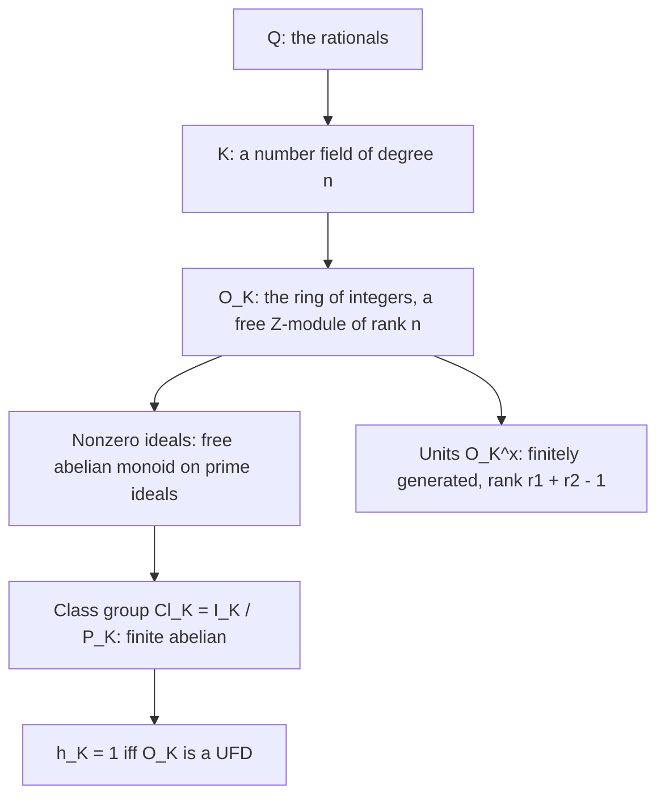
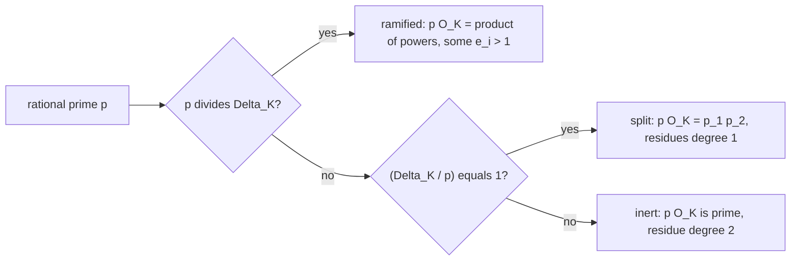
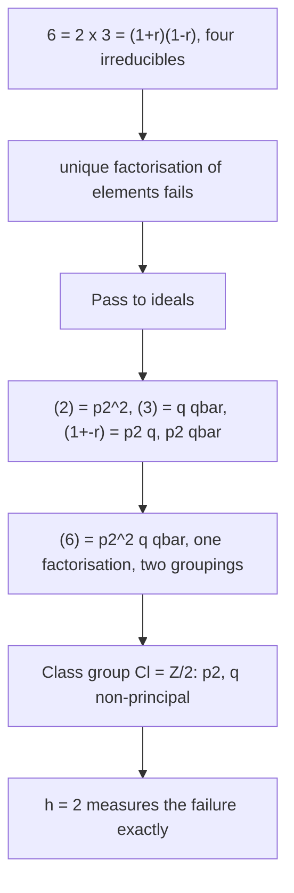

# Algebraic Number Theory

> [Mathematics](../../README.md) › [Advanced Topics](../README.md) · Level: Advanced · Prerequisites: [Rings](../../13-abstract-algebra/02-rings/README.md), [Fields](../../13-abstract-algebra/03-fields/README.md), [Galois Theory](../../13-abstract-algebra/04-galois-theory/README.md), [Divisibility and Primes](../../12-number-theory/01-divisibility-and-primes/README.md), [Diophantine Equations](../../12-number-theory/04-diophantine-equations/README.md), [Determinants](../../08-linear-algebra/06-determinants/README.md), [Complex Numbers and Geometry](../../15-complex-analysis/01-complex-numbers-and-geometry/README.md) · Estimated time: 720 min

## 1. Introduction

The integers have a property so useful that it is easy to mistake it for a law of nature: every positive integer factors uniquely into primes. Euclid's *Elements* contains the key step (Book VII, Proposition 30: if a prime divides a product, it divides a factor), and the statement in its modern form — the fundamental theorem of arithmetic — is the foundation of everything in elementary number theory.

The property is not a law of nature. It fails as soon as one moves from $\mathbb{Z}$ to the next natural ring, $\mathbb{Z}[\sqrt{-5}] = \{a + b\sqrt{-5} : a,b \in \mathbb{Z}\}$, where
$$6 = 2\cdot 3 = (1+\sqrt{-5})(1-\sqrt{-5}),$$
four irreducibles, no two associate, two genuinely different factorisations of the same number. This is not a curiosity: Fermat's last theorem for exponent $n$ is easy for $n = 4$ but hard for $n = 3$ precisely because the natural ring for $n = 3$, the Eisenstein integers $\mathbb{Z}[\omega]$, needs its unique factorisation to be *proved* rather than assumed — and Lamé's 1847 "proof" of the general case collapsed exactly because it assumed unique factorisation in $\mathbb{Z}[\zeta_p]$, which Kummer had discovered to be false.

**Algebraic number theory** is the discipline that repairs the failure. Its two central moves are:

1. **Pass from numbers to ideals.** In $\mathbb{Z}[\sqrt{-5}]$ the four factorisations of $6$ are not really different: they decompose the *ideal* $(6)$ into the same four prime ideals, grouped differently. Dedekind's theorem (1871) states that in the ring of integers of any number field, every nonzero ideal factors uniquely into prime ideals. Unique factorisation is restored at the level of ideals, and principal ideals then measure how badly it fails at the level of elements.
2. **Measure the failure by a finite group.** The *class group* $\mathrm{Cl}_K$ is the group of fractional ideals modulo principal ideals; it is finite (Minkowski), and it is trivial exactly when the ring of integers is a unique factorisation domain. Its order $h_K$, the **class number**, is the fundamental arithmetic invariant of the field: $\mathbb{Q}(\sqrt{-5})$ has $h = 2$, $\mathbb{Q}(i)$ has $h = 1$, and the imaginary quadratic fields with $h = 1$ are exactly those with $d = -1,-2,-3,-7,-11,-19,-43,-67,-163$ (Heegner 1952, Baker 1966, Stark 1967).

Around this core the subject develops the instruments that make the repair computable and quantitative.

* **The ring of integers** $\mathcal{O}_K$ and its discriminant $\Delta_K$, which encode the field's arithmetic in a single integer: the primes that ramify are exactly the primes dividing $\Delta_K$.
* **Norms, traces and discriminants**, which translate questions about ideals into questions about integers.
* **Splitting laws**, which describe how a rational prime $p$ decomposes in $\mathcal{O}_K$; for quadratic fields the answer is given by the Legendre symbol $\left(\frac{\Delta_K}{p}\right)$, a first glimpse of class field theory.
* **Dirichlet's unit theorem**, which says that the units of $\mathcal{O}_K$ form a finitely generated abelian group of rank $r_1 + r_2 - 1$; for real quadratic fields this is the engine behind Pell's equation, and the connection runs through the continued fraction of $\sqrt d$.
* **The Dedekind zeta function** $\zeta_K(s)$ and the **analytic class number formula**, which express the class number and the regulator as the residue of $\zeta_K$ at $s = 1$ — an analytic handle on an algebraic invariant, and the beginning of the analytic theory of $L$-functions.

This chapter is a first course. It proves the structure theorem for ideals in the quadratic case, states the general theorems with their hypotheses, and works seven examples in full, from computing $\mathcal{O}_K$ by hand to a descent argument that solves a Diophantine equation. Three results are stated without proof and used as black boxes: the theorem that $\mathcal{O}_K$ is a Dedekind domain (§8.1), Minkowski's convex body theorem (§7.7), and Dirichlet's unit theorem (§7.8). Each is standard, and each is proved in the references of §16; the chapter is written so that the reader who accepts them can verify everything else.

## 2. Prerequisites

**Rings, ideals and quotient rings.** Ideals, prime and maximal ideals, quotient rings, the correspondence between ideals of $R/I$ and ideals of $R$ containing $I$, unique factorisation domains, principal ideal domains, Euclidean domains, Gauss's lemma, content of a polynomial. The whole chapter is about the gap between "PID" and "UFD" and about the ideals that close it. See [Rings](../../13-abstract-algebra/02-rings/README.md).

**Fields and field extensions.** Degree $[K:\mathbb{Q}]$, towers, minimal polynomials, algebraic and transcendental elements, embeddings into $\mathbb{C}$, separability, the primitive element theorem. The number fields of this chapter are exactly the finite extensions of $\mathbb{Q}$. See [Fields](../../13-abstract-algebra/03-fields/README.md).

**Galois theory.** Normal closures, the Galois group, the Galois correspondence, the discriminant of a polynomial, resultants. Used in §7.3 (embeddings and the discriminant), §7.6 (splitting in Galois extensions, the formula $\sum e_if_i = n$) and §7.10 (the factorisation $\zeta_K = \zeta\cdot L$ for quadratic fields). See [Galois Theory](../../13-abstract-algebra/04-galois-theory/README.md).

**Elementary number theory.** Divisibility, primes, the fundamental theorem of arithmetic, congruences, Legendre and Jacobi symbols, quadratic reciprocity, the Chinese remainder theorem, Euler's criterion. See [Divisibility and Primes](../../12-number-theory/01-divisibility-and-primes/README.md) and, for the reciprocity law, the same tutorial's treatment of congruences.

**Diophantine equations.** Fermat descent, Pell's equation, sums of two squares, the Mordell equation $y^2 = x^3 + k$. These are the applications in §7.11 and §9.7. See [Diophantine Equations](../../12-number-theory/04-diophantine-equations/README.md).

**Linear algebra over $\mathbb{Z}$ and over $\mathbb{Q}$.** Bases, determinants, lattices in $\mathbb{R}^n$, the index of a sublattice, discriminants as squared determinants, and the change-of-basis formula. The ring of integers is a lattice of rank $n$ in $\mathbb{R}^{r_1}\times\mathbb{C}^{r_2}$, and its covolume is $\tfrac{1}{2^{r_2}}\sqrt{\lvert\Delta_K\rvert}$. See [Determinants](../../08-linear-algebra/06-determinants/README.md).

**Complex numbers and plane geometry.** Complex conjugation, the modulus, the argument, roots of unity, and the identification of $\mathbb{C}$ with $\mathbb{R}^2$ used in the geometry-of-numbers arguments. See [Complex Numbers and Geometry](../../15-complex-analysis/01-complex-numbers-and-geometry/README.md).

## 3. Learning Objectives

By the end of this chapter you will be able to:

1. Compute the ring of integers of a quadratic field from its squarefree radicand, and explain why the answer depends on $d \bmod 4$.
2. Compute norms, traces and discriminants of elements and of bases, and use the index formula $\operatorname{disc}(\mathbb{Z}[\alpha]) = [\mathcal{O}_K:\mathbb{Z}[\alpha]]^2\Delta_K$.
3. Exhibit a failure of unique factorisation, prove the four factors of $6$ in $\mathbb{Z}[\sqrt{-5}]$ are irreducible and pairwise non-associate, and explain what "irreducible but not prime" means concretely.
4. Compute with fractional ideals, calculate the norm of an ideal, and factor a given principal ideal into prime ideals.
5. State the unique factorisation theorem for ideals with its hypotheses, and verify it in $\mathbb{Q}(\sqrt{-5})$ for the ideal $(6)$.
6. Characterise Dedekind domains in at least three equivalent ways and explain why $\mathcal{O}_K$ is one.
7. Determine the splitting type of a rational prime in a quadratic field using $\left(\frac{\Delta_K}{p}\right)$, and compute the residue degrees and ramification indices.
8. State and use Minkowski's bound to compute class numbers of quadratic fields.
9. State Dirichlet's unit theorem, compute the unit group of $\mathbb{Z}[\sqrt2]$ and of $\mathbb{Z}[i]$, and explain the connection with Pell's equation and continued fractions.
10. State the analytic class number formula and verify it numerically for $\mathbb{Q}$, $\mathbb{Q}(i)$ and $\mathbb{Q}(\sqrt{-5})$.
11. Solve a Diophantine equation by unique factorisation in a number field, and recognise when the class group obstructs the method.

## 4. Intuition

### 4.1 Why integers are special

In $\mathbb{Z}$, a prime $p$ has two equivalent properties:

* (irreducible) if $p = ab$ then one of $a,b$ is a unit;
* (prime) if $p \mid ab$ then $p \mid a$ or $p \mid b$.

In an arbitrary ring, "prime" is stronger than "irreducible", and the gap between them is exactly where unique factorisation fails. In $\mathbb{Z}[\sqrt{-5}]$, the element $2$ is irreducible (its norm is $4$ and no element has norm $2$) but not prime:
$$2 \mid (1+\sqrt{-5})(1-\sqrt{-5}) = 6, \qquad \text{but } 2 \nmid 1\pm\sqrt{-5}.$$
The numerator of the failure is visible in the norms: $N(2) = 4$ while both factors have norm $6$.

The remedy is to stop asking "which *number* divides which" and to ask "which *ideal* contains which". The ideal $(2, 1+\sqrt{-5})$ divides both $(2)$ and $(1+\sqrt{-5})$; it is a genuine common divisor that no element sees.

### 4.2 Ideals as the repair

Think of an ideal as a set of numbers together with a common "divisibility profile". In $\mathbb{Z}$, the ideals $(n)$ and the integers $n \ge 0$ are in bijection, so ideals add nothing. In $\mathbb{Z}[\sqrt{-5}]$ they are genuinely finer: the ideal $\mathfrak{p} = (2, 1+\sqrt{-5})$ is not generated by a single element, so it is a common divisor that cannot be written as a number.

Dedekind's discovery is that this finer notion has *exactly* the right properties: every nonzero ideal factors uniquely into prime ideals, exactly as integers factor into primes. The failure of unique factorisation of elements is then measured by a single invariant: how far the ideal class group is from being trivial. A ring with $h = 1$ has unique factorisation; $\mathbb{Z}[\sqrt{-5}]$ has $h = 2$, and its ideal factorisations are finer than its element factorisations by exactly a factor of two.

A second analogy is useful. Think of the class group as the "shape" of the lattice of ideals. The Minkowski bound says that every ideal class has a representative that is not too large — its norm is at most a constant depending only on the discriminant. That makes the class group *computable*: enumerate the finitely many ideals of norm below the bound and determine which classes they generate. This is why class numbers are computable in principle, and why the bound appears in every computational treatment.

### 4.3 Splitting: the local picture

The primes of $\mathcal{O}_K$ sitting over a rational prime $p$ describe how $p$ behaves when the arithmetic is done inside $K$. Three things can happen:

* $p$ **splits** into several primes, each of smaller norm — the field sees more structure than $\mathbb{Q}$ does;
* $p$ **stays inert**, so that $p\mathcal{O}_K$ is prime — the field sees nothing new;
* $p$ **ramifies**, so that some prime appears with exponent $\ge 2$ — the field is "degenerate" at $p$, and only finitely many primes can do this.

For $\mathbb{Z}[i]$, the picture is complete: $2$ ramifies ($2 = -i(1+i)^2$), primes $p \equiv 1 \bmod 4$ split (as $p = a^2+b^2$), and primes $p \equiv 3 \bmod 4$ stay inert. Fermat's two-squares theorem is the statement that $p$ splits exactly when it is a sum of two squares in integers — a first glimpse of the general principle that *splitting is a reciprocity law*.

### 4.4 Units and the shape of the ring

If unique factorisation is about multiplication, the units are what multiplication cannot see. In $\mathbb{Z}$ the units are $\pm1$, a finite group. In $\mathbb{Z}[\sqrt2]$ the units are infinite: $1+\sqrt2$ has norm $-1$ and its powers $ (1+\sqrt2)^n$ are all units. Dirichlet's theorem says that this is the whole story in general: the unit group is a finite group of roots of unity times a free abelian group whose rank is $r_1 + r_2 - 1$. For an imaginary quadratic field the rank is $0$ and the units are finite (for $\mathbb{Z}[i]$, the four units $\pm1,\pm i$); for a real quadratic field the rank is $1$, and the units are exactly $\pm\varepsilon^{\,n}$ for a fundamental unit $\varepsilon$.

This is where Pell's equation re-enters. Solving $x^2 - dy^2 = 1$ in integers is solving $N(x+y\sqrt d) = 1$ in $\mathbb{Z}[\sqrt d]$, i.e. finding the units of norm $1$. The continued fraction of $\sqrt d$ computes the fundamental unit, and therefore solves Pell's equation, in finitely many steps.

### 4.5 The analytic bridge

There is no obvious reason why the class number — a purely algebraic invariant measuring the failure of unique factorisation — should be related to a complex-analytic function. Yet it is: the Dedekind zeta function
$$\zeta_K(s) = \sum_{\mathfrak{a}} \frac{1}{N(\mathfrak{a})^s} = \prod_{\mathfrak{p}}\left(1 - \frac{1}{N(\mathfrak{p})^s}\right)^{-1}$$
has a simple pole at $s = 1$, and the residue is
$$\frac{2^{r_1}(2\pi)^{r_2} h_K R_K}{w_K\sqrt{\lvert\Delta_K\rvert}}.$$
Everything in the formula is arithmetic except the analytic object on the left. This is the first instance of a theme that dominates modern number theory: analytic quantities encode algebraic invariants, and the encoding can be used in both directions (class number formulae give bounds; $L$-functions give equidistribution).

## 5. Formal Definitions

### 5.1 Number fields and embeddings

**Definition 5.1** (Number field). A *number field* is a subfield $K \subseteq \mathbb{C}$ with $[K:\mathbb{Q}] < \infty$. Its *degree* is $n := [K:\mathbb{Q}]$. A *quadratic field* is a number field of degree $2$; every such field is $K = \mathbb{Q}(\sqrt d)$ for a unique squarefree integer $d \ne 0,1$.

**Definition 5.2** (Embeddings and signature). A *$\mathbb{Q}$-embedding* of $K$ is a field homomorphism $\sigma : K \to \mathbb{C}$ fixing $\mathbb{Q}$. Because $K/\mathbb{Q}$ is separable, there are exactly $n$ of them; they are distinct and are the roots of the minimal polynomials of a primitive element. An embedding is *real* if $\sigma(K) \subseteq \mathbb{R}$ and *complex* otherwise. Write $r_1$ for the number of real embeddings and $2r_2$ for the number of complex ones, so that
$$n = r_1 + 2r_2 .$$
The pair $(r_1, r_2)$ is the *signature* of $K$. The complex embeddings come in conjugate pairs $\{\sigma, \bar\sigma\}$; the set $\{\sigma_1,\dots,\sigma_n\}$ is ordered so that $\sigma_1,\dots,\sigma_{r_1}$ are the real embeddings and $\sigma_{r_1+1},\dots,\sigma_{r_1+r_2}$ are one representative from each conjugate pair.

For a quadratic field: $K = \mathbb{Q}(\sqrt d)$ with $d > 0$ has $(r_1,r_2) = (2,0)$ and is called *real quadratic*; with $d < 0$ it has $(r_1,r_2) = (0,1)$ and is called *imaginary quadratic*.

### 5.2 Algebraic integers and the ring of integers

**Definition 5.3** (Algebraic integer). A complex number $\alpha$ is an *algebraic integer* if there are $c_0,\dots,c_{m-1} \in \mathbb{Z}$ with
$$\alpha^m + c_{m-1}\alpha^{m-1} + \cdots + c_1\alpha + c_0 = 0,$$
i.e. if $\alpha$ satisfies a *monic* polynomial with integer coefficients.

**Lemma 5.4** (Equivalent characterisations). For $\alpha \in \mathbb{C}$ the following are equivalent:

1. $\alpha$ is an algebraic integer;
2. the minimal polynomial of $\alpha$ over $\mathbb{Q}$ lies in $\mathbb{Z}[x]$;
3. the ring $\mathbb{Z}[\alpha]$ is a finitely generated $\mathbb{Z}$-module;
4. there is a subring $R \subseteq \mathbb{C}$ containing $\alpha$ that is a finitely generated $\mathbb{Z}$-module.

*Why.* (1)$\Leftrightarrow$(2): the minimal polynomial divides every monic polynomial over $\mathbb{Z}$ satisfied by $\alpha$, and its coefficients are algebraic integers; a rational algebraic integer is an integer (rational root theorem). (2)$\Rightarrow$(3): if the minimal polynomial has degree $m$, then $1,\alpha,\dots,\alpha^{m-1}$ generate $\mathbb{Z}[\alpha]$ over $\mathbb{Z}$. (3)$\Rightarrow$(4) is trivial. (4)$\Rightarrow$(1): if $R = \mathbb{Z}\omega_1 + \cdots + \mathbb{Z}\omega_k$ and $\alpha R \subseteq R$, then multiplication by $\alpha$ is an integer matrix $A$ on this generating set, and $\alpha$ is a root of the characteristic polynomial $\det(xI - A)$, which is monic with integer coefficients. $\square$

**Proposition 5.5** (The ring of integers). Let $K$ be a number field. The set
$$\mathcal{O}_K := \{\, \alpha \in K : \alpha \text{ is an algebraic integer} \,\}$$
is a subring of $K$, called the *ring of integers* of $K$.

*Why.* If $\alpha,\beta \in \mathcal{O}_K$, then $\mathbb{Z}[\alpha,\beta]$ is finitely generated as a $\mathbb{Z}$-module, because it is generated by the products $\alpha^i\beta^j$ with $i < \deg\alpha$ and $j < \deg\beta$. That module is a ring containing $\alpha \pm \beta$ and $\alpha\beta$, so Lemma 5.4(4) applies to each of them. $\square$

**Theorem 5.6** (Integral basis). Let $n = [K:\mathbb{Q}]$. Then $\mathcal{O}_K$ is a free $\mathbb{Z}$-module of rank $n$: there exist $\omega_1,\dots,\omega_n \in \mathcal{O}_K$ such that every element of $\mathcal{O}_K$ is a unique integer combination of the $\omega_i$. Such a tuple is an *integral basis*, and $\mathcal{O}_K \otimes_{\mathbb{Z}}\mathbb{Q} = K$.

The proof of Theorem 5.6 is not given here; it belongs to the general theory of Dedekind domains (§8.1) and appears in any of the references of §16. Its content is that $\mathcal{O}_K$ is a *lattice* in the $n$-dimensional real vector space $K \otimes_{\mathbb{Q}}\mathbb{R} \cong \mathbb{R}^{r_1}\times\mathbb{C}^{r_2}$, and that the lattice is full (rank $n$).

### 5.3 Norms and traces

**Definition 5.7** (Norm and trace). For $\alpha \in K$ define
$$N_{K/\mathbb{Q}}(\alpha) := \prod_{i=1}^{n}\sigma_i(\alpha), \qquad T_{K/\mathbb{Q}}(\alpha) := \sum_{i=1}^{n}\sigma_i(\alpha).$$
Equivalently, $N_{K/\mathbb{Q}}(\alpha)$ and $T_{K/\mathbb{Q}}(\alpha)$ are the determinant and the trace of the $\mathbb{Q}$-linear map $m_\alpha : K\to K$, $x\mapsto \alpha x$.

**Proposition 5.8** (Basic properties). For $\alpha,\beta \in K$ and $q \in \mathbb{Q}$:

1. $N(\alpha\beta) = N(\alpha)N(\beta)$ and $N(q) = q^n$; $N(\alpha) = 0$ iff $\alpha = 0$;
2. $T(\alpha+\beta) = T(\alpha)+T(\beta)$ and $T(q\alpha) = qT(\alpha)$; $T(q) = nq$;
3. $N(\alpha) = \operatorname{Norm}_{\mathbb{Q}(\alpha)/\mathbb{Q}}(\alpha)^{n/[\mathbb{Q}(\alpha):\mathbb{Q}]}$, and similarly for $T$;
4. if $\alpha \in \mathcal{O}_K$ then $N(\alpha), T(\alpha) \in \mathbb{Z}$;
5. $N(\alpha)$ and $T(\alpha)$ are the constant term (up to sign) and the negative of the coefficient of $x^{m-1}$ of the minimal polynomial of $\alpha$;
6. for $\alpha \ne 0$, $\lvert N(\alpha)\rvert = [\mathcal{O}_K : \alpha\mathcal{O}_K]$.

*Why.* (1)–(3) follow from the definitions and the multiplicativity of determinants. (4): the matrix of $m_\alpha$ in a $\mathbb{Z}$-basis of $\mathcal{O}_K$ (Theorem 5.6) is an integer matrix, so its trace and determinant are integers. (5) is the standard description of the coefficients of a polynomial in terms of its roots. (6) is proved by Smith normal form: the index of the sublattice $\alpha\mathcal{O}_K$ equals the absolute determinant of the matrix of $m_\alpha$, which is $\lvert N(\alpha)\rvert$. $\square$

The norm is *multiplicative* but the trace is only additive; this asymmetry is the reason norms control ideals and traces control discriminants.

### 5.4 Discriminants and integral bases

**Definition 5.9** (Discriminant). For $\alpha_1,\dots,\alpha_n \in K$ define
$$\operatorname{disc}(\alpha_1,\dots,\alpha_n) := \left(\det\bigl(\sigma_i(\alpha_j)\bigr)_{i,j=1}^{n}\right)^{2} = \det\bigl(T(\alpha_i\alpha_j)\bigr)_{i,j}.$$
If $\alpha_1,\dots,\alpha_n$ is a $\mathbb{Q}$-basis of $K$ consisting of algebraic integers, then $\operatorname{disc}$ is a nonzero integer. If the basis is a $\mathbb{Z}$-basis of $\mathcal{O}_K$, the value is independent of the basis and is denoted $\Delta_K$, the *absolute discriminant* of $K$.

**Proposition 5.10** (Change of basis). Let $\alpha_1,\dots,\alpha_n \in \mathcal{O}_K$ be a $\mathbb{Q}$-basis and let $M$ be the $\mathbb{Z}$-lattice $\mathbb{Z}\alpha_1 + \cdots + \mathbb{Z}\alpha_n \subseteq \mathcal{O}_K$. Then
$$\operatorname{disc}(\alpha_1,\dots,\alpha_n) = [\mathcal{O}_K : M]^2\,\Delta_K .$$
In particular the discriminant detects how far a given basis is from being an integral basis: the index divides the problem.

*Why.* Change from the basis $\alpha$ to an integral basis $\omega$ by a rational matrix $C$. Then $\det(\sigma_i(\alpha_j)) = \det(C)\det(\sigma_i(\omega_j))$, and $\det C = \pm[\mathcal{O}_K:M]$. Squaring gives the formula. $\square$

**Sign of the discriminant.** $\Delta_K$ has sign $(-1)^{r_2}$: it is positive for real quadratic fields and negative for imaginary quadratic fields. For $K = \mathbb{Q}(\sqrt d)$ with $d$ squarefree,
$$\Delta_K = \begin{cases} d & d \equiv 1 \pmod 4,\\ 4d & d \equiv 2, 3 \pmod 4.\end{cases}$$

### 5.5 Ideals, norms and the class group

**Definition 5.11** (Fractional ideal). A *fractional ideal* of $K$ is a nonzero $\mathcal{O}_K$-submodule $I \subseteq K$ of the form $I = xJ$ with $x \in K^\times$ and $J \subseteq \mathcal{O}_K$ a nonzero ideal. Integral ideals are the fractional ideals contained in $\mathcal{O}_K$. The product of fractional ideals is defined elementwise and is again a fractional ideal; the set $I_K$ of all fractional ideals is an abelian group with identity $\mathcal{O}_K$.

**Definition 5.12** (Ideal norm). For a nonzero integral ideal $I \subseteq \mathcal{O}_K$, the *norm* is
$$N(I) := \lvert \mathcal{O}_K/I\rvert .$$
The quotient is finite because $\mathcal{O}_K$ is a lattice and $I$ a full sublattice. The norm extends to fractional ideals by $N(xJ) := \lvert N(x)\rvert N(J)$; it is multiplicative, $N(IJ) = N(I)N(J)$, and $N((\alpha)) = \lvert N(\alpha)\rvert$.

**Definition 5.13** (Class group). Let $P_K = \{(\alpha) : \alpha \in K^\times\}$ be the subgroup of $I_K$ consisting of *principal* fractional ideals. The *ideal class group* is
$$\mathrm{Cl}_K := I_K / P_K, \qquad h_K := \lvert \mathrm{Cl}_K\rvert,$$
and $h_K$ is the *class number*. Two ideals are *equivalent* if they differ by a principal ideal; the class $[\mathcal{O}_K]$ is the identity.

Two facts, proved later, give the definition its force: $\mathrm{Cl}_K$ is a finite abelian group (§7.7), and $h_K = 1$ if and only if $\mathcal{O}_K$ is a unique factorisation domain (§7.5).

### 5.6 Ramification and splitting

**Definition 5.14** (Splitting type). Let $p$ be a rational prime and factor the ideal $p\mathcal{O}_K$ into prime ideals:
$$p\mathcal{O}_K = \mathfrak{p}_1^{e_1}\cdots\mathfrak{p}_g^{e_g}, \qquad e_i \ge 1 .$$
The integer $e_i$ is the *ramification index* of $\mathfrak{p}_i$ and $f_i := [\mathcal{O}_K/\mathfrak{p}_i : \mathbb{F}_p]$ is its *residue degree*. The fundamental identity is
$$\sum_{i=1}^{g} e_i f_i = n = [K:\mathbb{Q}].$$
The prime $p$ is *unramified* if all $e_i = 1$, *split completely* if $g = n$ (equivalently all $e_i = f_i = 1$), *inert* if $g = 1$ with $e_1 = 1$ and $f_1 = n$, and *ramified* if some $e_i \ge 2$. Only finitely many primes ramify: they are exactly the primes dividing $\Delta_K$ (§8.2).

### 5.7 Units and the regulator

**Definition 5.15** (Units). $\mathcal{O}_K^\times$ is the group of units of $\mathcal{O}_K$, i.e. of elements of norm $\pm 1$. Its torsion subgroup is $\mu_K$, the group of roots of unity contained in $K$; write $w_K := \lvert\mu_K\rvert$.

**Definition 5.16** (Regulator). Let $r := r_1 + r_2 - 1$. Choose units $u_1,\dots,u_r$ whose classes generate $\mathcal{O}_K^\times/\mu_K$ (Dirichlet's theorem says such units exist and $r$ is the rank). The *regulator* is
$$R_K := \left\lvert \det\bigl(\log\lvert\sigma_i(u_j)\rvert\bigr)_{1 \le i,j \le r}\right\rvert,$$
with $R_K := 1$ when $r = 0$. The determinant is independent of the choice of fundamental units.

### 5.8 The Dedekind zeta function

**Definition 5.17** (Dedekind zeta function). For $\operatorname{Re} s > 1$,
$$\zeta_K(s) := \sum_{\mathfrak{a} \ne 0} \frac{1}{N(\mathfrak{a})^s},$$
where the sum runs over nonzero integral ideals. The series converges absolutely for $\operatorname{Re} s > 1$ and satisfies the Euler product
$$\zeta_K(s) = \prod_{\mathfrak{p}}\left(1 - \frac{1}{N(\mathfrak{p})^s}\right)^{-1},$$
the product running over nonzero prime ideals. Both statements use the unique factorisation of ideals (§7.5) and the multiplicativity of the norm.

## 6. Mathematical Notation

| Symbol | Read as | Meaning |
|---|---|---|
| $K$, $n = [K:\mathbb{Q}]$ | $K$, degree $n$ | a number field and its degree over $\mathbb{Q}$ |
| $\mathcal{O}_K$ | O sub $K$ | the ring of integers of $K$ |
| $\sigma_1,\dots,\sigma_n$ | the embeddings | the $n$ $\mathbb{Q}$-embeddings $K \hookrightarrow \mathbb{C}$ |
| $r_1$, $r_2$ | $r$ one, $r$ two | number of real embeddings; number of conjugate pairs |
| $N_{K/\mathbb{Q}}(\alpha)$, $T_{K/\mathbb{Q}}(\alpha)$ | norm, trace | $\prod_i\sigma_i(\alpha)$, $\sum_i\sigma_i(\alpha)$ |
| $\Delta_K$, $\operatorname{disc}$ | discriminant | $\det(\sigma_i(\omega_j))^2$ for an integral basis $\omega$ |
| $\omega_1,\dots,\omega_n$ | integral basis | a $\mathbb{Z}$-basis of $\mathcal{O}_K$ |
| $\mathfrak{a}, \mathfrak{b}, \mathfrak{p}, \mathfrak{q}$ | fraktur a, p | ideals, usually fractional; $\mathfrak{p}$ a prime ideal |
| $I_K$, $P_K$ | $I$ sub $K$, $P$ sub $K$ | group of fractional ideals; subgroup of principal ideals |
| $\mathrm{Cl}_K$, $h_K$ | class group, class number | $I_K/P_K$ and its order |
| $N(I)$ | norm of $I$ | $\lvert\mathcal{O}_K/I\rvert$ |
| $e(\mathfrak{p}/p)$, $f(\mathfrak{p}/p)$ | ramification index, residue degree | exponent in $p\mathcal{O}_K$; $\lvert\mathcal{O}_K/\mathfrak{p}:\mathbb{F}_p\rvert$ |
| $\left(\frac{a}{p}\right)$ | Legendre symbol | $1$ if $a$ is a nonzero square mod $p$, $-1$ if not, $0$ if $p\mid a$ |
| $\left(\frac{D}{p}\right)$ | Kronecker symbol | the extension to $D \in \mathbb{Z}$, $p = 2$ allowed |
| $\mathcal{O}_K^\times$, $\mu_K$ | units, roots of unity | unit group; torsion subgroup; $w_K = \lvert\mu_K\rvert$ |
| $\varepsilon$, $\varepsilon_d$ | fundamental unit | the least unit $>1$ of a real quadratic field |
| $R_K$ | regulator | determinant of logs of fundamental units |
| $\zeta_K(s)$ | Dedekind zeta | $\sum_{\mathfrak{a}} N(\mathfrak{a})^{-s}$ |
| $\chi_D$ | quadratic character | $\chi_D(n) = \left(\frac{D}{n}\right)$ |
| $L(s,\chi)$ | Dirichlet $L$-function | $\sum_{n\ge1}\chi(n)n^{-s}$ |
| $\mathbb{F}_p$ | F sub $p$ | the field with $p$ elements; $\mathcal{O}_K/\mathfrak{p}$ is a finite extension of $\mathbb{F}_p$ |

Points of language worth fixing.

* $\mathcal{O}_K$ is a *ring*, not a field: $2$ is not invertible in $\mathcal{O}_{\mathbb{Q}(i)} = \mathbb{Z}[i]$, though it is invertible in $K = \mathbb{Q}(i)$. The passage from $K$ to $\mathcal{O}_K$ is the passage from a field to its integers, and it is where all the arithmetic lives.
* "$N$" carries two meanings that are related but distinct: the *element* norm $N_{K/\mathbb{Q}}(\alpha)$ and the *ideal* norm $N(I)$. They agree on principal ideals, $N((\alpha)) = \lvert N(\alpha)\rvert$, and the context always makes clear which is meant.
* An ideal is often written $(a_1,\dots,a_k)$ for the $\mathcal{O}_K$-span of the listed elements; this is *not* the same as a $\mathbb{Z}$-span. For instance $(2, 1+\sqrt{-5})$ consists of all $2\alpha + (1+\sqrt{-5})\beta$ with $\alpha,\beta \in \mathbb{Z}[\sqrt{-5}]$.
* The symbol $\mathfrak{p}$ always denotes a prime ideal, and "prime" for ideals means prime in the ideal sense (equivalently, for $\mathcal{O}_K$, maximal, since $\mathcal{O}_K$ has Krull dimension $1$).

## 7. Core Concepts

### 7.1 Number fields and their rings of integers

A number field is described by a primitive element: $K = \mathbb{Q}(\alpha)$ for some $\alpha$, with $\alpha$ of degree $n$ over $\mathbb{Q}$. If $f \in \mathbb{Q}[x]$ is the minimal polynomial of $\alpha$, then $K \cong \mathbb{Q}[x]/(f)$, and the arithmetic of $K$ is the arithmetic of the quotient.

Three examples carry the whole chapter.

| Field | $n$ | $(r_1,r_2)$ | $\mathcal{O}_K$ | $\Delta_K$ | $\mathrm{Cl}_K$ |
|---|---|---|---|---|---|
| $\mathbb{Q}(i)$, $d = -1$ | $2$ | $(0,1)$ | $\mathbb{Z}[i]$ | $-4$ | trivial, $h=1$ |
| $\mathbb{Q}(\sqrt{-5})$, $d = -5$ | $2$ | $(0,1)$ | $\mathbb{Z}[\sqrt{-5}]$ | $-20$ | $\mathbb{Z}/2$, $h=2$ |
| $\mathbb{Q}(\sqrt2)$, $d = 2$ | $2$ | $(2,0)$ | $\mathbb{Z}[\sqrt2]$ | $8$ | trivial, $h=1$ |

The entry that requires work is $\mathcal{O}_K$: it is *not* always $\mathbb{Z}[\sqrt d]$. For $d \equiv 1 \pmod 4$ the ring is larger, because $\frac{1+\sqrt d}{2}$ is an algebraic integer. The next subsection proves this in general.

### 7.2 The ring of integers of a quadratic field

**Theorem 7.1** (Ring of integers of a quadratic field). Let $d \ne 1$ be a squarefree integer and $K = \mathbb{Q}(\sqrt d)$. Then
$$\mathcal{O}_K = \begin{cases} \mathbb{Z}\left[\dfrac{1+\sqrt d}{2}\right] & \text{if } d \equiv 1 \pmod 4,\\[2mm] \mathbb{Z}[\sqrt d] & \text{if } d \equiv 2,3 \pmod 4.\end{cases}$$
Consequently
$$\Delta_K = \begin{cases} d & d \equiv 1 \pmod 4,\\ 4d & d \equiv 2,3 \pmod 4.\end{cases}$$

*Proof.* Let $\alpha \in K$, so $\alpha = u + v\sqrt d$ with $u,v \in \mathbb{Q}$. If $v = 0$ then $\alpha \in \mathbb{Q}$, and $\alpha$ is an algebraic integer iff $\alpha \in \mathbb{Z}$.

Assume $v \ne 0$. Then $\alpha \notin \mathbb{Q}$, its minimal polynomial over $\mathbb{Q}$ is
$$m_\alpha(x) = x^2 - 2u\,x + (u^2 - dv^2),$$
and by Lemma 5.4(2) $\alpha$ is an algebraic integer iff $T := 2u \in \mathbb{Z}$ and $N := u^2 - dv^2 \in \mathbb{Z}$.

Write $m := 2v \in \mathbb{Q}$. Multiplying $4N = T^2 - dm^2$ by nothing, we get the identity
$$T^2 - d\,m^2 = 4N \in 4\mathbb{Z}. \tag{7.1}$$
We first show that $m \in \mathbb{Z}$. Write $m = r/s$ in lowest terms with $s > 0$. From (7.1), $s^2 \mid d r^2$; since $\gcd(r,s) = 1$ and $d$ is squarefree, $s^2 \mid d$ forces $s = 1$. Hence $m \in \mathbb{Z}$, and $\alpha = (T + m\sqrt d)/2$ with $T, m \in \mathbb{Z}$.

Now (7.1) becomes the congruence $T^2 \equiv d m^2 \pmod 4$.

*If $d \equiv 2,3 \pmod 4$:* squares modulo $4$ are $0$ and $1$. If $m$ were odd then $m^2 \equiv 1$ and $T^2 \equiv d \equiv 2$ or $3 \pmod 4$, impossible. So $m$ is even, and then $T^2 \equiv 0 \pmod 4$, so $T$ is even. Hence $\alpha \in \mathbb{Z}[\sqrt d]$.
*If $d \equiv 1 \pmod 4$:* the congruence reads $T^2 \equiv m^2 \pmod 4$, which holds iff $T \equiv m \pmod 2$. So either both are even — then $\alpha \in \mathbb{Z}[\sqrt d]$ — or both are odd, and then
$$\alpha = \frac{T + m\sqrt d}{2} = \frac{T-m}{2} + m\cdot\frac{1+\sqrt d}{2} \in \mathbb{Z}\left[\frac{1+\sqrt d}{2}\right].$$
In both cases $\alpha$ lies in the ring displayed in the statement.

Conversely, $\sqrt d$ is integral (it satisfies $x^2 - d$), and when $d \equiv 1 \pmod 4$ the element $\omega = (1+\sqrt d)/2$ is integral, because
$$\omega^2 - \omega + \frac{1-d}{4} = 0 \quad\text{and}\quad \frac{1-d}{4} \in \mathbb{Z}.$$
So the displayed rings are contained in $\mathcal{O}_K$, and the first assertion follows.

For the discriminants: with the basis $1,\sqrt d$ one has
$$\operatorname{disc}(1,\sqrt d) = \det\begin{pmatrix} 1 & \sqrt d\\ 1 & -\sqrt d\end{pmatrix}^{2} = (-2\sqrt d)^2 = 4d,$$
and this is an integral basis exactly when $d \equiv 2,3 \pmod 4$, giving $\Delta_K = 4d$. When $d \equiv 1 \pmod 4$, the integral basis $1,\omega$ gives
$$\operatorname{disc}(1,\omega) = (\omega' - \omega)^2 = (-\sqrt d)^2 = d\ (= \Delta_K),$$
because $\omega = (1+\sqrt d)/2$ and $\omega' = (1-\sqrt d)/2$. $\blacksquare$

**Example 7.2.** $\mathcal{O}_{\mathbb{Q}(\sqrt{-3})} = \mathbb{Z}[\frac{1+\sqrt{-3}}{2}]$, the Eisenstein integers, with $\Delta_K = -3$. The smaller ring $\mathbb{Z}[\sqrt{-3}]$ has discriminant $-12 = 2^2\cdot(-3)$, consistent with Proposition 5.10 and index $2$. The element $\frac{1+\sqrt{-3}}{2}$ is a cube root of unity: it satisfies $\omega^2 + \omega + 1 = 0$ (put $d = -3$ in the displayed quadratic above: $(1-d)/4 = 1$).

**Table 7.2.1** (Small quadratic fields). The third and fourth columns are the content of Theorem 7.1; the last column records the index of the "naive" ring $\mathbb{Z}[\sqrt d]$, which is $2$ exactly when $d \equiv 1 \pmod 4$.

| $d$ | $K$ | $\mathcal{O}_K$ | $\Delta_K$ | $[\mathcal{O}_K:\mathbb{Z}[\sqrt d]]$ |
|---|---|---|---|---|
| $-1$ | $\mathbb{Q}(i)$ | $\mathbb{Z}[i]$ | $-4$ | $1$ |
| $-2$ | | $\mathbb{Z}[\sqrt{-2}]$ | $-8$ | $1$ |
| $-3$ | | $\mathbb{Z}\bigl[\tfrac{1+\sqrt{-3}}{2}\bigr]$ | $-3$ | $2$ |
| $-5$ | | $\mathbb{Z}[\sqrt{-5}]$ | $-20$ | $1$ |
| $-7$ | | $\mathbb{Z}\bigl[\tfrac{1+\sqrt{-7}}{2}\bigr]$ | $-7$ | $2$ |
| $2$ | | $\mathbb{Z}[\sqrt2]$ | $8$ | $1$ |
| $3$ | | $\mathbb{Z}[\sqrt3]$ | $12$ | $1$ |
| $5$ | | $\mathbb{Z}\bigl[\tfrac{1+\sqrt5}{2}\bigr]$ | $5$ | $2$ |
| $13$ | | $\mathbb{Z}\bigl[\tfrac{1+\sqrt{13}}{2}\bigr]$ | $13$ | $2$ |

Reading the table is a useful check of Theorem 7.1: the half-integer rings occur exactly in the rows with $d \equiv 1 \pmod 4$, and their discriminants are the smallest possible for the given $d$.

**Remark 7.2.2** (Not every ring of integers is monogenic). In degree $2$ one always has $\mathcal{O}_K = \mathbb{Z}[\alpha]$ for a suitable $\alpha$ (Theorem 7.1). In higher degree this can fail: Dedekind's classical example is the cubic field generated by a root of $x^3 - x^2 - 2x - 8$, whose ring of integers is not of the form $\mathbb{Z}[\alpha]$ for any $\alpha \in \mathcal{O}_K$. This is why the hypothesis $p \nmid [\mathcal{O}_K:\mathbb{Z}[\alpha]]$ appears in Theorem 7.13: for a non-monogenic ring there is no single $\alpha$ with $\mathcal{O}_K = \mathbb{Z}[\alpha]$, and the Kummer–Dedekind method must be applied prime by prime with different choices of $\alpha$.

### 7.3 Norms, traces and discriminants in practice

For $K = \mathbb{Q}(\sqrt d)$ with $d$ squarefree, the two embeddings are $\sigma_\pm(a+b\sqrt d) = a \pm b\sqrt d$, so for $\alpha = a + b\sqrt d$,
$$N(\alpha) = a^2 - db^2, \qquad T(\alpha) = 2a.$$
This is the single most used formula of the chapter. In particular:

* $\mathbb{Z}[i]$: $N(a+bi) = a^2+b^2$, the sum of two squares;
* $\mathbb{Z}[\sqrt{-5}]$: $N(a+b\sqrt{-5}) = a^2+5b^2$, always nonnegative;
* $\mathbb{Z}[\sqrt2]$: $N(a+b\sqrt2) = a^2-2b^2$, indefinite, so units with norm $\pm1$ exist.

**Proposition 7.3** (Discriminants and indices). Let $K = \mathbb{Q}(\alpha)$ with $\alpha$ integral of degree $n$ and minimal polynomial $f$. Then
$$\operatorname{disc}(1,\alpha,\dots,\alpha^{n-1}) = \operatorname{disc}(f) = \prod_{i<j}(\sigma_i(\alpha)-\sigma_j(\alpha))^{2}, \qquad \operatorname{disc}(\mathbb{Z}[\alpha]) = [\mathcal{O}_K:\mathbb{Z}[\alpha]]^{2}\,\Delta_K .$$
In particular $\operatorname{disc}(f)$ determines $\Delta_K$ up to a square factor, and $\mathbb{Z}[\alpha] = \mathcal{O}_K$ exactly when the two discriminants are equal.

*Why.* The first identity is the Vandermonde determinant squared. The second is Proposition 5.10 applied to the basis $1,\alpha,\dots,\alpha^{n-1}$ of $\mathbb{Z}[\alpha]$. $\square$

**Example 7.4.** For $f = x^2 - 5$ one has $\operatorname{disc}(f) = 20$, but $\Delta_{\mathbb{Q}(\sqrt5)} = 5$; hence $[\mathcal{O}_K:\mathbb{Z}[\sqrt5]] = 2$, and indeed $\mathcal{O}_K = \mathbb{Z}[(1+\sqrt5)/2]$. For $f = x^2+5$ one has $\operatorname{disc}(f) = -20 = \Delta_{\mathbb{Q}(\sqrt{-5})}$, so $\mathbb{Z}[\sqrt{-5}]$ is already the full ring of integers.

The general formula for the discriminant of a trinomial is useful: $\operatorname{disc}(x^2+bx+c) = b^2-4c$, and $\operatorname{disc}(x^3+px+q) = -4p^3-27q^2$.

### 7.4 Failure of unique factorisation

**Theorem 7.5.** The ring $\mathbb{Z}[\sqrt{-5}]$ is not a unique factorisation domain. Specifically,
$$6 = 2\cdot 3 = (1+\sqrt{-5})(1-\sqrt{-5}),$$
the four elements $2, 3, 1+\sqrt{-5}, 1-\sqrt{-5}$ are irreducible, pairwise non-associate, and none is a unit.

*Proof.* Write $N(a+b\sqrt{-5}) = a^2+5b^2$.

*Units.* $N(\alpha) = 1$ forces $b = 0$ and $a = \pm1$. So the units are $\pm1$, and two elements are associate iff they are equal or opposite.

*Norms.* $N(2) = 4$, $N(3) = 9$, $N(1\pm\sqrt{-5}) = 1+5 = 6$.

*Irreducibility of $2$.* If $2 = \alpha\beta$ with $\alpha,\beta$ non-units, then $4 = N(\alpha)N(\beta)$ with $N(\alpha), N(\beta) \in \{2\}$ (each is a positive integer $>1$). But $a^2+5b^2 = 2$ has no integer solution: $b = 0$ gives $a^2 = 2$, and $\lvert b\rvert \ge 1$ gives $a^2+5b^2 \ge 5$. So $2$ is irreducible.

*Irreducibility of $3$.* If $3 = \alpha\beta$ with non-units, then $9 = N(\alpha)N(\beta)$ with $N(\alpha) = N(\beta) = 3$. But $a^2+5b^2 = 3$ has no integer solution by the same argument. So $3$ is irreducible.

*Irreducibility of $1+\sqrt{-5}$.* If it factors with non-units, then $6 = N(\alpha)N(\beta)$ with $N(\alpha),N(\beta) \in \{2,3\}$, and neither $2$ nor $3$ is a norm. So it is irreducible; the same holds for its conjugate.

*Non-associacy.* $2, 3, 1+\sqrt{-5}, 1-\sqrt{-5}$ are pairwise distinct and no two are negatives, so no two are associates.

Since $6$ has two factorisations into irreducibles that differ by more than reordering and units, $\mathbb{Z}[\sqrt{-5}]$ is not a UFD. $\blacksquare$

**Corollary 7.6** (Irreducible does not imply prime). In $\mathbb{Z}[\sqrt{-5}]$ the element $2$ is irreducible but not prime: $2 \mid 6 = (1+\sqrt{-5})(1-\sqrt{-5})$ while $2 \nmid 1\pm\sqrt{-5}$ (the quotients $(1\pm\sqrt{-5})/2$ are not in $\mathcal{O}_K$, since their coefficients are not integers).

The failure is not an accident of the choice $d = -5$. It happens for every $d<0$ with $\lvert d\rvert$ large enough (and for many $d>0$): by the Heegner–Baker–Stark theorem, the imaginary quadratic fields with class number $1$ are exactly those with
$$d = -1,-2,-3,-7,-11,-19,-43,-67,-163 .$$

### 7.5 Ideals as the repair

**Theorem 7.7** (Unique factorisation of ideals). Let $K$ be a number field. Every nonzero proper ideal $\mathfrak{a} \subsetneq \mathcal{O}_K$ admits a factorisation
$$\mathfrak{a} = \mathfrak{p}_1\mathfrak{p}_2\cdots\mathfrak{p}_r$$
into nonzero prime ideals, and the factorisation is unique up to the order of the factors. Equivalently, the monoid of nonzero ideals of $\mathcal{O}_K$ is free abelian on the set of nonzero prime ideals.

*Proof sketch.* Three ingredients.

(i) *Every nonzero ideal is contained in a maximal ideal.* Take $0 \ne a \in \mathfrak{a}$; then $\mathcal{O}_K/(a)$ is finite (Proposition 5.8(6)) and nonzero, so it has a maximal ideal, which pulls back to a maximal ideal $\mathfrak{p} \supseteq \mathfrak{a}$.

(ii) *Cancellation.* If $\mathfrak{a}\mathfrak{b} = \mathfrak{a}\mathfrak{c}$ with $\mathfrak{a} \ne 0$, then $\mathfrak{b} = \mathfrak{c}$. This follows from the invertibility of nonzero ideals: for each nonzero ideal $\mathfrak{a}$ there is a fractional ideal $\mathfrak{a}^{-1}$ with $\mathfrak{a}\mathfrak{a}^{-1} = \mathcal{O}_K$. Invertibility is proved by localising at maximal ideals, where $\mathcal{O}_{K,\mathfrak{p}}$ is a discrete valuation ring.

(iii) *Existence and uniqueness.* Choose a maximal $\mathfrak{p}_1 \supseteq \mathfrak{a}$; one shows $\mathfrak{a} = \mathfrak{p}_1\mathfrak{a}_1$ with $\mathfrak{a} \subseteq \mathfrak{a}_1$, and iterates. The chain of ideals $\mathfrak{a} \subseteq \mathfrak{a}_1 \subseteq \cdots$ must terminate because $\mathcal{O}_K$ is Noetherian and the norms $N(\mathfrak{a}_i)$ strictly decrease as long as $\mathfrak{a}_i \ne \mathcal{O}_K$. For uniqueness, if $\mathfrak{p}_1\cdots\mathfrak{p}_r = \mathfrak{q}_1\cdots\mathfrak{q}_s$, then $\mathfrak{p}_1$ contains the product on the right, hence contains some $\mathfrak{q}_j$ (prime implies: if $\mathfrak{p} \supseteq \prod \mathfrak{q}_j$ then $\mathfrak{p} \supseteq \mathfrak{q}_j$ for some $j$); maximality gives $\mathfrak{p}_1 = \mathfrak{q}_j$, and cancellation reduces the length. $\square$

The theorem is stated and sketched, not proved in full: step (ii) is the substance, and it is the content of the structure theory of Dedekind domains. A complete proof is in any of the references of §16 (Neukirch, *Algebraic Number Theory*, Chapter I; Marcus, *Number Fields*, Chapter 3).

**Definition 7.8** (Dedekind domain). An integral domain $A$ is a *Dedekind domain* if it is Noetherian, integrally closed in its field of fractions, and every nonzero prime ideal is maximal (equivalently, $A$ has Krull dimension $1$).

**Theorem 7.9** (Characterisations of Dedekind domains). For an integral domain $A$ with field of fractions $F$, the following are equivalent:

1. $A$ is a Dedekind domain;
2. every nonzero proper ideal of $A$ is a product of prime ideals, uniquely up to order;
3. every nonzero fractional ideal of $A$ is invertible, i.e. the fractional ideals form a group under multiplication;
4. $A$ is Noetherian, and for every maximal ideal $\mathfrak{m}$ the localisation $A_{\mathfrak{m}}$ is a discrete valuation ring.

Moreover $\mathcal{O}_K$ is a Dedekind domain for every number field $K$.

*Why.* The equivalence of (2), (3) and (4) is the standard structure theory; (1)$\Leftrightarrow$(4) is the local characterisation of Dedekind domains (a Noetherian domain is integrally closed with dimension $1$ iff all its localisations at maximal ideals are DVRs). For $\mathcal{O}_K$: it is Noetherian because it is a finitely generated $\mathbb{Z}$-module (Theorem 5.6); it is integrally closed because an element of $K$ integral over $\mathcal{O}_K$ is integral over $\mathbb{Z}$, hence lies in $\mathcal{O}_K$; and every nonzero prime is maximal because $\mathcal{O}_K/\mathfrak{p}$ is a finite integral domain, hence a field. $\square$

**Theorem 7.10** (Class number one is unique factorisation). $\mathcal{O}_K$ is a unique factorisation domain if and only if $\mathrm{Cl}_K$ is trivial, i.e. $h_K = 1$.

*Proof.* ($\Leftarrow$) If every ideal is principal then $\mathcal{O}_K$ is a principal ideal domain, and every PID is a UFD.

($\Rightarrow$) Suppose $\mathcal{O}_K$ is a UFD. Let $\mathfrak{p} \ne 0$ be a prime ideal. Since $\mathcal{O}_K$ is a UFD and $\mathfrak{p} \ne 0$, pick a nonzero element $a \in \mathfrak{p}$ and factor it into irreducibles; one of the irreducible factors $p$ lies in $\mathfrak{p}$, because $\mathfrak{p}$ is prime. In a UFD, an irreducible element generates a prime ideal, so $(p) \subseteq \mathfrak{p}$ is a nonzero prime ideal. Since $\mathcal{O}_K$ has dimension $1$ (Theorem 7.9), $(p)$ is maximal, hence $\mathfrak{p} = (p)$. So every prime ideal is principal, and every ideal is a product of prime ideals (Theorem 7.7), hence principal. Therefore $P_K = I_K$ and $\mathrm{Cl}_K$ is trivial. $\blacksquare$

**Example 7.11** (The repair in action). In $\mathbb{Z}[\sqrt{-5}]$ put
$$\mathfrak{p}_2 = (2, 1+\sqrt{-5}), \qquad \mathfrak{p}_3 = (3, 1+\sqrt{-5}), \qquad \bar{\mathfrak{p}}_3 = (3, 1-\sqrt{-5}).$$
Then one computes (Example 9.4 and Example 9.5)
$$(2) = \mathfrak{p}_2^2, \qquad (3) = \mathfrak{p}_3\bar{\mathfrak{p}}_3, \qquad (1+\sqrt{-5}) = \mathfrak{p}_2\mathfrak{p}_3, \qquad (1-\sqrt{-5}) = \mathfrak{p}_2\bar{\mathfrak{p}}_3 .$$
Therefore both factorisations of $6$ become the *same* ideal factorisation:
$$(6) = (2)(3) = \mathfrak{p}_2^2\,\mathfrak{p}_3\bar{\mathfrak{p}}_3 = (\mathfrak{p}_2\mathfrak{p}_3)(\mathfrak{p}_2\bar{\mathfrak{p}}_3) = (1+\sqrt{-5})(1-\sqrt{-5}).$$
The ambiguity has disappeared: what looked like two factorisations of an element is one factorisation of an ideal, grouped in two ways. The element $6$ cannot see $\mathfrak{p}_2$, $\mathfrak{p}_3$, $\bar{\mathfrak{p}}_3$ individually because they are not principal; the class group measures exactly this blindness.

### 7.6 Ramification and splitting

**Theorem 7.12** (Fundamental identity). Let $K$ be a number field of degree $n$ and $p$ a rational prime. If $p\mathcal{O}_K = \mathfrak{p}_1^{e_1}\cdots\mathfrak{p}_g^{e_g}$, then
$$\sum_{i=1}^{g} e_i f_i = n, \qquad N(\mathfrak{p}_i) = p^{f_i}, \qquad N(p\mathcal{O}_K) = p^n .$$
The last identity follows from multiplicativity of the ideal norm and the first.

*Why.* Localise at $p$: $\mathcal{O}_K/p\mathcal{O}_K$ is a finite $\mathbb{F}_p$-algebra of dimension $n$ (it is $(\mathcal{O}_K\otimes\mathbb{Z}_p)/p$), and by the Chinese remainder theorem it is the product of the local rings $\mathcal{O}_K/\mathfrak{p}_i^{e_i}$, each of which has $\mathbb{F}_p$-dimension $e_if_i$. Adding dimensions gives the identity. $\square$

**Theorem 7.13** (Kummer–Dedekind). Let $K = \mathbb{Q}(\alpha)$ with $\alpha \in \mathcal{O}_K$ and minimal polynomial $f \in \mathbb{Z}[x]$. Let $p$ be a prime with $p \nmid [\mathcal{O}_K:\mathbb{Z}[\alpha]]$. If
$$\bar f = \bar g_1^{e_1}\cdots\bar g_g^{e_g}$$
is the factorisation of $f$ modulo $p$ into monic irreducibles over $\mathbb{F}_p$, then
$$p\mathcal{O}_K = \mathfrak{p}_1^{e_1}\cdots\mathfrak{p}_g^{e_g}, \qquad f_i = \deg g_i, \qquad \mathfrak{p}_i = (p,\, g_i(\alpha)).$$
In particular the splitting type of $p$ is read off from the factorisation of $f$ in $\mathbb{F}_p[x]$.

*Why.* Reduce the isomorphism $\mathbb{Z}[\alpha] \cong \mathbb{Z}[x]/(f)$ modulo $p$: $\mathbb{Z}[\alpha]/(p) \cong \mathbb{F}_p[x]/(\bar f)$, and the Chinese remainder theorem decomposes this into the factors $\mathbb{F}_p[x]/(\bar g_i^{e_i})$. The hypothesis $p \nmid [\mathcal{O}_K:\mathbb{Z}[\alpha]]$ ensures that the primes of $\mathbb{Z}[\alpha]$ and of $\mathcal{O}_K$ above $p$ correspond bijectively. $\square$

**Theorem 7.14** (Splitting law for quadratic fields). Let $K = \mathbb{Q}(\sqrt d)$ with $d$ squarefree, and let $p$ be a rational prime.

1. If $p$ is odd and $p \nmid d$, then $p$ splits iff $\left(\frac dp\right) = 1$, is inert iff $\left(\frac dp\right) = -1$, and ramifies iff $p \mid d$.
2. $2$ ramifies iff $d \equiv 2,3 \pmod 4$; if $d \equiv 1 \pmod 4$, then $2$ splits iff $d \equiv 1 \pmod 8$ and is inert iff $d \equiv 5 \pmod 8$.
3. Uniformly for all primes $p$: $p$ ramifies iff $p \mid \Delta_K$, and for $p \nmid \Delta_K$, $p$ splits iff $\left(\frac{\Delta_K}{p}\right) = 1$ and is inert iff $\left(\frac{\Delta_K}{p}\right) = -1$, where the symbol is the Kronecker symbol.

*Proof.* (1) Take $\alpha = \sqrt d$, so $f = x^2 - d$ and $\mathbb{Z}[\alpha] = \mathcal{O}_K$ since $d \equiv 2,3 \pmod 4$; assume first $d \equiv 2,3 \pmod 4$. For odd $p \nmid d$, the polynomial $x^2-d$ has a root mod $p$ iff $d$ is a quadratic residue, and then it factors into two distinct linear factors (the roots are $\pm r$ with $r \not\equiv -r$ since $p$ is odd); otherwise it is irreducible. By Theorem 7.13 this is precisely split versus inert. If $p \mid d$ then $x^2 - d \equiv x^2 \pmod p$, a repeated factor, so $p$ ramifies. When $d \equiv 1 \pmod 4$ the same argument is applied to the minimal polynomial $x^2 - x + \frac{1-d}{4}$ of $\omega = (1+\sqrt d)/2$ over $\mathbb{Z}$; its discriminant is $d$, and the computation of $\left(\frac dp\right)$ is unchanged.

(2) For $d \equiv 2,3 \pmod 4$, $x^2 - d \equiv x^2$ or $x^2+1 = (x+1)^2$ modulo $2$, so $2$ ramifies. For $d \equiv 1 \pmod 4$, reduce $x^2 - x + \frac{1-d}{4}$ modulo $2$: it splits iff $\frac{1-d}{4}$ is even, i.e. $d \equiv 1 \pmod 8$, and is irreducible iff $\frac{1-d}{4}$ is odd, i.e. $d \equiv 5 \pmod 8$.

(3) The statement about ramification is the theorem that the discriminant's prime divisors are exactly the ramified primes (§8.2). The uniform form follows because $\Delta_K = d$ or $4d$ and for odd $p$ the Kronecker symbol $\left(\frac{4d}{p}\right) = \left(\frac dp\right)$. $\square$

**Table 7.15** (Splitting in small quadratic fields). The entries are the splitting type of $p$; "ram" means ramified.

| $K$ | $\Delta_K$ | $p=2$ | $3$ | $5$ | $7$ | $11$ | $13$ |
|---|---|---|---|---|---|---|---|
| $\mathbb{Q}(i)$ | $-4$ | ram | inert | split | inert | inert | split |
| $\mathbb{Q}(\sqrt{-5})$ | $-20$ | ram | split | ram | split | inert | inert |
| $\mathbb{Q}(\sqrt2)$ | $8$ | ram | inert | inert | split | inert | inert |
| $\mathbb{Q}(\sqrt5)$ | $5$ | inert | inert | ram | inert | split | inert |

Each entry is a one-line computation with Theorem 7.14; Example 9.5 verifies several of them explicitly, including the factorisations of the corresponding ideals.

**Remark 7.15.1** (Splitting and representation by the norm form). A prime $p \nmid 2\Delta_K$ is represented as $p = \lvert x^2-dy^2\rvert$ with $x,y \in \mathbb{Z}$ and $y \ne 0$ if and only if $p$ splits in $K$ **and** the prime ideal of $\mathcal{O}_K$ above $p$ is principal. For the implication, if $p = \lvert N(x+y\sqrt d)\rvert$ then $(p) = (x+y\sqrt d)(x-y\sqrt d)$ is a product of two conjugate ideals of norm $p$, so $p$ splits; for the converse, if the prime $\mathfrak{p}$ above $p$ is generated by $\alpha = x+y\sqrt d$, then $p = N(\mathfrak{p}) = \lvert N(\alpha)\rvert = \lvert x^2-dy^2\rvert$. When $h_K = 1$ every split prime is represented, and two instances are:

* $d = -1$: $p = x^2+y^2$ for $p$ odd iff $p \equiv 1 \pmod 4$ — Fermat's two-squares theorem (Theorem 7.30).
* $d = -2$: $p = x^2+2y^2$ iff $\left(\frac{-8}{p}\right) = 1$, i.e. iff $p \equiv 1$ or $3 \pmod 8$; for example $3 = 1+2$, $11 = 9+2$, $17 = 9+8$, while $5, 7, 13$ are not of this form.

When $h_K > 1$ the two conditions separate: in $\mathbb{Q}(\sqrt{-5})$, the prime $3$ splits (Example 9.5) but is *not* of the form $x^2+5y^2$ with integers, because $x^2+5y^2 = 3$ has no solution — the prime ideal above $3$ is non-principal. This is the classical theory of binary quadratic forms seen from the ideal-theoretic side: the forms of discriminant $\Delta_K$ correspond to the ideal classes of $K$, a prime is represented by a given form exactly when its prime ideal lies in the corresponding class, and the class group is the obstruction to representing it by the principal form.

**Theorem 7.16** (Finitely many ramified primes). Only finitely many rational primes ramify in $K$; they are exactly the prime divisors of $\Delta_K$. Consequently, for all but finitely many $p$, the ideal $p\mathcal{O}_K$ is a product of distinct prime ideals.

*Why.* Theorem 7.13 shows that $p$ is unramified whenever $p \nmid [\mathcal{O}_K:\mathbb{Z}[\alpha]]$ and $\bar f$ has no repeated factor, i.e. whenever $p \nmid \operatorname{disc}(f)$. Since $\operatorname{disc}(f) = [\mathcal{O}_K:\mathbb{Z}[\alpha]]^2\Delta_K$, all primes not dividing $\Delta_K$ are unramified. The converse (every prime dividing $\Delta_K$ ramifies) is the harder direction of Dedekind's discriminant theorem; it follows from the local structure of $\mathcal{O}_K$ at $p$. $\square$

**Remark 7.16.1** (The local picture). Fix a prime $\mathfrak{p}$ above $p$ and complete $K$ with respect to the $\mathfrak{p}$-adic valuation. The completion $K_{\mathfrak{p}}$ is a finite extension of $\mathbb{Q}_p$ of degree $e_{\mathfrak{p}}f_{\mathfrak{p}}$: the ramification index $e_{\mathfrak{p}}$ is the ramification index of this local extension, and the residue degree $f_{\mathfrak{p}}$ is the degree of its residue field extension. With this reading, the fundamental identity $\sum_i e_if_i = n$ says that the degrees of the finitely many completions add up to the global degree, and "ramified at $p$" means that at least one completion is ramified over $\mathbb{Q}_p$. The local point of view explains why Dedekind domains and local fields give the same answers, and it is the entry point to local class field theory.

### 7.7 The class group and Minkowski's bound

**Theorem 7.17** (Minkowski's convex body theorem). Let $\Lambda \subseteq \mathbb{R}^n$ be a lattice of covolume $V$, and let $S \subseteq \mathbb{R}^n$ be convex, measurable and symmetric about the origin ($x \in S \Rightarrow -x \in S$). If $\operatorname{vol}(S) > 2^n V$, then $S$ contains a nonzero point of $\Lambda$.

*Why.* Consider the map $\mathbb{R}^n \to \mathbb{R}^n/\Lambda$. If the sets $\tfrac12 S + \lambda$, $\lambda \in \Lambda$, were pairwise disjoint, their volumes would sum to at most $V$; but each has volume $2^{-n}\operatorname{vol}(S) > V$, so two of them overlap. Thus $\tfrac12 s_1 + \lambda_1 = \tfrac12 s_2+\lambda_2$ with $s_1 \ne s_2$, giving $0 \ne \lambda_1 - \lambda_2 = \tfrac12(s_2 - s_1) \in \tfrac12(S - S) \subseteq S$ by symmetry and convexity. $\square$

**Theorem 7.18** (Minkowski bound). Let $K$ have degree $n$, signature $(r_1,r_2)$ and discriminant $\Delta_K$. Every ideal class of $K$ contains an integral ideal $I$ with
$$N(I) \le \left(\frac{4}{\pi}\right)^{r_2}\frac{n!}{n^n}\sqrt{\lvert\Delta_K\rvert}. \tag{7.2}$$

*Proof.* Let $\mathfrak{c}$ be an ideal class and choose an integral ideal $\mathfrak{b}$ with $\mathfrak{b}\mathfrak{c} = (\alpha)$ for some $\alpha$; equivalently $\mathfrak{b}$ represents the inverse class. Embed $K$ into $\mathbb{R}^{r_1}\times\mathbb{C}^{r_2}$ by the $n$ embeddings; the image of $\mathfrak{b}$ is a lattice of covolume
$$\operatorname{covol}(\mathfrak{b}) = 2^{-r_2}\sqrt{\lvert\Delta_K\rvert}\,N(\mathfrak{b}).$$
For $t > 0$ let $S_t \subset \mathbb{R}^{r_1}\times\mathbb{C}^{r_2}$ be the convex body
$$S_t = \Bigl\{\, x : \sum_{i=1}^{r_1}\lvert x_i\rvert + 2\sum_{i=r_1+1}^{n}\lvert x_i\rvert < t \,\Bigr\},$$
which is convex and symmetric, with $\operatorname{vol}(S_t) = 2^{r_1}(\pi/2)^{r_2}t^n/n!$. Choose $t$ so that $\operatorname{vol}(S_t) = 2^n\operatorname{covol}(\mathfrak{b})$, i.e.
$$\frac{t^n}{n!} = \frac{2^n\,2^{-r_2}\sqrt{\lvert\Delta_K\rvert}N(\mathfrak{b})}{2^{r_1}(\pi/2)^{r_2}} = \left(\frac{4}{\pi}\right)^{r_2}\sqrt{\lvert\Delta_K\rvert}\,N(\mathfrak{b}),$$
using $n = r_1 + 2r_2$. By Theorem 7.17 there is $0 \ne \beta \in \mathfrak{b}$ with $\beta \in S_t$. Apply the arithmetic–geometric mean inequality to the $n$ nonnegative numbers consisting of the $r_1$ real values $\lvert\sigma_i(\beta)\rvert$ and the $r_2$ complex values $\lvert\sigma_i(\beta)\rvert$ each counted twice. Their sum is exactly the quantity bounded by $t$, so
$$\lvert N(\beta)\rvert = \prod_{i=1}^{n}\lvert\sigma_i(\beta)\rvert \le \left(\frac{1}{n}\sum_{i=1}^{r_1}\lvert\sigma_i(\beta)\rvert + \frac{2}{n}\sum_{i>r_1}\lvert\sigma_i(\beta)\rvert\right)^{n} < \left(\frac{t}{n}\right)^{n} = \left(\frac{t^n}{n!}\right)\frac{n!}{n^n}.$$
Substituting the value of $t^n/n!$ gives
$$\lvert N(\beta)\rvert \le \left(\frac{4}{\pi}\right)^{r_2}\frac{n!}{n^n}\sqrt{\lvert\Delta_K\rvert}\;N(\mathfrak{b}).$$
Now $(\beta) \subseteq \mathfrak{b}$, so $(\beta) = \mathfrak{b}I$ for an integral ideal $I$, and multiplicativity of the norm gives
$$N(I) = \frac{\lvert N(\beta)\rvert}{N(\mathfrak{b})} \le \left(\frac{4}{\pi}\right)^{r_2}\frac{n!}{n^n}\sqrt{\lvert\Delta_K\rvert}.$$
Finally $\mathfrak{b}I = (\beta)$ is principal, so $I$ and $\mathfrak{b}^{-1}$ are in the same class, and $\mathfrak{b}^{-1}$ is in the class $\mathfrak{c}$. Hence $I \in \mathfrak{c}$ satisfies the bound. $\square$

**Theorem 7.19** (Finiteness of the class group). $\mathrm{Cl}_K$ is a finite abelian group.

*Proof.* By Theorem 7.18 every class contains an integral ideal of norm at most $B := (4/\pi)^{r_2}(n!/n^n)\sqrt{\lvert\Delta_K\rvert}$. For a fixed $m \le B$ there are only finitely many ideals of norm $m$: such an ideal contains $m\mathcal{O}_K$, and the ideals containing a fixed nonzero ideal correspond to the ideals of the finite ring $\mathcal{O}_K/m\mathcal{O}_K$. Hence there are finitely many ideals of norm at most $B$, and therefore finitely many classes. $\blacksquare$

**Theorem 7.20** (Hermite). For every $B > 0$ and $n \ge 1$ there are only finitely many number fields of degree $n$ with $\lvert\Delta_K\rvert \le B$.

*Why.* The bound (7.2) together with a refinement of Minkowski's theorem (applied to the trace-zero hyperplane) gives an explicit bound on $\lvert\Delta_K\rvert$ in terms of $n$ alone, so that $\lvert\Delta_K\rvert \ge c(n)$ grows with $n$; and for fixed degree and bounded discriminant only finitely many fields exist, because the coefficients of the minimal polynomials of a bounded set of algebraic integers are bounded. The full argument is in Neukirch, Chapter III. $\square$

Hermite's theorem is the reason class numbers can be *tabulated*: for each degree there are finitely many fields below any discriminant bound, and each field's class number is computable from (7.2).

**Example 7.21** (Class numbers computed from the bound). For $n = 2$ the bound (7.2) reads
$$N(I) \le \begin{cases} \dfrac{2}{\pi}\sqrt{\lvert\Delta_K\rvert} & K \text{ imaginary quadratic},\\[2mm] \dfrac{1}{2}\sqrt{\Delta_K} & K \text{ real quadratic}.\end{cases}$$
* $K = \mathbb{Q}(i)$: bound $= 4/\pi \approx 1.273 < 2$, so every class contains an ideal of norm $1$, i.e. $\mathcal{O}_K$. Hence $h = 1$.
* $K = \mathbb{Q}(\sqrt2)$: bound $= \sqrt8/2 = \sqrt2 \approx 1.414 < 2$, so $h = 1$.
* $K = \mathbb{Q}(\sqrt5)$: bound $= \sqrt5/2 \approx 1.118 < 2$, so $h = 1$.
* $K = \mathbb{Q}(\sqrt{-5})$: bound $= 2\sqrt{20}/\pi \approx 2.847$, so every class contains an ideal of norm at most $2$; the only possibilities are $\mathcal{O}_K$ and the ideal of norm $2$, which is $\mathfrak{p}_2 = (2,1+\sqrt{-5})$. Since $\mathfrak{p}_2$ is not principal (Example 9.4), $h = 2$.

Example 9.6 carries out a complete class group computation for $\mathbb{Q}(\sqrt{-6})$ by this method.

### 7.8 Units and Dirichlet's unit theorem

**Theorem 7.22** (Dirichlet's unit theorem). Let $K$ have signature $(r_1,r_2)$ and let $\mu_K$ be its group of roots of unity, of order $w_K$. Then
$$\mathcal{O}_K^\times \;\cong\; \mu_K \times \mathbb{Z}^{\,r_1+r_2-1}.$$
In particular $\mathcal{O}_K^\times$ is finitely generated, its rank is $r_1+r_2-1$, and it is finite exactly when $K$ is $\mathbb{Q}$ or imaginary quadratic.

*Why (sketch).* Consider the logarithmic map
$$L : \mathcal{O}_K^\times \to \mathbb{R}^{r_1+r_2}, \qquad u \mapsto \bigl(\log\lvert\sigma_1(u)\rvert,\dots,\log\lvert\sigma_{r_1+r_2}(u)\rvert\bigr).$$
It is a homomorphism from a multiplicative group to an additive one, and its image lies in the hyperplane $\sum x_i = 0$, because $\lvert N(u)\rvert = 1$. The kernel is exactly $\mu_K$: a unit with all $\lvert\sigma_i(u)\rvert = 1$ has all conjugates on the unit circle, hence is a root of unity (finiteness of the set of algebraic integers of bounded height). The image is a *discrete* subgroup of a hyperplane of dimension $r_1+r_2-1$ — discreteness comes from the fact that an algebraic integer with all conjugates bounded lies in a finite set — and a classical compactness argument (the unit box $\lvert\sigma_i(u)\rvert \le C$ contains only finitely many elements of $\mathcal{O}_K$) shows that the image is *full*, i.e. a lattice of rank $r_1+r_2-1$. A discrete full subgroup of $\mathbb{R}^{r}$ is isomorphic to $\mathbb{Z}^r$, and the theorem follows. $\square$

The theorem is quoted, not proved: the compactness argument is the substance and is carried out in Neukirch, Chapter I §7, or Marcus, Chapter 5.

**Examples 7.23.**

* $K = \mathbb{Q}$: $r_1+r_2-1 = 0$, units $\mu_{\mathbb{Q}} = \{\pm1\}$, $w = 2$.
* $K = \mathbb{Q}(i)$: rank $0$, units $\{\pm1,\pm i\} = \mu_4$, $w = 4$.
* $K = \mathbb{Q}(\sqrt{-5})$: rank $0$, units $\{\pm1\}$, $w = 2$.
* $K = \mathbb{Q}(\sqrt{-3})$: rank $0$, units $\mu_6 = \{\pm1,\pm\omega,\pm\omega^2\}$ with $\omega = (1+\sqrt{-3})/2$, $w=6$.
* $K = \mathbb{Q}(\sqrt2)$: rank $1$, $\mathcal{O}_K^\times = \{\pm(1+\sqrt2)^n : n \in \mathbb{Z}\}$; the fundamental unit is $1+\sqrt2$, of norm $-1$.
* $K = \mathbb{Q}(\sqrt5)$: rank $1$, fundamental unit $\varepsilon = (1+\sqrt5)/2 \approx 1.618$, of norm $-1$.
* $K = \mathbb{Q}(\sqrt{-23})$: rank $0$; but its class number is $3$, so the unit group gives no information about unique factorisation. Units and class number are independent invariants.

**Remark 7.23.1** (Size of the regulator). The regulator can be large even when the fundamental unit is modest. For $K = \mathbb{Q}(\sqrt{10})$ the fundamental unit is $3+\sqrt{10} \approx 6.162$, so $R_K = \log(3+\sqrt{10}) \approx 1.818$. For $K = \mathbb{Q}(\sqrt{46})$ the fundamental unit is $24335 + 3588\sqrt{46} \approx 48669.8$, so $R_K \approx 10.793$. Since $h_KR_K \approx \sqrt{\lvert\Delta_K\rvert}$ by Theorem 8.5, a large regulator forces a small class number, and conversely; this trade-off is the reason the two invariants are always studied together.

### 7.9 Continued fractions and Pell revisited

**Definition 7.24** (Continued fraction). A *finite continued fraction* is
$$[a_0; a_1,\dots,a_k] = a_0 + \cfrac{1}{a_1 + \cfrac{1}{a_2 + \cdots + \cfrac{1}{a_k}}},$$
with $a_0 \in \mathbb{Z}$ and $a_i \in \mathbb{N}$ for $i \ge 1$. An *infinite* continued fraction $[a_0;a_1,a_2,\dots]$ is the limit of its finite prefixes, which exists for every such sequence. The *convergents* are $p_n/q_n := [a_0;\dots,a_n]$, computed by
$$p_{-1} = 1,\ p_0 = a_0,\quad p_n = a_np_{n-1}+p_{n-2};\qquad q_{-1} = 0,\ q_0 = 1,\quad q_n = a_nq_{n-1}+q_{n-2}.$$

**Theorem 7.25** (Lagrange). The continued fraction of a real number $\alpha$ is eventually periodic if and only if $\alpha$ is a quadratic irrational. For $\alpha = \sqrt d$ with $d$ a positive nonsquare integer, the expansion is purely periodic after the first term, $\sqrt d = [a_0;\overline{a_1,\dots,a_\ell}]$.

*Why.* If $\alpha$ is a quadratic irrational, the complete quotients $\alpha_n$ are again quadratic irrationals of bounded height, so only finitely many of them occur, forcing periodicity. Conversely, a periodic continued fraction satisfies a quadratic equation with integer coefficients. $\square$

**Theorem 7.26** (Pell's equation). Let $d > 1$ be a squarefree integer. Then $x^2 - dy^2 = 1$ has infinitely many solutions in integers, and they are exactly the pairs $(x,y)$ with
$$x + y\sqrt d = \pm\bigl(x_1 + y_1\sqrt d\bigr)^{n}, \qquad n \in \mathbb{Z},$$
where $x_1 + y_1\sqrt d > 1$ is the smallest solution (the *fundamental solution*). If $\sqrt d = [a_0;\overline{a_1,\dots,a_\ell}]$ has period $\ell$, then:

* if $\ell$ is even, the fundamental solution is $(p_{\ell-1}, q_{\ell-1})$;
* if $\ell$ is odd, the fundamental solution is $(p_{2\ell-1}, q_{2\ell-1})$, and $(p_{\ell-1},q_{\ell-1})$ solves $x^2 - dy^2 = -1$.

*Why.* The equation is $N(x+y\sqrt d) = 1$ in the order $\mathbb{Z}[\sqrt d] \subseteq \mathcal{O}_{\mathbb{Q}(\sqrt d)}$, and the units of norm $1$ form the positive part of an infinite cyclic group (Theorem 7.22, rank $1$). The continued fraction produces the smallest unit because convergents are best approximations: $\lvert\sqrt d - p/q\rvert < 1/q^2$ forces $\lvert p^2 - dq^2\rvert < 2\sqrt d$, so for $d$ small the convergents exhaust the possibilities. $\square$

**Example 7.27** (Pell computed). Take $d = 23$. Then $\sqrt{23} = [4;\overline{1,3,1,8}]$, period $\ell = 4$, and the convergents are
$$4,\quad \frac51,\quad \frac{19}{4},\quad \frac{24}{5},\quad \frac{211}{44}.$$
The fundamental solution is $(24,5)$, and indeed $24^2 - 23\cdot 5^2 = 576 - 575 = 1$. The next solution comes from $(24+5\sqrt{23})^2 = 1151 + 240\sqrt{23}$, and $1151^2 - 23\cdot240^2 = 1$.

Take $d = 2$: $\sqrt2 = [1;\overline{2}]$, period $1$ (odd), so $(p_0,q_0) = (1,1)$ solves $x^2-2y^2 = -1$, and $(p_1,q_1) = (3,2)$ is the fundamental solution of $x^2-2y^2 = 1$. This matches the unit group: $1+\sqrt2$ has norm $-1$, and $(1+\sqrt2)^2 = 3+2\sqrt2$ has norm $1$.

**Why the continued fraction finds the fundamental unit.** Three facts combine.

* *Best approximation.* For every convergent $p_n/q_n$ of $\alpha$, one has $\lvert\alpha - p_n/q_n\rvert < 1/q_n^{2}$, and no rational with denominator at most $q_n$ is closer to $\alpha$.
* *Bounded size of the norm.* For $\alpha = \sqrt d$ this gives $\lvert p_n^{2} - dq_n^{2}\rvert = q_n^{2}\lvert\sqrt d - p_n/q_n\rvert\cdot\lvert\sqrt d + p_n/q_n\rvert < 2\sqrt d + 1$. So the integers $p_n^2 - dq_n^2$ can take only finitely many values, and each value that occurs is a norm of an element of $\mathbb{Z}[\sqrt d]$.
* *Ordering.* The sequence $p_n + q_n\sqrt d$ is increasing, and the units of norm $\pm1$ form a cyclic group up to sign (Theorem 7.22 with $r=1$). So the first convergent whose norm is $\pm1$ produces the fundamental unit, up to the squaring needed when the period is odd.

Combining the three, the algorithm terminates within one full period, which is why the period length $\ell$ of $\sqrt d$ is the exact measure of the work: $\ell = 1$ for $d = 2$, $\ell = 2$ for $d = 3$, $\ell = 4$ for $d = 7$ and $d = 23$. Periods can be long, which is why Pell's equation can have enormous fundamental solutions even for modest $d$: for $d = 61$ the fundamental solution is $1766319049 + 226153980\sqrt{61}$, and for $d = 46$ it is $24335 + 3588\sqrt{46}$.

**Example 7.27.1** (An odd period). For $d = 13$ the algorithm gives
$$\sqrt{13} = [3;\overline{1,1,1,1,6}],$$
a period of length $\ell = 5$, which is odd. The convergents are
$$3,\quad 4,\quad \frac72,\quad \frac{11}{3},\quad \frac{18}{5},\quad \frac{119}{33},\quad \frac{137}{38},\quad \frac{256}{71},\quad \frac{393}{109},\quad \frac{649}{180},\ \dots$$
Because $\ell$ is odd, the convergent $p_{\ell-1}/q_{\ell-1} = 18/5$ solves the *negative* Pell equation ($324-325 = -1$), and the fundamental solution of $x^2-13y^2 = 1$ is $p_{2\ell-1}/q_{2\ell-1} = 649/180$: indeed $649^2 - 13\cdot 180^2 = 421201-421200 = 1$ ✓. This is the precise sense in which the parity of the period decides whether $-1$ is a norm: $-1$ is a norm in $\mathbb{Z}[\sqrt d]$ exactly when the period of $\sqrt d$ is odd.

### 7.10 The Dedekind zeta function and the analytic class number formula

**Theorem 7.28** (Euler product and continuation). The series defining $\zeta_K(s)$ converges absolutely for $\operatorname{Re} s > 1$, and
$$\zeta_K(s) = \prod_{\mathfrak{p}}\left(1 - N(\mathfrak{p})^{-s}\right)^{-1}. \tag{7.3}$$
It extends to a meromorphic function on $\mathbb{C}$ with a simple pole at $s = 1$ and no other pole; it satisfies a functional equation relating $s$ to $1-s$, and it has an Euler product whose local factors encode the splitting type of each prime.

*Why.* Absolute convergence follows from $\sum_{\mathfrak{a}}N(\mathfrak{a})^{-s} = \prod_p \sum_{k\ge0} c(p^k)p^{-ks}$ where $c(p^k)$ is the number of ideals of norm $p^k$, and $c(p^k) \le (k+1)^n$, a polynomial bound. The Euler product is the unique factorisation theorem (Theorem 7.7) translated into generating functions: expanding the product gives one term per finite product of prime ideals, and each ideal occurs exactly once. The meromorphic continuation is Hecke's theorem and requires the functional equation of the completed zeta function; it is beyond the scope of this chapter. $\square$

For a quadratic field $K$ with fundamental discriminant $D = \Delta_K$, the factorisation of primes according to Theorem 7.14 gives, factor by factor,
$$\zeta_K(s) = \zeta(s)\,L(s,\chi_D), \qquad \chi_D(n) = \left(\frac{D}{n}\right),$$
where $L(s,\chi_D) = \sum_{n\ge1}\chi_D(n)n^{-s}$ is the Dirichlet $L$-function of the quadratic character. The identity is the analytic shadow of the splitting law: split primes contribute two factors of $(1-p^{-s})^{-1}$ to $\zeta_K$, inert primes contribute one, and ramified primes contribute one with a correction — exactly the local factors of $\zeta\cdot L$.

**Theorem 7.29** (Analytic class number formula). Let $K$ be a number field with $r_1$ real and $r_2$ complex places, discriminant $\Delta_K$, class number $h_K$, regulator $R_K$ and $w_K$ roots of unity. Then
$$\lim_{s\to1}\,(s-1)\,\zeta_K(s) = \frac{2^{r_1}(2\pi)^{r_2}\,h_K R_K}{w_K\sqrt{\lvert\Delta_K\rvert}}. \tag{7.4}$$

*Why (idea).* The residue is computed from the Dirichlet series by grouping ideals in a class: for each class $\mathfrak{c}$, the ideals in $\mathfrak{c}$ correspond to principal ideals $(\alpha)$ with $\alpha$ in a fixed lattice, and counting lattice points in a region of $\mathbb{R}^{r_1}\times\mathbb{C}^{r_2}$ gives, by a volume computation, the contribution $\frac{2^{r_1}(2\pi)^{r_2}R_K}{w_K\sqrt{\lvert\Delta_K\rvert}}$ per class. Summing over the $h_K$ classes gives (7.4). The volume of the fundamental domain of the unit lattice is $R_K$ (up to the factor $w_K$ from the roots of unity), which is where the regulator enters. $\square$

**Checks of the formula.** In each case the left side is computed independently, from the known residue of $\zeta$ and the value of an $L$-function.

| $K$ | $(r_1,r_2)$ | $h_K$ | $R_K$ | $w_K$ | $\Delta_K$ | (7.4) | left side |
|---|---|---|---|---|---|---|---|
| $\mathbb{Q}$ | $(1,0)$ | $1$ | $1$ | $2$ | $1$ | $2/2 = 1$ | $1$ |
| $\mathbb{Q}(i)$ | $(0,1)$ | $1$ | $1$ | $4$ | $-4$ | $2\pi/8 = \pi/4$ | $\zeta\cdot L(\cdot,\chi_{-4})$ has residue $L(1,\chi_{-4}) = \pi/4$ |
| $\mathbb{Q}(\sqrt{-5})$ | $(0,1)$ | $2$ | $1$ | $2$ | $-20$ | $4\pi/(2\sqrt{20}) = \pi/\sqrt5$ | $L(1,\chi_{-20}) = \pi/\sqrt5$ |
| $\mathbb{Q}(\sqrt2)$ | $(2,0)$ | $1$ | $\log(1+\sqrt2)$ | $2$ | $8$ | $4\log(1+\sqrt2)/(2\sqrt8) = \log(1+\sqrt2)/\sqrt2$ | $L(1,\chi_8)$ times $\zeta$ residue |

Two of the entries are worth verifying by hand. For $\mathbb{Q}(i)$: $\zeta_{\mathbb{Q}(i)}(s) = \zeta(s)L(s,\chi_{-4})$ and $L(1,\chi_{-4}) = 1 - \frac13+\frac15-\frac17+\cdots = \frac{\pi}{4}$ (Leibniz), so the residue is $\pi/4$, matching $2^{0}(2\pi)^{1}\cdot1\cdot1/(4\sqrt4) = 2\pi/8$. For $\mathbb{Q}(\sqrt{-5})$: the Kronecker character modulo $20$ is odd and vanishes on even integers, and the formula $L(1,\chi) = -\frac{\pi}{f^{3/2}}\sum_{a=1}^{f}a\chi(a)$ for an odd primitive character of conductor $f$ gives
$$\sum_{a\ \mathrm{odd},\,1\le a\le 19} a\chi_{-20}(a) = 1+3+7+9-11-13-17-19 = -40, \qquad L(1,\chi_{-20}) = \frac{40\pi}{20^{3/2}} = \frac{\pi}{\sqrt5},$$
in agreement with the formula's prediction. This is a strong numerical check of both (7.4) and of the class number $h=2$ computed algebraically in Example 9.4.

**The completed zeta function.** The symmetry behind the analytic continuation is most visible in the *completed* Dedekind zeta function. Put
$$\Gamma_{\mathbb{R}}(s) := \pi^{-s/2}\Gamma(s/2), \qquad \Gamma_{\mathbb{C}}(s) := 2(2\pi)^{-s}\Gamma(s), \qquad \Lambda_K(s) := \lvert\Delta_K\rvert^{s/2}\,\Gamma_{\mathbb{R}}(s)^{r_1}\,\Gamma_{\mathbb{C}}(s)^{r_2}\,\zeta_K(s).$$
Then $\Lambda_K$ extends to a meromorphic function on $\mathbb{C}$, bounded on vertical strips and satisfying the functional equation
$$\Lambda_K(s) = \Lambda_K(1-s).$$
The factor $\lvert\Delta_K\rvert^{s/2}$ is the conductor, the two gamma factors record the real and complex places, and the pole at $s = 1$ is matched by a pole at $s = 0$. For $K = \mathbb{Q}$ the identity reduces to the classical functional equation of the Riemann zeta function, $\pi^{-s/2}\Gamma(s/2)\zeta(s) = \pi^{-(1-s)/2}\Gamma((1-s)/2)\zeta(1-s)$. The class number formula (7.4) is what remains of the local behaviour at $s=1$ after this symmetry is imposed, and the arithmetic content sits entirely in the residue.

### 7.11 Applications to Diophantine equations

Unique factorisation in $\mathbb{Z}[i]$ and $\mathbb{Z}[\sqrt{-2}]$ solves classical equations completely, and the class group explains when the method fails.

**Theorem 7.30** (Fermat's two-squares theorem). An odd prime $p$ is a sum of two integer squares if and only if $p \equiv 1 \pmod 4$.

*Proof.* ($\Rightarrow$) If $p = a^2+b^2$ with $p$ odd, then $a,b$ are of opposite parity, so $a^2+b^2 \equiv 1 \pmod 4$.

($\Leftarrow$) Let $p \equiv 1 \pmod 4$. By Euler's criterion, $-1$ is a quadratic residue mod $p$: indeed $\left(\frac{-1}{p}\right) = (-1)^{(p-1)/2} = 1$. Choose $n$ with $n^2 \equiv -1 \pmod p$. Then $p \mid n^2+1 = (n+i)(n-i)$ in $\mathbb{Z}[i]$. If $p$ were prime in $\mathbb{Z}[i]$, it would divide $n+i$ or $n-i$, which is impossible because $p \nmid 1$ as a Gaussian integer coefficient ($(n\pm i)/p \notin \mathbb{Z}[i]$). So $p$ is not prime in the UFD $\mathbb{Z}[i]$; hence $p = \pi\bar\pi$ is reducible, say $p = (a+bi)(a-bi)$ with $a,b \ne 0$. Taking norms, $p^2 = (a^2+b^2)^2$, so $p = a^2+b^2$. $\blacksquare$

**Theorem 7.31** (The equation $x^2+1 = y^3$). The only integer solutions of $x^2+1 = y^3$ are $(x,y) = (0,1)$.

*Proof.* Suppose $x^2+1 = y^3$. If $x$ were odd, then $x^2+1 \equiv 2 \pmod 4$, which is not a cube modulo $4$ (cubes are $0,1,3 \pmod 4$). So $x$ is even and $y$ is odd.

Factor in $\mathbb{Z}[i]$:
$$(x+i)(x-i) = y^3 .$$
*Coprimality.* Any common divisor $\delta$ of $x+i$ and $x-i$ divides their difference $2i$, hence divides $2$. But $N(x+i) = x^2+1 = y^3$ is odd, so no factor of $2$ divides $x+i$. Hence the two factors are coprime in $\mathbb{Z}[i]$.

*Conclusion.* Since $\mathbb{Z}[i]$ is a unique factorisation domain and a product of two coprime factors is a cube, each factor is a cube up to a unit: $x+i = u(a+bi)^3$ with $u \in \{\pm1,\pm i\}$. Every unit of $\mathbb{Z}[i]$ is itself a cube ($1 = 1^3$, $-1 = (-1)^3$, $i = (-i)^3$, $-i = i^3$), so absorbing $u$ we may assume $x+i = (a+bi)^3$. Expanding,
$$(a+bi)^3 = (a^3 - 3ab^2) + (3a^2b - b^3)i,$$
so comparing imaginary parts,
$$1 = b(3a^2 - b^2).$$
Hence $b = \pm1$ and $3a^2 - b^2 = \pm1$. If $b = 1$ then $3a^2 = 2$, impossible; if $b = -1$ then $3a^2 = 0$, so $a = 0$. Then $x+i = (-i)^3 = i$, giving $x = 0$, and $y^3 = 1$, so $y = 1$. $\blacksquare$

**Theorem 7.32** (The equation $x^2+2 = y^3$). The integer solutions of $x^2+2 = y^3$ are $(\pm5,3)$.

*Sketch.* The ring $\mathbb{Z}[\sqrt{-2}]$ is Euclidean for the norm $N(a+b\sqrt{-2}) = a^2+2b^2$: given $\alpha/\beta \in \mathbb{Q}(\sqrt{-2})$, approximate its two rational coordinates by integers, leaving a remainder of norm at most $\frac14 + 2\cdot\frac14 = \frac34 < 1$. So it is a UFD. Factor $(x+\sqrt{-2})(x-\sqrt{-2}) = y^3$; the factors are coprime (a common divisor divides $2\sqrt{-2} = -(\sqrt{-2})^3$, so $\sqrt{-2} \mid x$, forcing $x$ even and $y^3 = x^2+2 \equiv 2 \pmod 4$, impossible). Hence $x+\sqrt{-2} = (a+b\sqrt{-2})^3$ up to a unit, and comparing coefficients gives $1 = \pm b(3a^2-2b^2)$, so $b = \pm1$ and $a = \pm1$; then $x = \pm(a^3-6ab^2) = \pm5$ and $y = a^2+2b^2 = 3$. $\blacksquare$

**Where the method fails.** The same strategy applied to $x^2+5 = y^3$ runs into the class group of $\mathbb{Z}[\sqrt{-5}]$: factoring $(x+\sqrt{-5})(x-\sqrt{-5})$ produces ideals whose classes must be trivial for the argument to conclude that each factor is a cube of an *element*. When $h_K > 1$ the conclusion becomes "each factor is a cube up to an ideal of a controlled class", and extra work (usually a second descent or a genus-theory argument) is needed. Kummer's work on Fermat's last theorem is the classical instance: for the cyclotomic field $\mathbb{Q}(\zeta_p)$, the argument goes through for the *regular* primes $p$, those for which $p$ does not divide $h_{\mathbb{Q}(\zeta_p)}$; the irregular primes required a refinement (Kummer's theory of ideal classes, and later the work of Furtwängler and others).

### 7.12 Computing a class group: the algorithm

The proof of Theorem 7.19 is constructive, and it gives an algorithm that works for any number field whose ring of integers is known.

**Algorithm 7.33** (Class group by enumeration).

1. **Bound.** Compute $B = \left(\frac{4}{\pi}\right)^{r_2}\frac{n!}{n^n}\sqrt{\lvert\Delta_K\rvert}$ (Theorem 7.18).
2. **Find the primes of small norm.** For each rational prime $p \le B$, factor $p\mathcal{O}_K$ using Theorem 7.13 (factor the defining polynomial modulo $p$; if $p$ divides the index, use a different defining polynomial or work locally). Record every prime ideal $\mathfrak{p}$ with $N(\mathfrak{p}) = p^{f} \le B$.
3. **List the ideals.** Enumerate all products $\prod\mathfrak{p}^{e_\mathfrak{p}}$ of the primes from step 2 whose norm is at most $B$. By Theorem 7.18 every ideal class has a representative in this list.
4. **Test principality.** For each listed ideal $I$, decide whether $I = (\alpha)$ for some $\alpha$: this is a finite search, because $I = (\alpha)$ forces $\lvert N(\alpha)\rvert = N(I)$, and the elements of $\mathcal{O}_K$ of a given norm are finite (they are the roots of finitely many quadratic equations in a $\mathbb{Z}$-basis).
5. **Find relations.** For the non-principal ideals, compute products $IJ$ and test whether the product is principal. Each such test gives a relation $[I][J] = 1$ in $\mathrm{Cl}_K$.
6. **Assemble the group.** The group generated by the classes in step 3 modulo the relations in step 5 is $\mathrm{Cl}_K$; its order is $h_K$.

Two cautions. First, step 3 can be large when $B$ is large: the number of ideals of norm at most $B$ grows roughly like $B$, so the method is practical only for small discriminants (or with the improvements of the analytic class number formula and the use of $L$-functions). Second, step 4 requires an actual algorithm for the norm equation; for imaginary quadratic fields this is easy (the norm form is positive definite, so the search is bounded), while for real quadratic fields one must also allow the unit group to act, which is why the general algorithm is more delicate.

**Example 7.34** (The algorithm on $\mathbb{Q}(\sqrt{-6})$). Steps 1–2 give $B \approx 3.12$ and the primes $\mathfrak{p}_2 = (2,\sqrt{-6})$, $\mathfrak{p}_3 = (3,\sqrt{-6})$, both of norm $\le 3$. Step 4 shows both are non-principal. Step 5 finds the single relation $\mathfrak{p}_2\mathfrak{p}_3 = (\sqrt{-6})$, and also $\mathfrak{p}_2^2 = (2)$, $\mathfrak{p}_3^2 = (3)$. The group presented by generators $a = [\mathfrak{p}_2]$, $b = [\mathfrak{p}_3]$ with relations $a^2 = b^2 = ab = 1$ has order $2$. Hence $h_K = 2$ and $\mathrm{Cl}_K \cong \mathbb{Z}/2$, as computed by hand in Example 9.6.

The algorithm also explains why class numbers are *computable* rather than merely finite: the bound is explicit, the factorisation of each $p$ is finite, and each principality test is a finite search. What is not effective is a *uniform* bound on the *running time* in terms of $\log\lvert\Delta_K\rvert$ alone — that is the content of the growth estimates of Theorem 8.5 and of the unresolved questions about class numbers of real quadratic fields.

## 8. Formulas and Properties: a Reference

This section collects the formulas and the exact hypotheses of the main theorems. Proofs are in §7 unless stated otherwise.

**Table 8.1** (Hypotheses at a glance).

| Result | Hypotheses | Conclusion |
|---|---|---|
| Ring of integers, quadratic (7.1) | $d \ne 1$ squarefree | $\mathcal{O}_K = \mathbb{Z}[\sqrt d]$ or $\mathbb{Z}[(1+\sqrt d)/2]$ according to $d \bmod 4$ |
| Index formula (5.10) | $\alpha_1,\dots,\alpha_n$ a $\mathbb{Q}$-basis of $\mathcal{O}_K$-elements | $\operatorname{disc} = [\mathcal{O}_K:M]^2\Delta_K$ |
| Unique factorisation of ideals (7.7) | $K$ a number field, $\mathfrak{a} \ne 0$ | $\mathfrak{a} = \prod\mathfrak{p}_i$ uniquely |
| Dedekind characterisation (7.9) | $A$ a domain | four equivalent conditions |
| $h = 1 \Leftrightarrow$ UFD (7.10) | $K$ a number field | $\mathrm{Cl}_K$ trivial iff $\mathcal{O}_K$ a UFD |
| Fundamental identity (7.12) | $p$ a rational prime | $\sum e_if_i = n$ |
| Kummer–Dedekind (7.13) | $p \nmid [\mathcal{O}_K:\mathbb{Z}[\alpha]]$ | splitting of $p$ mirrors $\bar f$ |
| Quadratic splitting law (7.14) | $K$ quadratic, $p$ prime | type determined by $\left(\frac{\Delta_K}{p}\right)$ |
| Minkowski bound (7.18) | any number field | every class has an ideal of norm $\le(4/\pi)^{r_2}\frac{n!}{n^n}\sqrt{\lvert\Delta_K\rvert}$ |
| Finiteness of $\mathrm{Cl}_K$ (7.19) | any number field | $\mathrm{Cl}_K$ finite |
| Dirichlet units (7.22) | any number field | $\mathcal{O}_K^\times \cong \mu_K\times\mathbb{Z}^{r_1+r_2-1}$ |
| Pell (7.26) | $d>1$ squarefree | all solutions from the fundamental unit |
| Analytic class number formula (7.29) | any number field | residue of $\zeta_K$ at $1$ |

**Formulas to memorise.**

$$\mathcal{O}_{\mathbb{Q}(\sqrt d)}:\quad \Delta_K = \begin{cases} d, & d\equiv1 \ (4),\\ 4d, & d\equiv2,3\ (4);\end{cases} \qquad N(a+b\sqrt d) = a^2-db^2,\quad T(a+b\sqrt d) = 2a;$$

$$p\mathcal{O}_K = \mathfrak{p}_1^{e_1}\cdots\mathfrak{p}_g^{e_g},\qquad \sum_{i=1}^{g}e_if_i = n,\qquad N(\mathfrak{p}_i) = p^{f_i};$$

$$N(I)\ \text{is multiplicative},\qquad N((\alpha)) = \lvert N_{K/\mathbb{Q}}(\alpha)\rvert = [\mathcal{O}_K:\alpha\mathcal{O}_K];$$

$$N(I) \le \left(\frac{4}{\pi}\right)^{r_2}\frac{n!}{n^n}\sqrt{\lvert\Delta_K\rvert}\quad\text{for some }I\text{ in each class};$$

$$\lim_{s\to1}(s-1)\zeta_K(s) = \frac{2^{r_1}(2\pi)^{r_2}h_KR_K}{w_K\sqrt{\lvert\Delta_K\rvert}};\qquad \zeta_K(s) = \prod_{\mathfrak{p}}\left(1-N(\mathfrak{p})^{-s}\right)^{-1};$$

$$\zeta_{\mathbb{Q}(\sqrt D)}(s) = \zeta(s)L(s,\chi_D),\qquad \chi_D(n) = \left(\frac{D}{n}\right).$$

**Theorem 8.2** (Quadratic reciprocity). For distinct odd primes $p,q$,
$$\left(\frac pq\right)\left(\frac qp\right) = (-1)^{\frac{p-1}{2}\cdot\frac{q-1}{2}},$$
and the supplementary laws are $\left(\frac{-1}{p}\right) = (-1)^{(p-1)/2}$ and $\left(\frac 2p\right) = (-1)^{(p^2-1)/8}$.

*Why it matters here.* The quadratic splitting law (Theorem 7.14) says that $p$ splits in $\mathbb{Q}(\sqrt d)$ exactly when $\left(\frac dp\right) = 1$. Reciprocity converts this into a congruence condition on $p$ modulo $4\lvert d\rvert$: the splitting of $p$ depends only on $p$ modulo the discriminant. That is the first instance of the general principle of class field theory, that splitting is governed by congruence conditions. For example, $p$ splits in $\mathbb{Q}(\sqrt{-1})$ iff $p \equiv 1 \pmod 4$, and in $\mathbb{Q}(\sqrt5)$ iff $p \equiv \pm1 \pmod 5$.

**Theorem 8.3** (Kronecker–Weber). Every finite abelian extension of $\mathbb{Q}$ is contained in a cyclotomic field $\mathbb{Q}(\zeta_m)$ for some $m$.

*Why it matters here.* The quadratic fields of this chapter are the simplest abelian extensions of $\mathbb{Q}$, and Kronecker–Weber is the structural reason their splitting laws are congruence conditions: every abelian extension sits inside a cyclotomic one, where splitting is governed by congruences via Theorem 8.2. The theorem is quoted; a proof is in Neukirch, Chapter V.

**Theorem 8.4** (Heegner–Baker–Stark). The imaginary quadratic fields with class number $1$ are exactly $\mathbb{Q}(\sqrt d)$ for
$$d = -1,\,-2,\,-3,\,-7,\,-11,\,-19,\,-43,\,-67,\,-163 .$$

*Why it matters here.* The list shows that unique factorisation in imaginary quadratic rings is a rare accident. It also gives a striking numerical coincidence: $e^{\pi\sqrt{163}}$ is within $10^{-12}$ of an integer (Ramanujan's constant), a consequence of the $q$-expansion of the modular $j$-function at the class number one discriminant $-163$.

**Theorem 8.5** (Brauer–Siegel). As $\lvert\Delta_K\rvert \to \infty$ through a fixed degree,
$$\log(h_KR_K) \sim \tfrac12\log\lvert\Delta_K\rvert,$$
so that $h_K R_K = \lvert\Delta_K\rvert^{1/2+o(1)}$.

*Why it matters here.* The class number and the regulator cannot both be small: their product grows like the square root of the discriminant. For real quadratic fields the regulator is often the large factor, which is why $h$ can be small even for large $d$ — and why the "class number problem" for real quadratic fields is genuinely different from the imaginary case.

## 9. Step-by-Step Examples

The examples run from computing a ring of integers to a descent argument that solves a Diophantine equation. Each displays a technique that generalises.

### 9.1 Computing rings of integers

**Problem.** Determine $\mathcal{O}_K$ and $\Delta_K$ for $K = \mathbb{Q}(\sqrt2)$, $\mathbb{Q}(\sqrt{-5})$ and $\mathbb{Q}(\sqrt5)$, with justification.

**Method.** Theorem 7.1: the answer depends only on $d \bmod 4$.

**Step 1: $d = 2$.** Here $2 \equiv 2 \pmod 4$, so $\mathcal{O}_K = \mathbb{Z}[\sqrt2]$ and $\Delta_K = 4\cdot2 = 8$. *Check.* The element $\frac{1+\sqrt2}{2}$ is not integral: its minimal polynomial is $x^2 - x - \frac14$, whose constant term is not an integer. So the ring cannot be larger than $\mathbb{Z}[\sqrt2]$.

**Step 2: $d = -5$.** Here $-5 \equiv 3 \pmod 4$, so $\mathcal{O}_K = \mathbb{Z}[\sqrt{-5}]$ and $\Delta_K = 4(-5) = -20$. *Check.* $\frac{1+\sqrt{-5}}{2}$ has minimal polynomial $x^2 - x + \frac32$, not integral.

**Step 3: $d = 5$.** Here $5 \equiv 1 \pmod 4$, so
$$\mathcal{O}_K = \mathbb{Z}\left[\frac{1+\sqrt5}{2}\right], \qquad \Delta_K = 5 .$$
*Check.* $\omega = \frac{1+\sqrt5}{2}$ satisfies $\omega^2 - \omega - 1 = 0$, so it is integral, and $\mathbb{Z}[\sqrt5]$ has index $2$ in $\mathcal{O}_K$ by Proposition 5.10, since $\operatorname{disc}(1,\sqrt5) = 20 = 2^2\cdot5$.

**Remark.** The pattern $d \equiv 1 \pmod 4$ is exactly the case in which $(1+\sqrt d)/2$ is integral: the coefficient $(1-d)/4$ in its minimal polynomial is an integer precisely then.

### 9.2 Norms, traces and discriminants

**Problem.** For $K = \mathbb{Q}(\sqrt{-5})$ and $\alpha = 3 + 2\sqrt{-5}$, compute $N(\alpha)$, $T(\alpha)$, the minimal polynomial, the ideal $(\alpha)$ and its norm.

**Step 1: norm and trace.** $N(\alpha) = 3^2 + 5\cdot2^2 = 9+20 = 29$ and $T(\alpha) = 6$.

**Step 2: minimal polynomial.** $x^2 - T x + N = x^2 - 6x + 29$. *Check.* The roots are $\frac{6 \pm \sqrt{36-116}}{2} = 3\pm\sqrt{-20}/2 = 3\pm\sqrt{-5}$, which is $\alpha$ and its conjugate. ✓

**Step 3: the ideal.** $(\alpha) = \alpha\mathcal{O}_K$ has index $\lvert N(\alpha)\rvert = 29$, so $N((\alpha)) = 29$.

**Step 4: factorisation.** The ideal $(\alpha)$ has prime norm, so it is a prime ideal. Since $29$ is odd and $\left(\frac{-5}{29}\right) = \left(\frac{24}{29}\right)$ and $24 = 2^3\cdot3$, we compute $\left(\frac{2}{29}\right) = (-1)^{(29^2-1)/8} = (-1)^{105} = -1$ and $\left(\frac{3}{29}\right) = \left(\frac{29}{3}\right) = \left(\frac23\right) = -1$, so $\left(\frac{24}{29}\right) = (-1)^3(-1) = 1$. Hence $29$ splits, and its two prime factors are conjugate ideals of norm $29$; $(\alpha)$ is one of them.

**Step 5: discriminant.** For the basis $1, \sqrt{-5}$,
$$\operatorname{disc}(1,\sqrt{-5}) = \det\begin{pmatrix}1 & \sqrt{-5}\\ 1 & -\sqrt{-5}\end{pmatrix}^{2} = (-2\sqrt{-5})^2 = -20 = \Delta_K,$$
consistent with $\mathcal{O}_K = \mathbb{Z}[\sqrt{-5}]$.

### 9.3 Failure of unique factorisation, verified by norms

**Problem.** Prove that $\mathbb{Z}[\sqrt{-5}]$ is not a UFD and that $2$ is irreducible but not prime.

**Step 1: units.** $N(\alpha) = 1$ forces $a^2+5b^2 = 1$, so $b = 0$, $a = \pm1$. Units: $\pm1$.

**Step 2: two factorisations.**
$$2\cdot3 = 6 = (1+\sqrt{-5})(1-\sqrt{-5}),$$
and the second product is $1^2 + 5 = 6$ ✓.

**Step 3: irreducibility.** See Theorem 7.5. In each case a factorisation with two non-units would force an element of norm $2$ or $3$, and $a^2+5b^2 \in \{2,3\}$ has no integer solution.

**Step 4: non-associacy.** The four elements have norms $4,9,6,6$. Associates have equal norms, so the only possible associations are $1+\sqrt{-5} \sim 1-\sqrt{-5}$; but their sum is $2$, so they are not negatives of each other (their negatives are $-1\mp\sqrt{-5}$), and they are unequal. Hence the four irreducibles are pairwise non-associate.

**Step 5: $2$ is not prime.** $2 \mid 6$ but $2\nmid 1\pm\sqrt{-5}$: the quotients $\frac{1\pm\sqrt{-5}}{2}$ have half-integer real part and are not in $\mathbb{Z}[\sqrt{-5}]$.

### 9.4 Ideals repair the factorisation

**Problem.** In $\mathbb{Z}[\sqrt{-5}]$, let $\mathfrak{p}_2 = (2, 1+\sqrt{-5})$. Prove that $\mathfrak{p}_2$ is a proper ideal of norm $2$, that it is not principal, that $\mathfrak{p}_2^2 = (2)$, and deduce $h_K = 2$ and the ideal factorisations of $(6)$, $(1+\sqrt{-5})$ and $(1-\sqrt{-5})$.

**Step 1: $\mathfrak{p}_2$ is proper.** If $\mathfrak{p}_2 = \mathcal{O}_K$ then $1 = 2\alpha + (1+\sqrt{-5})\beta$ for some $\alpha,\beta \in \mathcal{O}_K$. Reduce modulo $\mathfrak{p}_2$ would be circular; instead, consider the quotient homomorphism $\mathcal{O}_K \to \mathcal{O}_K/(2) \cong \mathbb{F}_2[x]/(x^2+5) = \mathbb{F}_2[x]/(x^2+1) = \mathbb{F}_2[x]/(x+1)^2$, which has $2$ elements. The image of $\mathfrak{p}_2$ is the ideal generated by $0$ and $x+1$, which is not the whole ring; hence $\mathfrak{p}_2 \ne \mathcal{O}_K$ and $\lvert\mathcal{O}_K/\mathfrak{p}_2\rvert = 2$, i.e. $N(\mathfrak{p}_2) = 2$.

Alternatively, directly: $\mathcal{O}_K/\mathfrak{p}_2 \cong \mathbb{Z}[\sqrt{-5}]/(2, 1+\sqrt{-5}) \cong \mathbb{F}_2$, with $\sqrt{-5} \mapsto 1$.

**Step 2: not principal.** If $\mathfrak{p}_2 = (\alpha)$, then $\lvert N(\alpha)\rvert = N(\mathfrak{p}_2) = 2$, so $a^2+5b^2 = 2$ for $\alpha = a+b\sqrt{-5}$. No integer solution exists, as in Step 3 of Example 9.3. Hence $\mathfrak{p}_2$ is not principal.

**Step 3: $\mathfrak{p}_2^2 = (2)$.** Multiply the generators:
$$\mathfrak{p}_2^2 = (4,\ 2(1+\sqrt{-5}),\ (1+\sqrt{-5})^2) = (4,\ 2+2\sqrt{-5},\ -4+2\sqrt{-5}).$$
The difference of the last two generators is
$$(2+2\sqrt{-5}) - (-4+2\sqrt{-5}) = 6,$$
so $6 \in \mathfrak{p}_2^2$; together with $4 \in \mathfrak{p}_2^2$ this gives $2 = 6-4 \in \mathfrak{p}_2^2$. Hence $(2) \subseteq \mathfrak{p}_2^2$. Conversely every generator of $\mathfrak{p}_2^2$ is $2$ times an element of $\mathcal{O}_K$: $4 = 2\cdot2$, $2+2\sqrt{-5} = 2(1+\sqrt{-5})$, and $-4+2\sqrt{-5} = 2(-2+\sqrt{-5})$. So $\mathfrak{p}_2^2 \subseteq (2)$. Therefore $\mathfrak{p}_2^2 = (2)$.

*Check by norms.* $N(\mathfrak{p}_2^2) = 2\cdot2 = 4 = N((2))$ ✓.

**Step 4: $h_K = 2$.** By Theorem 7.18 the Minkowski bound is $2\sqrt{20}/\pi \approx 2.847$, so every ideal class contains an ideal of norm $1$ or $2$. The only such ideals are $\mathcal{O}_K$ and $\mathfrak{p}_2$ (an ideal of norm $2$ must contain $2\mathcal{O}_K = \mathfrak{p}_2^2$, and $\mathcal{O}_K/\mathfrak{p}_2^2$ has exactly one ideal of index $2$, namely $\mathfrak{p}_2$). Since $\mathfrak{p}_2$ is not principal, the class group has exactly two elements: $h_K = 2$ and $\mathrm{Cl}_K \cong \mathbb{Z}/2$.

**Step 5: factorisations.** Since $\mathfrak{p}_2^2 = (2)$ and $N((1+\sqrt{-5})) = 6$, and $1+\sqrt{-5} \in \mathfrak{p}_2$ (because $1+\sqrt{-5}$ is a generator), the ideal $(1+\sqrt{-5})$ is divisible by $\mathfrak{p}_2$:
$$(1+\sqrt{-5}) = \mathfrak{p}_2\,\mathfrak{q}, \qquad N(\mathfrak{q}) = 6/2 = 3 .$$
Moreover $(3) = \mathfrak{q}\bar{\mathfrak{q}}$ with $\mathfrak{q} = (3, 1+\sqrt{-5})$ and $\bar{\mathfrak{q}} = (3, 1-\sqrt{-5})$ (Example 9.5), and $\mathfrak{q}$ has norm $3$. So
$$(1+\sqrt{-5}) = \mathfrak{p}_2\mathfrak{q}, \qquad (1-\sqrt{-5}) = \mathfrak{p}_2\bar{\mathfrak{q}}, \qquad (3) = \mathfrak{q}\bar{\mathfrak{q}}, \qquad (2) = \mathfrak{p}_2^2 .$$
Then
$$(6) = (2)(3) = \mathfrak{p}_2^2\,\mathfrak{q}\bar{\mathfrak{q}} = (\mathfrak{p}_2\mathfrak{q})(\mathfrak{p}_2\bar{\mathfrak{q}}) = (1+\sqrt{-5})(1-\sqrt{-5}),$$
which is the *same* prime ideal factorisation grouped in two ways. Unique factorisation of ideals holds; only its grouping into principal ideals fails.

**Coda.** Which classes occur? $\mathfrak{p}_2$ has order $2$ in the class group, and $\mathfrak{q}$: is it principal? If $\mathfrak{q} = (\beta)$ then $\lvert N(\beta)\rvert = 3$, impossible. And $\mathfrak{q} \sim \mathfrak{p}_2$ because $(1+\sqrt{-5}) = \mathfrak{p}_2\mathfrak{q}$ is principal, so $[\mathfrak{q}] = [\mathfrak{p}_2]^{-1} = [\mathfrak{p}_2]$. So the class group is $\{1, [\mathfrak{p}_2]\} \cong \mathbb{Z}/2$, consistent with Step 4.

### 9.5 Splitting laws worked

**Problem.** Determine the splitting type and the explicit prime factorisation of the indicated primes: $2, 5, 13$ in $\mathbb{Q}(i)$; $3, 5, 7$ in $\mathbb{Q}(\sqrt{-5})$; $7$ in $\mathbb{Q}(\sqrt2)$.

**Method.** Theorem 7.14 for the type; Theorem 7.13 (or direct factorisation) for the ideals.

**Step 1: $p = 2$ in $\mathbb{Q}(i)$.** $\Delta_K = -4$, so $2$ ramifies. Directly: $(1+i)^2 = 2i$, hence
$$(2) = (1+i)^2$$
up to the unit $-i$, and $N((1+i)) = 2$. This is the unique ramified prime of $\mathbb{Z}[i]$.

**Step 2: $p = 5$ in $\mathbb{Q}(i)$.** $\left(\frac{-4}{5}\right) = \left(\frac15\right) = 1$: split. Directly, $5 = 1^2+2^2$ gives
$$(5) = (2+i)(2-i), \qquad N(2\pm i) = 5 .$$
The two prime ideals are conjugate and non-associate.

**Step 3: $p = 13$ in $\mathbb{Q}(i)$.** $\left(\frac{-4}{13}\right) = 1$ since $13 \equiv 1 \pmod 4$: split. Indeed $13 = 2^2+3^2$, so
$$(13) = (3+2i)(3-2i).$$

**Step 4: $p = 3$ in $\mathbb{Q}(\sqrt{-5})$.** $\left(\frac{-20}{3}\right) = \left(\frac13\right) = 1$: split. Modulo $3$, $x^2+5 \equiv x^2+2 \equiv (x-1)(x+1)$, so with $\alpha = \sqrt{-5}$,
$$(3) = (3,\,1+\alpha)(3,\,1-\alpha), \qquad N(3,\,1\pm\alpha) = 3 .$$
*Check.* $(1+\alpha)(1-\alpha) = 6 = 2\cdot3 = \mathfrak{p}_2^2\cdot(3)$, and indeed $(1+\alpha) = \mathfrak{p}_2\mathfrak{q}$ with $\mathfrak{q} = (3, 1+\alpha)$, from Example 9.4.

**Step 5: $p = 5$ in $\mathbb{Q}(\sqrt{-5})$.** $5 \mid \Delta_K = -20$: ramified. Modulo $5$, $x^2+5 \equiv x^2$, so
$$(5) = (5,\,\alpha)^2, \qquad N(5,\alpha) = 5 .$$
*Check.* $\alpha^2 = -5 \in (5)$, so $(5,\alpha)^2 = (25,\,5\alpha,\,\alpha^2) = (25, 5\alpha, -5) = (5)$ ✓.

**Step 6: $p = 7$ in $\mathbb{Q}(\sqrt{-5})$.** $\left(\frac{-20}{7}\right) = \left(\frac17\right) = 1$ (since $-20 \equiv 1 \pmod 7$): split. Modulo $7$, $x^2+5 \equiv x^2-2 \equiv (x-3)(x+3)$, so
$$(7) = (7,\,3+\alpha)(7,\,3-\alpha).$$
*Check.* $(3+\alpha)(3-\alpha) = 9+5 = 14 = 2\cdot7$ ✓, and each factor has norm $7$.

**Step 7: $p = 7$ in $\mathbb{Q}(\sqrt2)$.** $\left(\frac{8}{7}\right) = \left(\frac17\right) = 1$: split. Modulo $7$, $x^2-2 \equiv (x-3)(x+3)$ since $9 \equiv 2 \pmod 7$, so
$$(7) = (7,\,3+\sqrt2)(7,\,3-\sqrt2).$$
*Check.* $(3+\sqrt2)(3-\sqrt2) = 9-2 = 7$ ✓ — and this is a *principal* factorisation, since $\mathbb{Z}[\sqrt2]$ is a UFD.

**Moral.** Three phenomena are visible: ramification (exponent $2$), splitting (two factors of degree $1$), and inertness (one factor of degree $2$). The discriminant determines which, and the actual factorisation is obtained by factoring the minimal polynomial modulo $p$.

### 9.6 A complete class group computation: $\mathbb{Q}(\sqrt{-6})$

**Problem.** Compute the class group and class number of $K = \mathbb{Q}(\sqrt{-6})$.

**Step 1: the ring of integers and the discriminant.** $-6 \equiv 2 \pmod 4$, so $\mathcal{O}_K = \mathbb{Z}[\sqrt{-6}]$ and $\Delta_K = -24$. As a check, $\operatorname{disc}(x^2+6) = -24$ ✓.

**Step 2: the Minkowski bound.** With $n = 2$, $r_2 = 1$,
$$N(I) \le \frac{2}{\pi}\sqrt{24} = \frac{2\cdot 4.89898}{3.14159} \approx 3.119 .$$
So every ideal class contains an integral ideal of norm at most $3$.

**Step 3: the ideals of small norm.** An ideal of norm $m \le 3$ must contain $m\mathcal{O}_K$. Factor:
* $(2)$: modulo $2$, $x^2+6 \equiv x^2$, so $(2) = \mathfrak{p}_2^2$ with $\mathfrak{p}_2 = (2,\sqrt{-6})$ and $N(\mathfrak{p}_2) = 2$.
* $(3)$: modulo $3$, $x^2+6 \equiv x^2$, so $(3) = \mathfrak{p}_3^2$ with $\mathfrak{p}_3 = (3,\sqrt{-6})$ and $N(\mathfrak{p}_3) = 3$.

There are no other ideals of norm $\le 3$: the primes above $2$ and $3$ are the only ones, and the only products of norm $\le 3$ are $\mathcal{O}_K$, $\mathfrak{p}_2$, $\mathfrak{p}_3$.

**Step 4: which are principal?** An integral ideal $(\beta)$ with $\beta = a+b\sqrt{-6}$ has norm $\lvert a^2+6b^2\rvert = a^2+6b^2$. The equation $a^2+6b^2 = 2$ has no integer solution ($b=0$ gives $a^2 = 2$; $\lvert b\rvert\ge1$ gives $\ge 6$), and neither does $a^2+6b^2 = 3$. Hence $\mathfrak{p}_2$ and $\mathfrak{p}_3$ are both non-principal.

**Step 5: the relation between them.** $\sqrt{-6}$ lies in both $\mathfrak{p}_2$ and $\mathfrak{p}_3$, so $(\sqrt{-6}) \subseteq \mathfrak{p}_2\mathfrak{p}_3$. Both sides have norm $6$ ($N(\sqrt{-6}) = 6$, $N(\mathfrak{p}_2\mathfrak{p}_3) = 2\cdot3$), so
$$\mathfrak{p}_2\mathfrak{p}_3 = (\sqrt{-6}),$$
which is principal. Hence $[\mathfrak{p}_3] = [\mathfrak{p}_2]^{-1}$.

**Step 6: the group.** Since $\mathfrak{p}_2^2 = (2)$ is principal, $[\mathfrak{p}_2]$ has order $1$ or $2$; it is not $1$ (Step 4), so it has order exactly $2$. Every class is represented by $\mathcal{O}_K$, $\mathfrak{p}_2$ or $\mathfrak{p}_3$, and the last two coincide with $[\mathfrak{p}_2]$ and its inverse, which is itself. Therefore
$$\mathrm{Cl}_K = \{[\mathcal{O}_K],\,[\mathfrak{p}_2]\} \cong \mathbb{Z}/2, \qquad h_K = 2 .$$

**Step 7: consistency check.** The analytic class number formula (7.4) with $r_1 = 0$, $r_2 = 1$, $R_K = 1$, $w_K = 2$, $\Delta_K = -24$, $h_K = 2$ predicts
$$\lim_{s\to1}(s-1)\zeta_K(s) = \frac{2\pi\cdot2}{2\sqrt{24}} = \frac{2\pi}{2\sqrt6} = \frac{\pi}{\sqrt6} \approx 1.2825 .$$
This can be checked against $\zeta(s)L(s,\chi_{-24})$: the character has conductor $24$, and the computation is a routine exercise with the Kronecker symbol.

**Moral.** The computation has three ingredients: the Minkowski bound (finiteness and a finite search), the splitting law (identifying the primes of small norm), and the ideal arithmetic (finding the relations between their classes). Every class number computation follows this pattern, and it is exactly the algorithm used by computer algebra systems, with better bounds.

### 9.7 Pell's equation, units, and a descent in $\mathbb{Z}[\sqrt2]$

**Problem.** (a) Compute the continued fraction of $\sqrt2$ and its convergents. (b) Prove that the units of $\mathbb{Z}[\sqrt2]$ are exactly $\pm(1+\sqrt2)^n$. (c) Solve $x^2 - 2y^2 = \pm1$ completely, and reduce $x^2 - 2y^2 = -2$ to the same problem.

**Part (a).** Let $\alpha_0 = \sqrt2$; $a_0 = \lfloor\sqrt2\rfloor = 1$, and $\alpha_1 = 1/(\sqrt2-1) = \sqrt2+1$, so $a_1 = \lfloor\sqrt2+1\rfloor = 2$ and $\alpha_1 - 2 = \sqrt2 - 1 = 1/\alpha_1$. Hence the complete quotients repeat, and
$$\sqrt2 = [1;\overline{2}] = 1 + \cfrac{1}{2+\cfrac{1}{2+\cdots}}.$$
The convergents, by the recurrences of Definition 7.24:

| $n$ | $a_n$ | $p_n$ | $q_n$ | $p_n^2-2q_n^2$ |
|---|---|---|---|---|
| $0$ | $1$ | $1$ | $1$ | $-1$ |
| $1$ | $2$ | $3$ | $2$ | $1$ |
| $2$ | $2$ | $7$ | $5$ | $-1$ |
| $3$ | $2$ | $17$ | $12$ | $1$ |
| $4$ | $2$ | $41$ | $29$ | $-1$ |

The alternating signs are not an accident: $p_n^2 - 2q_n^2 = (-1)^{n+1}$.

**Part (b).** First, $1+\sqrt2$ is a unit: $N(1+\sqrt2) = 1-2 = -1$. So every $\pm(1+\sqrt2)^n$ is a unit.

Conversely, let $u = x+y\sqrt2$ be a unit with $u > 1$. Since $N(u) = \pm1$, the conjugate $u' = x-y\sqrt2 = \pm u^{-1}$ satisfies $\lvert u'\rvert < 1$. Hence
$$2x = u + u' \in (u-1, u+1), \qquad 2y\sqrt2 = u - u' \in (u-1,u+1),$$
so $x,y > 0$ for $u > 1$.

*Descent step.* If $u > 3+2\sqrt2 = (1+\sqrt2)^2$, then
$$v := u\,(3-2\sqrt2)$$
is a unit of the same norm, and $1 < v < u$: indeed $0 < 3-2\sqrt2 \approx 0.1716 < 1$, so $v < u$, and $v > 1$ because $u > 1/(3-2\sqrt2) = 3+2\sqrt2$. Also $v \in \mathbb{Z}[\sqrt2]$, because $3-2\sqrt2 \in \mathbb{Z}[\sqrt2]$.

*Termination.* The units $x+y\sqrt2$ with $1 \le u \le M$ form a finite set: $0 < x+y\sqrt2 \le M$ and $\lvert x-y\sqrt2\rvert = 1/(x+y\sqrt2) \le 1$ bound $\lvert x\rvert$ and $\lvert y\rvert$. So the descent cannot continue forever; it stops at a unit $v$ with $1 \le v \le 3+2\sqrt2$. That unit has norm $\pm1$ and $v \ge 1$; the only such units are $1$ and $1+\sqrt2$ and $3+2\sqrt2$ (the smallest positive units), and since we are descending through units $>1$ of the *same* norm as $u$, the terminal value is either $1$ or, if $N(u) = -1$, the value $1+\sqrt2$. Therefore $u = (3+2\sqrt2)^k$ or $u = (1+\sqrt2)(3+2\sqrt2)^k$, i.e. $u = (1+\sqrt2)^n$ with $n$ even or odd respectively. Adding signs and using $u \mapsto -u$ and $u \mapsto u^{-1}$ (which is also of the form $\pm(1+\sqrt2)^m$), the units are exactly $\pm(1+\sqrt2)^n$, $n \in \mathbb{Z}$.

**Part (c).** The equation $x^2-2y^2 = 1$ is $N(x+y\sqrt2) = 1$, so its solutions are the units of norm $1$: $\pm(1+\sqrt2)^{2k} = \pm(3+2\sqrt2)^k$. The positive solutions are
$$(x,y) = (1,0),\ (3,2),\ (17,12),\ (99,70),\ \dots$$
and the equation $x^2 - 2y^2 = -1$ has the solutions $\pm(1+\sqrt2)^{2k+1}$, starting $(1,1), (7,5), (41,29),\dots$.

For $x^2 - 2y^2 = -2$: $x$ must be even, $x = 2u$, and the equation becomes $4u^2 - 2y^2 = -2$, i.e. $y^2 - 2u^2 = 1$. Hence the solutions are $y + u\sqrt2 = \pm(3+2\sqrt2)^k$, i.e.
$$(x,y) = (2u,\,y) \quad\text{with } y^2-2u^2 = 1,$$
starting $(x,y) = (0,\pm1), (\pm4,3), (\pm24,17), (\pm140,99),\dots$; for instance $24^2 - 2\cdot17^2 = 576-578 = -2$. The substitution $x = 2u$ is the arithmetic statement that the ideal $(2) = (\sqrt2)^2$ is a square, so dividing by $\sqrt2$ converts a norm $-2$ equation into a norm $1$ equation — a first glimpse of the ideal-theoretic method of §7.5.

**Moral.** The regulator $R_K = \log(1+\sqrt2)$ measures the "size" of the fundamental unit, and the continued fraction computes it. The descent is the proof that the unit group has rank one: it is the algorithm of Theorem 7.22 made explicit in the simplest real quadratic case.

## 10. Visual Explanations

### 10.1 The objects and their relations

Read the diagram as a chain of refinements: the field gives the arithmetic, the ring of integers gives the lattice, the ideals give unique factorisation, and the class group measures how far the elements are from doing so.

### 10.2 The three splitting types

The decision procedure is complete for quadratic fields; for higher degree the question is answered by the factorisation of a defining polynomial modulo $p$ (Theorem 7.13), and in general by class field theory.

### 10.3 Where the difficulty lives

| Field | $\Delta_K$ | $h_K$ | $\mathcal{O}_K^\times$ | Obstruction to unique factorisation |
|---|---|---|---|---|
| $\mathbb{Q}$ | $1$ | $1$ | $\{\pm1\}$ | none |
| $\mathbb{Q}(i)$ | $-4$ | $1$ | $\mu_4$ | none |
| $\mathbb{Q}(\sqrt{-3})$ | $-3$ | $1$ | $\mu_6$ | none |
| $\mathbb{Q}(\sqrt{-5})$ | $-20$ | $2$ | $\{\pm1\}$ | $(2,1+\sqrt{-5})$ non-principal |
| $\mathbb{Q}(\sqrt{-6})$ | $-24$ | $2$ | $\{\pm1\}$ | $(2,\sqrt{-6})$ non-principal |
| $\mathbb{Q}(\sqrt{-23})$ | $-23$ | $3$ | $\{\pm1\}$ | class group $\mathbb{Z}/3$ |
| $\mathbb{Q}(\sqrt2)$ | $8$ | $1$ | $\pm(1+\sqrt2)^n$ | none |
| $\mathbb{Q}(\sqrt5)$ | $5$ | $1$ | $\pm\varepsilon^n$, $\varepsilon = \frac{1+\sqrt5}{2}$ | none |
| $\mathbb{Q}(\sqrt{10})$ | $40$ | $2$ | $\pm(3+\sqrt{10})^n$ | $(2,\sqrt{10})$ non-principal |

Every row is verifiable by the Minkowski bound of §7.7 together with the splitting law of §7.6. The table also shows that the class number and the unit group are independent invariants: $\mathbb{Q}(\sqrt{-23})$ has no units to speak of but class number $3$, while $\mathbb{Q}(\sqrt{10})$ has infinitely many units and class number $2$.

### 10.4 The dictionary

| Integers $\mathbb{Z}$ | Ring of integers $\mathcal{O}_K$ |
|---|---|
| integer $n$ | ideal $\mathfrak{a}$ |
| prime $p$ | prime ideal $\mathfrak{p}$ |
| $n = \pm p_1^{e_1}\cdots p_r^{e_r}$ | $\mathfrak{a} = \mathfrak{p}_1^{e_1}\cdots\mathfrak{p}_r^{e_r}$ |
| $\lvert n\rvert$ | $N(\mathfrak{a})$ |
| units $\pm1$ | $\mathcal{O}_K^\times$, rank $r_1+r_2-1$ |
| every ideal principal | $h_K = 1$ |
| gcd | sum of ideals |
| lcm | intersection of ideals |

The table is the reason the chapter exists: the left column is what one hopes for, the right column is what one gets, and the class group measures the difference.

### 10.5 How the repair works, in one picture

The vertical sequence is the logical order of the repair: the failure is observed at the level of elements, the passage to ideals makes the factorisation unique, and the class group records how the uniqueness is lost when one insists on principal ideals.

## 11. Common Mistakes

**1. Assuming $\mathcal{O}_K = \mathbb{Z}[\sqrt d]$ for every squarefree $d$.** For $d \equiv 1 \pmod 4$ the ring is $\mathbb{Z}[(1+\sqrt d)/2]$, larger by a factor of $2$ in index. The error corrupts the discriminant, the splitting law at $2$, and every unit computation. Check $d \bmod 4$ first (Theorem 7.1).

**2. Confusing $\operatorname{disc}(f)$ with $\Delta_K$.** The polynomial discriminant equals $[\mathcal{O}_K:\mathbb{Z}[\alpha]]^2\Delta_K$, so it carries a square factor. For $f = x^2-5$ it is $20$, while $\Delta_K = 5$. Using the wrong one shifts the Minkowski bound by a factor of $2$ and can produce a wrong class number.

**3. Believing "irreducible implies prime".** In $\mathbb{Z}[\sqrt{-5}]$, $2$ is irreducible and not prime (Theorem 7.5, Corollary 7.6). The implication holds in a UFD but is precisely what fails otherwise; conversely, if every irreducible is prime then the ring is a UFD (for GCD domains), so the failure is the whole phenomenon.

**4. Confusing element norm and ideal norm.** $N_{K/\mathbb{Q}}(\alpha)$ is a signed rational integer; $N(I) = \lvert\mathcal{O}_K/I\rvert$ is a positive integer. They agree for principal ideals: $N((\alpha)) = \lvert N(\alpha)\rvert$. Writing $N(\mathfrak{p}) = p$ for a prime ideal of residue degree $f > 1$ is wrong: $N(\mathfrak{p}) = p^f$.

**5. Thinking that a non-principal ideal is "not an ideal" or that it "does not exist as a set".** A non-principal ideal is a perfectly good $\mathcal{O}_K$-submodule; what fails is that it has no single generator. $(2, 1+\sqrt{-5})$ is as concrete an object as $(2)$; it simply cannot be written $(a)$.

**6. Concluding that $\mathbb{Z}[\sqrt{-5}]$ is a UFD because $6 = 2\cdot3$ "looks canonical".** Both factorisations of $6$ are into irreducibles, and none of the four factors is a unit. The norms $4, 9, 6, 6$ show that no reordering or sign change can match them up.

**7. Confusing ramified with split.** Ramified means some $e_i \ge 2$; split means $g = n$. A ramified prime usually has $g < n$; an inert prime has $g = 1$. In $\mathbb{Q}(i)$ the prime $2$ is ramified and $3$ is inert, while $5$ is split; the three cases are mutually exclusive for a given $p$ (in a quadratic field).

**8. Assuming every prime ideal has norm $p$.** Residue degrees can exceed $1$: in $\mathbb{Q}(\sqrt5)$, $(2)$ is inert and $N((2)) = 4$, and the unique prime above $2$ has norm $4$, not $2$.

**9. Forgetting units when discussing factorisation.** Factorisation is "up to units". In $\mathbb{Z}[\sqrt2]$, $3+2\sqrt2$ and $1$ are associates? No — they differ by the unit $(1+\sqrt2)^2$. Two elements differing by a unit have the same factorisation type, and elements of norm $\pm1$ are invisible to any factorisation statement. This is also why $\lvert N(\alpha)\rvert$, not $N(\alpha)$, appears in the norm of an ideal.

**10. Thinking that the Minkowski bound gives the class number.** It gives a finite search: every class has a representative of norm at most $B$. To conclude $h = 2$ one must also show that the representatives found are non-principal, which requires a separate argument (usually a norm equation with no solutions). The bound alone does not even show that the group is nontrivial.

**11. Confusing the regulator with the discriminant.** $\Delta_K$ measures the covolume of $\mathcal{O}_K$ and controls ramification; $R_K$ measures the logarithms of the fundamental units and controls the density of units. They enter the class number formula as a product $h_KR_K$, which is why neither can be read off from the residue alone.

**12. Believing that real quadratic fields have class number one.** $\mathbb{Q}(\sqrt2)$ and $\mathbb{Q}(\sqrt5)$ do, but $\mathbb{Q}(\sqrt{10})$ has class number $2$ (Exercise 29). Whether infinitely many real quadratic fields have $h = 1$ is an open problem; the corresponding question for imaginary quadratic fields was settled by Heegner–Baker–Stark (Theorem 8.4).

**13. Applying the quadratic splitting law with $\left(\frac dp\right)$ when $p = 2$.** The formula with the Legendre symbol is for odd $p$; at $2$ the criterion is a congruence on $d$ modulo $8$ (Theorem 7.14(2)). Using $\left(\frac d2\right)$ blindly gives the wrong answer.

**14. Assuming that $\mathcal{O}_K = \mathbb{Z}[\alpha]$ for some $\alpha$ in every number field.** This holds for quadratic fields but fails in general (Remark 7.2.2). It matters for computation: the Kummer–Dedekind factorisation theorem requires an $\alpha$ with $p \nmid [\mathcal{O}_K:\mathbb{Z}[\alpha]]$, and for a non-monogenic ring one must switch to a different generator for the offending primes — or work with the discriminant and local methods.

## 12. Applications

**Diophantine equations.** The classical applications are the reason the theory was invented. Unique factorisation in $\mathbb{Z}[i]$ proves Fermat's two-squares theorem (Theorem 7.30) and solves $x^2+1 = y^3$ (Theorem 7.31); $\mathbb{Z}[\sqrt{-2}]$ solves $x^2+2 = y^3$ (Theorem 7.32); $\mathbb{Z}[\sqrt{-3}]$ and $\mathbb{Z}[\zeta_3]$ solve Fermat's equation for exponent $3$; cyclotomic fields give Kummer's criterion for Fermat's last theorem. In each case the method is: factor the equation in a ring of integers, prove the factors are coprime, and conclude that each is a unit times a cube or square. The class group tells you in advance whether this will work.

**Elliptic curves and rational points.** The Mordell equation $y^2 = x^3 + k$, the arithmetic of elliptic curves over $\mathbb{Q}$, and the Birch–Swinnerton-Dyer conjecture all use algebraic number theory: the Mordell–Weil theorem, heights, and the arithmetic of the field of definition of torsion points. The class number formula is the prototype for the BSD conjecture, which expresses the order of the Tate–Shafarevich group and the rank of the Mordell–Weil group in terms of the behaviour of an $L$-function at $s = 1$.

**Algebraic coding theory and lattices.** Minkowski's convex body theorem is the foundational result of the geometry of numbers, which gives bounds for sphere packings, the Minkowski–Hlawka theorem, and the analysis of lattice-based cryptosystems. The ring of integers of a number field with its trace form is a lattice, and ideal lattices are the raw material of modern lattice cryptography.

**Factoring integers and primality.** The number field sieve, the fastest known algorithm for factoring general integers, constructs a number field adapted to the integer being factored and uses the arithmetic of its ring of integers (smoothness of ideals, the size of the class group) to build relations. Algebraic number theory also supplies primality tests: the Lucas–Lehmer test for Mersenne primes is proved using the arithmetic of $\mathbb{Z}[\sqrt3]$ and $\mathbb{Z}[(1+\sqrt5)/2]$.

**Reciprocity laws.** The quadratic reciprocity law is the first reciprocity law, and its generalisation — class field theory — describes abelian extensions of number fields in terms of ideal class groups and congruence conditions. Kronecker–Weber (Theorem 8.3) and the Artin reciprocity law are the structural statements behind the splitting laws of §7.6.

**Modular forms and the Langlands programme.** The analytic class number formula is the simplest case of a general principle relating special values of $L$-functions to arithmetic invariants. The development of this principle — Hecke characters, modular forms, automorphic representations — is the Langlands programme, and the class number formula is its first data point.

**Cryptography.** Schemes based on the hardness of problems in number fields (class group computation, ideal lattice problems) rely on the same algorithms and bounds developed in this chapter; conversely, the security analysis of such schemes requires knowing how fast class groups and unit groups can be computed. Cohen's *A Course in Computational Algebraic Number Theory* is the standard reference for the algorithmic side.

**Physics and crystallography.** Quasicrystals have diffraction patterns with rotational symmetry forbidden for lattices; the standard model describes them using the ring of integers of $\mathbb{Q}(\zeta_5)$, whose units and embeddings encode the long-range order. This is a genuine application of the unit group and the geometry of numbers to a physical structure.

**Arithmetic statistics.** The distribution of class numbers and regulators across quadratic fields is a well-developed statistical theory: the Cohen–Lenstra heuristics predict the distribution of $\mathrm{Cl}_K$ as $K$ varies, and the predictions have been verified numerically to a high degree of accuracy. The class number formula is the bridge between the algebraic invariant and the analytic data that the heuristics model.

**Explicit computation in computer algebra.** Systems such as PARI/GP, SageMath and Magma implement the algorithm of §7.12 together with the analytic improvements (bounding the class number from above and below with $L$-functions). Being able to compute $h_K$, $R_K$ and the unit group of a number field is routine today, and the algorithms are direct descendants of the theorems in this chapter.

## 13. Exercises

The problem set is in [exercises.md](exercises.md): 36 problems in four levels, from computing rings of integers and discriminants to a complete class number computation and a descent argument. Attempt each in writing before consulting the answers.

## 14. Solutions

Full solutions, with strategy and every step, are in [solutions.md](solutions.md). Each solution states which theorem is being used and verifies that its hypotheses hold.

## 15. Summary

* **Number field**: a finite extension $K$ of $\mathbb{Q}$ of degree $n = r_1+2r_2$; **ring of integers** $\mathcal{O}_K$, a free $\mathbb{Z}$-module of rank $n$.
* For quadratic $K = \mathbb{Q}(\sqrt d)$: $\mathcal{O}_K = \mathbb{Z}[\sqrt d]$ if $d \equiv 2,3 \pmod 4$, and $\mathbb{Z}[(1+\sqrt d)/2]$ if $d \equiv 1 \pmod 4$; $\Delta_K = 4d$ or $d$ accordingly.
* **Norm** and **trace** are the product and sum of the conjugates; they are multiplicative/additive, take values in $\mathbb{Z}$ on $\mathcal{O}_K$, and $\lvert N(\alpha)\rvert = [\mathcal{O}_K:\alpha\mathcal{O}_K]$.
* The **discriminant** $\Delta_K = \det(\sigma_i(\omega_j))^2$ is independent of the integral basis, has sign $(-1)^{r_2}$, and satisfies $\operatorname{disc}(\mathbb{Z}[\alpha]) = [\mathcal{O}_K:\mathbb{Z}[\alpha]]^2\Delta_K$.
* **Unique factorisation fails** in general: $\mathbb{Z}[\sqrt{-5}]$ has $6 = 2\cdot3 = (1+\sqrt{-5})(1-\sqrt{-5})$, four non-associate irreducibles.
* **Ideals repair it**: every nonzero ideal of $\mathcal{O}_K$ factors uniquely into prime ideals (Theorem 7.7); $\mathcal{O}_K$ is a Dedekind domain (Theorem 7.9).
* The **class group** $\mathrm{Cl}_K = I_K/P_K$ is finite, with order $h_K$; $h_K = 1$ iff $\mathcal{O}_K$ is a UFD (Theorem 7.10).
* **Splitting**: $p\mathcal{O}_K = \prod\mathfrak{p}_i^{e_i}$ with $\sum e_if_i = n$; in the quadratic case the type is determined by $\left(\frac{\Delta_K}{p}\right)$ (Theorem 7.14).
* **Minkowski's bound** makes the class group computable: every class has an ideal of norm $\le (4/\pi)^{r_2}\frac{n!}{n^n}\sqrt{\lvert\Delta_K\rvert}$.
* **Dirichlet's unit theorem**: $\mathcal{O}_K^\times \cong \mu_K\times\mathbb{Z}^{r_1+r_2-1}$; for real quadratic fields the fundamental unit solves Pell's equation, and continued fractions compute it.
* **Dedekind zeta**: $\zeta_K(s) = \sum N(\mathfrak{a})^{-s} = \prod(1-N(\mathfrak{p})^{-s})^{-1}$, with a simple pole at $s=1$ whose residue is the analytic class number formula.
* **Applications**: two squares, $x^2+1=y^3$, $x^2+2=y^3$, Fermat's last theorem for small exponents, Mordell equations — with the class group explaining when the elementary method succeeds.
* **The dictionary** between $\mathbb{Z}$ and $\mathcal{O}_K$ — integer/ideal, prime/prime ideal, absolute value/norm, unit group/unit group — is the organising metaphor of the whole subject, and the class group is exactly the failure of that dictionary to be an isomorphism.

## 16. Further Learning

**Inside this repository.** The algebraic background is in [Rings](../../13-abstract-algebra/02-rings/README.md), [Fields](../../13-abstract-algebra/03-fields/README.md) and [Galois Theory](../../13-abstract-algebra/04-galois-theory/README.md); the number theory used throughout is in [Divisibility and Primes](../../12-number-theory/01-divisibility-and-primes/README.md) and [Diophantine Equations](../../12-number-theory/04-diophantine-equations/README.md); the linear algebra behind discriminants and lattices is in [Determinants](../../08-linear-algebra/06-determinants/README.md); and the geometric background for the embeddings is in [Complex Numbers and Geometry](../../15-complex-analysis/01-complex-numbers-and-geometry/README.md). For the computational theory of what can and cannot be decided about these objects, see [Computability and Decidability](../11-computability-and-decidability/README.md).

**Standard texts.**

* Jürgen Neukirch, *Algebraic Number Theory* — the modern canonical reference; Chapters I–III cover everything in this chapter except the analytic formula, which is in Chapter VII.
* Daniel Marcus, *Number Fields* — the most readable full treatment, with excellent exercises and complete proofs of the structure theorems.
* Serge Lang, *Algebraic Number Theory* — encyclopaedic, with the analytic theory and class field theory.
* Ian Stewart and David Tall, *Algebraic Number Theory and Fermat's Last Theorem* — the gentlest entry point, strong on the Diophantine applications.
* Kenneth Ireland and Michael Rosen, *A Classical Introduction to Modern Number Theory* — quadratic reciprocity, the splitting laws and the zeta function, with an emphasis on the classical problems.
* Z. I. Borevich and I. R. Shafarevich, *Number Theory* — the classical Russian school; the treatment of Dedekind domains and the quadratic case is particularly clear.
* Jean-Pierre Serre, *Local Fields* — for the local point of view and ramification theory.
* Henri Cohen, *A Course in Computational Algebraic Number Theory* — algorithms for everything in §7.7, §7.9 and §9.6, including class group and unit computation.
* Cassels and Fröhlich, *Algebraic Number Theory* — the classical proceedings volume, still the best source for the analytic class number formula and its proof.

**What to study next.** [Commutative algebra](../09-commutative-algebra/README.md), a sibling topic in this discipline, develops the theory of Dedekind domains, integrality and localisation in full generality and is the natural next step after §7.5. Class field theory continues §7.6 and §8.3: the Artin map, $L$-functions of characters, and the description of abelian extensions by ideal class groups. Algebraic geometry continues the study of $\mathcal{O}_K$ as a one-dimensional scheme: $\operatorname{Spec}\mathcal{O}_K$ is the prototype of a Dedekind scheme, and the class group is the Picard group. Analytic number theory continues §7.10: the prime number theorem for arithmetic progressions, the Chebotarev density theorem, and the theory of $L$-functions.

**A closing note on method.** The three theorems quoted without proof — that $\mathcal{O}_K$ is a Dedekind domain, Minkowski's convex body theorem, and Dirichlet's unit theorem — are exactly the three points at which the chapter touches deeper structure: commutative algebra, the geometry of numbers, and the arithmetic of lattices in logarithmic space. A reader who wants to see the subject without black boxes should read the first three chapters of Neukirch and the first five of Marcus; everything else in this chapter will then be a sequence of corollaries.

