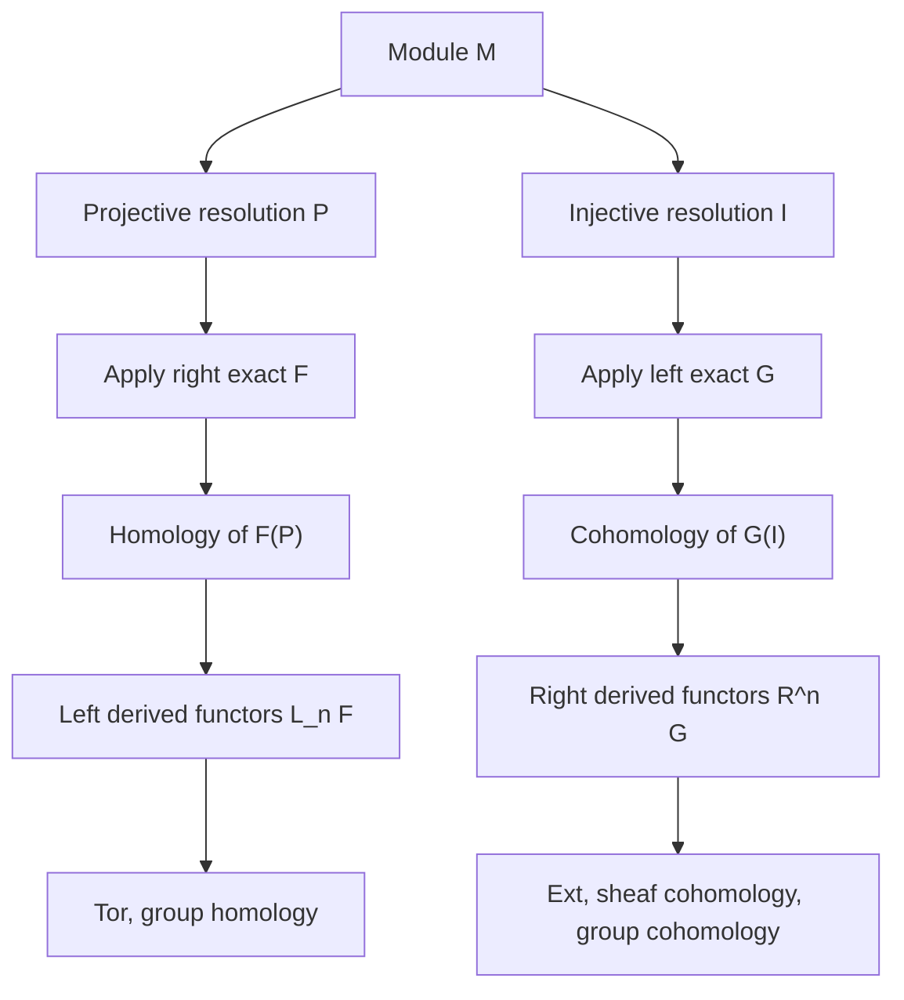

# Homological Algebra
> [Mathematics](../../README.md) › [Advanced Topics](../README.md) › Homological Algebra · Level: Advanced · Prerequisites: [Groups](../../13-abstract-algebra/01-groups/README.md), [Rings](../../13-abstract-algebra/02-rings/README.md), [Fields](../../13-abstract-algebra/03-fields/README.md), [Vector Spaces](../../08-linear-algebra/04-vector-spaces/README.md), [Linear Transformations](../../08-linear-algebra/05-linear-transformations/README.md), [Category Theory](../03-category-theory/README.md), [Algebraic Topology](../05-algebraic-topology/README.md) · Estimated time: 12 h

## 1. Introduction
Homological algebra is the algebra of **chain complexes** and of the functors that measure how far a construction is from being exact. It began as a bookkeeping device in topology — the algebra of cycles, boundaries and homology — and became an independent subject when Cartan, Eilenberg, Mac Lane and Grothendieck recognised that the same constructions compute the cohomology of groups, Lie algebras, sheaves, rings and spaces.

The central problem is easily stated. A short exact sequence of modules
$$0 \to A \to B \to C \to 0$$
is often transformed by a functor into a sequence that is no longer exact. The tensor product is right exact but not left exact; the Hom functor is left exact but not right exact; global sections of a sheaf are left exact but not right exact. Homological algebra measures the failure. The measurements are the **derived functors**: $\operatorname{Tor}_n$, $\operatorname{Ext}^n$, sheaf cohomology $H^n(X,\mathcal{F})$, group cohomology $H^n(G,M)$, and many others.

The construction is uniform. To compute the left derived functors of a right exact functor $F$, replace the object by a **projective resolution**, apply $F$ term by term, and take homology. To compute the right derived functors of a left exact functor $G$, replace the object by an **injective resolution**, apply $G$, and take cohomology. The result does not depend on the resolution, and a short exact sequence of objects produces a **long exact sequence** of derived functors. This long exact sequence is the main computational tool of the subject.

The plan of the tutorial is:

* **Complexes and exactness** (§7.1). A review, with the vocabulary of cones, cycles, boundaries and quasi-isomorphisms.
* **The snake lemma** (§7.2). The diagram chase that generates every long exact sequence, with a complete proof.
* **Projective and injective resolutions** (§7.3–§7.4), including existence and the comparison theorem.
* **Derived functors** (§7.5), with the construction and its independence of the resolution.
* **Ext and Tor** (§7.6–§7.7), constructed and computed in examples over $\mathbb{Z}$ and $k[x]$.
* **The long exact sequence in homology** (§7.8), with a complete proof.
* **Group cohomology** (§7.9), including the bar resolution and the interpretations of $H^1$ and $H^2$.
* **Spectral sequences** (§7.10), with the Serre spectral sequence and a worked computation of $H_*(S^3)$ from the Hopf fibration.
* **Abelian categories and Freyd–Mitchell** (§7.11), explaining why diagram chases are valid everywhere.
* **Sheaf cohomology and topology** (§7.12), the bridge back to geometry.
* **Applications** (§7.13).

## 2. Prerequisites
You should be comfortable with:

* **Groups, normal subgroups, quotients, abelian groups, free groups, presentations** — [Groups](../../13-abstract-algebra/01-groups/README.md). Group cohomology is the main source of examples outside module theory.
* **Rings, ideals, modules, submodules, quotient modules, homomorphisms, free modules** — [Rings](../../13-abstract-algebra/02-rings/README.md). All constructions are stated for modules over a ring; the case $R = \mathbb{Z}$ recovers abelian groups.
* **Fields, field extensions and vector spaces** — [Fields](../../13-abstract-algebra/03-fields/README.md) and [Vector Spaces](../../08-linear-algebra/04-vector-spaces/README.md). Over a field every module is free, so homological algebra collapses; the interesting phenomena are torsion and non-split extensions.
* **Linear maps, kernels, images, quotients, bases, dimension, matrices and the rank–nullity theorem** — [Linear Transformations](../../08-linear-algebra/05-linear-transformations/README.md). A chain complex over a field is linear algebra with a grading.
* **Categories, functors, natural transformations, limits and universal properties** — [Category Theory](../03-category-theory/README.md). Abelian categories and derived functors are categorical constructions.
* **Chain complexes, homology, exact sequences and the long exact sequence of a pair** — [Algebraic Topology](../05-algebraic-topology/README.md). Homology is the motivating example of a derived functor.

No prior knowledge of Ext, Tor, spectral sequences or sheaf cohomology is assumed. Every algebraic statement is proved or explicitly identified as a standard theorem, and the topological examples are self-contained.

## 3. Learning Objectives
After this tutorial you will be able to:

1. Define chain complexes, chain maps, chain homotopies, quasi-isomorphisms and the homology functors, and verify that homology is functorial.
2. State and prove the snake lemma, and use it to produce long exact sequences.
3. Define projective and injective modules, prove the standard characterisations, and construct projective and injective resolutions.
4. Prove the comparison theorem for projective resolutions and explain why derived functors are independent of the resolution.
5. Construct $\operatorname{Ext}^n_R(M,N)$ and $\operatorname{Tor}_n^R(M,N)$ and compute them for modules over $\mathbb{Z}$ and $k[x]$.
6. Prove the long exact sequences for Ext and Tor in both variables.
7. Explain the bijection between $\operatorname{Ext}^1_R(M,N)$ and equivalence classes of extensions of $M$ by $N$.
8. Define group cohomology and group homology, compute them for cyclic groups, and interpret $H^1$ and $H^2$.
9. Define a spectral sequence, state the Serre spectral sequence, and use it to compute the homology of $S^3$ from the Hopf fibration.
10. Define an abelian category, state the Freyd–Mitchell embedding theorem, and explain why diagram chases are valid in any abelian category.
11. Relate derived functors to sheaf cohomology, de Rham cohomology and singular cohomology.
12. Identify the places where homological algebra is used in algebra, geometry, topology, number theory and data analysis.

## 4. Intuition
Imagine a spreadsheet of vector spaces and linear maps, arranged in columns, with the rule that the map out of each column followed by the next map is zero. The columns are the **degrees**, the maps are the **differentials**, and the rule is $\partial^2 = 0$. The **homology** of the spreadsheet is, in each column, the kernel of the outgoing map modulo the image of the incoming map: the part of the column that is closed but not exact.

Why should anyone care? Because the same spreadsheet can be produced from a space, a group, a ring, a sheaf or a polynomial ring, and its homology measures something different in each case. For a space it measures holes; for a group it measures extensions and derivations; for a ring it measures relations among relations; for a sheaf it measures the obstruction to patching local data.

The second idea is **resolution**. To understand an object $M$, replace it by a chain of simpler objects mapping onto it, each of which is projective (or injective). The resolution is a "free coordinate system" for $M$: it records generators, then relations among generators, then relations among relations, and so on. Applying a functor to the resolution and taking homology measures the failure of the functor to preserve exactness. Different resolutions give the same answer because any two resolutions are linked by a chain map, unique up to homotopy.

The third idea is **exactness as a local-to-global principle**. A short exact sequence is a way of saying that $B$ is built from $A$ and $C$. A left exact functor preserves the $A$ and the kernel; a right exact functor preserves the $C$ and the cokernel. The derived functors fill in the missing term and, more importantly, continue the sequence indefinitely. The long exact sequence is the precise statement that "there is no loss of information, only a shift in degree".

A useful analogy is **calculus**. Differentiation is not exact: it loses constants. The de Rham complex is a resolution of the constant sheaf, and de Rham cohomology measures the constants that survive globally. Integration is not exact either: an exact form integrates to zero over a closed cycle, but a closed form need not be exact, and the obstruction is a cohomology class. Homological algebra is the algebra of these obstructions.

A second analogy is **linear algebra over a ring**. Over a field, every short exact sequence splits and every module is free, so all higher Ext and Tor vanish. Over $\mathbb{Z}$, the sequence $0 \to \mathbb{Z} \xrightarrow{2} \mathbb{Z} \to \mathbb{Z}/2 \to 0$ does not split, and the failure is measured by $\operatorname{Ext}^1(\mathbb{Z}/2,\mathbb{Z}) = \mathbb{Z}/2$ and $\operatorname{Tor}_1(\mathbb{Z}/2,\mathbb{Z}/2) = \mathbb{Z}/2$. The torsion is the obstruction.

## 5. Formal Definition
### 5.1 Chain complexes
**Definition 5.1.1** (chain complex). Let $R$ be a ring. A **chain complex** of left $R$-modules is a sequence
$$\cdots \to C_{n+1} \xrightarrow{\ \partial_{n+1}\ } C_n \xrightarrow{\ \partial_n\ } C_{n-1} \to \cdots$$
of left $R$-modules and $R$-linear maps with $\partial_n \circ \partial_{n+1} = 0$ for all $n$. A **cochain complex** is the same with upper indices and differentials $d^n : C^n \to C^{n+1}$ satisfying $d^{n+1} d^n = 0$.

**Definition 5.1.2** (morphisms). A **chain map** $f : (C_*,\partial) \to (D_*,\partial')$ is a family of $R$-linear maps $f_n : C_n \to D_n$ with $\partial'_n f_n = f_{n-1}\partial_n$. A **chain homotopy** between chain maps $f,g : C_* \to D_*$ is a family $h_n : C_n \to D_{n+1}$ with
$$\partial'_{n+1} h_n + h_{n-1}\partial_n = g_n - f_n.$$
If such an $h$ exists, $f$ and $g$ are **chain homotopic**, written $f \simeq g$.

**Definition 5.1.3** (homology). For a chain complex $C_*$, put
$$Z_n(C_*) = \ker \partial_n, \qquad B_n(C_*) = \operatorname{im}\partial_{n+1}, \qquad H_n(C_*) = Z_n(C_*)/B_n(C_*).$$
The elements of $Z_n$ are **cycles**, those of $B_n$ are **boundaries**, and $H_n$ is the **$n$-th homology module**. A chain map induces $f_* : H_n(C_*) \to H_n(D_*)$ by $f_*[z] = [f_n(z)]$. A chain map is a **quasi-isomorphism** if it induces isomorphisms on all homology modules.

### 5.2 Exact sequences and exact functors
**Definition 5.2.1** (exactness). A sequence of $R$-modules and maps
$$\cdots \to A_{n+1} \xrightarrow{f_{n+1}} A_n \xrightarrow{f_n} A_{n-1} \to \cdots$$
is **exact at $A_n$** if $\ker f_n = \operatorname{im} f_{n+1}$. It is **exact** if it is exact at every term. A **short exact sequence** is an exact sequence of the form
$$0 \to A \xrightarrow{i} B \xrightarrow{p} C \to 0,$$
which means that $i$ is injective, $p$ is surjective and $\ker p = \operatorname{im} i$.

**Definition 5.2.2** (additive and exact functors). Let $F : R\text{-}\mathbf{Mod} \to S\text{-}\mathbf{Mod}$ be an additive functor, so $F(f+g) = F(f)+F(g)$ and $F(0)=0$.

* $F$ is **left exact** if every short exact sequence $0 \to A \to B \to C \to 0$ gives an exact sequence $0 \to F(A) \to F(B) \to F(C)$.
* $F$ is **right exact** if every such sequence gives an exact sequence $F(A) \to F(B) \to F(C) \to 0$.
* $F$ is **exact** if it is both left and right exact.

The functor $\operatorname{Hom}_R(M,-)$ is left exact, the functor $\operatorname{Hom}_R(-,N)$ is left exact and contravariant, and the functor $-\otimes_R M$ is right exact.

### 5.3 Projective and injective objects
**Definition 5.3.1** (projective). A left $R$-module $P$ is **projective** if for every surjective $R$-linear map $p : B \to C$ and every $R$-linear map $f : P \to C$ there exists an $R$-linear map $\tilde f : P \to B$ with $p \circ \tilde f = f$. Equivalently, the functor $\operatorname{Hom}_R(P,-)$ is exact.

**Definition 5.3.2** (injective). A left $R$-module $Q$ is **injective** if for every injective $R$-linear map $i : A \to B$ and every $R$-linear map $f : A \to Q$ there exists an $R$-linear map $\tilde f : B \to Q$ with $\tilde f \circ i = f$. Equivalently, the functor $\operatorname{Hom}_R(-,Q)$ is exact.

**Theorem 5.3.3** (standard characterisations).

1. A module is projective iff it is a direct summand of a free module.
2. A module is injective iff it satisfies **Baer's criterion**: every $R$-linear map $I \to Q$ from a left ideal $I \subseteq R$ extends to an $R$-linear map $R \to Q$.
3. Over $\mathbb{Z}$, a module is injective iff it is divisible; in particular $\mathbb{Q}$ and $\mathbb{Q}/\mathbb{Z}$ are injective, while $\mathbb{Z}$ and $\mathbb{Z}/n$ are not.
4. Over a field, every module is both projective and injective.

### 5.4 Resolutions
**Definition 5.4.1** (projective resolution). A **projective resolution** of a left $R$-module $M$ is an exact sequence
$$\cdots \to P_2 \xrightarrow{\ \partial_2\ } P_1 \xrightarrow{\ \partial_1\ } P_0 \xrightarrow{\ \varepsilon\ } M \to 0$$
in which every $P_n$ is projective. The map $\varepsilon$ is the **augmentation**.

**Definition 5.4.2** (injective resolution). An **injective resolution** of $M$ is an exact sequence
$$0 \to M \xrightarrow{\ \eta\ } I^0 \xrightarrow{\ d^0\ } I^1 \xrightarrow{\ d^1\ } I^2 \to \cdots$$
in which every $I^n$ is injective.

**Theorem 5.4.3** (existence). Every left $R$-module has a projective resolution, and every left $R$-module has an injective resolution.

*Sketch.* For projectives, choose a generating set of $M$, let $P_0$ be the free module on that set with $\varepsilon : P_0 \to M$ surjective, let $K_0 = \ker\varepsilon$, and repeat with $K_0$ to obtain $P_1 \to K_0$, and so on. For injectives, embed $M$ into an injective module $I^0$ (for $R = \mathbb{Z}$, embed into a divisible group; for a general ring, use the characteristic module $\operatorname{Hom}_{\mathbb{Z}}(R,\mathbb{Q}/\mathbb{Z})$ and Baer's criterion), then embed the cokernel into an injective, and iterate. $\blacksquare$

**Theorem 5.4.4** (comparison theorem). Let $P_* \to M$ and $Q_* \to N$ be projective resolutions, and let $f : M \to N$ be $R$-linear. Then there is a chain map $\tilde f : P_* \to Q_*$ lifting $f$ (so $\tilde f_0$ covers $f$), and any two such lifts are chain homotopic.

The proof is an induction using the lifting property of projective modules; it is given in §7.3. The same statement holds for injective resolutions, with the arrows reversed.

### 5.5 Derived functors
**Definition 5.5.1** (left derived functor). Let $F : R\text{-}\mathbf{Mod} \to S\text{-}\mathbf{Mod}$ be a right exact additive functor and let $M$ be a left $R$-module. Choose a projective resolution $P_* \to M$ and define
$$L_n F(M) = H_n\bigl(F(P_*)\bigr), \qquad n \ge 0.$$
By the comparison theorem, $L_nF(M)$ is independent of the resolution up to a canonical isomorphism, and $L_0F \cong F$.

**Definition 5.5.2** (right derived functor). Let $G : R\text{-}\mathbf{Mod} \to S\text{-}\mathbf{Mod}$ be a left exact additive functor and let $M$ be a left $R$-module. Choose an injective resolution $M \to I^*$ and define
$$R^n G(M) = H^n\bigl(G(I^*)\bigr), \qquad n \ge 0.$$
Again $R^nG(M)$ is independent of the resolution, and $R^0G \cong G$.

**Definition 5.5.3** (Ext and Tor). For left $R$-modules $M,N$:

$$\operatorname{Ext}^n_R(M,N) = R^n\operatorname{Hom}_R(M,-)(N) = L_n\operatorname{Hom}_R(-,N)(M).$$

For Tor, assume $R$ is commutative (or take $M$ a right module and $N$ a left module) so that the tensor product is defined:

$$\operatorname{Tor}_n^R(M,N) = L_n(M \otimes_R -)(N) = L_n(-\otimes_R N)(M).$$

The equalities are the **balancing** of Ext and Tor: either variable may be resolved. In particular $\operatorname{Ext}^0_R(M,N) = \operatorname{Hom}_R(M,N)$ and $\operatorname{Tor}_0^R(M,N) = M \otimes_R N$.

### 5.6 Long exact sequences
**Theorem 5.6.1** (long exact sequence in homology). Let $0 \to A_* \to B_* \to C_* \to 0$ be a short exact sequence of chain complexes of $R$-modules. Then there is a long exact sequence
$$\cdots \to H_n(A_*) \to H_n(B_*) \to H_n(C_*) \xrightarrow{\ \partial_n\ } H_{n-1}(A_*) \to \cdots,$$
natural in the short exact sequence. The connecting map is defined by lifting a cycle in $C_n$ to $B_n$, applying the boundary, and taking the unique preimage in $A_{n-1}$.

**Theorem 5.6.2** (long exact sequences for Ext and Tor). Let $0 \to A \to B \to C \to 0$ be a short exact sequence of left $R$-modules and let $N$ be a left $R$-module.

1. There is a long exact sequence
$$0 \to \operatorname{Hom}_R(C,N) \to \operatorname{Hom}_R(B,N) \to \operatorname{Hom}_R(A,N) \to \operatorname{Ext}^1_R(C,N) \to \operatorname{Ext}^1_R(B,N) \to \operatorname{Ext}^1_R(A,N) \to \cdots.$$
2. There is a long exact sequence
$$\cdots \to \operatorname{Ext}^1_R(N,A) \to \operatorname{Ext}^1_R(N,B) \to \operatorname{Ext}^1_R(N,C) \to \operatorname{Ext}^2_R(N,A) \to \cdots.$$
3. There is a long exact sequence
$$\cdots \to \operatorname{Tor}_1^R(N,A) \to \operatorname{Tor}_1^R(N,B) \to \operatorname{Tor}_1^R(N,C) \to N \otimes_R A \to N \otimes_R B \to N \otimes_R C \to 0.$$
**Remark.** The exactness of these sequences is the shadow of the snake lemma: each is obtained by applying the snake lemma to a diagram of resolutions or by the long exact sequence of a short exact sequence of complexes.

### 5.7 Group cohomology and homology
**Definition 5.7.1.** Let $G$ be a group and let $M$ be a left $\mathbb{Z}G$-module, equivalently an abelian group with a left $G$-action. The **group cohomology** and **group homology** are
$$H^n(G,M) = \operatorname{Ext}^n_{\mathbb{Z}G}(\mathbb{Z},M), \qquad H_n(G,M) = \operatorname{Tor}_n^{\mathbb{Z}G}(\mathbb{Z},M),$$
where $\mathbb{Z}$ is the trivial $\mathbb{Z}G$-module (every $g \in G$ acts by the identity).

**The bar resolution.** Let $B_n$ be the free left $\mathbb{Z}G$-module on the set $G^n$, with basis symbols $[g_1|\cdots|g_n]$, and define
$$\partial_n[g_1|\cdots|g_n] = g_1[g_2|\cdots|g_n] + \sum_{i=1}^{n-1}(-1)^i[g_1|\cdots|g_ig_{i+1}|\cdots|g_n] + (-1)^n[g_1|\cdots|g_{n-1}].$$
The augmented complex $B_* \to \mathbb{Z}$ is exact (it has a contracting homotopy), so it is a free resolution of $\mathbb{Z}$.

**The standard cochain complex.** Applying $\operatorname{Hom}_{\mathbb{Z}G}(-,M)$ gives $C^n(G,M) = \operatorname{Maps}(G^n,M)$ with coboundary
$$(d\varphi)(g_1,\dots,g_{n+1}) = g_1\cdot\varphi(g_2,\dots,g_{n+1}) + \sum_{i=1}^{n}(-1)^i\varphi(g_1,\dots,g_ig_{i+1},\dots,g_{n+1}) + (-1)^{n+1}\varphi(g_1,\dots,g_n).$$
Then $H^n(G,M) = \ker d^n/\operatorname{im} d^{n-1}$. In low degrees:

* $H^0(G,M) = M^G$, the fixed points.
* $H^1(G,M) = \operatorname{Der}(G,M)/\operatorname{Inn}(G,M)$, derivations modulo principal derivations.
* $H^2(G,M)$ classifies extensions $1 \to M \to E \to G \to 1$ inducing the given action.

### 5.8 Abelian categories
**Definition 5.8.1** (abelian category). An **abelian category** is an additive category $\mathcal{A}$ such that:

1. every morphism has a kernel and a cokernel;
2. every monomorphism is a kernel of its cokernel;
3. every epimorphism is a cokernel of its kernel.

Equivalently, $\mathcal{A}$ is additive, has finite limits and colimits, and the canonical map $\operatorname{coim} f \to \operatorname{im} f$ is an isomorphism for every morphism $f$.

**Examples.** The categories $R\text{-}\mathbf{Mod}$ of left $R$-modules, $\mathbf{Ab}$ of abelian groups, $\operatorname{Sh}(X)$ of sheaves of abelian groups on a space $X$, presheaves of abelian groups, and the category $\mathbf{Ch}(R)$ of chain complexes of $R$-modules are abelian. The category of torsion-free abelian groups is not abelian: the cokernel of multiplication by $2$ on $\mathbb{Z}$ is $\mathbb{Z}/2$, which is not torsion-free.

**Theorem 5.8.2** (Freyd–Mitchell embedding theorem). Every **small** abelian category $\mathcal{A}$ admits a full, faithful and exact functor
$$F : \mathcal{A} \to R\text{-}\mathbf{Mod}$$
for some ring $R$ (not necessarily commutative). "Exact" means that $F$ preserves finite limits and finite colimits, hence kernels, cokernels, images and coimages.

The theorem justifies **diagram chasing** in an arbitrary abelian category: a diagram chase is a finite diagram, and the theorem embeds the relevant small subcategory into modules, where elements are available. The embedding is not an equivalence; it does not identify $\mathcal{A}$ with a category of modules.

### 5.9 Spectral sequences
**Definition 5.9.1** (spectral sequence). A **homological spectral sequence** in a category $\mathcal{A}$ consists of objects $E^r_{p,q}$ for $r \ge 2$ and $p,q \in \mathbb{Z}$, and differentials
$$d_r : E^r_{p,q} \to E^r_{p-r,q+r-1}, \qquad d_r \circ d_r = 0,$$
together with isomorphisms $E^{r+1}_{p,q} \cong \ker d_r/\operatorname{im} d_r$. A spectral sequence is **first quadrant** if $E^r_{p,q} = 0$ whenever $p < 0$ or $q < 0$.

**Definition 5.9.2** (convergence). A first-quadrant spectral sequence **converges** to a graded object $H_*$ if there is a finite filtration
$$0 = F_{-1}H_n \subseteq F_0H_n \subseteq \cdots \subseteq F_nH_n = H_n$$
for each $n$, with isomorphisms $E^\infty_{p,q} \cong F_pH_{p+q}/F_{p-1}H_{p+q}$, where $E^\infty$ is the stable value of $E^r$.

**Theorem 5.9.3** (Serre spectral sequence). Let $F \to E \to B$ be a Serre fibration with $B$ path-connected, and let $R$ be a commutative ring. Suppose $\pi_1(B)$ acts on $H_q(F;R)$ through a local coefficient system $\mathcal{H}_q(F;R)$. Then there is a first-quadrant spectral sequence
$$E^2_{p,q} = H_p\bigl(B;\mathcal{H}_q(F;R)\bigr) \Longrightarrow H_{p+q}(E;R).$$
If $B$ is simply connected, the action is trivial and $E^2_{p,q} = H_p(B;H_q(F;R))$.

The differentials are $d_r : E^r_{p,q} \to E^r_{p-r,q+r-1}$, and the spectral sequence computes the homology of the total space from the homology of the base and the fibre, up to the extension problem encoded by the filtration.

## 6. Mathematical Notation

| Symbol | Read as | Meaning |
|---|---|---|
| $R\text{-}\mathbf{Mod}$ | the category of left $R$-modules | objects are modules, arrows are $R$-linear maps |
| $\mathbf{Ch}(R)$ | the category of chain complexes | complexes of $R$-modules with chain maps |
| $C_*$, $\partial$ | chain complex, boundary | a graded module with $\partial^2 = 0$ |
| $Z_n$, $B_n$, $H_n$ | cycles, boundaries, homology | $Z_n = \ker\partial_n$, $B_n = \operatorname{im}\partial_{n+1}$, $H_n = Z_n/B_n$ |
| $\operatorname{Ext}^n_R(M,N)$ | Ext | $R^n\operatorname{Hom}_R(M,-)(N)$ |
| $\operatorname{Tor}_n^R(M,N)$ | Tor | $L_n(M \otimes_R -)(N)$ |
| $L_nF$, $R^nG$ | left/right derived functors | homology/cohomology of $F$ or $G$ applied to a resolution |
| $\operatorname{pd}_R(M)$ | projective dimension | minimal length of a projective resolution |
| $\operatorname{id}_R(M)$ | injective dimension | minimal length of an injective resolution |
| $\operatorname{gl.dim} R$ | global dimension | supremum of projective dimensions |
| $\mathbb{Z}G$ | group ring | finite formal sums $\sum a_g g$ with $g \in G$ |
| $H^n(G,M)$ | group cohomology | $\operatorname{Ext}^n_{\mathbb{Z}G}(\mathbb{Z},M)$ |
| $H_n(G,M)$ | group homology | $\operatorname{Tor}_n^{\mathbb{Z}G}(\mathbb{Z},M)$ |
| $M^G$, $M_G$ | invariants, coinvariants | fixed points, quotient by $gm-m$ |
| $\operatorname{Der}(G,M)$ | derivations | maps $d$ with $d(gh)=g\,d(h)+d(g)$ |
| $E^r_{p,q}$, $d_r$ | spectral sequence page and differential | $d_r : E^r_{p,q} \to E^r_{p-r,q+r-1}$ |
| $E^\infty_{p,q}$ | stable page | associated graded of the abutment |
| $\operatorname{Sh}(X)$ | category of sheaves on $X$ | sheaves of abelian groups |
| $\Gamma(X,-)$ | global sections | left exact functor to abelian groups |
| $\check{H}^p(\mathcal{U},\mathcal{F})$ | Čech cohomology | cohomology of the nerve of a cover |

## 7. Core Concepts
### 7.1 Chain complexes and exact sequences reviewed
A chain complex is a graded object with a differential whose square is zero. The definitions are in §5.1; this subsection records the facts used constantly.

**Homology is functorial.** A chain map $f : C_* \to D_*$ sends cycles to cycles and boundaries to boundaries, so it induces $f_* : H_n(C_*) \to H_n(D_*)$. The identities $(g \circ f)_* = g_* \circ f_*$ and $(\operatorname{id})_* = \operatorname{id}$ hold. Chain homotopic maps induce equal maps on homology:
$$f \simeq g \implies f_* = g_*.$$
Indeed, if $\partial h + h\partial = g - f$ and $z$ is a cycle, then $g(z) - f(z) = \partial h(z)$ is a boundary.

**The mapping cone.** For a chain map $f : A_* \to B_*$, the **cone** is the complex
$$\operatorname{cone}(f)_n = A_{n-1} \oplus B_n, \qquad \partial(a,b) = \bigl(-\partial a,\ f(a) + \partial b\bigr).$$
A direct check gives $\partial^2 = 0$. The cone fits into a short exact sequence of complexes
$$0 \to B_* \to \operatorname{cone}(f) \to A_{*-1} \to 0,$$
and the associated long exact sequence shows that $f$ is a quasi-isomorphism iff $\operatorname{cone}(f)$ is acyclic. This is the algebraic prototype of the mapping cone in topology.

**The homotopy category and the derived category.** Chain complexes of $R$-modules, chain maps and chain homotopies form the **homotopy category** $K(R)$. Inverting all quasi-isomorphisms in $K(R)$ produces the **derived category** $D(R)$, in which a quasi-isomorphism becomes an isomorphism. The derived functors $L_nF$ and $R^nG$ are the cohomology functors of genuine functors on $D(R)$, and the long exact sequence of a short exact sequence is the shadow of a **distinguished triangle**. This is the modern setting for homological algebra; the present tutorial states everything in the classical language, and the reader should treat the derived category as the next step rather than as a prerequisite.

**Exact sequences.** A sequence is exact at a term when the kernel of the outgoing map equals the image of the incoming map. Over a field every short exact sequence splits, because every subspace has a complement and every module is free. Over $\mathbb{Z}$ this fails: the sequence
$$0 \to \mathbb{Z} \xrightarrow{\ \times 2\ } \mathbb{Z} \xrightarrow{\ \operatorname{mod} 2\ } \mathbb{Z}/2 \to 0$$
is exact but does not split, since $\mathbb{Z}$ has no element of order $2$. The obstruction to splitting is an element of $\operatorname{Ext}^1_{\mathbb{Z}}(\mathbb{Z}/2,\mathbb{Z}) \cong \mathbb{Z}/2$.

**Split sequences.** A short exact sequence $0 \to A \to B \to C \to 0$ splits iff there is a map $s : C \to B$ with $p \circ s = \operatorname{id}_C$ (a **section**) iff there is a map $r : B \to A$ with $r \circ i = \operatorname{id}_A$ (a **retraction**). In that case $B \cong A \oplus C$. A sequence with $C$ projective or with $A$ injective always splits.

**Additive functors.** Every additive functor sends chain homotopies to chain homotopies and split exact sequences to split exact sequences. It need not preserve exactness; measuring the failure is the purpose of derived functors.

### 7.2 The snake lemma
The snake lemma is the source of every long exact sequence in the subject. It is a statement about a commutative diagram with exact rows.

**Theorem 7.2.1** (snake lemma). Let
$$
\begin{array}{ccccccccc}
0 & \to & A & \xrightarrow{\ f\ } & B & \xrightarrow{\ g\ } & C & \to & 0\\
 & & \downarrow{\scriptstyle \alpha} & & \downarrow{\scriptstyle \beta} & & \downarrow{\scriptstyle \gamma} & & \\
0 & \to & A' & \xrightarrow{\ f'\ } & B' & \xrightarrow{\ g'\ } & C' & \to & 0
\end{array}
$$
be a commutative diagram of $R$-modules with exact rows. Then there is an exact sequence
$$0 \to \ker\alpha \to \ker\beta \to \ker\gamma \xrightarrow{\ \delta\ } \operatorname{coker}\alpha \to \operatorname{coker}\beta \to \operatorname{coker}\gamma \to 0,$$
natural in the diagram.

*Proof.* The maps on kernels are the restrictions of $f$ and $g$; the maps on cokernels are induced by $f'$ and $g'$.

*Well-definedness on kernels.* If $a \in \ker\alpha$, then $\beta f(a) = f'\alpha(a) = 0$, so $f(a) \in \ker\beta$. If $b \in \ker\beta$, then $\gamma g(b) = g'\beta(b) = 0$, so $g(b) \in \ker\gamma$.

*The connecting map $\delta$.* Let $c \in \ker\gamma \subseteq C$. Since $g$ is surjective, choose $b \in B$ with $g(b) = c$. Then
$$g'\beta(b) = \gamma g(b) = \gamma(c) = 0,$$
so $\beta(b) \in \ker g' = \operatorname{im} f'$. Since $f'$ is injective, there is a unique $a' \in A'$ with $f'(a') = \beta(b)$. Define
$$\delta(c) = [a'] \in \operatorname{coker}\alpha = A'/\operatorname{im}\alpha.$$
*Well-definedness of $\delta$.* If $b_1, b_2$ both lift $c$, then $g(b_1 - b_2) = 0$, so $b_1 - b_2 = f(a)$ for some $a \in A$. Then
$$\beta(b_1) - \beta(b_2) = \beta f(a) = f'\alpha(a),$$
so the corresponding $a'$ changes by $\alpha(a)$, hence the class in $\operatorname{coker}\alpha$ is unchanged. The element $a'$ is unique because $f'$ is injective. Thus $\delta$ is well defined. It is a homomorphism because the choices can be added.

*Exactness at $\ker\alpha$.* The map $\ker\alpha \to \ker\beta$ is injective because $f$ is injective.

*Exactness at $\ker\beta$.* An element $b \in \ker\beta$ maps to zero in $\ker\gamma$ iff $g(b) = 0$, iff $b = f(a)$ for some $a \in A$. Since $\beta(b) = 0$, we have $f'\alpha(a) = \beta f(a) = 0$, and $f'$ injective gives $\alpha(a) = 0$. Hence $b$ is the image of $a \in \ker\alpha$.

*Exactness at $\ker\gamma$.* If $c = g(b)$ with $b \in \ker\beta$, then $\beta(b) = 0$, so $a' = 0$ and $\delta(c) = 0$. Conversely, if $\delta(c) = 0$, then $a' = \alpha(a)$ for some $a \in A$, so $\beta(b) = f'\alpha(a) = \beta f(a)$. Then $b - f(a) \in \ker\beta$ and $g(b - f(a)) = g(b) = c$, so $c$ is the image of an element of $\ker\beta$.

*Exactness at $\operatorname{coker}\alpha$.* The composite $\ker\gamma \to \operatorname{coker}\alpha \to \operatorname{coker}\beta$ sends $c$ to the class of $f'(a') = \beta(b)$, which is zero in $\operatorname{coker}\beta$. Conversely, if $[a'] \in \operatorname{coker}\alpha$ maps to zero in $\operatorname{coker}\beta$, then $f'(a') = \beta(b)$ for some $b \in B$. Then $g'\beta(b) = 0$, so $\gamma g(b) = 0$, hence $g(b) \in \ker\gamma$ and $\delta(g(b)) = [a']$ by construction.

*Exactness at $\operatorname{coker}\beta$.* The composite $\operatorname{coker}\alpha \to \operatorname{coker}\beta \to \operatorname{coker}\gamma$ is zero because $g'f' = 0$. Conversely, if $[b'] \in \operatorname{coker}\beta$ maps to zero, then $g'(b') = \gamma(c)$ for some $c \in C$. Choose $b \in B$ with $g(b) = c$. Then $g'(b' - \beta(b)) = 0$, so $b' - \beta(b) = f'(a')$ for some $a'$, and $[b'] = [f'(a')]$ is the image of $[a'] \in \operatorname{coker}\alpha$.

*Surjectivity onto $\operatorname{coker}\gamma$.* Since $g'$ is surjective, every class $[c']$ is the image of a class $[b']$.

Naturality is immediate from the construction: a morphism of diagrams carries lifts to lifts and changes of lifts to changes of lifts. $\blacksquare$

**Corollary 7.2.2** (long exact sequence of complexes). A short exact sequence of chain complexes $0 \to A_* \to B_* \to C_* \to 0$ gives a long exact sequence in homology.

*Proof.* This is Theorem 7.8.1, where the connecting map is constructed explicitly. Equivalently, apply the snake lemma to the degreewise diagram formed by the cycles and boundaries of the three complexes; the connecting map it produces agrees with the one in Theorem 7.8.1. $\blacksquare$

**Corollary 7.2.3** (the five lemma). In a commutative diagram with exact rows
$$
\begin{array}{ccccccccc}
A & \to & B & \to & C & \to & D & \to & E\\
\downarrow{\scriptstyle \alpha} & & \downarrow{\scriptstyle \beta} & & \downarrow{\scriptstyle \gamma} & & \downarrow{\scriptstyle \delta} & & \downarrow{\scriptstyle \varepsilon}\\
A' & \to & B' & \to & C' & \to & D' & \to & E',
\end{array}
$$
if $\alpha, \beta, \delta, \varepsilon$ are isomorphisms, then so is $\gamma$.

*Proof.* Apply the snake lemma to the two halves of the diagram (or chase elements). Injectivity of $\gamma$: if $\gamma(c) = 0$, then $\delta(d) = 0$ for a preimage $d$ of $c$ in $D$; since $\delta$ is injective, $d = 0$, so $c$ comes from $B$; then $\beta(b) = 0$, so $b = 0$ and $c = 0$. Surjectivity: given $c' \in C'$, choose $d'$ mapping to $c'$; since $\delta$ is surjective, $d' = \delta(d)$; then $c' - \gamma(\text{preimage of } d)$ maps to zero in $D'$, so it comes from $B'$, and $\beta$ surjective lifts it. $\blacksquare$

### 7.3 Projective resolutions
**Proposition 7.3.1.** For a left $R$-module $P$, the following are equivalent:

1. $P$ is projective;
2. every surjection $B \to P$ splits;
3. $P$ is a direct summand of a free module;
4. $\operatorname{Ext}^1_R(P,N) = 0$ for every $N$;
5. $\operatorname{Hom}_R(P,-)$ is exact.

*Proof.* (1) $\Rightarrow$ (2): apply the lifting property to the identity $P \to P$. (2) $\Rightarrow$ (3): choose a surjection $F \to P$ from a free module. (3) $\Rightarrow$ (1): a direct summand of a free module inherits the lifting property. (1) $\Leftrightarrow$ (5) is the definition. (1) $\Rightarrow$ (4): a projective resolution of $P$ is $0 \to P \to P \to 0$, so Ext vanishes in positive degrees. (4) $\Rightarrow$ (2): given an extension $0 \to K \to B \xrightarrow{p} P \to 0$, the exact sequence
$$\operatorname{Hom}(P,B) \xrightarrow{\ p_*\ } \operatorname{Hom}(P,P) \to \operatorname{Ext}^1(P,K) = 0$$
shows that $\operatorname{id}_P$ lifts to a map $s : P \to B$ with $p \circ s = \operatorname{id}_P$, so the extension splits. $\blacksquare$

**Existence of projective resolutions.** Let $M$ be a module. Choose a set of generators $\{m_\alpha\}$ and let $P_0 = R^{(I)}$ be the free module on the same indexing set, with $\varepsilon(e_\alpha) = m_\alpha$. Then $\varepsilon$ is surjective. Let $K_0 = \ker\varepsilon$ and repeat: choose a free module $P_1$ mapping onto $K_0$, and so on. The resulting sequence
$$\cdots \to P_2 \to P_1 \to P_0 \to M \to 0$$
is exact by construction. Every free module is projective, so this is a projective resolution.

**Examples of resolutions.**

*Over $R = \mathbb{Z}$, for $M = \mathbb{Z}/n$:*
$$0 \to \mathbb{Z} \xrightarrow{\ \times n\ } \mathbb{Z} \xrightarrow{\ \operatorname{mod} n\ } \mathbb{Z}/n \to 0.$$
This is a projective resolution of length $1$, and it is the standard input for computing Ext and Tor of cyclic groups.

*Over $R = k[x]$, for $M = k$ with $x$ acting by zero:*
$$0 \to k[x] \xrightarrow{\ \times x\ } k[x] \xrightarrow{\ x \mapsto 0\ } k \to 0.$$
Again length $1$.

*Over $R = k[x,y]$, for $M = k$:* the **Koszul resolution**
$$0 \to R \xrightarrow{\ \begin{pmatrix} -y \\ x \end{pmatrix}\ } R^2 \xrightarrow{\ \begin{pmatrix} x & y \end{pmatrix}\ } R \to k \to 0.$$
The composite is $-xy + xy = 0$, and exactness follows from the fact that $x,y$ is a regular sequence. This is the first nontrivial example of a resolution of length $2$.

*The bar resolution.* For a group $G$, the bar resolution of $\mathbb{Z}$ over $\mathbb{Z}G$ is a free resolution in every degree; it is the universal source of group cohomology (§7.9).

**Hilbert's syzygy theorem.** Over the polynomial ring $R = k[x_1,\dots,x_d]$, every finitely generated module has a free resolution of length at most $d$. The kernels of the successive maps are the **syzygies** of the module: generators, then relations, then relations among relations. The theorem says that after $d$ steps the process stops, so the polynomial ring has global dimension $d$. This is the algebraic reason that projective dimension is a finite, computable invariant for modules over a polynomial ring, and it is the input to the Auslander–Buchsbaum formula relating depth and projective dimension.

**Theorem 7.3.2** (comparison theorem). Let $P_* \to M$ and $Q_* \to N$ be projective resolutions, and let $f : M \to N$. Then there is a chain map $\tilde f : P_* \to Q_*$ with $\varepsilon_Q \tilde f_0 = f \varepsilon_P$, and any two such chain maps are chain homotopic.

*Proof.* **Existence.** For $n=0$, the composite $P_0 \to M \to N$ lifts through the surjection $Q_0 \to N$ because $P_0$ is projective. Suppose $\tilde f_0,\dots,\tilde f_{n-1}$ are constructed and commute with boundaries. The composite $P_n \to P_{n-1} \xrightarrow{\tilde f_{n-1}} Q_{n-1}$ lands in $\ker(Q_{n-1} \to Q_{n-2}) = \operatorname{im}(Q_n \to Q_{n-1})$. Since $P_n$ is projective, this map lifts to $Q_n$, giving $\tilde f_n$.

**Uniqueness up to homotopy.** Let $\tilde f, \tilde g$ be two lifts. We construct $h_n : P_n \to Q_{n+1}$ with $\partial h_n + h_{n-1}\partial = \tilde g_n - \tilde f_n$. For $n=0$, $\tilde g_0 - \tilde f_0$ maps into $\ker(Q_0 \to N) = \operatorname{im}(Q_1 \to Q_0)$, so it lifts to $h_0 : P_0 \to Q_1$ by projectivity. Suppose $h_0,\dots,h_{n-1}$ are constructed. Then
$$\partial\bigl(\tilde g_n - \tilde f_n - h_{n-1}\partial\bigr) = (\tilde g_{n-1} - \tilde f_{n-1})\partial - \partial h_{n-1}\partial = \partial h_{n-2}\partial - \partial h_{n-1}\partial = 0,$$
using the induction hypothesis, so the expression lands in $\ker\partial = \operatorname{im}(Q_{n+1} \to Q_n)$ and lifts to $h_n$. $\blacksquare$

The comparison theorem is what makes derived functors well defined: any two projective resolutions of $M$ are linked by chain maps in both directions whose composites are homotopic to the identity, so applying an additive functor and taking homology gives canonically isomorphic results.

### 7.4 Injective resolutions
Injective modules are the dual notion. They are rarer in concrete categories, but they exist in abundance by general theorems.

**Theorem 7.4.1** (Baer's criterion). A left $R$-module $Q$ is injective if and only if every $R$-linear map $I \to Q$ from a left ideal $I \subseteq R$ extends to a map $R \to Q$.

*Proof.* If $Q$ is injective, the extension property is the defining lifting property applied to the inclusion $I \hookrightarrow R$.

Conversely, suppose the extension property holds for ideals. Let $i : A \to B$ be injective and let $f : A \to Q$. Consider the set of pairs $(A', f')$ with $A \subseteq A' \subseteq B$ and $f' : A' \to Q$ extending $f$, ordered by extension. It is nonempty and every chain has an upper bound, so by Zorn's lemma there is a maximal $(A', f')$. If $A' \ne B$, choose $b \in B \setminus A'$ and let $I = \{r \in R : rb \in A'\}$, a left ideal. Define $\varphi : I \to Q$ by $\varphi(r) = f'(rb)$. By hypothesis $\varphi$ extends to $\psi : R \to Q$. Define $f'' : A' + Rb \to Q$ by $f''(a' + rb) = f'(a') + \psi(r)$. This is well defined: if $a' + rb = 0$, then $r \in I$ and $\psi(r) = \varphi(r) = f'(rb) = f'(-a') = -f'(a')$. It extends $f'$, contradicting maximality. Hence $A' = B$, and $Q$ is injective. $\blacksquare$

**Examples over $\mathbb{Z}$.** A $\mathbb{Z}$-module is injective iff it is **divisible**, meaning that for every $q$ and every $n \ne 0$ there is $x$ with $nx = q$. The groups $\mathbb{Q}$ and $\mathbb{Q}/\mathbb{Z}$ are divisible and hence injective. The group $\mathbb{Z}$ is not divisible (there is no integer $x$ with $2x = 1$), so it is not injective. The group $\mathbb{Z}/n$ is not divisible for $n \ge 2$.

**Injective resolution of $\mathbb{Z}$.** The sequence
$$0 \to \mathbb{Z} \hookrightarrow \mathbb{Q} \xrightarrow{\ \operatorname{mod} 1\ } \mathbb{Q}/\mathbb{Z} \to 0$$
is exact: the inclusion is injective, the quotient map is surjective, and the kernel of $\mathbb{Q} \to \mathbb{Q}/\mathbb{Z}$ is $\mathbb{Z}$. Both $\mathbb{Q}$ and $\mathbb{Q}/\mathbb{Z}$ are divisible, hence injective. This is the standard injective resolution of $\mathbb{Z}$.

**Injective resolution of $\mathbb{Z}/n$.** The sequence
$$0 \to \mathbb{Z}/n \hookrightarrow \mathbb{Q}/\mathbb{Z} \xrightarrow{\ \times n\ } \mathbb{Q}/\mathbb{Z} \to 0$$
is exact: multiplication by $n$ on $\mathbb{Q}/\mathbb{Z}$ is surjective, and its kernel is the subgroup of elements of order dividing $n$, which is $\mathbb{Z}/n$.

**Existence.** Every module embeds in an injective module. For $R = \mathbb{Z}$, embed $M$ into a product of copies of $\mathbb{Q}/\mathbb{Z}$ indexed by $\operatorname{Hom}(M,\mathbb{Q}/\mathbb{Z})$; this product is divisible, hence injective. For a general ring, use Baer's criterion and the **characteristic module** $R^\vee = \operatorname{Hom}_{\mathbb{Z}}(R,\mathbb{Q}/\mathbb{Z})$, which is injective, and embed $M$ into a product of copies of $R^\vee$. Iterating the embedding produces an injective resolution.

**Injective objects in sheaf categories.** In a Grothendieck abelian category, and in particular in the category of sheaves of abelian groups on a topological space, Grothendieck's theorem guarantees enough injectives. This is why sheaf cohomology can be defined by injective resolutions even though the category is not a category of modules. The **Godement resolution** is the standard explicit replacement: it resolves a sheaf by products of skyscraper sheaves, which are flasque and hence acyclic for global sections.

**Theorem 7.4.2** (dual comparison theorem). Any two injective resolutions of a module are linked by chain maps that are unique up to chain homotopy, with the arrows reversed.

The proof is the dual of Theorem 7.3.2, using the lifting property of injective modules against injections.

### 7.5 Derived functors
The construction of derived functors is now formal.

**Definition 7.5.1.** Let $F : R\text{-}\mathbf{Mod} \to S\text{-}\mathbf{Mod}$ be right exact and additive. For a left $R$-module $M$, choose a projective resolution $P_* \to M$ and set $L_nF(M) = H_n(F(P_*))$.

**Theorem 7.5.2.** $L_nF(M)$ is well defined up to a canonical isomorphism independent of the projective resolution, and $L_0F(M) \cong F(M)$.

*Proof.* Let $P_*$ and $Q_*$ be projective resolutions of $M$. The identity map of $M$ lifts to chain maps $u : P_* \to Q_*$ and $v : Q_* \to P_*$ by Theorem 7.3.2. The composite $vu : P_* \to P_*$ lifts the identity, so it is chain homotopic to the identity. Applying $F$ preserves chain homotopies (additive functors do), so $F(v)F(u)$ and $F(u)F(v)$ are homotopic to identities. Hence $F(u)$ and $F(v)$ induce inverse isomorphisms on homology. For $n=0$, exactness of $P_1 \to P_0 \to M \to 0$ and right exactness of $F$ give $F(P_1) \to F(P_0) \to F(M) \to 0$ exact, so $H_0(F(P_*)) \cong F(M)$. $\blacksquare$

**Theorem 7.5.3.** A short exact sequence $0 \to A \to B \to C \to 0$ gives a long exact sequence
$$\cdots \to L_{n+1}F(C) \to L_nF(A) \to L_nF(B) \to L_nF(C) \to L_{n-1}F(A) \to \cdots \to L_0F(C) \to 0.$$
*Proof.* Choose projective resolutions $P_* \to A$ and $R_* \to C$. The **horseshoe lemma** (Exercise 21) produces a projective resolution $Q_* \to B$ and a short exact sequence of complexes $0 \to P_* \to Q_* \to R_* \to 0$. Applying $F$ gives a short exact sequence of complexes because $F$ is additive and the sequences split in each degree (a projective module is a direct summand of a free module, and the degreewise sequence of projectives splits). The long exact sequence of Theorem 5.6.1 then gives the result. $\blacksquare$

**Right derived functors.** Dually, for a left exact additive $G$, choose an injective resolution $M \to I^*$ and set $R^nG(M) = H^n(G(I^*))$. A short exact sequence gives
$$0 \to G(A) \to G(B) \to G(C) \to R^1G(A) \to R^1G(B) \to R^1G(C) \to R^2G(A) \to \cdots.$$
**Acyclic objects.** An object $X$ is **$F$-acyclic** if $L_nF(X) = 0$ for $n > 0$ (respectively $R^nG(X)=0$). Projective objects are acyclic for every right exact functor; injective objects are acyclic for every left exact functor. More generally, $F$-acyclic resolutions compute $L_*F$; this is the **acyclic resolution** theorem, and it is the reason flat resolutions compute Tor and flasque or soft resolutions compute sheaf cohomology.

**Balancing.** For Ext and Tor, either variable may be resolved:
$$\operatorname{Ext}^n_R(M,N) \cong R^n\operatorname{Hom}_R(M,-)(N) \cong L_n\operatorname{Hom}_R(-,N)(M),$$
$$\operatorname{Tor}_n^R(M,N) \cong L_n(M \otimes_R -)(N) \cong L_n(-\otimes_R N)(M).$$
The proof uses a double complex (a Cartan–Eilenberg resolution) and the spectral sequence of a double complex; the two spectral sequences collapse to the two computations. This is the first appearance of the method of §7.10.

### 7.6 Ext
**Definition 7.6.1.** For left $R$-modules $M,N$ and $n \ge 0$,
$$\operatorname{Ext}^n_R(M,N) = R^n\operatorname{Hom}_R(M,-)(N).$$
Equivalently, resolve $M$ by projectives $P_* \to M$ and take the cohomology of $\operatorname{Hom}_R(P_*,N)$. The two definitions agree by balancing.

**Basic properties.**

1. $\operatorname{Ext}^0_R(M,N) \cong \operatorname{Hom}_R(M,N)$.
2. $\operatorname{Ext}^n_R(P,N) = 0$ for $n > 0$ and $P$ projective.
3. $\operatorname{Ext}^n_R(M,Q) = 0$ for $n > 0$ and $Q$ injective.
4. Ext is additive in each variable but **not symmetric**: $\operatorname{Ext}^n_R(M,N)$ and $\operatorname{Ext}^n_R(N,M)$ can differ.
5. $\operatorname{Ext}^n_R(\bigoplus_\alpha M_\alpha, N) \cong \prod_\alpha \operatorname{Ext}^n_R(M_\alpha,N)$ and $\operatorname{Ext}^n_R(M,\prod_\alpha N_\alpha) \cong \prod_\alpha \operatorname{Ext}^n_R(M,N_\alpha)$.

**Higher Ext as longer extensions.** Just as $\operatorname{Ext}^1_R(M,N)$ classifies one-step extensions of $M$ by $N$, the group $\operatorname{Ext}^n_R(M,N)$ classifies $n$-fold extensions
$$0 \to N \to E_1 \to E_2 \to \cdots \to E_n \to M \to 0$$
up to a suitable equivalence, the **Yoneda** equivalence. The Yoneda product is composition of extensions, and it explains the contravariance in the first variable: an $n$-fold extension begins with a map out of $M$, so a map $M' \to M$ pulls an extension back along the first term.

**Computation over $\mathbb{Z}$.** Let $m \ge 1$ and let $N$ be any abelian group. Use the projective resolution $0 \to \mathbb{Z} \xrightarrow{m} \mathbb{Z} \to \mathbb{Z}/m \to 0$. Applying $\operatorname{Hom}_{\mathbb{Z}}(-,N)$ gives
$$0 \to \operatorname{Hom}(\mathbb{Z}/m,N) \to N \xrightarrow{\ m\ } N \to \operatorname{Ext}^1_{\mathbb{Z}}(\mathbb{Z}/m,N) \to 0,$$
and all higher Ext groups vanish because the resolution has length $1$. Hence
$$\operatorname{Ext}^1_{\mathbb{Z}}(\mathbb{Z}/m,N) \cong N/mN, \qquad \operatorname{Ext}^n_{\mathbb{Z}}(\mathbb{Z}/m,N) = 0 \quad (n \ge 2).$$
In particular, for $N = \mathbb{Z}/n$,
$$\operatorname{Ext}^1_{\mathbb{Z}}(\mathbb{Z}/m,\mathbb{Z}/n) \cong \frac{\mathbb{Z}/n}{m(\mathbb{Z}/n)} \cong \mathbb{Z}/\gcd(m,n),$$
and $\operatorname{Ext}^0 = \operatorname{Hom}(\mathbb{Z}/m,\mathbb{Z}/n) \cong \mathbb{Z}/\gcd(m,n)$. For $N = \mathbb{Z}$ we get $\operatorname{Ext}^1(\mathbb{Z}/m,\mathbb{Z}) \cong \mathbb{Z}/m$; this is the group of extensions of $\mathbb{Z}/m$ by $\mathbb{Z}$, and the non-split extension is exhibited by the resolution itself.

**Ext$^1$ and extensions.** Let $M,N$ be $R$-modules. An **extension of $M$ by $N$** is a short exact sequence
$$0 \to N \to E \to M \to 0.$$
Two extensions are **equivalent** if there is a map of short exact sequences that is the identity on $N$ and $M$. The set of equivalence classes is an abelian group under the **Baer sum**, and there is a natural bijection
$$\operatorname{Ext}^1_R(M,N) \longleftrightarrow \{\text{equivalence classes of extensions of } M \text{ by } N\}.$$
The zero class corresponds to the split extension $E = N \oplus M$. Given an extension, the class is obtained by applying $\operatorname{Hom}_R(-,N)$ to $0 \to N \to E \to M \to 0$ and taking the image of $\operatorname{id}_N$ under the connecting map $\operatorname{Hom}(N,N) \to \operatorname{Ext}^1(M,N)$. Conversely, a class is represented by pulling back the universal extension along a projective presentation of $M$. The construction is functorial and additive; the details are Exercise 17.

**The Yoneda product.** For a ring $R$ and a module $M$, the graded group $\operatorname{Ext}^*_R(M,M) = \bigoplus_n \operatorname{Ext}^n_R(M,M)$ carries an associative product, the **Yoneda product**, given by splicing extensions. It makes $\operatorname{Ext}^*_R(M,M)$ into a graded ring, and $\operatorname{Ext}^*_R(M,N)$ into a graded module over it. For $M = R/I$ with $R$ a polynomial ring, this ring encodes the syzygies of $M$.

**Projective dimension.** The **projective dimension** $\operatorname{pd}_R(M)$ is the least length of a projective resolution of $M$ (or $\infty$). Then
$$\operatorname{pd}_R(M) \le n \iff \operatorname{Ext}^k_R(M,-) = 0 \text{ for all } k > n.$$
The **global dimension** of $R$ is the supremum of $\operatorname{pd}_R(M)$ over all modules. Fields have global dimension $0$; $\mathbb{Z}$ and $k[x]$ have global dimension $1$; $k[x_1,\dots,x_d]$ has global dimension $d$ (Hilbert's syzygy theorem).

### 7.7 Tor
**Definition 7.7.1.** In this subsection $R$ is commutative and $M,N$ are $R$-modules. For $n \ge 0$,

$$\operatorname{Tor}_n^R(M,N) = L_n(M \otimes_R -)(N).$$

Equivalently, resolve $M$ by projectives and take the homology of $P_* \otimes_R N$.

**Basic properties.**

1. $\operatorname{Tor}_0^R(M,N) \cong M \otimes_R N$.
2. $\operatorname{Tor}_n^R(P,N) = 0$ for $n > 0$ and $P$ projective (or flat).
3. Tor is symmetric: $\operatorname{Tor}_n^R(M,N) \cong \operatorname{Tor}_n^R(N,M)$.
4. Tor commutes with direct sums in each variable.
5. For a commutative ring $R$, $\operatorname{Tor}_n^R(M,N)$ is an $R$-module.

**Computation over $\mathbb{Z}$.** With the resolution $0 \to \mathbb{Z} \xrightarrow{m} \mathbb{Z} \to \mathbb{Z}/m \to 0$ and any abelian group $N$, tensoring gives
$$0 \to \operatorname{Tor}_1^{\mathbb{Z}}(\mathbb{Z}/m,N) \to N \xrightarrow{\ m\ } N \to \mathbb{Z}/m \otimes N \to 0.$$
Hence
$$\operatorname{Tor}_1^{\mathbb{Z}}(\mathbb{Z}/m,N) \cong N[m] = \{x \in N : mx = 0\}, \qquad \operatorname{Tor}_n^{\mathbb{Z}}(\mathbb{Z}/m,N) = 0 \quad (n \ge 2),$$
and $\mathbb{Z}/m \otimes_{\mathbb{Z}} N \cong N/mN$. For $N = \mathbb{Z}/n$,
$$\operatorname{Tor}_1^{\mathbb{Z}}(\mathbb{Z}/m,\mathbb{Z}/n) \cong \mathbb{Z}/\gcd(m,n),$$
the same group as $\operatorname{Ext}^1$, but for a different reason: Ext measures extensions, Tor measures torsion.

**Flatness.** A module $N$ is **flat** if $-\otimes_R N$ is exact. The following are equivalent:

1. $N$ is flat;
2. $\operatorname{Tor}_1^R(M,N) = 0$ for every $M$;
3. $\operatorname{Tor}_1^R(R/I,N) = 0$ for every finitely generated ideal $I$;
4. every injection $A \hookrightarrow B$ induces an injection $A \otimes N \hookrightarrow B \otimes N$.

Projective modules are flat; the converse fails in general: there are rings over which a flat module need not be projective. Over $\mathbb{Z}$, flat means torsion-free, so $\mathbb{Q}$ is flat and $\mathbb{Z}/n$ is not. Over a field, every module is flat.

**Lazard's theorem.** A module is flat iff it is a filtered colimit of finitely generated free modules. This explains why flatness is a colimit-friendly and local condition: a filtered colimit of free modules inherits the exactness of tensor. It is the algebraic counterpart of the local triviality of a vector bundle. Over a noetherian ring, a finitely generated flat module is projective; over a general ring this can fail.

**Tor and the universal coefficient theorem.** For a space $X$ and an abelian group $G$, the universal coefficient theorem
$$0 \to H_n(X;\mathbb{Z}) \otimes G \to H_n(X;G) \to \operatorname{Tor}_1^{\mathbb{Z}}(H_{n-1}(X;\mathbb{Z}),G) \to 0$$
is the algebraic Künneth theorem applied to the singular chain complex. The Tor term is exactly the correction caused by torsion in the integral homology. This is the cleanest illustration of why Tor is unavoidable in topology.

### 7.8 The long exact sequence in homology
The long exact sequence is the central computational device of homological algebra. The proof is a careful diagram chase; it is given here in full because every later construction depends on it.

**Theorem 7.8.1.** Let $0 \to A_* \xrightarrow{\alpha} B_* \xrightarrow{\beta} C_* \to 0$ be a short exact sequence of chain complexes of $R$-modules. Then there are connecting maps $\partial_n : H_n(C_*) \to H_{n-1}(A_*)$ such that
$$\cdots \to H_n(A_*) \xrightarrow{\alpha_*} H_n(B_*) \xrightarrow{\beta_*} H_n(C_*) \xrightarrow{\partial_n} H_{n-1}(A_*) \xrightarrow{\alpha_*} H_{n-1}(B_*) \to \cdots$$
is exact, and the connecting maps are natural with respect to maps of short exact sequences.

*Proof.*

**Definition of $\partial_n$.** Let $[c] \in H_n(C_*)$, represented by a cycle $c \in Z_n(C_*)$. Since $\beta_n$ is surjective, choose $b \in B_n$ with $\beta_n(b) = c$. Then
$$\beta_{n-1}(\partial_n^B b) = \partial_n^C(\beta_n b) = \partial_n^C c = 0,$$
so $\partial_n^B b \in \ker\beta_{n-1} = \operatorname{im}\alpha_{n-1}$. Since $\alpha_{n-1}$ is injective, there is a unique $a \in A_{n-1}$ with $\alpha_{n-1}(a) = \partial_n^B b$. Moreover $a$ is a cycle:
$$\alpha_{n-2}(\partial_{n-1}^A a) = \partial_{n-1}^B(\alpha_{n-1} a) = \partial_{n-1}^B \partial_n^B b = 0,$$
and $\alpha_{n-2}$ is injective, so $\partial^A a = 0$. Define
$$\partial_n[c] = [a] \in H_{n-1}(A_*).$$
**Well-definedness.** If $b'$ is another lift of $c$, then $\beta_n(b - b') = 0$, so $b - b' = \alpha_n(a_0)$ for some $a_0 \in A_n$. Then
$$\alpha_{n-1}(a - \partial_n^A a_0) = \partial_n^B b - \partial_n^B \alpha_n(a_0) = \partial_n^B b',$$
so the new element is $a - \partial a_0$, which is homologous to $a$. If $c$ is replaced by a homologous cycle $c + \partial c_1$, lift $c_1$ to $b_1$ and replace $b$ by $b + \partial b_1$; then $\partial(b + \partial b_1) = \partial b$, so $a$ does not change. Hence $\partial_n$ is well defined on homology classes.

**Additivity.** Adding representatives and their chosen lifts gives the sum, so $\partial_n$ is a homomorphism.

**Exactness at $H_n(B_*)$.** The composite $\beta_* \alpha_* = (\beta\alpha)_* = 0$, so $\operatorname{im}\alpha_* \subseteq \ker\beta_*$. Conversely, let $[b] \in H_n(B_*)$ with $\beta_n(b) = \partial c_1$ for some $c_1 \in C_{n+1}$. Lift $c_1$ to $b_1 \in B_{n+1}$. Then $\beta_n(b - \partial b_1) = 0$, so $b - \partial b_1 = \alpha_n(a)$ for some $a \in A_n$. Since $\alpha$ is a chain map and $b - \partial b_1$ is a cycle, $a$ is a cycle, and $[b] = \alpha_*[a]$.

**Exactness at $H_n(C_*)$.** If $[c] = \beta_*[b]$ with $b$ a cycle, then $\partial_n[c] = 0$ because $\partial b = 0$. Conversely, if $\partial_n[c] = 0$, then the element $a$ constructed above is a boundary, $a = \partial a_0$ for some $a_0 \in A_n$. Then $b - \alpha_n(a_0)$ is a cycle in $B_n$ and $\beta_n(b - \alpha_n(a_0)) = c$, so $[c] = \beta_*[b - \alpha_n(a_0)]$.

**Exactness at $H_{n-1}(A_*)$.** Let $[a] \in H_{n-1}(A_*)$. If $[a] = \partial_n[c]$, then by construction $\alpha_{n-1}(a) = \partial_n^B b$ for a lift $b$ of $c$, so $\alpha_*[a] = 0$ in $H_{n-1}(B_*)$. Conversely, if $\alpha_*[a] = 0$, then $\alpha_{n-1}(a) = \partial_n^B b$ for some $b \in B_n$. Then $c = \beta_n(b)$ is a cycle because
$$\partial_n^C c = \beta_{n-1}\partial_n^B b = \beta_{n-1}\alpha_{n-1}(a) = 0,$$
and $\partial_n[c] = [a]$ by construction. Hence $\ker\alpha_* = \operatorname{im}\partial_n$. This proves exactness at all three spots, and the pattern repeats in every degree.

**Naturality.** A map of short exact sequences sends a chosen lift $b$ to a lift of the image cycle, and the unique preimage $a$ to the corresponding preimage, so the connecting maps commute with the induced maps on homology. $\blacksquare$

**Corollary 7.8.2** (the snake lemma). Applying Theorem 7.8.1 to the short exact sequence of complexes associated to a diagram with exact rows recovers Theorem 7.2.1. Conversely, the snake lemma implies Theorem 7.8.1. The two statements are equivalent.

### 7.9 Group cohomology
Group cohomology is the derived functor of invariants. It is the natural home of the theory of group extensions, and it is the prototype of Galois cohomology.

**Definition 7.9.1.** Let $G$ be a group and let $M$ be a left $\mathbb{Z}G$-module. Then
$$H^n(G,M) = \operatorname{Ext}^n_{\mathbb{Z}G}(\mathbb{Z},M), \qquad H_n(G,M) = \operatorname{Tor}_n^{\mathbb{Z}G}(\mathbb{Z},M),$$
where $\mathbb{Z}$ is the trivial module.

**The bar resolution.** Let $B_n$ be the free left $\mathbb{Z}G$-module on the symbols $[g_1|\cdots|g_n]$ for $g_i \in G$, with $B_0 = \mathbb{Z}G$. Define
$$\partial_n[g_1|\cdots|g_n] = g_1[g_2|\cdots|g_n] + \sum_{i=1}^{n-1}(-1)^i[g_1|\cdots|g_ig_{i+1}|\cdots|g_n] + (-1)^n[g_1|\cdots|g_{n-1}],$$
and $\varepsilon : B_0 = \mathbb{Z}G \to \mathbb{Z}$ by $\sum a_g g \mapsto \sum a_g$. The complex $B_* \to \mathbb{Z}$ is exact: it admits a contracting homotopy of the underlying abelian groups, given by inserting $[e]$ at the front and applying the standard correction terms (the **normalized bar resolution** makes the formula literal). Hence $B_*$ is a free resolution and computes the derived functors.

**The standard cochain complex.** Applying $\operatorname{Hom}_{\mathbb{Z}G}(-,M)$ gives $C^n(G,M) = \operatorname{Maps}(G^n,M)$ with coboundary
$$(d\varphi)(g_1,\dots,g_{n+1}) = g_1\varphi(g_2,\dots,g_{n+1}) + \sum_{i=1}^{n}(-1)^i\varphi(g_1,\dots,g_ig_{i+1},\dots,g_{n+1}) + (-1)^{n+1}\varphi(g_1,\dots,g_n).$$
**Low degrees.**

* $H^0(G,M) = M^G = \{m : gm = m \text{ for all } g\}$.
* $H^1(G,M)$ is the group of **derivations** modulo **principal derivations**. A derivation is a map $d : G \to M$ with $d(gh) = g\,d(h) + d(g)$; a principal derivation is $d_m(g) = gm - m$. If $G$ acts trivially, $H^1(G,M) = \operatorname{Hom}(G,M)$.
* $H^2(G,M)$ classifies extensions $1 \to M \to E \to G \to 1$ that induce the given action of $G$ on $M$. The split extension corresponds to the zero class.

**Homology in low degrees.** $H_0(G,M) = M_G = M/\langle gm - m\rangle$ is the module of coinvariants. $H_1(G,\mathbb{Z}) \cong G^{\mathrm{ab}}$, the abelianisation of $G$. $H_2(G,\mathbb{Z})$ is the **Schur multiplier** of $G$, and it controls the central extensions of $G$ by $\mathbb{Z}$.

**Cyclic groups.** Let $G = C_n = \langle t \mid t^n = 1\rangle$ and let $N = 1 + t + \dots + t^{n-1} \in \mathbb{Z}G$. There is a periodic free resolution
$$\cdots \to \mathbb{Z}G \xrightarrow{\ t-1\ } \mathbb{Z}G \xrightarrow{\ N\ } \mathbb{Z}G \xrightarrow{\ t-1\ } \mathbb{Z}G \xrightarrow{\ \varepsilon\ } \mathbb{Z} \to 0.$$
Applying $\operatorname{Hom}_{\mathbb{Z}G}(-,M)$ gives the cochain complex
$$\cdots \to M \xrightarrow{\ t-1\ } M \xrightarrow{\ N\ } M \xrightarrow{\ t-1\ } M \to \cdots$$
and hence
$$H^0(C_n,M) = M^{C_n}, \qquad H^{2k-1}(C_n,M) = \frac{\ker(N : M \to M)}{\operatorname{im}(t-1 : M \to M)}, \qquad H^{2k}(C_n,M) = \frac{\ker(t-1 : M \to M)}{\operatorname{im}(N : M \to M)}$$
for $k \ge 1$. For $M = \mathbb{Z}$ with trivial action, $t-1 = 0$ and $N = n$, so
$$H^0(C_n,\mathbb{Z}) = \mathbb{Z}, \qquad H^{2k-1}(C_n,\mathbb{Z}) = 0, \qquad H^{2k}(C_n,\mathbb{Z}) = \mathbb{Z}/n\mathbb{Z} \quad (k \ge 1).$$
For $M = \mathbb{Z}/n$ with trivial action, $t-1 = 0$ and $N = 0$ in $\mathbb{Z}/n$, so $H^k(C_n,\mathbb{Z}/n) = \mathbb{Z}/n$ for every $k \ge 0$.

**Finite groups.** Let $G$ be finite and let $M$ be a $G$-module. The **norm map** $N_M : M \to M$, $m \mapsto \sum_{g \in G} gm$, is $G$-equivariant and satisfies $N_M(gm - m) = 0$. It induces the zero map on $H^n(G,M)$ for $n \ge 1$ and multiplication by $|G|$ on $H^0(G,M) = M^G$. Hence
$$|G| \cdot H^n(G,M) = 0 \qquad (n \ge 1).$$
In particular, for a finite group and $n \ge 1$, $H^n(G,M)$ is annihilated by $|G|$; for example $H^2(C_n,\mathbb{Z}) = \mathbb{Z}/n$ is killed by $n$.

**The Schur multiplier.** The group $H_2(G,\mathbb{Z})$ is the **Schur multiplier** of $G$. It classifies central extensions of $G$ by $\mathbb{Z}$ and is the obstruction to lifting a projective representation of $G$ to a linear representation. For a finite group it is finite and annihilated by $|G|$. The universal central extension of a perfect group has kernel exactly the Schur multiplier, and this is the algebraic basis of the theory of projective representations.

**Inflation and restriction.** Let $N \trianglelefteq G$ and let $M$ be a $G$-module. There is an exact sequence
$$0 \to H^1(G/N, M^N) \xrightarrow{\ \operatorname{inf}\ } H^1(G,M) \xrightarrow{\ \operatorname{res}\ } H^1(N,M)^{G/N} \xrightarrow{\ \operatorname{tr}\ } H^2(G/N,M^N) \xrightarrow{\ \operatorname{inf}\ } H^2(G,M),$$
the **inflation-restriction sequence**. It is the five-term sequence of the Lyndon–Hochschild–Serre spectral sequence for the group extension $1 \to N \to G \to G/N \to 1$.

**Shapiro's lemma.** If $H \le G$ and $M$ is an $H$-module, then
$$H^n(G, \operatorname{Coind}_H^G M) \cong H^n(H,M)$$
for all $n$, where $\operatorname{Coind}_H^G M = \operatorname{Hom}_{\mathbb{Z}H}(\mathbb{Z}G, M)$. This is the derived version of the adjunction between restriction and coinduction.

### 7.10 Spectral sequences and the Serre spectral sequence
A spectral sequence is an algorithm for computing the homology of a filtered complex from the homology of its associated graded pieces. It is the most powerful computational tool in homological algebra, and the Serre spectral sequence is its most famous instance in topology.

**The spectral sequence of a filtered complex.** Let $C$ be a chain complex with an increasing filtration

$$\cdots \subseteq F_{p-1}C \subseteq F_pC \subseteq F_{p+1}C \subseteq \cdots, \qquad \bigcup_p F_pC = C.$$

The filtration induces a filtration on homology. Under suitable boundedness hypotheses, there is a first-quadrant spectral sequence with

$$E^1_{p,q} = H_{p+q}(F_pC/F_{p-1}C), \qquad E^\infty_{p,q} \cong F_pH_{p+q}(C)/F_{p-1}H_{p+q}(C).$$
**The spectral sequence of a double complex.** A **double complex** $C_{p,q}$ has horizontal differentials $d^h : C_{p,q} \to C_{p-1,q}$ and vertical differentials $d^v : C_{p,q} \to C_{p,q-1}$ with $d^hd^h = d^vd^v = 0$ and $d^hd^v + d^vd^h = 0$. The total complex $\operatorname{Tot}(C)_n = \bigoplus_{p+q=n} C_{p,q}$ has differential $d = d^h + d^v$. If the double complex is concentrated in the first quadrant, there are two spectral sequences with
$${}^I E^2_{p,q} = H_p\bigl(H_q(C_{*,*},d^v), d^h\bigr), \qquad {}^{II} E^2_{p,q} = H_q\bigl(H_p(C_{*,*},d^h), d^v\bigr),$$
both converging to $H_{p+q}(\operatorname{Tot}(C))$. This is the algebraic engine behind the balancing of Ext and Tor and behind the Grothendieck spectral sequence.

**The Serre spectral sequence.** Let $F \to E \xrightarrow{p} B$ be a Serre fibration with $B$ path-connected. Filter the singular chains of $E$ by the preimages of the skeleta of a CW structure on $B$. The associated spectral sequence has
$$E^2_{p,q} = H_p\bigl(B; \mathcal{H}_q(F;R)\bigr) \Longrightarrow H_{p+q}(E;R),$$
with local coefficients $\mathcal{H}_q(F;R)$ when $\pi_1(B)$ acts nontrivially. The differentials are $d_r : E^r_{p,q} \to E^r_{p-r,q+r-1}$. The $E^2$ page is the homology of the base with coefficients in the homology of the fibre; the differentials encode the twisting of the fibration.

**Worked example: the Hopf fibration.** Consider the Hopf fibration
$$S^1 \to S^3 \to S^2,$$
a principal $S^1$-bundle. The base $S^2$ is simply connected, so the coefficients are untwisted. The $E^2$ page has
$$E^2_{p,q} = H_p(S^2; H_q(S^1;\mathbb{Z})).$$
Since $H_0(S^1) = \mathbb{Z}$ and $H_1(S^1) = \mathbb{Z}$, and $H_p(S^2)$ is $\mathbb{Z}$ for $p = 0,2$ and $0$ otherwise, the nonzero entries are
$$
\begin{array}{c|ccc}
q \uparrow & & & \\
1 & \mathbb{Z} & 0 & \mathbb{Z}\\
0 & \mathbb{Z} & 0 & \mathbb{Z}\\
\hline
 & p=0 & p=1 & p=2
\end{array}
$$
The only possible differential is $d_2 : E^2_{2,0} \to E^2_{0,1}$, a map $\mathbb{Z} \to \mathbb{Z}$. Since $H_2(S^3) = 0$, the kernel $E^\infty_{2,0} = \ker d_2$ must vanish, so $d_2$ is injective. Since $H_1(S^3) = 0$, the cokernel $E^\infty_{0,1} = \operatorname{coker} d_2$ must vanish, so $d_2$ is surjective. Hence $d_2$ is an isomorphism. Then $E^3 = E^\infty$ has $\mathbb{Z}$ at $(0,0)$ and at $(2,1)$, and zero elsewhere. Therefore
$$H_0(S^3) = \mathbb{Z}, \qquad H_1(S^3) = 0, \qquad H_2(S^3) = 0, \qquad H_3(S^3) = \mathbb{Z},$$
as expected. The differential $d_2$ is the transgression, and its isomorphism is the algebraic expression of the fact that the Hopf fibration is not null-homotopic.

**The five-term exact sequence.** For a first-quadrant spectral sequence converging to $H_*$, the edge maps give an exact sequence
$$0 \to E^2_{1,0} \to H_1 \to E^2_{0,1} \xrightarrow{\ d_2\ } E^2_{2,0} \to H_2.$$
For a fibration $F \to E \to B$ with $B$ path-connected and simply connected, this becomes
$$0 \to H_1(B) \to H_1(E) \to H_0(B;H_1(F)) \to H_2(B) \to H_2(E).$$
**The Grothendieck spectral sequence.** Let $\mathcal{A} \xrightarrow{F} \mathcal{B} \xrightarrow{G} \mathcal{C}$ be left exact functors between abelian categories with enough injectives, and suppose $F$ sends injective objects to $G$-acyclic objects. Then for every object $A$ of $\mathcal{A}$ there is a first-quadrant spectral sequence
$$E_2^{p,q} = R^pG\bigl(R^qF(A)\bigr) \Longrightarrow R^{p+q}(G \circ F)(A).$$
The associated five-term exact sequence is
$$0 \to R^1G(F(A)) \to R^1(GF)(A) \to G(R^1F(A)) \to R^2G(F(A)) \to R^2(GF)(A).$$
This single theorem produces the Lyndon–Hochschild–Serre spectral sequence (group cohomology), the Leray spectral sequence (sheaf cohomology), and the local-to-global spectral sequences of algebraic geometry.

**The Leray spectral sequence.** For a continuous map $f : X \to Y$ and a sheaf $\mathcal{F}$ on $X$, the composite of the pushforward $f_*$ and global sections $\Gamma_Y$ is $\Gamma_X$. The Grothendieck spectral sequence of this composite is the **Leray spectral sequence**
$$E_2^{p,q} = H^p\bigl(Y, R^qf_*\mathcal{F}\bigr) \Longrightarrow H^{p+q}(X,\mathcal{F}).$$
It computes the cohomology of $X$ from the cohomology of $Y$ with coefficients in the higher direct images. When $f$ is a fiber bundle, the higher direct images are local systems on $Y$ with stalks $H^q(F)$, and the Leray sequence becomes the sheaf-theoretic analogue of the Serre spectral sequence.

### 7.11 Abelian categories and the Freyd–Mitchell theorem
The constructions of this tutorial use elements: a cycle, a lift, a preimage. In an arbitrary abelian category there are no elements, yet the same arguments are valid. The reason is the Freyd–Mitchell embedding theorem.

**Definition 7.11.1** (recap). An additive category $\mathcal{A}$ is **abelian** if every morphism has a kernel and a cokernel, every monomorphism is a kernel, and every epimorphism is a cokernel. Equivalently, the canonical map $\operatorname{coim} f \to \operatorname{im} f$ is an isomorphism for every $f$.

**Examples.** The following categories are abelian:

* $R\text{-}\mathbf{Mod}$ for any ring $R$;
* $\mathbf{Ab}$, the category of abelian groups;
* $\mathbf{Ch}(R)$, the category of chain complexes of $R$-modules, with degreewise kernels and cokernels;
* $\operatorname{Sh}(X,\mathbf{Ab})$, the category of sheaves of abelian groups on a topological space $X$;
* the category of presheaves of abelian groups on $X$;
* the category of modules over a sheaf of rings.

The category of torsion-free abelian groups is **not** abelian: the cokernel of multiplication by $2$ on $\mathbb{Z}$ is $\mathbb{Z}/2$, which is not torsion-free, so cokernels do not exist in the category. The category of topological abelian groups is not abelian either: not every continuous bijection has a continuous inverse.

| Category | Enough injectives | Enough projectives | Standard resolution |
|---|---|---|---|
| $R\text{-}\mathbf{Mod}$ | yes | yes | projective or injective |
| $\mathbf{Ch}(R)$ | yes | yes | degreewise |
| presheaves on $X$ | yes | yes | degreewise |
| sheaves on $X$ | yes | generally no | Godement (flasque) |
| quasi-coherent sheaves | yes | generally no | injective or Čech |
| coherent sheaves | generally no | no | locally free or Čech |
| $G$-modules | yes | yes | bar resolution |

**Theorem 7.11.2** (Freyd–Mitchell). Let $\mathcal{A}$ be a **small** abelian category. Then there exist a ring $R$ (not necessarily commutative) and a functor
$$F : \mathcal{A} \to R\text{-}\mathbf{Mod}$$
that is full, faithful and exact.

**Consequences.** The theorem has three important consequences.

1. **Diagram chasing is valid.** A finite diagram in $\mathcal{A}$ involves finitely many objects and morphisms; it generates a small abelian subcategory, which embeds into modules. An exactness statement proved by chasing elements in that subcategory holds in $\mathcal{A}$.
2. **The snake lemma, five lemma, horseshoe lemma and nine lemma hold in every abelian category.** They are finite diagram lemmas, so they transfer.
3. **Derived functors can be developed categorically.** An abelian category with enough injectives has right derived functors for left exact additive functors, defined by injective resolutions; the proof uses only kernels, cokernels and exactness.

**Triangulated and derived categories.** The homotopy category $K(\mathcal{A})$ of an abelian category is **triangulated**: it has a shift functor, a class of **distinguished triangles** playing the role of exact sequences, and a **t-structure** whose heart recovers $\mathcal{A}$. Localising at quasi-isomorphisms gives the derived category $D(\mathcal{A})$. In this language, derived functors are functors between triangulated categories, and the spectral sequences of §7.10 are the computational shadow of the resulting filtered complexes. The passage from abelian to triangulated categories is the point where homological algebra becomes homotopical algebra.

**Limits of the theorem.** The embedding is not an equivalence, and it does not commute with arbitrary limits or colimits; it preserves only finite ones. It requires $\mathcal{A}$ to be small, or one works with universes. It does not say that every abelian category is a category of modules. It does say that every *finite* argument is.

**Grothendieck categories.** A **Grothendieck abelian category** is an abelian category with a generator, with all small colimits, and satisfying the axiom (AB5): filtered colimits are exact. Such a category has enough injectives (Grothendieck's theorem). The category of sheaves of abelian groups on a space is a Grothendieck category, which is why sheaf cohomology can be defined by injective resolutions. The category of modules over a ring is a Grothendieck category. The category of coherent sheaves on a scheme is abelian but has enough injectives only after passing to quasi-coherent sheaves; this is one reason algebraic geometry works with quasi-coherent sheaves.

### 7.12 Relation to sheaf cohomology and algebraic topology
Homological algebra was born in topology, and it returns there through sheaf cohomology.

**Sheaves and global sections.** Let $X$ be a topological space. A **presheaf** of abelian groups assigns to each open $U \subseteq X$ an abelian group $\mathcal{F}(U)$ and to each inclusion $V \subseteq U$ a restriction map $\mathcal{F}(U) \to \mathcal{F}(V)$, contravariantly and functorially. A **sheaf** is a presheaf satisfying locality and gluing: a section is determined by its restrictions to an open cover, and compatible local sections glue uniquely.

The **global sections** functor
$$\Gamma(X,-) : \operatorname{Sh}(X,\mathbf{Ab}) \to \mathbf{Ab}, \qquad \mathcal{F} \mapsto \mathcal{F}(X),$$
is left exact: $0 \to \mathcal{F} \to \mathcal{G} \to \mathcal{H}$ exact implies $0 \to \mathcal{F}(X) \to \mathcal{G}(X) \to \mathcal{H}(X)$ exact. It is not right exact: a surjection of sheaves need not be surjective on global sections. The obstruction is measured by the **sheaf cohomology**
$$H^n(X,\mathcal{F}) = R^n\Gamma(X,\mathcal{F}).$$
**Injective resolutions and acyclicity.** Since $\operatorname{Sh}(X,\mathbf{Ab})$ has enough injectives, $H^n$ is computed by an injective resolution of $\mathcal{F}$. In practice one uses **acyclic** resolutions: flasque sheaves, soft sheaves, fine sheaves, or $\Gamma$-acyclic sheaves. The **Godement resolution** constructs a canonical flasque resolution by taking products of skyscraper sheaves. Any resolution by $\Gamma$-acyclic sheaves computes $H^n$.

**Comparison with singular cohomology.** Let $A$ be an abelian group and let $\underline{A}$ be the constant sheaf with stalk $A$. If $X$ is locally contractible (for example, a CW complex or a topological manifold), then
$$H^n(X,\underline{A}) \cong H^n_{\mathrm{sing}}(X;A).$$
The proof compares both sides with the cohomology of the constant sheaf on a good cover, using the fact that on a contractible open set every locally constant sheaf is constant and has no higher cohomology. This is the bridge between homological algebra and algebraic topology.

**The de Rham theorem.** Let $M$ be a smooth manifold. The **de Rham complex** of sheaves
$$0 \to \underline{\mathbb{R}} \to \Omega^0 \xrightarrow{\ d\ } \Omega^1 \xrightarrow{\ d\ } \Omega^2 \to \cdots$$
is a resolution of the constant sheaf $\underline{\mathbb{R}}$: the Poincaré lemma says that every closed form on a contractible open set is exact, so the sequence is exact on small open sets and hence as a sequence of sheaves. The sheaves $\Omega^k$ are fine, hence acyclic for $\Gamma$. Therefore
$$H^n(M,\underline{\mathbb{R}}) \cong H^n_{\mathrm{dR}}(M) = \frac{\ker(d : \Omega^n(M) \to \Omega^{n+1}(M))}{\operatorname{im}(d : \Omega^{n-1}(M) \to \Omega^n(M))}.$$
Combined with the comparison theorem, this gives the classical **de Rham theorem** $H^n_{\mathrm{dR}}(M) \cong H^n_{\mathrm{sing}}(M;\mathbb{R})$.

**Čech cohomology.** For an open cover $\mathcal{U} = \{U_i\}$ of $X$, the **Čech complex** is
$$\check{C}^p(\mathcal{U},\mathcal{F}) = \prod_{i_0 < \dots < i_p} \mathcal{F}(U_{i_0} \cap \dots \cap U_{i_p}),$$
with the alternating sum differential. Its cohomology $\check{H}^p(\mathcal{U},\mathcal{F})$ depends on the cover, but for a **good cover** (all finite intersections contractible) and a locally constant sheaf, it computes $H^p(X,\mathcal{F})$. The general statement is the **Leray theorem**: if every finite intersection $U_{i_0}\cap\dots\cap U_{i_p}$ is $\mathcal{F}$-acyclic, then $\check{H}^p(\mathcal{U},\mathcal{F}) \cong H^p(X,\mathcal{F})$. This is the most usable computational form of sheaf cohomology.

**Fine and soft sheaves.** On a smooth manifold, the sheaves of differential forms are **fine**: they admit partitions of unity subordinate to any open cover. Fine sheaves are acyclic for global sections, which is exactly why the de Rham resolution computes cohomology. On a paracompact space, **soft** sheaves (sections over closed sets extend to the whole space) are also acyclic. These acyclicity criteria are the practical substitutes for injectivity, and they are what make sheaf cohomology computable.

**Ext of sheaves.** For a ringed space $(X,\mathcal{O}_X)$ and $\mathcal{O}_X$-modules $\mathcal{F},\mathcal{G}$, the **local Ext** sheaves are $\mathcal{E}xt^n_{\mathcal{O}_X}(\mathcal{F},\mathcal{G})$, and there is a local-to-global spectral sequence
$$H^p\bigl(X,\mathcal{E}xt^q_{\mathcal{O}_X}(\mathcal{F},\mathcal{G})\bigr) \Longrightarrow \operatorname{Ext}^{p+q}_{\mathcal{O}_X}(\mathcal{F},\mathcal{G}).$$
For the structure sheaf itself, $H^n(X,\mathcal{F}) \cong \operatorname{Ext}^n_{\mathcal{O}_X}(\mathcal{O}_X,\mathcal{F})$. This identifies sheaf cohomology with a derived Hom in the category of sheaves, exactly as group cohomology is a derived Hom in $\mathbb{Z}G$-modules.

**Derived categories in algebraic geometry.** The bounded derived category $D^b(\operatorname{Coh}(X))$ of coherent sheaves on a smooth projective variety is the natural home of Serre duality, which becomes a statement that the derived functor $R\mathcal{H}om(-,\omega_X)$ is a duality on $D^b(\operatorname{Coh}(X))$. **Fourier–Mukai transforms** are equivalences of derived categories induced by correspondences, and **homological mirror symmetry** conjectures an equivalence between the derived category of coherent sheaves on a Calabi–Yau manifold and the Fukaya category of its mirror. These are deep applications of the derived-functor formalism developed here.

**Coherent sheaves.** On a noetherian scheme or a complex analytic space, the category of **coherent sheaves** is abelian, and its cohomology has powerful finiteness properties. **Serre's vanishing theorem** says that for a coherent sheaf $\mathcal{F}$ on a projective variety and a sufficiently ample line bundle $\mathcal{O}(1)$, $H^n(X,\mathcal{F}(m)) = 0$ for $n > 0$ and all sufficiently large $m$. The **Riemann–Roch theorem** computes the Euler characteristic $\sum(-1)^n \dim H^n(X,\mathcal{F})$ in terms of Chern classes. These are derived-functor statements with geometric content.

**Relation to algebraic topology.** The main connections are:

* **Universal coefficients and Künneth** are the algebraic Künneth theorems applied to singular chains; their Tor terms are homological algebra.
* **Local coefficients** are sheaves on a space; homology with local coefficients is the homology of a chain complex of modules over the fundamental groupoid.
* **The Serre spectral sequence** is the spectral sequence of a fibration, and it is the main computational tool of algebraic topology.
* **The Eilenberg–Moore spectral sequence** computes the cohomology of a pullback square from the cohomology of the corners, and is a derived tensor product in the category of differential graded algebras.
* **Characteristic classes** are cohomology classes of classifying spaces; their relations are computed by spectral sequences and derived functors.

**Comparison theorems.** The same derived-functor formalism unifies several classical cohomology theories:

* singular cohomology is the cohomology of the constant sheaf on a locally contractible space;
* de Rham cohomology is the cohomology of the de Rham resolution by fine sheaves;
* Dolbeault cohomology is the cohomology of the Dolbeault resolution by fine sheaves of $(p,q)$-forms;
* Čech cohomology is the cohomology of the Čech complex for a good cover;
* group cohomology is $\operatorname{Ext}^*_{\mathbb{Z}G}(\mathbb{Z},-)$;
* Lie algebra cohomology is $\operatorname{Ext}^*_{U(\mathfrak{g})}(k,-)$;
* Hochschild cohomology is $\operatorname{Ext}^*_{R^e}(R,-)$ for the enveloping algebra $R^e = R \otimes R^{\mathrm{op}}$;
* Galois cohomology is the group cohomology of a Galois group with coefficients in a Galois module;
* simplicial cohomology is the cohomology of the cosimplicial abelian group of cochains on a simplicial set;
* cyclic homology is computed from the cyclic bar complex and is the target of the Chern character;
* André–Quillen cohomology is the derived functor of derivations and controls deformations of algebras.

Each is a special case of the same construction, and the comparison maps between them are derived-functor morphisms.

### 7.13 Applications
Homological algebra is a language rather than a single theorem; its applications are correspondingly broad.

**Algebraic topology.** The universal coefficient theorem, the Künneth formula, the Serre spectral sequence, the Eilenberg–Moore spectral sequence, group homology of fundamental groups, and intersection homology are all homological algebra. The classification of fiber bundles uses the derived functors of the functor of sections and the classifying space construction.

**Group theory and number theory.** Group cohomology classifies extensions, computes the Schur multiplier, and controls the cohomology of finite groups. Galois cohomology is the group cohomology of Galois groups with coefficients in Galois modules; local and global class field theory are statements about $H^1$ and $H^2$ of Galois groups. The Brauer group of a field is $H^2(\operatorname{Gal}(\bar k/k), \bar k^\times)$, and the Merkurjev–Suslin theorem identifies $K_2$ with a Galois cohomology group.

**Commutative algebra.** The Tor and Ext functors define depth, projective dimension, injective dimension and global dimension. **Local cohomology** $H^n_{\mathfrak{m}}(M)$ is the derived functor of $\mathfrak{m}$-power torsion, and it characterises Cohen–Macaulay rings: a noetherian local ring is Cohen–Macaulay iff $H^n_{\mathfrak{m}}(R) = 0$ for $n < \dim R$. The **Auslander–Buchsbaum formula** relates depth and projective dimension. **Free resolutions** and **syzygies** are the computational core of commutative algebra and are implemented in computer algebra systems.

**Algebraic geometry.** Sheaf cohomology, Serre duality, the Riemann–Roch theorem, the Hodge decomposition, deformation theory (cotangent complexes and André–Quillen cohomology), and the derived category of coherent sheaves are homological algebra. The derived category, invented by Grothendieck and Verdier, is the natural home of derived functors and is the language of modern algebraic geometry and homological mirror symmetry.

**Representation theory.** Ext groups between modules classify extensions of representations; the Auslander–Reiten quiver encodes the extension structure of a module category; blocks of finite groups are governed by cohomology. Group cohomology also underlies the theory of Schur multipliers and projective representations.

**Algebraic K-theory.** Quillen's definition of higher algebraic $K$-theory uses the classifying space of a category and the plus construction; the $K$-groups are closely related to group homology and to the derived functors of the $K_0$ functor. The Q-construction and the algebraic K-theory of rings are among the deepest applications.

**Physics.** The BRST complex of a gauge theory is a cochain complex whose cohomology describes physical states modulo gauge; anomalies are obstructions in group cohomology; topological field theories are functors whose values are chain complexes and whose composition is governed by homological algebra.

| Area | Derived functor | What it measures |
|---|---|---|
| topology | $H_*(X;G)$ | holes with coefficients |
| group theory | $H^n(G,M)$ | extensions and derivations |
| number theory | Galois cohomology | arithmetical obstructions |
| commutative algebra | local cohomology | depth and singularities |
| algebraic geometry | sheaf cohomology | global sections and moduli |
| representation theory | $\operatorname{Ext}^*$ | extensions of modules |
| data analysis | persistent homology | multiscale shape |

**Data analysis.** Persistent homology computes the homology of a filtered complex, and its stability theorem is a statement about the derived functors of a persistence module. The algebraic setting is the category of graded modules over a polynomial ring in one variable, which is a Grothendieck category.

**Derived algebraic geometry.** The derived category and its refinements (dg categories, stable $\infty$-categories) are the foundation of derived algebraic geometry, where intersections and fiber products are taken in a derived sense. The cotangent complex, the derived moduli space and the virtual fundamental class are homological-algebraic objects, and the machinery of this tutorial — resolutions, Ext, Tor and spectral sequences — is the entry point to that theory.

## 8. Formulas and Properties
**Theorem 8.1** (snake lemma). For a commutative diagram of modules with exact rows, there is a natural exact sequence
$$0 \to \ker\alpha \to \ker\beta \to \ker\gamma \xrightarrow{\delta} \operatorname{coker}\alpha \to \operatorname{coker}\beta \to \operatorname{coker}\gamma \to 0.$$
The connecting map is $\delta(c) = [a']$ where $f'(a') = \beta(b)$ for any lift $b$ of $c$. *Proof:* Theorem 7.2.1.

**Theorem 8.2** (long exact sequence). A short exact sequence of chain complexes $0 \to A_* \to B_* \to C_* \to 0$ gives a natural long exact sequence
$$\cdots \to H_n(A_*) \to H_n(B_*) \to H_n(C_*) \xrightarrow{\partial_n} H_{n-1}(A_*) \to \cdots.$$
*Proof:* Theorem 7.8.1.

**Theorem 8.3** (five lemma). In a commutative diagram with exact rows, if four of the five vertical maps are isomorphisms, then so is the fifth. *Proof:* Corollary 7.2.3.

**Theorem 8.4** (horseshoe lemma). Given a short exact sequence $0 \to A \to B \to C \to 0$ and projective resolutions $P_* \to A$, $R_* \to C$, there is a projective resolution $Q_* \to B$ with $Q_n \cong P_n \oplus R_n$ and a short exact sequence of complexes $0 \to P_* \to Q_* \to R_* \to 0$. *Proof:* induction on $n$, lifting the differentials through the projectivity of $P_n$ and $R_n$ (Exercise 21).

**Theorem 8.5** (Ext sequences). For $0 \to A \to B \to C \to 0$ exact:
$$0 \to \operatorname{Hom}(C,N) \to \operatorname{Hom}(B,N) \to \operatorname{Hom}(A,N) \to \operatorname{Ext}^1(C,N) \to \operatorname{Ext}^1(B,N) \to \operatorname{Ext}^1(A,N) \to \cdots,$$
$$0 \to \operatorname{Hom}(N,A) \to \operatorname{Hom}(N,B) \to \operatorname{Hom}(N,C) \to \operatorname{Ext}^1(N,A) \to \operatorname{Ext}^1(N,B) \to \operatorname{Ext}^1(N,C) \to \cdots.$$
**Theorem 8.6** (Tor sequence). For $0 \to A \to B \to C \to 0$ exact:
$$\cdots \to \operatorname{Tor}_1(N,A) \to \operatorname{Tor}_1(N,B) \to \operatorname{Tor}_1(N,C) \to N \otimes A \to N \otimes B \to N \otimes C \to 0.$$
**Theorem 8.7** (dimension shifting). If $0 \to K \to P \to M \to 0$ is exact with $P$ projective, then for $n \ge 0$
$$\operatorname{Ext}^{n+1}_R(M,N) \cong \operatorname{Ext}^n_R(K,N), \qquad \operatorname{Tor}_{n+1}^R(M,N) \cong \operatorname{Tor}_n^R(K,N).$$
*Why:* apply the long exact sequences and use the vanishing of Ext and Tor on the projective $P$.

**Theorem 8.8** (Ext$^1$ and extensions). For modules $M,N$ over a ring $R$, there is a natural bijection between $\operatorname{Ext}^1_R(M,N)$ and equivalence classes of short exact sequences $0 \to N \to E \to M \to 0$, with the zero class corresponding to the split extension and addition given by the Baer sum.

**Theorem 8.9** (Tor and flatness). A module $N$ is flat iff $\operatorname{Tor}_1^R(M,N) = 0$ for every $M$. Projective modules are flat; over $\mathbb{Z}$ the flat modules are exactly the torsion-free groups.

**Theorem 8.10** (universal coefficients). For a space $X$ and an abelian group $G$ there are split exact sequences
$$0 \to H_n(X;\mathbb{Z}) \otimes G \to H_n(X;G) \to \operatorname{Tor}_1^{\mathbb{Z}}(H_{n-1}(X;\mathbb{Z}),G) \to 0,$$
$$0 \to \operatorname{Ext}^1_{\mathbb{Z}}(H_{n-1}(X;\mathbb{Z}),G) \to H^n(X;G) \to \operatorname{Hom}(H_n(X;\mathbb{Z}),G) \to 0.$$
**Theorem 8.11** (Künneth). For CW complexes with finitely generated integral homology,
$$0 \to \bigoplus_{p+q=n} H_p(X) \otimes H_q(Y) \to H_n(X \times Y) \to \bigoplus_{p+q=n-1} \operatorname{Tor}_1^{\mathbb{Z}}(H_p(X),H_q(Y)) \to 0$$
is exact and splits.

**Theorem 8.12** (Grothendieck spectral sequence). If $F : \mathcal{A} \to \mathcal{B}$ and $G : \mathcal{B} \to \mathcal{C}$ are left exact, $\mathcal{A}$ and $\mathcal{B}$ have enough injectives, and $F$ takes injectives to $G$-acyclics, then
$$E_2^{p,q} = R^pG(R^qF(A)) \Longrightarrow R^{p+q}(G \circ F)(A).$$
**Theorem 8.13** (group cohomology in low degrees). For a group $G$ and a $G$-module $M$:
$$H^0(G,M) = M^G, \qquad H^1(G,M) = \operatorname{Der}(G,M)/\operatorname{Inn}(G,M),$$
and $H^2(G,M)$ classifies extensions $1 \to M \to E \to G \to 1$ with the given action. Moreover $H_1(G,\mathbb{Z}) = G^{\mathrm{ab}}$ and $H_2(G,\mathbb{Z})$ is the Schur multiplier.

**Theorem 8.14** (inflation-restriction). For $N \trianglelefteq G$ and a $G$-module $M$, the sequence
$$0 \to H^1(G/N,M^N) \xrightarrow{\operatorname{inf}} H^1(G,M) \xrightarrow{\operatorname{res}} H^1(N,M)^{G/N} \xrightarrow{\operatorname{tr}} H^2(G/N,M^N) \xrightarrow{\operatorname{inf}} H^2(G,M)$$
is exact.

**Theorem 8.15** (Shapiro). For $H \le G$ and an $H$-module $M$,
$$H^n(G,\operatorname{Coind}_H^G M) \cong H^n(H,M)$$
for all $n \ge 0$.

**Theorem 8.16** (dimensions). The projective dimension of $M$ is the smallest $n$ with $\operatorname{Ext}^k_R(M,-) = 0$ for all $k > n$; the injective dimension of $N$ is the smallest $n$ with $\operatorname{Ext}^k_R(-,N)=0$ for all $k > n$. The global dimension of $R$ is the supremum of all projective dimensions.

## 9. Step-by-Step Examples
### 9.1 Homology of a small chain complex
**Problem.** Compute the homology of the chain complex
$$0 \to \mathbb{Z}^2 \xrightarrow{\ A\ } \mathbb{Z}^2 \xrightarrow{\ 0\ } \mathbb{Z} \to 0, \qquad A = \begin{pmatrix} 2 & 0\\ 0 & 3\end{pmatrix}.$$
**Solution.** In degree $2$, $A$ is injective, so $Z_2 = 0$ and $H_2 = 0$. In degree $1$, $Z_1 = \mathbb{Z}^2$ because the outgoing map is zero, and $B_1 = \operatorname{im} A = 2\mathbb{Z} \oplus 3\mathbb{Z}$. Hence
$$H_1 = \frac{\mathbb{Z}^2}{2\mathbb{Z} \oplus 3\mathbb{Z}} \cong \frac{\mathbb{Z}}{2\mathbb{Z}} \oplus \frac{\mathbb{Z}}{3\mathbb{Z}} \cong \mathbb{Z}/6\mathbb{Z}.$$
In degree $0$, $Z_0 = \mathbb{Z}$ and $B_0 = 0$, so $H_0 = \mathbb{Z}$. The homology is $(\mathbb{Z}, \mathbb{Z}/6, 0)$.

**Check.** The alternating sum of the ranks of the chain groups is $2 - 2 + 1 = 1$, and the alternating sum of the ranks of homology is $1 - 0 + 0 = 1$. The torsion does not affect the Euler characteristic.

### 9.2 A snake lemma computation
**Problem.** Apply the snake lemma to the commutative diagram
$$
\begin{array}{ccccccccc}
0 & \to & \mathbb{Z} & \xrightarrow{\times 2} & \mathbb{Z} & \xrightarrow{q} & \mathbb{Z}/2 & \to & 0\\
 & & \downarrow{\scriptstyle \times 2} & & \downarrow{\scriptstyle \times 2} & & \downarrow{\scriptstyle 0} & & \\
0 & \to & \mathbb{Z} & \xrightarrow{\times 2} & \mathbb{Z} & \xrightarrow{q} & \mathbb{Z}/2 & \to & 0
\end{array}
$$
and compute the connecting map.

**Solution.** The diagram commutes: on the left, $2\cdot 2 = 2\cdot 2$; on the right, the quotient of $2b$ is zero in $\mathbb{Z}/2$, matching $\gamma = 0$.

The kernels are $\ker(\times 2) = 0$ on the left and middle, and $\ker(0) = \mathbb{Z}/2$ on the right. The cokernels are all $\mathbb{Z}/2$: $\mathbb{Z}/2\mathbb{Z}$ on the left and middle, and $(\mathbb{Z}/2)/0 = \mathbb{Z}/2$ on the right.

The connecting map $\delta : \mathbb{Z}/2 \to \mathbb{Z}/2$ is computed on the class of $1$. Lift $1 \in \mathbb{Z}/2$ to $1 \in \mathbb{Z}$; apply $\beta = \times 2$ to get $2$; write $2 = 2\cdot 1 = f'(1)$; so $\delta([1]) = [1]$. Hence $\delta$ is the identity, an isomorphism. The snake sequence is
$$0 \to 0 \to 0 \to \mathbb{Z}/2 \xrightarrow{\ \cong\ } \mathbb{Z}/2 \xrightarrow{\ 0\ } \mathbb{Z}/2 \xrightarrow{\ \operatorname{id}\ } \mathbb{Z}/2 \to 0,$$
which is exact.

**Moral.** The connecting map measures the failure of the vertical maps to be compatible with the kernels and cokernels. Here the middle vertical map is multiplication by $2$, which is injective with cokernel $\mathbb{Z}/2$, and the right vertical map is zero, so the discrepancy is exactly one copy of $\mathbb{Z}/2$.

### 9.3 Ext and Tor for cyclic groups
**Problem.** Compute $\operatorname{Ext}^n_{\mathbb{Z}}(\mathbb{Z}/4,\mathbb{Z}/6)$ and $\operatorname{Tor}_n^{\mathbb{Z}}(\mathbb{Z}/4,\mathbb{Z}/6)$ for all $n$.

**Solution.** Use the projective resolution $0 \to \mathbb{Z} \xrightarrow{4} \mathbb{Z} \to \mathbb{Z}/4 \to 0$.

*Ext.* Apply $\operatorname{Hom}_{\mathbb{Z}}(-,\mathbb{Z}/6)$:
$$0 \to \operatorname{Hom}(\mathbb{Z}/4,\mathbb{Z}/6) \to \mathbb{Z}/6 \xrightarrow{\ \times 4\ } \mathbb{Z}/6 \to \operatorname{Ext}^1 \to 0.$$
The image of $\times 4$ is $\{0,2,4\}$, of order $3$, so the cokernel is $\mathbb{Z}/2$. Also $\operatorname{Hom}(\mathbb{Z}/4,\mathbb{Z}/6) \cong \mathbb{Z}/\gcd(4,6) = \mathbb{Z}/2$. Hence
$$\operatorname{Ext}^0 = \mathbb{Z}/2, \qquad \operatorname{Ext}^1 = \mathbb{Z}/2, \qquad \operatorname{Ext}^n = 0 \ (n \ge 2).$$
*Tor.* Tensor the resolution with $\mathbb{Z}/6$:
$$0 \to \operatorname{Tor}_1 \to \mathbb{Z}/6 \xrightarrow{\ \times 4\ } \mathbb{Z}/6 \to \mathbb{Z}/4 \otimes \mathbb{Z}/6 \to 0.$$
The kernel of $\times 4$ is $\{0,3\} \cong \mathbb{Z}/2$, and the cokernel is $\mathbb{Z}/2$. Hence
$$\operatorname{Tor}_0 = \mathbb{Z}/2, \qquad \operatorname{Tor}_1 = \mathbb{Z}/2, \qquad \operatorname{Tor}_n = 0 \ (n \ge 2).$$
**Check.** Both answers equal $\mathbb{Z}/\gcd(4,6) = \mathbb{Z}/2$, as predicted by the formulas in §7.6–§7.7. The two functors agree numerically here but have different meanings: Ext classifies extensions, Tor measures torsion.

### 9.4 Ext$^1$ and the two extensions of $\mathbb{Z}/2$ by $\mathbb{Z}/2$
**Problem.** Exhibit both elements of $\operatorname{Ext}^1_{\mathbb{Z}}(\mathbb{Z}/2,\mathbb{Z}/2)$ as extensions and verify the Baer sum.

**Solution.** The group is $\mathbb{Z}/2$, so there are exactly two classes.

*The split class.* The sequence
$$0 \to \mathbb{Z}/2 \to \mathbb{Z}/2 \oplus \mathbb{Z}/2 \to \mathbb{Z}/2 \to 0$$
with the evident inclusion and projection is exact and splits. It is the zero element.

*The non-split class.* The sequence
$$0 \to \mathbb{Z}/2 \xrightarrow{\ \times 2\ } \mathbb{Z}/4 \xrightarrow{\ \operatorname{mod} 2\ } \mathbb{Z}/2 \to 0$$
is exact. It does not split: $\mathbb{Z}/4$ has a unique element of order $2$, so there is no subgroup isomorphic to $\mathbb{Z}/2$ complementing the image of the inclusion. It is the nonzero element.

*Baer sum.* The sum of the non-split class with itself is the pullback of the extension along the addition map, and it is computed by the connecting map; since the group has order $2$, the sum is zero. Concretely, the Baer sum of the non-split extension with itself is the split extension. This is the algebraic statement that the non-split extension is 2-torsion.

### 9.5 Group cohomology of a cyclic group
**Problem.** Compute $H^n(C_2,\mathbb{Z})$ and $H^n(C_2,\mathbb{Z}/2)$ for all $n$, where $C_2 = \langle t \mid t^2 = 1\rangle$ acts trivially.

**Solution.** For $C_2$, the norm element is $N = 1 + t$, and $t - 1$ is the other boundary. The periodic resolution gives the cochain complex
$$\cdots \to M \xrightarrow{\ t-1\ } M \xrightarrow{\ N\ } M \xrightarrow{\ t-1\ } M \to \cdots.$$
*For $M = \mathbb{Z}$ with trivial action.* Here $t - 1 = 0$ and $N = 2$. The complex is
$$\cdots \to \mathbb{Z} \xrightarrow{\ 0\ } \mathbb{Z} \xrightarrow{\ 2\ } \mathbb{Z} \xrightarrow{\ 0\ } \mathbb{Z} \to 0.$$
Hence $H^0 = \ker 0 = \mathbb{Z}$; $H^1 = \ker 2/\operatorname{im}0 = 0$; $H^2 = \ker 0/\operatorname{im}2 = \mathbb{Z}/2$; $H^3 = \ker 2/\operatorname{im}0 = 0$; and the pattern repeats:
$$H^n(C_2,\mathbb{Z}) = \begin{cases}\mathbb{Z}, & n = 0,\\ 0, & n \text{ odd},\\ \mathbb{Z}/2, & n \text{ even and } n \ge 2.\end{cases}$$
*For $M = \mathbb{Z}/2$ with trivial action.* Now $t - 1 = 0$ and $N = 1 + t = 2 = 0$ in $\mathbb{Z}/2$. The complex is zero in every degree, so
$$H^n(C_2,\mathbb{Z}/2) = \mathbb{Z}/2 \qquad \text{for every } n \ge 0.$$
**Check.** The finite-group theorem says that $|C_2| = 2$ annihilates $H^n(C_2,M)$ for $n \ge 1$. Both computations satisfy this: $\mathbb{Z}/2$ is annihilated by $2$, and $0$ is annihilated by $2$.

### 9.6 A long exact sequence from multiplication by $n$
**Problem.** Use the short exact sequence $0 \to \mathbb{Z} \xrightarrow{n} \mathbb{Z} \to \mathbb{Z}/n \to 0$ to compute $\operatorname{Ext}^1_{\mathbb{Z}}(\mathbb{Z}/n,\mathbb{Z})$ and $\operatorname{Tor}_1^{\mathbb{Z}}(\mathbb{Z}/n,\mathbb{Z}/n)$.

**Solution.** *Ext.* Apply $\operatorname{Hom}_{\mathbb{Z}}(-,\mathbb{Z})$:
$$0 \to \operatorname{Hom}(\mathbb{Z}/n,\mathbb{Z}) \to \operatorname{Hom}(\mathbb{Z},\mathbb{Z}) \xrightarrow{\ \times n\ } \operatorname{Hom}(\mathbb{Z},\mathbb{Z}) \to \operatorname{Ext}^1(\mathbb{Z}/n,\mathbb{Z}) \to \operatorname{Ext}^1(\mathbb{Z},\mathbb{Z}) = 0.$$
The first group is $0$ because $\mathbb{Z}$ is torsion-free; the middle map is multiplication by $n$ on $\mathbb{Z}$; its cokernel is $\mathbb{Z}/n$. Hence $\operatorname{Ext}^1(\mathbb{Z}/n,\mathbb{Z}) \cong \mathbb{Z}/n$.

*Tor.* Tensor the same sequence with $\mathbb{Z}/n$:
$$0 = \operatorname{Tor}_1(\mathbb{Z},\mathbb{Z}/n) \to \operatorname{Tor}_1(\mathbb{Z}/n,\mathbb{Z}/n) \to \mathbb{Z}/n \xrightarrow{\ \times n\ } \mathbb{Z}/n \to \mathbb{Z}/n \otimes \mathbb{Z}/n \to 0.$$
The map $\times n$ on $\mathbb{Z}/n$ is zero, so its kernel is all of $\mathbb{Z}/n$. Hence
$$\operatorname{Tor}_1(\mathbb{Z}/n,\mathbb{Z}/n) \cong \mathbb{Z}/n, \qquad \mathbb{Z}/n \otimes \mathbb{Z}/n \cong \mathbb{Z}/n.$$
**Moral.** Ext and Tor both detect the torsion, but the long exact sequences show it in different places: Ext appears as a cokernel of multiplication by $n$, Tor as a kernel.

### 9.7 The Serre spectral sequence for the Hopf fibration
**Problem.** Use the Serre spectral sequence of the Hopf fibration $S^1 \to S^3 \to S^2$ to compute $H_*(S^3;\mathbb{Z})$.

**Solution.** The base $S^2$ is simply connected, so the local coefficient system is constant and
$$E^2_{p,q} = H_p(S^2; H_q(S^1;\mathbb{Z})).$$
The nonzero groups are
$$E^2_{0,0} = \mathbb{Z}, \quad E^2_{2,0} = \mathbb{Z}, \quad E^2_{0,1} = \mathbb{Z}, \quad E^2_{2,1} = \mathbb{Z}.$$
The only differential with both source and target nonzero is
$$d_2 : E^2_{2,0} = \mathbb{Z} \to E^2_{0,1} = \mathbb{Z}.$$
Since $H_2(S^3) = 0$, the term $E^\infty_{2,0}$ must vanish, so $d_2$ is injective. Since $H_1(S^3) = 0$, the term $E^\infty_{0,1}$ must vanish, so $d_2$ is surjective. Hence $d_2$ is an isomorphism. Then $E^3 = E^\infty$ has $\mathbb{Z}$ at $(0,0)$ and $(2,1)$, and zero elsewhere. Therefore
$$H_0(S^3) = \mathbb{Z}, \qquad H_1(S^3) = 0, \qquad H_2(S^3) = 0, \qquad H_3(S^3) = \mathbb{Z}.$$
**Check.** The Euler characteristic is $1 - 0 + 0 - 1 = 0$, as required for a closed odd-dimensional manifold. The differential $d_2$ is an isomorphism because the Euler class of the Hopf bundle is a generator of $H^2(S^2)$, which is the geometric reason the total space has the homology of a $3$-sphere.

## 10. Visual Explanations
The following diagram shows the uniform construction of derived functors.

**The dictionary of derived functors.**

| Functor | Domain | Left/right exact | Derived functor | Meaning |
|---|---|---|---|---|
| $-\otimes_R N$ | $R\text{-}\mathbf{Mod}$ | right exact | $\operatorname{Tor}_n^R(-,N)$ | torsion and flatness |
| $\operatorname{Hom}_R(M,-)$ | $R\text{-}\mathbf{Mod}$ | left exact | $\operatorname{Ext}^n_R(M,-)$ | extensions |
| $\operatorname{Hom}_R(-,N)$ | $R\text{-}\mathbf{Mod}$ | left exact (contravariant) | $\operatorname{Ext}^n_R(-,N)$ | extensions |
| invariants $M \mapsto M^G$ | $\mathbb{Z}G\text{-}\mathbf{Mod}$ | left exact | $H^n(G,M)$ | group cohomology |
| coinvariants $M \mapsto M_G$ | $\mathbb{Z}G\text{-}\mathbf{Mod}$ | right exact | $H_n(G,M)$ | group homology |
| global sections $\Gamma$ | $\operatorname{Sh}(X)$ | left exact | $H^n(X,\mathcal{F})$ | sheaf cohomology |
| pushforward $f_*$ | $\operatorname{Sh}(X)$ | left exact | $R^nf_*$ | higher direct images |

**The $E^2$ page of the Hopf fibration.** The table records the groups $E^2_{p,q} = H_p(S^2;H_q(S^1))$; the arrow is the only nonzero differential.

| $q \backslash p$ | $0$ | $1$ | $2$ |
|---|---|---|---|
| $1$ | $\mathbb{Z}$ | $0$ | $\mathbb{Z}$ |
| $0$ | $\mathbb{Z}$ | $0$ | $\mathbb{Z}$ |

The differential $d_2 : E^2_{2,0} \to E^2_{0,1}$ is an isomorphism, leaving $\mathbb{Z}$ at $(0,0)$ and $(2,1)$; the total degrees are $0$ and $3$, which are the only nonzero homology groups of $S^3$.

## 11. Common Mistakes
1. **Thinking every short exact sequence splits.** Over $\mathbb{Z}$, $0 \to \mathbb{Z} \xrightarrow{2} \mathbb{Z} \to \mathbb{Z}/2 \to 0$ does not split. Splitting requires a section or a retraction, not merely the existence of some map.

2. **Confusing left and right exactness.** $\operatorname{Hom}$ is left exact, tensor is right exact. The derived functors therefore live on opposite sides: Ext is a right derived functor, Tor is a left derived functor.

3. **Believing the derived functor depends on the resolution.** The comparison theorem shows that any two projective resolutions are linked by chain maps unique up to homotopy, so the homology is canonical. A computation that seems to depend on the resolution has an arithmetic error.

4. **Assuming Ext is symmetric.** $\operatorname{Ext}^n_R(M,N)$ and $\operatorname{Ext}^n_R(N,M)$ are generally different. For example, $\operatorname{Ext}^1_{\mathbb{Z}}(\mathbb{Z}/2,\mathbb{Z}) = \mathbb{Z}/2$ while $\operatorname{Ext}^1_{\mathbb{Z}}(\mathbb{Z},\mathbb{Z}/2) = 0$.

5. **Equating projective with free.** Free modules are projective, but a direct summand of a free module need not be free. Over a principal ideal domain every projective module is free, but over a general ring this fails.

6. **Equating injective with projective.** Over $\mathbb{Z}$, $\mathbb{Q}$ is injective but not projective; $\mathbb{Z}$ is projective but not injective. The two notions are dual, not equivalent.

7. **Forgetting the hypotheses.** Derived functors require enough projectives or enough injectives. The category of coherent sheaves on a scheme does not have enough injectives in general; one passes to quasi-coherent sheaves.

8. **Writing $H^n(X;G) = \operatorname{Hom}(H_n(X),G)$.** The universal coefficient theorem has an Ext term. For $\mathbb{R}P^2$, $H^2(X;\mathbb{Z}) = \mathbb{Z}/2$ while $\operatorname{Hom}(H_2(X),\mathbb{Z}) = 0$.

9. **Mixing up the variance of Ext.** $\operatorname{Ext}^n_R(M,N)$ is contravariant in $M$ and covariant in $N$. A short exact sequence in $M$ produces the long exact sequence with the arrows reversed relative to the sequence in $N$.

10. **Treating Tor as a torsion group.** $\operatorname{Tor}_1^{\mathbb{Z}}(\mathbb{Q},\mathbb{Z}/2) = 0$ because $\mathbb{Q}$ is flat, even though $\mathbb{Z}/2$ is torsion. Tor measures the failure of flatness of one variable, not the torsion of the other alone.

11. **Forgetting that the snake lemma is natural.** The connecting map is natural with respect to maps of diagrams; this is what makes long exact sequences functorial. A proof that ignores naturality loses the ability to compare sequences.

12. **Confusing group cohomology with the cohomology of a classifying space.** For a discrete group $G$ and a $G$-module $M$, $H^n(G,M) \cong H^n(K(G,1);\mathcal{M})$ for the associated local system, but this is a theorem, not a definition. The bar resolution defines the groups algebraically.

13. **Using the wrong indexing in a spectral sequence.** Homological spectral sequences have $d_r : E^r_{p,q} \to E^r_{p-r,q+r-1}$; cohomological ones have $d_r : E_r^{p,q} \to E_r^{p+r,q-r+1}$. Mixing the conventions produces false differentials.

14. **Thinking Freyd–Mitchell says every abelian category is a module category.** It says every *small* abelian category embeds fully and faithfully into a module category, and the embedding is exact but not an equivalence. Large categories require a universe.

15. **Assuming derived functors commute with limits or colimits.** $\operatorname{Ext}$ and $\operatorname{Tor}$ commute with products or direct sums only under additional finiteness hypotheses. For example, $\operatorname{Tor}_1^{\mathbb{Z}}(\mathbb{Q}/\mathbb{Z},\mathbb{Z}/n)$ is not the direct sum of the Tor groups of the finite cyclic subgroups in general.

## 12. Applications
**Computer algebra.** Gröbner bases compute syzygies and free resolutions of finitely generated modules over polynomial rings. The algorithms produce the maps in a projective resolution, and the Betti numbers of the resolution are invariants of the module. Systems such as Macaulay2 and Singular are built on this combination of commutative algebra and homological algebra.

**Coding theory and combinatorics.** The homology of simplicial complexes associated with graphs and hypergraphs (Stanley–Reisner rings) connects combinatorial invariants to Betti numbers. The Künneth formula and the universal coefficient theorem are used to compute the homology of product complexes.

**Physics.** The BRST cohomology of a gauge theory is the cohomology of a differential graded algebra; the physical observables are the cohomology classes. Anomalies are classes in group cohomology, and the descent equations of the Wess–Zumino consistency condition are a spectral sequence.

**Data science.** Persistent homology computes a filtered chain complex from data and tracks the birth and death of homology classes. The algebraic stability theorem is a statement about interleavings of persistence modules, which are graded modules over $k[t]$; the classification of finitely generated graded modules over a principal ideal domain gives the barcode decomposition.

**Engineering and robotics.** Configuration spaces and their homology detect obstructions to motion planning. The Euler characteristic and Betti numbers of a workspace guide sensor placement and coverage algorithms.

**Finance and economics.** Topological data analysis has been applied to the shape of financial time series and to market microstructure; the algebraic tools are the same persistence modules and their Betti curves. Fixed point theorems, which are homological in nature, underlie equilibrium existence results.

**Cryptography and security.** Homological methods appear in the analysis of algebraic cryptosystems and in the construction of locally testable codes via high-dimensional expanders, where the cohomology of a simplicial complex controls the distance of the code.

## 13. Exercises
The companion problem set contains 36 problems graded from direct computation to challenge level, with complete solutions.

* [Exercises](exercises.md)

Attempt every problem in writing before consulting the solutions. Several exercises extend the computations of §9 to rings and groups not treated in the text.

## 14. Solutions
Complete worked solutions, with the strategy for each problem and every significant step, are in

* [Solutions](solutions.md)

## 15. Summary
* **Chain complexes** are graded modules with $\partial^2 = 0$; homology is cycles modulo boundaries.
* **Exactness** is the local-to-global principle: kernels equal images. Over a field every short exact sequence splits; over $\mathbb{Z}$ torsion obstructs splitting.
* **The snake lemma** produces a six-term exact sequence from a commutative diagram with exact rows, and it is the source of every long exact sequence.
* **Projective modules** are direct summands of free modules and have the lifting property; **injective modules** have the dual extension property, characterised by Baer's criterion.
* **Resolutions** replace a module by a chain of projective or injective modules; the comparison theorem makes the construction independent of choices.
* **Derived functors** $L_nF$ and $R^nG$ measure the failure of exactness. $L_0F \cong F$ and $R^0G \cong G$.
* **Ext** is the derived functor of Hom and classifies extensions: $\operatorname{Ext}^1_R(M,N)$ is the group of extensions of $M$ by $N$.
* **Tor** is the derived functor of tensor and measures torsion and failure of flatness.
* **Long exact sequences** for Ext and Tor are the main computational tool; dimension shifting reduces higher Ext and Tor to lower ones.
* **Group cohomology** is $\operatorname{Ext}^n_{\mathbb{Z}G}(\mathbb{Z},M)$; $H^1$ classifies derivations modulo principal derivations, $H^2$ classifies extensions, and $H_1(G,\mathbb{Z}) = G^{\mathrm{ab}}$.
* **Spectral sequences** compute the homology of a filtered complex from the homology of the associated graded pieces. The Serre spectral sequence computes $H_*(E)$ from $H_*(B)$ and $H_*(F)$, and the Hopf fibration shows how a single differential encodes the topology.
* **Abelian categories** are the natural setting; the Freyd–Mitchell theorem justifies diagram chasing by embedding small abelian categories into module categories.
* **Sheaf cohomology** is the derived functor of global sections, and it agrees with singular cohomology for constant sheaves on locally contractible spaces.
* **Applications** range from algebraic topology and number theory to algebraic geometry, commutative algebra, physics, data analysis and computer algebra.

## 16. Further Learning
**Within this repository.**

* [Algebraic Topology](../05-algebraic-topology/README.md) develops the topological side: chain complexes, the long exact sequence, Mayer–Vietoris, cellular homology and the Serre spectral sequence in action.
* [Category Theory](../03-category-theory/README.md) develops functors, natural transformations, limits, adjunctions and the Yoneda lemma, which are the language of abelian categories.
* [Groups](../../13-abstract-algebra/01-groups/README.md) and [Rings](../../13-abstract-algebra/02-rings/README.md) contain the algebra of modules, ideals and group actions used throughout.
* [Fields](../../13-abstract-algebra/03-fields/README.md) contains Galois theory, the source of Galois cohomology.
* [Vector Spaces](../../08-linear-algebra/04-vector-spaces/README.md) and [Linear Transformations](../../08-linear-algebra/05-linear-transformations/README.md) contain the linear algebra that becomes chain complexes over a field.
* [Topological Spaces](../../17-topology/01-topological-spaces/README.md) contains the point-set foundations for sheaf theory.

**Standard texts.**

* Charles Weibel, *An Introduction to Homological Algebra*, Cambridge University Press, 1994. The standard modern reference; covers Ext, Tor, spectral sequences, group and Lie algebra cohomology, and sheaf cohomology.
* Henri Cartan and Samuel Eilenberg, *Homological Algebra*, Princeton University Press, 1956. The founding text; still the clearest source for the Cartan–Eilenberg resolutions and the balancing of derived functors.
* Saunders Mac Lane, *Homology*, Springer, 1995. A classic with a strong categorical flavour and careful foundations.
* Sergei Gelfand and Yuri Manin, *Methods of Homological Algebra*, Springer, 2003. A modern treatment emphasizing derived categories and spectral sequences.
* Joseph Rotman, *An Introduction to Homological Algebra*, Springer, 2009. A gentle and example-rich introduction.
* David Eisenbud, *Commutative Algebra with a View Toward Algebraic Geometry*, Springer, 1995. Contains the homological algebra of commutative rings: depth, Cohen–Macaulay modules, free resolutions and local cohomology.
* Robin Hartshorne, *Algebraic Geometry*, Springer, 1977. Develops sheaf cohomology and Serre duality; Chapter III is the standard reference.
* John McCleary, *A User's Guide to Spectral Sequences*, Cambridge University Press, 2001. A readable and comprehensive guide to spectral sequences in topology and algebra.
* Kenneth Brown, *Cohomology of Groups*, Springer, 1982. The standard reference for group cohomology and the Lyndon–Hochschild–Serre spectral sequence.
* Masaki Kashiwara and Pierre Schapira, *Sheaves on Manifolds*, Springer, 1990. A systematic treatment of sheaf cohomology, derived categories and microlocal analysis.

**What to study next.** The natural continuations are derived categories and triangulated categories, which make the derived functors into genuine functors; the theory of $t$-structures and perverse sheaves; homological algebra over operads and in stable homotopy theory; and the applications to algebraic geometry, representation theory and mathematical physics. The spectral sequence of a double complex, developed here in outline, is the gateway to all of these.
