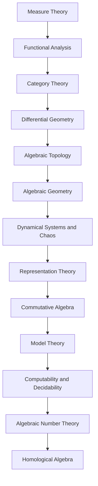

<!-- Generated by tools/build_indexes.py from tools/curriculum.json. Do not edit by hand. -->

# Advanced Topics

*Research-level foundations*

[Mathematics](../README.md) › Advanced Topics

Measure theory, functional analysis, category theory, differential and algebraic geometry, dynamical systems and more: the door from undergraduate mathematics into research.

## At a glance

| | |
|---|---|
| Topics | 13 (13 complete, 0 draft, 0 planned) |
| Estimated study time | ~162 hours |
| Prerequisites | [14-real-analysis](../14-real-analysis/README.md), [13-abstract-algebra](../13-abstract-algebra/README.md), [08-linear-algebra](../08-linear-algebra/README.md) |

## Study order

The numbers are the recommended order. Study a topic only after the ones before it —
the dependency chain below is the shortest safe route through the discipline.

## Topic inventory

| # | Topic | Level | Est. time | Status | Materials |
|---|---|---|---|---|---|
| 1 | [Measure Theory](01-measure-theory/README.md) | Advanced | 14 h | Complete | [Tutorial](01-measure-theory/README.md) · [Exercises](01-measure-theory/exercises.md) · [Solutions](01-measure-theory/solutions.md) |
| 2 | [Functional Analysis](02-functional-analysis/README.md) | Advanced | 14 h | Complete | [Tutorial](02-functional-analysis/README.md) · [Exercises](02-functional-analysis/exercises.md) · [Solutions](02-functional-analysis/solutions.md) |
| 3 | [Category Theory](03-category-theory/README.md) | Advanced | 12 h | Complete | [Tutorial](03-category-theory/README.md) · [Exercises](03-category-theory/exercises.md) · [Solutions](03-category-theory/solutions.md) |
| 4 | [Differential Geometry](04-differential-geometry/README.md) | Advanced | 14 h | Complete | [Tutorial](04-differential-geometry/README.md) · [Exercises](04-differential-geometry/exercises.md) · [Solutions](04-differential-geometry/solutions.md) |
| 5 | [Algebraic Topology](05-algebraic-topology/README.md) | Advanced | 14 h | Complete | [Tutorial](05-algebraic-topology/README.md) · [Exercises](05-algebraic-topology/exercises.md) · [Solutions](05-algebraic-topology/solutions.md) |
| 6 | [Algebraic Geometry](06-algebraic-geometry/README.md) | Advanced | 14 h | Complete | [Tutorial](06-algebraic-geometry/README.md) · [Exercises](06-algebraic-geometry/exercises.md) · [Solutions](06-algebraic-geometry/solutions.md) |
| 7 | [Dynamical Systems and Chaos](07-dynamical-systems/README.md) | Advanced | 11 h | Complete | [Tutorial](07-dynamical-systems/README.md) · [Exercises](07-dynamical-systems/exercises.md) · [Solutions](07-dynamical-systems/solutions.md) |
| 8 | [Representation Theory](08-representation-theory/README.md) | Advanced | 12 h | Complete | [Tutorial](08-representation-theory/README.md) · [Exercises](08-representation-theory/exercises.md) · [Solutions](08-representation-theory/solutions.md) |
| 9 | [Commutative Algebra](09-commutative-algebra/README.md) | Advanced | 12 h | Complete | [Tutorial](09-commutative-algebra/README.md) · [Exercises](09-commutative-algebra/exercises.md) · [Solutions](09-commutative-algebra/solutions.md) |
| 10 | [Model Theory](10-model-theory/README.md) | Advanced | 11 h | Complete | [Tutorial](10-model-theory/README.md) · [Exercises](10-model-theory/exercises.md) · [Solutions](10-model-theory/solutions.md) |
| 11 | [Computability and Decidability](11-computability-and-decidability/README.md) | Advanced | 10 h | Complete | [Tutorial](11-computability-and-decidability/README.md) · [Exercises](11-computability-and-decidability/exercises.md) · [Solutions](11-computability-and-decidability/solutions.md) |
| 12 | [Algebraic Number Theory](12-algebraic-number-theory/README.md) | Advanced | 12 h | Complete | [Tutorial](12-algebraic-number-theory/README.md) · [Exercises](12-algebraic-number-theory/exercises.md) · [Solutions](12-algebraic-number-theory/solutions.md) |
| 13 | [Homological Algebra](13-homological-algebra/README.md) | Advanced | 12 h | Complete | [Tutorial](13-homological-algebra/README.md) · [Exercises](13-homological-algebra/exercises.md) · [Solutions](13-homological-algebra/solutions.md) |

### What each topic covers

- **Measure Theory** — Sigma-algebras, Lebesgue measure, measurable functions and integration.
- **Functional Analysis** — Banach and Hilbert spaces, bounded operators, Hahn-Banach and spectral theory.
- **Category Theory** — Categories, functors, natural transformations, limits and adjunctions.
- **Differential Geometry** — Manifolds, tangent spaces, differential forms, connections and curvature.
- **Algebraic Topology** — Homology, cohomology, exact sequences and topological invariants.
- **Algebraic Geometry** — Affine and projective varieties, ideals, schemes and Bézout's theorem.
- **Dynamical Systems and Chaos** — Flows, maps, fixed points, bifurcations, chaos and the logistic map.
- **Representation Theory** — Group actions on vector spaces, characters and the Peter-Weyl idea.
- **Commutative Algebra** — Localisation, Noetherian rings, primary decomposition and dimension theory.
- **Model Theory** — Languages, structures, compactness, Löwenheim-Skolem and quantifier elimination.
- **Computability and Decidability** — Turing machines, the halting problem, Gödel's incompleteness theorems.
- **Algebraic Number Theory** — Number fields, rings of integers, ideals, unique factorisation and units.
- **Homological Algebra** — Chain complexes, exact sequences, derived functors and spectral sequences.

## Related disciplines

- [17-topology](../17-topology/README.md)
- [15-complex-analysis](../15-complex-analysis/README.md)

## Status key

- **Complete** — tutorial, exercises and full solutions exist and the tutorial meets the
  [authoring standard](../CONTRIBUTING.md).
- **Draft** — some material exists but the topic is not finished.
- **Planned** — identified in the curriculum, not written yet.

Overall progress and the full topic inventory live in [ROADMAP.md](../ROADMAP.md).
