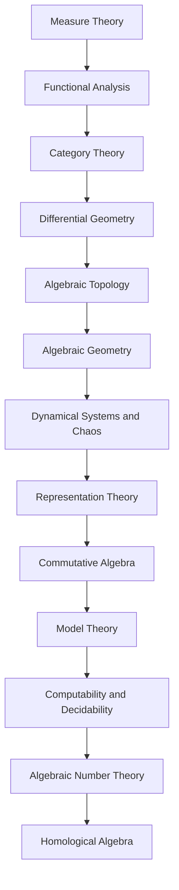

<!-- Generated by tools/build_indexes.py from tools/curriculum.json. Do not edit by hand. -->

# Advanced Topics

*Research-level foundations*

[Mathematics](../README.md) › Advanced Topics

Measure theory, functional analysis, category theory, differential and algebraic geometry, dynamical systems and more: the door from undergraduate mathematics into research.

## At a glance

| | |
|---|---|
| Topics | 13 (0 complete, 0 draft, 13 planned) |
| Estimated study time | ~162 hours |
| Prerequisites | [14-real-analysis](../14-real-analysis/README.md), [13-abstract-algebra](../13-abstract-algebra/README.md), [08-linear-algebra](../08-linear-algebra/README.md) |

## Study order

The numbers are the recommended order. Study a topic only after the ones before it —
the dependency chain below is the shortest safe route through the discipline.

## Topic inventory

| # | Topic | Level | Est. time | Status | Materials |
|---|---|---|---|---|---|
| 1 | Measure Theory | Advanced | 14 h | Planned | — |
| 2 | Functional Analysis | Advanced | 14 h | Planned | — |
| 3 | Category Theory | Advanced | 12 h | Planned | — |
| 4 | Differential Geometry | Advanced | 14 h | Planned | — |
| 5 | Algebraic Topology | Advanced | 14 h | Planned | — |
| 6 | Algebraic Geometry | Advanced | 14 h | Planned | — |
| 7 | Dynamical Systems and Chaos | Advanced | 11 h | Planned | — |
| 8 | Representation Theory | Advanced | 12 h | Planned | — |
| 9 | Commutative Algebra | Advanced | 12 h | Planned | — |
| 10 | Model Theory | Advanced | 11 h | Planned | — |
| 11 | Computability and Decidability | Advanced | 10 h | Planned | — |
| 12 | Algebraic Number Theory | Advanced | 12 h | Planned | — |
| 13 | Homological Algebra | Advanced | 12 h | Planned | — |

### What each topic covers

- **Measure Theory** — Sigma-algebras, Lebesgue measure, measurable functions and integration.
- **Functional Analysis** — Banach and Hilbert spaces, bounded operators, Hahn-Banach and spectral theory.
- **Category Theory** — Categories, functors, natural transformations, limits and adjunctions.
- **Differential Geometry** — Manifolds, tangent spaces, differential forms, connections and curvature.
- **Algebraic Topology** — Homology, cohomology, exact sequences and topological invariants.
- **Algebraic Geometry** — Affine and projective varieties, ideals, schemes and Bézout's theorem.
- **Dynamical Systems and Chaos** — Flows, maps, fixed points, bifurcations, chaos and the logistic map.
- **Representation Theory** — Group actions on vector spaces, characters and the Peter-Weyl idea.
- **Commutative Algebra** — Localisation, Noetherian rings, primary decomposition and dimension theory.
- **Model Theory** — Languages, structures, compactness, Löwenheim-Skolem and quantifier elimination.
- **Computability and Decidability** — Turing machines, the halting problem, Gödel's incompleteness theorems.
- **Algebraic Number Theory** — Number fields, rings of integers, ideals, unique factorisation and units.
- **Homological Algebra** — Chain complexes, exact sequences, derived functors and spectral sequences.

## Related disciplines

- [17-topology](../17-topology/README.md)
- [15-complex-analysis](../15-complex-analysis/README.md)

## Status key

- **Complete** — tutorial, exercises and full solutions exist and the tutorial meets the
  [authoring standard](../CONTRIBUTING.md).
- **Draft** — some material exists but the topic is not finished.
- **Planned** — identified in the curriculum, not written yet.

Overall progress and the full topic inventory live in [ROADMAP.md](../ROADMAP.md).
