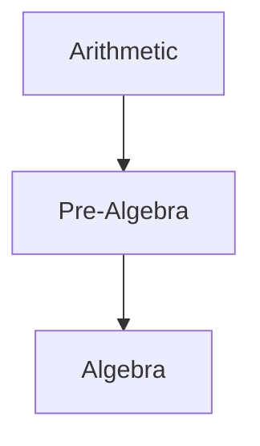

# Contributing & Authoring Standard

This repository is a **progressive mathematics curriculum**: a place where a reader who knows no
mathematics can start at [Arithmetic](01-arithmetic/README.md) and work up to graduate-level
[Real Analysis](14-real-analysis/README.md) and beyond.

Everything here is written in Markdown. Content quality is the only thing that matters: a topic is
*complete* only when a motivated reader could learn from it without outside help.

---

## 1. Repository layout

```
<discipline>/
    README.md                # discipline index (generated from curriculum manifest)
    <nn>-<topic>/            # one folder per topic, numbered in study order
        README.md            # the tutorial itself
        exercises.md         # graded problem set
        solutions.md         # full worked solutions
```

Rules:

* A **discipline** is a numbered top-level folder (`01-arithmetic`, `14-real-analysis`, …).
* A **topic** is a numbered sub-folder. The number encodes the recommended study order *within*
  the discipline, not difficulty.
* The tutorial is always `README.md` so that GitHub renders it when a reader opens the folder.
* `exercises.md` and `solutions.md` are **separate files**: a reader should be able to attempt
  problems without accidentally seeing the answers.
* Never place assets outside `diagrams/` unless they belong to the topic (a topic may keep small
  SVG figures next to its tutorial when they are used nowhere else).

---

## 2. Naming conventions

| Thing | Convention | Example |
|---|---|---|
| Discipline folder | `NN-kebab-case` | `07-calculus` |
| Topic folder | `NN-kebab-case` | `05-applications-of-derivatives` |
| Tutorial | `README.md` | — |
| Exercises | `exercises.md` | — |
| Solutions | `solutions.md` | — |
| Shared asset | `diagrams/svg/<descriptive-name>.svg` | `unit-circle.svg` |

Headings use Title Case. Section numbers (`## 1. Introduction`) are used inside tutorials so that
other documents can cross-reference a section unambiguously.

---

## 3. Tutorial template

Adapt the template to the subject — do not force sections that add nothing — but keep the order and
the numbering stable so that readers can navigate any tutorial predictably.

```markdown
# Topic Name

> [Discipline](../README.md) · Level: Beginner · Prerequisites: [A](../../...), [B](../../...) · Estimated time: 60 min

## 1. Introduction
What the topic is, why it exists, where it is used. Motivate before formalising.

## 2. Prerequisites
List the specific knowledge required, each with a link to the tutorial that teaches it.

## 3. Learning Objectives
Concrete, testable statements ("you will be able to …").

## 4. Intuition
The idea in plain language, with a real-world analogy. No symbols yet.

## 5. Formal Definition
Precise definitions, every quantifier explicit.

## 6. Mathematical Notation
Every symbol used, what it means, how to read it aloud.

## 7. Core Concepts
The body of the topic, split into ordered subsections.

## 8. Formulas and Properties
Statements with hypotheses, plus *why* they are true.

## 9. Step-by-Step Examples
Several worked examples, easy → hard, every significant algebraic step explained.

## 10. Visual Explanations
Mermaid diagrams / SVG / tables when they genuinely clarify something.

## 11. Common Mistakes
Frequent errors, why they are tempting, and how to avoid them.

## 12. Applications
Where the concept shows up in other mathematics, science, engineering, computing, finance.

## 13. Exercises
A link plus a short description; the problems live in `exercises.md`.

## 14. Solutions
A link to `solutions.md`. Never inline the answers to the exercises in the tutorial.

## 15. Summary
The essential takeaways, as a compact list.

## 16. Further Learning
What to study next, with links, and (where useful) references to standard texts.
```

Small topics may merge sections (for example no separate *Visual Explanations*); large topics may
add sections, but the numbering must not collide.

---

## 4. Writing standard

1. **Never use an unexplained concept.** If it has not been taught earlier in the repository, define
   it here or link to the place it is taught.
2. **Explain *why*, not just *what*.** Every formula gets a derivation, a plausibility argument, or a
   proof — at the level appropriate to the reader.
3. **Separate intuition from proof.** Intuition is allowed to be informal; theorems are not.
4. **Correctness is non-negotiable.** Never invent a theorem, a formula, or a proof. If a statement
   has hypotheses, state them. If you are unsure, state the standard result and cite a reputable
   source rather than guessing.
5. **Show every meaningful step.** Do not compress `x² − 5x + 6 = 0` into "so `x = 2, 3`".
6. **Include edge cases.** Division by zero, empty sets, degenerate cases, `n = 0`, equality cases.
7. **Give multiple depths for hard topics** — intuitive, then concrete, then formal, then a note on
   the general/advanced setting.
8. **No decorative diagrams.** Every figure must carry information that prose would convey worse.
9. **Consistent terminology.** Use the term defined in [GLOSSARY.md](GLOSSARY.md); do not introduce a
   synonym for an existing concept.
10. **Cross-reference instead of duplicating.** When a concept is introduced elsewhere, link to the
    canonical treatment and continue.

---

## 5. Mathematics formatting

The repository is rendered on GitHub, which supports LaTeX-style math.

* Inline math: `$x^2 + 1$` → $x^2+1$
* Display math: `$$` on its own line, equation on the next line(s), closing `$$` on its own line.
* Use `\dfrac` inside display math for readability, `\frac` inline.
* Use `\operatorname{}` for multi-letter operators that are not built in (`\operatorname{rank}`).
* Numbered equations are not supported by GitHub; refer to displayed equations by name instead
  ("the second identity above").
* Escape literal dollar amounts as `\$` (`\$5`), otherwise it will be parsed as math.
* Tables are preferred to aligned ASCII art. Use a Markdown table for truth tables and sign charts.
* Use `\begin{aligned} … \end{aligned}` inside `$$ … $$` for multi-line derivations.
* Use `\mathbb{}` for standard number sets (`\mathbb{N}`, `\mathbb{Z}`, `\mathbb{Q}`, `\mathbb{R}`,
  `\mathbb{C}`), `\mathcal{}` for families of sets, `\varnothing` for the empty set.

Standard notation is documented in [MATHEMATICAL_NOTATION.md](MATHEMATICAL_NOTATION.md). Follow it.

---

## 6. Diagrams

**Mermaid** (rendered natively by GitHub) is the default. Use it for concept maps, dependency graphs,
proof flow, decision procedures and classification trees.

~~~markdown

~~~

Rules:

* Only `flowchart`, `graph`, `stateDiagram-v2`, `sequenceDiagram`, `classDiagram`, `mindmap` and
  `timeline` — these render reliably on GitHub.
* Always quote labels that contain spaces, parentheses, commas, slashes, `=`, `-`, `:` or `→`.
  Write `A["Natural numbers (N)"]`, not `A[Natural numbers (N)]`.
* Do not use HTML in labels (`<br/>` works, `<b>` usually does not).
* Keep graphs under ~25 nodes; split large ones.

**SVG** is for precision that Mermaid cannot give: geometric constructions, function graphs, the unit
circle, vectors, 3-D sketches. Hand-write clean SVG with `viewBox`, no external fonts, no scripts, and
always include `role="img"` plus a `<title>`. Store shared figures in `diagrams/svg/`.

---

## 7. Exercises and solutions

`exercises.md` must contain **at least 30 problems**, distributed over four levels:

| Level | Purpose | Typical count |
|---|---|---|
| Beginner | direct application, fluency | 10–15 |
| Intermediate | two-step, requires choosing a method | 8–12 |
| Advanced | multi-step, proof, or synthesis | 5–8 |
| Challenge | genuinely hard, competition-flavoured, or open-ended exploration | 2–5 |

Number problems continuously across levels (`**1.**`, `**2.**`, …) so that `solutions.md` can mirror
the numbering exactly. Include a mix of conceptual questions, computations, proofs, word problems and
applications. Never repeat the tutorial's worked examples verbatim.

`solutions.md` gives, for **every** exercise: the answer **and** the reasoning, including the
strategy ("why start this way"), every significant algebraic step, and — for proof exercises — a
complete proof. Where several approaches exist, show a second approach or remark on it. Flag common
pitfalls inside the solution where they are likely.

---

## 8. Cross-linking

* Use **relative** links only; they must work when browsing the repository on GitHub and on disk.
* Every tutorial links *up* to its discipline index (`../README.md`) and *sideways* to prerequisites
  and successors.
* Do not link to a topic that does not exist yet. Prefer linking to the discipline index or to the
  closest existing prerequisite.
* All internal links are validated by `tools/validate_repo.py`.

---

## 9. Adding a new topic

1. Add the topic to the curriculum manifest `tools/curriculum.json` (title, level, prerequisites).
2. Create `<discipline>/<nn>-<slug>/` with `README.md`, `exercises.md`, `solutions.md`.
3. Regenerate the indexes: `python tools/build_indexes.py`.
4. Validate: `python tools/validate_repo.py`.
5. Update `ROADMAP.md` status if the topic moves between "planned" and "complete".

A topic counts as **complete** when: it satisfies the template, its mathematics has been reviewed, it
has ≥ 30 exercises with full solutions, and all its links resolve.

---

## 10. Review checklist

Before declaring a topic complete, verify:

- [ ] Every definition is stated before it is used.
- [ ] Every theorem has its hypotheses and a proof or a cited source.
- [ ] Every worked example is checked numerically.
- [ ] Every exercise is solvable from the material taught (or is explicitly marked as a challenge).
- [ ] Every solution is complete and correct.
- [ ] Notation matches [MATHEMATICAL_NOTATION.md](MATHEMATICAL_NOTATION.md).
- [ ] Markdown links resolve; Mermaid renders; math renders.
- [ ] The prerequisites listed are sufficient, and they are actually taught earlier.
