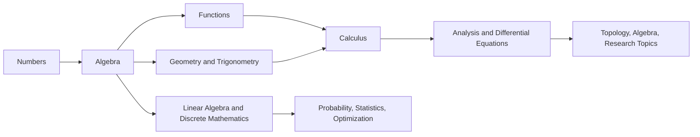

<!-- Generated by tools/build_indexes.py from tools/learning_paths.json. Do not edit by hand. -->

# Learning Paths

Mathematics is not a single sequence, and nobody learns all of it. These are curated routes
through the repository: choose by destination, not by discipline. Topics marked *(planned)* are
part of the curriculum but not written yet — read the closest available prerequisite first, and
check the [Roadmap](ROADMAP.md) for progress.

## Where do I start?

Find the first statement that describes you and follow its advice.

| If this sounds like you | Then |
|---|---|
| You cannot confidently add, subtract, multiply and divide fractions and decimals. | Start at [Arithmetic](01-arithmetic/README.md). Do every exercise set; this is the foundation everything else stands on. |
| You can compute with numbers but algebra looks like arbitrary symbol-pushing. | Start at [Pre-Algebra](02-pre-algebra/README.md), then [Elementary Algebra](03-algebra/01-elementary-algebra/README.md). |
| You can solve equations but want to understand functions and graphs. | Start at [Functions](03-algebra/11-functions/README.md), then take [Path 2](#path-2-the-algebra-and-calculus-path). |
| You are comfortable with calculus and want proofs. | Take [Path 3](#path-3-the-pure-mathematics-path): logic and sets first, then real analysis. |
| You program and want the mathematics behind algorithms and cryptography. | Take [Path 4](#path-4-the-discrete-mathematics-and-computer-science-path). |
| You work with data and want the mathematics behind the methods. | Take [Path 5](#path-5-the-probability-statistics-and-data-path). |
| You are an engineer who needs differential equations and numerical methods. | Take [Path 6](#path-6-the-applied-and-engineering-path). |

A second, sharper diagnostic: open a tutorial one level above where you think you are and
attempt the **Beginner** exercises. If you score below about 70%, the level below is where you
belong — and doing it quickly will cost you less time than struggling upward.

## Path 1: The Complete Path from Zero to Research

**For:** No mathematical background at all, and the ambition to reach research-level mathematics.

This is the whole repository in reading order. It alternates between computation and proof on purpose: fluency with symbols makes abstraction possible, and abstraction explains why the symbols work. Budget several years at a few hours a week — the estimate below is for a committed full-time student.

**Estimated total:** ~1039 hours of study, 111 topics.

### Stage 1 — Numbers and operations

*Do not rush this. Every later difficulty in algebra is usually an unfinished difficulty here.*

- [Mathematical Thinking and Problem Solving](00-foundations/01-mathematical-thinking/README.md)
- [Natural Numbers](01-arithmetic/01-natural-numbers/README.md)
- [Integers and Negative Numbers](01-arithmetic/02-integers/README.md)
- [Fractions](01-arithmetic/03-fractions/README.md)
- [Decimals](01-arithmetic/04-decimals/README.md)
- [Percentages](01-arithmetic/05-percentages/README.md)
- [Ratios, Rates and Proportions](01-arithmetic/06-ratios-and-proportions/README.md)
- [Exponents and Roots](01-arithmetic/07-exponents-and-roots/README.md)

*Stage time: ~53 hours.*

### Stage 2 — The language of algebra

*From here on, every new rule is justified, not memorised.*

- [Order of Operations](02-pre-algebra/01-order-of-operations/README.md)
- [Variables and Algebraic Expressions](02-pre-algebra/02-variables-and-expressions/README.md)
- [Factors, Multiples, GCD and LCM](02-pre-algebra/03-factors-and-multiples/README.md)
- [Introduction to Equations](02-pre-algebra/04-introduction-to-equations/README.md)
- [The Coordinate Plane](02-pre-algebra/05-the-coordinate-plane/README.md)
- [Propositional and First-Order Logic](00-foundations/02-logic/README.md)

*Stage time: ~33 hours.*

### Stage 3 — Algebra in earnest

- [Elementary Algebra](03-algebra/01-elementary-algebra/README.md)
- [Linear Equations](03-algebra/02-linear-equations/README.md)
- [Inequalities](03-algebra/03-inequalities/README.md)
- [Systems of Linear Equations](03-algebra/05-systems-of-equations/README.md)
- [Polynomials](03-algebra/06-polynomials/README.md)
- [Factoring](03-algebra/07-factoring/README.md)
- [Quadratic Equations](03-algebra/08-quadratic-equations/README.md)
- [Intermediate Algebra](03-algebra/04-intermediate-algebra/README.md)
- [Rational Expressions](03-algebra/09-rational-expressions/README.md)
- [Radicals and Rational Exponents](03-algebra/10-radicals-and-rational-exponents/README.md)

*Stage time: ~83 hours.*

### Stage 4 — Functions

*The single most important idea for everything that follows: a function is a rule, a graph, and an object you can transform.*

- [Functions](03-algebra/11-functions/README.md)
- [Exponential and Logarithmic Functions](03-algebra/12-exponential-and-logarithmic-functions/README.md)
- [Advanced Algebra](03-algebra/14-advanced-algebra/README.md)
- [Complex Numbers](03-algebra/13-complex-numbers/README.md)
- [Functions and Graphs](06-precalculus/01-functions-and-graphs/README.md)
- [Polynomial and Rational Functions](06-precalculus/02-polynomial-and-rational-functions/README.md)
- Exponential and Logarithmic Models *(planned)*

*Stage time: ~64 hours.*

### Stage 5 — Shape, space and angle

- [Euclidean Geometry](04-geometry/01-euclidean-geometry/README.md)
- [Triangles](04-geometry/02-triangles/README.md)
- [Circles](04-geometry/03-circles/README.md)
- [Coordinate Geometry](04-geometry/04-coordinate-geometry/README.md)
- [Solid Geometry](04-geometry/05-solid-geometry/README.md)
- [Geometric Transformations](04-geometry/06-transformations/README.md)
- [Analytic Geometry](04-geometry/07-analytic-geometry/README.md)
- [Trigonometric Functions](05-trigonometry/01-trigonometric-functions/README.md)
- [The Unit Circle and Radian Measure](05-trigonometry/02-unit-circle/README.md)
- [Triangle Trigonometry](05-trigonometry/05-triangle-trigonometry/README.md)
- [Trigonometric Identities](05-trigonometry/03-trigonometric-identities/README.md)
- Inverse Trigonometric Functions *(planned)*
- Trigonometric Equations *(planned)*

*Stage time: ~115 hours.*

### Stage 6 — Calculus

*The first subject where the two halves of mathematics — the computational and the deductive — meet.*

- [Conic Sections](06-precalculus/04-conic-sections/README.md)
- [Sequences and Series](06-precalculus/05-sequences-and-series/README.md)
- Introduction to Limits *(planned)*
- [Limits](07-calculus/01-limits/README.md)
- [Continuity](07-calculus/02-continuity/README.md)
- [Derivatives](07-calculus/03-derivatives/README.md)
- [Differentiation Rules](07-calculus/04-differentiation-rules/README.md)
- [Applications of Derivatives](07-calculus/05-applications-of-derivatives/README.md)
- [Integrals](07-calculus/06-integrals/README.md)
- [The Fundamental Theorem of Calculus](07-calculus/07-fundamental-theorem-of-calculus/README.md)
- [Techniques of Integration](07-calculus/08-techniques-of-integration/README.md)
- Applications of Integration *(planned)*
- Improper Integrals *(planned)*
- Sequences and Series *(planned)*

*Stage time: ~129 hours.*

### Stage 7 — Linear algebra and discrete mathematics

*Two independent branches. Linear algebra is the most reusable subject you will ever learn.*

- [Vectors](08-linear-algebra/01-vectors/README.md)
- [Matrices](08-linear-algebra/02-matrices/README.md)
- [Systems of Linear Equations](08-linear-algebra/03-systems-of-linear-equations/README.md)
- [Vector Spaces](08-linear-algebra/04-vector-spaces/README.md)
- [Linear Transformations](08-linear-algebra/05-linear-transformations/README.md)
- Determinants *(planned)*
- [Eigenvalues and Eigenvectors](08-linear-algebra/07-eigenvalues-and-eigenvectors/README.md)
- Inner Product Spaces *(planned)*
- [Mathematical Induction](09-discrete-mathematics/01-mathematical-induction/README.md)
- [Recurrence Relations](09-discrete-mathematics/02-recurrence-relations/README.md)
- Boolean Algebra *(planned)*

*Stage time: ~103 hours.*

### Stage 8 — Calculus in several variables

- Multivariable Calculus *(planned)*
- Vector Calculus *(planned)*
- First-Order Differential Equations *(planned)*
- Second-Order Linear ODEs *(planned)*
- Systems of ODEs *(planned)*

*Stage time: ~56 hours.*

### Stage 9 — Probability and statistics

- [Probability Foundations](10-probability/01-probability-foundations/README.md)
- [Conditional Probability and Independence](10-probability/02-conditional-probability-and-independence/README.md)
- [Random Variables](10-probability/03-random-variables/README.md)
- Probability Distributions *(planned)*
- [Expectation and Variance](10-probability/05-expectation-and-variance/README.md)
- Law of Large Numbers and the Central Limit Theorem *(planned)*
- [Descriptive Statistics](11-statistics/01-descriptive-statistics/README.md)
- Sampling and Estimation *(planned)*
- Hypothesis Testing *(planned)*
- Linear Regression *(planned)*

*Stage time: ~92 hours.*

### Stage 10 — Proof, rigour and abstract structure

*This is where mathematics changes character. Everything before was computation; here you learn why the computations are true.*

- [Set Theory](00-foundations/03-set-theory/README.md)
- [Proof Techniques](00-foundations/04-proof-techniques/README.md)
- [Relations and Functions](00-foundations/05-relations-and-functions/README.md)
- [Divisibility and Primes](12-number-theory/01-divisibility-and-primes/README.md)
- [Congruences](12-number-theory/02-congruences/README.md)
- [Groups](13-abstract-algebra/01-groups/README.md)
- Rings *(planned)*
- Fields *(planned)*

*Stage time: ~87 hours.*

### Stage 11 — Analysis

- [The Real Numbers and Completeness](14-real-analysis/01-real-numbers-and-completeness/README.md)
- Sequences and Series *(planned)*
- Continuity and Limits *(planned)*
- Differentiation *(planned)*
- Riemann Integration *(planned)*
- Metric Spaces *(planned)*
- Complex Numbers and Geometry *(planned)*
- Analytic Functions *(planned)*
- Complex Integration *(planned)*
- Power Series and Residues *(planned)*

*Stage time: ~116 hours.*

### Stage 12 — Research-level foundations

- Topological Spaces *(planned)*
- Continuity and Homeomorphisms *(planned)*
- Compactness *(planned)*
- Connectedness *(planned)*
- Measure Theory *(planned)*
- Functional Analysis *(planned)*
- Differential Geometry *(planned)*
- Algebraic Topology *(planned)*
- Category Theory *(planned)*

*Stage time: ~108 hours.*

## Path 2: The Algebra and Calculus Path

**For:** A student heading for university STEM, or an adult who wants calculus done properly.

The classical route. It assumes arithmetic is solid, moves quickly through pre-algebra, and spends its time where the difficulty actually is: functions, trigonometry and the limit idea.

**Estimated total:** ~362 hours of study, 42 topics.

### Repair and consolidate arithmetic

*Skip only if you can do all of this without a calculator and without hesitation.*

- [Fractions](01-arithmetic/03-fractions/README.md)
- [Decimals](01-arithmetic/04-decimals/README.md)
- [Percentages](01-arithmetic/05-percentages/README.md)
- [Exponents and Roots](01-arithmetic/07-exponents-and-roots/README.md)
- [Order of Operations](02-pre-algebra/01-order-of-operations/README.md)
- [Variables and Algebraic Expressions](02-pre-algebra/02-variables-and-expressions/README.md)

*Stage time: ~36 hours.*

### Algebra to fluency

- [Elementary Algebra](03-algebra/01-elementary-algebra/README.md)
- [Linear Equations](03-algebra/02-linear-equations/README.md)
- [Inequalities](03-algebra/03-inequalities/README.md)
- [Systems of Linear Equations](03-algebra/05-systems-of-equations/README.md)
- [Factoring](03-algebra/07-factoring/README.md)
- [Quadratic Equations](03-algebra/08-quadratic-equations/README.md)
- [Rational Expressions](03-algebra/09-rational-expressions/README.md)
- [Radicals and Rational Exponents](03-algebra/10-radicals-and-rational-exponents/README.md)
- [Exponential and Logarithmic Functions](03-algebra/12-exponential-and-logarithmic-functions/README.md)

*Stage time: ~74 hours.*

### Functions and graphs

- [The Coordinate Plane](02-pre-algebra/05-the-coordinate-plane/README.md)
- [Functions](03-algebra/11-functions/README.md)
- [Functions and Graphs](06-precalculus/01-functions-and-graphs/README.md)
- [Polynomial and Rational Functions](06-precalculus/02-polynomial-and-rational-functions/README.md)

*Stage time: ~34 hours.*

### Trigonometry

- [Triangles](04-geometry/02-triangles/README.md)
- [Trigonometric Functions](05-trigonometry/01-trigonometric-functions/README.md)
- [The Unit Circle and Radian Measure](05-trigonometry/02-unit-circle/README.md)
- [Trigonometric Identities](05-trigonometry/03-trigonometric-identities/README.md)
- [Triangle Trigonometry](05-trigonometry/05-triangle-trigonometry/README.md)
- Trigonometric Equations *(planned)*

*Stage time: ~53 hours.*

### Calculus I and II

- Introduction to Limits *(planned)*
- [Limits](07-calculus/01-limits/README.md)
- [Continuity](07-calculus/02-continuity/README.md)
- [Derivatives](07-calculus/03-derivatives/README.md)
- [Differentiation Rules](07-calculus/04-differentiation-rules/README.md)
- [Applications of Derivatives](07-calculus/05-applications-of-derivatives/README.md)
- [Integrals](07-calculus/06-integrals/README.md)
- [The Fundamental Theorem of Calculus](07-calculus/07-fundamental-theorem-of-calculus/README.md)
- [Techniques of Integration](07-calculus/08-techniques-of-integration/README.md)
- Applications of Integration *(planned)*
- Sequences and Series *(planned)*

*Stage time: ~105 hours.*

### The subjects that follow calculus

- [Vectors](08-linear-algebra/01-vectors/README.md)
- [Matrices](08-linear-algebra/02-matrices/README.md)
- [Systems of Linear Equations](08-linear-algebra/03-systems-of-linear-equations/README.md)
- Multivariable Calculus *(planned)*
- First-Order Differential Equations *(planned)*
- Second-Order Linear ODEs *(planned)*

*Stage time: ~60 hours.*

## Path 3: The Pure Mathematics Path

**For:** A reader who wants proofs, abstraction and the structure of mathematics itself.

Logic and sets first, then the two great proof laboratories — number theory and group theory — and finally analysis and topology, where intuition is trained to survive counterexamples.

**Estimated total:** ~429 hours of study, 40 topics.

### The language of proof

- [Mathematical Thinking and Problem Solving](00-foundations/01-mathematical-thinking/README.md)
- [Propositional and First-Order Logic](00-foundations/02-logic/README.md)
- [Set Theory](00-foundations/03-set-theory/README.md)
- [Proof Techniques](00-foundations/04-proof-techniques/README.md)
- [Relations and Functions](00-foundations/05-relations-and-functions/README.md)

*Stage time: ~44 hours.*

### Proof in action: the integers

- [Divisibility and Primes](12-number-theory/01-divisibility-and-primes/README.md)
- [Congruences](12-number-theory/02-congruences/README.md)
- Arithmetic Functions *(planned)*
- Diophantine Equations *(planned)*

*Stage time: ~36 hours.*

### Algebraic structure

- [Vectors](08-linear-algebra/01-vectors/README.md)
- [Matrices](08-linear-algebra/02-matrices/README.md)
- [Vector Spaces](08-linear-algebra/04-vector-spaces/README.md)
- [Linear Transformations](08-linear-algebra/05-linear-transformations/README.md)
- [Eigenvalues and Eigenvectors](08-linear-algebra/07-eigenvalues-and-eigenvectors/README.md)
- [Groups](13-abstract-algebra/01-groups/README.md)
- Rings *(planned)*
- Fields *(planned)*
- Galois Theory *(planned)*

*Stage time: ~103 hours.*

### Analysis and topology

- Introduction to Limits *(planned)*
- [Limits](07-calculus/01-limits/README.md)
- [Derivatives](07-calculus/03-derivatives/README.md)
- [Integrals](07-calculus/06-integrals/README.md)
- [The Fundamental Theorem of Calculus](07-calculus/07-fundamental-theorem-of-calculus/README.md)
- [The Real Numbers and Completeness](14-real-analysis/01-real-numbers-and-completeness/README.md)
- Sequences and Series *(planned)*
- Continuity and Limits *(planned)*
- Differentiation *(planned)*
- Riemann Integration *(planned)*
- Metric Spaces *(planned)*
- Topological Spaces *(planned)*
- Continuity and Homeomorphisms *(planned)*
- Compactness *(planned)*
- Connectedness *(planned)*

*Stage time: ~157 hours.*

### Research foundations

- Measure Theory *(planned)*
- Functional Analysis *(planned)*
- Category Theory *(planned)*
- Algebraic Topology *(planned)*
- Algebraic Geometry *(planned)*
- Model Theory *(planned)*
- Computability and Decidability *(planned)*

*Stage time: ~89 hours.*

## Path 4: The Discrete Mathematics and Computer Science Path

**For:** Programmers and computer scientists: algorithms, complexity, cryptography, logic and networks.

Discrete mathematics is the mathematics that a computer can actually do. Counting, induction, graphs and logic are the working tools of algorithm analysis, databases, compilers, cryptography and machine learning.

**Estimated total:** ~272 hours of study, 31 topics.

### Logical and combinatorial foundations

- [Propositional and First-Order Logic](00-foundations/02-logic/README.md)
- [Set Theory](00-foundations/03-set-theory/README.md)
- [Proof Techniques](00-foundations/04-proof-techniques/README.md)
- [Relations and Functions](00-foundations/05-relations-and-functions/README.md)
- [Mathematical Induction](09-discrete-mathematics/01-mathematical-induction/README.md)
- Boolean Algebra *(planned)*

*Stage time: ~53 hours.*

### Counting and combinatorics

- [Counting Principles](20-combinatorics/01-counting-principles/README.md)
- Inclusion-Exclusion *(planned)*
- The Pigeonhole Principle *(planned)*
- Generating Functions *(planned)*
- [Recurrence Relations](09-discrete-mathematics/02-recurrence-relations/README.md)
- Algorithms and Complexity *(planned)*

*Stage time: ~50 hours.*

### Graphs and networks

- [Graph Basics](21-graph-theory/01-graph-basics/README.md)
- Trees *(planned)*
- Paths and Connectivity *(planned)*
- Planarity and Colouring *(planned)*
- Matching and Flows *(planned)*

*Stage time: ~41 hours.*

### Number theory and cryptography

- [Divisibility and Primes](12-number-theory/01-divisibility-and-primes/README.md)
- [Congruences](12-number-theory/02-congruences/README.md)
- Arithmetic Functions *(planned)*

*Stage time: ~27 hours.*

### The linear algebra a computer scientist needs

- [Vectors](08-linear-algebra/01-vectors/README.md)
- [Matrices](08-linear-algebra/02-matrices/README.md)
- [Systems of Linear Equations](08-linear-algebra/03-systems-of-linear-equations/README.md)
- [Eigenvalues and Eigenvectors](08-linear-algebra/07-eigenvalues-and-eigenvectors/README.md)
- Inner Product Spaces *(planned)*

*Stage time: ~47 hours.*

### Probability, learning and limits of computation

- [Probability Foundations](10-probability/01-probability-foundations/README.md)
- [Conditional Probability and Independence](10-probability/02-conditional-probability-and-independence/README.md)
- [Random Variables](10-probability/03-random-variables/README.md)
- Discrete Probability *(planned)*
- Computability and Decidability *(planned)*
- Information Theory *(planned)*

*Stage time: ~54 hours.*

## Path 5: The Probability, Statistics and Data Path

**For:** Data analysts, scientists and machine-learning practitioners who want the mathematics rather than the libraries.

Probability is subtle in a way that calculus is not: the formulas are easy and the reasoning is hard. This path builds the calculus and linear algebra it needs, then goes slowly through conditioning, distributions and inference.

**Estimated total:** ~310 hours of study, 33 topics.

### The quantitive toolkit

- [Percentages](01-arithmetic/05-percentages/README.md)
- [Functions](03-algebra/11-functions/README.md)
- [Exponential and Logarithmic Functions](03-algebra/12-exponential-and-logarithmic-functions/README.md)
- [Sequences and Series](06-precalculus/05-sequences-and-series/README.md)

*Stage time: ~35 hours.*

### Calculus for continuous probability

- [Limits](07-calculus/01-limits/README.md)
- [Derivatives](07-calculus/03-derivatives/README.md)
- [Integrals](07-calculus/06-integrals/README.md)
- [The Fundamental Theorem of Calculus](07-calculus/07-fundamental-theorem-of-calculus/README.md)
- Applications of Integration *(planned)*
- Multivariable Calculus *(planned)*

*Stage time: ~61 hours.*

### Linear algebra for data

- [Vectors](08-linear-algebra/01-vectors/README.md)
- [Matrices](08-linear-algebra/02-matrices/README.md)
- [Systems of Linear Equations](08-linear-algebra/03-systems-of-linear-equations/README.md)
- [Eigenvalues and Eigenvectors](08-linear-algebra/07-eigenvalues-and-eigenvectors/README.md)
- Inner Product Spaces *(planned)*

*Stage time: ~47 hours.*

### Probability

- [Counting Principles](20-combinatorics/01-counting-principles/README.md)
- [Probability Foundations](10-probability/01-probability-foundations/README.md)
- [Conditional Probability and Independence](10-probability/02-conditional-probability-and-independence/README.md)
- [Random Variables](10-probability/03-random-variables/README.md)
- Probability Distributions *(planned)*
- [Expectation and Variance](10-probability/05-expectation-and-variance/README.md)
- Law of Large Numbers and the Central Limit Theorem *(planned)*

*Stage time: ~65 hours.*

### Statistics

- [Descriptive Statistics](11-statistics/01-descriptive-statistics/README.md)
- Sampling and Estimation *(planned)*
- Hypothesis Testing *(planned)*
- Linear Regression *(planned)*
- Experimental Design *(planned)*
- Bayesian Statistics *(planned)*

*Stage time: ~53 hours.*

### Beyond the basics

- Stochastic Processes *(planned)*
- Gradient Methods *(planned)*
- Convex Optimization *(planned)*
- Information Theory *(planned)*
- Stochastic Models *(planned)*

*Stage time: ~49 hours.*

## Path 6: The Applied and Engineering Path

**For:** Engineers and applied scientists: modelling, differential equations, signals and control.

Applied mathematics is the art of choosing the right approximation and knowing how wrong it is. This path builds the differential-equation and numerical machinery, then applies it.

**Estimated total:** ~286 hours of study, 30 topics.

### Calculus and linear algebra

- [Derivatives](07-calculus/03-derivatives/README.md)
- [Applications of Derivatives](07-calculus/05-applications-of-derivatives/README.md)
- [Integrals](07-calculus/06-integrals/README.md)
- [Techniques of Integration](07-calculus/08-techniques-of-integration/README.md)
- Sequences and Series *(planned)*
- Multivariable Calculus *(planned)*
- Vector Calculus *(planned)*
- [Matrices](08-linear-algebra/02-matrices/README.md)
- [Systems of Linear Equations](08-linear-algebra/03-systems-of-linear-equations/README.md)
- [Eigenvalues and Eigenvectors](08-linear-algebra/07-eigenvalues-and-eigenvectors/README.md)

*Stage time: ~109 hours.*

### Differential equations

- First-Order Differential Equations *(planned)*
- Second-Order Linear ODEs *(planned)*
- Systems of ODEs *(planned)*
- Laplace Transforms *(planned)*
- Introduction to PDEs *(planned)*

*Stage time: ~51 hours.*

### Computation

- Floating-Point Arithmetic *(planned)*
- Root Finding *(planned)*
- Numerical Integration *(planned)*
- Iterative Methods for Linear Systems *(planned)*
- Numerical Solutions of ODEs *(planned)*

*Stage time: ~39 hours.*

### Modelling

- Principles of Modeling *(planned)*
- Population Dynamics *(planned)*
- Epidemic Models *(planned)*
- Linear Programming *(planned)*
- Lagrange Multipliers *(planned)*

*Stage time: ~40 hours.*

### Applied specialties

- Mathematical Physics *(planned)*
- Control Theory *(planned)*
- Signal Processing *(planned)*
- Game Theory *(planned)*
- Financial Mathematics *(planned)*

*Stage time: ~47 hours.*

## Short routes

When you need one subject and nothing else.

### I only need calculus

*Six topics, in order. Do the exercise sets; they are where the subject is actually learned.*

- [Limits](07-calculus/01-limits/README.md)
- [Derivatives](07-calculus/03-derivatives/README.md)
- [Differentiation Rules](07-calculus/04-differentiation-rules/README.md)
- [Applications of Derivatives](07-calculus/05-applications-of-derivatives/README.md)
- [Integrals](07-calculus/06-integrals/README.md)
- [The Fundamental Theorem of Calculus](07-calculus/07-fundamental-theorem-of-calculus/README.md)

*About 58 hours.*

### I only need linear algebra

*The computational core first, then the structural view.*

- [Vectors](08-linear-algebra/01-vectors/README.md)
- [Matrices](08-linear-algebra/02-matrices/README.md)
- [Systems of Linear Equations](08-linear-algebra/03-systems-of-linear-equations/README.md)
- [Vector Spaces](08-linear-algebra/04-vector-spaces/README.md)
- [Eigenvalues and Eigenvectors](08-linear-algebra/07-eigenvalues-and-eigenvectors/README.md)

*About 49 hours.*

### I need to read proofs

*The indispensable minimum for reading a mathematics paper.*

- [Propositional and First-Order Logic](00-foundations/02-logic/README.md)
- [Set Theory](00-foundations/03-set-theory/README.md)
- [Proof Techniques](00-foundations/04-proof-techniques/README.md)
- [Relations and Functions](00-foundations/05-relations-and-functions/README.md)

*About 38 hours.*

### I need probability for machine learning

*Conditioning and distributions carry more weight than combinatorics here.*

- [Probability Foundations](10-probability/01-probability-foundations/README.md)
- [Conditional Probability and Independence](10-probability/02-conditional-probability-and-independence/README.md)
- [Random Variables](10-probability/03-random-variables/README.md)
- Probability Distributions *(planned)*
- [Expectation and Variance](10-probability/05-expectation-and-variance/README.md)
- Gradient Methods *(planned)*

*About 57 hours.*

## How to study a topic

1. **Read the intuition section first**, before any symbols. If it does not land, read it
   again after the formal definitions — that order is deliberate.
2. **Reproduce every worked example on paper**, without looking. Reading a proof is not the
   same as being able to write it.
3. **Do the exercises before the solutions.** Begin at the Beginner level even if the tutorial
   felt easy; fluency is the point.
4. **Write the summary from memory** at the end. If you cannot, the topic is not finished.
5. **Revisit after a week.** Spaced retrieval is what converts understanding into knowledge.

## If you get stuck

* A definition is unclear: find the tutorial that *introduces* it using the prerequisites
  section — do not try to absorb it from its use.
* A proof does not convince you: write out the quantifiers explicitly and check each implication
  separately. Most confusion in proofs is a missing quantifier.
* An exercise resists: solve a smaller case by hand, then generalise.
* You can follow everything but cannot reproduce it: the gap is fluency, not understanding.
  Do more Beginner-level exercises.

