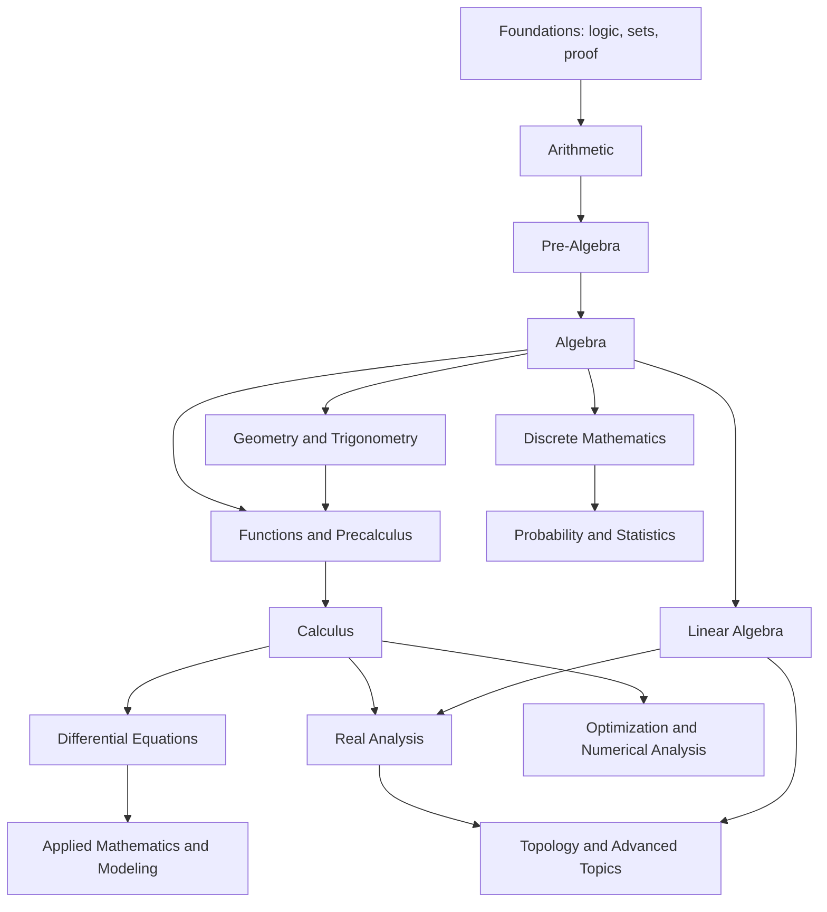

# Mathematics

**A complete, progressive curriculum — from counting to research-level mathematics.**

This repository is a self-contained mathematics education: every topic is a tutorial that explains
*why*, not just *what*; every tutorial comes with a graded problem set and complete worked
solutions; and every topic links backwards to what it needs and forwards to what it unlocks.

It is written for two readers at once:

* someone who knows **no mathematics at all** and wants to start at the beginning, and
* someone studying **advanced mathematics** who wants a rigorous, self-contained account of a
  subject — definitions, theorems, proofs, examples, counterexamples.

---

## Start here

| If you are… | Begin with | Path |
|---|---|---|
| Starting from zero | [Natural Numbers](01-arithmetic/01-natural-numbers/README.md) | [The complete path](LEARNING_PATHS.md#path-1-the-complete-path-from-zero-to-research) |
| Comfortable with arithmetic, new to algebra | [Order of Operations](02-pre-algebra/01-order-of-operations/README.md) | [Path 2](LEARNING_PATHS.md#path-2-the-algebra-and-calculus-path) |
| Learning to write proofs | [Mathematical Thinking](00-foundations/01-mathematical-thinking/README.md) | [Path 3](LEARNING_PATHS.md#path-3-the-pure-mathematics-path) |
| Heading into computer science | [Mathematical Induction](09-discrete-mathematics/01-mathematical-induction/README.md) | [Path 4](LEARNING_PATHS.md#path-4-the-discrete-mathematics-and-computer-science-path) |
| Heading into data, statistics or machine learning | [Probability Foundations](10-probability/01-probability-foundations/README.md) | [Path 5](LEARNING_PATHS.md#path-5-the-probability-statistics-and-data-path) |
| Preparing for university | [Functions](03-algebra/11-functions/README.md) | [Path 2](LEARNING_PATHS.md#path-2-the-algebra-and-calculus-path) |
| Looking for a specific subject | [Roadmap](ROADMAP.md) | Full topic inventory, with status |

If you are unsure, take the [diagnostic self-check](LEARNING_PATHS.md#where-do-i-start) in the
learning paths.

---

## The curriculum



* **[Foundations](00-foundations/README.md)** — mathematical thinking, logic, sets, proof, relations and functions
* **[Arithmetic](01-arithmetic/README.md)** — natural numbers, integers, fractions, decimals, percentages, ratios, powers
* **[Pre-Algebra](02-pre-algebra/README.md)** — order of operations, variables, factors, first equations, coordinates
* **[Algebra](03-algebra/README.md)** — linear equations, inequalities, polynomials, factoring, functions, logarithms, complex numbers
* **[Geometry](04-geometry/README.md)** — Euclidean geometry, triangles, circles, coordinates, solids, transformations, conics
* **[Trigonometry](05-trigonometry/README.md)** — trigonometric functions, the unit circle, identities, triangle trigonometry
* **[Precalculus](06-precalculus/README.md)** — function families, sequences and series, conics, the road to limits
* **[Calculus](07-calculus/README.md)** — limits, derivatives, integrals, series, multivariable and vector calculus
* **[Linear Algebra](08-linear-algebra/README.md)** — vectors, matrices, vector spaces, transformations, eigenvalues
* **[Discrete Mathematics](09-discrete-mathematics/README.md)** — induction, recurrences, algorithms, Boolean algebra
* **[Probability](10-probability/README.md)** — foundations, conditioning, random variables, distributions, limit theorems
* **[Statistics](11-statistics/README.md)** — description, estimation, testing, regression, Bayesian inference, design
* **[Number Theory](12-number-theory/README.md)** — divisibility, congruences, arithmetic functions, reciprocity
* **[Abstract Algebra](13-abstract-algebra/README.md)** — groups, rings, fields, Galois theory, modules
* **[Real Analysis](14-real-analysis/README.md)** — completeness, sequences, continuity, differentiation, integration, metric spaces
* **[Complex Analysis](15-complex-analysis/README.md)** — analytic functions, contour integration, residues, conformal maps
* **[Differential Equations](16-differential-equations/README.md)** — first-order, second-order, systems, Laplace, PDEs
* **[Topology](17-topology/README.md)** — spaces, continuity, compactness, connectedness, algebraic topology
* **[Optimization](18-optimization/README.md)** — linear programming, convexity, Lagrange multipliers, gradient methods
* **[Numerical Analysis](19-numerical-analysis/README.md)** — floating point, root finding, interpolation, quadrature
* **[Combinatorics](20-combinatorics/README.md)** — counting, inclusion-exclusion, generating functions, extremal problems
* **[Graph Theory](21-graph-theory/README.md)** — trees, connectivity, colouring, flows, spectra
* **[Mathematical Modeling](22-mathematical-modeling/README.md)** — assumptions, population and epidemic models, simulation
* **[Applied Mathematics](23-applied-mathematics/README.md)** — physics, information theory, game theory, finance, control
* **[Advanced Topics](24-advanced-topics/README.md)** — measure theory, functional analysis, category theory, geometry, computability

---

## How every topic is organised

```
04-geometry/02-triangles/
    README.md        the tutorial: definitions, intuition, proofs, worked examples
    exercises.md     30+ graded problems, in four difficulty levels
    solutions.md     a complete worked solution for every problem
```

Tutorials follow one stable structure — introduction, prerequisites, objectives, intuition, formal
definitions, notation, core concepts, formulas and properties, worked examples, visual explanations,
common mistakes, applications, exercises, solutions, summary, further learning — so that you always
know where to find what you need. The standard is documented in [CONTRIBUTING.md](CONTRIBUTING.md).

Reading conventions:

* **Intuition** is marked as such and is allowed to be informal. **Theorems** are not: every theorem
  states its hypotheses, and every proof is complete or explicitly cited.
* Every symbol is defined in the tutorial that first uses it and listed in
  [Mathematical Notation](MATHEMATICAL_NOTATION.md).
* Terms are defined once in the [Glossary](GLOSSARY.md) and linked, never re-explained under a
  different name.

---

## Reference

* [Roadmap](ROADMAP.md) — every topic, organised by discipline, with live completion status
* [Learning Paths](LEARNING_PATHS.md) — ordered routes through the curriculum, with time estimates
* [Mathematical Notation](MATHEMATICAL_NOTATION.md) — the symbols used across the repository
* [Glossary](GLOSSARY.md) — definitions of the central terms, with links to the full treatment
* [Formula reference](reference/formulas/README.md), [identities](reference/identities/README.md),
  [theorems](reference/theorems/README.md), [symbols](reference/symbols/README.md)
* [Resources](resources/textbooks.md) — books and courses worth using alongside these notes

---

## Status and quality

This is a large, deliberately ambitious project and it is built incrementally. Progress is tracked
honestly in [ROADMAP.md](ROADMAP.md):

* **Complete** — tutorial, graded exercises and full solutions, reviewed, links validated.
* **Draft** — material exists but is not finished.
* **Planned** — identified in the curriculum, not written yet.

A file existing is not completion. The repository's own tooling enforces this:

```powershell
python tools/build_indexes.py     # regenerate discipline indexes and ROADMAP from the curriculum manifest
python tools/validate_repo.py     # check every internal link, code fence, Mermaid label and solution count
```

---

## Contributing

Corrections are more valuable than additions. If a proof has a gap, an exercise is wrong, or an
explanation is unclear, that is a bug. The authoring standard, folder conventions and review
checklist are in [CONTRIBUTING.md](CONTRIBUTING.md).